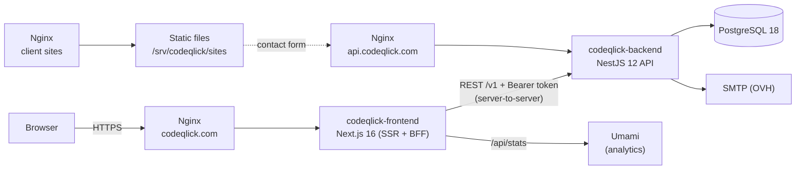
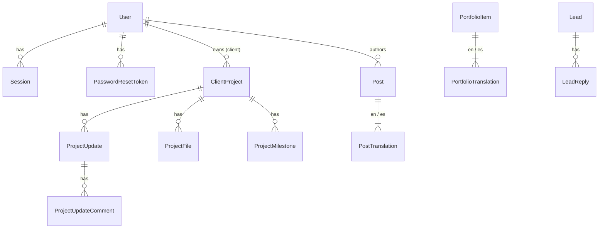
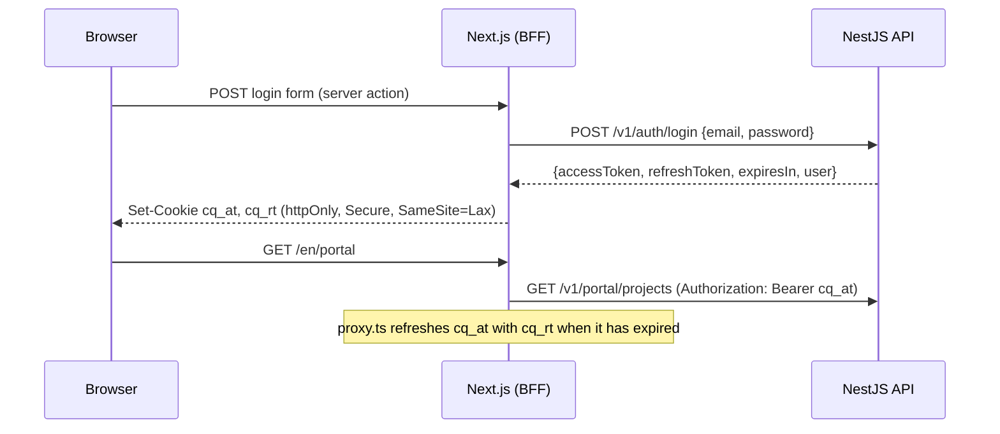

# Codeqlick — Architecture

> *Redefining information technology in society*

This document is the source of truth for how the Codeqlick platform is built. Both apps follow it; change it in the same pull request as any change that breaks it.

## 1. Overview



Two independent deployables in one repository:

| Directory | What it is | Runs on |
|---|---|---|
| `codeqlick-frontend/` | Public website (EN/ES), blog, portfolio, contact form, client portal and admin panel | Node 24, port 3000 |
| `codeqlick-sites/` | The basic-website template (`web-basica`) and the service that builds managed client sites from it | Node 24, internal port 4100 |
| `codeqlick-backend/` | REST API: auth, leads, blog, portfolio, client projects (updates, files, tasks, hours, briefs, reviews, access, monitoring), proposals, support, bookings, settings, users | Node 24, port 4000 |

Client websites hosted by Codeqlick are static sites next to them (section 8.2).

They share **no code**. The contract between them is the HTTP API (section 5), documented live with OpenAPI at `/docs` in non-production environments.

## 2. Principles

1. **The backend owns data and rules.** The frontend never talks to the database and never re-implements validation it can get from the API (it validates for UX, the API validates for truth).
2. **Backend-for-frontend (BFF).** The browser only talks to `codeqlick.com`. Next.js server components, server actions and the proxy call the API server-to-server. Tokens never reach browser JavaScript.
3. **Secure by default.** Every API route requires authentication unless explicitly marked `@Public()`. Admin routes additionally require the `ADMIN` role.
4. **Validate at the edge.** Every request body, query and param is parsed with a Zod schema (NestJS 12 Standard Schema validation). Environment variables are validated at boot; the app refuses to start with bad config.
5. **Modules by domain, layers inside.** Each backend module owns its controller (HTTP), service (use cases), repository (persistence) and schemas.
6. **Exact dependency versions.** No `^` or `~` in any `package.json`. Upgrades are deliberate pull requests.
7. **Boring infrastructure.** PostgreSQL, Docker Compose, Nginx. No managed services required to run it.

## 3. Tech stack

| Concern | Choice | Notes |
|---|---|---|
| Runtime | Node.js 24 LTS | Both apps, Docker `node:24-alpine` |
| Language | TypeScript 7.0 (API and website); 6.0 in the site template | TS 7.0 has only the `tsc` executable: the API compiles and watches with it; `astro check` still needs 6.0 (decision 19) |
| Backend framework | NestJS 12 (ESM) | `"type": "module"`, NodeNext resolution |
| Validation | Zod 4 via Standard Schema | `@Body({ schema })` + `StandardSchemaValidationPipe` |
| ORM | Prisma 7 + `@prisma/adapter-pg` | Generated client in `src/generated/prisma` |
| Database | PostgreSQL 18 | |
| Auth | JWT access token (15 min) + rotating refresh token (30 days) | Passwords hashed with Argon2id |
| API docs | `@nestjs/swagger` 12 | Zod → OpenAPI via `z.toJSONSchema` |
| Logging | `nestjs-pino` | JSON logs in production, pretty in development, request IDs |
| Rate limiting | `@nestjs/throttler` | Stricter limits on login and contact form |
| Health | `@nestjs/terminus` | `GET /v1/health` checks the database |
| Email | Nodemailer (SMTP) | Mailpit in development |
| Backend tests | Vitest + `unplugin-swc` + Supertest | |
| Frontend tests | Vitest (node) | Unit tests next to the code (`src/**/*.test.ts(x)`): helpers, form schemas and plain components rendered with `react-dom/server`. Pages and Server Actions are checked in a browser |
| Frontend framework | Next.js 16 (App Router) + React 19 | `proxy.ts` (formerly middleware) |
| i18n | `next-intl` 4 | `/en/...` and `/es/...`, English default |
| Styling | CSS Modules + design tokens | Brand tokens in `src/styles/tokens.css` |
| Fonts | `next/font/local` | Latin subset of each variable font (OFL, from Fontsource) in `src/assets/fonts`, served from our domain; neither builds nor visitors reach Google |
| Lint / format | oxlint + Prettier | Both apps |
| Browser tests | Playwright (Chromium) | `codeqlick-frontend/e2e`: public pages, the contact form, and the portal flow (client comments and approves, the team answers), against the whole stack. The E2E workflow builds it from the commit; locally they run against the Docker dev stack (`npm run test:e2e`) |
| CI | GitHub Actions | Lint, typecheck, test, build per app; E2E browser tests; deploy to the VPS once all of a commit's CI has passed |

## 4. Backend (`codeqlick-backend`)

### 4.1 Folder structure

```
src/
  main.ts                    Bootstrap: app.setup.ts (helmet, CORS, global pipe/filter, shutdown hooks), Swagger outside production
  app.module.ts              Wires all modules, global guards (throttler, JWT auth, roles)
  config/
    env.schema.ts            Zod schema for process.env
    app-config.service.ts    Typed accessors over ConfigService
  common/
    decorators/              @Public(), @Roles(), @CurrentUser()
    guards/                  JwtAuthGuard (global), RolesGuard (global)
    filters/                 ProblemDetailsFilter (RFC 9457 error bodies)
    schemas/                 Shared Zod schemas: pagination, locale, id params, slug
    types/                   AuthUser, Paginated<T>
  prisma/                    PrismaModule + PrismaService (adapter-pg, connect/disconnect)
  generated/prisma/          Prisma client output (git-ignored, created by `prisma generate`)
  modules/
    health/
    auth/                    login, refresh (rotation + reuse detection), logout, me, two-step verification, sessions
    accounts/                Client companies: `accountOf()` and the people of an account
    activity/                The activity log (who changed what)
    users/                   Admin management of admin/client accounts
    mail/                    MailService abstraction over Nodemailer; email-layout.ts renders every email as plain text plus branded HTML
    leads/                   Public contact form + admin pipeline
    posts/                   Blog (EN/ES translations)
    portfolio/               Case studies (EN/ES translations)
    projects/                Client projects + progress updates (admin writes, client reads own)
    tasks/                   Project tasks: from support requests or planned; the client sees titles and statuses; the release key reads and updates them
    time/                    Time tracking per project and maintenance plans (monthly hour allowances) (admin logs it; the client sees it when the project shows it)
    bookings/                Calls booked from the website (free slots in Madrid time, iCalendar invitations)
    calculator/              Cost calculator prices (a `settings` row)
    reviews/                 Client reviews: asked for on launch, published on the site with consent
    credentials/             Access clients share for their projects (encrypted; the team reveals, logged)
    monitoring/              Uptime monitoring of hosted client sites (checks every 5 minutes, alerts, status in the portal)
    site-forms/              Contact forms of hosted static client sites, relayed to the client's inbox
    domains/                 Client domains: availability, OVH (DNS and expiry) and renewal reminders
    managed-sites/           Managed basic websites: content, revisions, builds through site-builder
    briefs/                  The project brief questionnaire (portal form, admin view, release-key read)
    proposals/               Proposals and quotes: drafted and sent from the admin panel, accepted or declined in the portal
    support/                 Support requests: clients open and answer them in the portal, the team in the admin panel
    media/                   Image uploads (admin) stored on disk and served publicly
    saved-replies/           Reusable texts for lead replies and project comments
    stats/                   Admin dashboard numbers and the public site's visits (Umami)
prisma/
  schema.prisma
  migrations/
  seed.ts                    Creates the first admin from env vars
prisma.config.ts
test/                        e2e tests (Supertest)
```

Inside each module:

```
modules/posts/
  posts.module.ts
  posts.controller.ts          Public routes
  admin-posts.controller.ts    Admin routes (@Roles('ADMIN'))
  posts.service.ts             Use cases; throws Nest HTTP exceptions
  posts.repository.ts          The only file that touches Prisma for this domain
  posts.schemas.ts             Zod request schemas + inferred types
  posts.service.spec.ts        Unit tests with a mocked repository
```

Dependency direction: **controller → service → repository → PrismaService**. Never skip a layer, never go backwards. The `media` module has no database table: its `media.storage.ts` plays the repository's role over the file system, and `media.repository.ts` only reads which posts and case studies use an image.

### 4.2 Data model



- **User** — `email` (unique, lower-cased), `passwordHash` (Argon2id), `name`, `role` (`ADMIN` | `CLIENT`), `isActive`, `locale` (`EN` | `ES`, default `EN`: language of the emails the platform sends them), `weeklyDigest` / `lastDigestAt` (the weekly summary), `monthlyReport` (default true: the monthly website report, section 8.2), `registeredAt?` (decision 17: when the person created the account themselves or accepted the team's invitation; null for a client account the team prepared for an email — a proposal, a project — which nobody can sign in to until its owner registers with that email).
- **Client companies:** a CLIENT user with `memberOfId` is a person of the company whose main client account is `memberOf` (one level: a member can't have members, and projects and proposals must belong to a main account). The main account owns projects, requests and proposals; its active members see and act on all of them (the portal checks the caller's *account*: `accountOf(user)`, carried in the access token as `acc`), and the client emails (updates, comments, replies, status changes, proposals, weekly summary) go to the owner and every active member, each in their language. What a member writes (messages, comments, approvals) is signed with their own name, and team notifications reply to them.
- **Session** — one row per refresh token: `tokenHash` (SHA-256, unique), `familyId`, `expiresAt`, `revokedAt`, `replacedById`, `userAgent`, `ip`.
- **PasswordResetToken** — one row per "forgot my password" email or welcome email: `tokenHash` (SHA-256, unique), `expiresAt` (60 minutes for a reset, 7 days for a welcome email), `usedAt`. Asking again deletes the user's unused tokens, so only the latest link works. An unregistered client's invitation to create their account is one of these too (7 days). **SignupToken** — a self-registration waiting for its email to be confirmed: `email`, `name`, `passwordHash`, `locale`, `tokenHash` (unique), `expiresAt` (24 hours), `usedAt`.
- **Lead** — contact form submission, or a business the team added itself (`createdById?`: who; a prospect, section 8.2): `name`, `email?` (always set from the forms; a prospect may have none until the team adds it), `company?`, `projectType?` (what they need: `web`, `custom`, `mobile`, `design`, `support`, `not-sure`), `budget?` (only older leads: the form asked for a range before), `message`, `locale`, `status` (the sales process from the wiki's Client Engagement: `NEW` → `TALKING` → `CALL` → `PROPOSAL` → `WON` / `LOST`; `SPAM` is not a stage and stays off the board), `lostReason?` (`PRICE`, `NO_RESPONSE`, `NOT_A_FIT`, `CHOSE_OTHER`, `TIMING`, `OTHER`; kept only while LOST), `followUpOn?` (date), `clientId?` (the account it became), `notes?`, `siteRequest?` (JSON `{ preset, business, domain? }`: when it came from the basic-website request, which onboarding then builds the site from), and its instant preview: `previewSlug?` (unique), `previewStatus?` (`BUILDING` | `READY` | `FAILED` | `REMOVED`), `previewBuiltAt?`, `previewFollowUpAt?` (when the follow-up about it was emailed; never for a prospect) (decision 16, section 8.2), and `proposalId?` (the proposal drafted from the request, `POST /admin/leads/:id/proposal`; null again if it is deleted).
- **SitePurchase** — a request's preview bought online (section 8.2, decision 20): `leadId`, `stripeSessionId` (unique, the Stripe Checkout Session), `amountCents`, `currency` (`eur`), `status` (`PENDING` → `PAID` | `EXPIRED`), `email?` (the buyer's, from Stripe), `paidAt?`, `projectId?` (the project of the site made from it), `error?` (why the site couldn't be made on its own; the team finishes it).
- **LeadReply** — an email answer sent to a lead from the admin panel: `leadId`, `authorId?` (null once the user is deleted), `authorName` copied at the time, `subject`, `body`. Only stored once the email was accepted by the SMTP server.
- **Post / PostTranslation** — `slug` (unique), `status` (`DRAFT` | `PUBLISHED`), `publishedAt`, `coverImageUrl?`; translation per `locale` with `title`, `excerpt`, `content` (Markdown).
- **Tag / PostTag** — blog topics shared by both languages: `slug` (unique, used in `/blog?tag=`), `nameEn`, `nameEs`; `PostTag` joins posts and tags (both sides cascade, so deleting a tag just removes it from its posts). Up to 10 tags per post.
- **Scheduling (posts and case studies):** content is live when `status = PUBLISHED` and `publishedAt <= now`. A published item dated in the future is *scheduled*: the public API (lists, detail, so also the sitemap and RSS) hides it until then and it appears on its own, with no job to run, within the public pages' 5-minute revalidation. `publishedAt` is set on the first publish unless one is given; clearing it on a published item means now. The admin panel types it in Madrid time.
- **PortfolioItem / PortfolioTranslation** — same publishing model plus `clientName?`, `projectUrl?`, `technologies[]`, `services[]` (the website's service keys: web, custom, mobile, design, consulting, support), `sortOrder`, `testimonialAuthor?`; translation has `title`, `summary`, `content`, `testimonialQuote?`, `testimonialRole?`. A case study has a testimonial in a language when it has an author and a quote in that language; it is shown on the case study and on the home page.
- **ClientProject** — `clientId`, `name`, `description?`, `phase` (`DISCOVERY` | `DESIGN` | `DEVELOPMENT` | `QA` | `LAUNCHED` | `SUPPORT` | `ON_HOLD`), `progress` (0–100), `startDate?`, `dueDate?`, `stagingUrl?`, `productionUrl?`, `showHours` (the client sees the hours logged on it; off by default), and its watched domain: `domainName?`, `domainSource` (`RDAP` | `MANUAL` | `OVH`), `domainExpiresAt?` (date), `domainCheckedAt?`, `domainWarnedFor?` (`<day>:<30|7>`, the last reminder). With `RDAP` the expiry is read from the registry's RDAP server (found in IANA's bootstrap, `data.iana.org/rdap/dns.json`); TLDs without RDAP (`.es`) take a date typed by the team. A domain the team's OVH account manages (the client made it the technical contact, decision 15) switches to `OVH` on its next check: the expiry is OVH's (`GET /domain/{name}/serviceInfos`), `.es` included; one OVH stops managing goes back to `RDAP`. 30 and 7 days before it, the team inbox and every person of the client account are emailed, once each per expiry date. A managed site's own domain becomes the project's watched domain when it has none.
- **ProjectUpdate** — `title`, `body` (Markdown), `authorId`, `createdAt`, `approvalRequested` (the team asks the client to approve it), `approvedAt?`, `approvedById?`. A **release** is an update with `version`, `environment` (`STAGING` | `PRODUCTION`) and `url?`: the version deployed, where, and where to try it; posting one also sets the project's `stagingUrl` or `productionUrl` to that URL. A project may have a release key (`releaseTokenHash`, SHA-256 of `cqr_…`, and `releaseTokenCreatedAt`) for its deploy pipeline.
- **ProjectUpdateComment** — a comment on an update by the client or the team: `body` (plain text, max 5000), `authorId?`, `createdAt`. Comments by an ADMIN are shown as the team's.
- **ProjectMilestone** — a step of the project shown to the client as a timeline: `title`, `description?` (plain text, max 2000), `dueDate?`, `completedAt?` (set when the admin marks it done; null while open), `position` (order set by the admin, 0-based). The first milestone not done is the "next" one.
- **ProjectFile** — a file shared with the project's client: `name` (original name, cleaned), `contentType` (as sent by the uploader; informational), `size`, `uploadedById?`. The content is stored on disk at `UPLOADS_DIR/project-files/<id>`, never under a public URL.
- **SupportTicket** — a request a client opens from the portal: `number` (sequential, shown as `#12`), `clientId`, `projectId?` (one of the client's projects), `type` (`BUG` | `CHANGE` | `QUESTION`), `priority` (`LOW` | `NORMAL` | `HIGH` | `URGENT`), `status` (`OPEN` | `IN_PROGRESS` | `WAITING_CLIENT` | `RESOLVED` | `CLOSED`), `title`, `resolvedAt?` (set when it becomes RESOLVED or CLOSED, cleared when it is reopened).
- **TicketMessage** — the request's conversation, oldest first: `body` (plain text, max 20 000), `authorId?`. The first message is the client's description; messages by an ADMIN are shown as the team's.
- **TicketAttachment** — a file added to a support request by the client or the team: `name`, `contentType`, `size`, `uploadedById?`. Stored on disk at `UPLOADS_DIR/ticket-files/<id>`, like project files.
- **Proposal** — a proposal or quote for a client: `number` (sequential, `#7`), `clientId`, `projectId?` (one of the client's projects), `createdById?`, `title`, `summary` (Markdown: scope), `terms?` (Markdown: payment, deadlines), `currency` (`EUR`), `validUntil?` (date; last day it can be accepted, Madrid time), `status` (`DRAFT` | `SENT` | `ACCEPTED` | `DECLINED` | `WITHDRAWN`), `sentAt?`, `respondedAt?`, `acceptedName?` (the full name the client typed to accept it), `declineReason?`. Only drafts can be edited or deleted; a sent one gets a new version by duplicating it. Nothing is charged: accepting is a recorded agreement.
- **ProposalTemplate** — a starting point for new proposals ("Web básica"): `name` (unique), `title`, `summary`, `terms?`, `validDays?` (a proposal made from it is valid that many days from the day it is created), `items` (JSON `[{ description, quantity, unitPrice }]`, cents). Admin → Propuestas → Nueva offers them; any proposal can be saved as one.
- **ProposalItem** — a line of a proposal: `position`, `description`, `quantity` (whole units), `unitPrice` (cents). The total is computed, never stored.
- **UpdateDraft** — an update sent with a project's release key and waiting for the team's review: `title`, `body` (Markdown), `version?`, `environment?`, `url?`. The client never sees it; publishing creates the ProjectUpdate (a release when it has a version) from the reviewed text and deletes the draft.
- **MaintenancePlan** — a monthly hour allowance for a project (one per project): `active`, `name`, `monthlyMinutes`, `alertPercent` (default 80), `alertedMonth`/`alertedLevel`. Its time entries draw it down per Madrid calendar month; logging time that crosses the threshold or 100 % emails the team inbox, once a month per level. The client sees the use while it is active. Nothing is billed.
- **SiteForm** — the contact form of a static client site (one per project): public `key` (it goes in the site's HTML), `enabled`, `recipients` (1–5 emails), `submissions` counter, `lastSubmissionAt`. Messages are emailed, never stored. **SiteFormDay** — `formId`, `day` (Madrid), `count`: messages per day, for the visits chart.
- **ManagedSite** — a basic website built from content stored here (one per project, section 8.2): `slug` (unique: folder and preview subdomain `<slug>.<SITES_PREVIEW_DOMAIN>`), `preset` (the demo it started from; its images are usable by name), `content` (JSON: the template's `Site` type without `url`, `form` and `demo`, validated by `siteContentSchema`; uploaded photos are `media/<file>`), `domain?` (the client's own, unique; never under `SITES_PREVIEW_DOMAIN` or the platform's own domain), `domainState?` (`UNREGISTERED`: nobody has it; `ELSEWHERE`: registered but not resolving to `SITES_SERVER_IP` or not answering over HTTPS yet; `LIVE`: it serves the site — null without a domain or before its first check), `domainCheckedAt?`, `mailState?` (where the domain's email goes, from its MX records: `NONE`, `OVH` — `*.ovh.net` — or `OTHER`; checked with the domain, null while unregistered), `status` (`NONE` | `BUILDING` | `LIVE` | `FAILED`), `lastBuildAt?`, `lastBuildError?` (the end of the build log), `release?`, `reportedMonth?` (`yyyy-mm`: the last month its monthly report went out for), `umamiWebsiteId?` (its website in Umami, created on its first build when Umami is set up; the build then adds the cookieless tracker, `UMAMI_SCRIPT_URL`, and the template's privacy and cookie pages mention it). Creating one starts from the preset with the project's name and the client as legal owner, creates the project's site form when missing and sets the project's `stagingUrl` (preview) and `productionUrl` (the domain once LIVE, the preview until then). A domain is published as itself and `www.` (the builder's `domains`). Each check connects it through OVH when the team manages it: its zone's apex and `www` `A`/`AAAA`/`CNAME` records are replaced by one `A` to `SITES_SERVER_IP` unless they already point there (other records, such as MX, are never touched; each change is in the activity log). Turning LIVE rebuilds the site on the domain, turns on its uptime monitor and emails the client; a LIVE domain that still resolves here stays LIVE when HTTPS fails for a moment. Every change is built at once (`url`, `demo: false` and the form's key added); a failed build keeps the previous release online. A site may have a **draft** the client is editing (decision 18): `draftContent?` (the whole content, valid against `siteContentSchema`), `draftPreset?` (the style it starts from, when the client changed it), `draftUpdatedAt?` and `draftKey?` (random, the address of its preview: `/site-draft/<key>/`); publishing it replaces `content` (and `preset`) and clears it. **ManagedSiteRevision** — the content before each change (`authorId?`), the last 20 kept.
- **ClientReview** — the client's review of a project (one per project): `status` (`REQUESTED` | `SUBMITTED` | `PUBLISHED` | `HIDDEN`), `rating` (1–5), `quote`, `authorName`, `authorRole?`, `consent` (may go on the website), `locale` (the language it was written in), `requestedAt`, `submittedAt?`, `publishedAt?`. Asked for (email to every person of the account) when the project's phase moves to `LAUNCHED`, once, or from the project page. The team publishes it only with consent; published reviews show on the home page's testimonials, after the case studies' ones, in their own language.
- **ProjectCredential** — access a client shares for a project instead of emailing it: `label`, `url?`, `username?`, `secret` and `notes?` sealed with AES-256-GCM (key derived from `CREDENTIALS_SECRET`, purpose `project-credentials-v1`), `createdById?`, `viewedAt?`. The people of the client account add and delete theirs but never read a secret back; the team reveals one at a time (logged as `project.credential_viewed`, and the client sees when) and can delete them all at the end. Adding one emails the team inbox, never with the secret.
- **SiteMonitor / SiteCheck** — uptime monitoring of a client project's production site (`productionUrl`): `enabled`, `status` (`UNKNOWN` | `UP` | `DOWN`), `statusSince`, `failures` in a row, `lastCheckedAt`, `lastError`, `certExpiresAt` (read at most hourly), `certWarnedFor`. `MonitoringService` (API process, every 5 minutes, off in tests) requests each enabled site (up below HTTP 400 within 15 s, redirects followed) and stores a `SiteCheck` (`ok`, `statusCode`, `responseMs`, `error`; kept 90 days). Two failures in a row make it DOWN and email the team inbox; its return emails too; a certificate with under 14 days left is warned about once. The server itself (disk ≥ 85 %, memory ≥ 90 %: time for a bigger plan) is watched by `deploy/monitor/monitor.sh`.
- **ProjectBrief** — the client's questionnaire for a project (one per project): `status` (`REQUESTED` | `SUBMITTED`), `answers` (JSON by question: `business`, `goals`, `success`, `audience`, `mustHave`, `niceToHave`, `references`, `brandStatus` none/partial/complete, `brandColors`, `brandTone` formal/friendly/technical/playful, `brandAssetsUrl`, `content` client/codeqlick/both, `domain`, `services`, `deadline`, `deadlineReason`, `other`), `requestedAt`, `submittedAt?`. Created when a lead is converted (no email: the welcome email brings them in), asked for by email when a proposal with a project is accepted or from the project page. Sending needs `business`, `goals`, `audience` and `mustHave`; it can be edited and sent again.
- **ProjectTask** — work on a client project: `title`, `description?` (for the team only), `status` (`TODO` | `IN_PROGRESS` | `DONE`), `doneAt?`, `ticketId?` (the support request it came from). Turning a request into a task moves an open request to `IN_PROGRESS`; when all of a request's tasks are done it becomes `RESOLVED` (the client is emailed, as for any status change).
- **TimeEntry** — time spent on a client project: `projectId`, `userId?` (who logged it), `date` (the day, Madrid), `minutes` (1–1440), `description` (max 500). Logging and deleting entries are recorded in the activity log with the minutes.
- **Setting** — site settings edited in the admin panel, one JSON document per `key`. `calculator`: the cost calculator's prices — per project type (`web`, `custom`, `mobile`, `design`, `support`) `{ min, max, weeksMin, weeksMax }` in euros/weeks for a medium size, size factors `{ small, medium, large }`, extras (`languages`, `accounts`, `payments`, `admin`, `integrations`) `{ min, max }`, and `enabled`. An estimate is the type scaled by the size plus the extras, rounded out to hundreds; types and extras with a maximum of 0 are not offered.
- **Booking** — a video call booked from the website: `name`, `email`, `company?`, `message?`, `locale`, `startsAt`/`endsAt`, `status` (`CONFIRMED` | `CANCELLED`), `slotKey` (the start while confirmed, unique, null once cancelled: no double booking), `cancelTokenHash` (SHA-256 of the token in the visitor's cancel link), `sequence` (calendar revision), `leadId?`. Its settings are the `Setting` `booking`: `enabled`, `meetingUrl` (a fixed Google Meet link), `calendarEmail` (optional: also gets the team's invitations and cancellations, so calls land in that calendar, e.g. the owner's Gmail), `durationMinutes` (15–120, default 30), `minNoticeHours` (default 24), `horizonDays` (default 21) and `weekly` free hours per weekday in Madrid time (`[{ start: 'HH:MM', end: 'HH:MM' }]`). Free slots are those hours cut into calls, after the notice, minus confirmed calls. Booking moves the open lead with that email to `CALL` (or starts one there) with the call's day as follow-up; both sides are emailed an iCalendar invitation (`METHOD:REQUEST`; cancellations send `METHOD:CANCEL` with a higher `SEQUENCE`).
- **SavedReply** — a reusable text for lead replies and project comments: `title` (only the admin sees it) and `body`. The admin panel puts `{name}` (lead or client) and `{project}` in when it inserts the text.
- **ActivityLog** — who changed what: `actorId?` (null once the user is deleted) and `actorName` copied at the time, `action` (`<target>.<verb>`, e.g. `post.published`), `targetType`, `targetId?`, `targetLabel?` (title, name or email at the time), `details?` (JSON: what changed, e.g. `{ phase, progress }`). Written by the services after each admin change and each change to one's own account (password, two-step verification, signing out devices); a failed write is logged and never fails the change.

All ids are UUIDs. All tables have `createdAt`/`updatedAt`. `Locale` is an enum `EN` | `ES`; the HTTP API uses lowercase `en` | `es`.

### 4.3 Authentication



- **Access token:** JWT (HS256), 15 minutes, claims `sub`, `role`, `email`, `name` and `sid` (the session's `familyId`, which marks the current device in the sessions list).
- **Refresh token:** 48 random bytes, base64url, 30 days. Only its SHA-256 hash is stored. Each refresh **rotates** the token (old one revoked, `replacedById` set). Presenting an already-rotated token is treated as theft: the whole `familyId` is revoked.
- **Logout** revokes the current session.
- **Two-step verification required for admins** (`ADMIN_TWO_FACTOR_REQUIRED`, true in production): `RolesGuard` refuses admin routes with 403 `Two-step verification is required for admin accounts` while the admin's account has no TOTP (read from the database, so turning it on takes effect at once). Account routes (`/auth/*`) carry no `@Roles`, so the setup still works. `GET /auth/2fa` reports `required`, and turning it off is refused (409). The admin layout then shows only the account page with a notice, and `apiFetch` sends that 403 to it.
- **Sessions list:** a session (device) is a `familyId`; its live row (the latest rotation) gives the browser, the IP and the last activity. Signing a device out revokes its family; it stays in until its access token expires (15 minutes at most). A refresh token whose row was revoked without a replacement (signed out) is rejected without the reuse alarm.
- **Cleanup:** sessions and password reset tokens are deleted 30 days after they expire (the API checks twice a day). The 30 days keep reuse detection working for a rotated token that comes back shortly after expiring.
- **Brute force:** login is limited to 5 attempts per minute per IP; the service runs an Argon2 verify even when the email doesn't exist, so timing doesn't reveal accounts.
- Deactivating a user (`isActive=false`) revokes all their sessions.
- **Two-step verification (optional, per user):** an RFC 6238 authenticator app (TOTP, SHA-1, 30 s, 6 digits, ±1 step). With it on, a correct password returns `{ twoFactorRequired, challengeToken }` instead of tokens; the challenge is a 5-minute JWT signed with its own key (so it never passes as an access token) and the web app keeps it in the httpOnly cookie `cq_2fa` until the code is entered at `/[locale]/login/verify`. The secret is stored encrypted (AES-256-GCM, key derived from `JWT_ACCESS_SECRET`: rotating that secret means setting two-step verification up again). An accepted time step can't be reused. Ten single-use recovery codes (`xxxx-xxxx`, stored as SHA-256) replace the app when the phone is lost.

### 4.4 Errors

All errors use RFC 9457 *problem details* with `Content-Type: application/problem+json`:

```json
{ "type": "about:blank", "title": "Bad Request", "status": 400, "detail": "Validation failed", "instance": "/v1/leads", "errors": [{ "path": "email", "message": "Invalid email" }], "requestId": "…" }
```

Unknown errors return 500 without leaking internals; the stack goes to the logs with the request id.

### 4.5 Configuration (environment)

| Variable | Example | Notes |
|---|---|---|
| `NODE_ENV` | `production` | `development` \| `test` \| `production` |
| `PORT` | `4000` | |
| `DATABASE_URL` | `postgresql://codeqlick:…@localhost:5432/codeqlick` | |
| `CORS_ORIGINS` | `https://codeqlick.com` | Comma-separated |
| `SITE_URL` | `https://codeqlick.com` | Public URL of the website, for links in emails and the email logo (`/email/logo.png`, served by the frontend) |
| `JWT_ACCESS_SECRET` | 64+ random chars | Required, min 32 |
| `CREDENTIALS_SECRET` | 64+ random chars | Encrypts the access clients share for their projects (AES-256-GCM). Required in production (`docker-compose.prod.yml`); in development it falls back to `JWT_ACCESS_SECRET`. Changing it makes stored access unreadable |
| `JWT_ACCESS_TTL` | `900` | Seconds |
| `REFRESH_TOKEN_TTL_DAYS` | `30` | |
| `SMTP_HOST` / `SMTP_PORT` / `SMTP_SECURE` / `SMTP_USER` / `SMTP_PASSWORD` | OVH SMTP | |
| `MAIL_FROM` | `Codeqlick <hello@codeqlick.com>` | |
| `LEADS_NOTIFY_TO` | `hello@codeqlick.com` | Where new leads are emailed |
| `UPLOADS_DIR` | `./uploads` | Folder for uploaded images (a Docker volume in production) |
| `SITE_BUILDER_URL` / `SITE_BUILDER_TOKEN` | `http://site-builder:4100` | The site builder (section 8.2); without them managed sites answer 503 |
| `SITES_PREVIEW_DOMAIN` | `demo.codeqlick.com` | Managed sites are previewed at `<slug>.<this>` |
| `PUBLIC_API_URL` | `https://api.codeqlick.com/v1` | The API as browsers reach it: managed sites' forms post to `<this>/forms/:key` |
| `SITES_SERVER_IP` | `54.37.159.171` | The server's public IPv4: managed sites' domains must resolve here to be LIVE, and OVH zones point here |
| `OVH_ENDPOINT` / `OVH_APPLICATION_KEY` / `OVH_APPLICATION_SECRET` / `OVH_CONSUMER_KEY` | `https://eu.api.ovh.com/1.0` | OVH's API with the team's keys (rights in `deploy/README.md`), for availability and the domains whose technical contact is the team; off without the three keys. Requests are signed (`$1$` + SHA-1 of secret, consumer key, method, URL, body and OVH's time); no SDK |
| `OVH_NIC_HANDLE` | `ab12345-ovh` | The team's OVH account ID, shown to clients as the technical contact to add |
| `ADMIN_TWO_FACTOR_REQUIRED` | `true` | Admins must have two-step verification to use admin routes (true in production) |
| `UMAMI_URL` / `UMAMI_WEBSITE_ID` / `UMAMI_USERNAME` / `UMAMI_PASSWORD` | `http://umami:3000` | Umami's API inside the Docker network, for the dashboard's visits (`/admin/stats/visits`) and the managed sites' statistics (their websites are created with this account); off without them |
| `UMAMI_SCRIPT_URL` | `https://stats.codeqlick.com/script.js` | The tracker managed client sites load |
| `STRIPE_SECRET_KEY` / `STRIPE_WEBHOOK_SECRET` | `sk_live_…` / `whsec_…` | Buying a preview online (section 8.2, decision 20); off without both. Test keys (`sk_test_…`) in development |
| `SITE_PRICE_CENTS` | `20000` | Price of a basic website bought online, in euro cents (default 200 €) |
| `SEED_ADMIN_EMAIL` / `SEED_ADMIN_PASSWORD` / `SEED_ADMIN_NAME` | | Only used by `prisma db seed` |
| `LOG_LEVEL` | `info` | |

### 4.6 Background work

Scheduled work runs inside the API process (timers that start on boot, off when `NODE_ENV=test`); nothing else needs a scheduler:

- **Uptime monitoring** of client sites every 5 minutes (`MonitoringService`, see SiteMonitor).
- **Session and reset-token cleanup** twice a day (`TokenCleanupService`).
- **Domain renewal** every 6 hours (`DomainsService`): expiry dates older than a day are refreshed (OVH or RDAP) and the reminders due are sent.
- **Request previews** every 6 hours (`SitePreviewsService`): previews older than 30 days, or of converted or spam leads, are taken down, and the follow-ups due are sent (section 8.2).
- **Monthly website report** (clients): `SiteReportsService` checks every hour and, from the 1st at 09:00 Madrid time, sends last month's report of each managed site whose `reportedMonth` is older (section 8.2). Off in tests.
- **Managed sites' domains** every 10 minutes (`SiteDomainsService`): each domain not yet LIVE (and every LIVE one after 6 hours) is connected through OVH when the team manages it and its state checked (see ManagedSite).
- **Weekly summary** (clients): `WeeklyDigestService` checks every hour, in the API process. It sends this week's summary to every active client with `weeklyDigest` whose `lastDigestAt` is before this week's Monday 08:00 Madrid time, so a restart or a missed Monday neither skips nor repeats it. For each project the email lists the updates and completed milestones of the last 7 days, updates waiting for approval and the next milestone. A week with nothing to tell sends nothing, but still counts as done. Clients turn it off in their account (`PATCH /auth/preferences`) and admins on the user page, which also has a "send now" button (`POST /admin/projects/weekly-digest/:clientId` → `{ sent }`, or `{ sent: false, reason: 'no-news' }`). Off in tests.
- **Scheduled posts and case studies** need no job: they are hidden until their `publishedAt` (see Scheduling).

On the host, `deploy/monitor/monitor.sh` (cron, every 5 minutes) watches the server and the stack, and the `backup` container dumps the database daily (section 8).

## 5. API contract (v1)

Base URL: `https://api.codeqlick.com/v1`. JSON in and out. Dates are ISO 8601 strings. Lists are paginated:

```json
{ "items": [ … ], "page": 1, "pageSize": 20, "total": 57, "totalPages": 3 }
```

Query params for lists: `page` (default 1), `pageSize` (default 20, max 100).

### Public

| Method | Path | Body / query | Response |
|---|---|---|---|
| GET | `/health` | | Terminus health result |
| POST | `/leads` | `{ name, email, company?, projectType?, message, locale, website? }` (`projectType`: web, custom, mobile, design, support or not-sure; `budget?` is still accepted from older pages) (`website` is a honeypot and must be empty) | `201 { id }` — limited to 5/min/IP |
| GET | `/posts` | `?locale=en&page&pageSize&tag&q` | Paginated `PostSummary` (published only). `q` (max 100 characters) keeps posts whose title, excerpt or content contains it in the requested locale or English, ignoring case and accents (Postgres `unaccent`); `%` and `_` are literal |
| GET | `/posts/tags` | `?locale=en` → `[{ slug, name, count }]`: tags used by live posts, named in `locale`, by name |
| GET | `/posts/:slug/related` | `?locale=en&limit=3` (1–6) → `PostSummary[]`: live posts sharing the most tags, newest first among equals, topped up with the latest posts |
| GET | `/posts/:slug` | `?locale=en` | `PostDetail` or 404 |
| GET | `/portfolio` | `?locale=en&page&pageSize&testimonials=true&technology&service` | Paginated `PortfolioSummary` (published only, by `sortOrder`); `testimonials=true` keeps those with a testimonial in `locale`; `technology` (exact name) and `service` (key) filter and combine |
| GET | `/portfolio/filters` | — | `{ technologies: { name, count }[], services: { key, count }[] }` over published case studies, for the list's filter chips |
| GET | `/portfolio/:slug` | `?locale=en` | `PortfolioDetail` or 404 |
| GET | `/brief` | `Authorization: Bearer <release key>` → the key's project's brief (`{ project: { id, name }, status, answers, ... }`) | |
| GET / POST | `/tasks` | `Authorization: Bearer <release key>`. GET `?status=TODO|IN_PROGRESS|DONE|open` → the key's project's `ProjectTask[]` (open first: in progress, to do; then done). POST `{ title, description? }` → `201` task | |
| PATCH | `/tasks/:taskId` | Release key + `{ title?, description?, status? }` → task; `DONE` may resolve its request. Limited to 60/min/IP | |
| GET | `/bookings/slots` | `{ durationMinutes, timeZone: 'Europe/Madrid', slots: string[] }` (ISO instants); `404` until published | |
| GET | `/reviews` | `?locale=en&limit=6` (1–12) → published reviews written in that language (`{ quote, author, role, rating }`), newest first | |
| POST | `/bookings` | `{ name, email, company?, message?, locale, startsAt, website? }` (`website`: honeypot) | `201 { id, startsAt, meetingUrl }`; `409` when the time isn't free (any more). Emails the visitor (their language, Meet link, cancel link, invitation) and the team inbox (invitation, reply-to the visitor) — limited to 5/min/IP |
| POST | `/bookings/cancel` | `{ token }` (from the visitor's email) | `200 { startsAt }`; `404` for an unknown or already cancelled call. Emails the team |
| POST | `/forms/:key` | A client site's contact form: `{ name, email, phone?, message, website? (honeypot), redirect? }`, urlencoded (a plain HTML form) or JSON | Emails the project's `recipients` (Spanish, reply-to the visitor). A form post is answered `303` to `redirect` or the `Referer` with `form=ok` / `form=error` added, only when that URL is on the project's production or staging origin (else a short page); JSON gets `{ ok }`. `403` when `Origin` is another site; `404` for an unknown or disabled key — limited to 5/min/IP |
| GET | `/domains/availability?name=` | A label (`peluqueria-ana`, accents and spaces become dashes) or a domain | `{ results: [{ domain, available: true \| false \| null }] }`: a label in `.com`, `.es` and `.eu`; a domain first, then its label in the other two. OVH's order API answers when its keys are set; otherwise RDAP (404 free, 200 taken; `null` when unknown, e.g. `.es`). Cached 10 min, 400 without a usable label, limited to 20/min/IP |
| POST | `/site-requests` | The basic-website request: `{ preset, business: { name, kind, city, address?, phone?, whatsapp?, email?, hours? (a line per slot, "Days: hours"), services? (a line each, "Service — price"), about?, wishes? (what they want on the website, in their words) }, domain?: { name, owned }, name, email, locale, website? (honeypot) }` | `201 { id, previewUrl? }`: a lead (`projectType: web`, `company` = the business, the message a readable summary with the link to the preview's waiting page) keeping `siteRequest` (with the domain they want, `owned: false`, or have); onboarding pre-fills the site's domain with it; the usual lead emails. No photos (decision 13). Limited to 3/min/IP. Onboarding with that lead fills the site from it: business name and tagline, contact, address, hours, services and about, `schemaType: LocalBusiness`; the preset's made-up services, reviews and facts are dropped |
| GET | `/site-requests/previews/:slug` | Public: whether a request's preview is online → `{ status, url, business, purchase }`; `purchase` is `{ priceCents, currency, available }` while buying online is on (`available`: READY, not bought, not a client yet), else null. 404 when there is none. Limited to 30/min/IP |
| POST | `/site-requests/previews/:slug/checkout` | Public: `{ locale, accept: true }` (the terms and starting at once) → `{ url }`, a Stripe Checkout Session to pay the website (section 8.2). 404 while buying online is off or without a preview; 409 when it isn't READY, was bought or its lead is a client. Limited to 5/min/IP |
| GET | `/site-requests/purchases/:sessionId` | Public: how a purchase is going, for the page Stripe returns to → `{ status, business, siteUrl? }` (`siteUrl` once its site exists); 404 when unknown |
| POST | `/payments/stripe` | Stripe's webhook (raw body, `Stripe-Signature` checked with `STRIPE_WEBHOOK_SECRET`, else 400): a paid `checkout.session.completed` or `checkout.session.async_payment_succeeded` marks the purchase PAID and makes the site; `checkout.session.expired` marks it EXPIRED. Answers 200 to anything else |
| GET | `/calculator` | The calculator's prices (`Setting` `calculator`) once published; `404` until then | |
| POST | `/drafts` | `Authorization: Bearer <release key>` + `{ title, body, version?, environment? (required with a version), url? }` | `201 UpdateDraft` (`{ id, project: { id, name }, title, body, version, environment, url, createdAt }`); the team inbox is emailed a link to review it. Same key rules and limit as `/releases` |
| POST | `/releases` | `Authorization: Bearer <release key>` + the body of `POST /admin/projects/:id/releases` | `201` release on the key's project, posted as "Despliegue automático" (shown as Codeqlick); `401` for a missing, unknown or revoked key — limited to 20/min/IP. For deploy pipelines: see below |
| GET | `/media/:filename` | | The uploaded image, cacheable forever (names are never reused); 404 otherwise |
| POST | `/auth/login` | `{ email, password }` | `200 AuthTokens`, or `200 { twoFactorRequired: true, challengeToken }` when two-step verification is on — limited to 5/min/IP |
| POST | `/auth/2fa/verify` | `{ challengeToken, code }` (authenticator or recovery code) | `200 AuthTokens`; `401` for a wrong code or an expired challenge — limited to 5/min/IP |
| POST | `/auth/refresh` | `{ refreshToken }` | `200 AuthTokens` |
| POST | `/auth/password-reset/request` | `{ email, locale }` | `202` always, whether or not the account exists. An active account is emailed a link to `SITE_URL/{locale}/reset-password?token=…`, or, when it was never registered, the invitation to create it — limited to 5/min/IP |
| POST | `/auth/register` | `{ name, email, password, locale, acceptPrivacy: true, website? (honeypot) }` | `202` always (it never says whether the email has an account). An email without a registered account is emailed a link to `SITE_URL/{locale}/register/confirm?token=…` (24 hours); one with a registered account is emailed that it already has one, with links to sign in and reset the password — limited to 3/min/IP |
| POST | `/auth/register/confirm` | `{ token }` | `200 AuthTokens`: the account is created (role CLIENT) or, when the team had prepared one for that email, it becomes theirs with the name and password they chose; signed in at once. `400` when the token is unknown, used or expired — limited to 5/min/IP |
| GET | `/auth/register/invitation?token=…` | | `{ email, name }` of the invitation (to fill in the form); `400` when invalid or expired |
| POST | `/auth/register/invitation` | `{ token, name, password, locale, acceptPrivacy: true }` | `200 AuthTokens`: the invitation's link proves the email, so the account is theirs at once — limited to 5/min/IP |
| POST | `/auth/password-reset/confirm` | `{ token, newPassword }` | `204`: password set, token spent, every session of the user revoked. `400` when the token is unknown, used or expired — limited to 5/min/IP |

### Authenticated (any role)

| Method | Path | Response |
|---|---|---|
| POST | `/auth/logout` | `{ refreshToken }` → `204` |
| GET | `/auth/me` | `AuthUser` |
| GET / PATCH | `/auth/preferences` | `{ weeklyDigest, monthlyReport }` / either of them → the preferences |
| GET | `/auth/2fa` | `{ enabled, recoveryCodesLeft }` |
| POST | `/auth/2fa/setup` | `{ secret, otpauthUrl }`: a new secret, pending until confirmed; `409` when already on |
| POST | `/auth/2fa/enable` | `{ code }` → `{ recoveryCodes }` (shown once); `400` for a wrong code — limited to 5/min/IP |
| POST | `/auth/2fa/disable` | `{ password, code }` → `204`; `400` with a field error for a wrong password or code — limited to 5/min/IP |
| GET | `/auth/sessions` | `ActiveSession[]`: `{ id, userAgent, ip, lastActiveAt, current }`, one per signed-in device, most recent first (`id` is the family id) |
| DELETE | `/auth/sessions/:id` | `204`: signs that device out; `404` when it isn't the caller's or has already ended |
| POST | `/auth/sessions/revoke-others` | `{ refreshToken }` → `204`: signs out every device except the one owning `refreshToken` |
| POST | `/auth/password` | `{ currentPassword, newPassword, refreshToken }` → `204`. Revokes the caller's other sessions; the one owning `refreshToken` stays signed in. `400` with a field error when `currentPassword` is wrong or `newPassword` (min 12 chars) equals it — limited to 5/min/IP |

### Client portal (role `CLIENT`; admins may also call)

| Method | Path | Response |
|---|---|---|
| GET | `/portal/projects` | `ClientProject[]` owned by the caller |
| GET | `/portal/projects/:id` | `ClientProject` with `updates[]` and `files[]` (`{ id, name, contentType, size, createdAt }`), newest first, and `milestones[]` (`{ id, title, description, dueDate, completedAt }`) in the admin's order; 404 if not the caller's |
| POST | `/portal/projects/:id/updates/:updateId/comments` | `{ body }` → `201 UpdateComment` (`{ id, body, createdAt, author: { name, team } }`). A client's comment emails the team inbox (`LEADS_NOTIFY_TO`, reply-to the client) |
| POST | `/portal/projects/:id/updates/:updateId/approval` | Role CLIENT only (403 for admins) → `ProjectUpdate` with `approvedAt`; 400 when the update doesn't ask for approval; approving again keeps the first approval. Emails the team inbox |
| GET / PUT | `/portal/projects/:id/brief` | `{ status: 'NONE' | 'REQUESTED' | 'SUBMITTED', answers, requestedAt, submittedAt, updatedAt }` / `{ answers, submit? }`: saves; with `submit`, sends it (400 listing `answers.<key>` when an essential one is missing) and emails the team inbox |
| GET / PUT | `/portal/projects/:id/review` | The review (`status: 'NONE'` when not asked for) / `{ rating, quote, authorName, authorRole?, consent, locale }` (400 when not asked for); emails the team inbox. Sending again puts a published one back to review |
| GET / POST | `/portal/projects/:id/credentials` | List (`{ id, label, url, username, createdBy: { name }, createdAt, viewedAt }`, never the secret) / `{ label, url?, username?, secret, notes? }` → `201` |
| DELETE | `/portal/projects/:id/credentials/:credentialId` | `204` |
| GET | `/portal/projects/:id/status` | `SiteMonitor` view (`{ status, statusSince, uptime30, days: [{ day, checks, ratio }] (30 Madrid days), certExpiresAt, lastCheckedAt, ... }`); 404 unless the project is the caller's and monitored |
| GET / PUT | `/portal/projects/:id/site` | The client's managed website: `{ status, preset, url, previewUrl, domain: { name, state, checkedAt, mail, nicHandle, serverIp }, lastBuildAt, businessName, colors: { primary, primaryText }, editable }` (`nicHandle` and `serverIp` are what the client sets at their registrar), `editable` being what they may change (`tagline`, `contact` — with `reviewUrl`, the Google review link of section 8.2 —, `hours`, `hero: { title, text }`, `services`, `about: { title, paragraphs }`, `gallery`, `testimonials`; brand, theme and legal data stay with the team) / `{ site: editable }` → merged into the content, validated as a whole (400 with the field in the message), saved as a change by the client (a revision) and published; the team inbox is emailed what changed (or that publishing failed). Changing the hours drops the machine-readable `openingHoursSpec`. 404 unless the project is the caller's and has a managed site. Limited to 30/hour |
| PUT | `/portal/projects/:id/site/domain` | `{ name: string \| null }` → the site: the client chooses, changes or drops their own domain; it is rebuilt and the domain checked right away. 400 for a Codeqlick domain, 409 when another site uses it. Limited to 10/hour |
| GET / PUT / DELETE | `/portal/projects/:id/site/draft` | The website editor (section 8.2): `{ content, preset, presets: [{ key, theme, images }], published: { content, preset }, draft: { updatedAt, previewUrl, previewStatus } \| null }` (`content`/`preset`: the draft's, or the published ones without a draft) / `{ content, preset?, rebuild? }` → the same: saved as the draft (400 with every issue as `{ path, message }`, nothing saved), its preview built when `rebuild` (or when there was none) / `204`: the draft is discarded and its preview deleted. Limited to 600/hour |
| POST | `/portal/projects/:id/site/draft/publish` | The draft becomes the site's content (a revision of the previous one) and is published; the team inbox is emailed what changed. 409 without a draft. Limited to 30/hour |
| POST | `/portal/projects/:id/site/draft/style` | `{ preset }` → the editor view: the draft takes that style's colours, fonts, corners, section order and photos (uploaded photos stay), keeping every text |
| GET | `/site-drafts/:key/*` | Public (the key is the secret): a file of the draft's preview, streamed from the builder; 404 when it doesn't exist or was discarded |
| POST | `/portal/projects/:id/site/images` | Multipart `file` (JPEG, PNG or WebP, 5 MB) → `201 { file: 'media/<name>', url }`, stored with the uploaded images (an image a managed site uses counts as used in the media library). Limited to 20/hour |
| GET | `/portal/projects/:id/visits` | `?days=7\|30\|90` (default 30) → `{ enabled, available, days, visitors, pageviews, messages, daily: [{ date, visitors, pageviews, messages }], referrers: [{ source, visitors }] (5) }`: the managed site's numbers from Umami and its form's messages; `enabled: false` until it has statistics. Also `GET /admin/projects/:id/visits`. 404 without a managed site of the caller's |
| GET | `/portal/projects/:id/tasks` | The project's tasks without `description` (`{ id, title, status, ticket, doneAt, createdAt, updatedAt }`) |
| GET | `/portal/projects/:id/plan` | `{ active, name, monthlyMinutes, alertPercent, month, usedMinutes, remainingMinutes, percent, months: [{ month, minutes }] (4, newest first) }`; 404 unless the project is the caller's and the plan is active |
| GET | `/portal/projects/:id/time` | `ProjectTime` (`{ totalMinutes, months: [{ month: 'yyyy-mm', minutes }], entries: TimeEntry[] }`, newest first); 404 unless the project is the caller's and has `showHours` |
| GET | `/portal/projects/:id/files/:fileId` | The file, always as `application/octet-stream` with `Content-Disposition: attachment` (UTF-8 name); 404 if the project isn't the caller's |
| GET | `/portal/proposals` | `?status&page&pageSize` → `Paginated<Proposal>` of the caller's proposals, drafts left out |
| GET | `/portal/proposals/:id` | `Proposal`; 404 for a draft or someone else's |
| POST | `/portal/proposals/:id/accept` | Role CLIENT only (403 for admins). `{ name }` → `Proposal` `ACCEPTED`; 409 unless `SENT` and not expired. Emails the team inbox |
| POST | `/portal/proposals/:id/decline` | Role CLIENT only. `{ reason? }` → `Proposal` `DECLINED`; 409 unless `SENT`. Emails the team inbox |
| GET / POST | `/portal/tickets` | GET `?page&pageSize` → `Paginated<Ticket>` of the caller's requests, latest activity first. POST (role CLIENT only) `{ type, priority?, title, body, projectId? }` → `201 TicketDetail`; 400 when `projectId` isn't one of the caller's projects. Emails the team inbox (`LEADS_NOTIFY_TO`, reply-to the client) |
| GET | `/portal/tickets/:id` | `TicketDetail`; 404 if it isn't the caller's |
| POST | `/portal/tickets/:id/messages` | `{ body }` → `TicketDetail`. A request `WAITING_CLIENT` or `RESOLVED` goes back to `IN_PROGRESS`; 409 when it is `CLOSED`. Emails the team inbox |
| POST | `/portal/tickets/:id/close` | → `TicketDetail` with status `CLOSED` (no more replies) |
| POST | `/portal/tickets/:id/files` | Multipart, one `file` field, up to 25 MB; the request's client or an admin → `201 TicketDetail`; 409 when `CLOSED`. A client's file emails the team inbox |
| GET | `/portal/tickets/:id/files/:fileId` | The file, always as `application/octet-stream` attachment; 404 if the request isn't the caller's (admins may read any) |

### Admin (role `ADMIN`)

| Method | Path | Body / query |
|---|---|---|
| GET | `/admin/stats` | `{ leads: { new, total, lostReasons }, posts: { published, drafts, scheduled }, portfolio: { published }, projects: { active }, clients, support: { active }, proposals: { sent }, drafts: { pending }, bookings: { upcoming } }` (`support.active`: requests not resolved or closed; `proposals.sent`: waiting for the client's answer) |
| GET | `/admin/stats/timeline` | `?months=12` (1–36) → `{ months: [{ month: 'yyyy-mm', leads, leadsWon, posts, caseStudies }] }`: oldest first, every month present; leads by the month they came in, posts and case studies by the month they went live; months in Madrid time |
| GET / POST | `/admin/proposals` | GET `?status&clientId&page&pageSize` → `Paginated<Proposal>`, latest activity first. POST `{ clientId, projectId?, title, summary, terms?, validUntil?, items: [{ description, quantity, unitPrice }] }` (1–100 items, cents) → `201 Proposal` `DRAFT` |
| GET / PUT / DELETE | `/admin/proposals/:id` | `Proposal` / the same body without `clientId` (drafts only; items replaced) / `204` (drafts only); 409 otherwise |
| POST | `/admin/proposals/:id/send` | Draft → `SENT`; emails the client in their language with a link to `SITE_URL/{locale}/portal/proposals/:id` → `Proposal & { clientNotified }`; 400 when `validUntil` has passed |
| POST | `/admin/proposals/:id/withdraw` | `SENT` → `WITHDRAWN` |
| POST | `/admin/proposals/:id/duplicate` | `201 Proposal`: a new draft with the same content (no valid-until date) |
| POST | `/admin/proposals/:id/template` | `{ name }` → the template made from the proposal (replaces one with the same name; `validUntil` becomes `validDays`) |
| GET / POST | `/admin/proposal-templates` | `ProposalTemplate[]` by name / `{ name, title, summary, terms?, validDays? (1–365), items }` → the template (replaces one with the same name) |
| PUT / DELETE | `/admin/proposal-templates/:id` | The same body → the template (409 when the name is another's) / `204` |
| GET | `/admin/projects/:id/review` | The review |
| POST | `/admin/projects/:id/review/request` | Asks for it (once per project) |
| PUT | `/admin/projects/:id/review/status` | `{ status: 'PUBLISHED' | 'HIDDEN' }`; 400 publishing without consent |
| POST | `/admin/projects/:id/credentials/:credentialId/reveal` | `{ secret, notes }`; logged, and `viewedAt` is set |
| DELETE | `/admin/projects/:id/credentials` | Deletes all of the project's access → `{ deleted }` |
| GET | `/admin/monitoring` | Every monitor's view |
| GET / PUT | `/admin/projects/:id/monitor` | The view (or `{ enabled: false }`) / `{ enabled }` (400 without a production URL; enabling checks at once) |
| POST | `/admin/projects/:id/monitor/check` | Checks now (certificate included) → the view |
| POST | `/admin/sites/onboard` | `{ name, email, locale? (es), businessName, slug, preset, domain?, leadId? }` → `201 { projectId, client: { id, created, invitationSent? }, site, monitoring }`: a basic-website client in one step. With `leadId` the lead is converted (as `/admin/leads/:id/convert`: account, project, brief, WON); otherwise the account is found or created (welcome email) and a project opened in DESIGN. Then the managed site from the preset (form and first build included) and, without a domain of its own, the uptime monitor (a client domain may lack DNS yet). A taken name or domain is refused (409) before anything is created |
| POST | `/admin/leads/:id/proposal` | Only leads with a `siteRequest`: reuses the email's client account or prepares an unregistered one (no email), drafts a proposal for it from the request (section 8.2), links it as the lead's `proposalId` and moves the lead to `PROPOSAL` → `201 { proposalId, client: { id, created, invitationSent? } }`; `400` without a request, `409` while the lead already has one |
| POST | `/admin/projects/:id/site/report` | Sends last month's website report of the project's site now (section 8.2), whatever the day and whether or not it went out → `{ sent: number }` (the people emailed; 0 when all opted out); `404` without a managed site |
| DELETE | `/admin/leads/:id/preview` | Takes the request's preview down → `{ status: 'REMOVED' \| null }` (`null`: it had none). Lead views carry `preview: { url, status, builtAt } \| null` and `prospect` (added by the team) |
| POST | `/admin/leads/:id/preview` | (Re)builds the lead's preview from its `siteRequest` → `{ status: 'BUILDING' }`: on its slug while it is up, on a new one when it was removed or never built (then it counts toward the daily cap: 429 past it). Nobody is emailed. 400 without a `siteRequest`, 503 without a builder |
| PUT | `/admin/leads/:id/request` | `{ preset, business, domain? }` (the request's own schema) → the lead: replaces its `siteRequest` (and the `message` summary) and rebuilds its preview as above |
| GET | `/admin/previews` | Every lead with a preview, newest first: `{ leadId, name, email, business, preset, slug, url, status, builtAt, createdAt, prospect, purchased }[]` (up to 200; `purchased`: bought online) |
| GET | `/admin/leads/:id/purchases` | The lead's online purchases of its preview, newest first (section 8.2, decision 20): `{ id, status, business, siteUrl, delayed, stripeSessionId, amountCents, currency, email, paidAt, projectId, error, createdAt }[]` |
| POST | `/admin/previews` | `{ preset, business, domain?, name?, email?, locale? }` → `201 { leadId }`: a prospect (section 8.2): a lead `createdById` the caller, status `NEW`, with its `siteRequest` and its preview building (`name` defaults to the business). 429 past the daily cap and 503 without a builder, creating nothing |
| DELETE | `/admin/projects/:id/site` | → `204`: takes the managed site down (section 8.2): the builder marks it for removal (the host unpublishes its domains and folder), the project's monitor is turned off, its preview and live addresses are cleared and the site and its revisions are deleted. Its photos stay in the media library and its form keeps working until removed. `project.site_deleted` in the activity log. Deleting a project does this first |
| GET | `/admin/sites` | Every managed site (`SiteView`: `{ projectId, project, client, slug, preset, domain, previewUrl, url, status, lastBuildAt, lastBuildError, release, content, updatedAt }`), newest first |
| GET / POST / PATCH | `/admin/projects/:id/site` | The site (or `{ exists: false }`) / `{ slug, preset: 'peluqueria' \| 'restaurante' \| 'fisioterapia' \| 'portfolio' \| 'despacho' \| 'comercio' \| 'reformas' \| 'general', domain? }` (a preset's name is reserved for its demo) → `201` site, built (409 when the project has one or the name or domain is taken) / `{ domain: string \| null }` → the site, rebuilt (a new domain starts unchecked and is checked right after). `SiteView` has `domainState` and `domainCheckedAt`. `503` when the builder isn't configured or doesn't answer |
| POST | `/admin/projects/:id/site/domain/check` | Checks the site's domain now (connecting it through OVH when it can) → the site |
| PUT | `/admin/projects/:id/site/content` | `{ content }` (the whole content; 400 with the path in the message) → the site, rebuilt; the previous content becomes a revision |
| POST | `/admin/projects/:id/site/build` | Builds the current content again → the site |
| GET | `/admin/projects/:id/site/revisions` | `[{ id, createdAt, author: { name } \| null }]`, newest first |
| POST | `/admin/projects/:id/site/revisions/:revisionId/restore` | Puts that content back (itself a change, so the current one becomes a revision) → the site |
| GET / PUT | `/admin/projects/:id/domain` | `{ name, source, expiresAt, daysLeft, checkedAt }` / `{ name: string \| null, source: 'RDAP' \| 'MANUAL' \| 'OVH', expiresAt? (MANUAL) }` → the view (an automatic domain is checked at once; changing it starts the reminders over) |
| POST | `/admin/projects/:id/domain/check` | Reads the expiry again (OVH or RDAP) → the view |
| GET / PUT | `/admin/projects/:id/form` | `SiteForm` view (`{ enabled, key, recipients, origins, submissions, lastSubmissionAt }`, or `{ enabled: false }`) / `{ enabled, recipients }` (the first save creates the key) |
| POST | `/admin/projects/:id/form/key` | Replaces the key (the old one stops working) → the view |
| GET | `/admin/projects/:id/brief` | The brief, as the portal returns it |
| POST | `/admin/projects/:id/brief/request` | Creates it if missing and emails every person of the client account (not once it was sent) |
| GET / POST | `/admin/projects/:id/tasks` | `?status` → `ProjectTask[]` / `{ title, description? }` → `201` |
| PATCH / DELETE | `/admin/projects/:id/tasks/:taskId` | `{ title?, description?, status? }` / `204` |
| POST | `/admin/tickets/:id/task` | `{ projectId?, title? }` → `201` task made from the request (title and first message), on its project unless another of the client's projects is given; 400 without a project |
| GET / POST | `/admin/projects/:id/time` | `ProjectTime` / `{ date: 'yyyy-mm-dd', minutes, description }` → `201 TimeEntry` (`{ id, date, minutes, description, author: { name }, project: { id, name, client: { id, name } } }`) |
| DELETE | `/admin/projects/:id/time/:entryId` | `204` |
| GET / PUT | `/admin/projects/:id/plan` | The plan (or `{ active: false }`) / `{ active, name, monthlyMinutes (60–60000), alertPercent? (10–99) }` |
| GET | `/admin/plans` | `?month=yyyy-mm` → `{ month, plans: [{ project, client, name, monthlyMinutes, usedMinutes, percent }] }`, most used first |
| GET | `/admin/time` | `?month=yyyy-mm` (default: the current Madrid month) → `{ month, totalMinutes, projects: [{ id, name, client, minutes }] (most hours first), entries: TimeEntry[] }` |
| GET | `/admin/tickets` | `?status&active=true&page&pageSize` → `Paginated<Ticket>`, latest activity first; `active=true` leaves out RESOLVED and CLOSED |
| GET / PATCH | `/admin/tickets/:id` | `TicketDetail` / `{ status?, priority? }`. Moving it to RESOLVED or CLOSED, or reopening a resolved one, emails the client |
| DELETE | `/admin/tickets/:id/files/:fileId` | `204` |
| POST | `/admin/tickets/:id/messages` | `{ body, status? }` (default `WAITING_CLIENT`) → `TicketDetail`; emails the client the answer in their language, with a link to `SITE_URL/{locale}/portal/support/:id` |
| GET | `/admin/bookings` | `?scope=upcoming|past` → bookings (upcoming: soonest first) |
| POST | `/admin/bookings/:id/cancel` | Cancels a confirmed call; the visitor is emailed in their language with the calendar cancellation |
| GET / PUT | `/admin/booking-settings` | The booking settings / the whole config; `400` when publishing without the link or any free hours |
| GET / PUT | `/admin/calculator` | The calculator's prices (defaults: none, not published) / the whole config; `400` when publishing with no priced type or a maximum below its minimum |
| GET / POST | `/admin/saved-replies` | List (by title) / create `{ title, body }` |
| PATCH / DELETE | `/admin/saved-replies/:id` | `{ title?, body? }` / `204` |
| POST | `/admin/projects/weekly-digest/:clientId` | Sends that client's weekly summary now → `{ sent: true }`, or `{ sent: false, reason: 'no-news' }` |
| GET | `/admin/stats/visits` | `?days=7|30|90` (default 30) → `SiteVisits`: the public site's numbers from Umami (visitors, visits, page views, bounce rate, average visit, visitors in the previous period, daily series in Madrid days, top pages, referrers, countries and `contact-sent` events). `enabled: false` without `UMAMI_URL`, `UMAMI_WEBSITE_ID` and `UMAMI_PASSWORD`; `available: false` when Umami doesn't answer |
| GET | `/admin/activity` | `?targetType=post|portfolio|project|lead|user|media|tag|account|support|proposal|settings|booking&page&pageSize` → `Paginated<ActivityEntry>`: `{ id, action, actor: { id, name }, target: { type, id, label }, details, createdAt }`, newest first |
| GET | `/admin/leads` | `?status&q&page&pageSize` |
| GET | `/admin/leads/export.csv` | `?status&q` (same filters as the list) → `text/csv` attachment with every match, newest first, up to 10,000 rows. UTF-8 with BOM; cells that start like a formula get a leading `'` |
| GET / PATCH / DELETE | `/admin/leads/:id` | PATCH `{ status?, notes?, name?, email? (null clears it, only for a prospect), company? (null clears it) }` / DELETE → `204`: the lead, its replies and its preview (taken down) are deleted; its bookings, proposal and client account stay, unlinked. `lead.deleted` in the activity log. 409 when it has an online purchase (its record is kept) |
| POST | `/admin/leads/:id/convert` | `{ projectName? }` → `201 { lead, client: { id, created, invitationSent? }, project: { id, name } }`: reuses the email's client account or prepares an unregistered one and invites them to create it, opens a project in DISCOVERY and sets the lead WON. 409 when already converted or the email is an admin's |
| GET / POST | `/admin/leads/:id/replies` | GET → `LeadReply[]` (`{ id, subject, body, author: { name }, createdAt }`, oldest first). POST `{ subject, body }` emails the answer to the lead from `MAIL_FROM` (branded layout in the lead's language, their message quoted) → `201 { reply, lead }`; a lead still `NEW` becomes `TALKING`. `503` when the email can't be sent, and then nothing is stored |
| GET / POST | `/admin/posts` | POST `PostInput` |
| GET / PATCH / DELETE | `/admin/posts/:id` | PATCH partial `PostInput` |
| GET / POST | `/admin/tags` | GET → `AdminTag[]` (`{ id, slug, nameEn, nameEs, postCount }`); POST `{ slug, nameEn, nameEs }`, `409` when the slug is taken |
| PATCH / DELETE | `/admin/tags/:id` | PATCH partial; DELETE removes the tag from its posts |
| GET / POST | `/admin/portfolio` | POST `PortfolioInput` |
| GET / PATCH / DELETE | `/admin/portfolio/:id` | |
| GET / POST | `/admin/projects` | POST `{ clientId, name, description?, phase, progress, startDate?, dueDate?, stagingUrl?, productionUrl? }` |
| GET / PATCH / DELETE | `/admin/projects/:id` | |
| POST | `/admin/projects/:id/updates/:updateId/comments` | `{ body }` → `201 UpdateComment & { clientNotified }`: the client is emailed the comment in their `locale` with a link to the update |
| POST | `/admin/projects/:id/releases` | `{ version, environment, url?, title, body, notifyClient?, requestApproval? }` → `201` update with `release: { version, environment, url }` (plain updates have `release: null`); same email and `clientNotified` as updates, worded as a new version |
| GET | `/admin/projects/drafts` | Every project's `UpdateDraft[]`, oldest first (declared before `/:id`) |
| GET | `/admin/projects/:id/drafts` | The project's drafts |
| POST | `/admin/projects/:id/drafts/:draftId/publish` | The reviewed `{ title, body, version?, environment?, url?, notifyClient?, requestApproval? }` → `201` update or release, as `POST …/updates` / `…/releases`; the draft is deleted |
| DELETE | `/admin/projects/:id/drafts/:draftId` | `204`: discards it |
| POST / DELETE | `/admin/projects/:id/release-key` | `201 { key }`: a new release key (`cqr_…`), shown only this once, replacing the previous one / `204` revokes it. Projects carry `releaseKeyCreatedAt` |
| POST | `/admin/projects/:id/updates` | `{ title, body, notifyClient?, requestApproval? }`. Updates carry `approvalRequested`, `approvedAt`, `approvedBy` and `comments[]` (oldest first). With `notifyClient: true` the client is emailed the update (title, first 1500 characters, link to `SITE_URL/{locale}/portal/projects/:id`) in their `locale`, and the answer carries `clientNotified: boolean`; a failed email or a deactivated client gives `false` and keeps the update |
| POST | `/admin/projects/:id/milestones` | `{ title, description?, dueDate? }` → `201 ProjectMilestone`, added after the last one |
| PATCH / DELETE | `/admin/projects/:id/milestones/:milestoneId` | PATCH `{ title?, description?, dueDate?, completed? }`: `completed: true` sets `completedAt` to now (kept if it was already done), `false` clears it. DELETE → `204`. 404 when the milestone isn't the project's |
| PUT | `/admin/projects/:id/milestones/order` | `{ ids }`: every milestone of the project once, in the new order → `ProjectMilestone[]`; 400 when an id is missing, repeated or foreign |
| POST | `/admin/projects/:id/files` | `multipart/form-data` with one `file` (any type, max 25 MB) → `201 { id, name, contentType, size, createdAt }`; 413 when too large |
| DELETE | `/admin/projects/:id/files/:fileId` | `204`; removes the row and the content. Deleting a project removes its files too |
| POST | `/admin/media` | `multipart/form-data` with one `file` (PNG, JPEG, WebP or GIF, detected from its content; max 5 MB) → `201 { filename, contentType, size }`; 400 for other content, 413 when too large |
| GET | `/admin/media` | `?page&pageSize` → paginated `{ filename, contentType, size, createdAt, usedBy: { type: 'post' \| 'portfolio', id, slug }[] }`, newest first. `usedBy` lists content that has the image as its cover or in its Markdown |
| DELETE | `/admin/media/:filename` | `204`; `409` while any content still uses the image; `404` for an unknown name |
| GET / POST | `/admin/users` | POST `{ email, name, password?, role, locale?, memberOfId? }` (`memberOfId`: add a person to a client company's main account; 400 unless both are clients and it is a main account); GET `?role&memberOf=<account id>&accounts=true` (`accounts`: main client accounts only). Users carry `memberOfId`. `locale` (default `en`) is stored as the user's email language. Without `password` the account gets a random one nobody knows and the user is emailed (in that language) a link valid 7 days: an admin to `SITE_URL/{locale}/reset-password?token=…&welcome=1`, a client (left unregistered) to create their account at `SITE_URL/{locale}/register?invitation=…`; the answer then carries `invitationSent: boolean` (a failed email keeps the account). Users carry `registered: boolean` |
| PATCH / DELETE | `/admin/users/:id` | PATCH `{ name?, password?, isActive?, role?, locale? }` / DELETE → `204`: the account and what hangs from it go (sessions, its company's people, proposals, support requests); its posts, updates, comments, files, hours and activity stay without author, and leads it became stay unlinked. 400 for your own account, 409 while it owns projects (delete them first). `user.deleted` in the activity log. User views carry `owns: { projects, members, proposals, tickets }` (counts, on `GET /admin/users/:id`) |
| POST | `/admin/users/:id/invitation` | `{ locale? }` (default: the user's) → `204`: sends the welcome email again (to an unregistered client: the invitation to create their account), replacing any earlier link. `400` for a deactivated account, `503` when the email can't be sent |

### Shapes

```ts
type Locale = 'en' | 'es';
type AuthUser = { id: string; email: string; name: string; role: 'ADMIN' | 'CLIENT' };
type AuthTokens = { accessToken: string; refreshToken: string; expiresIn: number; user: AuthUser };

type PostSummary = { slug: string; title: string; excerpt: string; coverImageUrl: string | null; publishedAt: string; tags: { slug: string; name: string }[] };
type PostDetail = PostSummary & { content: string; locales: Locale[] };

type Translation<T> = { locale: Locale } & T;
type PostInput = {
  slug: string; status: 'DRAFT' | 'PUBLISHED'; publishedAt?: string | null /* ISO with offset; future = scheduled */; tagIds?: string[]; coverImageUrl?: string | null;
  translations: Translation<{ title: string; excerpt: string; content: string }>[]; // at least 'en'
};
type AdminPost = Omit<PostInput, 'coverImageUrl'> & { id: string; coverImageUrl: string | null; publishedAt: string | null; createdAt: string; updatedAt: string };

type Testimonial = { quote: string; author: string; role: string | null };
type PortfolioSummary = { slug: string; title: string; summary: string; clientName: string | null; coverImageUrl: string | null; technologies: string[]; testimonial: Testimonial | null };
type PortfolioDetail = PortfolioSummary & { content: string; projectUrl: string | null; locales: Locale[] };
type PortfolioInput = {
  slug: string; status: 'DRAFT' | 'PUBLISHED'; publishedAt?: string | null; clientName?: string | null; projectUrl?: string | null;
  coverImageUrl?: string | null; technologies: string[]; sortOrder: number; testimonialAuthor?: string | null;
  translations: Translation<{ title: string; summary: string; content: string; testimonialQuote?: string | null; testimonialRole?: string | null }>[];
};

type ClientProject = {
  id: string; name: string; description: string | null;
  phase: 'DISCOVERY' | 'DESIGN' | 'DEVELOPMENT' | 'QA' | 'LAUNCHED' | 'SUPPORT' | 'ON_HOLD';
  progress: number; startDate: string | null; dueDate: string | null;
  stagingUrl: string | null; productionUrl: string | null; showHours: boolean;
  client: { id: string; name: string; email: string };
  updates?: { id: string; title: string; body: string; createdAt: string; author: { name: string } }[];
  createdAt: string; updatedAt: string;
};

type Lead = { id: string; name: string; email: string; company: string | null; budget: string | null /* older leads */; projectType: string | null; message: string; locale: Locale; status: 'NEW' | 'TALKING' | 'CALL' | 'PROPOSAL' | 'WON' | 'LOST' | 'SPAM'; notes: string | null; lostReason: 'PRICE' | 'NO_RESPONSE' | 'NOT_A_FIT' | 'CHOSE_OTHER' | 'TIMING' | 'OTHER' | null; followUpOn: string | null; clientId: string | null; createdAt: string; updatedAt: string };
type Ticket = {
  id: string; number: number; type: 'BUG' | 'CHANGE' | 'QUESTION'; priority: 'LOW' | 'NORMAL' | 'HIGH' | 'URGENT';
  status: 'OPEN' | 'IN_PROGRESS' | 'WAITING_CLIENT' | 'RESOLVED' | 'CLOSED'; title: string;
  client: { id: string; name: string; email: string }; project: { id: string; name: string } | null;
  createdAt: string; updatedAt: string; resolvedAt: string | null;
};
type TicketDetail = Ticket & {
  messages: { id: string; body: string; createdAt: string; author: { name: string; team: boolean } }[];
  files: { id: string; name: string; contentType: string; size: number; createdAt: string; author: { name: string; team: boolean } }[];
};
type Proposal = {
  id: string; number: number; title: string; summary: string; terms: string | null; currency: string; validUntil: string | null;
  status: 'DRAFT' | 'SENT' | 'ACCEPTED' | 'DECLINED' | 'WITHDRAWN'; expired: boolean /* sent, past validUntil */;
  sentAt: string | null; respondedAt: string | null; acceptedName: string | null; declineReason: string | null;
  client: { id: string; name: string; email: string }; project: { id: string; name: string } | null;
  items: { id: string; description: string; quantity: number; unitPrice: number; amount: number }[]; total: number /* cents */;
  createdAt: string; updatedAt: string;
};
type AdminUser = AuthUser & { isActive: boolean; createdAt: string };
```

Slugs match `^[a-z0-9]+(?:-[a-z0-9]+)*$`. A post or portfolio item missing the requested locale falls back to English.

## 6. Frontend (`codeqlick-frontend`)

### 6.1 Folder structure

```
src/
  proxy.ts                     next-intl locale routing + token refresh + route protection
  i18n/
    routing.ts                 locales ['en','es'], default 'en', localePrefix 'always'
    request.ts                 Loads messages per request
    navigation.ts              Locale-aware Link, redirect, usePathname, useRouter
  messages/en.json, es.json    All UI copy
  app/
    layout.tsx                 Root passthrough
    [locale]/
      layout.tsx               <html lang>, fonts, NextIntlClientProvider
      (site)/                  Public website: header + footer
        page.tsx               Landing (hero, services, process, why us, stack, CTA)
        services/ services/[slug]/  One page per service (static copy from messages, built ahead of time)
        blog/ blog/[slug]/     blog/[slug]/og: the post's social preview image (route handler)
        work/ work/[slug]/     Portfolio; work/[slug]/og: the case study's social preview image
        about/                 Who is behind Codeqlick (from the company overview in the Notion wiki)
        legal/ privacy/        Legal notice and privacy policy (shown once LEGAL_OWNER_NAME is set)
        book/                  Book a call (free slots, POST /v1/bookings) and cancel from the emailed link
        calculator/            Cost calculator (prices from GET /v1/calculator; 404 until published)
        basic-website/         The basic website offer: price (messages), what is included, the demos
                               (covers in public/demos, links to <demo>.demo.codeqlick.com), steps, FAQ;
                               request/: the online request (style, business, contact; honeypot and 3 s rule)
        contact/               Contact form (server action → POST /v1/leads). Bots are dropped silently: a
                               honeypot field, and submissions made less than 3 s after the form was served
        not-found.tsx          Boundary for notFound() in site pages (unknown post or case study). Next.js 16.4
                               sends those 404s as an empty document and draws this boundary in the browser
      login/
      forgot-password/         Asks for a reset email
      reset-password/          Landing page of the emailed link: choose a new password (worded as a first password with `welcome=1`)
      register/                Create an account (clients): name, email, password, privacy; `?email=` fills it in,
                               `?invitation=` is the team's invitation (email fixed, signed in at once);
                               register/confirm: the emailed link, a button that confirms and signs in
      portal/                  Client area (role CLIENT or ADMIN): projects (updates, timeline, files, tasks, hours and plan,
                               brief, review, shared access, site status, "Tu web" (status, domain) and its editor (forms and
                               the draft's preview, section 8.2),
                               photos shown from public/presets or the uploads; site/reviews: the Google
                               review kit, QR and printable poster), proposals, support requests, account
      admin/                   Admin panel (role ADMIN): dashboard (monthly charts as server-drawn SVG, visits, recent activity), leads
                               (list and board), proposals, support, hours and plans, drafts to review, bookings, calculator,
                               monitoring, saved replies, posts, tags, portfolio, projects, managed websites (list and "Nueva web
                               básica", also from a lead), previews (list, "Nueva vista previa"), media, users, activity,
                               account; leads, users and managed sites can be deleted (typing to confirm), leads' contact
                               details and requests edited;
                               posts and portfolio items have a preview page that renders the saved draft; Markdown
                               fields (post and case-study content, project description and updates) have a live
                               preview next to the editor (MarkdownField, client-side, same renderer as the site)
    media/[file]/route.ts      Serves uploaded images from the API at /media/<filename>
    not-found.tsx              404 for every URL that matches no route: a full page (header, footer, locale from
                               the proxy), rendered on the server
    robots.ts, sitemap.ts
  components/
    brand/                     Logo, Symbol
    layout/                    SiteHeader, SiteFooter, LocaleSwitcher, AppShell (portal/admin)
    ui/                        Button, Field, Select, Textarea, Badge, Card, Pagination, EmptyState
    markdown/                  Markdown renderer (react-markdown, no raw HTML)
    content/                   PostArticle, CaseStudyArticle: shared by the public pages and the admin previews
  lib/
    api/client.ts              Typed fetch wrapper (server-only): base URL, auth header, problem+json errors
    api/types.ts               Types from the API contract (section 5)
    api/*.ts                   One file per resource (posts, portfolio, leads, projects, proposals, support, bookings, calculator,
                               briefs, reviews, credentials, monitoring, site-forms, tasks, time, plans, users, auth, stats…)
    auth/session.ts            Cookie names, read/write tokens, getCurrentUser(), requireRole()
    env.ts                     Server env validated with Zod (API_URL, SITE_URL, PUBLIC_API_URL, UMAMI_*, LEGAL_OWNER_*)
  styles/
    tokens.css                 Brand tokens (colors, type, spacing, radius)
    globals.css
```

### 6.2 Rules

- **Server first.** Pages are Server Components. Client Components only for interactivity (forms with pending state, locale switcher, mobile nav).
- **Mutations are Server Actions** that call the API, then `revalidatePath` and `redirect`. Forms use `useActionState` to show field errors returned by the API.
- **Caching:** public content is fetched with `next: { revalidate: 300 }`; authenticated data with `cache: 'no-store'`.
- **Auth cookies:** `cq_at` (access token, max-age = `expiresIn`) and `cq_rt` (refresh token, 30 days), both `httpOnly`, `secure` in production, `sameSite: 'lax'`, `path: '/'`.
- **Client IP and browser:** Server Actions for login and contact, and the proxy's token refresh, forward the visitor's IP (`X-Real-IP` from Nginx) to the API as `X-Forwarded-For` and their `User-Agent`, so per-IP rate limits apply per visitor and not per web server, and sessions record the real device.
- `proxy.ts` runs next-intl, then for `/[locale]/portal` and `/[locale]/admin`: if `cq_at` is missing but `cq_rt` exists, it calls `/v1/auth/refresh` and sets new cookies; if neither exists, it redirects to `/[locale]/login?next=…`. Role checks happen in the layouts via `requireRole()`.
- **Project files:** uploads are a plain multipart form posted to the route handler `/[locale]/admin/projects/[id]/files`, which checks the origin and streams the body to `POST /v1/admin/projects/:id/files` without buffering it (Server Actions cap bodies at 6 MB). Downloads go through `/[locale]/portal/projects/[id]/files/[fileId]`, which streams the API response. Support request files work the same way through `/[locale]/portal/support/[id]/files` (upload, for the client and the admin page, which adds `?from=admin`) and `/[locale]/portal/support/[id]/files/[fileId]` (download).
- **Legal pages:** `/[locale]/legal` (legal notice, LSSI-CE) and `/[locale]/privacy` (GDPR, cookies), written in `src/content/legal` for a private individual as owner. They render, and the footer, sitemap and contact form link to them, only when `LEGAL_OWNER_NAME` is set (`LEGAL_OWNER_TAX_ID` and `LEGAL_OWNER_ADDRESS` are optional); otherwise they are a 404.
- **FAQ:** `components/content/Faq` renders questions from messages (`Faq.items`) as `<details>` (no script) with `FAQPage` structured data: all of them on /services, five on /contact. Answers follow the wiki's Client Engagement and Services pages; there are no prices or durations, because those depend on each proposal.
- **Lead board** (`/[locale]/admin/leads/board`): the six stages as columns, each with a line on what it means (spam stays in the list). Cards show a lost lead's reason and flag a follow-up date that has arrived, the 50 most recent leads per column. Cards move by drag and drop or with their "Move to" menu (keyboard and touch); the change shows at once (`useOptimistic`) and a Server Action PATCHes the lead. Each column's header counts the open leads whose follow-up date has arrived ("N por seguir hoy").
- **Analytics:** Umami (self-hosted, cookieless) when `UMAMI_URL` and `UMAMI_WEBSITE_ID` are set. Only the public site layout loads the tracker, from `/api/stats/script.js`; its events go to `/api/stats/api/send`. A route handler forwards just those two paths to Umami inside the Docker network, with the visitor's IP and User-Agent, so the CSP stays same-origin and Umami is never public. "Do Not Track" is respected. A sent contact form fires the `contact-sent` event.
- **Social preview images:** a post or case study is shared with its cover. Without one, `og:image` points to `/[locale]/blog/[slug]/og` (or `/work/[slug]/og`), a 1200×630 PNG drawn on request with `next/og` from the title, a label (date or client) and the brand mark, in the brand fonts read from `public/og-fonts/` (WOFF). Pages with neither use `/og-image.png`.
- **Images:** uploads go through a Server Action to `POST /v1/admin/media`; the stored URL is `SITE_URL/media/<filename>`, which a route handler serves by fetching the file from the API, so the BFF rule also holds for images.
- **No secrets in the client bundle.** Only `NEXT_PUBLIC_SITE_URL` is public.
- **Security headers** (`next.config.ts`): nosniff, referrer policy, `X-Frame-Options`, permissions policy; in production also a Content Security Policy (scripts, styles, fonts and connections from the site only; scripts need `'unsafe-inline'` for the Next.js bootstrap, since a nonce would make every page dynamic) and HSTS for a year.
- **Accessibility:** semantic HTML, labels on every input, visible focus, 4.5:1 contrast, works without JavaScript for reading content.

## 7. Brand tokens

| Token | Value |
|---|---|
| `--color-fuchsia` | `#D9177E` (primary; white text on it passes WCAG AA at 4.8:1) |
| `--color-fuchsia-dark` | `#A80F5E` (hover, eyebrows on light backgrounds) |
| `--color-fuchsia-light` | `#FF7DBE` (accents on dark backgrounds) |
| `--color-ink` | `#14101F` (text, dark sections) |
| `--color-blush` | `#FCEAF3` (soft backgrounds) |
| `--color-slate` | `#5C5768` (secondary text) |
| Fonts | Space Grotesk (display), IBM Plex Sans (body), JetBrains Mono (code/labels) |

## 8. Environments and deployment

| Environment | How |
|---|---|
| Local | `docker compose up --build -d`: PostgreSQL, Mailpit, `api` and `web` (the `dev` target of each Dockerfile, source bind-mounted for hot reload) |
| Production | VPS (OVH): `docker compose -f docker-compose.prod.yml up -d --build` in `/srv/codeqlick`, Nginx in front with Let's Encrypt |

Production compose runs `db` (PostgreSQL, volume), `backup` (daily `pg_dump` to `/srv/codeqlick/backups`, 14 days kept, plus a copy of the uploaded images), `api` (runs `prisma migrate deploy` on start, keeps uploaded images in the `uploads-data` volume), `web`, `site-builder` (builds managed client sites, 8.2) and `umami` with its own `umami-db` (analytics; dashboard at stats.codeqlick.com). Only Nginx is exposed publicly; the services bind to `127.0.0.1`. Merging to `main` deploys on its own once the commit's CI passes (`.github/workflows/deploy.yml`). Step-by-step instructions, the env template and the Nginx sites are in [`deploy/`](../deploy/README.md).

### 8.1 Releases from client projects' pipelines

Client projects are built and deployed by Codeqlick, so each deploy can publish itself to the client's portal. Create the key on the project page (admin → project → "Despliegue automático"), store it as a secret of that project's CI (e.g. `CODEQLICK_RELEASE_KEY`) and add a step after a successful deploy:

```yaml
- name: Publish the release to the client portal
  env:
    KEY: ${{ secrets.CODEQLICK_RELEASE_KEY }}
  run: |
    curl -fsS -X POST https://api.codeqlick.com/v1/releases \
      -H "Authorization: Bearer $KEY" -H 'Content-Type: application/json' \
      -d "$(jq -n --arg v "${GITHUB_REF_NAME}" --arg body "$(git log -1 --pretty=%B)" \
            '{version: $v, environment: "STAGING", url: "https://preview.example.com", title: "Nueva versión", body: $body, notifyClient: false}')"
```

`notifyClient: true` emails the client; `requestApproval: true` asks them to approve it in the portal.

To review before anything reaches the client, send a **draft** instead: `tools/codeqlick-draft.sh "<title>" [since-ref]` builds the body from the commit subjects since `since-ref` (default: the latest tag; Conventional Commit prefixes dropped) and posts it to `/v1/drafts` with `CODEQLICK_RELEASE_KEY`; `CODEQLICK_VERSION`, `CODEQLICK_ENVIRONMENT` and `CODEQLICK_URL` make it a release, `DRY_RUN=1` prints it. The team gets an email, reviews the text on the project page (or in Admin → "Borradores por revisar") and publishes or discards it.

The project's **tasks** (changes the client asked for, planned work) can be followed from the repository with the same key: `tools/codeqlick-tasks.sh list | all | show <id> | start <id> | done <id> | add "<title>" ["<details>"]`. Marking a task done resolves the support request it came from. The client's **brief** prints as Markdown with `tools/codeqlick-brief.sh` (`--json` for the raw answers).

### 8.2 Hosting client sites

Client sites are static and served by the host's Nginx from `/srv/codeqlick/sites/<name>/current`
(the root helper `cq-site` adds each domain's Nginx site and certificate). Their contact form posts
to `POST /v1/forms/:key` (a project's `SiteForm`).

- **Template:** `codeqlick-sites/web-basica` (Astro; a site's content is one `Site` object in
  `site.ts` plus its images; the demos in `examples/` are also the presets of managed sites:
  `peluqueria`, `restaurante`, `fisioterapia`, `portfolio`, `despacho` (professional office),
  `comercio` (shop), `reformas` (trades) and `general`, "Another kind of website", a neutral design
  with generic photos for any other business. `sections` orders the middle sections and `navLabels`
  renames them in the header and above their titles, e.g. a portfolio's gallery first as
  "Trabajos"). Its CI
  (`.github/workflows/sites.yml`) checks and builds the template and every demo, and builds a preset
  through the builder.
- **site-builder** (`codeqlick-sites/builder/server.mjs`, a service in both compose files, internal
  only): `POST /build` with `Authorization: Bearer $SITE_BUILDER_TOKEN` and `{ slug, preset,
  domains, content }` writes the content to a work folder, copies its images (`media/<name>` from
  the API's uploads, mounted read-only; other names from the preset), runs `astro build`, copies
  the result to `releases/<timestamp>`, swaps `current` (a relative link), keeps 5 releases and
  writes `domains` (and drops a `remove` mark). One build at a time; answers `{ ok, release, ms }`, or `422 { ok: false, error }`
  with the end of the build log. `GET /presets` returns the demos' content.
- **Domains:** `deploy/sites/sync-sites.sh` (the deploy user's cron, every minute) runs
  `cq-site add` for each domain in `sites/*/domains` that points at the server and isn't served
  over HTTPS yet. A client's own domain is theirs (decision 15): they register and pay it, and
  either make the team's OVH account its technical contact (the API then points it here and reads
  its expiry) or point `@` and `www` at the server themselves. The portal tells them which.
  Their email is theirs too: a domain newly bought at OVH includes a free Zimbra Starter mailbox
  in their account. The portal tells them to keep that option, to create `hola@<domain>` in the
  OVH manager, how to read it (webmail, IMAP/SMTP `ssl0.ovh.net`) and offers to put that address on
  the site. Zone changes never touch MX or TXT records.
- **Request previews** (decision 16): `POST /site-requests` reserves a slug (`<business label>-<6
  random chars>`) and, after storing the lead, builds the preset with the request applied in the
  background (`SitePreviewsService`) with `demo: true`, `form: { demo: true }` and `preview: true`
  (the template then puts `noindex` on every page and a bar "Vista previa preparada por Codeqlick ·
  aún no está publicada"), at `<slug>.<SITES_PREVIEW_DOMAIN>`. Until the host publishes it (about a
  minute) that address answers with another site of the server, so in production the API waits for
  it to answer 200 over HTTPS (up to 10 minutes, else `FAILED`) before marking it `READY` and
  emailing the requester the link. The "sent" page (`?preview=<slug>`) links
  `/basic-website/request/preview/<slug>`, which asks `GET /site-requests/previews/:slug`, refreshes
  itself every 10 s while it is `BUILDING` and sends the visitor to the preview once `READY` (and
  says it isn't available when it failed or was removed). At most 10 a day across all
  requests (more still become leads, without preview). They are taken down after 30 days, or once
  the lead is converted (onboarding does it at once) or marked as spam (a job every 6 hours), and
  from the lead page: the builder's `DELETE /sites/:slug` writes `sites/<slug>/remove`, and
  `sync-sites.sh` runs `cq-site remove` for each of its domains and deletes the folder.
- **Preview follow-up:** three days after a preview became `READY`, a lead still `NEW` (nobody has
  answered it), not converted and whose preview is still up gets one email in its language: "what
  do you think of it?", the preview's button and an invitation to reply with what to change or to
  book a call. It is sent once (`previewFollowUpAt`), and the lead's `followUpOn` becomes that day
  when it had none, so the board flags it for the team. The lead page shows when it went out.
- **Proposal from a request:** "Preparar propuesta" on a lead with a `siteRequest` drafts, in the
  lead's language, a proposal for its client account (prepared unregistered when missing, no email):
  title "Web de <business>", a summary with the business, kind and city, the chosen style, the
  domain (theirs or to register), their wishes and what the basic website includes; one item "Web
  básica de una página" at 200 €; terms with the two rounds of changes, the domain paid by the
  client and the optional maintenance; valid 30 days. The team reviews and sends it as any draft.
- **Monthly website report:** on the 1st (from 09:00 Madrid time) every managed site whose domain is
  `LIVE` gets last month's report, emailed to the active people of the client account with
  `monthlyReport` (each in their language): visitors and page views (Umami, with the month before
  to compare), the top 3 sources, the messages sent through its form and the uptime of its monitor,
  plus a button to the project in the portal. When Umami doesn't answer it waits for the next hourly
  check, and from the 3rd it goes out without visits. `reportedMonth` keeps it to one a month.
  Clients turn it off in their account and admins on the user page; the project page has "send now".
- **Prospects:** "Nueva vista previa" (Admin → Vistas previas) builds the preview of a business
  that hasn't asked yet, to show it in person or send it: the request's fields (style, business,
  contact details, hours, services, about, wishes) and, optionally, the person's name and email.
  It is a lead added by the team (`createdById`): never emailed automatically (no "your preview is
  ready", no follow-up), its legal email is the business's, the person's or `MAIL_FROM`, and it
  can't be converted or get a proposal until it has an email. From the lead page the team edits any
  request (form or prospect) and rebuilds its preview, rebuilds a removed or failed one, or deletes
  the lead. Previews are listed with their state, address and lead.
- **Taking a managed site down** (Admin → project → website → "Dar de baja la web", typing its
  address to confirm): see `DELETE /admin/projects/:id/site`. DNS records set at OVH are left as
  they are.
- **Website editor** (`/[locale]/portal/projects/[id]/site/editor`, decision 18): clients (and
  admins) change everything of their site: design (the style it starts from, colours with a
  contrast check, fonts, corners), the business (name, tagline, description for Google, kind of
  business, price range), the hero (texts, photo, buttons, facts), every section (shown or hidden,
  its title and menu label, its order) with its items and photos, the banner, contact details,
  hours, social links, the contact section and the legal data. Forms on the left, the draft's
  preview on the right (on phones, a "Ver" tab). Every change is saved as the draft about a second
  after typing stops; texts and colours change in the preview at once (the draft build marks its
  texts with `data-edit` paths and listens to `postMessage`), anything else (photos, sections,
  order, fonts, style) rebuilds the preview, which takes a few seconds. "Publicar" puts it online;
  "Descartar cambios" goes back to the published site. The draft's preview is a build with
  `draft: true` (noindex, links disabled, no form, no statistics) under the base path
  `/site-draft/<key>`, kept by the builder apart from the published releases, served sandboxed
  (`Content-Security-Policy: sandbox allow-scripts`). The "Tu web" page keeps the status, the
  domain and the review kit, and opens the editor.
- **Google review kit:** the site content's `contact.reviewUrl` is the business's "write a review"
  link on Google (`https://g.page/r/…/review`, `https://search.google.com/local/writereview?placeid=…`
  or a `maps.app.goo.gl`/`goo.gl` short link; other hosts are refused). Clients set it in "Tu web"
  (reviews section), with how to get it from their Google Business Profile ("Pedir
  reseñas"). With it the site's reviews section ends with "Déjanos tu opinión en Google", and the
  portal page `/portal/projects/[id]/site/reviews` shows the kit: the QR code (SVG drawn on the
  server), the link to copy and send by WhatsApp or email, and a printable A5 poster ("¿Te ha
  gustado? Déjanos tu opinión en Google", business name, QR, short steps) printed or saved as PDF
  from the browser. Without the link the page explains how to get it. The project page links to it.
- **Notices** (closures and special hours): the site content's `notices` (up to 5) are short texts
  with dates, `{ text, from?, until }` (`YYYY-MM-DD`, `until` not before `from`): "Cerrado por
  vacaciones del 10 al 20 de agosto", "El 12 de octubre abrimos de 10:00 a 14:00". Each shows as a
  bar on top of every page from `from` (or at once) to the end of `until`, by the visitor's date: the
  site is static, so the bars are built `hidden` and a small inline script shows the ones in their
  window, and they go away on their own when the dates pass without a rebuild (a notice past its
  `until` stays in the content until the client removes it). Clients edit them in the website
  editor ("Avisos"), which says of each whether it is showing, scheduled or over; the draft's
  preview shows them all, and their texts change live.
- **Buying a preview** (decision 20): with `STRIPE_SECRET_KEY` and `STRIPE_WEBHOOK_SECRET` set,
  the requester can buy their website from its preview for `SITE_PRICE_CENTS` (200 €), one
  payment, with nobody from the team in between. The preview's bar adds "La quiero · 200 €" (the
  build gets `previewBuyUrl`), and so do the "your preview is ready" and follow-up emails. They lead
  to `/[locale]/basic-website/request/preview/<slug>/buy` on the website: the business, the link to
  the preview, what is included (the whole website with a contact form that works, hosting,
  the editor to change everything, choosing their domain from the client area; the domain is paid
  apart, to its registrar) and the price, and a checkbox to accept the terms (`/terms`) and ask to
  start at once, knowing the right of withdrawal ends once the website is made. Its button asks
  `POST /site-requests/previews/:slug/checkout` and goes to Stripe Checkout (one line "Web básica —
  <business>", euros, the lead's email when it has one, billing address and optional tax ID
  collected, the purchase in `client_reference_id` and the metadata). Stripe returns to
  `…/preview/<slug>/paid?session=<id>`, which follows the purchase (refreshing while it is pending)
  and then says the website is made, where it is and that an email brings them into the client
  area; a cancelled payment returns to the buy page. Stripe's webhook makes the website once it is
  paid, whatever the buyer does after paying: the lead gets the buyer's email if it had none, and
  onboarding runs from it as the team's oldest active admin (activity says it came from a purchase):
  the client account (invited to create it, decision 17), the project, the site from the request
  (slug: the business label, with a suffix when taken; no domain, chosen from the portal), its
  monitor, and the preview taken down. The buyer gets "pago recibido, tu web ya está creada" with
  its address and the client area, and the team gets an email with the purchase. If the site can't
  be made (the lead became a client meanwhile, the builder failed…) the purchase stays PAID with its
  `error`, and the team is emailed to finish it by hand. Each event is handled once. The lead page
  shows its purchases, and Admin → Vistas previas marks bought ones. Stripe sends the receipt;
  invoices are left for when the owner is registered (decision 20).
- **Custom sites** keep their own repository and are uploaded with `deploy/sites/publish-site.sh`.
  The demos are published that way at `<demo>.demo.codeqlick.com`.

Details in `deploy/README.md`.

## 9. Quality gates (CI)

Each app has its own workflow, triggered by changes in its folder:

- **Backend:** install → `prisma generate` → lint → format check → typecheck → unit tests → migrations and e2e tests against a PostgreSQL service → build.
- **Frontend:** install → lint → format check → typecheck → unit tests → build.
- **E2E:** the whole stack built from the commit, then Playwright browser tests.
- **Deploy:** after all of a commit's CI on `main` has passed, runs `deploy/ci-deploy.sh` on the server.

Changes that touch neither app (only `deploy/` or docs) run no CI and aren't deployed on their own.

## 10. Decisions log

| # | Decision | Why |
|---|---|---|
| 1 | Two apps, no shared package | Independent deploys and versions; the API contract is the boundary |
| 2 | BFF: browser never calls the API directly | Tokens stay httpOnly, no CORS surface for the browser, simpler security |
| 3 | Zod + Standard Schema over class-validator | Native in NestJS 12, one schema gives validation, types and OpenAPI |
| 4 | Rotating refresh tokens with reuse detection | Stolen refresh tokens are detected and the session family is revoked |
| 5 | TypeScript 6.0 instead of 7.0 | TS 7's tooling API isn't stable yet; linters and test runners don't support it |
| 6 | Prisma 7.10 instead of 8.0 RC | Only stable releases in production |
| 7 | Node 24 LTS | Node 26 isn't LTS until late October 2026 |
| 8 | CSS Modules + tokens over a CSS framework | Small surface, no runtime, brand-driven design |
| 9 | Markdown content stored in PostgreSQL | Simple authoring, versionable later, no external CMS |
| 10 | Uploaded images on the API's disk, not in object storage | One VPS and few files: a Docker volume is enough and adds no service or credentials; the URL shape (`/media/<filename>`) would survive a later move |
| 11 | Managed basic websites are built on the server from content in the database | Clients edit their own site from the portal and it republishes in seconds; one shared template keeps 200 € sites maintainable. Custom sites keep their own repository (`deploy/sites/publish-site.sh`) |
| 12 | The basic-website template lives in this repository (`codeqlick-sites/web-basica`) | The builder image needs it and every managed site must build from the same version; no extra repository credentials on the server |
| 13 | The public website request takes no photos | Anonymous uploads invite abuse; photos come later through the client portal, where the person has an account |
| 14 | Domain expiry: RDAP when the registry offers it, a date typed by the team otherwise | `.es` has no public RDAP or WHOIS; most other TLDs do |
| 15 | The client is the holder of their domain and pays the registrar; Codeqlick manages it as the technical contact | The domain is the client's if they ever leave; Codeqlick resells nothing (no business registration yet); as OVH technical contact the team's API keys can set its DNS and read its expiry (also `.es`) without the client's password |
| 16 | Request previews are built at once, under the previews' domain, demo-mode and noindex, and removed after 30 days | Seeing their own site a minute after asking sells it; demo mode (form that doesn't send, no dialling) and noindex keep a page nobody reviewed harmless; a daily cap keeps Let's Encrypt's weekly certificate limit for codeqlick.com safe |
| 17 | Clients create their own account; the team only prepares what is theirs and invites them | Consent and credentials come from the person (`/register`, email confirmed, privacy accepted). A proposal, project or site the team prepares for an email hangs from an unregistered account for that email, so nothing else changes; it can't be signed in to until its owner registers (on their own or from the invitation), and team emails to it (a sent proposal) carry the invitation instead of the portal link. Weekly summaries and monthly reports skip unregistered accounts |
| 18 | Clients edit everything of their website, on a draft with its preview | They own it: design, texts, photos, sections and legal data are theirs to change, with nothing left to ask the team for. A draft keeps half-finished changes off the live site, and its preview is a real build of the template (no second renderer to keep in step): texts and colours are patched live, everything else rebuilt in seconds. Publishing tells the team what changed, and every publish keeps a revision |
| 19 | TypeScript 7.0 in the API and the website; the site template stays on 6.0 | The Go compiler type-checks in a fraction of the time. 7.0 ships no programmatic API, so the API is built with `tsc` instead of the Nest CLI (it only ran `tsc` and cleaned `dist`), and the template keeps 6.0 until `astro check` (or its successor for 7.1+) supports it. Supersedes decision 5 for the API and the website |
| 20 | Clients can buy their preview online, through Stripe Checkout; built now, off until the owner is registered | The preview sells the website; paying for it there and getting it made at once, with the editor to finish it themselves, sells it to those who don't want a call. Stripe Checkout keeps card data off the platform and its webhook makes the site even if the buyer closes the page. Charging needs the owner registered (autónomo) and Stripe's account, so it stays off in production (no keys) until then; the terms page is a draft for a gestor to review |
