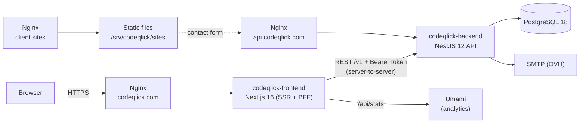
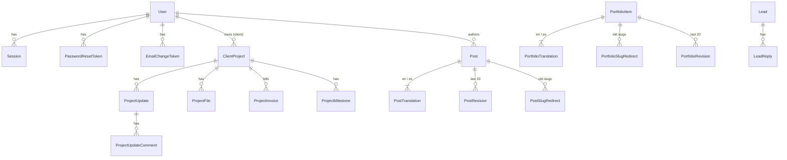
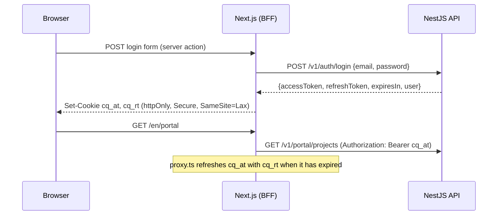

# Codeqlick — Architecture

> *Redefining information technology in society*

This document is the source of truth for how the Codeqlick platform is built. Both apps follow it; change it in the same pull request as any change that breaks it.

## 1. Overview



Two independent deployables in one repository:

| Directory | What it is | Runs on |
|---|---|---|
| `codeqlick-frontend/` | Public website (EN/ES), blog, portfolio, contact form, client portal and admin panel | Node 24, port 3000 |
| `codeqlick-sites/` | The basic-website template (`web-basica`) and the service that builds managed client sites from it | Node 24, internal port 4100 |
| `codeqlick-backend/` | REST API: auth, leads, blog, portfolio, client projects (updates, files, tasks, hours, briefs, reviews, access, monitoring), proposals, support, bookings, settings, users | Node 24, port 4000 |
| `codeqlick-cli/` | The `codeqlick` command of Codeqlick Cloud (section 4.13): sign-in, projects, deployments, domains; published to npm as `@codeqlick/cli` | Node 24 on developers' machines and CI |

Client websites hosted by Codeqlick are static sites next to them (section 8.2).

Cloud's public documentation (section 4.13) is a third static site, `codeqlick-docs/` (Astro, no server of its own): it is built and hosted by Cloud itself at docs.codeqlick.com.

Developers' static sites on Codeqlick Cloud are served the same way, from `/srv/codeqlick/cloud`, under their own domain (section 8.3).

They share **no code**. The contract between them is the HTTP API (section 5), documented live with OpenAPI at `/docs` in non-production environments.

## 2. Principles

1. **The backend owns data and rules.** The frontend never talks to the database and never re-implements validation it can get from the API (it validates for UX, the API validates for truth).
2. **Backend-for-frontend (BFF).** The browser only talks to `codeqlick.com`. Next.js server components, server actions and the proxy call the API server-to-server. Tokens never reach browser JavaScript.
3. **Secure by default.** Every API route requires authentication unless explicitly marked `@Public()`. Admin routes additionally require the `ADMIN` role.
4. **Validate at the edge.** Every request body, query and param is parsed with a Zod schema (NestJS 12 Standard Schema validation). Environment variables are validated at boot; the app refuses to start with bad config.
5. **Modules by domain, layers inside.** Each backend module owns its controller (HTTP), service (use cases), repository (persistence) and schemas.
6. **Exact dependency versions.** No `^` or `~` in any `package.json`. Upgrades are deliberate pull requests.
7. **Boring infrastructure.** PostgreSQL, Docker Compose, Nginx. No managed services required to run it.

## 3. Tech stack

| Concern | Choice | Notes |
|---|---|---|
| Runtime | Node.js 24 LTS | Both apps, Docker `node:24-alpine` |
| Language | TypeScript 7.0 (API and website); 6.0 in the site template | TS 7.0 has only the `tsc` executable: the API compiles and watches with it; `astro check` still needs 6.0 (decision 19) |
| Backend framework | NestJS 12 (ESM) | `"type": "module"`, NodeNext resolution |
| Validation | Zod 4 via Standard Schema | `@Body({ schema })` + `StandardSchemaValidationPipe` |
| ORM | Prisma 7 + `@prisma/adapter-pg` | Generated client in `src/generated/prisma` |
| Database | PostgreSQL 18 | |
| Auth | JWT access token (15 min) + rotating refresh token (30 days) | Passwords hashed with Argon2id |
| API docs | `@nestjs/swagger` 12 | Zod → OpenAPI via `z.toJSONSchema` |
| Logging | `nestjs-pino` | JSON logs in production, pretty in development, request IDs |
| Rate limiting | `@nestjs/throttler` | 100 requests a minute per IP for everything; every public route that changes something (POST, PUT, PATCH, DELETE without a session) has its own stricter `@Throttle`, enforced by a unit test (`common/throttle-coverage.spec.ts`, decision 109) |
| Health | `@nestjs/terminus` | `GET /v1/health` checks the database |
| Email | Nodemailer (SMTP) | Mailpit in development |
| Backend tests | Vitest + `unplugin-swc` + Supertest | |
| Frontend tests | Vitest (node) | Unit tests next to the code (`src/**/*.test.ts(x)`): helpers, form schemas and plain components rendered with `react-dom/server`. Pages and Server Actions are checked in a browser |
| Frontend framework | Next.js 16 (App Router) + React 19 | `proxy.ts` (formerly middleware) |
| i18n | `next-intl` 4 | `/en/...` and `/es/...`, English default |
| Styling | CSS Modules + design tokens | Brand tokens in `src/styles/tokens.css` |
| Fonts | `next/font/local` | Latin subset of each variable font (OFL, from Fontsource) in `src/assets/fonts`, served from our domain; neither builds nor visitors reach Google |
| Lint / format | oxlint + Prettier | Both apps |
| Browser tests | Playwright (Chromium) | `codeqlick-frontend/e2e`: public pages, the contact form, and the portal flow (client comments and approves, the team answers), against the whole stack. The E2E workflow builds it from the commit; locally they run against the Docker dev stack (`npm run test:e2e`) |
| CI | GitHub Actions | Lint, typecheck, test, build per app; E2E browser tests; deploy to the VPS once all of a commit's CI has passed |

## 4. Backend (`codeqlick-backend`)

### 4.1 Folder structure

```
src/
  main.ts                    Bootstrap: app.setup.ts (helmet, CORS, global pipe/filter, shutdown hooks), Swagger outside production
  app.module.ts              Wires all modules, global guards (throttler, JWT auth, roles)
  config/
    env.schema.ts            Zod schema for process.env
    app-config.service.ts    Typed accessors over ConfigService
  common/
    decorators/              @Public(), @Roles(), @CurrentUser()
    guards/                  JwtAuthGuard (global), RolesGuard (global)
    filters/                 ProblemDetailsFilter (RFC 9457 error bodies)
    schemas/                 Shared Zod schemas: pagination, locale, id params, slug
    types/                   AuthUser, Paginated<T>
  prisma/                    PrismaModule + PrismaService (adapter-pg, connect/disconnect)
  generated/prisma/          Prisma client output (git-ignored, created by `prisma generate`)
  modules/
    health/
    auth/                    login, refresh (rotation + reuse detection), logout, me, two-step verification, sessions
    accounts/                Client companies: `accountOf()` and the people of an account
    activity/                The activity log (who changed what)
    users/                   Admin management of admin/client accounts
    mail/                    MailService abstraction over Nodemailer; email-layout.ts renders every email as plain text plus branded HTML
    leads/                   Public contact form + admin pipeline
    posts/                   Blog (EN/ES translations)
    newsletter/              Blog newsletter: double opt-in sign-up, one-click unsubscribe, each new post emailed once (section 4.14)
    portfolio/               Case studies (EN/ES translations)
    link-checks/             Broken links in published posts and case studies, checked weekly (section 4.6; the last run's time is a `settings` row)
    projects/                Client projects + progress updates (admin writes, client reads own)
    tasks/                   Project tasks: from support requests or planned; the client sees titles and statuses; the release key reads and updates them
    time/                    Time tracking per project and maintenance plans (monthly hour allowances) (admin logs it; the client sees it when the project shows it)
    bookings/                Calls booked from the website (free slots in Madrid time, iCalendar invitations)
    citas/                   Citas: people's booking pages and their appointments (section 4.9)
    swipe/                   Swipe 18+: adults' intimate photos rated by swiping, matches and their chat, moderation and removal requests (section 4.10)
    cruising/                Cruising 18+: worldwide directory of cruising spots on a map with member reviews, then a members' social network; moderation and removal requests (section 4.15)
    calculator/              Cost calculator prices (a `settings` row)
    reviews/                 Client reviews: asked for on launch, published on the site with consent
    credentials/             Access clients share for their projects (encrypted; the team reveals, logged)
    monitoring/              Uptime monitoring of hosted client sites (checks every 5 minutes, alerts, status in the portal)
    errors/                  Unexpected errors of the API and the website, grouped, with an email per new one (section 4.11)
    site-audits/             Free website check: a visitor's site analysed (speed, mobile, Google, security) and the report emailed (section 4.12)
    cloud/                   Codeqlick Cloud (section 4.13): teams, members, API tokens and CLI sign-in, projects, static deployments, custom domains, events, abuse reports
    site-forms/              Contact forms of hosted static client sites, relayed to the client's inbox
    domains/                 Client domains: availability, OVH (DNS and expiry) and renewal reminders
    managed-sites/           Managed basic websites: content, revisions, builds through site-builder
    briefs/                  The project brief questionnaire (portal form, admin view, release-key read)
    proposals/               Proposals and quotes: drafted and sent from the admin panel, accepted or declined in the portal
    support/                 Support requests: clients open and answer them in the portal, the team in the admin panel
    media/                   Image uploads (admin) stored on disk and served publicly
    saved-replies/           Reusable texts for lead replies and project comments
    stats/                   Admin dashboard numbers, the platform overview (section 4.17) and the public site's visits (Umami)
    search/                  Admin search across leads, users, projects, requests, proposals, posts and case studies (section 4.14)
prisma/
  schema.prisma
  migrations/
  seed.ts                    Creates the first admin from env vars
prisma.config.ts
test/                        e2e tests (Supertest)
```

Inside each module:

```
modules/posts/
  posts.module.ts
  posts.controller.ts          Public routes
  admin-posts.controller.ts    Admin routes (@Roles('ADMIN'))
  posts.service.ts             Use cases; throws Nest HTTP exceptions
  posts.repository.ts          The only file that touches Prisma for this domain
  posts.schemas.ts             Zod request schemas + inferred types
  posts.service.spec.ts        Unit tests with a mocked repository
```

Dependency direction: **controller → service → repository → PrismaService**. Never skip a layer, never go backwards. The `media` module has no database table: its `media.storage.ts` plays the repository's role over the file system, and `media.repository.ts` only reads which posts and case studies use an image. Likewise `search.repository.ts` (section 4.14) only reads other domains' tables, never writes them.

### 4.2 Data model



- **User** — `email` (unique, lower-cased), `passwordHash` (Argon2id), `name`, `role` (`ADMIN` | `CLIENT`), `isActive`, `locale` (`EN` | `ES`, default `EN`: language of the emails the platform sends them), `weeklyDigest` / `lastDigestAt` (the weekly summary), `monthlyReport` (default true: the monthly website report, section 8.2; both are optional emails with a one-click unsubscribe link, see "Unsubscribe links" in section 4.3), `registeredAt?` (decision 17: when the person created the account themselves or accepted the team's invitation; null for a client account the team prepared for an email — a proposal, a project — which nobody can sign in to until its owner registers with that email), `username?` (unique, lower-cased; see "Username" under section 6, "My account"), `avatarKey?` (file name of the profile photo, see "One profile" under section 6), `signupApp?` (decision 29: the web app — `videochat`, `swipe`, `cruising`, `meetings`, `citas` — the person signed up from; null on codeqlick.com or for accounts the team created). `SignupToken.app?` carries it from `/auth/register` until the email is confirmed.
- **Client companies:** a CLIENT user with `memberOfId` is a person of the company whose main client account is `memberOf` (one level: a member can't have members, and projects and proposals must belong to a main account). The main account owns projects, requests and proposals; its active members see and act on all of them (the portal checks the caller's *account*: `accountOf(user)`, carried in the access token as `acc`), and the client emails (updates, comments, replies, status changes, proposals, weekly summary) go to the owner and every active member, each in their language. What a member writes (messages, comments, approvals) is signed with their own name, and team notifications reply to them.
- **Session** — one row per refresh token: `tokenHash` (SHA-256, unique), `familyId`, `expiresAt`, `revokedAt`, `replacedById`, `userAgent`, `ip`.
- **PasswordResetToken** — one row per "forgot my password" email or welcome email: `tokenHash` (SHA-256, unique), `expiresAt` (60 minutes for a reset, 7 days for a welcome email), `usedAt`. Asking again deletes the user's unused tokens, so only the latest link works. An unregistered client's invitation to create their account is one of these too (7 days). **SignupToken** — a self-registration waiting for its email to be confirmed: `email`, `name`, `passwordHash`, `locale`, `tokenHash` (unique), `expiresAt` (24 hours), `usedAt`. **EmailChangeToken** — a change of the account's email waiting for the new address to confirm it: `newEmail`, `tokenHash` (unique), `expiresAt` (24 hours), `usedAt`; asking again replaces the user's pending one.
- **Lead** — contact form submission, or a business the team added itself (`createdById?`: who; a prospect, section 8.2): `name`, `email?` (always set from the forms; a prospect may have none until the team adds it), `company?`, `projectType?` (what they need: `web`, `custom`, `mobile`, `design`, `support`, `not-sure`), `budget?` (only older leads: the form asked for a range before), `message`, `locale`, `status` (the sales process from the wiki's Client Engagement: `NEW` → `TALKING` → `CALL` → `PROPOSAL` → `WON` / `LOST`; `SPAM` is not a stage and stays off the board), `lostReason?` (`PRICE`, `NO_RESPONSE`, `NOT_A_FIT`, `CHOSE_OTHER`, `TIMING`, `OTHER`; kept only while LOST), `followUpOn?` (date), `clientId?` (the account it became), `notes?`, `siteRequest?` (JSON `{ preset, business, domain? }`: when it came from the basic-website request, which onboarding then builds the site from), and its instant preview: `previewSlug?` (unique), `previewStatus?` (`BUILDING` | `READY` | `FAILED` | `REMOVED`), `previewBuiltAt?`, `previewFollowUpAt?` (when the follow-up about it was emailed; never for a prospect) (decision 16, section 8.2), and `proposalId?` (the proposal drafted from the request, `POST /admin/leads/:id/proposal`; null again if it is deleted).
- **SitePurchase** — a request's preview bought online (section 8.2, decision 20): `leadId`, `stripeSessionId` (unique, the Stripe Checkout Session), `amountCents` (the total charged, VAT included), `currency` (`eur`), `status` (`PENDING` → `PAID` | `EXPIRED`), `email?` (the buyer's, from Stripe), `paidAt?`, `projectId?` (the project of the site made from it), `stripeInvoiceId?` (the invoice Stripe issued for it), `error?` (why the site couldn't be made on its own; the team finishes it).
- **LeadReply** — an email answer sent to a lead from the admin panel: `leadId`, `authorId?` (null once the user is deleted), `authorName` copied at the time, `subject`, `body`. Only stored once the email was accepted by the SMTP server.
- **Post / PostTranslation** — `slug` (unique), `status` (`DRAFT` | `PUBLISHED`), `publishedAt`, `coverImageUrl?`, `contentUpdatedAt?` (below), `newsletter` (default true: email it to the newsletter's subscribers, section 4.14), `newsletterSentAt?` (when its email went out, or was skipped; null until the post is live and the job has seen it); translation per `locale` with `title`, `excerpt`, `content` (Markdown).
- **NewsletterSubscriber** — a blog reader who signed up for new posts by email (section 4.14), not linked to `User`: `email` (unique, lower-cased), `locale` (`EN` | `ES`: the language of the emails), `status` (`PENDING` | `ACTIVE` | `UNSUBSCRIBED`), `confirmTokenHash?` (SHA-256, unique) and `confirmExpiresAt?` (48 hours), `confirmSentAt?` (the last confirmation email), `confirmedAt?`, `unsubscribeToken` (32 random bytes, base64url, unique; kept in clear because it goes in every email and can only unsubscribe), `unsubscribedAt?`, `createdAt`.
- **Tag / PostTag** — blog topics shared by both languages: `slug` (unique, used in `/blog?tag=`), `nameEn`, `nameEs`; `PostTag` joins posts and tags (both sides cascade, so deleting a tag just removes it from its posts). Up to 10 tags per post.
- **Scheduling (posts and case studies):** content is live when `status = PUBLISHED` and `publishedAt <= now`. A published item dated in the future is *scheduled*: the public API (lists, detail, so also the sitemap and RSS) hides it until then and it appears on its own, with no job to run, within the public pages' 5-minute revalidation. `publishedAt` is set on the first publish unless one is given; clearing it on a published item means now. The admin panel types it in Madrid time.
- **IndexNow (posts and case studies; roadmap item proposed by the agent team, 2026-11-14; decision 74):** when content changes, the API tells search engines that support IndexNow (Bing, Yandex, Seznam, Naver, Yep) at once instead of waiting for their crawlers. Off unless `INDEXNOW_ENABLED=true` (4.5).
  - **Key:** 32 hex characters, the start of HMAC-SHA256 of `JWT_ACCESS_SECRET` with the purpose `indexnow-v1`, so it needs no setting of its own and stays the same across restarts. `GET /v1/indexnow/key` hands it to the website (404 while off), which serves it as plain text at `/indexnow-key.txt`; submissions name that file as `keyLocation`.
  - **When:** after a post or case study is saved, when it is live before or after the change (created live, published, edited while live, a revision restored while live (decision 72), unpublished, made a draft, deleted, its slug changed). A scheduled item is announced when its date comes: every 5 minutes (`IndexNowService`, 4.6) the API submits the posts and case studies that went live in the last 10 minutes.
  - **What:** the item's addresses in both languages (`<SITE_URL>/en/blog/<slug>` and `/es/blog/<slug>`, or `/en/work/<slug>` and `/es/work/<slug>`), the old ones too after a slug change, and the list page in both languages (`/en/blog` and `/es/blog`, or `/en/work` and `/es/work`). One `POST https://api.indexnow.org/indexnow` with JSON `{ host, key, keyLocation, urlList }` (`host` from `SITE_URL`), 10-second timeout.
  - **Limits:** an address already submitted in the last 10 minutes is left out (kept in memory); nothing is sent when no address is left. The submission runs after the change is saved and never fails or delays it: a failure (network, a status other than 200 or 202) is logged as a warning and not retried, since the sitemap still lists the content.
- **Updated date (posts and case studies):** `contentUpdatedAt` (null until set) is when the text last really changed after going live. A save (an edit, or restoring a revision, decision 72) sets it to now when the item was live before it (published, `publishedAt <= now`), stays published, and the readers' content changed: a translation's title, excerpt (summary for case studies) or body, a translation added or removed, or the cover image. Slug, tags, status, date, sort order, services, technologies, client, link and testimonial changes don't move it, and neither does publishing again after unpublishing. Existing rows start null (no backfill: old `updatedAt` values don't say what changed). The public views give it as `contentUpdatedAt` only when it is at least 24 hours after `publishedAt` (a fix on launch day is not an update); otherwise `null`.
- **PortfolioItem / PortfolioTranslation** — same publishing model (including `contentUpdatedAt?`) plus `clientName?`, `projectUrl?`, `technologies[]`, `services[]` (the website's service keys: web, custom, mobile, design, consulting, support), `sortOrder`, `testimonialAuthor?`; translation has `title`, `summary`, `content`, `testimonialQuote?`, `testimonialRole?`. A case study has a testimonial in a language when it has an author and a quote in that language; it is shown on the case study and on the home page.
- **PostSlugRedirect / PortfolioSlugRedirect** — old addresses of a post or case study after a slug change (decision 71): `slug` (unique), `postId` (or `portfolioItemId`; cascade delete), `createdAt`. A slug is editable in the admin panel; when an item that has a publication date (`publishedAt` set before the save: published now or before, or scheduled) gets a new slug, its old slug is stored pointing to the item. A draft that was never published (no `publishedAt`) leaves nothing behind. A redirect points to the item, not to a slug, so renames never chain: after A → B → C, both A and B lead to C. In the same transaction as the save, giving any item (new or edited) a slug that is a stored redirect deletes that redirect (the new owner wins), and renaming an item back to one of its old slugs deletes that row. Nothing else changes: the activity log records the save as the usual update.
- **PostRevision / PortfolioRevision** — revision history of posts and case studies (decision 72): `postId` / `portfolioItemId` (cascade), `authorId?` (who made the change that replaced it; null once the user is deleted), `createdAt` (when it was replaced), `snapshot` (JSON: the item's content as it was until then). A post's snapshot is `{ coverImageUrl, tagIds, translations: [{ locale, title, excerpt, content }] }`; a case study's is `{ coverImageUrl, clientName, projectUrl, technologies, services, testimonialAuthor, translations: [{ locale, title, summary, content, testimonialQuote, testimonialRole }] }`. Publishing fields (`status`, `publishedAt`), `slug` and the case study's `sortOrder` are not content and are never part of it. Every admin update (`PATCH`) whose snapshot differs from the current one stores the current one as a revision in the same transaction as the change (tag ids and translations compared without regard to order); creating an item stores nothing, nor does a PATCH that changes nothing or only those other fields. The last 20 per item are kept: older ones are deleted in the same transaction. Images used only by a revision don't count as used in the media library.
- **ClientProject** — `clientId`, `name`, `description?`, `phase` (`DISCOVERY` | `DESIGN` | `DEVELOPMENT` | `QA` | `LAUNCHED` | `SUPPORT` | `ON_HOLD`), `progress` (0–100), `startDate?`, `dueDate?`, `stagingUrl?`, `productionUrl?`, `showHours` (the client sees the hours logged on it; off by default), and its watched domain: `domainName?`, `domainSource` (`RDAP` | `MANUAL` | `OVH`), `domainExpiresAt?` (date), `domainCheckedAt?`, `domainWarnedFor?` (`<day>:<30|7>`, the last reminder). With `RDAP` the expiry is read from the registry's RDAP server (found in IANA's bootstrap, `data.iana.org/rdap/dns.json`); TLDs without RDAP (`.es`) take a date typed by the team. A domain the team's OVH account manages (the client made it the technical contact, decision 15) switches to `OVH` on its next check: the expiry is OVH's (`GET /domain/{name}/serviceInfos`), `.es` included; one OVH stops managing goes back to `RDAP`. 30 and 7 days before it, the team inbox and every person of the client account are emailed, once each per expiry date. A managed site's own domain becomes the project's watched domain when it has none. Its maintenance plan (section 8.2, decision 110): `maintenanceStatus` (`NONE` | `PENDING` | `ACTIVE` | `PAST_DUE` | `CANCELED`, default `NONE`, from the Stripe subscription), `maintenanceSubscriptionStatus?` (Stripe's own status), `maintenanceSubscriptionId?` and `maintenanceCustomerId?` (unique), `maintenancePeriodEnd?`, `maintenanceCancelAtPeriodEnd` (default false), `maintenanceSince?` (when it last turned on), `maintenanceIncludedReason?` and `maintenanceIncludedAt?` (given for free by the team). The plan is on while `ACTIVE`, `PAST_DUE` or included.
- **ProjectUpdate** — `title`, `body` (Markdown), `authorId`, `createdAt`, `approvalRequested` (the team asks the client to approve it), `approvedAt?`, `approvedById?`. A **release** is an update with `version`, `environment` (`STAGING` | `PRODUCTION`) and `url?`: the version deployed, where, and where to try it; posting one also sets the project's `stagingUrl` or `productionUrl` to that URL. A project may have a release key (`releaseTokenHash`, SHA-256 of `cqr_…`, and `releaseTokenCreatedAt`) for its deploy pipeline.
- **ProjectUpdateComment** — a comment on an update by the client or the team: `body` (plain text, max 5000), `authorId?`, `createdAt`. Comments by an ADMIN are shown as the team's.
- **ProjectMilestone** — a step of the project shown to the client as a timeline: `title`, `description?` (plain text, max 2000), `dueDate?`, `completedAt?` (set when the admin marks it done; null while open), `position` (order set by the admin, 0-based). The first milestone not done is the "next" one.
- **ProjectFile** — a file shared with the project's client: `name` (original name, cleaned), `contentType` (as sent by the uploader; informational), `size`, `uploadedById?`. The content is stored on disk at `UPLOADS_DIR/project-files/<id>`, never under a public URL.
- **ProjectInvoice** — an invoice the team issued for a project (decision 23), as the PDF made by the team's invoicing tool: `number` (unique, the invoice's own number), `issuedOn`, `dueOn?` (dates), `amountCents` (the total, VAT included), `currency` (`eur`), `paidAt?` (set by the team), `fileName`, `size`, `uploadedById?`. The PDF is stored at `UPLOADS_DIR/invoices/<id>`, never under a public URL. Its status is derived: `PAID` with `paidAt`, `OVERDUE` once `dueOn` has passed, `DUE` otherwise.
- **SupportTicket** — a request a client opens from the portal: `number` (sequential, shown as `#12`), `clientId`, `projectId?` (one of the client's projects), `type` (`BUG` | `CHANGE` | `QUESTION`), `priority` (`LOW` | `NORMAL` | `HIGH` | `URGENT`), `status` (`OPEN` | `IN_PROGRESS` | `WAITING_CLIENT` | `RESOLVED` | `CLOSED`), `title`, `resolvedAt?` (set when it becomes RESOLVED or CLOSED, cleared when it is reopened), `maintenanceIncluded?` (a `CHANGE` request opened on a project whose maintenance plan is on: `true` when it was one of the month's 3 included changes, `false` past them; null otherwise; section 8.2).
- **TicketMessage** — the request's conversation, oldest first: `body` (plain text, max 20 000), `authorId?`. The first message is the client's description; messages by an ADMIN are shown as the team's.
- **TicketAttachment** — a file added to a support request by the client or the team: `name`, `contentType`, `size`, `uploadedById?`. Stored on disk at `UPLOADS_DIR/ticket-files/<id>`, like project files.
- **Proposal** — a proposal or quote for a client: `number` (sequential, `#7`), `clientId`, `projectId?` (one of the client's projects), `createdById?`, `title`, `summary` (Markdown: scope), `terms?` (Markdown: payment, deadlines), `currency` (`EUR`), `validUntil?` (date; last day it can be accepted, Madrid time), `status` (`DRAFT` | `SENT` | `ACCEPTED` | `DECLINED` | `WITHDRAWN`), `sentAt?`, `respondedAt?`, `acceptedName?` (the full name the client typed to accept it), `declineReason?`. `expiryRemindedAt?`: when the reminder that it is about to expire went out (section 4.6). Only drafts can be edited or deleted; a sent one gets a new version by duplicating it. Nothing is charged: accepting is a recorded agreement.
- **ProposalTemplate** — a starting point for new proposals ("Web básica"): `name` (unique), `title`, `summary`, `terms?`, `validDays?` (a proposal made from it is valid that many days from the day it is created), `items` (JSON `[{ description, quantity, unitPrice }]`, cents). Admin → Propuestas → Nueva offers them; any proposal can be saved as one.
- **ProposalItem** — a line of a proposal: `position`, `description`, `quantity` (whole units), `unitPrice` (cents). The total is computed, never stored.
- **UpdateDraft** — an update sent with a project's release key and waiting for the team's review: `title`, `body` (Markdown), `version?`, `environment?`, `url?`. The client never sees it; publishing creates the ProjectUpdate (a release when it has a version) from the reviewed text and deletes the draft.
- **MaintenancePlan** — a monthly hour allowance for a project (one per project): `active`, `name`, `monthlyMinutes`, `alertPercent` (default 80), `alertedMonth`/`alertedLevel`. Its time entries draw it down per Madrid calendar month; logging time that crosses the threshold or 100 % emails the team inbox, once a month per level. The client sees the use while it is active. Nothing is billed.
- **SiteForm** — the contact form of a static client site (one per project): public `key` (it goes in the site's HTML), `enabled`, `recipients` (1–5 emails), `submissions` counter, `lastSubmissionAt`. Messages are emailed; when the project has a managed site (section 8.2) a copy is also kept as a **SiteFormMessage** — `formId`, `name`, `email`, `phone?`, `message`, `createdAt` — for the client to read in the portal, deleted after 12 months (or by the client). Other sites' messages are only emailed. **SiteFormDay** — `formId`, `day` (Madrid), `count`: messages per day, for the visits chart.
- **ManagedSite** — a basic website built from content stored here (one per project, section 8.2): `slug` (unique: folder and preview subdomain `<slug>.<SITES_PREVIEW_DOMAIN>`), `preset` (the demo it started from; its images are usable by name), `content` (JSON: the template's `Site` type without `url`, `form` and `demo`, validated by `siteContentSchema`; uploaded photos are `media/<file>`), `domain?` (the client's own, unique; never under `SITES_PREVIEW_DOMAIN` or the platform's own domain), `domainState?` (`UNREGISTERED`: nobody has it; `ELSEWHERE`: registered but not resolving to `SITES_SERVER_IP` or not answering over HTTPS yet; `LIVE`: it serves the site — null without a domain or before its first check), `domainCheckedAt?`, `mailState?` (where the domain's email goes, from its MX records: `NONE`, `OVH` — `*.ovh.net` — or `OTHER`; checked with the domain, null while unregistered), `status` (`NONE` | `BUILDING` | `LIVE` | `FAILED`), `lastBuildAt?`, `lastBuildError?` (the end of the build log), `release?`, `reportedMonth?` (`yyyy-mm`: the last month its monthly report went out for), `umamiWebsiteId?` (its website in Umami, created on its first build when Umami is set up; the build then adds the cookieless tracker, `UMAMI_SCRIPT_URL`, and the template's privacy and cookie pages mention it). Creating one starts from the preset with the project's name and the client as legal owner, creates the project's site form when missing and sets the project's `stagingUrl` (preview) and `productionUrl` (the domain once LIVE, the preview until then). A domain is published as itself and `www.` (the builder's `domains`). Each check connects it through OVH when the team manages it: its zone's apex and `www` `A`/`AAAA`/`CNAME` records are replaced by one `A` to `SITES_SERVER_IP` unless they already point there (other records, such as MX, are never touched; each change is in the activity log). Turning LIVE rebuilds the site on the domain, turns on its uptime monitor and emails the client; a LIVE domain that still resolves here stays LIVE when HTTPS fails for a moment. Every change is built at once (`url`, `demo: false` and the form's key added); a failed build keeps the previous release online. A site may have a **draft** the client is editing (decision 18): `draftContent?` (the whole content, valid against `siteContentSchema`), `draftPreset?` (the style it starts from, when the client changed it), `draftUpdatedAt?` and `draftKey?` (random, the address of its preview: `/site-draft/<key>/`); publishing it replaces `content` (and `preset`) and clears it. **ManagedSiteRevision** — the content before each change (`authorId?`), the last 20 kept. `newsEnabled` (default false): the client has switched on the site's news section (section 8.2); like `menuEnabled`, a column of its own, not part of `content`, so switching it never touches the draft. `newsBuiltAt?`: when the last successful build started (the posts it shows are those not expired by then); a failed build leaves it, so the hourly job retries. **SiteNewsPost** — a news item or offer of a managed site (section 8.2, decision 55), outside `content` and its draft/publish cycle: `siteId`, `slug` (unique per site; made from the title when the post is created and never changed afterwards, so its address is stable; a slug that is only digits gets a suffix), `title` (≤ 120), `summary` (≤ 300; the list, Google and social previews), `body` (plain text, ≤ 10 000; a Markdown subset, see section 8.2), `photo?` (`media/<file>`, from the site's photo uploads), `publishedAt?` (null = draft; set when published, and kept if the post is edited), `expiresAt?` (end of a Madrid day, for offers: after it the post is hidden from the site), `authorId?`, `createdAt`/`updatedAt`. Up to 200 per site. A post's state is derived: `DRAFT` (no `publishedAt`), `PUBLISHED` or `EXPIRED` (`expiresAt` in the past). Posts are not in `ManagedSiteRevision`; they cascade with the site, and their photos stay in the media library. English twins (decision 106): `titleEn?`, `summaryEn?`, `bodyEn?` (same limits; empty falls back to the Spanish text on the English pages). A site's English version lives in its content (`english`, `en`, section 8.2), not in a column, so it follows the draft.
- **ClientReview** — the client's review of a project (one per project): `status` (`REQUESTED` | `SUBMITTED` | `PUBLISHED` | `HIDDEN`), `rating` (1–5), `quote`, `authorName`, `authorRole?`, `consent` (may go on the website), `locale` (the language it was written in), `requestedAt`, `submittedAt?`, `publishedAt?`. Asked for (email to every person of the account) when the project's phase moves to `LAUNCHED`, once, or from the project page. The team publishes it only with consent; published reviews show on the home page's testimonials, after the case studies' ones, in their own language.
- **ProjectCredential** — access a client shares for a project instead of emailing it: `label`, `url?`, `username?`, `secret` and `notes?` sealed with AES-256-GCM (key derived from `CREDENTIALS_SECRET`, purpose `project-credentials-v1`), `createdById?`, `viewedAt?`. The people of the client account add and delete theirs but never read a secret back; the team reveals one at a time (logged as `project.credential_viewed`, and the client sees when) and can delete them all at the end. Adding one emails the team inbox, never with the secret.
- **SiteMonitor / SiteCheck** — uptime monitoring of a client project's production site (`productionUrl`): `enabled`, `status` (`UNKNOWN` | `UP` | `DOWN`), `statusSince`, `failures` in a row, `lastCheckedAt`, `lastError`, `certExpiresAt` (read at most hourly), `certWarnedFor`. `MonitoringService` (API process, every 5 minutes, off in tests) requests each enabled site (up below HTTP 400 within 15 s, redirects followed) and stores a `SiteCheck` (`ok`, `statusCode`, `responseMs`, `error`; kept 90 days). Two failures in a row make it DOWN and email the team inbox; its return emails too; a certificate with under 14 days left is warned about once. The server itself (disk ≥ 85 %, memory ≥ 90 %: time for a bigger plan) is watched by `deploy/monitor/monitor.sh`.
- **ProjectBrief** — the client's questionnaire for a project (one per project): `status` (`REQUESTED` | `SUBMITTED`), `answers` (JSON by question: `business`, `goals`, `success`, `audience`, `mustHave`, `niceToHave`, `references`, `brandStatus` none/partial/complete, `brandColors`, `brandTone` formal/friendly/technical/playful, `brandAssetsUrl`, `content` client/codeqlick/both, `domain`, `services`, `deadline`, `deadlineReason`, `other`), `requestedAt`, `submittedAt?`. Created when a lead is converted (no email: the welcome email brings them in), asked for by email when a proposal with a project is accepted or from the project page. Sending needs `business`, `goals`, `audience` and `mustHave`; it can be edited and sent again.
- **ProjectTask** — work on a client project: `title`, `description?` (for the team only), `status` (`TODO` | `IN_PROGRESS` | `DONE`), `doneAt?`, `ticketId?` (the support request it came from). Turning a request into a task moves an open request to `IN_PROGRESS`; when all of a request's tasks are done it becomes `RESOLVED` (the client is emailed, as for any status change).
- **TimeEntry** — time spent on a client project: `projectId`, `userId?` (who logged it), `date` (the day, Madrid), `minutes` (1–1440), `description` (max 500). Logging and deleting entries are recorded in the activity log with the minutes.
- **Setting** — site settings edited in the admin panel, one JSON document per `key`. `calculator`: the cost calculator's prices — per project type (`web`, `custom`, `mobile`, `design`, `support`) `{ min, max, weeksMin, weeksMax }` in euros/weeks for a medium size, size factors `{ small, medium, large }`, extras (`languages`, `accounts`, `payments`, `admin`, `integrations`) `{ min, max }`, and `enabled`. An estimate is the type scaled by the size plus the extras, rounded out to hundreds; types and extras with a maximum of 0 are not offered.
- **Booking** — a video call booked from the website: `name`, `email`, `company?`, `message?`, `locale`, `startsAt`/`endsAt`, `status` (`CONFIRMED` | `CANCELLED`), `slotKey` (the start while confirmed, unique, null once cancelled: no double booking), `cancelTokenHash` (SHA-256 of the token in the visitor's cancel link), `sequence` (calendar revision), `leadId?`. Its settings are the `Setting` `booking`: `enabled`, `meetingUrl` (a fixed Google Meet link), `calendarEmail` (optional: also gets the team's invitations and cancellations, so calls land in that calendar, e.g. the owner's Gmail), `durationMinutes` (15–120, default 30), `minNoticeHours` (default 24), `horizonDays` (default 21) and `weekly` free hours per weekday in Madrid time (`[{ start: 'HH:MM', end: 'HH:MM' }]`). Free slots are those hours cut into calls, after the notice, minus confirmed calls. Booking moves the open lead with that email to `CALL` (or starts one there) with the call's day as follow-up; both sides are emailed an iCalendar invitation (`METHOD:REQUEST`; cancellations send `METHOD:CANCEL` with a higher `SEQUENCE`).
- **BookingPage** / **Appointment** — Citas (section 4.9): a person's booking page (`ownerId`, `slug` unique, `title`, `description`, `durationMinutes`, `location`, `video`, `meetingRoomId?`, `askPhone`, `timeZone`, `weekly`, `minNoticeHours`, `horizonDays`, `enabled`) and the appointments booked on it (`pageId`, `ownerId`, `name`, `email`, `phone?`, `note?`, `locale`, `startsAt`/`endsAt`, `status` reusing `BookingStatus`, `cancelTokenHash`, `sequence`, `reminderSentAt?`). Both cascade with their owner.
- **VideochatProfile** photo verification (section 4.7): `verificationStatus` (NONE · PENDING · APPROVED · REJECTED), `verificationKey?` (private file while pending), `verificationNote?`, `verificationSentAt?`, `verifiedAt?`.
- **SwipeProfile** / **SwipePhoto** / **SwipeVote** / **SwipeMatch** / **SwipeMessage** / **SwipeReport** / **SwipeBlock** / **SwipeTakedown** / **SwipeBlockedHash** — Swipe (section 4.10). Profile per account (`userId` PK: 18+ confirmation and terms version, `nickname`, `gender`, `seeking[]`, `interests[]`, verification `status`/`key`/`note`/`sentAt`/`verifiedAt`, suspension `suspendedAt`/`Until`/`Reason`). Photo (`ref` 8 characters unique, shown on the card; `storageKey` of the private file; `width`, `height`; `hash` dHash; `status` PENDING · LIVE · REJECTED · HIDDEN; `rejectReason`; `likes`; `inAlbum`; reviewer). Vote (PK voter + photo, `ownerId`, `like`). Match (`userAId` < `userBId` unique, `lastMessageAt`, read marks per side) with its messages (≤ 1000 characters). Report (reporter, reported, `photoId?`, `reason`, `details`, chat `transcript` JSON, status, reviewer). Block (both ways hide everything). Takedown (anyone's removal request: `email`, `photoRef`, matched `photoId?`, `reason`, `details`, `locale`, status OPEN · REMOVED · CLOSED, `response`). Blocked hash (removed images, refused on upload). Everything but takedowns and blocked hashes cascades with the account.
- **CruisingProfile** / **CruisingSpot** / **CruisingReview** / **CruisingReport** / **CruisingTakedown** / **CruisingCheckIn** / **CruisingConversation** / **CruisingMessage** / **CruisingBlock** — Cruising (section 4.15). Profile per account (`userId` PK: `birthYear`, `termsVersion`, `acceptedAt`, `emailAlerts`, suspension `suspendedAt`/`suspendedUntil`/`suspensionReason`; phase 2: `nickname?` unique, `bio`, `country?`, `lookingFor[]`, `showAge`). Spot (`slug` unique, `name`, `type`, `lat`/`lng` Decimal(8,5), `countryCode`, `city`, `citySlug`, `description`, `bestTimes?`, `status` PENDING · LIVE · REJECTED · HIDDEN · REMOVED, `rejectReason`, `createdById?` set null with the account, `reviewedAt`, `ratingAvg`/`ratingCount` denormalised). Review (`spotId` + `userId` unique, `rating` 1–5, `text?`, `status` LIVE · HIDDEN). Report (reporter, `targetType` SPOT · REVIEW · PROFILE · CONVERSATION, `spotId?`, `reviewId?`, `reportedId?`, `reason`, `details`, chat `transcript` JSON, status OPEN · DISMISSED · ACTIONED, reviewer). Takedown (anyone's removal request: `email`, `spotLink`, matched `spotId?`, `reason`, `details`, `locale`, status OPEN · REMOVED · CLOSED, `response`). Phase 2: check-in (`userId`, `spotId`, `anonymous`, `expiresAt`), conversation (`userAId` < `userBId` unique, `lastMessageAt`, `readAAt`/`readBAt`, `notifiedAAt`/`notifiedBAt`) with its messages (≤ 1000 characters), block (`blockerId` + `blockedId`). Phase 4: the profile's verification (`verificationStatus` NONE · PENDING · APPROVED · REJECTED, `verificationKey`, `verificationNote`, `verificationSentAt`, `verifiedAt`, and the daily counters `verificationTries`/`verificationTriesSince` and `uploads`/`uploadsSince`), **CruisingMedia** (`ref` unique, `ownerId`, `kind` PHOTO · VIDEO, `status` PROCESSING · LIVE · HIDDEN · FAILED, `storageKey`, `posterKey`, `width`, `height`, `durationSeconds`, `hash` (dHash of the photo or poster), `failure`, `cover`, `position`, `reviewedAt`/`reviewedById`), **CruisingBlockedHash** (`hash`, `reason`), reports gain the target MEDIA (`mediaId`) and the reasons NON_CONSENSUAL and STOLEN, takedowns gain `mediaRef`/`mediaId`. Everything but spots and takedowns cascades with the account; a spot stays with `createdById` null.
- **LinkCheck** — a link found in published content and its last check (4.6, Broken links): `url` (absolute: relative links resolved against the page's own address, `SITE_URL/<locale>/blog|work/<slug>`), `sourceType` POST · PORTFOLIO, `sourceId`, `locale` (the translation it appears in); unique `url` + `sourceType` + `sourceId` + `locale`; `internal`, `status` OK · BROKEN, `statusCode?`, `error?` (timeout, DNS, refused, private address…), `failures` (checks failed in a row), `brokenSince?`, `checkedAt`. Rows of links no longer in the content are deleted at the next run; deleting a post or case study deletes its rows.
- **ErrorGroup** — an unexpected error and its repeats (section 4.11): `fingerprint` (SHA-256, unique), `source` API · WEB_SERVER · WEB_BROWSER, `message`, the last occurrence's `stack`, `method`, `path` (no query string), `reference` (request id or Next.js digest) and `userAgent`, `count`, `firstSeenAt`, `lastSeenAt`, `resolvedAt`.
- **SiteAudit** — a free website check (section 4.12): `url` (as checked: the start URL, normalised), `host`, `name?`, `email`, `locale`, `status` (`PENDING` | `DONE` | `FAILED`), `score?` (0–100), `result?` (JSON: the final URL, the four categories' scores and each check's id, status and values), `error?` (why it failed, in English), `leadId?` (the lead it made), `finishedAt?`. Kept 180 days.
- **SavedReply** — a reusable text for lead replies and project comments: `title` (only the admin sees it) and `body`. The admin panel puts `{name}` (lead or client) and `{project}` in when it inserts the text.
- **Codeqlick Cloud** (section 4.13): **CloudTeam** (`slug` unique, `name`, `plan` `FREE` \| `PRO`, `requireTwoFactor` (default false)); **CloudMember** (`teamId` + `userId` unique, `role` `OWNER` \| `ADMIN` \| `MEMBER`, `termsVersion`, `termsAcceptedAt`); **CloudInvite** (`teamId`, `email`, `role`, `tokenHash` unique, `invitedById?`, `expiresAt`, `acceptedAt?`); **CloudToken** (`userId`, `teamId?` (restricted to it), `name`, `prefix`, `tokenHash` unique, `readOnly` (default false), `expiresAt?`, `expiryWarnedAt?`, `lastUsedAt?`, `lastUsedIp?`); **CloudDeviceCode** (`deviceCodeHash` unique, `userCode` unique, `clientName`, `userId?`, `approvedAt?`, `deniedAt?`, `consumedAt?`, `lastPolledAt?`, `expiresAt`); **CloudProject** (`teamId`, `slug` unique, `name`, `productionDeploymentId?`, `productionLockedAt?`, `productionLockedById?` (the person, kept as `null` when they leave), `suspendedAt?`, `suspendedReason?`, `deletedAt?`; password protection: `protection` `OFF` \| `PREVIEWS` \| `ALL` (default `OFF`), `protectionHash?` (Argon2id), `protectionDays` (default 7), `protectionVersion` (default 0), `protectionUpdatedAt?`; the bypass token for automation: `protectionBypassHash?` (SHA-256 hex of the token, unique), `protectionBypassPrefix?` (its first 12 characters), `protectionBypassCreatedAt?`, `protectionBypassCreatedById?` (the person, kept as `null` when they leave), `protectionBypassLastUsedAt?`; the shared analytics link: `analyticsShareHash?` (unique), `analyticsShareSealed?`; the weekly check of production, decision 81: `productionChecks` (Boolean, default false), `productionCheckNextAt?`); **CloudDeployment** (`projectId`, `shortId` (unique per project), `target` `PREVIEW` \| `PRODUCTION` (as uploaded), `message?`, `commit?`, `branch?`, `sizeBytes`, `fileCount`, `keptAt?`, `config?` (JSON: the parsed rules of `codeqlick.json`, null when it has none; 4.13 "Redirects, rewrites and headers"), `createdById?`, `tokenId?`); **CloudDomain** (`projectId`, `name` unique, `verificationToken`, `state` `PENDING` \| `VERIFIED` \| `LIVE` \| `ERROR`, `verifiedAt?`, `checkedAt?`, `lastError?`); **CloudEvent** (`teamId`, `actorId?`, `actorName`, `tokenId?`, `action`, `targetLabel?`, `details?` JSON, `ip?`); **CloudReport** (`url`, `projectId?` (matched from the address), `reason`, `details`, `email`, `status` `OPEN` \| `CLOSED`, `note?`, `closedAt?`). Phase 1b: **CloudForm** (`projectId`, `name`, `key` unique, `enabled`, `notify`, `recipientIds` (users), `spamFilter` (default on), `overLimitMonth?`); **CloudFormSubmission** (`formId`, `data` JSON, `email?`, `page?`, `spam` (default false), `spamReason?` (`markup` \| `links` \| `field` \| `page` \| `repeat` \| `manual`), `contentHash?` (SHA-256 hex), `createdAt`); **CloudMonitor** (`teamId`, `projectId?`, `name`, `kind` `HTTP` \| `HEARTBEAT`, `url?`, `keyword?`, `keywordMode` `CONTAINS` \| `NOT_CONTAINS`, `key?` unique, `periodMinutes?`, `graceMinutes?`, `enabled`, `status` `UNKNOWN` \| `UP` \| `DOWN` \| `PAUSED`, `statusSince`, `failures`, `lastCheckedAt?`, `lastPingAt?`, `deadlineAt?`, `lastError?`, `certExpiresAt?`, `certCheckedAt?`, `certWarnedFor?`, `alertIds` (users), `lastDownAlertAt?`, `lastUpAlertAt?`, `slowMs?`, `slowCount` (default 0), `slowSince?`); **CloudMonitorCheck** (`monitorId`, `checkedAt`, `ok`, `statusCode?`, `responseMs?`, `error?`: HTTP checks and heartbeat calls); **CloudMonitorEvent** (`monitorId`, `status`, `at`, `error?`); **CloudStatusPage** (`teamId` unique, `enabled`, `title`, `intro?`, `items` JSON: `[{ monitorId, label }]`, `subscriptions` (default false: email subscriptions, decision 105), `emailWindowStart?` and `emailsInWindow` (default 0: the hour's send counter)); **CloudStatusNotice** (`teamId`, `kind` `INCIDENT` | `MAINTENANCE`, `title`, `state`, `monitorIds`, `startsAt?`, `endsAt?`, `resolvedAt?`, `startNotifiedAt?`, `createdById?`, `createdAt`, `updatedAt`); **CloudStatusNoticeUpdate** (`noticeId`, `state?`, `body`, `createdById?`, `createdAt`); **CloudStatusSubscriber** (`teamId` (cascade), `email` (lower-cased; unique with `teamId`), `locale` `EN` \| `ES`, `status` `PENDING` \| `ACTIVE` \| `UNSUBSCRIBED`, `confirmTokenHash?` (SHA-256 hex, unique), `confirmExpiresAt?` (48 hours), `confirmSentAt?`, `confirmedAt?`, `unsubscribeToken` (32 random bytes, base64url, unique, kept in clear like the newsletter's), `unsubscribedAt?`, `createdAt`; indexes on `teamId` + `status` and on `email` + `confirmSentAt`; no IP); **CloudStatusDispatch** (the outbox of notice emails: `teamId` and `noticeId` (cascade), `updateId?` (cascade), `kind` `NOTICE` \| `UPDATE` \| `RESOLVED` \| `MAINTENANCE_STARTED`, `cursor?` (id of the last subscriber handled), `sent` (default 0), `completedAt?`, `createdAt`); **CloudAudit** (`teamId`, `projectId?` (set for preview and scheduled checks; set null when the project is deleted), `userId?` (null for a preview or scheduled check, which no member runs), `kind` `MANUAL` \| `PREVIEW` \| `SCHEDULED` (default `MANUAL`; decisions 69 and 81), `url`, `score`, `result` JSON, `createdAt`: only finished checks are kept; index on `projectId` + `kind` + `createdAt`). Phase 2: **CloudGitInstallation** (`installationId` unique, `teamId`, `accountLogin`, `accountType`, `createdById?`, `suspendedAt?`); the project's Git link and settings on **CloudProject** (`gitInstallationId?`, `gitRepoId?` and `gitRepo` (`owner/name`), `gitBranch` (production, default `main`), `rootDir`, `installCommand`, `buildCommand`, `outputDir`, `nodeVersion`, `buildBranches`, `buildPullRequests`, `previewChecks` (Boolean, default false: check each pull request's preview, decision 69), `onlyRootChanges`; the rebuild schedule: `rebuildFrequency` `OFF` \| `HOURLY` \| `DAILY` \| `WEEKLY`, `rebuildMinute?`, `rebuildHour?`, `rebuildWeekday?`, `rebuildNextAt?`, `rebuildFailures`); **CloudEnvVar** (`projectId`, `key`, `valueSealed`, `production`, `preview`, `branch` (`''` = every preview; project + key + branch unique)); **CloudBuild** (`projectId`, `number` (per project), `trigger` `PUSH` \| `PULL_REQUEST` \| `MANUAL` \| `SCHEDULE` \| `HOOK`, `hookName?` (a deploy hook's name at the time), `target`, `branch`, `commit`, `commitMessage?`, `author?`, `pullRequest?`, `noCache` (default `false`: the build was asked to run without the dependency cache), `status` `QUEUED` \| `RUNNING` \| `SUCCEEDED` \| `FAILED` \| `CANCELED`, `error?`, `log` (≤ 1 MB), `deploymentId?`, `auditId?` (the website check of its preview, decision 69; set null when the audit is deleted after its 30 days), `keptAsPreview` (a production build deployed while production was locked), `builder?`, `queuedAt`, `startedAt?`, `heartbeatAt?`, `finishedAt?`, `createdById?`); **CloudGitDelivery** (`id` = GitHub's delivery id, `receivedAt`; kept a day); **CloudPullComment** (`projectId` + `pullRequest` unique, `commentId`); **CloudDeployHook** (`projectId`, `name`, `branch`, `prefix`, `tokenHash` unique, `createdById?`, `lastCalledAt?`, unique `projectId` + `name`; deleted with its project, when the repository is disconnected or when another is connected). **CloudUsageAlert** (`teamId`, `key` `builds` \| `formSubmissions` \| `analyticsEvents` \| `storage` \| `deploymentsPerHour`, `period` (`yyyy-mm`, Madrid), `percent`, `used`, `limit`, `createdAt`; unique on `teamId` + `key` + `period`; kept 13 months; decision 54).
- **ActivityLog** — who changed what: `actorId?` (null once the user is deleted) and `actorName` copied at the time, `action` (`<target>.<verb>`, e.g. `post.published`), `targetType`, `targetId?`, `targetLabel?` (title, name or email at the time), `details?` (JSON: what changed, e.g. `{ phase, progress }`). Written by the services after each admin change and each change to one's own account (password, two-step verification, signing out devices); a failed write is logged and never fails the change.

All ids are UUIDs. All tables have `createdAt`/`updatedAt`. `Locale` is an enum `EN` | `ES`; the HTTP API uses lowercase `en` | `es`.

### 4.3 Authentication



- **Access token:** JWT (HS256), 15 minutes, claims `sub`, `role`, `email`, `name` and `sid` (the session's `familyId`, which marks the current device in the sessions list).
- **Refresh token:** 48 random bytes, base64url, 30 days. Only its SHA-256 hash is stored. Each refresh **rotates** the token (old one revoked, `replacedById` set). Presenting an already-rotated token is treated as theft: the whole `familyId` is revoked.
- **Logout** revokes the current session.
- **Two-step verification required for admins** (`ADMIN_TWO_FACTOR_REQUIRED`, true in production): `RolesGuard` refuses admin routes with 403 `Two-step verification is required for admin accounts` while the admin's account has no TOTP (read from the database, so turning it on takes effect at once). Account routes (`/auth/*`) carry no `@Roles`, so the setup still works. `GET /auth/2fa` reports `required`, and turning it off is refused (409). The admin layout then shows only the account page with a notice, and `apiFetch` sends that 403 to it.
- **Sessions list:** a session (device) is a `familyId`; its live row (the latest rotation) gives the browser, the IP and the last activity. Signing a device out revokes its family; it stays in until its access token expires (15 minutes at most). A refresh token whose row was revoked without a replacement (signed out) is rejected without the reuse alarm.
- **New-device sign-in email:** when a sign-in completes (`POST /auth/login` without two-step verification, or `POST /auth/2fa/verify`), the API describes the request's User-Agent as a browser and an operating system (`common/user-agent.ts`, the same rules as the website's `lib/user-agent.ts`) and compares it with every session row the account still has (live, signed out or expired but not yet cleaned up: about the last 60 days). When no row describes the same pair, the account gets an email in its language: when (Madrid time), the browser and system, the IP address, a button to its account page (`/admin/account` for admins, `/portal/account` otherwise), where it can sign that device out and change the password, and a link to reset a forgotten password. Nothing is sent when neither the browser nor the system can be told, nor for the sign-ins that create or claim an account (registration, invitation, sign-up confirmation). The email goes in the background: a mail failure is logged and never blocks the sign-in.
- **Cleanup:** sessions and password reset tokens are deleted 30 days after they expire (the API checks twice a day). The 30 days keep reuse detection working for a rotated token that comes back shortly after expiring.
- **Bots and fake accounts (owner's request 2026-11-08):**
  - **Disposable email addresses** (10minutemail, Mailinator, YOPmail…) can't register or become an account's email: `POST /auth/register` and `POST /auth/email` answer `400` with the field error `email: disposable` when the domain, or any domain it is under, is on the community list `disposable-email-domains` (the npm package `disposable-email-domains-js`, kept current by Dependabot). Accounts the team creates or invites are not checked.
  - **Cloudflare Turnstile** on sign-up and sign-in: the website's `/register` and `/login` (on every host, web apps included) show Turnstile's widget (managed mode, light theme, the page's language) when `TURNSTILE_SITE_KEY` is set, and the Server Action sends its token as `captcha`. With `TURNSTILE_SECRET_KEY` set, the API checks the token with Cloudflare's `siteverify` (secret, token and the visitor's IP; 5 s timeout) before anything else and answers `400` with the field error `captcha` when it is missing or refused. If Cloudflare can't be reached the request goes through (logged): an outage must not lock everyone out, and the other limits still apply. Off without the keys (development, tests); `TURNSTILE_SITE_KEY` without the secret only shows the widget. The CSP allows `https://challenges.cloudflare.com` for scripts, frames and connections.
- **Breached passwords (roadmap "Refuse passwords found in known data breaches", decision 56):** every place that **sets** a password (sign-up `POST /auth/register`, `POST /auth/register/invitation`, `POST /auth/password-reset/confirm`, `POST /auth/password`, and an admin's `POST /admin/users` / `PATCH /admin/users/:id` with `password`) first checks it against Have I Been Pwned's Pwned Passwords with k-anonymity (`PasswordBreachService`): the API sends only the first 5 hexadecimal characters of the password's SHA-1 to `GET https://api.pwnedpasswords.com/range/<prefix>` (header `Add-Padding: true`, so the answer's size gives nothing away) and compares the remaining 35 characters itself; padding rows (count 0) don't count. A match answers `400` with the field error `{ path: <the password field>, message: 'breached' }` (`password` or `newPassword`) and nothing is changed: no token is spent, no email is sent. On sign-up the check runs before the email is looked up, so the answer is the same whether or not the email has an account. **Fail open:** a timeout (2 s) or any error lets the password through and logs a warning, so a third party's outage never blocks sign-ups. Signing in is never checked. Switched on by `PASSWORD_BREACH_CHECK` (`true` in production; off by default, so development, tests and CI never call out). The website shows "This password has appeared in a data breach…" under the field (EN/ES). No personal data leaves the server: 5 characters of a hash match about a thousand unrelated passwords.
- **Brute force:** login is limited to 5 attempts per minute per IP; the service runs an Argon2 verify even when the email doesn't exist, so timing doesn't reveal accounts.
- Deactivating a user (`isActive=false`) revokes all their sessions.
- **Two-step verification (optional, per user):** an RFC 6238 authenticator app (TOTP, SHA-1, 30 s, 6 digits, ±1 step). With it on, a correct password returns `{ twoFactorRequired, challengeToken }` instead of tokens; the challenge is a 5-minute JWT signed with its own key (so it never passes as an access token) and the web app keeps it in the httpOnly cookie `cq_2fa` until the code is entered at `/[locale]/login/verify`. The secret is stored encrypted (AES-256-GCM, key derived from `JWT_ACCESS_SECRET`: rotating that secret means setting two-step verification up again). An accepted time step can't be reused. Ten single-use recovery codes (`xxxx-xxxx`, stored as SHA-256) replace the app when the phone is lost.
- **Passkeys (roadmap "Sign in with a passkey", decision 104):** WebAuthn with `@simplewebauthn/server` and `/browser` (exact versions). The relying party is `codeqlick.com` (`WEBAUTHN_RP_ID`), so one passkey works on the website and every app host (`*.codeqlick.com`); the API accepts the origins of the website and of the hosts in `WEBAPPS` (`WEBAUTHN_ORIGINS`, defaulting to them). A person adds up to **10** passkeys from **My account → Security** after typing their password (as for turning two-step verification off): `register/options` returns options with `residentKey: required` and `userVerification: required` and the passkeys already registered as `excludeCredentials`; `register/verify` stores `Passkey` (`credentialId` unique, `publicKey`, `counter`, `transports`, `deviceType`, `backedUp`, `name` ≤ 40, `createdAt`, `lastUsedAt`). Challenges are single-use rows (`WebAuthnChallenge`: `purpose` REGISTER or LOGIN, the user for REGISTER, 5 minutes) deleted on use and by the twice-daily cleanup. **Signing in:** the login page (every host) offers "Sign in with a passkey" and conditional UI (`autocomplete="username webauthn"`, the browser suggests passkeys in the email field); `login/options` (public) returns a challenge with no allowed credentials (discoverable) and its id; `login/verify` checks the assertion (origin, RP ID, user verification, the stored public key, a counter that only grows unless it is 0) and returns `AuthTokens` like a password sign-in: a passkey counts as **both factors**, so two-step verification isn't asked, the new-device email and the session rules apply, and an inactive account is refused. Turnstile isn't asked for it (a passkey can't be scripted). Renaming and deleting (password again) from the same page; adding one emails "A passkey was added to your account" and every change is in the activity log; the account export lists them (name, dates, device type, not the key). **Admins:** `ADMIN_TWO_FACTOR_REQUIRED` still means an authenticator app (TOTP); passkeys don't replace it, they are a faster way in.
- **Unsubscribe links (optional emails, decision 70):** the two recurring emails a person can turn off, the weekly summary (`weeklyDigest`, kind `digest`) and the monthly website report (`monthlyReport`, kind `report`), each carry a link that turns that one off without signing in. Transactional emails (password reset, welcome, invitations, email change, security notices, project updates, proposals, support answers…) never carry it. Every optional email has the headers `List-Unsubscribe: <PUBLIC_API_URL/email/unsubscribe?token=…>` and `List-Unsubscribe-Post: List-Unsubscribe=One-Click` (RFC 8058, which Gmail and Yahoo require for recurring mail), and a visible "Unsubscribe" link in its footer (text and HTML, `email-layout.ts`) to the website's `SITE_URL/{locale}/email/unsubscribe?token=…` in the person's language. The token is `<payload>.<signature>`: the payload is the base64url of `<userId>:<kind>`, the signature the base64url HMAC-SHA256 of the payload with a key derived from `JWT_ACCESS_SECRET` (its HMAC of the label `email-unsubscribe`), compared in constant time. No new variable, no table, no expiry: a link works as long as the account exists. Rotating `JWT_ACCESS_SECRET` invalidates old links; the person then signs in and changes it in My account. The endpoints (section 5, Public: `POST` / `GET /email/unsubscribe`, `GET` / `PUT /email/preferences`) need no session, are limited per IP (120/min for the one-click `POST`, which mail providers call from a few shared addresses; 30/min for the rest) and answer `404` alike for an invalid token and a deleted account (also when the account is deleted between reading and saving). A `GET` never changes anything, because mail scanners and link previews open links; only the provider's one-click `POST` and the website's `PUT` do. `GET /email/unsubscribe` (the header's URL opened in a browser) redirects to the website's page. Tokens never reach the logs: the request logger replaces the value of every `token` query parameter with `[redacted]`. Gmail only offers its one-click button when the DKIM signature covers both `List-Unsubscribe` and `List-Unsubscribe-Post`, so the sending server (OVH's SMTP) must sign those headers. Preferences are still edited in My account (`/auth/preferences`).

### 4.4 Errors

All errors use RFC 9457 *problem details* with `Content-Type: application/problem+json`:

```json
{ "type": "about:blank", "title": "Bad Request", "status": 400, "detail": "Validation failed", "instance": "/v1/leads", "errors": [{ "path": "email", "message": "Invalid email" }], "requestId": "…" }
```

Unknown errors return 500 without leaking internals; the stack goes to the logs with the request id. They are also recorded for Admin → Errors (section 4.11); an `HttpException` with a 5xx (a service not set up, the API saying it is unavailable) is a known state and is not.

### 4.5 Configuration (environment)

| Variable | Example | Notes |
|---|---|---|
| `NODE_ENV` | `production` | `development` \| `test` \| `production` |
| `PORT` | `4000` | |
| `DATABASE_URL` | `postgresql://codeqlick:…@localhost:5432/codeqlick` | |
| `CORS_ORIGINS` | `https://codeqlick.com` | Comma-separated |
| `SITE_URL` | `https://codeqlick.com` | Public URL of the website, for links in emails and the email logo (`/email/logo.png`, served by the frontend) |
| `JWT_ACCESS_SECRET` | 64+ random chars | Required, min 32 |
| `CREDENTIALS_SECRET` | 64+ random chars | Encrypts the access clients share for their projects (AES-256-GCM). Required in production (`docker-compose.prod.yml`); in development it falls back to `JWT_ACCESS_SECRET`. Changing it makes stored access unreadable |
| `JWT_ACCESS_TTL` | `900` | Seconds |
| `REFRESH_TOKEN_TTL_DAYS` | `30` | |
| `SMTP_HOST` / `SMTP_PORT` / `SMTP_SECURE` / `SMTP_USER` / `SMTP_PASSWORD` | OVH SMTP | |
| `MAIL_FROM` | `Codeqlick <hello@codeqlick.com>` | Its domain is also the name the API greets the SMTP server with (`EHLO`; a container's hostname is a random id) and the domain of every `Message-ID`. `List-Unsubscribe` goes only on the optional emails (decision 70: weekly summary, monthly website report; the newsletter, 4.14; Cloud's status updates, decision 105), never on transactional ones. The domain's SPF, DKIM and DMARC are checked with `deploy/check-email-dns.sh` (decision 109) |
| `LEADS_NOTIFY_TO` | `hello@codeqlick.com` | Where new leads are emailed |
| `UPLOADS_DIR` | `./uploads` | Folder for uploaded images (a Docker volume in production) |
| `SWIPE_UPLOADS_DIR` | `./swipe-uploads` | Swipe's private photos (section 4.10): never served by path, only through the API's access checks. Its own Docker volume (`swipe-data`), left out of the backups on purpose |
| `CRUISING_TERMS_VERSION` | `2026-11-16.1` | Version of Cruising's rules, terms and privacy policy (section 4.15); a new value asks every member to accept again (phase 4 moved it to `2026-11-16.1`) |
| `CRUISING_UPLOADS_DIR` | `./cruising-uploads` | Cruising's private photos, videos and verification photos (section 4.15, phase 4): `<uuid>.webp` / `<uuid>.mp4`, mode 0600, never served by name; `incoming/` holds uploads as they arrive and videos waiting for the transcoder. Production: the `cruising-data` volume, out of the backups. Uploads are refused while the disk holding it is under `CLOUD_DISK_LOW_GB` |
| `SITE_BUILDER_URL` / `SITE_BUILDER_TOKEN` | `http://site-builder:4100` | The site builder (section 8.2); without them managed sites answer 503 |
| `SITES_PREVIEW_DOMAIN` | `demo.codeqlick.com` | Managed sites are previewed at `<slug>.<this>` |
| `PUBLIC_API_URL` | `https://api.codeqlick.com/v1` | The API as browsers reach it: managed sites' forms post to `<this>/forms/:key` |
| `SITES_SERVER_IP` | `54.37.159.171` | The server's public IPv4: managed sites' domains must resolve here to be LIVE, and OVH zones point here |
| `OVH_ENDPOINT` / `OVH_APPLICATION_KEY` / `OVH_APPLICATION_SECRET` / `OVH_CONSUMER_KEY` | `https://eu.api.ovh.com/1.0` | OVH's API with the team's keys (rights in `deploy/README.md`), for availability and the domains whose technical contact is the team; off without the three keys. Requests are signed (`$1$` + SHA-1 of secret, consumer key, method, URL, body and OVH's time); no SDK |
| `OVH_NIC_HANDLE` | `ab12345-ovh` | The team's OVH account ID, shown to clients as the technical contact to add |
| `ADMIN_TWO_FACTOR_REQUIRED` | `true` | Admins must have two-step verification to use admin routes (true in production) |
| `WEBAUTHN_RP_ID` | `codeqlick.com` | Passkeys' relying party (4.3, decision 104). Unset: `codeqlick.com` in production, `localhost` elsewhere |
| `WEBAUTHN_ORIGINS` | `https://codeqlick.com,https://cruising.codeqlick.com` | Pages passkeys may be used from, comma-separated. Unset: `SITE_URL` plus each web app's host (`WEBAPPS`, as `webappUrl` builds it) |
| `PASSWORD_BREACH_CHECK` | `true` | New passwords are checked against Have I Been Pwned's breached passwords (k-anonymity, 4.3); off by default (development, tests, CI) |
| `UMAMI_URL` / `UMAMI_WEBSITE_ID` / `UMAMI_USERNAME` / `UMAMI_PASSWORD` | `http://umami:3000` | Umami's API inside the Docker network, for the dashboard's visits (`/admin/stats/visits`) and the managed sites' statistics (their websites are created with this account); off without them |
| `UMAMI_SCRIPT_URL` | `https://stats.codeqlick.com/script.js` | The tracker managed client sites load |
| `STRIPE_SECRET_KEY` / `STRIPE_WEBHOOK_SECRET` | `sk_live_…` / `whsec_…` | Buying a preview online (section 8.2, decision 20); off without both. Test keys (`sk_test_…`) in development |
| `SITE_PRICE_CENTS` | `20000` | Price of a basic website bought online, in euro cents before VAT (default 200 €) |
| `SITE_VAT_PERCENT` | `21` | VAT added to it (Spain's general rate); Stripe shows and invoices it as a tax rate "IVA" the API creates once |
| `STRIPE_MAINTENANCE_PRICE_ID` | `price_…` | The maintenance plan's recurring monthly price in Stripe (19 € before VAT, section 8.2, decision 110); the plan is off and hidden while it (or Stripe's keys) is unset |
| `SEED_ADMIN_EMAIL` / `SEED_ADMIN_PASSWORD` / `SEED_ADMIN_NAME` | | Only used by `prisma db seed` |
| `TURNSTILE_SECRET_KEY` | `0x4AAAA…` | Cloudflare Turnstile's secret key: with it, sign-up and sign-in require a valid Turnstile token (section 4.3); off when empty. The website gets the matching `TURNSTILE_SITE_KEY` |
| `MEETINGS_ORIGINS` | `https://meetings.codeqlick.com` | Pages allowed to open the meetings' WebSocket (section 4.8); production sets it from `MEETINGS_URL` |
| `PAGESPEED_API_KEY` | `AIza…` | Google PageSpeed Insights (free key) for the website check's mobile speed (section 4.12); without it the check measures speed itself |
| `CLOUD_HOSTING_DOMAIN` | `codeqlick.app` | Codeqlick Cloud's hosting domain (section 4.13, decision 33): projects at `<slug>.<this>`. Without it (or without `CLOUD_ROOT`) Cloud's console works but deploying answers 503 |
| `CLOUD_ROOT` | `/cloud` | Where the API writes deployments, host links and domain files (`/srv/codeqlick/cloud` on the host, section 8.3) |
| `CLOUD_URL` | `https://cloud.codeqlick.com` | The console, for links in emails and the CLI's sign-in page |
| `GITHUB_APP_ID` / `GITHUB_APP_SLUG` / `GITHUB_APP_CLIENT_ID` / `GITHUB_APP_CLIENT_SECRET` / `GITHUB_APP_PRIVATE_KEY` / `GITHUB_APP_WEBHOOK_SECRET` | `123456` / `codeqlick-cloud` / … | Cloud's GitHub App (section 4.13, Builds from Git). The private key is the PEM file's contents with its line breaks as `\n`. Without all of them, builds from Git are off |
| `CLOUD_PROTECTION_KEY` | 64 random hex chars | What the hosting sites' Nginx sends (`X-Cq-Protection-Key`) on its calls to `/v1/cloud/edge/check` and `/v1/cloud/protection/*` (section 4.13, Password protection, and Redirects, rewrites and headers: one check serves both); `deploy/setup-cloud.sh` creates it in `.env` and writes it for Nginx (8.3). Without it those routes answer 503 and protection can't be turned on |
| `CLOUD_BUILDER_TOKEN` | 64 random chars | What the build server's agent sends (`Authorization: Bearer`) to claim and report builds; without it the builder routes answer 503 |
| `CLOUD_PLATFORM_DOMAINS` / `CLOUD_PLATFORM_TEAM_ID` | `docs.codeqlick.com` / the Codeqlick team's id | Decision 53. Comma-separated exact domains under `codeqlick.com` that only projects of the team with this id (`CloudTeam.id`, not the slug: anyone can register a slug) may add as custom domains (Custom domains, section 4.13). Both default to empty: no exception |
| `INDEXNOW_ENABLED` | `true` | Tells search engines about changed posts and case studies through IndexNow (4.1, IndexNow). Off unless `true` (also the Compose default): leave it off in development and staging |
| `LOG_LEVEL` | `info` | |

### 4.6 Background work

Scheduled work runs inside the API process (timers that start on boot, off when `NODE_ENV=test`); nothing else needs a scheduler:

- **Uptime monitoring** of client sites every 5 minutes (`MonitoringService`, see SiteMonitor).
- **Session and reset-token cleanup** twice a day (`TokenCleanupService`).
- **Domain renewal** every 6 hours (`DomainsService`): expiry dates older than a day are refreshed (OVH or RDAP) and the reminders due are sent.
- **Request previews** every 6 hours (`SitePreviewsService`): previews older than 30 days, or of converted or spam leads, are taken down, and the follow-ups due are sent (section 8.2).
- **Monthly website report** (clients): `SiteReportsService` checks every hour and, from the 1st at 09:00 Madrid time, sends last month's report of each managed site whose `reportedMonth` is older (section 8.2). Off in tests.
- **Expired offers** every hour (`SiteNewsService`): a managed site with news switched on and a published post whose `expiresAt` is after the start of the site's last successful build (`expiresAt` > `newsBuiltAt` and in the past, so the live site still shows it) is rebuilt, which hides the post (section 8.2). Idempotent, so a restart or a missed hour loses nothing. Off in tests.
- **Managed sites' domains** every 10 minutes (`SiteDomainsService`): each domain not yet LIVE (and every LIVE one after 6 hours) is connected through OVH when the team manages it and its state checked (see ManagedSite).
- **Status page subscribers** (`CloudStatusSubscribersService`, section 4.13 "Email subscriptions"), off in tests: every minute it turns maintenance windows that have started into dispatches and sends the open dispatches in batches within each team's hourly cap; daily it deletes unconfirmed sign-ups, old `UNSUBSCRIBED` rows and finished dispatches.
- **Weekly summary** (clients): `WeeklyDigestService` checks every hour, in the API process. It sends this week's summary to every active client with `weeklyDigest` whose `lastDigestAt` is before this week's Monday 08:00 Madrid time, so a restart or a missed Monday neither skips nor repeats it. For each project the email lists the updates and completed milestones of the last 7 days, updates waiting for approval and the next milestone. A week with nothing to tell sends nothing, but still counts as done. Clients turn it off in their account (`PATCH /auth/preferences`) or from the email's unsubscribe link (section 4.3) and admins on the user page, which also has a "send now" button (`POST /admin/projects/weekly-digest/:clientId` → `{ sent }`, or `{ sent: false, reason: 'no-news' }`). Off in tests.
- **Proposals about to expire** every 6 hours (`ProposalRemindersService`): a `SENT` proposal whose `validUntil` (Madrid day) is today or within the next 3 days, sent more than a day ago and not reminded yet (`expiryRemindedAt`), emails every person of the client account in their language ("it can be accepted until …", with the link to it, or the invitation for someone who hasn't made the account theirs, as when it was sent) and tells the team inbox (`LEADS_NOTIFY_TO`, English). Once per proposal. Off in tests.
- **Newsletter** (`NewsletterService`, section 4.14), off in tests: every 10 minutes it emails each post that has just gone live to the active subscribers; daily it deletes `PENDING` sign-ups whose confirmation expired more than 7 days ago and `UNSUBSCRIBED` rows unsubscribed more than 12 months ago.
- **Scheduled posts and case studies** need no job to appear: they are hidden until their `publishedAt` (see Scheduling). Only their IndexNow announcement waits for a timer: `IndexNowService` every 5 minutes, when `INDEXNOW_ENABLED` (see IndexNow). Off in tests.
- **Form messages** daily (`SiteFormsService`): messages kept from managed sites' forms older than 12 months are deleted. Off in tests.
- **Website checks** (`SiteAuditsService`, section 4.12): run one by one as they are asked for; on boot the ones left `PENDING` from the last hour run again and older ones are marked `FAILED`. Checks older than 180 days are deleted daily. Off in tests.
- **Broken links** weekly (`LinkChecksService`, proposed by the agent team 2026-11-14): every hour it checks whether the last full run is 7 days old (or there was none) and then reads every link of the published posts and case studies (a run that fails is retried 6 hours later, not every hour; the times are kept in `settings` under `linkChecks`), in both languages (Markdown links and images, not code). Internal links (`/blog/<slug>`, `/work/<slug>`, with or without locale, or absolute on `SITE_URL`) are checked against the database (live, with at least one translation: the site shows another language when the link's one is missing), uploaded images (`/media/…`) on disk, and the site's own static routes (pages with a parameter in the address, such as `/citas/<slug>`, and other files with an extension count as unknown, never broken); anchors (`#…`) and `mailto:` are skipped. External `http(s)` links get a `HEAD` through the website check's `safeFetch` (private addresses refused on every hop, at most 5 redirects; `GET` when `HEAD` answers 405 or 501), 10 s timeout, user agent `CodeqlickLinkCheck/1 (+https://codeqlick.com)`, one request at a time per host and at most two a second overall; each distinct URL is fetched once per run. A link is **broken** after two failed checks in a row (4xx other than 429, 5xx, or a network error; 429 and a 403 that is a bot challenge (`cf-mitigated: challenge`, a Cloudflare `cf_chl` marker, AWS WAF or Vercel challenge headers) count as unknown, not failures; the same two strikes apply to internal links), so a site that blinks once isn't reported; it is OK again at the next good check. No email: Admin → Content → **Broken links** lists the broken ones of live content (links of unpublished or deleted content drop out at once; link, status or error, since when, where: post or case study with its language and an "Edit" link), and the dashboard counts them. "Check again" re-checks one link at once (10 a minute). Off in tests.
- **Cruising** (`CruisingService`, section 4.15), off in tests: every 10 minutes it emails once per conversation when the partner's messages have waited 15 minutes unread; every 30 minutes it sends the team digest; every hour it deletes check-ins that expired more than 24 hours ago conversation starts older than a day, and nickname changes older than 14 days. Phase 4 (`CruisingMediaService`): the video queue transcodes one video at a time in the API process (`nice ffmpeg`; videos still PROCESSING after a restart go back in the queue, or FAIL as `interrupted` when their upload is gone), and every 6 hours (first a minute after start) it deletes the files no row points to (older than an hour) and stale uploads of the work folder (older than 2 hours).
- **Old resolved errors** daily (`ErrorsService`): resolved groups not seen for 30 days are deleted. Off in tests.
- **Codeqlick Cloud** (section 4.13), off in tests: `CloudHostingService` every hour deletes deployments past the last 20 of each project (never production, never kept ones) with their files, projects deleted 30 days ago, and expired device codes, invitations and tokens (it first emails people about tokens expiring within 7 days or just expired, see API tokens); events older than 365 days daily. `CloudDomainsService` every 10 minutes checks the domains due (see Custom domains). Phase 1b: `CloudMonitorsService` every minute (HTTP checks due, late heartbeats, alerts; checks older than 90 days daily); `CloudFormsService` daily deletes submissions older than 180 days and spam older than 30 days; audits of kind `MANUAL` and `PREVIEW` older than 30 days and of kind `SCHEDULED` older than 90 days are deleted by `CloudAuditsService` once a day. `CloudProductionChecksService` (decision 81) every minute runs the weekly website checks of production that are due (see Production checks). Phase 2: `CloudBuildsService` every 30 seconds fails running builds without a heartbeat for 2 minutes; daily it empties logs older than 30 days, deletes builds older than 90 days and deliveries older than a day.

On the host, `deploy/monitor/monitor.sh` (cron, every 5 minutes) watches the server and the stack, and the `backup` container dumps the database daily (section 8).

### 4.7 Video chat (`modules/videochat`)

Codeqlick's first own web app: a random 1:1 video chat at **videochat.codeqlick.com** (spec and decisions also in the Notion roadmap row "Random video chat"). Decisions 21 and 22.

- **Who:** signed-in accounts only (registration confirms the email). Explicit sexual content between consenting adults is allowed (owner's decision, 2026-11-07); minors, non-consent, recording without permission, harassment, hate and anything illegal are not. Before entering, a person gives their date of birth (checked ≥ 18, **not stored**) and accepts the rules (`VIDEOCHAT_TERMS_VERSION`; a new version asks again). `VIDEOCHAT_AGE_VERIFICATION_REQUIRED=true` also requires `ageVerifiedAt` (an age-verification provider or the team, `PUT /admin/videochat/users/:userId/age-verification`); off by default.
- **Media never touches the server:** WebRTC browser to browser, or through **coturn** (TURN) when no direct path exists. The API hands out STUN/TURN URLs (`TURN_URLS`) and TURN credentials valid 12 hours (`<expiry>:<userId>` signed with HMAC-SHA1 of `TURN_SECRET`, coturn's `use-auth-secret`).
- **Signaling:** a WebSocket on the API's HTTP server at `/v1/videochat/ws` (`ws` library, no Nest adapter). Nginx maps `wss://videochat.codeqlick.com/ws` to it. It only accepts `Origin`s in `VIDEOCHAT_ORIGINS` (any origin is refused in production without the header), at most 5 sockets per IP and 64 KB per message, and a socket must send `{ type: 'auth', ticket }` within 5 s. The **ticket** comes from `POST /videochat/ticket`, which the website calls server-side (BFF: no token in the browser): 32 random bytes, single use, 30 s, kept hashed in memory. One live socket per account: a new one closes the old (`error: replaced`, close 4409). Pings every 30 s drop dead sockets.
- **Matching:** in memory (`Matchmaker`; one API instance, scaling out would need a shared store). A `join` pairs with a compatible person waiting, ranked by: first, someone this person hasn't talked to in the last 24 hours (the API remembers each account's last 20 partners, in memory; if only people already met are waiting, they still match); then, the most interests in common; then, who waited longest. Among the best three of that ranking it picks at random; never two sockets of one account, two people who blocked each other (either way), or the same two again within 60 s. The newcomer gets `matched { initiator: true }` and makes the WebRTC offer. Every 5 s the API pairs people already waiting who may meet now (two who just skipped each other, once the 60 s are over), so two people alone never wait forever. While waiting, `waiting { others }` tells how many more people wait who can't be paired with this one now (filters, a block or the 60 s); the room then says so and links to the filters. **Widen the search:** after 30 s waiting with filters on (`seeking`, same country or same language), the room offers "Search without my filters this time" (`widen`): that wait ignores the person's own filters, never the other person's, and the next `join` (after a call or `next`) uses them again; the saved filters don't change. `waiting { others, filtered, widened }` tells the room whether the person has filters and whether this wait is widened.
- **Messages:** browser → server `auth`, `join`, `next`, `leave`, `widen`, `like`, `call { contactId }`, `answer { callId, accept }`, `signal { data: { sdp } | { candidate } }` (relayed as is), `chat { text ≤ 500 }`, `report { reason, details? }`, `block`, and the group messages below; server → browser `ready`, `online`, `waiting`, `matched`, `liked`, `mutual`, `calling`, `incoming`, `call-ended`, `signal`, `chat`, `partner-left`, `reported`, `blocked`, `suspended`, `error { code }`. Limits per socket: 400 messages/min (over it, closed 4429), 20 `next`/min, 20 chat messages/10 s, 200 signals/min, 5 reports or blocks/min; tickets 10/min per account and 30/min per IP.
- **Text chat extras:** while someone types, the partner sees "typing…" (`typing { on }`: sent when typing starts and when it stops — after 3 s without a key, on send, or when the box is emptied; relayed as is, shown for at most 6 s without news). **Quick reactions:** six fixed emojis (❤️ 😂 😮 🔥 👍 😘; `react { emoji }`, anything else is refused) float over the other person's video and are added to the chat log; they count toward the chat limit (20 per 10 s). An incoming message or reaction plays a short soft tone (a "Sounds" switch in the chat turns tones off; remembered on the device) and the tab title flashes while the tab is hidden.
- **Chat translation:** in browsers with the built-in Translator and Language Detector APIs (Chrome and Edge 138+ on desktop), the chat shows a "Translate" switch (remembered on the device). With it on, each message from the other person (or people, in a group) in another language than the page's is translated on the device and shown translated, with "See original"; nothing is sent to a server. Without the APIs the switch isn't shown. The first use may download the browser's language model.
- **Report and block** act on the current partner or on the one of a call that ended less than 5 minutes ago. Both end the call and store a block (reporting someone also blocks them). A report keeps the call's last 30 text messages (`from: reporter | reported`). **Suspension** (`VideochatProfile.suspendedAt`, `suspendedUntil`, `suspensionReason`): automatic after reports from 3 different people within 24 hours (dismissed reports don't count), and at once after one `MINOR` report, which also emails `LEADS_NOTIFY_TO` (no personal data, a link to the admin page); both last until the team reviews them. The team suspends for 24 hours, 7 days, 30 days or for good. A suspended account is disconnected (`suspended`, close 4403) and gets no tickets until the suspension ends or is lifted; a timed one ends by itself (`suspendedUntil` in the past counts as not suspended).
- **Mutual contacts:** during a call or up to 5 minutes after it (like report and block), a person can press "I like them" (`like`). When both have liked each other they become **contacts** (`VideochatLike` rows both ways; a contact is a mutual pair) and both are told at once (`mutual { nickname }`) if connected. Contacts are listed on `/contacts` (nickname, interests, whether they are in the video chat right now and free); "Call" opens the room with `?call=<contactId>`, which sends `call` once connected. A person can **call** a contact who is connected and not in a call (`call { contactId }`): the contact gets `incoming { callId, partner }` wherever they are in the room (searching or idle), and accepts or declines (`answer { callId, accept }`); the caller gets `calling { callId, partner }` and can hang up; unanswered after 30 s it ends (`call-ended { callId, reason: declined | timeout | busy | offline | cancelled }`; searching, next or stop by either side cancels it, and a contact who was searching searches again). A call to someone who is not a contact gets `error { code: not-contact }`. On accept both leave the queue and start a normal call (report, block and next work as usual; the caller makes the offer). Only between mutual contacts with no block either way; at most 10 calls a minute per socket. Removing a contact (`DELETE /videochat/contacts/:id`) deletes the caller's like, so the pair is no longer mutual; blocking deletes both likes. `contactId` is the other account's id, only ever shown to their contacts.
- **Group calls (owner's request 2026-11-08):** up to 4 mutual contacts in one video call (`GROUP_MAX`), browser to browser as a mesh (each one sends to all the others, like Meetings), over the same socket. Whoever is in a group (or starts one) invites a contact who is connected and free (not in a call, ringing or another group): `group-invite { contactId }`. The first invite creates the group with the inviter alone in it (`group { groupId, self, members[] }`). The contact gets `group-invited { groupId, from, size }` wherever they are in the room and accepts or declines (`group-answer { groupId, accept }`); unanswered after 60 s, or when the group ends or fills, it ends (`group-invite-ended { groupId, reason: declined | timeout | busy | offline | full | gone | blocked | not-contact }`, sent to both). Nobody joins a group where a member blocked them or was blocked by them. Joining leaves any 1:1 call or queue; the newcomer gets `group` with the people inside and makes a WebRTC offer to each one (`group-signal { to | from, data }`, relayed only between members); the others get `group-joined { member }`. `group-leave` (or `join`/`next`, or closing the socket) leaves it, the others get `group-left { memberId }`; the last one may stay alone and invite again; an empty group is forgotten. Members' ids are per connection, never account ids. `group-chat { text ≤ 500 }` goes to everyone in the group (`group-chat { from, text }`, same limit as the 1:1 chat). In the room, `group-contacts` returns the person's contacts with whether each can be invited now (`group-contacts { items }`). **Safety:** every member has Report and Block (`group-report { memberId, reason, details? }`, `group-block { memberId }`): the same reports, blocks and automatic suspensions as 1:1; a report keeps the reporter's and the reported person's last group messages (`from: reporter | reported`), and both take the reporter out of the group. The contacts page has "Group" next to "Call" (`/room?group=<contactId>`, which sends `group-invite` once connected). Group calls are not in the statistics.
- **Public profile and filters (all free):** a nickname (the account's username, see "Username" in section 6; never the account name), gender (`WOMAN` · `MAN` · `NONBINARY`, optional), who they want to meet (`seeking`, any of the three; empty means anyone), country (ISO 3166-1 alpha-2, optional) and language (ISO 639-1, optional), with "same country only" and "same language only". **Interests:** up to 5 from a fixed list (`chat`, `friends`, `flirting`, `music`, `movies`, `series`, `gaming`, `sports`, `fitness`, `travel`, `books`, `art`, `photography`, `tech`, `food`, `anime`, `languages`, `nature`, `pets`, `fashion`, and a +18 group shown apart: `spicy`, `explicit`, `showing`, `watching`, `roleplay`, `fetish`, `bdsm`, `striptease`, `mutual`, `couples`, `lgbtq`, `nostrings`; no free text, so nothing to moderate). They don't filter anyone out: they make people with interests in common meet first, and the call shows the partner's interests, highlighting the shared ones. Filters hold **both ways**: two people match only when each one's gender is in the other's `seeking` (an empty `seeking` takes anyone, a person without gender only matches empty `seeking`), and each one's "same country/language only" is met. `matched` carries the partner's public profile `{ nickname, gender, country, language, interests, verified }` (nulls when unset). Changes apply from the next socket, which the room opens after saving.
- **Appeals:** a suspended person can appeal once per suspension (`VideochatAppeal`, a message ≤ 2,000 characters). The team accepts (lifts the suspension) or rejects it, with an optional answer, and the person gets an email either way. **History:** every suspension and lift is a `VideochatSanction` row (who, automatic or not, why, until when, which report), shown on the admin's page for the person. Suspending, lifting, dismissing reports, resolving appeals and age checks go to the activity log (target `videochat`).
- **Experience:** the landing shows how many people are online (`GET /videochat/online`, public); the room shows it live too (`online { count }`, sent on `ready` and, every 5 s, to people not in a call or group when the number changed); in the room, `Esc` is "next", a match plays a short tone and flashes the tab title, a lost socket reconnects by itself (1, 2, 4… up to 30 s, with a new ticket), and a call whose connection fails (ICE `failed`, or no media within 15 s) moves on to the next person. The room works on phones (portrait: the partner's video full width, own video as a corner thumbnail, the buttons in an even grid and the chat below). **On phones:** "Switch camera" (front ↔ back, shown when the device has more than one camera; the new track replaces the old one in the call without renegotiating, and only the front camera is mirrored); "Full screen" (the call fills the screen with the buttons over the video; the browser's full screen where it exists, else the same layout inside the page; Esc or the button leaves it); a **weak connection** badge on the partner's video when, for two samples in a row (every 3 s, `getStats`), the round trip is over 600 ms, more than 8% of video packets are lost or the video drops under 8 frames per second (it goes after two good samples); the screen stays on during a call (Wake Lock, where supported); a match or a contact's call vibrates (where supported). In portrait the buttons sit in a bar fixed to the bottom of the screen (above the home indicator), at least 48 px high, with "Next" the widest.
- **App on the phone (PWA):** on the video chat's host, `/manifest.webmanifest` describes the video chat (name "Codeqlick Videochat", `start_url` `/`, `display: standalone`, light theme colours, the brand icons), so it installs as an app: an "Install the app" button where the browser offers it (`beforeinstallprompt`), and the steps for iPhone (Share → Add to Home Screen) elsewhere. The main site keeps its own manifest.
- **"Tell me when someone is there" (Web Push, opt-in per device):** on `/settings` a person turns on notifications for that browser. The browser registers `/videochat-sw.js` (the service worker only shows notifications and opens the video chat when one is tapped; no caching), subscribes with the server's VAPID public key and the website stores the subscription (`PUT /videochat/push`; `DELETE` removes it). When someone has been waiting alone for 20 s, the API notifies, through `web-push`, people who are not connected, are allowed in (onboarded, not suspended), have not blocked or been blocked by them and whose filters match the waiting person's both ways; at most once every 6 hours per account and at most 20 accounts per notification, at most one round a minute. The notification is in the subscription's language and carries no name or profile ("Someone is waiting in the video chat"). A subscription the push service reports gone (404/410) is deleted; at most 10 per account (the oldest go). Off while `VAPID_PUBLIC_KEY`/`VAPID_PRIVATE_KEY` are empty (`VAPID_SUBJECT` defaults to `mailto:hello@codeqlick.com`). On iPhone, notifications need the app installed first (iOS 16.4+).
- **Peak time alerts (opt-in per account):** with notifications on, `/settings` offers "Also tell me at peak time" (`VideochatProfile.peakAlerts`, `PUT /videochat/push/peak { on }`). Every 5 minutes the API checks whether it is peak time: the current hour (Europe/Madrid) is one of the 3 hours with most calls over the last 14 days (at least 3 calls in it; the ranking is cached for an hour) and at least 5 people are connected now. Then it notifies, through every push subscription they have, accounts that asked for it, are not connected, are allowed in and were not told in the last 20 hours (`peakNotifiedAt`), at most 200 per round ("It's peak time in the video chat: N people are online now"). Off while notifications are off.
- **Statistics (admin):** `/admin/videochat/stats` shows how the video chat is used, for the last 7, 30 or 90 days (days and hours in Europe/Madrid): people who used it each day, new members (first 18+ confirmation), calls (split into under and over a minute), average call length and average wait before a match, reports, calls by hour of the day, and totals for the period (plus members, open reports and suspended accounts now). The data is kept apart from moderation and **anonymous**: `VideochatCallLog` stores only when a call started and ended, its length and the average wait of the two people (never who talked to whom); `VideochatActiveDay` stores which accounts used the video chat on which day (for daily counts). Both are deleted after 180 days (a cleanup in the API, twice a day). A call is logged when it ends.
- **Verified badge (owner's request 2026-11-09):** optional. In `/settings`, a person with a nickname sends a photo of themselves holding a paper with their nickname, "Videochat" and the date (`POST /videochat/verification`, multipart `file`; re-encoded to WebP without metadata like Swipe's; 5 a day). It is stored privately under `SWIPE_UPLOADS_DIR/videochat/` (`VideochatPhotoStorage`; Swipe's orphan cleanup only lists its own top-level files) and the team reviews it on `/admin/videochat` ("Verification photos"). Approving or rejecting deletes the photo (only the outcome stays: `VideochatProfile.verificationStatus` NONE · PENDING · APPROVED · REJECTED, `verificationNote`, `verifiedAt`) and emails the person, with the note when rejected. Approved people carry `verified: true` in what partners see (`matched`, `calling`, `incoming`), and in contacts: a fuchsia tick next to the nickname. The team can take it away from the person's admin page (`DELETE /admin/videochat/users/:userId/verification`). Files nothing points to (a deleted account's) go after an hour, checked every 6 hours. It is not age verification: `ageVerifiedAt` stays separate.
- **Your week (owner's request 2026-11-09):** `/settings` starts with the person's own figures for the last 7 days and the 7 before (`GET /videochat/stats`): chats (their `VideochatActiveDay.calls`, Europe/Madrid days), likes received and new contacts (pairs whose later like fell in the window).
- **Suspicious accounts (admin, owner's request 2026-11-08):** `/admin/videochat/suspicious` lists accounts that look like bots or fake profiles, highest score first (up to 50; suspended ones left out). Signals over the last 7 days, counted per account and day on `VideochatActiveDay` (`calls`, `shortCalls`: under 10 s, `skippedFast`: the other person ended it under 10 s): **reported** by different people in the last 30 days (+3 each, at most +9), **skipped at once** (`skippedFast` ≥ 80 % of at least 15 calls: +3; ≥ 60 %: +1), **machine-like volume** (150 calls or more on a day: +2), **disposable email** (+2) and **new account with a lot of calls** (joined the video chat less than 3 days ago and 30 calls or more: +1). From a score of 3 the account is listed with its reasons, figures and links to its page and to suspend it. "Not suspicious" (`VideochatProfile.suspicionClearedAt`) hides it for 30 days, unless someone new reports it after that.
- **Fast moderation (admin):** on `/admin/videochat` each report shows, beside it, the reported person's history: member since, reports against them by status (open, acted on, dismissed, all time), how many different people reported them, past suspensions and the last one's reason and date. Keyboard shortcuts (shown on the page; ignored while typing in a field): `j` / `k` next / previous report, `x` select it, `d` dismiss, `s` suspend (with the duration chosen on that report), `o` open the person's page, `?` show the shortcuts. Reports can be selected (one by one or all on the page) and dismissed or suspended in bulk: a bulk suspension suspends each person once and closes all their selected reports as ACTIONED; reports no longer open are skipped.
- **Ads (ExoClick, owner's decision 2026-11-08):** banner zones only (300x250, ExoClick's asynchronous tag); no popunders, interstitials or push, and never on screen with a call. Three zones (`lib/videochat-ads.ts`): `waiting` under the room while searching, `between` under the room after "Stop", `pages` at the bottom of the landing and of `/settings`. `components/videochat/AdZone` shows a labelled box ("Publicidad" / "Advertisement") with the `<ins>` tag, adds `https://a.magsrv.com/ad-provider.js` once per page and asks it to serve on every mount; a zone without an ID renders nothing, so a release turns each one on. Only the video chat's and Swipe's hosts (4.10) widen the CSP for ExoClick (`script-src`, `connect-src` and `frame-src` add `*.magsrv.com`, `*.exoclick.com`, `*.exosrv.com`, `*.exdynsrv.com`, `*.realsrv.com`); full screen hides the room's ads. Spec: Notion row "Video chat: ExoClick ads".
- **Scale:** one API instance holds the queue and the sockets in memory, which fits the single VPS (decision 21). Running several instances would need the queue and the relay in a shared store (Redis pub/sub keyed by user); it is left out until one instance is not enough.
- **Search (SEO, owner's request 2026-11-08):** the landing and `/rules` are indexed; room, contacts and settings send `noindex`. Every video chat page sends `<meta name="rating" content="adult">` (Google's label for sexual content, so SafeSearch filters it) and keeps ExoClick's verification tag. `metadataBase`, canonical and hreflang are absolute on the video chat's host (`lib/webapp-seo.ts`: `https://videochat.codeqlick.com/{locale}{path}`, x-default the default locale). On that host `robots.txt` disallows the account pages (`/*/room`, `/*/contacts`, `/*/settings`, login and register, the long `/*/videochat/` URLs) and points to its own `sitemap.xml`, which lists the landing and the rules in both languages (`WEBAPP_PUBLIC_PATHS`); other hosts keep the website's. The landing carries keyword-focused titles and text, six reasons, an eight-question FAQ and JSON-LD (`WebApplication` free and 18+, `Organization`, `FAQPage`); `/{locale}/og` is its share image. Spec: Notion row "Video chat: SEO (rank on Google)".
- **Data:** `VideochatProfile` (`userId`, `adultConfirmedAt`, `termsVersion`, `termsAcceptedAt`, `ageVerifiedAt?`, `suspendedAt?`, `suspendedUntil?`, `suspensionReason?`, `nickname?`, `gender?`, `seeking[]`, `country?`, `language?`, `sameCountryOnly`, `sameLanguageOnly`, `interests[]`), `VideochatReport` (`reporterId`, `reportedId`, `reason` MINOR · NON_CONSENSUAL · ILLEGAL · HARASSMENT · HATE · SPAM · OTHER, `details?`, `transcript` JSON, `status` OPEN · DISMISSED · ACTIONED, `reviewedById?`, `reviewedAt?`), `VideochatBlock` (`blockerId`, `blockedId`), `VideochatLike` (`fromId`, `toId`, `createdAt`; mutual when both directions exist), `VideochatSanction` (`userId`, `kind` SUSPENDED · LIFTED, `reason?`, `until?`, `byId?` — null when automatic, `reportId?`), `VideochatAppeal` (`userId`, `sanctionId`, `message`, `status` OPEN · ACCEPTED · REJECTED, `response?`, `reviewedById?`, `reviewedAt?`), `VideochatCallLog` (`startedAt`, `endedAt`, `durationSec`, `waitSec?`; no user), `VideochatActiveDay` (`day`, `userId`), `VideochatPushSubscription` (`userId`, `endpoint` unique, `p256dh`, `auth`, `locale`); `VideochatProfile.pushNotifiedAt?` is when the account was last notified, `peakAlerts` (default false) and `peakNotifiedAt?` the peak time alerts. All cascade with the user.

### 4.8 Meetings (`modules/meetings`)

Codeqlick's second own web app: video meetings by link at **meetings.codeqlick.com** for everyone (no adult content; spec also in the Notion roadmap row "Meetings"). Decision 24.

- **Rooms:** a signed-in account creates rooms (`MeetingRoom`: `code` unique, `ownerId`, `title` 1–80, `lobby` default true, `createdAt`, `lastUsedAt?`; cascades with the user), at most 20. A room is a permanent link, `meetings.codeqlick.com/{locale}/<code>`, until its owner deletes it; the code is `abc-defg-hij` from the letters without i, l and o, read forgivingly (case, spaces and dashes don't matter). Nothing about the meetings held is stored: no media, no chat, no list of who joined; only `lastUsedAt` (when someone enters an empty room).
- **Who:** anyone with the link. Signed-in people join with their account's name (`POST /meetings/rooms/:code/ticket`); guests type a name of 2–40 characters (`POST /meetings/rooms/:code/guest-ticket`, public, 10/min/IP). Tickets are like the video chat's: 32 random bytes, single use, 30 s, kept hashed in memory, with the ICE servers (the video chat's coturn; TURN usernames are `<expiry>:<user id>` or `<expiry>:guest-<random>`).
- **Waiting room:** when `lobby` is on, the owner goes straight in and everyone else knocks (`waiting`); owners inside get `knock { id, name }` and answer `admit { id, accept }` (declined: `declined`, close 4403). Without the owner inside, people wait. The owner turns it off from the room (`lobby { on }`, stored) or the room list (`PATCH`); turning it off lets everyone knocking in. At most 20 knocking.
- **Meeting:** up to **6 people** inside (the 7th gets `full`, close 4409), each connected to each other browser to browser (a WebRTC mesh: media never reaches the server). Whoever enters gets `ready { self, room, peers, knocks }` and makes the offers to everyone already inside; the others get `joined { peer }`. `signal { to, data }` relays SDP and ICE to one person (`signal { from, data }`). Each connection always has an audio and a video slot, so screen sharing replaces the camera track without renegotiating. `media { audio, video, screen }` tells the others what each one sends. Text chat (`chat`, 500 characters, 20 per 10 s) goes to everyone inside and isn't stored. The owner can remove someone (`remove { id }`: `removed`, close 4403; they may knock again) and end the meeting for everyone (`end`: `ended`, close 4410). Deleting the room ends its meeting too.
- **Signaling:** a WebSocket at `/v1/meetings/ws` on the API's HTTP server (Nginx maps `wss://meetings.codeqlick.com/ws`). It accepts only `Origin`s in `MEETINGS_ORIGINS`, at most 10 sockets per IP, 64 KB per message and 400 messages a minute; `auth { ticket, audio?, video? }` within 5 s. Pings every 30 s drop dead sockets. Every gateway sees every upgrade request: each one takes its own path (`common/websocket`), and unknown paths are dropped. Live meetings are in memory (one API instance, like the video chat).

### 4.9 Citas (`modules/citas`)

Codeqlick's third own web app: online bookings at **citas.codeqlick.com** for anyone with a service (a hairdresser, a teacher, a consultant…); spec also in the Notion roadmap row "Citas". Decision 26.

- **Pages:** a signed-in account creates up to 10 booking pages. Each has a public link `citas.codeqlick.com/{locale}/<slug>` (3–40 lowercase letters, digits and dashes, unique; the app's routes such as `editar` and `cancelar`, the sign-in pages, the web apps and the main site's sections are reserved), a title, a description, a duration (15–120 min), where it happens (free text), its own time zone (IANA, default `Europe/Madrid`), weekly free hours in that zone (ranges per weekday, no overlaps), a minimum notice (0–720 h), how far ahead (1–180 days), whether the phone is required, and an on/off switch (a paused page keeps its link but takes no bookings). With **video**, the page gets a Meetings room (section 4.8) owned by the same person, and every appointment carries its link.
- **Free times:** the page's weekly hours cut into appointments of its duration (the same `freeSlots` as the website's calls, generalised with a time zone), after the notice and within the horizon, minus the owner's confirmed appointments on **any** of their pages (one person can't be in two places).
- **Booking:** public, 5/min/IP, with a honeypot (and the web treats a form filled in under 3 s as one: a fake success, nothing stored). Inside a transaction with a per-owner advisory lock, the time must still be free; otherwise `409`. Both sides get an email with an iCalendar invitation (`METHOD:REQUEST`); the visitor's has a cancel link `citas.codeqlick.com/{locale}/cancelar?token=…` (32 random bytes, stored as its SHA-256).
- **Reminder:** about 24 h before each confirmed appointment, whoever booked gets a reminder email in their language (when, where, the video link, reply-to the owner). It can't carry the cancel link (only its hash is stored), so it points to the confirmation email's link and the booking page. `CitasRemindersService` runs every 15 minutes in the API process (off in tests) and sends for appointments starting in 2–24 h, skipping those booked less than 26 h ahead (their confirmation is fresh). Each reminder is claimed by setting `Appointment.reminderSentAt` before sending, so it goes out once.
- **Cancelling:** the visitor from that link (shows the appointment first; past appointments can't be cancelled), or the owner from their list. Either way both sides are emailed with `METHOD:CANCEL` and a higher `SEQUENCE`. Deleting a page cancels its upcoming appointments first.
- **Privacy:** pages are `noindex`; the owner sees their visitors' name, email, phone and note; the account export (`/auth/me/export`) includes the person's pages and their appointments.

### 4.10 Swipe (`modules/swipe`)

Codeqlick's fourth own web app, at **swipe.codeqlick.com**: adults share intimate photos of themselves, others swipe them (right likes, left skips), and two people who liked a photo of each other match and can chat. Spec in the Notion roadmap row "Swipe 18+". Decision 27. It is listed on the site's `/apps` page with an 18+ warning (owner's request, 2026-11-08); since 2026-11-09 (owner's request) its header and its favicon (the site's, which Google shows in results) carry the Codeqlick logo, and its public pages (`/`, `/rules`, `/takedown`) are indexed like the video chat's: canonical and hreflang on its own host, Open Graph image at `/{locale}/og`, `rating: adult` so SafeSearch filters it, its own sitemap and a robots.txt that keeps out `/deck`, `/photos`, `/matches`, the images and the sign-in pages, which also send `noindex`.

- **Entering:** signed-in accounts only. Like the video chat: date of birth checked ≥ 18 and **not stored** (only its year, since round 2), plus the rules (`SWIPE_TERMS_VERSION`; a new version asks again). No identity document: the owner chose declared age (2026-11-08), so the safeguards below rest on the team's review.
- **Verification photo before uploading:** to upload, a person first sends a photo of themselves holding a paper with their nickname, "Swipe" and the date. The team approves or rejects it (`/admin/swipe`); only the team sees it, and a rejected one is deleted. Moderators reject anyone who doesn't clearly look adult.
- **Verified badge and your week (owner's request 2026-11-09):** cards, the matches list and the chat header show a fuchsia tick next to a nickname whose verification photo was approved (`verified` on cards and match partners; since only verified people can upload, every card has it). `/photos` starts with the person's week once they can upload (`GET /swipe/stats`): views (any vote on their photos), likes, «me encanta» and new matches, for the last 7 days and the 7 before (index `swipe_votes(owner_id, created_at)`).
- **Photos:** up to 10 active per person, 10 uploads a day, JPEG/PNG/WebP up to 10 MB with explicit consent ("only I appear, I am 18+, I took it or let it be taken, I want it here"). The browser shrinks them first (≤ 1600 px, JPEG ≤ 900 KB, because the apps' Nginx sites take 1 MB). The API re-encodes with sharp (rotation applied, ≤ 1600 px, WebP, **metadata stripped**: no camera data or location), computes a 64-bit dHash and refuses images within 6 bits of a blocked hash. Files live in `SWIPE_UPLOADS_DIR` as `<uuid>.webp` (mode 0600); a cleanup every 6 hours deletes files no row points to (deleted photos and accounts). Every photo starts **PENDING** and only the team publishes it (LIVE), comparing it with the verification photo.
- **Seeing photos:** `GET /swipe/photos/:id/file` streams one to its owner, an admin, or a person who can see it in the deck (LIVE, not blocked either way, owner not suspended), otherwise `404`. The web proxies it (`/{locale}/swipe/img/<id>`) with `Cache-Control: private`. Cards show the nickname, gender, interests, the photo's ref and a watermark overlay (nickname · swipe.codeqlick.com); images can't be dragged or long-pressed.
- **Deck and matches:** 10 LIVE photos at a time, never my own, already voted, blocked or from a suspended owner, filtered by whom I want to see (`seeking`). A like counts on the photo; when the owner has also liked one of my photos, a match is created (once) and returned with the vote. A match's chat is text only (≤ 1000 characters, 20/min), the web polls every 4 s; ending a match deletes its chat, blocking also hides both people from each other.
- **Reports:** from a card or a chat (MINOR · NON_CONSENSUAL · STOLEN · ILLEGAL · HARASSMENT · SPAM · OTHER, 20 a day). MINOR, NON_CONSENSUAL and STOLEN **hide the photo at once** (HIDDEN) until reviewed, and MINOR emails the team. From a chat the last 30 messages are saved with the report. The team dismisses (a hidden photo goes back live if nothing else is open) or acts: remove the photo, block its image, suspend the person (24 h, 7 d, 30 d or permanent).
- **Removal requests (DSA):** a public form at `/{locale}/swipe/takedown`, no account needed (5/min/IP, honeypot): email, the photo's ref (optional), reason and details. A matching ref hides the photo at once; the team is emailed and the person gets an acknowledgement. Answered from `/admin/swipe` within 24 hours: remove (deletes the photo and blocks its image) or close (restores it); the person is emailed the answer in their language.
- **Privacy:** the date of birth isn't stored (only its year, for the age filter); files only reach browsers through the access checks; the account export includes the Swipe profile, photos (refs and statuses), likes given, messages sent and reports made; deleting the account deletes everything (files within 6 hours).
- **Improvements, round 2 (owner's request, 2026-11-08):**
  - **Emails to people** (in their account's language, never with a photo, a nickname or message text, so a glance at the inbox gives nothing away): verification approved or rejected (with the team's note), photo published or rejected (with the reason), a new match (to the person who didn't make it), a «me encanta» on one of my photos, and unread messages: a check every 10 minutes emails once per match when the partner's messages have waited 15 minutes unread, and not again until I read them (`SwipeMatch.notifiedAAt/BAt`). A profile switch turns off the match, «me encanta» and message emails (`emailAlerts`, on by default); the team's decisions are always mailed (the reason for a removal is owed under the DSA).
  - **Team digest:** every 30 minutes, when something new is waiting (verifications, photos, open reports, removal requests) since the last digest, `LEADS_NOTIFY_TO` gets one email with the counts and the link to `/admin/swipe`, at most once an hour. MINOR reports and removal requests still email at once.
  - **Own legal texts:** `/{locale}/swipe/terms-of-use` and `/{locale}/swipe/privacy-policy` (owner from `LEGAL_OWNER_*`, like the site's). The privacy policy names the special category data (sex life, GDPR art. 9.2.a: explicit consent at upload), what is kept and for how long, OVHcloud as the only processor, and the rights; both are linked from the entry screen, the footer and the rules. `SWIPE_TERMS_VERSION` moves to `2026-11-08.2`, so everyone accepts them on their next visit (which also stores the birth year of people who entered before).
  - **Phone app and notifications:** on the Swipe host the manifest installs "Swipe" (its own icon, no Codeqlick logo) and `/swipe-sw.js` shows Web Push notifications for a new match, a new message and a «me encanta», with the same VAPID keys as the video chat (off without them). Subscriptions in `SwipePushSubscription` (`POST/DELETE /swipe/push`); the profile has the switch.
  - **Filters:** besides whom I want to see (`seeking`), an age range (18–99) and «only my country». The age comes from the **birth year only** (`birthYear`, stored from the date of birth on entry; people who entered before set it in their profile); people without it only appear when the range is the full one. The country is optional (`country`, ISO code from a fixed list).
  - **Richer profile:** a sentence about me (`bio`, ≤ 160 characters) shown on cards and chats, with the interests that already exist.
  - **Undo and «me encanta»:** `POST /swipe/votes/undo` undoes my last vote when it is under 10 minutes old and didn't make a match (a like is subtracted). A vote can be a «me encanta» (`SwipeVote.superLike`, 3 a day): the owner is told (email and push) and the photos of whoever loved one of theirs come first in their deck, marked.
  - **Watermark in the file:** photos are stored with the nickname, the photo's ref and swipe.codeqlick.com burnt into a corner (the hash is taken before, so blocking still works). Photos stored before are marked once by the background task (`SwipePhoto.watermarked`).
  - **Safer chat:** until each person has sent 5 messages in a match, a message with a phone number, an email, a link or an outside app or handle (WhatsApp, Telegram, Instagram, Snapchat, OnlyFans, @name…) is refused with an explanation (scams and spam). Ending a match stays in the chat's menu.
  - **Blurred photos:** a profile switch (`blurPhotos`) shows the deck's and the chats' photos blurred until tapped.
- **Private album (owner's choice 2026-11-09):** besides the 10 public photos, up to 5 photos in a private album (`SwipePhoto.inAlbum`). They are reviewed like any photo, never appear in the deck (and can't be voted), and only people matched with the owner see them: the chat shows a closed «Álbum privado de …» with the thumbnails (blurred when the viewer chose blurred photos), the matches list shows how many there are (`partner.albumPhotos`), and the file route lets a viewer through only with a match. A photo moves into or out of the album from «Mis fotos» without a new review; reports, takedowns and admin tools work on album photos as on any other (the admin lists tag them).
- **Ads (ExoClick, like the video chat, 4.7):** the same 300x250 banner tag, from a separate ExoClick site for swipe.codeqlick.com with its own verification tag. Two zones (`SWIPE_AD_ZONES` in `lib/videochat-ads.ts`): `deck` under the deck, `pages` at the bottom of the landing and of the matches list; never inside a chat or over a photo. `AdZone` takes `app="swipe"`; a zone without an ID renders nothing, so the release that fills the IDs turns them on. Swipe's host gets the same CSP as the video chat's (ExoClick's hosts in `script-src`, `connect-src`, `frame-src`).

### 4.11 Errors log (`modules/errors`)

Owner's choice (2026-11-09): know about a bug before a person writes in, without an outside service. Unexpected errors from three places are grouped in `ErrorGroup` and shown in Admin → Errors:

- **API:** `ProblemDetailsFilter` records every error that is not an `HttpException` (the ones that become a generic 500), with the request's method, path, request id and user agent.
- **Website server:** `src/instrumentation.ts` (`onRequestError`) posts every error Next.js reports while rendering, in a Server Action or a route handler to `POST /errors` (`source: server`, with the digest the visitor's error page shows). Production only; an `ApiError` with a 4xx (the visitor's doing) or 503 (the API down, which the server monitor alerts on) is left out.
- **Visitors' browsers:** `components/layout/ErrorReporter` (in the root layout) listens for uncaught errors and promise rejections, and the error pages (`[locale]/error.tsx`, `(site)/error.tsx`) report what they catch. Errors with a digest came from the server and are skipped; so is noise nobody can fix (`lib/error-report.ts`: extensions, cross-origin scripts such as the ads, network failures, chunks of an older release). At most 5 reports per page load, through a Server Action (the BFF) that forwards the visitor's IP. Production only.

**Grouping:** the fingerprint is the SHA-256 of the source, the message without ids, numbers, URLs and quoted values, and the first stack frame of the app's own code without line numbers or bundle hashes, so the same bug stays one group across occurrences and releases. A repeat adds to `count` and updates the last occurrence's details.

**Alerts:** a new group, or a resolved one that happens again (it opens again), emails the team inbox (`LEADS_NOTIFY_TO`, English) with the message, where, and a link to it; at most 10 alert emails an hour. Later repeats only count.

**Limits:** `POST /errors` is public (the website calls it server-side), validated and limited to 30/min/IP; past 300 open groups no new ones are created. Resolved groups not seen for 30 days are deleted.

**Content Security Policy reports (decision 109):** browsers report what the website's CSP blocked (or would block, while it is report-only: section 6.4) to the website's `/api/csp-report`, which forwards them to `POST /csp-reports` (public, 20/min/IP, the visitor's IP forwarded for the limit only). The body is either one `report-uri` report (`{ "csp-report": { … } }`) or a Reporting API list (up to 20 items; only `type: csp-violation` is read). Each violation counts in a group of source `CSP` whose fingerprint is the SHA-256 of the directive (`effective-directive`, else the name of `violated-directive`) and what was blocked: the **origin** of a blocked URL (never its path or query), or `inline`, `eval`, `wasm-eval`, `data`, `blob`, `trusted-types-*`. The message reads `script-src-elem blocked https://example.com`; the sample of the last one keeps the page's path (no query) and, in `stack`, the source file's origin and path with its line and column, the first 40 characters of `script-sample` and the disposition (`report` or `enforce`), plus the user agent. **No IP is stored.** Dropped as noise: reports caused by browser extensions (a blocked URL or source file with `chrome-extension:`, `moz-extension:`, `safari-extension:`, `safari-web-extension:`, `ms-browser-extension:`) and anything without a directive. CSP groups never send the alert email (an extension or an old open tab can produce many) and have their own cap of 100 open groups, so they can never use up the 300 of real errors; past 600 violations a minute in all, the rest of that minute is dropped. Admin → Errors lists them like the others, labelled "CSP".

### 4.12 Website check (`modules/site-audits`)

Owner's choice (2026-11-10, roadmap "Free website check"): a free check of anyone's website that brings in clients for the basic website and for improvements. A visitor gives their website's address, their email and (optionally) their name on `/website-check`; the API checks the site in the background and emails them a report in their language with the score, the main problems in plain words and a link to the full report (`/website-check/<id>`), which also invites them to ask for a basic website or write to us. The team inbox gets an email per check, and each check is a lead (`projectType: web`, `company` = the host, the message a summary with the report's link) so it can be followed up; it is not acknowledged like a contact form lead (the report is the answer).

**What is checked** (each check is `pass`, `warn` or `fail`; a category's score is the share of points, a warn counting half; the score is the average of the four):

- **Speed:** time to the first byte of the page (< 0.6 s pass, < 1.5 s warn), the page's HTML weight (< 150 KB, < 500 KB), compression (gzip or Brotli), scripts in `<head>` that block the page (≤ 2, ≤ 5) and, with `PAGESPEED_API_KEY`, Google's mobile performance score (≥ 90, ≥ 50) and Largest Contentful Paint (≤ 2.5 s, ≤ 4 s).
- **Mobile:** a `viewport` with `width=device-width`, zoom not blocked (`user-scalable=no` or `maximum-scale=1`), the page's language (`<html lang>`) and an icon for phones' home screens (`apple-touch-icon`).
- **Google:** title (10–65 characters), meta description (50–160), exactly one `<h1>`, images with `alt` (none missing; ≤ 20 % warn), canonical link, not hidden from search engines (`noindex` fails), `robots.txt` and a sitemap (`/sitemap.xml` or listed in `robots.txt`), Open Graph title and image for sharing, structured data (JSON-LD).
- **Security:** HTTPS, `http://` sending to `https://`, the certificate valid with more than 14 days left, HSTS, the protective headers (`Content-Security-Policy`, `X-Content-Type-Options`, frame protection by `X-Frame-Options` or `frame-ancestors`, `Referrer-Policy`), no mixed content (`http://` scripts, styles, images or frames on an HTTPS page) and no software versions on show (`Server`, `X-Powered-By`, `<meta name=generator>`).

The texts of every check (title and advice, Spanish and English) live in the API (`site-audit-texts.ts`), so the email and the report page say the same.

**Safety:** only `http`/`https` on ports 80 and 443, no credentials in the URL; every connection's address is resolved by the API and refused when it is private, loopback, link-local, shared, multicast or reserved (IPv4 and IPv6), so the check can't reach the server's own network; the resolved address is the one connected to (no second lookup). At most 5 redirects, each one checked again; 15 s per request, the page read up to 3 MB. Requests say `Codeqlick-WebsiteCheck/1.0 (+https://codeqlick.com/website-check)`.

**Limits:** `POST /site-audits` is limited to 3/min/IP and 5 checks a day per email; the same email and host within 24 hours returns the earlier check instead of a new one. Checks run one at a time; a check that can't reach the site ends `FAILED` and the visitor is emailed that we couldn't open it (with the reason in plain words). The report page shows no email or name.

### 4.13 Codeqlick Cloud (`modules/cloud`)

Owner's choice (2026-11-12): developer tools in the spirit of AWS, Vercel or GitHub, built in phases from what the platform already runs. **Codeqlick Cloud** is a console at **cloud.codeqlick.com** (a web app of section 6.3, same accounts), a public HTTP API under `/v1/cloud`, and a command-line tool (`codeqlick-cli/`, the `codeqlick` command). Roadmap rows "Cloud: …" in Notion; decisions 32–36.

**Phases.** Each phase ships on its own and only starts when the one before works in production.

| Phase | Services | Runs code from users? | Needs |
|---|---|---|---|
| 1 | Console, teams, API tokens and CLI login; **static hosting** (deployments, previews, rollbacks); custom domains | No | The hosting domain (`CLOUD_HOSTING_DOMAIN`, decision 33) and its wildcard certificate (8.3) |
| 1b | The platform's existing tools opened to developers: forms for static sites (`site-forms`), uptime and cron heartbeats with public status pages (`monitoring`), the website check as an API and a GitHub Action (`site-audits`) | No | Phase 1 |
| 2 | Builds from Git (specified below, decisions 40–42 and 51); build notifications, web analytics and a key-value store (decisions 43–45); plans and billing through Stripe, managed PostgreSQL and S3-compatible object storage (decisions 46–48, for now on the production VPS) | Yes (builds) | Stripe live (decision 20); a build host (for now the production VPS, every build sandboxed by gVisor; a separate server once builds are frequent, decision 41); storage servers or OVH Object Storage |
| 3 | Containers and apps (long-running processes, like Heroku or Render) | Yes | Several servers with microVM isolation and someone on call |

Git hosting itself is left to GitHub (or a self-hosted Forgejo): developers already keep their code there, and phase 2 connects to it. Phases 2 and 3 are only outlined here; each gets its full spec before its code.

#### Teams and projects

- **Team:** what owns projects. `name`, `slug` (3–30, unique; the console's URLs), a `plan` (only `FREE` until phase 2). Anyone signed in creates a team, accepting the Cloud terms (`/terms-of-use` on the console, versioned like Swipe's: the member row stores the version and when). A person belongs to at most 10 teams and owns at most 3.
- **Terms:** a new `CLOUD_TERMS_VERSION` makes every member accept again (decision 105; first with `2026-11-17`). `GET /cloud/me` says `termsVersion` (the current one) and `termsAccepted` (false while any of the caller's memberships has an older version; true with no teams). While it is false the console shows only "The Cloud terms changed": a link to them and "Accept" (`POST /cloud/terms/accept { acceptTerms: true, termsVersion }`, session only, which updates `termsVersion` and `termsAcceptedAt` on all the caller's memberships; `409` for an old version). API tokens and the CLI keep working meanwhile, so deploys from CI never stop over a terms change; the console is where people read and accept.
- **Members and roles:** `OWNER` (everything, including deleting the team and transferring ownership; at least one), `ADMIN` (members, invitations and projects), `MEMBER` (deploys, domains and reading everything). Up to 10 members per team. Invitations go by email (link valid 7 days, `cloud.codeqlick.com/{locale}/invite?token=…`, the token stored as SHA-256) and are accepted by a signed-in account **with that email** (forwarded links don't work for someone else), accepting the terms. Owners and admins remove members; anyone leaves a team (not its last owner).
- **Requiring two-step verification:** a team's owners can require two-step verification (section 4.3) of every member (`requireTwoFactor`, off by default; decision 57), like GitHub organisations or Vercel teams. Turning it on is refused (`409 Turn on two-step verification on your own account first`) unless the owner turning it on has it. While it is on, a member whose account has no two-step verification gets `403 This team requires two-step verification` on every team route, through a session or an API token alike (checked by `CloudTeamsService.access` / `accessById` with the account's state read from the database, so turning it on or setting it up takes effect at once). Only three things stay open to them: seeing the team itself (`GET /cloud/teams/:team`, which then says `twoFactorBlocked: true`), the teams list (`GET /cloud/me`, which also carries `twoFactorBlocked`), and leaving the team. Turning it on or off is recorded (`team.two_factor_required`, details `{ enabled }`). The members list shows who has two-step verification; invitations to such a team (email and the invite page) say it is required. A member who later turns two-step verification off is simply blocked again until they set it up; the owners are not emailed. Team emails chosen by membership (form submissions, monitor alerts, build notifications) keep reaching a blocked member, since they only go to their own confirmed address; the console's token form leaves blocked teams out.
  - **Console:** the team's **Members** page has the switch (owners only; others see whether it is on) and a column "Two-step verification" (yes / no). A blocked member sees, on every page of the team, only a banner "This team requires two-step verification" with a link to set it up in My account (`/portal/account` on the main host) and the button to leave the team.
- **Project:** one deployable thing. `name`, `slug` (3–40 lowercase letters, digits and single dashes, unique across Cloud: it is the project's address `<slug>.<CLOUD_HOSTING_DOMAIN>`; reserved: `www`, `api`, `app`, `admin`, `cloud`, `console`, `docs`, `status`, `mail`, `cdn`, `static`, `assets`, `codeqlick` and the web apps' names), `productionDeploymentId?`, `suspendedAt?` / `suspendedReason?`. Up to 10 per team. Deleting a project takes its sites down and deletes its deployments and domains at once; the row stays 30 days (`deletedAt`) so nobody else can take its address while old links still point at it, then the slug is free.
- **Moving a project to another team** (roadmap proposal of 2026-11-14, decision 58): a studio builds a site in its own team and hands it to the client's team without a new project, a new address or deploying again. `POST /v1/cloud/projects/:id/transfer` `{ team: '<target slug>' }`, with a signed-in session only (like members and teams; a token gets `401`).
  - **Who:** an `OWNER` of the project's team who is also `OWNER` or `ADMIN` of the target team.
  - **Checks, in this order:** the project (live, not deleted) and the caller's role in its team: `404` "Project not found" (unknown or deleted) or "Not found" (not a member), `403` "Only a team owner can do this"; the target team: `404` "Team not found", `403` "Only a team admin can do this"; the same team: `400` "The project is already in that team"; suspended: `403` "This project is suspended"; a `QUEUED` or `RUNNING` build: `409` "Wait for the project's builds to finish" (or cancel them). Then the target team must have room for what counts against its limits (its plan's `CLOUD_PLANS`), each a `409`:
    - projects: "A team has at most <n> projects";
    - storage (the project's kept deployments added to the team's): "The team has <free> MB of storage left; this project's deployments take <size> MB";
    - monitors (those tied to the project, added to the team's): "A team has at most <n> monitors";
    - what the project holds against the target plan's per-project limits (domains, forms, variables, key-value store, databases, buckets) is not checked: as when a team goes back to FREE (Plans and billing), what is over keeps working and nothing more can be added.
  - **One transaction:** the project's row and both teams' rows are locked (`SELECT … FOR UPDATE`, in id order), the project, both memberships and every limit above are read again inside it (a project deleted, suspended or moved meanwhile: `409` "The project changed; try again"), then everything below is written. Nothing is copied on disk: deployments live under `deployments/<id>`, addresses under `hosts/<slug>…` and `domains/<domain>` in `CLOUD_ROOT`, databases and buckets by their own names in `cloud-pg` and Garage, and none of them names the team. The disk guard doesn't apply.
  - **What moves with it** (rows of the project, unchanged): its address and slug, deployments and production, domains, forms and their submissions and keys, environment variables, builds and their logs, pull request comments, notification channels (Slack, Discord and webhook ones as they are), analytics and its switch, the key-value store, databases (same connection strings and passwords) and buckets with their access keys. The month's builds, deployments and form submissions of the project count for the target team from then on (they are counted through the project).
  - **What is rewritten:**
    - `CloudProject.teamId`;
    - `CloudProject.productionChecks` is switched off and `productionCheckNextAt` cleared (decision 81): the history stays behind with the source team, so the target team's admins switch the weekly check on again;
    - the team's monitors tied to the project (`CloudMonitor.projectId`): their `teamId`, with their checks, events and heartbeat URLs; the source team's status page drops them from its `items`;
    - `CloudAnalyticsEvent.teamId` of all the project's events, after the commit, in batches of 10,000, the current Madrid month first (until they are moved, the month's events still count for the source team), then the older ones; the analytics counts cached for both teams are dropped;
    - the people lists: `CloudForm.recipientIds`, `CloudNotifyChannel.recipientIds` (email channels) and the moved monitors' `alertIds` keep only members of the target team; a list left empty becomes the person who moved it. (Sending already skips people who aren't members, so this keeps the console's lists true and nobody without a seat gets the target team's mail.)
  - **Git:** an installation belongs to one team, so the link is kept only when one of the target team's installations (not suspended) can see the repository (`gitRepoId`, through the installation's repositories, before the transaction): `gitInstallationId` becomes that installation's (and `gitRepo` its current name). Otherwise `gitInstallationId`, `gitRepoId` and `gitRepo` are cleared as by "Disconnect" (the build settings and variables stay), and the target team's admins connect it again in the **Git** tab. GitHub not set up or not answering counts as not seen.
  - **What stays behind:** the source team's events (the project's past), website checks (`CloudAudit`, the team's, the project's scheduled ones included), monitors not tied to the project, and abuse reports (`CloudReport`, by project, unchanged). Tokens restricted to the source team no longer reach the project (`404`); a folder's `codeqlick.json` still names the old team, so `codeqlick` answers "There is no project … in the team …" until `codeqlick init` is run again (or `team` edited).
  - **After the commit:** the target plan's connection limit on the project's databases and its bucket quotas follow within 10 minutes, set by the regular sweeps (`CloudDatabasesService.check`, `CloudStorageService.sync`). Events `project.transferred_out` in the source team and `project.transferred_in` in the target, both with the project's slug as label and details `{ from, to, monitors, git: 'kept' | 'dropped' | 'none' }` (team slugs). The target team's owners (except the person who moved it) get an email in their language (plain text and branded HTML): who moved which project from which team, its address, that its domains, forms and data came with it, whether the Git link was dropped, and a button to the project in the console.
  - **Answer:** `200 CloudProject` (its `team` now the target) with `git: 'kept' | 'dropped' | 'none'`.
  - **Console:** the project's settings gain "Move to another team", shown to the team's owners: a select of the caller's other teams where they are `OWNER` or `ADMIN` (from `/cloud/me`; with none, a line saying so), what moves and what changes (Git, tokens restricted to this team, `codeqlick.json`), a confirmation typing the project's slug, then a redirect to `/console/<target>/<project>` with a notice when the Git link was dropped.
- **Events:** every change in a team is recorded (`CloudEvent`: who, through which token if any, `action` such as `project.created`, `deployment.created`, `deployment.promoted`, `deployment.kept`, `deployment.unkept`, `domain.added`, `member.invited`, `token.created`, a label, details and the IP) and listed newest first in the console. Kept 365 days. Admin actions on Cloud also go to the platform's activity log.
- **Exporting events:** a team's admins and owners download its events as CSV (`GET /cloud/teams/:team/events.csv`, session or token): optional `from` and `to` (dates, `YYYY-MM-DD`, Madrid days, inclusive; at most 365 days apart; default the last 30 days) and `action` (an exact action such as `domain.added`, or a prefix ending in `.` such as `domain.`). Columns: `date` (UTC, ISO 8601), `actor`, `token`, `action`, `target`, `details` (JSON), `ip`; newest first. Written as it is read, 1,000 rows at a time (a busy year never sits in memory), UTF-8 with BOM, cells that start like a formula (`=`, `+`, `-`, `@`, tab, carriage return) get a leading `'`, like the leads export. File name `<team>-events-<from>-<to>.csv`. 10 exports an hour per IP (`@Throttle`; `429`). Exporting isn't recorded as an event.
  - **Console:** the team's **Events** page gets the period (from, to) and action filters, applied to the list too, and "Export CSV" with the same filters.

#### Authentication for machines

- **API tokens:** `cqk_` + 32 random bytes (base64url). Shown once; only the SHA-256 and the first 12 characters (to recognise it) are stored. A token belongs to the person who made it and acts as them, with their role in each team, optionally **restricted to one team**. Expiry 30, 90 or 365 days or never; the console shows when and from where (IP) it was last used. Tokens deploy and manage projects, deployments and domains; members, invitations, tokens and teams themselves need a signed-in session. Up to 20 tokens per person. Revoking deletes it. Tokens only open `/v1/cloud/*`: anywhere else they get `401`. Deactivating an account makes its tokens useless at once (checked on every request).
- **Expiry emails** (owner's roadmap item, 2026-11-14): a token that expires is announced to its person, so CI pipelines don't break silently. **Warning:** a token with an expiry that has 7 days or less left gets one email, when it was used or created in the last 30 days (a forgotten, unused token isn't worth an email); `expiryWarnedAt` marks it so it is never sent twice. Tokens of a deactivated account are skipped. **Expired:** when the hourly cleanup deletes expired tokens, those used in the last 7 days are announced first in an "expired" email (the token no longer exists afterwards, so this is the last moment); unused ones are deleted quietly. One email per person per run lists all their tokens in that state: name, first 12 characters, team restriction (or "all teams"), expiry date (Madrid time) and last use, with a button to the console's tokens page (`cloud.codeqlick.com/{locale}/console/tokens`) to make a new one and a reminder to update `CODEQLICK_TOKEN` where it is used. It is sent in the person's language, as plain text plus branded HTML. It runs inside the hourly Cloud cleanup (`CloudTokensService.cleanup`), off in tests like the rest. The console's tokens list marks a token that expires within 7 days ("Expires in N days", warning colour). No API change: `TokenView` is unchanged.
- **Access level** (proposed by the agent team, 2026-11-14; decision 61): a token is **Full** (the default) or **Read only**, chosen when it is made and never changed afterwards (make a new token instead). Existing tokens stay Full. A read-only token may only call `GET`, `HEAD` and `OPTIONS` on `@CloudApi()` routes; any other method answers `403` (4.4) "This token is read only". The rule is the method alone, with no exceptions per route: `POST`s that look like reads (`/domains/:domainId/check`, `/audits`, a notification channel's `/test`) change or create something, so they are refused too. CLI device-flow tokens ("CLI · <machine>") are always Full; signed-in sessions are unaffected. The `token.created` event (recorded in the team the token is restricted to; an unrestricted token has no team to record it in) records `readOnly` in its details.
- **Sending a token:** `Authorization: Bearer cqk_…`. `JwtAuthGuard` sends anything starting with `cqk_` to `CloudTokensService` (routes marked `@CloudApi()` only); the request's user then carries `via: 'token'` and `token: { id, name, teamId, readOnly }`. The read-only check happens there too, right after the token is resolved, so every `@CloudApi()` route, including ones added later, is covered without code of its own.
- **CLI sign-in (device flow, like RFC 8628):** `codeqlick login` asks `POST /cloud/cli/device` for a `deviceCode` (secret, kept by the CLI) and a `userCode` (`ABCD-EFGH`, no ambiguous letters), opens `cloud.codeqlick.com/{locale}/cli?code=ABCD-EFGH` and polls `POST /cloud/cli/device/token` every 5 s. On that page the signed-in person sees the code, the machine's name (sent by the CLI) and when it was asked for, and approves or denies. Approving creates a 90-day token named "CLI · <machine>", handed to the CLI once on its next poll. Codes expire after 10 minutes and are deleted after a day. For CI, a token made in the console goes in `CODEQLICK_TOKEN` instead.

#### Static hosting

- **Deployment:** an immutable upload of a built folder (the output of `astro build`, `vite build`, `next export`, plain HTML…). `codeqlick deploy [dir]` packs the folder as `tar.gz` (dotfiles left out except `.well-known/`; `.codeqlickignore` lines with `*` wildcards left out too) and sends it to `POST /cloud/projects/:id/deployments` as multipart (`bundle` plus `target` `preview` or `production`, and optionally `message`, `commit`, `branch`, all shown in the console, and `config`, the project's `codeqlick.json`: see "Redirects, rewrites and headers"). The API checks and unpacks it into its own folder before answering:
  - only regular files and folders (links, devices and anything else refused); relative paths without `..`, each part 1–255 bytes of printable characters; at most 10,000 files, 100 MB unpacked and 50 MB uploaded;
  - an `index.html` at the root;
  - the team's storage (the sum of its kept deployments) stays under its plan's limit, and 30 deployments an hour per team.
  Anything refused answers `400` (or `413` for size, `429` for the rate) with the reason, and nothing is kept. Each deployment records its size, file count, who made it and with which token.
- **Addresses:** every deployment answers at `https://<slug>--<short id>.<CLOUD_HOSTING_DOMAIN>` (`short id`: its first 8 hexadecimal characters) for as long as it is kept; the production deployment also at `https://<slug>.<CLOUD_HOSTING_DOMAIN>` and the project's verified domains. A `production` deployment becomes production as soon as it is unpacked. **Promote** makes any kept deployment production (that is how a rollback works: `codeqlick rollback` promotes the one before). Switching is atomic (a link replaced by a rename), so visitors never see half a site.
  - **Branch address:** a preview deployment with a `branch` (Git build or `codeqlick deploy --branch`) also gets a fixed address `https://<slug>--b-<part>.<CLOUD_HOSTING_DOMAIN>` that always serves the **newest preview deployment of that branch**. `part` is the branch lowercased, every run of characters outside `[a-z0-9]` replaced by one `-`, leading and trailing `-` trimmed (`feat/New_Thing` → `feat-new-thing`). The whole label stays within 63 characters: when `part` is empty or longer than `63 - slug.length - 4`, it is cut to that budget minus 7 characters (trailing `-` trimmed) and followed by `-` and the first 6 hexadecimal characters of the branch's SHA-256. Branches whose names give the same label (`feature/x`, `feature-x`) share the address: it serves the newest preview of any of them. The project's production branch (`gitBranch`, default `main`) gets none: it is production, and changing the production branch removes the new one's address and gives the old one its own. The link is set with the new deployment's own; when a deployment is deleted by hand or by the hourly cleanup, the branch address is recomputed from the database and points at the newest remaining preview of that branch, or is removed when none is left (the row is deleted and the address re-pointed before the files go, and a relink checks again after writing so a slower one can't leave an older deployment linked). A suspended project's branch addresses show the suspended page like its other addresses, and are restored when it is lifted; deleting the project removes them. Branch addresses are not kept apart from deployments: they are links like the others (8.3).
- **Serving:** Nginx serves the files straight from disk (8.3): `index.html` for folders, `<path>.html` without the extension, `404.html` when it exists for anything missing, and `200.html` (when it exists) for every missing path instead, which is how single-page apps route. Assets under `/_astro/`, `/assets/` and `/_next/static/` and any file with a content hash in its name are cached for a year; HTML is revalidated. Every response carries `X-Content-Type-Options: nosniff`, `Referrer-Policy: strict-origin-when-cross-origin` and `Strict-Transport-Security`; HTTP goes to HTTPS. Deployment addresses (the `--` ones) answer with `X-Robots-Tag: noindex`. A `codeqlick.json` can change how paths are answered (redirects, rewrites, headers, clean URLs, trailing slashes): see below. A project without production, suspended or deleted answers a Codeqlick page "nothing here" (404) or "suspended" (451).
- **Status badge:** every project has a public SVG badge for READMEs, `GET /cloud/badges/<slug>.svg`: `codeqlick` on the left and, on the right, `building` (blue) while its latest production build is queued or running, `failed` (red) when that build failed and no production deployment was made after it (a CLI deploy after a failed build clears it), else `deployed` (green) when it has a production deployment and `not deployed` (gray) when it has none. Canceled builds don't count. A deleted or suspended project answers the gray `unknown`, exactly like a slug that doesn't exist (same status code and headers). The badge is public by nature: whether a slug is taken is already visible when creating a project, and the production state is what the site itself shows. Cached 60 s in the API and by browsers (`Cache-Control: public, max-age=60`); `Cross-Origin-Resource-Policy: cross-origin` so other sites can show it. The SVG is drawn from fixed texts and brand colours (no font files; widths from a fixed per-character estimate, like the status page badge). The project's settings tab in the console shows it and the Markdown to copy, linking to the production address.
- **Files and comparison:** any member (or token) can list what a kept deployment contains and compare it with production or another kept deployment of the same project, without downloading anything; file contents are never served through these routes. The list is every file's relative path and size, sorted by path (UTF-8 byte order); it holds the first 10,000, while `count` and `totalBytes` cover every file. A comparison gives `added` (in this deployment, not in the other), `removed` (in the other only) and `changed` (in both, with a different size or SHA-256), each sorted by path with sizes, plus the count of unchanged files and both totals. Hashes are only computed for non-empty files of equal size, streamed from disk, and kept in memory per deployment (deployments are immutable): at most 50 deployments and about 64 MB, least recently used dropped first, and a deployment's hashes dropped when it is deleted; the same file is never hashed twice at once and at most two comparisons run at a time, so comparing again is instant. Comparing with production when the project has none answers `409`; comparing a deployment with itself is allowed (everything unchanged). Read from the deployment's folder on disk, so a deployment whose files are gone answers `404`. Console: a deployment's page has a **Files** tab (the list with a filter box, sizes, totals) and, unless it is production, **Compare with production** (the three groups, collapsed when empty). CLI 0.5: `codeqlick files <deployment> [--json]` and `codeqlick diff <deployment> [other] [--json]` (`other` defaults to production; a deployment is given by its id or short id, as for `promote`). No change to storage, limits or plans.
- **Production lock after a rollback:** promoting a deployment older than the current production one (console, `codeqlick rollback` or `promote`, by a person or a token) **locks** production (`productionLockedAt`, `productionLockedById`; promoting another older one while locked keeps the first lock's date and person), so the bug just rolled back can't come back on its own. While locked, production **builds from Git** (a push to the production branch, "Deploy again" on it) still build and deploy, but as previews: the deployment keeps `target` `PRODUCTION` "as uploaded" but production doesn't move, the build's log ends with "Production is locked after a rollback: promote this deployment to publish it", the build is marked `keptAsPreview`, its commit status and pull-request comment link the preview, and its build notifications say the preview is ready and production is locked instead of "published". Explicit releases by a person or token are honoured: `codeqlick deploy --prod` (an upload with `target` `production`) and promoting a deployment newer than the current production one make it production and **unlock**. Admins (also through their tokens) can unlock without publishing anything; the next production build then goes live as usual. The console shows a banner on the project ("Production is locked to <short id> since <date>, by <name>") with **Unlock** (ADMIN) and marks builds that were kept as previews (`keptAsPreview` on `CloudBuild` in the API); the team's events record `project.production_locked` and `project.production_unlocked`. CLI 0.5: `codeqlick rollback` and `promote` say when production is now (or still) locked, and `codeqlick unlock` unlocks.
- **Kept deployments:** the last 20 of each project not kept by hand, plus its production one and the ones kept by hand; older ones are deleted with their files every hour (`CloudHostingService`). A member can keep a deployment (`CloudDeployment.keptAt`), at most 5 per project (`KEPT_BY_HAND`, free and PRO alike; past that `409`). Kept deployments are never cleaned and do not take one of the 20 places; their files still count towards the team's storage. Keeping a kept deployment, or un-keeping one that is not kept, changes nothing and records no event. Un-keeping returns it to the normal window by its date: if it is older than the newest 20, the next hourly cleanup deletes it (the console warns before). Deleting a kept deployment by hand is still allowed unless it is production.
- **Download** (decision 60): any member (session or token) gets a kept deployment's files back as `tar.gz` from `GET /cloud/projects/:id/deployments/:deploymentId/archive`, to debug what is live or to leave Cloud. The API builds it on the fly from `deployments/<id>` (the `tar` package: `gzip`, `portable`, `cwd` the folder, its entries listed by name so paths are the uploaded ones without `./`, dotfiles included, except that entries whose name starts with `@` keep a `./` prefix (tar would read them as archives to append); links are never followed, and the folder holds only files and folders anyway) and streams it: `Content-Type: application/gzip`, `Content-Disposition: attachment; filename="<slug>-<short id>.tar.gz"`, `Cache-Control: private, no-store`, no `Content-Length`. Nothing is stored and no limit changes. Allowed while the project is suspended (the files are the team's; only serving them to visitors stops). 10 downloads an hour per team, counted from the team's `deployment.downloaded` events (`429` past it); each download is recorded as that event (labelled `<slug>--<short id>`, like the other deployment events) once the archive's first bytes are ready, just before streaming starts, so an attempt that fails before then (`500`, or `404` if the folder vanished) doesn't count. A deployment that is deleted, or whose folder is gone, answers `404` "Deployment not found"; hosting not set up, `503`. If the folder is removed while streaming (the hourly cleanup), the connection is cut and the archive is incomplete.
  - **Console:** a "Download" action on each deployment of the project's page, through a BFF route that pipes the API's stream without buffering it.
  - **CLI** (`codeqlick`, next minor release): `codeqlick download [id]` (its short id or id among the last 50, like `promote`; the production deployment when omitted) saves `<slug>-<short id>.tar.gz` in the current folder, or `-o, --out <file>`; it refuses to overwrite an existing file unless `--force`, writes to `<file>.part` and renames it when complete, so a cut download leaves nothing behind. Unpacking is left to `tar -xzf`. Events `deployment.kept` and `deployment.unkept`. The CLI does not keep or un-keep yet (planned; `codeqlick deployments` is unchanged).
- **Limits of the free plan** (the API's `CLOUD_PLANS`, shown on the usage page): 3 teams owned, 10 projects per team, 1 GB of storage per team, 100 MB and 10,000 files per deployment, 30 deployments an hour, 5 domains per project, 10 members, 20 tokens per person, 100 redirects and rewrites and 30 header rules per deployment; and in phase 1b, 3 forms per project and 1,000 submissions a month per team, 10 monitors per team, 20 website checks an hour per team (preview checks count too), 500 status-page subscribers and 1,000 subscriber emails an hour per team (`statusSubscribers`, `statusEmailsPerHour`; PRO 5,000 and 10,000). Traffic is fair use: Nginx limits each address to 50 requests a second (bursts of 100) and the team is told before anything is suspended for traffic.

#### Custom domains

A project serves its production deployment on up to 5 domains of its own (`docs.example.com`, `example.com`, `www.example.com`: each is added separately).

1. **Add:** refused when it is `CLOUD_HOSTING_DOMAIN` or under it, `codeqlick.com` or under it, `SITES_PREVIEW_DOMAIN` or under it, a managed site's domain, or another project's (unique). One exception (decision 53): a domain that is exactly one of `CLOUD_PLATFORM_DOMAINS` is accepted when the project belongs to the team whose id is `CLOUD_PLATFORM_TEAM_ID` (the id, because anyone can register a slug) (that is how the documentation site gets `docs.codeqlick.com`). Other teams still get the refusal; subdomains of a listed domain are not covered; with either variable empty there is no exception. The domain is then verified, pointed and served like any other.
2. **Verify ownership:** a TXT record `_codeqlick.<domain>` with `cq-verify=<token>` (random per domain). Nothing is published for a domain until it is verified, so nobody can point a domain they don't own at us and claim it.
3. **Point it:** an `A` record to `SITES_SERVER_IP`, or for a subdomain a `CNAME` to `<slug>.<CLOUD_HOSTING_DOMAIN>`. Once it resolves here, the API writes `domains/<domain>` (the project's slug inside) in `CLOUD_ROOT`; the host's `sync-sites.sh` (every minute) runs `cq-site add <domain> cloud <slug>`, which serves the project's production folder with a Let's Encrypt certificate. When it answers over HTTPS the domain is `LIVE`.

States: `PENDING` (not verified), `VERIFIED` (verified, not pointing here or not over HTTPS yet), `LIVE`, `ERROR` (it stopped resolving here, with the reason; it comes back on its own). `CloudDomainsService` checks the ones not `LIVE` every 10 minutes for 7 days (then daily) and the `LIVE` ones every 6 hours; "Check now" in the console checks one at once (10/min). Removing a domain deletes its file and `sync-sites.sh` unpublishes it.

#### Password protection

Owner's request (2026-11-13; Notion CQP-149): a project can ask visitors for a password before they see its deployments, and optionally its production too, so work in progress can be shown to a client without being public. Decision 50.

- **Setting** (on `CloudProject`, every plan): `protection` `OFF` (default) | `PREVIEWS` (every deployment address `<slug>--<short>.<CLOUD_HOSTING_DOMAIN>` and every branch address `<slug>--b-<part>.<…>`) | `ALL` (the previews plus production: `<slug>.<CLOUD_HOSTING_DOMAIN>` and the project's custom domains). One password per project (8–128 characters), stored only as an Argon2id hash (`protectionHash`, like account passwords); `protectionDays` (how long access lasts once the password is entered: 1, 7 or 30; default 7); `protectionVersion` (an integer, raised whenever the password or the mode changes, which ends every access given before). Turning it on needs a password; switching between `PREVIEWS` and `ALL` keeps the password unless a new one is sent; `OFF` deletes the hash, so turning it on again needs a password again. Changing the days doesn't end access already given. The project's admins (team owners and admins) change it, from the console or the CLI; each change is a team event `project.protection_changed` with the mode, the days and whether the password changed (never the password).
- **How Nginx enforces it** (8.3), without reloading: the API keeps one empty marker file per protected kind of address in `CLOUD_ROOT/protect/`: `<slug>.previews` for `PREVIEWS` and `ALL`, `<slug>.production` for `ALL`. They are written or removed on every change, removed when the project is deleted, and checked against the database when the API starts and every hour (with the deployments' cleanup), so a lost or stale file is put right. A marker belongs to the project's slug, not to a deployment, so deploying, promoting and rolling back change nothing. On every request the hosting site works out the slug and the kind from the label (`previews` when it ends in `--<short>`, `production` otherwise; a custom domain's site is `production` with its slug written in), and makes an `auth_request` to an internal location that answers `204` at once when neither the marker nor the deployment's `.cq-rules` exists (see Redirects, rewrites and headers: this one check also carries the deployment's rules), so unprotected sites without rules never reach the API. Otherwise it asks the API (`GET /v1/cloud/edge/check`, formerly `/protection/check`, always as `GET` without the body), sending `X-Cq-Protection-Key` (`CLOUD_PROTECTION_KEY`, section 4.5), `X-Cq-Host` (the address), `X-Cq-Project` (the slug), `X-Cq-Kind` and `X-Cq-Access` (the value of the visitor's `__Host-cq_access` cookie, taken out of `Cookie` by a `map`; the site's other cookies never reach the API). The API answers `204` (let through) or `401`; Nginx answers a `401` with a `302` to `/__codeqlick/password?next=<the path and query>`. Nginx keeps each answer 60 s per address and cookie value (`proxy_cache`), so a page with many files asks the API once; a changed password or mode therefore reaches visitors already let in within a minute (removing a marker, at once).
- **The check:** `204` when the bypass token is valid ("Bypass for automation", below) or the cookie is valid for that address (signature, project, the current `protectionVersion`, not expired), and also when the project isn't protected for that kind (a marker not yet removed), is suspended (its "suspended" page shows as usual) or doesn't exist; `401` otherwise. A request without the right key answers `403`, which the visitor sees as an error: protection fails closed.
- **Visitor's page:** `/__codeqlick/` on every hosting address (the hosting domain's and custom domains) is proxied by Nginx to the API's `/v1/cloud/protection/` with the same headers (and no `auth_request`), so that path of a project's own files is never served. `GET /__codeqlick/password?next=` answers a small Codeqlick page: the logo (inline SVG), the project's name, a password field and a button, in English or Spanish from `Accept-Language` (English otherwise); no external resources, `Content-Security-Policy: default-src 'none'; style-src 'unsafe-inline'; img-src data:; form-action 'self'; frame-ancestors 'none'; base-uri 'none'`, `X-Robots-Tag: noindex`, `Cache-Control: no-store`. `POST /__codeqlick/password` (form fields `password`, `next`) checks the hash: right, it sets the cookie and answers `303` to `next`; wrong, the page again (`401`) with "Wrong password". `next` is used only when it is a path on the same address (starting with `/`, not `//` or `/\`), else `/`; Nginx can't encode a query, so it sends `$request_uri` as is and the API takes everything after the first `next=` as the path. Tries are limited to 5 a minute per IP (IPv6 by its /64) and project, and 60 a minute per project from everyone, in the API (in memory; over it the page says to wait a minute, `429`) and to 10 requests a minute per IP on `/__codeqlick/password` in Nginx (`limit_req`).
- **Cookie:** `__Host-cq_access` (host-only, `Secure`, `HttpOnly`, `SameSite=Lax`, `Path=/`, `Max-Age` = `protectionDays`). Its value is `v1.<projectId>.<protectionVersion>.<expiry>.<signature>`, the signature an HMAC-SHA256 of the rest and the address, with a key derived from `CREDENTIALS_SECRET` with HKDF-SHA256 (salt `codeqlick`, purpose `cloud-protection-v1`, as `SecretBox` derives its keys). It is valid only on the address it was set on: the hosting domain is shared by every team, so nothing is ever set for the parent domain (decision 33), and a visitor of an `ALL` project enters the password once per address. Changing the password or the mode (a new `protectionVersion`) or `CREDENTIALS_SECRET` ends every cookie.
- **Team members skip it:** where the console links to a protected address (a deployment's, production's or a custom domain's), the link goes to a console route that asks `GET /v1/cloud/projects/:id/protection/ticket?host=<address>` (any member) and redirects to its `url`, `https://<address>/__codeqlick/enter?ticket=…`. The ticket is signed like the cookie (purpose `cloud-protection-ticket-v1`), names the project, the address and a random id, lasts 60 s and works once (its id kept hashed in memory until it expires, like the meetings' tickets). `/__codeqlick/enter` checks it, sets the same cookie and answers `303` to `/` with `Referrer-Policy: no-referrer`; an expired, used or foreign ticket shows the password page with "This link has expired". A member's access then lasts `protectionDays` like anyone's. The CLI's printed addresses stay plain.
- **Bypass for automation** (decision 80): a project can have one secret that lets scripts through its protected addresses without the password and without a cookie: end-to-end tests in CI, link checkers, `curl`. Like Vercel's Protection Bypass for Automation and Netlify's site-protection tokens.
  - **Token:** `cqb_` + 32 random bytes in base64url (`randomBytes(32)`, as API tokens use `cqk_`, 4.13 "Authentication for machines"). Stored only as `protectionBypassHash` (SHA-256 hex, like `CloudToken.tokenHash`: a random 256-bit secret needs no slow hash, unlike the password), with `protectionBypassPrefix` (its first 12 characters, shown so people can tell which token is set), `protectionBypassCreatedAt`, `protectionBypassCreatedById` and `protectionBypassLastUsedAt`. One token per project: generating again replaces it and the old one stops working at once (within 60 s for requests Nginx has cached). The token is returned once, on creation, and can't be read again.
  - **Use:** a request with the header `X-Codeqlick-Bypass: <token>` to any address of the project that is protected for its kind (previews, and with `ALL` production and custom domains) is let through, for every path and method. Header only, never a query parameter or a cookie: URLs end up in logs, history and `Referer`, and no cookie is set, so each request carries the header. It skips only the password: `codeqlick.json` rules still apply. While protection is `OFF` it does nothing.
  - **Separate from the password:** changing the password or the mode (a new `protectionVersion`) does not revoke the token, and revoking the token does not touch the password or any visitor's cookie. Turning protection `OFF` keeps the token (harmless while off, valid again if protection is switched on). Deleting the project deletes it. Moving the project to another team keeps it (it is a column of the project, so it moves with it, 4.13 "Moving a project to another team"; the new team's admins can regenerate it). A suspended project refuses creating it (`403` "This project is suspended", like the project's other writes); revoking is allowed.
  - **Who:** the project's admins (team owners and admins) create, replace and revoke it, from the console, the CLI or an API token (a read-only token is refused like any write, decision 61); every member sees whether one is set, its prefix, who made it, when and when it was last used. Team events `project.protection_bypass_created` (details `{ replaced: boolean }`) and `project.protection_bypass_revoked`; never the token or its hash.
  - **Nginx:** a `map $http_x_codeqlick_bypass $cq_bypass` in the hosting site (`cloud-hosting.conf.template`) holds the visitor's `X-Codeqlick-Bypass` value, empty when the header is absent or longer than 200 characters. The one check (above) passes it to the API as `X-Cq-Bypass` (`proxy_set_header X-Cq-Bypass $cq_bypass;` in `/__cq_check`, whose other request headers are already dropped), and both cache keys gain it: `$host|$cq_access|$cq_bypass` (with rules `$host|$cq_access|$cq_bypass|$cq_deploy|$request_uri`). An empty value changes nothing, so the fast path (neither marker nor `.cq-rules`: `204` from the file checks, no API call) is unchanged, and a request without the header can never be served an answer cached for one with it. Nginx can't hash, so the key holds the token itself; it lives only in the cache's key zone in memory (the cached file's header holds the key too, on the server's disk under `/var/cache/nginx/cq-protect`, readable by root and the Nginx user only). The hosting sites serve static files, so the header never reaches an origin. The `/__codeqlick/` location proxied to the API blanks the visitor's `X-Codeqlick-Bypass` (and the internal `X-Cq-*` headers), so the visitor pages never see it. The sites' access log is the default `combined` format, which logs no request headers; a custom log format must never add `$http_x_codeqlick_bypass` or `$cq_bypass`.
  - **The API:** in `edge`, when the cookie check would answer `401` and `X-Cq-Bypass` is present (at most 200 characters, else ignored), the API hashes it and compares it in constant time (`timingSafeEqual`) with `protectionBypassHash`; a match answers `204` (and then evaluates the deployment's rules as usual). A wrong token is treated as no token: `401`, so the visitor sees the password page. There is no per-IP limit on wrong tokens: a 256-bit random token can't be guessed, and the comparison is a cheap SHA-256 plus a constant-time compare, so a wrong token costs next to nothing. The load is bounded at the edge: Nginx caches each answer for 60 s with the token in the cache key (a repeated wrong value is one API call a minute), and the site's `limit_req` (per host, 50 r/s, burst 100) caps all requests to it, check included; the per-IP `limit_req` of 10 r/m covers only `/__codeqlick/password`, not the check. Nothing per visitor is kept, so a stranger can't lock automation out by sending wrong tokens, and a correct token always passes. `protectionBypassLastUsedAt` is set on a match, throttled: written only when the stored value is older than 60 s, so a busy test run is one write a minute. Generating a new token resets `protectionBypassLastUsedAt`; revoking when none is set answers `204` and records no event.
  - **Console:** see Console below. **CLI:** see CLI below.
  - **Logging:** the API's request logger redacts the `x-cq-bypass`, `x-cq-protection-key` and `x-cq-access` request headers, so none of them reaches the logs. **Docs:** the `password-protection` page of `codeqlick-docs` in English and Spanish (4.13 "Public documentation") has a "Bypass for automation" section with the header, `codeqlick protect bypass`, a Playwright example and a `curl -H` example, and says that monitors don't send the token; the CLI page lists the command.
- **Not automatic:** monitors and preview checks (`previewChecks`, decision 69) and the website check don't send it: they still see the password page, as any visitor would. A person who wants them to pass pastes the token into a tool that sends custom headers.
- **What it doesn't change:** forms, analytics, the key-value store's public reads and status pages are on the API's or the console's host, not the hosting site, so they work as before (a form's `Origin` is still the project's address). Monitors and the website check (`codeqlick audit`) of a protected address see the password page, as any visitor would (they don't send the bypass token either).
- **Console:** the project's **Settings** tab gets a "Password protection" card: the mode (off, previews, everything), the password (write-only: empty keeps the current one; required when turning it on), the access days (1, 7, 30) and Save; ADMIN only, members see the state. Protected projects show a lock next to their addresses. The same card gets a "Bypass for automation" row: the state (`cqb_xxxxxxxx…`, created by and when, last used or "never used", or "No token"), **Generate** (**Regenerate** when one exists, after a confirmation that the old token stops working) which shows the token once in a box with a copy button and the header to send (`X-Codeqlick-Bypass: <token>`) plus a Playwright and a `curl` example, and **Revoke**. ADMIN only; members see the state without the buttons. Disabled with a note while the project is suspended.
- **CLI** (`codeqlick` 0.5; the project linked in the folder, or `--project`): `codeqlick protect` prints the state; `codeqlick protect previews|all [--days 1|7|30]` asks for the password without echo in a terminal, twice (or reads standard input when it isn't a terminal, like `env add`); an empty answer keeps the current password when there is one (to change only the mode or the days). `codeqlick protect off`. `--json` prints the API's answer. `codeqlick protect` also prints whether a bypass token is set (its prefix and when it was last used). `codeqlick protect bypass` creates or replaces the project's bypass token and prints only the token on standard output (everything else goes to standard error), so it pipes into a CI secret (`codeqlick protect bypass | gh secret set CQ_BYPASS`); `codeqlick protect bypass --revoke` removes it; with `--json`, `{ token, prefix, createdAt }` (or `{}` for `--revoke`). Ships with the first CLI release after 0.5.0 (tag `cli-v<version>`). `codeqlick deploy` and `builds` print, on standard error, that the address asks for the password, so `--url-only` stays one line.
- **Privacy:** no IP is kept (the password tries' limits live in memory); the cookie holds no personal data and is set only after the visitor enters the password, so it is strictly necessary and needs no consent banner.

#### Redirects, rewrites and headers (`codeqlick.json`)

Owner's request (2026-11-13; Notion CQP-148): a deployment declares its redirects, rewrites and response headers in a `codeqlick.json`, as on Vercel or Netlify, without touching Nginx. Decision 52.

- **One file, two uses.** `codeqlick.json` is already the CLI's project link in the project's folder (`{ team, project, dir }`, section 4.13 CLI). The same file gains the keys below; the link keys stay and the server ignores them (as `$schema`). Unknown keys are refused, so a typo (`redirect`) is an error, not a silent no-op.

```json
{
  "$schema": "https://api.codeqlick.com/v1/cloud/schema/codeqlick.json",
  "team": "acme", "project": "web", "dir": "dist",
  "cleanUrls": true,
  "trailingSlash": false,
  "redirects": [{ "source": "/old/:slug", "destination": "/blog/:slug", "status": 301 }],
  "rewrites": [{ "source": "/app/*", "destination": "/app/index.html" }],
  "headers": [{ "source": "/*", "headers": { "Content-Security-Policy": "default-src 'self'" } }]
}
```

- **Where the server reads it.** The deployment upload (`POST /cloud/projects/:id/deployments`) takes an optional multipart field `config`: the file's JSON text. `codeqlick deploy` sends the `codeqlick.json` of the folder it runs in (not of `dir`); the build agent sends the one in the build's root folder (the project's `rootDir`, the source, not the output). When `config` isn't sent, a `codeqlick.json` at the root of the bundle is used (so a file copied into the output folder by a framework's `public/` works). `config` wins when both exist. The unpacked `codeqlick.json` is always deleted from the deployment's folder, so `/codeqlick.json` answers `404` (neither the link keys nor the rules are public). A file with none of the rule keys stores nothing (`config` null).
- **`$schema`.** `GET /v1/cloud/schema/codeqlick.json` (public, `application/schema+json`, CORS for any origin, cached a day) is the JSON Schema of the file, made from the same Zod schema the API validates with (`z.toJSONSchema`), so editors autocomplete it. It carries the hard maximums, not the plan's limits.
- **The CLI keeps the file whole.** `writeProjectFile` (`codeqlick link`, and the prompt of `deploy`) reads the file, sets only `team`, `project` and `dir`, and writes everything else back as it was (including `$schema`, the order of keys and unknown keys), so linking never drops rules. A file that isn't valid JSON is never overwritten: the CLI stops and says so.

**Rules.**

| Key | Value |
|---|---|
| `cleanUrls` | `true` (default): `/about` serves `about.html`, as today. `false`: only exact files and `<folder>/index.html`; `/about` doesn't serve `about.html`. The `.html` address keeps answering either way |
| `trailingSlash` | unset (default): `/about` and `/about/` both answer as today, and a folder asked for without its slash (only `<path>/index.html` matches) gets a `301` to `<path>/`, query kept, as Nginx does without rules. `true`: a path without a file extension in its last segment gets a `308` to the same path with a slash (`/about` → `/about/`). `false`: the reverse (`/about/` → `/about`). Never applied to `/`, to paths whose last segment has an extension, or to paths no file or rule answers. The query is kept |
| `redirects` | `[{ source, destination, status? }]`; `status` 301, 302, 307 or 308 (default 308). `destination`: a path, or an absolute `https://` or `http://` URL. The request's query string is kept unless the destination has its own |
| `rewrites` | `[{ source, destination }]`: serves another file of the deployment and leaves the URL as it is. `destination` is a path inside the deployment, with no query and no host: Cloud never proxies or fetches another address. It is resolved to a file (the exact file, then `<destination>/index.html`, then `<destination>.html` when `cleanUrls`), so a destination such as `/app` serves `/app/index.html`; when none exists the rewrite answers nothing (`/.cq-none`) |
| `headers` | `[{ source, headers: { name: value } }]`: headers added to the responses of the paths that match |

- **Patterns** (`source`; compared with the request's decoded path, without query; case-sensitive): start with `/` and contain no `?` or `#` (a source is a path: the query is never matched); segments separated by `/`; `:name` matches one segment (not empty, no `/`); `:name*` and `*` match the rest of the path, possibly empty (`/docs/*` also matches `/docs`; `*` is `:splat`). A destination may use the same `:name` and `:splat`, only those the source defines. At most 5 parameters, 500 characters per source, 2,000 per destination. A destination path starts with a single `/` (`//host` and anything but `/`, `https://` and `http://` is refused). A source starting with `/__codeqlick/` or `/__cq_` is refused (Cloud's own paths). A rule whose source equals its destination is refused (a certain loop).
- **Order** for one request, evaluated by the API (below): (1) the `redirects`, in file order, the **first** match wins, before any file is looked at (like Vercel: a redirect can hide a file); (2) `trailingSlash`; (3) the file system: the exact file, `<path>.html` (when `cleanUrls`), `<path>/index.html`; (4) only when no file matched, the `rewrites` in file order, the first match wins (like Netlify's non-forced rules: a file always beats a rewrite); (5) otherwise the usual fallback (`200.html`, `404.html`). The `headers` apply to every response served from files or rewrites (not to redirects, which carry only `Location`): **every** matching rule adds its headers, in file order, and for the same name the later rule replaces the earlier.
- **Allowed headers.** Nginx can only add headers it knows by name, so the list is fixed; matching is case-insensitive and the name is sent as written here: `Content-Security-Policy`, `Content-Security-Policy-Report-Only`, `Cache-Control`, `Permissions-Policy`, `X-Frame-Options`, `Cross-Origin-Opener-Policy`, `Cross-Origin-Embedder-Policy`, `Cross-Origin-Resource-Policy`, `Access-Control-Allow-Origin`, `Access-Control-Allow-Methods`, `Access-Control-Allow-Headers`, `Link`, `X-Robots-Tag` and `Content-Language`. Anything else is refused with the reason: those Cloud sets itself and a deployment can't weaken (`Strict-Transport-Security`, `X-Content-Type-Options`, `Referrer-Policy`), those that would break the response or identify the site (`Set-Cookie`, `Content-Type`, `Content-Length`, `Content-Encoding`, `Location`, `Host`) and every other name ("not an allowed header; allowed: …"). `X-Robots-Tag` is added next to ours, so deployment addresses stay `noindex` whatever the file says. A rule's `Cache-Control` replaces the default one of that path (the year for hashed assets, revalidation for the rest). Values: printable ASCII, no CR or LF, up to 2 KB each; up to 16 KB of values per rule; at most 20 headers per rule.
- **Limits** (`CLOUD_PLANS`: `configRules`, `configHeaderRules`, `configBytes`): free 100 redirects plus rewrites, 30 header rules and a 64 KB file per deployment; PRO 2,000, 200 and 256 KB. A file over its plan's size is refused before it is parsed.
- **Validation.** The API parses the JSON and checks it with Zod when it unpacks the deployment, before keeping anything. An invalid or over-limit file answers `400` naming the exact path of the first problem (`redirects[3].status: must be 301, 302, 307 or 308`; `headers[0].headers.Strict-Transport-Security: not an allowed header`; `redirects: 101 rules, the free plan allows 100`; invalid JSON: `codeqlick.json: invalid JSON at line 4`), with `errors: [{ path, message }]` (up to 20) in the body, and nothing is kept, like every other unpack refusal. A build whose `codeqlick.json` is refused fails with that message as its reason and in its log. Unpacking also refuses any entry whose name begins with `.cq-` (reserved for Cloud's own markers).
- **Storage.** The parsed rules (without the link keys) are kept with the deployment (`CloudDeployment.config`, null when none), and the API writes an empty marker `.cq-rules` in the deployment's folder when the file has any rule or sets `cleanUrls: false` or `trailingSlash`. Uploads never create it (the line above), so it can't be faked. The rules belong to the deployment, so a rollback or a promote needs no work: the production link points at another folder, with its own marker. The hourly cleanup rewrites a marker the database says should exist and the folder lacks.
- **How Nginx applies it** (8.3), without reloading, through the same single `auth_request` as password protection (a location can have only one; decision 52). The internal check location answers `204` at once when neither `CLOUD_ROOT/protect/<slug>.<kind>` nor `$realpath_root/.cq-rules` exists, so sites with neither never reach the API. Otherwise it asks `GET /v1/cloud/edge/check` (bodiless, no visitor headers) with the protection headers (4.13 Password protection) plus `X-Cq-Deployment` (the id, taken from `$realpath_root` by a `map`), `X-Cq-Uri` (the main request's `$uri`, kept in `$cq_uri` by a `set` at server level, because the subrequest's own `$uri` is `/__cq_check`) and `X-Cq-Args` (`$args` the same way). The API decides everything: it checks the password cookie first (`401` as before), then, when the deployment has rules (read from its stored `config`, compiled once and kept in memory: deployments are immutable), evaluates them with its own read-only `stat` of `CLOUD_ROOT/deployments/<id>` (so Nginx sends no file flags). It answers `403` with `X-Cq-Status` and `X-Cq-Location` for a redirect (`Location` is built whole, query kept as above, percent-encoded), or `204` with `X-Cq-Path` and `X-Cq-H-<name>` for each header to add. `X-Cq-Path` is the file to serve: the exact file, `<path>.html` or `<path>/index.html` found by the order above, or the rewrite's destination; when no file answers (a `cleanUrls: false` path, a request for `/.cq-*`, a path nothing matches) it is `/.cq-none`, which no file can match, so the `200.html` and `404.html` fallbacks apply as usual. A deployment without rules gets an empty `X-Cq-Path` and today's behaviour. Nginx copies the answer with `auth_request_set` (`$cq_status`, `$cq_location`, `$cq_path_raw`, one `$cq_h_<name>` per allowed header) and acts in the main request: `error_page 403 = @cq_redirect` returns the redirect (four `if ($cq_status = 30x) { return 30x $cq_location; }` lines; anything else, such as a wrong key, falls to `return 403`), and the content locations use `try_files $cq_path $cq_path.html $cq_path/ /200.html =404`, where `map $cq_path_raw $cq_path { "" $uri; default $cq_path_raw; }` makes an empty answer today's list (`$uri $uri.html $uri/ …`) and a rule answer exact. Headers are added with `add_header <Name> $cq_h_<name> always;` for each name of the allowed list (an empty variable adds nothing). `add_header` isn't inherited by a location that sets its own, so those lines are in a file included at server level and in every location that repeats the site's security headers (the hashed-assets one; its `Cache-Control` default is a `map` that is empty when a rule sets `Cache-Control`). Nginx caches each answer 60 s (`proxy_cache`, key `$host|$cq_access` as before for protection alone; with rules `$host|$cq_access|$cq_deploy|$request_uri`), so each URL costs one API call a minute at most. If the API is down, protected or rules-enabled sites answer `500` for answers not cached (protection already fails closed); other sites are unaffected.
- **Console:** the deployment's page shows "Rules: N redirects, N rewrites, N header rules" (plus `cleanUrls` and `trailingSlash` when set) and the parsed file, read-only; the list shows a small "rules" badge. Nothing is edited in the console: the file travels with the code.
- **CLI** (`codeqlick` 0.5.0): `codeqlick deploy` sends the folder's `codeqlick.json` as `config` and prints the API's validation errors, one per line with their path (exit `1`). `codeqlick config check` validates the local file without deploying: it sends it to `POST /v1/cloud/config/check` 🔑 (the CLI has no dependencies, so no local validation against the schema, and the answer always matches the server's limits for the team) and prints the same errors or "ok: N redirects, N rewrites, N header rules"; `--json` prints the API's answer.
- **Privacy:** nothing new is kept; the API sees the path and query of requests whose answer isn't cached yet (the same as Nginx's access log, not stored by the API).

#### Abuse and moderation

Hosting other people's files makes us responsible for answering complaints (DSA). The Cloud terms forbid phishing, malware, illegal content, content that infringes others' rights, sexual content, spam landing pages and cryptocurrency mining in visitors' browsers. Every hosted page can be reported at `cloud.codeqlick.com/{locale}/report` (the address, a reason, details and the reporter's email; public, 3/min/IP, honeypot): the team inbox gets an email and Admin → Cloud lists the report. An admin **suspends** a project with a reason: its addresses answer "suspended" at once, deploying is refused (`403`), and the team's owners are emailed the reason with the way to reply; lifting it restores production. Admin → Cloud also lists teams and projects with their usage.

#### Privacy

Static hosting stores the files developers upload (theirs, under their responsibility) and Nginx's access log of each visit (IP, address, user agent), kept 14 days on the server for security and abuse, as for every site we host; the console says so and the Cloud terms name Codeqlick as the processor of those logs for the team. Status-page subscribers' addresses are kept for the team as its processor too (Email subscriptions, decision 105). The account export (`/auth/me/export`) adds the person's teams, tokens (names, never the secret) and events they caused. Deleting an account is refused while it is the last owner of a team with other members (transfer it first); otherwise its own teams and their projects are deleted with it.

#### Forms (phase 1b)

A project's static pages post their forms to Codeqlick Cloud, which keeps each submission, emails it and shows it in the console. No backend of their own needed.

- **Form:** `CloudForm` of a project (up to 3 on the free plan): a `name`, a public `key` (`cqf_` + 16 random bytes; in the page's HTML, so it can be replaced), `enabled`, `notify` (emails each submission or not), `spamFilter` (on by default; off means no spam rule runs) and `recipients`: the team members who get them (1–5, by account; never a typed address, so a form can't be used to send email to strangers). Replacing the key stops copies of the old one.
- **Endpoint:** `POST /v1/cloud/forms/:key`, public, `application/x-www-form-urlencoded`, `multipart/form-data` without files, or JSON. Any fields: up to 30, names up to 60 characters, values up to 5,000, 20 KB in all (files are refused with `400`). Fields starting with `_` are instructions, not data: `_redirect` (where to send the visitor afterwards), `_gotcha` (honeypot: a filled one is answered as a success and kept nowhere), `_subject` (the email's subject). An `email` field that is a valid address becomes the email's reply-to.
- **Origins:** a browser post (`Origin` header) is accepted only from the project's addresses: `https://<slug>.<CLOUD_HOSTING_DOMAIN>`, its deployments' `https://<slug>--<id>.<…>`, its branch addresses `https://<slug>--b-<part>.<…>` and its verified domains; others get `403`. Posts without `Origin` (curl, servers) are accepted.
- **Answer:** JSON callers get `{ ok }` (`200`, or `400` with `{ ok: false, error }`); a plain form is sent (`303`) to `_redirect` or back to the page it came from, when either is on the project's addresses, with `?form=ok|error`; otherwise a short "sent" page in Spanish and English. CORS lets the project's origins call it with `fetch`.
- **Limits:** 10 posts a minute per IP (across forms); the team's plan sets submissions a month (free: 1,000, counted per Madrid calendar month; over it posts get `429` and the owners one email that month). Spam doesn't count, and is accepted even when the month's limit is reached.
- **Submissions:** `CloudFormSubmission`: the fields (JSON), the `email` when there is one, the page it came from (`Referer`, origin and path only) and when; no IP is kept. Listed newest first in the console, searchable, deleted one by one, exported as CSV (`GET …/submissions.csv`, UTF-8 with BOM, a column per field seen). The list and the CSV are the inbox: they hold only submissions that are not spam; spam is its own view (`?spam=true`). Also has `spam`, `spamReason` and `contentHash` (see Spam). Kept 180 days, then deleted (`CloudFormsService`, daily).
- **Spam:** with the form's `spamFilter` on, each accepted post is checked with local rules, no third-party service. In this order, the first that matches is the `spamReason`: `markup` (a value has link markup: `[url=`, `[/url]`, `[link=`, or `<a ` followed by `href`, case-insensitive); `links` (more than 3 links in all values together: `http://`, `https://` or `www.`, a `www.` right after `//` not counted again); `field` (a field named `email`, case-insensitive, whose value isn't a valid address, or a field named `name`, `nombre`, `first_name`, `last_name`, `firstname`, `lastname`, `fullname` or `full_name`, case-insensitive, that holds a link or is over 100 characters); `page` (the `Referer` origin and path are on a site that isn't one of the project's addresses, same test as Origins; no `Referer`, the rule doesn't apply); `repeat` (the same content, the SHA-256 hex of the fields as stored with keys sorted and values trimmed, was already received by the form at least 2 times in the last hour, spam or not: the 1st and 2nd identical posts pass, the 3rd and later within the hour are spam). The honeypot is unchanged. A spam submission is kept with `spam = true` and its `spamReason`, but it is not emailed, not sent to the channels and not counted towards the month's limit. Spam is kept 30 days from when it was received, also when marked by hand (`CloudFormsService`, daily) and at most 1,000 per form: past that, new spam is dropped (answered as a success, not stored). The caller always gets the normal success answer, so bots learn nothing. Members (`MEMBER` is enough) can mark a submission **Not spam** (`spam = false`, `spamReason` null; if it was flagged automatically it is delivered now, emailed when the form has `notify` and sent to the channels, as a new submission but with the default subject since `_subject` isn't kept, unless the form is paused or the project suspended or deleted; it counts in the month it was received; two clicks at once deliver it once) or **Spam** (`spam = true`, `spamReason = 'manual'`; it was already delivered, so moving it back later delivers nothing: a submission is delivered on "Not spam" only when its previous `spamReason` was not `manual`). Marking records no event; switching the filter is a `form.updated` event. The CSV exports only non-spam; delete works on both. The `CloudForm` view has `spamFilter` and `spam` (the number of spam kept); `submissions` stays the number of non-spam.
- **Emails:** each submission to the recipients in their language: the form and project, the fields as label/value rows, reply-to the visitor's `email`, a link to it in the console.
- **Privacy:** the team decides what its forms ask and is the controller of those data; Codeqlick keeps them as its processor (the Cloud terms say so, version `2026-11-13`).

#### Monitors and status pages (phase 1b)

- **Monitor:** `CloudMonitor` of a team (free plan: 10), optionally tied to one of its projects, with a `name` and one of two kinds:
  - **HTTP:** a URL (`http`/`https`, ports 80 and 443, no credentials) requested every 5 minutes with the website check's safe fetching (section 4.12: every address resolved by us and refused when private, loopback or reserved; at most 5 redirects, each checked): up when it answers below `400` within 15 s. Its certificate's expiry is read at most hourly; under 14 days left warns once per certificate. Optionally a `slowMs` threshold (500 to 14,000 ms, off by default) for slow-response alerts (see Slow responses). Optionally it also checks **text on the page** (UptimeRobot's keyword monitors): `keyword` (1–100 characters, no line breaks) with `keywordMode` `CONTAINS` (the page must contain it) or `NOT_CONTAINS` (it must not). The check reads at most the first 1 MB of the final response's body, decoded as UTF-8, compares case-sensitively and counts as a failed check when it doesn't hold (error "The page doesn't contain «…»" / "The page contains «…»"; a body over 1 MB is cut there, not refused), so the usual two failures in a row and alerts apply. Clearing `keyword` (null) switches the check off; changing it, its mode or the URL resets the failures count. Heartbeats refuse a keyword (`400`).
  - **Heartbeat:** a URL of ours, `https://api.codeqlick.com/v1/cloud/heartbeats/<key>` (`cqh_` + 16 random bytes; `GET` or `POST`, public, 30 a minute per key) that a scheduled job calls when it ends. It has a `period` (1 minute to 7 days) and a `grace` (1 minute to 1 day): late when no call arrived in period + grace since the last one (or since it was created). A call with `?status=fail` (or `POST` with `{"status":"fail"}`) counts as a failure at once.
- **State:** `UNKNOWN` until the first result, `UP`, `DOWN` (HTTP: two failed checks in a row; heartbeat: late or a failure call), `PAUSED` (switched off). Every change of state is a `CloudMonitorEvent` (state, when, the error), the incident history; checks (`CloudMonitorCheck`: ok, status code, response time, error) are kept 90 days.
- **Alerts:** going `DOWN` and coming back `UP` email the monitor's chosen members (team members, 1–10) in their language, with the error and how long it was down; certificate warnings too. Never more than one alert per monitor every 15 minutes in each direction; a down alert held back by that spacing goes out once it has passed if the monitor is still `DOWN` (checked every minute), and a back-up alert goes only for an outage that was announced. A monitor tied to a project can also alert that project's Slack, Discord and webhook channels ("Monitor alerts" in Build notifications, decision 64).
- **Slow responses:** an HTTP monitor with `slowMs` alerts when it answers slowly without being down. Only successful checks count (UP answers with `responseMs`); a check is slow when `responseMs > slowMs`. Per successful check: outside an episode (`slowSince` empty) a slow check adds 1 to `slowCount` and a normal one resets it; at 3 slow in a row the episode starts (`slowSince` = now, `slowCount` = 0) and the **slow** alert goes. In an episode a normal check adds 1 to `slowCount` and a slow one resets it; at 3 normal in a row it ends (`slowSince` empty, `slowCount` = 0) and the **back to normal** alert goes with how many minutes it lasted. A failed check doesn't touch the counters. Going `DOWN`, pausing, changing or clearing `slowMs` and changing the URL end any episode silently and reset `slowCount` (the down alert or the person's own change says enough). The state stays `UP`: no `CloudMonitorEvent`, and status pages, uptime and badges don't change. An episode needs 3 checks to start and 3 to end (every 5 minutes), so two alerts in the same direction are always more than 15 minutes apart: no extra spacing columns. Heartbeats can't have `slowMs` (`400`). Alerts go where down and up go: the monitor's chosen members by email (their language: monitor, URL, last response time, threshold; on back to normal, the duration) and, for a monitor tied to a project, its Slack, Discord and webhook channels with `monitorAlerts`.
- **Engine:** `CloudMonitorsService` (API process, every minute, off in tests): HTTP monitors whose last check is 5 minutes old, 10 at a time; heartbeats past their deadline. An HTTP check never runs twice at once (claimed by setting `lastCheckedAt` first).
- **Response-time stats:** `GET /cloud/monitors/:id` adds `responseStats: { '24h': Stats, '7d': Stats, '30d': Stats }` with `Stats = { checks, median, p95, average } | null`. Only HTTP monitors have them, and only successful checks count (`ok` with `responseMs` not null); failed checks and heartbeats don't. A window with no such check is `null`, and a heartbeat's `responseStats` is `null`. Values are whole milliseconds (rounded). They are computed in PostgreSQL over the monitor's `CloudMonitorCheck` rows in each window, with `percentile_cont(0.5)`, `percentile_cont(0.95)` and `avg` (one query with a `FILTER` clause per window); checks are kept 90 days, so 30 days always fit, and the query uses the index on (`monitorId`, `checkedAt`). Display only: the slow-response alerts are a separate feature.
  - **Console:** the monitor's page (HTTP monitors only) shows three tiles, Median, 95th percentile and Average, with the number of checks and a 24 h / 7 d / 30 d switch (default 24 h). The switch picks between the three windows already in the response; it makes no new request. A `null` window shows "—" and "No response times yet".
- **Status page:** one per team, `cloud.codeqlick.com/{locale}/status/<team>` (indexable when enabled): its `title`, an optional `intro`, and the monitors the team chose in its order, each with a public name (never its URL), current state, uptime over 90 days with a bar per Madrid day (the share of time it was not `DOWN`, from its events; time `UNKNOWN` or `PAUSED` doesn't count) and the incidents of the last 14 days. The overall state is "all systems operational", "partial outage" (some down) or "major outage" (all down). Also `GET /v1/cloud/status/<team>` (public JSON, cached 60 s) and `GET /v1/cloud/status/<team>/badge.svg` (a small badge with the overall state, cached 60 s). A team without an enabled page answers `404`. Status pages on the team's own domain are left for later.
- **Notices:** a team's ADMIN or OWNER posts a notice (`CloudStatusNotice`) on its status page: `kind` `INCIDENT` or `MAINTENANCE`, a `title` (1–120 characters), the affected monitors (`monitorIds`: 1–20 of the team's monitors; the public page names only those on the page, by their public label) and a timeline of updates (`CloudStatusNoticeUpdate`: `state`, `body` of 1–2,000 characters of plain text, no Markdown or HTML, shown with its line breaks, who and when; at most 50 per notice).
  - **Incident:** its states are `INVESTIGATING` → `IDENTIFIED` → `MONITORING` → `RESOLVED`, in any order. Each update sets the notice's state; `RESOLVED` sets `resolvedAt`, and a later update with another state reopens it and clears `resolvedAt`.
  - **Maintenance:** has `startsAt` and `endsAt` (the end after the start, at most 7 days long, the start within the next 90 days; a past start is allowed only at creation, up to 1 hour back, so a team can log one that just began; the end always in the future when it is set). Its phase comes from the time: `SCHEDULED` before `startsAt`, `IN_PROGRESS` until `endsAt`, `COMPLETED` after. An update with state `COMPLETED` ends it early (sets `resolvedAt`); other maintenance updates carry no state (they are a note). The window (title, monitors, times) can be edited until the maintenance is completed (`409` after); once it has started, monitors can be removed but not added, so past downtime can't be hidden.
  - **Limits:** a notice is open while an incident is not resolved or a maintenance is not completed. At most 20 open notices per team (`409`). Closed notices are kept 365 days after closing, then deleted by the daily job of `CloudMonitorsService`; they are also deleted with the team. Deleting a monitor removes it from the notices.
  - **During a maintenance in progress** its monitors show `MAINTENANCE` on the public page and in the JSON instead of their state, and send no down alert (checks and events go on as usual, so the console still shows what happened). A monitor still `DOWN` when the window ends (or is completed early) sends its down alert then, within a minute. A "back up" alert goes only for a down episode whose down alert was sent, so a recovery inside the window is still announced when the outage was, and an outage nobody was told about sends no recovery. The time inside the window doesn't count in the uptime, like `UNKNOWN` and `PAUSED`. The overall state gains `maintenance` ("under maintenance"): no monitor on the page is down and at least one is in maintenance. The badge shows it too.
  - **Public page:** open notices on top (incidents first, then maintenance in progress, then upcoming maintenance with its window), each with its latest update and the full timeline; notices closed in the last 14 days appear in the history next to the automatic incidents. Every change is a `CloudEvent`: `status.notice.create`, `status.notice.update`, `status.notice.delete`.
  - **Console:** the status-page tab has a "Notices" section: the open ones, the past ones (paginated), "New incident", "Schedule maintenance", post an update, edit a maintenance window and delete (ADMIN). Members can read.
- **Email subscriptions** (decision 105; roadmap "Cloud: email subscriptions to a status page"): visitors can get a team's notices by email, as Statuspage and Instatus offer. The team is the **controller** of its subscribers' data; Codeqlick is its **processor** (the Cloud terms say so from version `2026-11-17`, see Terms above).
  - **Setting:** `CloudStatusPage.subscriptions`, default false, changed by an ADMIN or OWNER with the status-page settings (`PUT /cloud/teams/:team/status-page`, `subscriptions`; omitted keeps it). It takes effect only while the page is `enabled`. Off or page disabled: the public page shows no form, sign-up answers `404`, nothing is sent and open dispatches are dropped (no backlog is sent when it is switched on again); subscribers are kept, and confirm and unsubscribe links keep working.
  - **Sign-up is double opt-in, as the newsletter (4.14, decision 67).** `POST /cloud/status/:team/subscribers` takes `{ email, locale, acceptPrivacy: true, website? }` and answers `202` whether or not the address is subscribed. A disposable address is refused (`email: disposable`); a filled honeypot does nothing. A new address is created `PENDING`; a `PENDING` or `UNSUBSCRIBED` one gets a new confirmation token (48 hours) and stays or becomes `PENDING` (an `UNSUBSCRIBED` address is never reactivated without confirming again). The email "Confirm your subscription to <page title>" links to `CLOUD_URL/{locale}/status-updates/confirm?token=…`; at most one per address and team every 10 minutes (`confirmSentAt`) and, so nobody can use Codeqlick to pester one person, at most 5 per address a day over all teams (rows of that email with `confirmSentAt` in the last 24 hours; beyond that nothing is sent and the answer is the same `202`). An `ACTIVE` address gets nothing. The confirm page asks for a click (button and Server Action) so a mail scanner cannot confirm; `POST /cloud/status-subscribers/confirm` sets `ACTIVE` and `confirmedAt` and clears the token. `confirmedAt` and the stored language are the proof of consent. `locale` (`en` or `es`) is the page's language at sign-up and the language of every email.
  - **Anti-abuse:** the honeypot and the 3-second rule of the other public forms (the newsletter and `/contact` use them; Turnstile is only on sign-up and sign-in, so it is not added here); 5 sign-ups a minute per IP and 60 an hour per team (the per-team limit is counted in the API process, `429` past it, so a bot rotating addresses cannot flood one team); the cap below; the per-address limit above. **No IP is stored**: the limiter keeps it in memory only, and no table has a column for it.
  - **Cap:** `CLOUD_PLANS.statusSubscribers` (FREE 500, PRO 5,000) counts the team's `PENDING` and `ACTIVE` rows. At the cap a new address gets `409` ("This page can't take more subscribers"); an address already in the table can still confirm or ask again. The public JSON has `subscribe: true` only while the setting is on and the count is under the cap, so the form hides itself. After a downgrade to a lower cap nobody is removed: existing subscribers keep receiving, new sign-ups wait until the count is under the cap. No usage meter or usage alert is added.
  - **What is sent:** one email per subscriber for each of: a notice posted (an incident or a scheduled maintenance: `NOTICE`), an update posted (`UPDATE`), a notice resolved or a maintenance completed early (`RESOLVED`: an update with state `RESOLVED` or `COMPLETED`), and a maintenance window starting (`MAINTENANCE_STARTED`, at `startsAt`; not when the maintenance was created already in progress, which sends only `NOTICE`, nor when it was completed before it started). **Never** for raw monitor changes (down, up, slow, certificates: notices are the team's own words), for edits of a notice's title, monitors or window, or for deleting a notice. Posting a notice or an update writes its `CloudStatusDispatch` row in the same transaction, only while subscriptions are on and the page is enabled. A later update that reopens an incident is an `UPDATE`. Only subscribers `ACTIVE` with `confirmedAt` before the dispatch was created receive it, so nobody gets news from before they joined.
  - **Email:** plain text and the branded HTML of `email-layout.ts`, built by `cloudStatusEmail` in `cloud-emails.ts`, in the subscriber's language (EN/ES; the notice's title and update text are the team's own words, in whatever language it wrote them, escaped in the HTML). Subject: `[<page title>] <Incident|Scheduled maintenance|Maintenance started|Resolved|Update>: <notice title>` (Spanish: `Incidencia`, `Mantenimiento programado`, `Mantenimiento iniciado`, `Resuelto`, `Actualización`), whitespace collapsed, at most 150 characters. Body: the notice's state (for a maintenance, its window in Madrid time), the update's text with its line breaks (for `MAINTENANCE_STARTED`, the latest update), the affected monitors' public labels, a button "View status page" (`CLOUD_URL/{locale}/status/<team>`), and a note saying why they get it ("You subscribed to updates from <page title>, sent by Codeqlick for <team name>") with the unsubscribe link (`unsubscribeUrl` of `email-layout.ts`: `CLOUD_URL/{locale}/status-updates/unsubscribe?token=…`). Every notice email (not the confirmation) has `List-Unsubscribe: <PUBLIC_API_URL/cloud/status-subscribers/unsubscribe/:token>` and `List-Unsubscribe-Post: List-Unsubscribe=One-Click` (RFC 8058, as decision 70). No reply-to.
  - **Sending** (`CloudStatusSubscribersService`, every minute, off in tests; a run does nothing while the previous one still runs): first, each maintenance whose `startsAt` has passed, is not completed and has `startNotifiedAt` null is claimed by setting `startNotifiedAt` where it is still null (one conditional update, so two API processes make one dispatch) and gets a `MAINTENANCE_STARTED` dispatch while subscriptions are on; a maintenance created already in progress has `startNotifiedAt` set at creation, and moving a maintenance's start into the future clears it. Then the open dispatches, oldest first (at most 3 a run, at most 400 emails a run in all): a batch is claimed **before** sending by moving the dispatch's `cursor` past up to 200 eligible subscribers (ordered by id; one conditional update on the old cursor, so a crash loses a batch rather than sending it twice, as the newsletter) after reserving room in the team's hour (`CloudStatusPage.emailWindowStart` / `emailsInWindow`: a window that starts at the first send and lasts an hour; the batch is cut to what `CLOUD_PLANS.statusEmailsPerHour`, FREE 1,000 and PRO 10,000, leaves, and a dispatch with no room waits for the next window). Emails go one by one with a 100 ms pause; a failed send is logged (never with the address) and skipped, not retried. A dispatch is completed (`completedAt`) when no eligible subscriber is left, and dropped without sending when the page is disabled, subscriptions are off or it is more than 24 hours old (stale news is worse than none); `sent` counts the emails. Deleting a notice deletes its dispatches. Completed dispatches are deleted after 30 days. Subscribers are read again per batch, so someone who unsubscribes midway gets no more.
  - **Unsubscribing** is one step with no session: the link in each email opens `CLOUD_URL/{locale}/status-updates/unsubscribe?token=…` (a button; its Server Action calls `POST /cloud/status-subscribers/unsubscribe`, so a link scanner's GET changes nothing); the one-click `POST /cloud/status-subscribers/unsubscribe/:token` does the same; `GET` on that address redirects (302) to the page in the subscriber's language (`en` for an unknown token). It sets `UNSUBSCRIBED` and `unsubscribedAt`, clears any confirmation token, is idempotent and keeps the row so a later sign-up is told apart.
  - **Retention:** daily, `PENDING` rows whose `confirmExpiresAt` is more than 7 days past are deleted (about 9 days after sign-up), and so are `UNSUBSCRIBED` rows whose `unsubscribedAt` is more than 12 months past (address and date kept only to respect and prove the opt-out). `ACTIVE` rows stay until the person unsubscribes or the team deletes them. Deleting the team deletes its subscribers and dispatches with it (cascade), emailing no one; so does deleting an account that owns the team alone. The account export (`/auth/me/export`) never includes a team's subscribers (they are the team's data, not the member's).
  - **Console:** the status-page tab has an "Email subscriptions" card (ADMIN or OWNER): the on/off switch (in the page's settings form), the counts (active, pending, unsubscribed) and "n of <cap>", a list with a status filter and **masked** addresses (`j***@e***.com`: the first character of the local part and of the domain's first label, and the last label), a delete button per row (erasure; the person can sign up again) and "Delete all subscribers" (with a confirmation), and a note that the team is responsible for these addresses and that Codeqlick processes them on its behalf. Members don't see the card, and the API answers them `403`.
  - **Team events** (`CloudEvent`, section 5 rules): `status_subscribers.enabled` and `status_subscribers.disabled` when the setting changes; `status_subscriber.deleted` with the subscriber's id as `targetLabel` and `details` `{ status }`; `status_subscribers.deleted_all` with `details` `{ count }`. Never the email address, in an event or in any log. People confirming or unsubscribing themselves are not team events.
  - **Public form:** under the page's header, "Get updates by email": an email field, a checkbox ("I agree to receive this page's updates by email"), the honeypot and the 3-second rule; under it a short notice: "<team name> is responsible for your address and Codeqlick processes it on its behalf. Privacy policy. You can unsubscribe at any time from any email." (the link goes to the privacy policy's section on them: `/en/privacy#status-page-subscribers`, `/es/privacy#suscriptores-de-paginas-de-estado`; `content/legal/anchors.ts`). Success only says to check the inbox. The confirm and unsubscribe pages are `cloud.codeqlick.com/{locale}/status-updates/confirm` and `…/unsubscribe` (not indexed), with a link back to the page.
  - **Terms and privacy:** the Cloud terms gain a data-processing clause for the subscribers (Codeqlick as processor, the team as controller: purpose, acting only on the team's instructions given through the settings, confidentiality, security, OVHcloud as sub-processor, deletion when the team deletes them or the team, assistance with the subscribers' rights), so `CLOUD_TERMS_VERSION` becomes `2026-11-17` and every member accepts again (see Terms above). The main privacy policy (`content/legal`, EN and ES) gets a section for status-page subscribers ("Status page subscribers"): who the controller is, what is kept (email, language, status, dates), the purpose, consent as the basis, retention as above, unsubscribing from any email, and Codeqlick as processor for the team.
  - **Unaffected:** moving a project or a monitor to another team (notices and the status page belong to the team); deleting a monitor (it leaves the notices, as above); plan changes other than the cap and the hourly limit above.

#### Website check API (phase 1b)

- `POST /v1/cloud/audits` 🔑 `{ url, locale? }` runs the free website check (section 4.12, the same checks, texts and safety, PageSpeed when `PAGESPEED_API_KEY` is set) for a team's member and answers when it finishes (within 60 s, else `504`): `{ id, url, finalUrl, score, categories: [{ key, name, score, checks: [{ id, status, title, advice }] }], createdAt }`. It is a developer tool: no lead, no email. 20 an hour per team (plan `auditsPerHour`); a URL that can't be opened answers `422` with the reason.
- **Preview checks:** a project can have the same check run on each pull request's preview ("Check each preview", specified under Builds from Git; decision 69). It uses the same code and safety as `POST /v1/cloud/audits`, but no member runs it: the audit is stored with `userId` null and `kind` `PREVIEW`, no `audit.run` team event is recorded (the build is the trail) and the report's language is English. It counts in the team's `auditsPerHour` like any other check. Preview addresses answer `X-Robots-Tag: noindex` (Static hosting), which the check would always fail as "hidden from search engines", so for a preview check the `indexable` check is left out of the Google category and the score.
- `CloudAudit` keeps each one (the team, who, the URL, score and result) 30 days, except scheduled ones (`kind` `SCHEDULED`), which are kept 90 days; `GET /v1/cloud/teams/:team/audits` lists them (each with `kind`: `manual`, `preview` (made for a build) or `scheduled`; `userId` is null for the last two), `GET /v1/cloud/audits/:id` returns one. The console's "Website check" page runs one and shows the recent ones, the preview ones marked "Preview check" and the scheduled ones "Weekly check".
- **Production checks** (decision 81): a project can have its live site checked once a week and its admins told when the score drops. It is a setting of the project, not of Git, because projects deployed with the CLI have a production too.
  - **Setting:** `CloudProject.productionChecks` (default off: every check costs an audit and up to a minute of server time), changed with `PATCH /cloud/projects/:id` (ADMIN). Turning it on sets `productionCheckNextAt` to the project's next slot; turning it off clears it. Team events `project.production_checks_enabled` and `project.production_checks_disabled` (label: the project's slug). Moving the project to another team switches it off (its history stays with the source team, see Moving a project).
  - **Slot:** each project has a fixed weekly slot, computed and never stored, from SHA-256 of the project's id: first byte mod 7 + 1 is the weekday (1–7, Monday first), second byte mod 5 + 1 the hour (01:00–05:59), third byte mod 60 the minute, all Madrid time (decision 65's helpers: `nextRebuild` logic with a weekly schedule). A computed slot needs no column and no "assign" step, and a project never moves unless its id does; only the next run (`productionCheckNextAt`) is stored, because the claim needs it. The spread (2,100 slots) keeps the weekly checks from arriving together, so a team's `auditsPerHour` is not used up by them.
  - **Job:** `CloudProductionChecksService` (in the API, every minute, off in tests; a tick does nothing while the previous one still runs) takes up to 5 projects with `productionChecks` on, not deleted and `productionCheckNextAt` due, oldest first. Each is claimed exactly like a scheduled rebuild: `updateMany` where `id`, `productionCheckNextAt` equals the value read and `productionChecks` is true, setting `productionCheckNextAt` to the next slot after now; no row updated means another process or restart has it. So a run happens once even with several API processes, and an API that was down runs a late check once on boot (not one per missed week).
  - **Address:** always `https://<slug>.<CLOUD_HOSTING_DOMAIN>/`, never a custom domain. It is the address Cloud itself serves and always has a valid certificate, so the weekly numbers compare like with like; a custom domain can change between weeks (added, removed, behind a customer's DNS or CDN) and would make a score move that Cloud didn't cause. The customer's domain is watched by an uptime monitor (certificate warnings included). A follow-up may add "check my domain".
  - **Skipped** (nothing is stored, nothing is sent; a line in the API's log; the slot still moves on): `productionChecks` switched off meanwhile; the project deleted or suspended; no production deployment; `protection` `ALL` (the check would score the password page); the team past its `auditsPerHour` (the same `429` as any check; no retry before next week). A site that can't be opened (`422`) or takes over 60 s (`504`) is also skipped: downtime is the monitors' business, and a failed audit would be noise in the history.
  - **The check:** the same code and safety as `POST /v1/cloud/audits` and the preview checks (`CloudAuditsService.execute`), with every check, `indexable` included (production isn't `noindex`). Stored with `kind` `SCHEDULED`, `projectId` set, `userId` null and the team's `auditsPerHour` counted. No `audit.run` event. The result stores check ids and numbers, not texts, so it has no language: the console and the emails render it in the reader's language.
  - **Comparison:** the previous check is the newest `SCHEDULED` audit of the same project (any age within the 90 days kept; none: nothing to compare, no alert). The new one **dropped** when any of these holds:
    - the overall `score` is 10 or more points lower;
    - a category score (`result.categories`: `speed`, `mobile`, `seo` (shown as "Google") or `security`) is 10 or more points lower;
    - a check of both results (same `id`, from the 27 of section 4.12) goes from `pass` to `fail`. `ttfb` (one measurement), `psi-performance` and `psi-lcp` (Google's lab numbers) vary from run to run, so they count in the scores but never trigger this rule alone. A check missing from one result (the PageSpeed ones without `PAGESPEED_API_KEY`) is not compared.
    The next week compares with this check, not with the last good one, so a steady low score alerts once, when it falls. Recovery is not announced (a non-goal). Nothing records that an alert was sent; whether a check dropped is computed from the two audits, so the history (below) can show it.
  - **Alert:** when it dropped, in the background right after the audit is stored (never failing the job; errors are logged):
    - **Email** to the team's owners and admins (`CloudNotificationsRepository.admins`: active `OWNER` and `ADMIN` members; Cloud has no email preferences yet, so none is applied), in each person's language, plain text plus branded HTML (`cloudProductionCheckEmail` in `cloud-emails.ts`, built with `renderEmail`). Subject `Website score dropped: <project> (92 → 78)`. Body: the address; one line per drop, overall first, then categories, then checks (`Google 95 → 70`, `HSTS: pass → fail`, with the check's title); the date of both checks, a link to the previous report and, as the button, "See the new report" (`<CLOUD_URL>/<locale>/console/<team>/audits/<id>`).
    - **Slack, Discord and webhook channels** of the project with `monitorAlerts` on and enabled (decision 64; email channels never get it), event `audit.dropped`, in the channel's `locale`, sent by `CloudNotificationsService` like monitor alerts (same safe delivery, signing, failure counting and switch-off). Webhook body: `{ event: "audit.dropped", project: { slug, name }, audit: { id, url, score, categories: { speed, mobile, seo, security }, createdAt }, previous: { id, score, categories, createdAt }, dropped: { score: { from, to } | null, categories: [{ key, from, to }], checks: [{ id, category, title }] }, consoleUrl, sentAt }` (`title` in English; `consoleUrl` the new report), with `X-Codeqlick-Event: audit.dropped` and the same signature. Slack and Discord: "📉 *web* · website score dropped from 92 to 78 (Google 95 → 70, 2 checks failed)" with a link to the report; Discord as an orange embed. The channel's `monitorAlerts` switch is now described in the console as "Monitor alerts and website-check drops".
  - **Retention:** the comparison needs last week's audit, and audits are deleted after 30 days, which a week-by-week run would survive but a project paused for a month would not, and the history needs 12 weeks. So `SCHEDULED` audits are kept 90 days (12 weeks is 84 days) and the other kinds stay at 30. The alternative, a score summary on the project, would need a second copy of the result (the check ids) and a way to keep the report linkable; a longer retention for one kind needs a single `where` in the daily cleanup. At one audit a week per project, the extra storage is negligible.
  - **API:** `GET /cloud/projects/:id/production-checks` (any member) answers the setting, the next run, the address and the last 12 scheduled checks with whether each dropped; `PATCH /cloud/projects/:id` `{ productionChecks }` changes the setting (section 5).
  - **Console:** the **Settings** tab (next to Password protection) has a "Weekly website check" card: a checkbox "Check the live site every week and tell the admins when the score drops" (ADMIN; others see it read-only), the next run (the day and hour in Madrid time) and a note that alerts go to the team's admins by email and to the project's channels with monitor alerts. The project's overview (**Deployments** tab) shows, while the setting is on or there is history, a "Website check" card: the last scheduled score with its date and a link to the report, the four category scores, and a list of the last 12 weeks (date and score, with a mark on the weeks that dropped and a link to each report). With no check yet: "The first check runs on <day, hour>". The Website check page lists scheduled checks as "Weekly check".
  - **CLI:** none. The setting isn't part of the Git settings that `codeqlick git` prints (it is not a Git setting), and the weekly check is a console feature; a CI check stays `codeqlick audit`.
  - **Not included:** recovery notices, choosing the day, hour or address, checking several pages, retrying a check that was skipped, a "run now" button (`POST /cloud/audits` already does that on demand), and notices in the status page.
- **In CI:** `codeqlick audit <url> [--min-score 80] [--fail-on fail|warn] [--json]` prints the score and the problems and exits `1` below the minimum or when a check of that level appears, so a GitHub Actions step (`npx @codeqlick/cli audit https://<preview> --min-score 80` with `CODEQLICK_TOKEN`) fails the pull request. `codeqlick deploy` prints the deployment's URL on its own line with `--url-only`, to chain them.

#### Builds from Git (phase 2)

Owner's choice (2026-11-12). A project connected to a GitHub repository is built and deployed on every push, and its pull requests get preview addresses. Decisions 40–42.

- **GitHub App "Codeqlick Cloud"** (one, owned by the Codeqlick organisation, installable by any account): permissions *Contents: read*, *Metadata: read*, *Pull requests: read and write*, *Commit statuses: read and write*; events `push`, `pull_request`, `installation`, `installation_repositories`; webhook `https://api.codeqlick.com/v1/cloud/github/webhook` with a secret; setup URL `https://cloud.codeqlick.com/github/setup` with **Request user authorization (OAuth) during installation** on. Settings in `GITHUB_APP_*` (8.4); without them the Git tab says it isn't set up and nothing else changes.
- **Connecting:** in a project's **Git** tab an admin presses "Connect GitHub" and installs the app on the repositories they choose (`https://github.com/apps/<slug>/installations/new?state=…`; the state is signed, names the team and the person and lasts 30 minutes). GitHub comes back to `/github/setup?installation_id&code&state`; the API exchanges `code` for the person's GitHub token, checks with it that the person can see that installation (`GET /user/installations`), and only then links the installation to the team (`CloudGitInstallation`: its id, the account's login and type). The token isn't kept. An installation belongs to one team. Then the admin picks the repository (the installation's repositories, through an installation token) and the production branch.
- **Build settings** (project, all optional): root folder, install command (`npm ci`), build command (`npm run build`), output folder (`dist`), Node version (`20`, `22` or `24`), build other branches as previews (on), build pull requests (on), **check each preview** (`previewChecks`, off: it costs website checks and time; see Back on GitHub), only build when the root folder changes (off). While the install or build command is left at its default, the build uses pnpm or Yarn instead when the repository does ("Package managers" below).
- **Only when the root folder changes** (`onlyRootChanges`, for monorepos where several projects share a repository; ignored while the root folder is empty): a push or pull request whose changed files are all outside the project's root folder queues no build for that project. A file counts as inside when its path is the folder or starts with `<folder>/` (both names of a renamed file count). For a push the files are those of every commit in the delivery (`added`, `modified`, `removed`); for a pull request, the files of GitHub's comparison between its base and head (`GET /repos/<repo>/compare/<base>...<head>`, through an installation token). When the list can't be trusted the build runs as usual: a new branch, a forced push, a delivery without commits or with 2,048 (GitHub's cap), a commit listing 3,000 files or more (its cap per commit), a push listing no files at all (an empty commit, pushed to force a build, or a merge whose lists GitHub leaves empty), a comparison without a file list or with 300 files or more (its cap), or a comparison GitHub refused. A skipped commit gets no build, no commit status (the `Codeqlick Cloud` status is shared by every project of the repository, so another project's state must not be overwritten) and no pull request comment, like a commit with `[skip cloud]`. "Deploy again" always builds.
- **Suggested settings** (roadmap item proposed by the agent team, 2026-11-14; decision 75): when a repository is chosen, the console and the CLI fill the build settings from what the repository contains, so the first build doesn't fail on the wrong output folder or Node version. Nothing is saved until the person connects; every suggested field can be changed.
  - **What is read** (through a token of the team's installation limited to that repository, at the chosen branch, at most 5 GitHub requests counting the token; the branch follows the same rule as the saved setting): the root folder's listing, its `package.json` (at most 512 KB) and, when present there, `.nvmrc` or `.node-version`, and the Next.js config file. Nothing is kept.
  - **Framework** (the first dependency found in `dependencies` or `devDependencies`, in this order): Astro (`astro`, output `dist`), Docusaurus (`@docusaurus/core`, `build`), Gatsby (`gatsby`, `public`), Next.js (`next`, `out`; a note `next-not-static` when the config file doesn't contain `output: 'export'`, since only a static export can be served), Nuxt (`nuxt`, build `npx nuxi generate`, `.output/public`), SvelteKit (`@sveltejs/kit`, `build`; a note `sveltekit-no-static-adapter` without `@sveltejs/adapter-static`), Eleventy (`@11ty/eleventy`, `_site`), Create React App (`react-scripts`, `build`), Vite (`vite`, `dist`). None of them: `framework: null` with the defaults.
  - **Commands:** the install command stays `npm ci` (builds pick pnpm or Yarn from the lockfile, "Package managers"). The build command is `npx nuxi generate` for Nuxt (its `build` script makes a server, not static pages); for the others `npm run build` when `package.json` has a `build` script, otherwise the framework's own (`npx astro build`, `npx docusaurus build`, `npx gatsby build`, `npx next build`, `npx nuxi generate`, `npx vite build`, `npx @11ty/eleventy`, `npx react-scripts build`, `npx vite build` for SvelteKit), and `npm run build` when there is no framework either.
  - **Node version:** from `.nvmrc` or `.node-version` (a version such as `22`, `v20.11.1` or `lts/iron`, where `iron` is 20, `jod` 22 and `krypton` 24), otherwise `engines.node`. The first major version number decides: a range that starts with `>` or `>=` takes the newest supported (`24`); otherwise the smallest supported version at or above it (`20`, `22` or `24`); a version above 24 takes `24` and one we can't read keeps the default, each with the note `node-unsupported`. Without any of them: `24`.
  - **No `package.json`** in the root folder: the defaults and the note `no-package-json` (the console suggests `codeqlick deploy` for a folder that needs no build, or choosing the right root folder).
  - **API:** `GET /cloud/teams/:team/github/detect?installationId&repoId&branch&rootDir` (team ADMIN, the installation must be the team's; 20 a minute per address, like the other Cloud limits). `404` when GitHub doesn't know the repository, branch or root folder for that installation; `503` without the GitHub App or while GitHub limits us (its 403 or 429).
  - **Console:** the Git tab's connect form asks for the suggestion when the repository, the branch or the root folder changes, but only while the project isn't connected yet or a different repository is chosen (a connected project's saved settings are never replaced by a suggestion for its own repository); it fills the fields the person hasn't edited, and says what it found ("Astro detected in package.json · Node 22 from .nvmrc") with the notes in their language. If the call fails the form stays as it was.
  - **CLI:** `codeqlick git connect <owner/repo>` asks for the suggestion and uses it for every option not given (`--build`, `--output`, `--node`), printing what it found and the notes before connecting, under the same rule: a project already connected to that repository keeps its saved settings for the options not given.
- **Environment variables** (`CloudEnvVar`): up to 50 per project, names `[A-Z_][A-Z0-9_]{0,63}`, values up to 4 KB, each for production, previews or both. **For one branch:** a preview variable can name a Git branch (`branch`, 1–200 characters, no spaces or control characters, as Git allows); it is then preview-only and given only to preview builds of that branch, where it replaces the general variable with the same key. So `API_URL` can exist for all previews and again for `staging`. Production builds never get branch variables. The same key may exist once per branch plus once without one; every row counts toward the 50. Values are sealed (AES-256-GCM, key from `CREDENTIALS_SECRET`, purpose `cloud-env-v1`) and are write-only: the console shows names, never values; only the build that needs them receives them, and the build log hides them.
  - **Importing a `.env` file:** `POST /cloud/projects/:id/env/import` `{ content, production, preview, overwrite }` (ADMIN; session or token; `content` up to 256 KB) adds many at once. Dotenv syntax: one `KEY=value` per line, blank lines and `#` comments skipped, an optional `export ` prefix, values unquoted (trimmed; a ` #` starts a comment), in single quotes (as written) or in double quotes (`\n`, `\r`, `\t`, `\"` and `\\` escaped, and may span lines). Names and values follow the rules above. All or nothing, in one transaction: any line that doesn't parse, a bad name or value, a name twice in the file, or going past the plan's variables per project refuses the whole import (`400` with `errors: [{ line, key?, message }]`, never a value); an existing name is replaced only with `overwrite` (otherwise it is skipped). An import only writes general variables (no `branch`): "existing" means a general one with that name, and branch variables are left alone but count toward the limit. Answers `{ created: [keys], updated: [keys], skipped: [keys] }`, never values. One event `env.imported` with the keys and the targets.
  - **Console:** "Import .env" in the project's variables: a textarea (or a file chosen from the computer, read in the browser), the targets and "Replace existing", then the result; errors show their line. **CLI:** `codeqlick env import <file> [--production] [--preview] [--overwrite]` (both targets when neither is given; `--branch` is refused: branch variables are added one by one with `env add`), printing the keys created, updated and skipped.
- **What triggers a build** (the webhook, signature `X-Hub-Signature-256` checked, deliveries deduplicated by `X-GitHub-Delivery` for a day): a push to the production branch (a **production** build); a push to another branch (a **preview**, when on); a pull request opened, reopened or updated from a branch of the same repository (a preview with its number; **pull requests from forks are never built**: their code is a stranger's). Branch deletions, tags and commits whose message contains `[skip cloud]` are ignored. A newer build for the same project and branch cancels the queued ones before it. "Deploy again" in the console builds the branch's latest commit. A deploy hook (a secret URL a CMS can call) does the same for its branch.
- **Scheduled rebuilds:** a connected project can rebuild its production branch on a schedule, for sites that read content when they build (a CMS, an API): `off` (default), `hourly` (at a minute), `daily` (at a time) or `weekly` (a weekday and a time), Madrid time (`rebuildFrequency`, `rebuildMinute` 0–59, `rebuildHour` 0–23, `rebuildWeekday` 1–7, Monday first; the next run in `rebuildNextAt`). At the time the API (every minute, `CloudBuildsService`, off in tests; each run claimed by moving `rebuildNextAt` on first) queues a production build of the branch's latest commit with trigger `SCHEDULE`, exactly like "Deploy again", unless a build of that branch is already queued or running (then that run is skipped). It counts towards the month's builds like any other; one refused for the limit counts as failed, and so does a run whose branch can't be read from GitHub (deleted branch or repository, suspended installation). Suspended projects skip their runs; deleting a project or disconnecting Git switches the schedule off. Five scheduled builds failing in a row (`rebuildFailures`; a successful one resets it, canceled ones don't count) switch the schedule off and email the team's admins once. The **Git** tab sets it and shows the next run; scheduled builds show "scheduled" in the builds list.
- **Build** (`CloudBuild`): `QUEUED` → `RUNNING` → `SUCCEEDED` (with its deployment) or `FAILED` (with the reason), or `CANCELED`. One running build per team at a time; at most 15 minutes; the free plan builds 200 times a month per team (Madrid calendar month; over it builds are refused with a note in the console and a failed commit status). The log (stdout and stderr, at most 1 MB: the end is kept) is shown live in the console and kept with the build 30 days; builds are kept 90 days. **Downloading the log**: any member (session or token, also a read-only one) gets the whole kept log as a file from `GET /cloud/projects/:id/builds/:buildId/log` (`text/plain; charset=utf-8`, `Content-Disposition: attachment; filename="<project-slug>-build-<number>.log"` (plus `filename*=UTF-8''…`), `Cache-Control: no-store`), as stored: at most 1 MB, so for a long build only the end. While the build runs it answers what is there so far. A build that is unknown, of another project, or of a project the caller can't see (not a member, deleted) answers `404` "Build not found", like `GET /builds/:buildId`. The API empties a build's log 30 days after it finished (its daily cleanup sets `log` to `''`), so after that the answer is `200` with an empty file, not `404`. Nothing is recorded in the team's events.
- **Build server** (decision 41): a build host runs `codeqlick-builder` (section 8.4; for now the production VPS itself, with every build sandboxed by gVisor), an agent that **asks** the API for work (`POST /v1/cloud/builder/claim`, every 5 s; it needs no open port). For each build the API hands it a one-hour installation token for that repository only, the commit, the settings and the variables. The agent clones the commit, runs install and build in a **throwaway Docker container** (`node:<version>-bookworm-slim` under gVisor, the agent's own unprivileged user, 2 CPUs at low priority, 2 GB of memory, 512 processes, internet only: no access to the host, its private networks or Docker; removed afterwards), sends the log every 2 seconds and a heartbeat every 30, and finally uploads the output folder as a `tar.gz`, which the API deploys exactly like `codeqlick deploy` (same checks and limits, decision 34), together with the `codeqlick.json` of the build's root folder as `config` when it has one. A running build without a heartbeat for 2 minutes is failed ("the build server stopped answering").
- **Dependency cache** (roadmap item proposed by the agent team, 2026-11-14; decision 68): builds keep the package managers' download stores between runs, so a build doesn't download every dependency again.
  - **Two caches per project.** `production` is used by builds whose `target` is `production` (the project's production branch, `CloudProject.gitBranch`); `preview` by every other build (other branches and pull requests). A build reads and writes only its own cache, so a preview build never writes what production builds install: code from a branch or a pull request can't poison the production cache. Caches are never shared between projects or teams.
  - **What is cached:** the stores only, never `node_modules` or the build output: npm (`npm_config_cache=/cache/npm`, with its logs sent to `/tmp` by `npm_config_logs_dir` so they are not kept), Yarn 1 (`YARN_CACHE_FOLDER=/cache/yarn`), Yarn 2+ (`YARN_GLOBAL_FOLDER=/cache/yarn-berry`) and pnpm (`npm_config_store_dir` and `pnpm_config_store_dir`, both `/cache/pnpm`). These are set with `-e`, which Docker applies over the project's own variables (`--env-file`), so a project can't point the cache elsewhere. They are content-addressed, so a changed lockfile still reuses every package that matches, and the cache's key doesn't depend on the lockfile. The cache is also per Node major version (a store built under one Node may not suit another).
  - **Key:** the API computes it at claim time as `<projectId>/<production|preview>-node<major>` (`major` is the project's `nodeVersion`: `20`, `22` or `24`), for example `3f9c…/production-node22`. It matches `[a-z0-9-]+/[a-z0-9-]+`.
  - **Without cache:** `POST /cloud/projects/:id/builds` accepts `noCache` (`true`). The build is stored with `noCache: true` and the console shows it. The claim then carries `cache: { key, fresh: true }`: the agent deletes the stored cache before the install (`Dependency cache: cleared for this build`), so the build starts empty and its fresh cache replaces the old one for the builds after it. Builds started by a push or a pull request always use the cache. The console's "New build" form has a "Without cache" checkbox and a failed build's page offers "Retry without cache" (a new build of the branch's latest commit, like "Deploy again", with `noCache`); the CLI has `codeqlick builds start --no-cache`. It is the way out of a cache that has gone bad.
  - **Log:** the agent writes `Dependency cache: restored (<size>)` or `Dependency cache: empty` before the install, or `Dependency cache: off for this build` when the claim has no cache; after the build, `Dependency cache: saved (<size>)`. With `fresh` it says `Dependency cache: cleared for this build`. When the limits below delete the cache it says so (`Dependency cache: over the project's limit (<size>), deleted; the next build starts empty`).
  - **Limits** (the agent's, section 8.4; the same for FREE and PRO, no plan difference): after each build that used a cache the agent measures it; above `BUILDER_CACHE_PROJECT_MB` (default 1024) it deletes that cache. Then, while the whole cache folder is above `BUILDER_CACHE_TOTAL_MB` (default 10240), it deletes the least recently used caches (last use is the folder's modification time, set at each use). Builds run one at a time on an agent, so nothing is locked. The agent measures only after the build's container is gone (a cancelled or timed-out build is removed with `docker rm -f` and waited for; its cache is then left as it is, not measured or saved), so build code can't swap files under it. Before measuring or deleting it makes the whole tree readable and writable for its user (`chmod -R u+rwX`, which doesn't follow symbolic links), counts the space really used (allocated blocks, at least 4 KB per file or folder, so millions of empty files count), never follows symbolic links, and deletes a cache it can't fully read. The least-recently-used pass runs after the output is uploaded, so it doesn't delay deployments, and only looks at folders whose names match the key pattern. Deleting a project deletes no cache at once: its caches go out by that same least-recently-used rule.
  - **Disk guard:** the API knows the disk's state at claim time (`CloudDiskService`, "Disk guard (one server)" below). While it is `full` builds still run, but the claim sends `cache: null` and the log says `Dependency cache: off for this build`, so nothing grows on the disk. The API's reading is that of the disk holding `CLOUD_ROOT`: it is the builder's disk only while the builder runs on the same machine; on a separate build server the size limits are what protect its disk.
- **Package managers** (roadmap item proposed by the agent team, 2026-11-14; decision 73): pnpm and Yarn projects build with no setup.
  - **Corepack in every build:** the container's command starts with `mkdir -p /tmp/.corepack-bin && corepack enable --install-directory /tmp/.corepack-bin` (Corepack needs the folder to exist), followed by `;` rather than `&&`, and puts that folder first on `PATH`, with `COREPACK_ENABLE_DOWNLOAD_PROMPT=0` (the container's user can't write to `/usr/local/bin`, so a plain `corepack enable` fails). So `pnpm …` and `yarn …` work in any install or build command, custom ones included. Corepack fetches the version named by the project's `packageManager` field, or its own default. The Node 20, 22 and 24 images ship Corepack; when it is missing the build goes on without it.
  - **Automatic choice:** each of the two commands is replaced only while it is still its default (install `npm ci`, build `npm run build`); a command the team typed is never changed. A valid `packageManager` field in the root folder's `package.json` (`pnpm@…`, `yarn@…`, `npm@…`) names the manager, whatever lockfiles there are (Corepack refuses to run any other one). Without it, the lockfile does: the agent looks in the root folder, then in each parent up to the repository root, never above it (monorepos keep it at the top); the first folder with any lockfile wins, and inside a folder the order is `pnpm-lock.yaml` → pnpm, `yarn.lock` → Yarn, `package-lock.json` or `npm-shrinkwrap.json` → npm; with no lockfile, npm. "With a lockfile" below means that the chosen manager's own lockfile is in that nearest folder with any lockfile. The agent reads the checkout carefully: a file counts only when its folder, symlinks resolved, is inside the checkout (a symlinked root folder or parent can't make it look at the build host), and it reads only regular files of at most 1 MB (so not a symlinked `package.json`).
  - **Commands:** pnpm → `pnpm install --frozen-lockfile` (`pnpm install` without a lockfile) and `pnpm run build`; Yarn 2 or later (`packageManager` `yarn@2` or later; without the field, a `.yarnrc.yml` next to `yarn.lock` or in the root folder) → `yarn install --immutable` and `yarn run build`; Yarn 1 → `yarn install --frozen-lockfile` and `yarn run build`; Yarn without its lockfile (chosen by `packageManager`) → `yarn install` (an immutable install refuses to create the lockfile); npm with its lockfile → `npm ci` and `npm run build` (as before); npm without its lockfile → `npm install` (`npm ci` failed there) and `npm run build`. Bun's lockfiles (`bun.lock`, `bun.lockb`) don't count: the image has no Bun, and the log says so.
  - **Log:** one line before the command says what was chosen and why: `Package manager: pnpm (pnpm-lock.yaml)`, `Package manager: Yarn 1 (yarn.lock in ..)`, `Package manager: Yarn 2+ (packageManager in package.json)`, `Package manager: npm (no lockfile)`, `Package manager: custom commands`. It also names what was passed over: another manager's lockfile when `packageManager` decides (`Package manager: Yarn 2+ (packageManager in package.json; pnpm-lock.yaml ignored)`), the other lockfiles of the winning folder when the lockfile decides (`Package manager: pnpm (pnpm-lock.yaml; also found package-lock.json)`), and a Bun lockfile (`bun.lock found, but the build image has no Bun`). When only a `.yarnrc.yml` says Yarn 2+, it adds `set packageManager in package.json so Corepack runs Yarn 2+` (Corepack's default Yarn is 1.x; a committed `yarnPath` still works, so it is a hint, not an error).
  - **No API change:** the agent decides from the checkout; the claim, the database and the defaults stay as they are, so an agent not yet updated builds exactly as before.
  - **Console and CLI:** the Git tab's build field explains that the default commands pick npm, pnpm or Yarn from the lockfile or the `packageManager` field; so does the CLI's README for `git connect`.
- **Back on GitHub:** each build sets the commit status `Codeqlick Cloud` (pending → success with the deployment's address, or failure with the build's page). A pull request gets one comment from the app, updated with each build: the preview's address, the branch's fixed address (not for the production branch) and the build's state. With **Check each preview** on (decision 69), the comment also carries a website check of the preview:
  - **When:** a build whose trigger is a pull request (target preview) succeeds, its deployment is live and `previewChecks` is on. The API then runs the website check (section 4.13, Website check API, "Preview checks") on the deployment's own address (`https://<slug>--<short id>.<CLOUD_HOSTING_DOMAIN>`), in the background: `finish` neither waits for it nor fails because of it, and neither do the commit status or the build notifications. Branch pushes and manual builds are not checked, nor are production builds.
  - **Limit:** it counts against the team's `auditsPerHour`. Past it the check is skipped (no audit is made).
  - **Result:** the audit is stored (no member) and the build's `auditId` set. When it ends, the API rewrites the comment with the same builder as the build's own report. Only the pull request's latest build updates it: a check that ends after a newer build was made for that pull request doesn't touch the comment.
  - **Comment section "Website check":** while running, `Website check: running…`. Done: the score and the four categories' scores (Speed, Mobile, Google, Security), up to 5 failed checks (their titles only, no advice), the number of warnings and a link to the audit in the console (`<CLOUD_URL>/en/console/<team>/audits/<id>`). Skipped: `Website check skipped: hourly limit reached`. When the preview couldn't be opened or the check ran over 60 s: `Website check: couldn't open the preview (<reason>)`, the reason being the website check's own plain-language one. The comment is in English, like the rest of it (the app has no per-team language).
  - **Only the latest build writes:** before the "running…" line and again before the result, the API checks that the build is still the pull request's latest (cancelled builds don't count); an older build writes the plain success comment and runs no check. No check runs when the GitHub App isn't configured or the repository was unlinked. A check cut short by an API restart is not retried: the comment keeps "running…" until the next push.
  - **Not checked:** Cloud has no password-protected previews, so there is nothing to skip for them. If previews get a password, the check skips them with a note in the comment (to specify then). The commit status's address stays the deployment's own.
- **Console:** the project's **Git** tab (connection, settings, variables), its **Builds** (list with state, branch, commit, duration; a build's page with the live log, refreshed every 3 s while running, and, while the log isn't empty, a "Download log" link and a "Copy log" button (it copies the log shown, then says "Copied"; the link goes to the route handler `/[locale]/cloud/console/<team>/<project>/builds/<number>/log`, next to the deployment archive's, which checks the session, finds the project and pipes the API's log without the browser ever calling the API); "Deploy again", "Cancel"; the "New build" form's "Without cache" checkbox and a failed build's "Retry without cache", and a build run without cache says so; for a build with a preview check, its score with a link to the audit's report). Deployments made by a build show its commit and link to it; the build's page and the project's deployment row show the branch address next to the deployment's own. The Git tab's "Build pull requests" is followed by a checkbox **"Check each preview"** (`previewChecks`).
- **CLI** (`codeqlick` 0.3, owner's choice 2026-11-13; the same `/v1/cloud` routes with the person's token): `codeqlick git` shows the connection and settings (with "check previews" when on; `git connect` has no flag for it, it is changed in the console or through the API); `codeqlick git connect <owner/repo> [--branch] [--root] [--install] [--build] [--output] [--node]` links a repository the team's GitHub installations can see (with none, it prints the console's Git tab to install the app: installing needs the browser); `codeqlick git disconnect`. `codeqlick env` lists the variables (names and targets, never values); `codeqlick env add <KEY> [value] [--production] [--preview]` (both when neither is given; without a value it reads standard input, or asks without echo in a terminal, so secrets stay out of the shell's history); `codeqlick env rm <KEY>`; both take `--branch <name>` for a variable of one preview branch (`env add --branch` implies `--preview`), and the list shows each variable's branch (next CLI release). `codeqlick builds` lists the latest builds; `codeqlick builds start [--branch] [--no-cache]` queues one (`--no-cache` runs it without the dependency cache) and, like `codeqlick logs [number]`, follows its log until it ends (polling `?after=` every 2 s), printing the deployment's address; both exit `1` when the build fails or is canceled, so CI can wait on a build. `codeqlick builds cancel <number>`. `codeqlick logs [number] --out <file>` writes the whole log from the log download route to a file instead of printing and following it (`-o` is the short form, as in `download`); it refuses to overwrite an existing file unless `--force`, and answers the usual error for an unknown build. `--json` prints the API's answer for `git`, `env` and `builds`.

#### Build notifications (phase 2)

Owner's choice (2026-11-13). A project tells people when its builds end, so nobody has to watch the console. Decision 43.

- **Channel** (`CloudNotifyChannel`, up to 5 per project, managed by the team's admins): a `name`, `enabled`, a `kind` and what it is told about:
  - **Email:** team members (1–10, like a monitor's alerts), each in their language.
  - **Slack:** an incoming webhook (`https://hooks.slack.com/services/…`).
  - **Discord:** a channel webhook (`https://discord.com/api/webhooks/…` or `discordapp.com`).
  - **Webhook:** any `https` URL of the team's (port 443, no credentials). Each delivery is a `POST` of JSON `{ event, project: { slug, name }, build: { number, target, branch, commit, commitMessage, author, pullRequest, status, error, keptAsPreview, durationMs, url }, deployment: { url } | null, sentAt }` with `X-Codeqlick-Event` and `X-Codeqlick-Signature: sha256=<HMAC-SHA256 of the body with the channel's secret>`; the secret (`cqn_` + 32 hex) is shown once, when the channel is created.
  - **Language:** Slack, Discord and webhook messages use the channel's `locale` (`en` or `es`, the console's language when it was created); emails use each person's.
  - **Events:** a build **failed** (on by default), a build **succeeded** (off by default; with the deployment's address), and whether **previews** count too (off: only production builds). Canceled builds tell nobody. A build refused because the month's builds ran out counts as failed. Slack, Discord and webhook channels can also be told about **form submissions** (see below). Slack, Discord and webhook channels can also get **monitor alerts** (see below).
- **Secrets:** Slack, Discord and webhook URLs carry their own credential, so they are sealed like environment variables (AES-256-GCM, key from `CREDENTIALS_SECRET`, purpose `cloud-notify-v1`) and write-only: the console shows the host and the last 4 characters. Changing the URL means entering it again.
- **Delivery:** when a build ends, every enabled channel that wants that event is sent one message in the background (never delaying the build or GitHub's status): URLs through the website check's safe fetching (public addresses only, checked on connection; no redirects; 10 s), a `2xx` is success. The channel keeps its last delivery (`lastSentAt`, `lastOk`, `lastError`), shown in the console. Ten failed deliveries in a row switch the channel off (`enabled: false`) and email the team's admins once. "Send a test" sends a sample event at once (a build, or a form submission for channels that get them; both with `event: "test"` so a CRM doesn't file a fake lead) and answers with the result.
- **Messages:** short and in the project's words: "❌ *web* · build #12 failed on `main` (`a1b2c3d` Fix header): The build exited with code 1" with a link to the build; "✅ *web* · `main` published: https://web.codeqlick.app" with links to the site and the build. Slack gets `text` (mrkdwn), Discord an embed (red or green), email the branded layout with a button to the build.
- **Form submissions:** a Slack, Discord or webhook channel can also get the project's form submissions (`formSubmitted`, off by default), from all its forms or only some (`formIds`, up to 20 forms of the project; empty means all; deleting a form removes it from the list, and deleting the last listed one also switches `formSubmitted` off so the channel doesn't start getting every form). Email channels can't (`400`): forms already email their own recipients. Only stored submissions are sent: honeypot hits, refused posts and posts over the month's limit send nothing. Delivery, failure counting and switch-off are the build events' ones, in the background after the submission is stored (never delaying the visitor's answer), with two differences because anyone can post to a form: form events go out one at a time per channel (an in-memory queue of at most 50; when it is full, new ones are dropped: they stay in the console), and a `429` answer is recorded but doesn't count towards the switch-off.
  - **Webhook:** `POST` of `{ event: "form.submitted", project: { slug, name }, form: { id, name }, submission: { id, fields, email, page, createdAt, url }, sentAt }` (`fields` as stored: `[name, value]` pairs in the order sent; `url` the form's submissions in the console) with `X-Codeqlick-Event: form.submitted` and the same signature.
  - **Slack and Discord:** "📨 *web* · new submission to *Contact*" with up to 10 fields as `name: value` lines (each value cut to 300 characters, in the stored order; on Discord, lines that would pass the embed's length are left out whole), "+N more fields" when there are more, and a link to the form's submissions in the console. Visitors write these values, so they are sent as plain text: Slack's control characters (`&`, `<`, `>`) are escaped so they can't make masked links or mentions (a bare address still shows as a link, without a preview), and Discord messages go with `allowed_mentions: { parse: [] }` so `@everyone` or a user id pings nobody.
  - **Privacy:** submissions usually hold personal data; sending them to a service the team chose is the team's decision as controller (the Cloud terms already make Codeqlick its processor). The console says so next to the switch.
- **Monitor alerts:** a Slack, Discord or webhook channel can also get the alerts of the project's monitors (`monitorAlerts`, off by default): down, back up, certificate warnings, slow and back to normal of every monitor tied to the project (section "Monitors and status pages"), exactly when their emails go (same rules: two failures and 15-minute spacing for down and up, the episode rules of Slow responses for slow). Email channels can't (`400`): monitors already email their own chosen members. Monitors without a project keep email only. The same switch also carries the drops of the weekly production check (event `audit.dropped`, see Production checks, decision 81).
  - **Webhook:** `POST` of `{ event: "monitor.down" | "monitor.up" | "monitor.cert" | "monitor.slow" | "monitor.fast", project: { slug, name }, monitor: { id, name, kind, url }, error, downMinutes, certExpiresAt, responseMs, slowMs, slowMinutes, consoleUrl, sentAt }` (`url` only for HTTP monitors; `downMinutes` on `monitor.up`; `certExpiresAt` on `monitor.cert`; `responseMs` and `slowMs` on `monitor.slow` and `monitor.fast`; `slowMinutes` on `monitor.fast`; otherwise `null`), with `X-Codeqlick-Event` and the same signature.
  - **Slack and Discord:** "🔴 *web* · *API* is down: Timeout after 15 s", "🟢 *web* · *API* is back up after 12 min", "⚠️ *web* · the certificate of *API* expires on 2 Dec 2026", "🐢 *web* · *API* is slow: 2,400 ms (limit 1,000 ms)", "⚡ *web* · *API* is back to normal after 25 min" with a link to the monitor in the console; Discord as a red, green, yellow or orange embed (slow orange, back to normal green). Monitor names and errors are escaped like build messages.
  - Delivery, failure counting and switch-off are the build events' ones, in the background (never delaying the checks).
- **Console:** the project's **Notifications** tab (list with kind, events and last delivery; add, edit, switch off, test, delete). The **Builds** tab's button says "Build <branch>" while the project has no builds yet.

#### Deploy hooks (phase 2)

Owner's request (2026-11-13; roadmap row CQP-150). A deploy hook is a secret URL that builds one branch of a project when something calls it, so a headless CMS (or any service that can call a webhook) rebuilds the site when its content changes and no commit is pushed. Decision 51.

- **Hook** (`CloudDeployHook` of a project): a `name` (1–60, unique in the project), a `branch` (always set: the production branch when none is given; it must exist in the repository when the hook is made, else `400`) and a secret **token**: `cqd_` + 32 random bytes (base64url). The token is part of the hook's URL, `<the API's public address>/v1/cloud/hooks/<token>` (`https://api.codeqlick.com/v1/cloud/hooks/cqd_…`), shown **once**, when the hook is made; only its SHA-256 and its first 12 characters (`prefix`, to recognise it) are stored, like API tokens. The hook also keeps who made it (`createdById`, null once that account is gone), when it was made and when it was last called (`lastCalledAt`).
- **Who and how many:** only projects connected to a repository have hooks (`409` otherwise). A project's admins make and delete them; members list them (session or API token). Up to 5 per project on every plan (`CLOUD_PLANS.*.deployHooksPerProject`; past it `409`). A hook can't be edited: to change its name or branch, make a new one and delete the old one.
- **Revoking:** deleting a hook revokes it at once (its URL answers `404` from then on). Disconnecting the repository, connecting the project to a different repository, or deleting the project deletes its hooks. Changing the production branch leaves them as they are: each keeps building its own branch (a hook made for the old production branch now builds previews of it).
- **Endpoint:** `POST /v1/cloud/hooks/:token`, public (the token is the credential); `POST` only. It needs no body: any body is ignored (read only up to the API's default size limit, `413` above), so a CMS's payload never matters. A call queues a build of the latest commit of the hook's branch **exactly like "Deploy again"** (`CloudBuildsService`: the branch's head read from GitHub, the month's builds counted, older queued builds of that branch canceled, the commit status and notifications as for any build). The build is **production** when the branch is the project's production branch, else a **preview**, whatever the "build other branches as previews" switch says: a hook is an explicit request. It answers `202 { build: { number, status, url } }`, `url` being the build's page in the console.
- **Refusals:** an unknown or deleted token `404`; a deleted project `404`; a suspended project `403`; a project no longer connected, or a branch that no longer exists in the repository (`404` from GitHub) `409` with the reason; GitHub failing `502`; the GitHub App not set up `503`. When the team's builds for the month have run out the call is handled like a push: the build is recorded as failed with the note "The team reached its N builds this month" (failed commit status and notifications included, nothing is built) and the call answers `429` with that reason. Every build a call queues counts against the plan's monthly builds (`buildsPerMonth`, Madrid calendar month, shared with pushes and "Deploy again") unless it is canceled: a build replaced by a newer one before it started no longer counts.
- **Rate limit:** 10 calls a minute per hook and 60 a minute per IP across hooks (both `429`, counted in the API's memory like the other public endpoints). Bursts within the limit cost little: each new build cancels the queued ones before it for the same branch, so a CMS saving ten times in a row builds once or twice (and only the builds that are not superseded count for the month).
- **The build:** `CloudBuild.trigger` is `HOOK` (`hook` in the API) and the build keeps the hook's name at that moment (`hookName`), so it stays readable after the hook is deleted; it is shown in the console's build list and page as "Deploy hook · <name>". It has no `createdById`; its commit, message and author are the branch head's, as for "Deploy again".
- **Events:** every call that finds a hook of a live project is a team event `deploy_hook.called`, whatever the answer (`202`, `403`, `409`, the month's limit): label the hook's name; details `{ status, build? }` (the HTTP status and the build's number when one was queued); the caller's IP. It has **no person**: `CloudEvent.actorId` is already optional, so it is written like Cloud's other automatic events (`CloudTeamsService.recordSystem`, which takes the caller's IP as an optional last argument for this) with `actorName` `Deploy hook <name>` (cut to 120) and no token. The console's events list shows it like any other. Calls refused before a hook is known (unknown token `404`) or by the rate limit (`429`) record nothing, so a flood can't fill the list. Making and deleting a hook are `deploy_hook.created` and `deploy_hook.deleted`, by the person (and token) that did it, with the hook's name and branch.
- **Keeping the token out of logs:** the API's request log and error log write a hook's path as `/v1/cloud/hooks/cqd_<first 8>…`, never the full token. Nginx's access log of the API writes the hook's path the same way, with only the first 8 characters of the token after `cqd_`.
- **Management API:** `GET`, `POST` and `DELETE /v1/cloud/projects/:id/hooks…` (section 5), with a session or an API token. `lastCalledAt` is only written when a call finds the hook.
- **Console:** the project's **Git** tab gets a **Deploy hooks** card: the list (name, branch, `prefix…`, made by, last called), "Add" with a name and a branch (the production branch preselected), the new URL shown once with a copy button and a warning that it won't be shown again, and "Delete" (with a confirmation saying the URL stops working at once). Without a repository the card says to connect one first. The Builds list marks hook builds.
- **CLI** (`codeqlick` 0.5.0; the project linked in the folder, or `--project`): `codeqlick hooks` lists them; `codeqlick hooks add <name> [--branch <branch>]` makes one (the production branch when `--branch` is missing) and prints its URL once, with a note to paste it in the CMS's webhook; `codeqlick hooks rm <id or name>` deletes one. `--json` prints the API's answer (for `add`, with the `url`).

#### Web analytics (phase 2)

Owner's choice (2026-11-13). A project counts its visits without cookies and without sending its visitors to a third party, and sees them in the console. Decision 44.

- **Switch:** off by default; a project's admins switch it on in its **Analytics** tab (`CloudProject.analytics`). While it is off, events for the project are dropped.
- **Snippet:** `<script defer src="https://api.codeqlick.com/v1/cloud/analytics/script.js"></script>` in the site's pages (sent with `Cross-Origin-Resource-Policy: cross-origin`, cached a day). The script (under 1 KB, no cookies, no local storage) sends a page view on load and on every navigation of a single-page app (`history.pushState`, `replaceState`, `popstate`) with `navigator.sendBeacon` as `text/plain` JSON `{ n, u, r, w }` (event name, the page's address, the referrer, the window's width). `window.codeqlick.track('<name>')` sends a custom event (letters, digits, `_`, `-`, `.`, `:`; up to 40). It sends nothing over `http:`, from `localhost` or when the browser asks "Do Not Track". A site with a Content-Security-Policy allows `https://api.codeqlick.com` in `script-src` and `connect-src`.
- **Endpoint:** `POST /v1/cloud/analytics/event` (public, 4 KB, 60 a minute per IP), always `202` so nobody learns which addresses count. An event is kept only when its page `u` is one of the project's addresses (`https://<slug>.<CLOUD_HOSTING_DOMAIN>`, its deployments' and its verified domains; like forms), the `Origin` header (when sent) is that page's origin, the project has analytics on and is neither suspended nor deleted, and the User-Agent isn't a bot (empty, or naming a crawler, a headless browser, a link preview or an HTTP library).
- **What is kept** (`CloudAnalyticsEvent`): the project, the event name (`pageview` or the custom one), the path (no query, no fragment; up to 300), the referrer's host when it is another site, the campaign (`utm_source`, or `ref`, up to 60), the browser, the operating system and the device (mobile under 768 px, tablet under 1,024, desktop), and a **visitor id**: the first 16 bytes of SHA-256 of a daily salt, the project, the IP and the User-Agent. The salt is random, one per UTC day (`CloudAnalyticsSalt`), and deleted the day after, so ids can't be recomputed or followed from one day to the next: a person is counted once a day. No IP, no cookie, no country.
- **Limits:** 50,000 events a month per team on the free plan (`analyticsEventsPerMonth`, Madrid calendar month; over it events are dropped and the owners get one email that month). Events are kept 365 days, then deleted (daily).
- **Report:** `GET /v1/cloud/projects/:id/analytics?period=24h|7d|30d|90d|365d` (default `7d`) answers the totals (visitors, page views), a series (by hour for `24h`, by Madrid day otherwise), and the top 10 pages, referrers (with campaigns), browsers, operating systems, devices and custom events, each with visitors (and page views or counts).
- **Export** (owner's roadmap, 2026-11-14): `GET /v1/cloud/projects/:id/analytics.csv?period=24h|7d|30d|90d|365d` (default `7d`; session or API token, any member, like the report) returns one CSV for the period with the columns `kind,date,name,visitors,count`: a row per Madrid day (per hour for `24h`, as `YYYY-MM-DD HH:00` in Madrid time) and page (`kind` `page`, `name` the path, `count` its page views), and a row per day (or hour) and custom event (`kind` `event`, `name` the event, `count` its events). Rows are ordered by date, then kind, then count, highest first. `visitors` counts the distinct visitor ids within that day (or hour). UTF-8 with BOM; cells that start like a formula are escaped as in the leads export (`/admin/leads/export.csv`, section 5). At most 100,000 rows: when there are more, the file ends with the first 100,000 (oldest first) and the response carries the header `X-Truncated: true`. The attachment is named `<project slug>-analytics-<period>.csv`. 10 a minute per caller. It works while analytics is switched off: the events already kept still belong to the team. No data-model change. The CLI does not export it yet.
- **Comparison with the previous period:** the report also answers `previous: { visitors, pageviews, complete }`, the totals of the window of the same length that ends where the current one starts (`7d` → the 7 days before those 7; `24h` → the 24 hours before). It is counted exactly like `totals` (visitors are the distinct visitor ids of the window, page views the `pageview` events) over `[since − length, since)` computed with the same `periodRange` rules (Madrid days, or UTC hours for `24h`). Caveats: a visitor id is per day (above), so `visitors` is the number of visitor-days in the window, and a person who comes on three days of the window counts three times, in both windows alike; two windows of the same length are comparable, a window and one of another length are not. The current window includes today so far, so early in the day the change reads lower than it will at night. Events are kept 365 days, so a previous window that starts before that (`365d` always) is still computed over what is kept, and `complete` is `false`; the console shows no change then, because the figure would compare a full window with a partial one.
- **Console:** the project's **Analytics** tab: the switch, the snippet to copy, the period, an **Export CSV** link next to the period selector (it goes through a route of the web app, like the forms' CSV, so the browser never calls the API), the totals, a bar chart and the tables, and a **Share** section (below). Under each total, the change against the previous period, rounded to whole percent (`round((current − previous) / previous × 100)`): "+12 % vs previous 7 days" (up, in the positive style), "−8 % vs previous 7 days" (down, in the negative style), "0 % vs previous 7 days" when equal, "New" when the previous is 0 and the current is above 0, and nothing when both are 0 or `previous.complete` is `false`. In Spanish: "+12 % frente a los 7 días anteriores". The label names the period (`24h`: "previous 24 hours"). The shared public report (Shared link, below) shows the same comparison, from the same `previous` in its answer.
- **Shared link:** owner's choice (2026-11-14). A project's admins can share its analytics read-only with people outside the team (a studio's client), like Plausible's shared links. One link per project: `https://cloud.codeqlick.com/{locale}/analytics/<token>`, the token being `cqa_` + 24 random bytes in base64url. It is stored as its SHA-256 (`analyticsShareHash`, unique, for the lookup) and sealed (`analyticsShareSealed`, AES-256-GCM, key from `CREDENTIALS_SECRET`, purpose `cloud-analytics-share-v1`, like environment variables) so admins can copy it again from the console. Creating it again replaces it (the old link stops working); deleting it stops sharing. Members see whether it is on; only admins see and copy the link. The token is part of the address, so it appears in access logs like any shared link.
  - **Page:** the same report as the console (period selector 24h to 365d, totals, chart and top tables) for that project, read-only. Title "<project name> · Analytics", `noindex`, no snippet, no team name, no settings and no links into the console. The footer says "Analytics by Codeqlick Cloud" and links to the Cloud landing.
  - **API:** `GET /v1/cloud/projects/:id/analytics/share` (any member) answers `{ enabled, url?, token? }` (`url` and `token` only for admins; `url` is the English address; the console builds the address in the viewer's language from `token`); `POST` (ADMIN, session or API token, like the analytics `PATCH`) creates or replaces the link and answers `{ url, token }`; `DELETE` (ADMIN) answers `204`. `GET /v1/cloud/analytics/shared/<token>?period=` is public (60 a minute per IP) and answers the report without `enabled` and `snippet`, plus `project: { name }`, with `Cache-Control: private, max-age=60`. It answers `404` when the token is unknown, the project is suspended or deleted, or analytics are switched off.
  - **Events:** `analytics.shared` (created or replaced) and `analytics.unshared` in the team's events.
  - **Console:** the Share section shows off or on, "Create link" (or "New link", with a confirmation that the old one stops working), a copy button and "Stop sharing".
- **Privacy:** the team decides to measure and is the controller; Codeqlick processes the events for it (Cloud terms). Nothing is stored on visitors' devices and no personal data is kept, which is how it avoids needing a cookie banner.

#### Key-value store (phase 2)

Owner's choice (2026-11-13). Each project has a small key-value store reached over HTTP, for settings, feature flags, counters and data that scripts, CI jobs and servers share; keys under `public:` are readable by anyone, so a static site can read them from the browser. Decision 45.

- **Entry** (`CloudKvEntry`, by project and key): a key (1–256 characters: letters, digits, `.`, `_`, `-`, `:`), a value (any JSON, up to 64 KB once serialised), its size, an optional expiry (`ttl` 1 second to 365 days) and when it was created and updated. An expired entry reads as missing and is deleted within the hour.
- **Limits:** free plan 1,000 keys and 10 MB per project (`kvKeysPerProject`, `kvBytesPerProject`; past them a write answers `409`); 600 requests a minute per caller.
- **API** (`/v1/cloud/projects/:id/kv`, session or API token; any member reads and writes): list keys (`?prefix&cursor&limit`, by key), read one, write one (`PUT { value, ttl? }`), delete one, and increment one atomically (`POST …/incr { by?, ttl? }`, `by` an integer, default 1; a missing key starts at 0; `409` when the value isn't an integer). Writes aren't recorded as team events (they are data, not changes to the team).
- **Public reads:** `GET /v1/cloud/kv/<project slug>/<key>` answers the value of a key starting with `public:` as JSON to anyone (CORS for any origin, `Cache-Control: public, max-age=10`, 120 a minute per IP); any other key, a suspended or a deleted project answers `404`. Nothing is writable without a token.
- **Console:** the project's **KV** tab: usage against the limits, keys by prefix with their size and expiry, a key's value, writing one (JSON) and deleting it, and the `curl` lines to use it.

#### Plans and billing (phase 2)

Owner's choice (2026-11-13). A team moves to **PRO** (the limits of `CLOUD_PLANS.PRO`) by paying a monthly subscription through Stripe; the free plan stays. Decision 46.

- **Price:** a recurring monthly price made in Stripe's dashboard, named by `STRIPE_CLOUD_PRO_PRICE_ID`; its amount and currency are read from Stripe (cached an hour) and shown in the console, plus IVA (the same tax rate as decision 20, `SITE_VAT_PERCENT`). Without Stripe's keys or that price the team's **Plan** page says paid plans aren't available yet and nothing else changes.
- **Upgrade:** a team's owners press "Upgrade to PRO": `POST /v1/cloud/teams/:team/billing/checkout` makes a Checkout Session in subscription mode (the team's Stripe customer, made once with the owner's email and the team's id in its metadata; `client_reference_id` and metadata name the team) and the console sends them there. Stripe's webhook (`POST /v1/payments/stripe`, the same endpoint as decision 20, which tells them apart by the session's mode and metadata) makes the team `PRO` when the session completes.
- **Subscription state** (`CloudTeam`: `stripeCustomerId`, `stripeSubscriptionId`, `subscriptionStatus`, `currentPeriodEnd`, `cancelAtPeriodEnd`, `subscriptionAmountCents`: what the subscription bills a month before VAT, for the admin overview's MRR, section 4.17), kept by the webhook's `customer.subscription.created|updated|deleted`: `active` and `trialing` are PRO; `past_due` stays PRO while Stripe retries (the owners are emailed on `invoice.payment_failed`); `canceled`, `unpaid` and `incomplete_expired` go back to FREE. The event's subscription is read again from Stripe before acting, so events arriving out of order don't matter.
- **Managing it:** `POST /v1/cloud/teams/:team/billing/portal` opens Stripe's customer portal (card, invoices, cancel at the end of the period). Owners only; admins and members see the plan.
- **Going back to FREE** deletes nothing: what is over the free limits keeps working but nothing more can be added (a 409 names the limit), and the monthly limits (builds, analytics, form submissions) apply at once.
- **Console:** the team's **Plan** page: the plan, its limits side by side, the price, the subscription's state and next renewal, and the buttons. Admin → Cloud shows each team's plan.

#### Usage alerts (phase 2)

Owner's request (2026-11-13). A team hears that it is close to a plan limit before anything is refused. Decision 54.

- **What is measured**, per team against its current plan (`CLOUD_PLANS`, so PRO teams get alerts against PRO's limits):

  | Key | Used | Limit | Resets |
  |---|---|---|---|
  | `builds` | builds queued this Madrid calendar month | `buildsPerMonth` | the 1st |
  | `formSubmissions` | form submissions this month, all the team's forms | `formSubmissionsPerMonth` | the 1st |
  | `analyticsEvents` | analytics events this month | `analyticsEventsPerMonth` | the 1st |
  | `storage` | bytes of the team's kept deployments | `storageBytesPerTeam` | never (frees up when deployments are deleted) |
  | `deploymentsPerHour` | deployments in the last hour (rolling) | `deploymentsPerHour` | rolling |

  The counts are the ones the limits themselves use, so an alert and a refusal never disagree. A limit counts as reached at `used × 100 ≥ limit × CLOUD_USAGE_ALERT_PERCENT`, a constant (80), not an environment variable. The percent shown is `floor(used / limit × 100)`, and can pass 100.
- **Sweep:** `CloudUsageAlertsService` (API process, every 10 minutes, off in tests, `sweep(now)` callable directly) looks for the teams with activity since the last sweep: a build queued, a form submission, an analytics event or a deployment created (by their timestamps; teams with none are not looked at). The first sweep after a start looks back an hour, so a restart loses nothing. For each such team it computes the five measures once and, for each one at or over the threshold, tries to claim an alert (below). Nothing runs on the hot paths (posting a form, recording an event, deploying), which stay as cheap as they are.
- **Once per limit per month:** `CloudUsageAlert` has one row per team, key and period. The period is the Madrid month (`yyyy-mm`) for every key, including storage and deployments per hour, so each limit mails at most once a month. The claim is an `INSERT … ON CONFLICT DO NOTHING` on the unique index; only the sweep that inserted the row sends, so two sweeps (or two API processes) never send twice. As with the existing limit emails, a failed send is logged and not retried that month. Rows older than 13 months are deleted by the sweep once a day.
- **Email:** to every `OWNER` of the team (admins and members don't get it: owners are the ones who pay and choose the plan), each in their own language, in the branded layout (`email-layout.ts`; `cloudUsageAlertEmail` in `cloud-emails.ts`; plain text and HTML). Subject, for example: "Your team *web* used 80 % of its builds this month" (Spanish: "Tu equipo *web* ha usado el 80 % de sus builds este mes"); the percent is the real one at that moment. The body gives used and limit ("164 of 200"), when it resets ("on the 1st, Madrid time" for the monthly ones; storage: "when you delete deployments"; deployments per hour: "as the last hour passes"), what happens at 100 % (below), and a button to the team's usage page (`cloud.codeqlick.com/{locale}/console/<team>`). For a `FREE` team, and only when billing is available (`CloudBillingService.available`), a line says PRO has higher limits, with a link to the Plan page. The existing emails at 100 % (form submissions, analytics events) stay as they are and usually come after this one.
- **At 100 %** (the existing behaviour, repeated in the email): builds are refused, with a note in the console and a failed commit status; form posts get `429`; analytics events are dropped; deployments are refused (`413`, storage; `429`, per hour).
- **Console banner:** every team page shows a warning banner above its content while any limit is at 80 % or more, and an error-styled one while any is at 100 % or more, naming the limits and linking to the usage page (the team's main page). It is always shown while true; nothing is dismissed or stored. It is computed from the usage endpoint (below), which gives each measure's `percent`; the frontend only decides the style.
- **Team events:** an alert sent is recorded as `usage.alert_sent`, a system event (`actorId` null, `actorName` "Codeqlick", no token, no IP) with `details` `{ key, percent, used, limit, period, emailed }` (`emailed`: how many owners). It is listed in the events page like the others.
- **No new settings:** the threshold is a constant, the mail is the platform's, and nothing is configured per team. Alerts per person, other thresholds and Slack or webhook delivery are left for later.

#### Databases (phase 2)

Owner's choice (2026-11-13): managed PostgreSQL databases for projects, **for now on the production VPS** in a PostgreSQL of their own, apart from the platform's. Decision 47.

- **Server:** the `cloud-pg` service (`postgres:18-alpine`, its own volume) listening publicly on `pg.<CLOUD_HOSTING_DOMAIN>:5432` with **TLS only** (the hosting domain's wildcard certificate, copied in when the container starts and every 12 hours, then reloaded) and SCRAM passwords. `pg_hba.conf`: remote clients only over `hostssl`, each role only to its own database (`sameuser`); the administrator role only from the Docker network. `pg` is a reserved project slug. Settings in `CLOUD_PG_ADMIN_URL` (the administrator's connection inside Docker) and `CLOUD_PG_HOST`; without them the **Databases** tab says it isn't set up.
- **Database** (`CloudDatabase` of a project; free: 1 per project, PRO: 5): a `name` (shown), and in PostgreSQL a database and a role both called `cq_<16 hex>`, the role `LOGIN NOSUPERUSER NOCREATEDB NOCREATEROLE`, owner of its database, with a connection limit (free 5, PRO 20) and `statement_timeout` 60 s; `CONNECT` is revoked from `PUBLIC`. The password (32 random characters) is shown once, at creation and when it is reset; it is never stored (decision 42's reasoning: the console doesn't need to read it back).
- **Size:** free 256 MB, PRO 10 GB per database (`pg_database_size`, checked every 10 minutes and shown). Over it, the database becomes read-only (`default_transaction_read_only`, its sessions ended) and the team's admins are emailed; under it again it is writable again. A session can turn read-only off for itself, so past 150 % of its size the role's connection limit becomes 0 until it is back under (a team deletes data through the console's help or by email). Databases of deleted projects are dropped at the next check.
- **Backups:** each database is dumped daily (`pg_dump -Fc`) next to the platform's backups and kept 7 days. For now they stay on the same server, which the console says; restoring is asked by email.
- **API** (`/v1/cloud/projects/:id/databases`, ADMIN to create, reset and delete; members read): read one (`GET …/:databaseId`, the same view; added with the CLI's `db` commands, decision 111), list (`{ id, name, host, port, database, user, sizeBytes, maxBytes, readOnly, connectionUrl (without the password), createdAt }`), create (`{ name }`, the answer adds `password` and the full `connectionUrl` once), reset the password, delete (drops it at once; the latest daily dump stays for 7 days). Recorded as team events.
- **Console:** the project's **Databases** tab: the list with size and state, the connection string to copy (`postgresql://<user>:<password>@pg.<domain>:5432/<database>?sslmode=require`), create, reset the password, delete.

#### Object storage (phase 2)

Owner's choice (2026-11-13): S3-compatible buckets for projects, **for now on the production VPS**. Decision 48.

- **Server:** [Garage](https://garagehq.deuxfleurs.fr/) (`dxflrs/garage:v2.5.0`, one node, replication 1, its own volumes) in the `cloud-storage` service. Its S3 API answers at `https://s3.<CLOUD_HOSTING_DOMAIN>` (host Nginx with the wildcard certificate, path-style addresses, region `garage`, no upload size limit, buffering off); its admin API stays inside Docker (`CLOUD_STORAGE_ADMIN_URL`, `CLOUD_STORAGE_ADMIN_TOKEN`). `s3` is a reserved project slug. Without the settings the **Storage** tab says it isn't set up.
- **Bucket** (`CloudBucket` of a project; free: 2 per project, PRO: 10): a name of 3–63 lowercase letters, digits and dashes, unique across Cloud, which is also its name in Garage, and a quota (free 1 GB and 100,000 objects per bucket; PRO 50 GB and 1,000,000) set as Garage's bucket quota, so uploads past it are refused by Garage itself. Size and objects are read from Garage and shown.
- **Access keys** (`CloudBucketKey`, up to 10 per bucket): a name and read-only or read-write; made in Garage for that bucket only. The secret is shown once; only the key's id is kept. Deleting a key deletes it in Garage.
- **Use:** any S3 client or SDK (`endpoint https://s3.<domain>`, `forcePathStyle`, region `garage`); browsers get files through presigned URLs that the team's own server signs, or straight from a public bucket (below).
- **Public buckets** (owner's request 2026-11-17, decision 111): a bucket can be made **public read**, so anyone can download its files without a key, for images, downloads and other assets of a site. `CloudBucket.publicAt` (null: private). Free: 1 public bucket per project, PRO: 10 (`publicBucketsPerProject`; past it `409` "A project has at most <n> public buckets on this plan"; going back to FREE keeps the ones already public, as with every limit). Turning it on is refused for a suspended project (`403`).
  - **Garage** serves it through its website endpoint (`[s3_web]`, port 3902, published on `127.0.0.1:3902` only): the API sets the bucket's `websiteAccess` (`UpdateBucket { websiteAccess: { enabled: true, indexDocument: 'index.html' } }`, admin API v2) on and off. The website endpoint never lists a bucket: a path is a file (a folder's `index.html` when there is one), anything else is `404`.
  - **Address:** `https://s3.<CLOUD_HOSTING_DOMAIN>/_public/<bucket>/<key>` (`publicUrl` in the bucket's view, the prefix with a trailing `/`; null while private). The host Nginx site of the S3 API (`deploy/nginx/cloud-storage.conf.template`) gets one more location: `/_public/<bucket>/…` goes to Garage's website endpoint with `Host: <bucket>` (Garage takes a host that isn't under its `root_domain` as the bucket's global name) and the path after the bucket. `_` is never part of a bucket name, so the prefix can't clash with path-style S3 requests; no DNS record or certificate is needed (it is the same host). Only `GET`, `HEAD` and `OPTIONS` pass; `Authorization` and cookies are dropped; every answer gets `Content-Security-Policy: sandbox` (an HTML file opens with scripts off and an opaque origin, so one bucket's file can't act on another's: sites belong in static hosting), `X-Content-Type-Options: nosniff` and HSTS. Reads count toward nothing (no egress limit for now; Nginx's per-IP limit of the S3 site applies).
  - **Safety:** the console lists a public bucket with a warning badge ("Public: anyone with the address can read every file") and asks for confirmation before turning it on; `codeqlick buckets public <bucket> on` asks too unless `--yes`. The bucket's quota and the disk guard apply as before (turning public on or off doesn't grow anything, so it is allowed while the disk is `full`). The 10-minute sweep (`CloudStorageService.sync`) turns website access off for buckets of deleted or suspended projects and sets it again when Garage's state differs from `publicAt` (so a restore or a manual change converges). The abuse rules of static hosting apply to public files.
- **CORS rules** (decision 111): a bucket can have one CORS rule, applied by Garage both to its S3 API (uploads from a browser with presigned URLs) and to public reads. `CloudBucket.cors` (JSON, null: none): `{ origins, methods, headers, exposeHeaders, maxAge }`, where `origins` is 1–10 values, each `*` or an origin `http(s)://host[:port]` (no path, at most 200 characters, lowercased); `methods` 1–5 of `GET`, `HEAD`, `PUT`, `POST`, `DELETE` (default `GET`, `HEAD`); `headers` up to 20 allowed request headers (letters, digits, `-`, or `*`; default `*`); `exposeHeaders` up to 20 (default `ETag`); `maxAge` 0–86,400 seconds (default 3,600). Sent to Garage as `UpdateBucket { corsRules: [{ AllowedOrigin, AllowedMethod, AllowedHeader, ExposeHeader, MaxAgeSeconds }] }` (Garage 2.5's admin API takes S3's field names); clearing sends `corsRules: []`. The sweep (above) sets the stored rule again when Garage's differs from it.
- **Changing a bucket:** `PATCH /cloud/projects/:id/buckets/:bucketId` `{ public?: boolean, cors?: CorsRule | null }` (ADMIN; read-only tokens refused), the changed bucket back. Garage is changed first; the row only when Garage accepted it. Events `bucket.public_enabled`, `bucket.public_disabled` (label the bucket's name), `bucket.cors_updated` (details `{ origins, methods }`) and `bucket.cors_cleared`; nothing is recorded when nothing changed.
- **Deleting a bucket** is refused while it holds objects (empty it first); then it and its keys are deleted.
- **API** (`/v1/cloud/projects/:id/buckets`, ADMIN to change; members read): list (`{ id, name, endpoint, region, sizeBytes, objects, maxBytes, maxObjects, public, publicUrl, cors, keys: [{ id, name, accessKeyId, write, createdAt }], createdAt }`, plus `publicLimit` and `publicCount` next to `items`), create `{ name }`, change (above), delete; `POST …/:bucketId/keys` `{ name, write }` → the key with `secretAccessKey` once; `DELETE …/:bucketId/keys/:keyId`.
- **Console:** the project's **Storage** tab: buckets with usage, keys, and the settings to paste into an S3 client; per bucket (ADMIN) a "Public read" switch with its confirmation, the public address to copy and the warning badge, and a "CORS" form (origins one per line, the methods as checkboxes, headers, max age; Save and Clear). Members see the state.

**Privacy and responsibility of databases and storage:** what teams keep there is theirs (Codeqlick is its processor, Cloud terms); the abuse rules of static hosting apply. Both run on the platform's server until they move to their own (owner's choice, November 2026).

#### Disk guard (one server)

Owner's choice (2026-11-13): everything stays on one machine for now (the platform, builds, `cloud-pg`, Garage and the backups share the VPS's disk), so Cloud must never fill it and take the platform down with it. Decision 49.

- **Measure:** `CloudDiskService` reads the free space of the disk holding `CLOUD_ROOT` (`statfs`) every minute. States: `ok`; `low` when less than `CLOUD_DISK_LOW_GB` is free (default 30); `full` when less than `CLOUD_DISK_MIN_GB` (default 15).
- **While `full`:** creating deployments (CLI uploads and build outputs), databases and buckets answers `507` ("Codeqlick Cloud is short of space; try again later"); every Cloud database is made read-only, as if it were over its size; and every bucket's Garage quota is lowered to its current size, so nothing in Cloud grows. Coming back to `ok` or `low` undoes it at the next check (databases every 10 minutes, quotas within the hour).
- **Builds:** a build is never refused for lack of space, but while the state is `full` the claim sends `cache: null` (build runs without the dependency cache, section "Builds from Git"); its output deployment is refused as above.
- **Telling people:** the server monitor (8.x, `deploy/monitor/monitor.sh`) already emails the team at 85 % of the disk and now also checks `cloud-pg`, `cloud-pg-backup` and `cloud-storage` when the `cloud-data` profile is on. Admin → Cloud shows the disk (size, free, state) and what Cloud keeps on it: deployments, databases and buckets.
- `GET /v1/admin/cloud/disk` (ADMIN): `{ state, totalBytes, freeBytes, lowBytes, minBytes, deploymentsBytes, databasesBytes, bucketsBytes }`.

#### Command line for analytics and the key-value store

`codeqlick` 0.4 (owner's choice 2026-11-13; the project is the one linked in the folder, or `--project`): `codeqlick analytics [--period 24h|7d|30d|90d|365d] [--json]` prints the totals (with the change against the previous period next to each, as in the console: `+12 %`, `-8 %`, `new`, nothing when both are 0 or the previous window isn't complete; `--json` has it in `previous`) and the top pages and sources; `codeqlick kv ls [prefix]`, `codeqlick kv get <key>`, `codeqlick kv set <key> <value> [--ttl seconds]` (the value is JSON, or text when it isn't; `-` reads standard input), `codeqlick kv rm <key>`, `codeqlick kv incr <key> [--by n]`. `--json` prints the API's answer.

#### Command line for monitors

Ships with the next CLI release (roadmap item "CLI: codeqlick monitors (list, pause, resume)"). No API change: it uses the monitor routes of section 5 (`GET /cloud/teams/:team/monitors`, `PATCH /cloud/monitors/:id`) with the person's token or an API token. Monitors belong to the team, not to a project, so the commands need no linked project.

- **Team:** the same rule as `codeqlick audit` and `config check` (`teamOf` in `cli.ts`): `--team <slug>`, else `CODEQLICK_TEAM`, else the `team` of the folder's `codeqlick.json`, else the only team of the account (`whoami`), else the error "Which team? Pass --team <slug> (or set CODEQLICK_TEAM)." (exit `1`).
- **`codeqlick monitors [--team <slug>] [--json]`:** lists the team's monitors, in the API's order. Columns: `name`, `kind` (`HTTP` or `HEARTBEAT`), `state` (`UP`, `DOWN`, `PAUSED` or `UNKNOWN`, from `status`; `PAUSED` also when `enabled` is false), the time in that state (`statusSince`) and the last check (`lastCheckedAt` for HTTP, `lastPingAt` for heartbeats; `-` when none). The list answer has no uptime figure (uptime is computed only for one monitor, `GET /cloud/monitors/:id`, which has the last 24 h of checks and `uptime30`), so the table shows none; the list stays one request. A team without monitors prints "No monitors yet" and exits `0`. `--json` prints the API's `{ items }` unchanged.
  - List fields (`MonitorView`): `id`, `name`, `kind`, `url`, `keyword`, `keywordMode`, `heartbeatUrl`, `periodMinutes`, `graceMinutes`, `projectId`, `enabled`, `status`, `statusSince`, `lastCheckedAt`, `lastPingAt`, `deadlineAt`, `lastError`, `certExpiresAt`, `alertIds`, `createdAt`.
- **`codeqlick monitors pause <id|name>` and `codeqlick monitors resume <id|name>`:** `PATCH /cloud/monitors/:id` with `{ enabled: false }` or `{ enabled: true }`, then print "Paused <name>" or "Resumed <name>" (`--json` prints the returned monitor). The argument is first matched as an id, then as a name **exactly** (case-sensitive) among the team's monitors. No match: "There is no monitor "<x>" in the team "<team>"." Several with that name: an error that lists their ids (and kinds), asking to use an id. Pausing a paused monitor, or resuming a running one, changes nothing and still succeeds (the CLI doesn't send the `PATCH` then). The API's own rules apply: pausing sets the state `PAUSED` and records the event; resuming sets `UNKNOWN` until the next check (a heartbeat gets a new deadline of period + grace from now), so `resume` does not print `UP`.
- **Who can:** listing needs any member of the team; `PATCH` needs **ADMIN** (or OWNER) of the monitor's team (`403` for a MEMBER, shown as the API's message). API tokens work like on every `@CloudApi()` route: a full token can pause and resume, a team-restricted token only in its team, and a **read-only** token can list but pause and resume answer `403` "This token is read only" (decision 61).
- **Exit codes** (as the rest of the CLI: `0` success, `1` any error): `1` for no team, no match, an ambiguous name, not signed in (`401`, "run `codeqlick login`") and any API error (`403`, `404`).
- **Use case:** pause the monitors around planned work so the team isn't alerted and the status page doesn't show an outage, e.g. in a deploy script: `codeqlick monitors pause "Web" && ./migrate.sh; codeqlick monitors resume "Web"` with `CODEQLICK_TOKEN` and `CODEQLICK_TEAM` set (a status-page maintenance notice, section "Monitors and status pages", is the public way to announce it).

#### Command line for databases and storage

`codeqlick` 0.6 (owner's request 2026-11-17, decision 111). The project is the one linked in the folder, or `--project`; every command takes `--json` (the API's answer, unchanged, on standard output) and exits `0` on success, `1` on any error (the API's message). No API change beyond reading one database (`GET /cloud/projects/:id/databases/:databaseId`) and changing a bucket (`PATCH …/buckets/:bucketId`, above).

- **Names:** `<name>` is matched first as an id, then exactly (case-sensitive) as a database's name or a bucket's name among the project's; no match: "There is no database "<x>" in <project>." (or bucket). Databases may share a name: several matches is an error that lists their ids.
- **Confirmations:** what can't be undone or exposes data asks `<question> [y/N]` on the terminal (only `y` or `yes` goes on); `--yes` (`-y`) skips it. Without a terminal (CI) and without `--yes` it refuses: "Pass --yes to confirm" (exit `1`), so a script never hangs or deletes by accident.
- **Databases:**
  - `codeqlick db ls`: name, size against its limit, read-only, the connection string without the password; "No databases yet" when empty.
  - `codeqlick db create <name>`: makes it and prints the full connection URL **once**, with a line saying it won't be shown again.
  - `codeqlick db url <name>`: the password isn't kept, so this **resets** it (`POST …/:databaseId/password`) and prints the new URL once; asks first ("Reset the password of <name>? Apps using the old one stop connecting.").
  - `codeqlick db rm <name>`: asks first ("Delete the database <name> and all its data?"), then `DELETE`.
  - `codeqlick db psql <name> [--reset]`: runs the local `psql` (from `PATH`; "psql isn't installed" otherwise, exit `1`) on the URL without the password, so `psql` asks for it; with `--reset` it resets the password first (asking as `db url` does) and hands it to `psql` through the `PGPASSWORD` environment variable, never on the command line. Standard input, output and the exit code are `psql`'s.
- **Buckets:**
  - `codeqlick buckets ls`: name, size and objects against the quota, `public` with the public address when it is, CORS origins, number of keys; the endpoint and region once at the top.
  - `codeqlick buckets create <name>`; `codeqlick buckets rm <name>` (asks first; the API refuses a bucket that holds objects).
  - `codeqlick buckets keys <bucket>`: the keys (name, access key id, read-only or read-write, created).
  - `codeqlick buckets key create <bucket> [--name <name>] [--write]`: a read-only key unless `--write` (name default `cli`); prints the access key id and the secret **once**, with the endpoint and region to paste into an S3 client.
  - `codeqlick buckets key rm <bucket> <key>` (`<key>` the key's id, access key id or name): asks first.
  - `codeqlick buckets public <bucket> on|off`: `on` asks first ("Anyone with the address will be able to read every file in <bucket>.") and prints the public address; `off` doesn't ask.
  - `codeqlick buckets cors <bucket>` prints the rule; `codeqlick buckets cors <bucket> set <origin...> [--methods GET,HEAD,PUT] [--headers a,b] [--max-age <seconds>]` replaces it; `codeqlick buckets cors <bucket> clear` removes it.
- **Who:** members list; the rest needs ADMIN (the API's `403`). A read-only token lists only.

#### Preview comments (phase 2)

Owner's request (2026-11-17): team members leave comments on a deployment's preview, pinned to a page and a place on it, as on Vercel; the console gathers them in an inbox. Decision 111.

- **Where:** only on **deployment addresses** (`<slug>--<short id>.<CLOUD_HOSTING_DOMAIN>`, Nginx's `$cq_kind` `previews`), never on production (`<slug>.<domain>`), custom domains or branch addresses (a branch address changes deployment, so its pins would move under them). Nothing is added to the user's files or to the pages visitors get: the comments open in a page of Codeqlick's own on the preview's host, and only for a team member who opened it from the console.
- **How it opens (no change to the site, no Nginx change):** `/__codeqlick/` of every hosting address is already proxied to the API (`/v1/cloud/protection/`, Password protection), with `X-Cq-Host`, `X-Cq-Kind` and the protection key that proves Nginx sent it. The console's "Comment" (on a deployment, and from the inbox) asks `POST /v1/cloud/projects/:id/comments/session { deploymentId, path? }` (a signed-in person: session only, a token gets `401`; any member; `403` suspended, `404` unknown deployment) and opens the `url` it answers: `https://<slug>--<short>.<domain>/__codeqlick/comments?path=<path>#token=<token>`. When previews are password-protected the `url` goes first through the members' ticket (`/__codeqlick/enter?ticket=…&next=<that path>`, `enter` now taking a safe `next`, default `/`), so the member never types the password. The fragment never reaches a server or a `Referer`; the page reads it, removes it from the address bar (`history.replaceState`) and keeps it in `sessionStorage` for reloads of that tab.
- **The comments page** (`GET /cloud/protection/comments`, HTML, EN/ES by `Accept-Language`): the preview in a full-size `<iframe>` of the same origin (`src` = `path`, a safe same-host path, default `/`), a small toolbar (comment mode on/off, the open count, show resolved, a link to the console's inbox) and the pins, drawn by the overlay script `GET /cloud/comments/overlay.js` (also at `/cloud/protection/comments/overlay.js`, so the page loads it as `/__codeqlick/comments/overlay.js` from its own origin). The page's own headers: `Content-Security-Policy: default-src 'none'; script-src 'self'; style-src 'self' 'unsafe-inline'; img-src 'self' data:; connect-src 'self'; frame-src 'self'; frame-ancestors 'none'; base-uri 'none'; form-action 'none'`, `Referrer-Policy: no-referrer`, `Cache-Control: no-store`, `X-Robots-Tag: noindex`. Being of the same origin, the script reads the frame's current path and document (to place pins as the visitor scrolls and navigates) without touching the site's code. A site that forbids being framed (`X-Frame-Options: DENY`, or `frame-ancestors 'none'` in its `codeqlick.json` headers) shows a note asking to allow `SAMEORIGIN` / `'self'` for comments.
- **A pin:** in comment mode a click on the page opens a box at that point; the thread stores `path` (the frame's path and query, 1–1,000 characters, starting with `/`), `x` and `y` (0–100, percent of the **page's** width and height, so the pin stays on the same spot while scrolling), an optional `selector` (a short CSS path of the clicked element, at most 500 characters: an `#id`, else up to 5 `tag:nth-of-type(n)` steps) used to scroll to and outline the element, and `viewportWidth` (the frame's width in pixels, 200–10,000, shown as "desktop"/"mobile" in the inbox). Pins of the current path are shown; resolved ones only with "show resolved".
- **Threads and comments** (`CloudCommentThread` of a project and a deployment; `CloudComment` of a thread): a thread is its first comment plus replies, `resolvedAt`/`resolvedById` (resolve and reopen by any member), `lastCommentAt` for the inbox's order. A comment: `body` (1–2,000 characters, plain text; never rendered as HTML, in the page or the console), its author (`authorId`, kept as `authorName` when the account goes), `mentionIds`, `createdAt`. Its author or a team admin deletes a comment; deleting a thread's last comment deletes the thread. Limits: 100 comments per thread, 2,000 threads per project (`409`), 30 comments a minute per person (`429`), and 60 requests a minute per IP on each of the overlay's writing routes (decision 109). A thread keeps `deploymentShort` (the 8 hex characters) when the hourly cleanup deletes its deployment (`deploymentId` set null); its pins can't be opened then, the inbox still shows it.
- **Mentions:** a comment carries `mentions` (up to 10 user ids, chosen in the box from the team's members by typing `@`; the body shows `@Name`). The API keeps only current members of the project's team, never the author, and emails each one once per comment (`cloudCommentMentionEmail` in `cloud-emails.ts`, plain text and HTML in the branded layout, in their language): "<author> mentioned you on <project>", the comment, the page and deployment, a button to the inbox (`cloud.codeqlick.com/{locale}/console/<team>/<project>?tab=comments`). A failed send is logged, never fails the comment.
- **The overlay's token** (no cookies on the preview host from the console host): `v1.<userId>.<projectId>.<deploymentId>.<expiry>.<signature>`, an HMAC-SHA256 of the rest and the deployment's host with a key derived from `CREDENTIALS_SECRET` (HKDF, purpose `cloud-comments-v1`, like the protection cookie), valid **2 hours**; the page says when it has expired and links to the console to open it again. It is sent as `X-Codeqlick-Comments` (a header, never a cookie, so there is nothing to forge across sites) to the overlay's API, which accepts it only when Nginx's key is right, `X-Cq-Kind` is `previews` and `X-Cq-Host` is the host it was signed for, and then checks again, on every call, that the person is active and still a member of the project's team (two-step rule included), the project is live and not suspended and the deployment exists. It reaches comments only, of that one deployment. The site's own scripts share the page's origin and could read it; that is the team's own code, and the token can do no more than comment on that preview for 2 hours.
- **Production never gets it:** a request with `X-Cq-Kind` `production` (the production address and every custom domain) answers `404` on every comments route, the page included; a token is bound to one deployment address, so it can't be used anywhere else; and nothing is injected into served files.
- **The overlay's API** (Nginx only, as `/__codeqlick/comments/api/…` on the deployment address; the headers above): `GET …/api/me` (`{ user: { id, name }, project: { name, slug }, deployment: { id, shortId }, members: [{ id, name }], inboxUrl, expiresAt }`), `GET …/api/threads` (the deployment's threads with their comments, every path, newest activity first), `POST …/api/threads` `{ path, x, y, selector?, viewportWidth?, body, mentions? }`, `POST …/api/threads/:threadId/comments` `{ body, mentions? }`, `PATCH …/api/threads/:threadId` `{ resolved }`, `DELETE …/api/threads/:threadId/comments/:commentId`.
- **The console's API** (session or token 🔑, any member; read-only tokens read): `GET /cloud/projects/:id/comments?status=open|resolved|all&deploymentId&path` (default `open`; up to 200 threads, newest activity first, with their comments; plus `open`, the count of open threads), `POST /cloud/projects/:id/comments/:threadId/comments` `{ body, mentions? }` (a reply), `PATCH /cloud/projects/:id/comments/:threadId` `{ resolved }`, `DELETE /cloud/projects/:id/comments/:threadId/comments/:commentId`, and the session above.
- **Events** (team activity): `comment.created` (a thread or a reply; label `<short id> <path>`, details `{ threadId, deploymentId, reply, mentions }`), `comment.resolved`, `comment.reopened`, `comment.deleted`.
- **Console:** the project's **Comments** tab (the inbox): open / resolved / all, each thread with its deployment, page, device width, comments and replies (a reply box with an `@` member picker), Resolve or Reopen, Delete on one's own comments (and admins' on any), and "Open on the preview" (the session above, in a new tab). The tab shows the number of open threads. Each deployment of the Deployments tab gets "Comment".
- **Deleted with the project:** soft-deleting a project deletes its threads (with its deployments and domains, in the same transaction), and the rows cascade from the project when it is purged; a project moved to another team keeps them. Comments are the team's data (Codeqlick is its processor); nothing is kept on the preview host.
- **Out of scope for now:** screenshots, attachments, comments from people outside the team (clients with a link), notifications in Slack or by webhook, comments on production.

#### Public documentation (docs.codeqlick.com)

Owner's request (2026-11-13), roadmap item "Cloud: public documentation" (CQP-152). Cloud gets a public, indexable documentation site in English and Spanish, for developers who haven't signed up. It replaces the short `/docs` page of the console (section 6.3). Decision 53.

- **Site:** `codeqlick-docs/`, an Astro 7.4.5 static site with TypeScript 6.0.3 (`astro check` refuses 7.0, decision 19). It uses **exactly the dependencies and versions of `codeqlick-sites/web-basica`** (its `package-lock.json` is copied, with the package name changed), so there is no new package to audit; `sharp`, `@astrojs/sitemap` and the formatter come along, and the template's other font packages simply go unused. No MDX, no UI kit, no client framework. Dependabot gets a group for the folder (section 9).
- **Content:** Astro content collections of plain Markdown: `src/content/docs/en/<slug>.md` and `src/content/docs/es/<slug>.md`, the same slugs in both languages. Frontmatter: `title`, `description` (used for the page's `<meta>` and in search), `group` (the sidebar group: `start`, `hosting`, `services` or `reference`), `order` and optional `draft: true`. A draft page is left out of the build: no route, no sidebar entry, no search entry, no sitemap line. Pages for features whose code is not merged yet are written with `draft: true`; whoever merges the feature removes the flag in the same pull request or right after. A page never links to a draft page except from another draft page (the link check would fail). A page and its twin must have the same `draft` value.
- **Writing:** second person, short sentences, a runnable example for every feature (`codeqlick` commands and `curl`), written for developers from the specs in this section: no server paths, table or service names, or other internals. Features are written as features, not as plans.
- **Routes:** `/en/<slug>/` and `/es/<slug>/`, `/en/` and `/es/` for the introduction. `/` is a tiny page that reads `navigator.language` and sends the visitor to `/en/` or `/es/` with a script; without JavaScript (and for crawlers) it shows two links. Every page has `<link rel="alternate" hreflang="en|es">` to its twin and `hreflang="x-default"` to `/`.
- **Pages** (the same list in both languages, `group` in brackets):

  | Slug | Page | Draft until |
  |---|---|---|
  | `index` | Introduction (what Cloud is, what is free) | |
  | `quickstart` | Quickstart: sign in with the CLI and deploy a folder | |
  | `static-hosting` | Static hosting: deployments, previews, rollbacks, single-page apps, limits | |
  | `custom-domains` | Custom domains: verify, point, states | |
  | `password-protection` | Password protection | its PR is merged (#209) |
  | `codeqlick-json` | `codeqlick.json`: redirects, rewrites, headers | its PR is merged (#211) |
  | `builds-from-git` | Builds from Git: connecting GitHub, build settings, previews of pull requests | |
  | `environment-variables` | Environment variables | |
  | `deploy-hooks` | Deploy hooks | its PR is merged (#210) |
  | `preview-comments` | Preview comments: pins, threads, mentions, the inbox | |
  | `build-notifications` | Build notifications: email, Slack, Discord, signed webhooks | |
  | `forms` | Forms | |
  | `monitors-and-status-pages` | Monitors, heartbeats and status pages | |
  | `website-check` | Website check API and the GitHub Actions use | |
  | `analytics` | Web analytics | |
  | `key-value-store` | Key-value store | |
  | `databases` | Databases | |
  | `object-storage` | Object storage | |
  | `cli` | CLI reference: every command and flag | |
  | `api-tokens` | API tokens and CI (`CODEQLICK_TOKEN`) | |
  | `plans-and-limits` | Plans and limits of the free plan, and PRO | |

  The sidebar groups them as *Get started*, *Hosting* (static hosting to deploy hooks, `build-notifications` and `preview-comments` included), *Services* (forms to object storage) and *Reference* (CLI, API tokens, plans). Usage alerts are written into `plans-and-limits` when they are merged.
- **Brand:** the tokens of section 7 as CSS custom properties, light and dark through `prefers-color-scheme` (no toggle), the "Click Q" logo inline as SVG next to the lowercase wordmark `codeqlick`, and `docs` as a label. The brand fonts are the **same three variable `woff2` files as the website** (Latin subset, OFL; section 3), copied into `public/fonts/` and loaded with `@font-face` and `font-display: swap`, so they come from the docs' own domain; there is no font package and no request to Google. The stacks fall back to `system-ui` and `ui-monospace`. Code blocks use Astro 7's default Markdown highlighting, styled with the brand tokens (`--code-bg`).
- **Search:** an Astro endpoint `src/pages/search-[lang].json.ts` writes, at build time, `/search-en.json` and `/search-es.json`: for each published page its `title`, `description`, URL, headings (text and anchor) and plain text (up to 20,000 characters; the script cuts a short snippet around the match when it shows a result). A vanilla script (no dependency, under 4 KB gzipped) loads the language's index the first time the box is used, splits the query into lowercase terms, and ranks pages by simple term matching (title weighs most, then headings, then text; every term must match; a heading hit links to its anchor). Keyboard: `/` focuses the box (unless typing in a field), Arrow keys move through the results, Enter opens one, Escape closes the list. Results are in a `role="listbox"` with `aria-activedescendant`. Without JavaScript the box is hidden and the sidebar still lists every page.
- **SEO:** a `<title>` of `<page> · Codeqlick Cloud docs`, a description and a canonical per page, `hreflang` as above, Open Graph (title, description, `og:locale`, one shared image), `@astrojs/sitemap` with its `i18n` option (`en`, `es`), `public/robots.txt` allowing everything and naming `https://docs.codeqlick.com/sitemap-index.xml`, heading anchors, and a 404 page (without canonical or `og:url`, since it answers at any missing path). The site never sets `noindex`: deployment addresses (`--`) get it from Cloud (Static hosting) and `docs.codeqlick.com` doesn't.
- **Checks:** `npm run linkcheck` (`scripts/linkcheck.mjs`, Node only) reads the built `dist/` and fails when an internal `href` or `src` doesn't resolve to a built file or folder with `index.html`, an anchor `#id` doesn't exist in its page, a page lacks its twin in the other language (or the twin's `draft` differs), or a page lacks `<title>`, description or canonical (the 404 page needs none).
- **Hosting (dogfooding):** a Cloud project of the Codeqlick team, slug `codeqlick-docs` (`docs` itself is a reserved slug), connected to this repository with Builds from Git: root folder `codeqlick-docs`, install `npm ci`, build `npm run build`, output `dist`, Node 24, production branch `main`, "build other branches" off and "build pull requests" off (CI builds the site on every pull request, and a Cloud preview for each would only cost builds). Merging to `main` publishes; the Deploy workflow of the platform doesn't touch it. Its custom domain is `docs.codeqlick.com`, allowed by `CLOUD_PLATFORM_DOMAINS` / `CLOUD_PLATFORM_TEAM_ID` (Custom domains). The site makes no API calls, so there is nothing else to configure. Owner's steps once the PR is merged and deployed: create the project and connect it, set the two variables (the team id, not its slug) in `/srv/codeqlick/.env` and redeploy, add the `A` record `docs.codeqlick.com` → `SITES_SERVER_IP` through OVH's DNS, add the domain to the project and verify it with the TXT record, then set `CLOUD_DOCS_URL` (below). Steps in `deploy/README.md`.
- **Console:** with `CLOUD_DOCS_URL` set (frontend server env, e.g. `https://docs.codeqlick.com`; empty by default), `/cloud/docs` answers `307` (temporary) to `<CLOUD_DOCS_URL>/<locale>/`, and every link to the documentation in the console, the landing and the emails uses `<CLOUD_DOCS_URL>/<locale>/` too (one helper, `cloudDocsUrl(locale)`). Without it nothing changes: the console keeps its own `/docs` page (`src/content/cloud-docs.ts`), which is removed in a later change once the site is live. The CLI package's `homepage` becomes `https://docs.codeqlick.com` (metadata only: no release, no version bump).
- **Out of scope:** versioned docs, comments, a language switcher that keeps the section's anchor, an API reference generated from OpenAPI (the live `/docs` of non-production environments stays the reference for the API's shapes), an "edit on GitHub" link.

#### Later phases (outline)

- **Later for databases and storage:** their own servers with off-server backups; custom domains for public buckets.
- **3 Apps:** containers from a Dockerfile, isolated in microVMs, on their own servers.

### 4.14 Newsletter (`modules/newsletter`)

Roadmap "Newsletter sign-up" (CQP-30): blog readers had no way to follow new posts besides RSS. A reader gives their email and language; every new post is emailed to them once.

- **Subscribers** are `NewsletterSubscriber` rows (section 4.2), not accounts: readers need no account (decision 67).
- **Sign-up is double opt-in.** `POST /newsletter` always answers `202`, so it never reveals whether an address is subscribed. A disposable address is refused as in `/auth/register` (`isDisposableEmail`, field error `email: disposable`). A filled honeypot (`website`) answers `202` and does nothing.
  - A new address is created as `PENDING`. A `PENDING` or `UNSUBSCRIBED` one gets a new confirmation token (48 hours) and becomes or stays `PENDING`; an `UNSUBSCRIBED` address is never reactivated without a new confirmation, so nobody can resubscribe someone who left. It receives "Confirm your subscription" with a link to `SITE_URL/{locale}/newsletter/confirm?token=…`, at most one such email per address every 10 minutes (`confirmSentAt`; inside that time nothing is sent). An `ACTIVE` address gets nothing.
  - The confirmation page asks for a click (a button and a Server Action), so a mail scanner that opens the link cannot confirm a sign-up made by someone else. `POST /newsletter/confirm` with the token sets `ACTIVE` and `confirmedAt` and clears the token and its expiry. `400` for an unknown or expired token. The `confirmedAt` date and the stored language are the proof of consent.
- **Unsubscribing** is one step and needs no sign-in. Every newsletter email (not the confirmation) carries `List-Unsubscribe: <PUBLIC_API_URL/newsletter/unsubscribe/:token>` and `List-Unsubscribe-Post: List-Unsubscribe=One-Click` (RFC 8058, which Gmail and Yahoo require of bulk senders), and a visible link to `SITE_URL/{locale}/newsletter/unsubscribe?token=…`. That page shows a button and the Server Action unsubscribes, so a link scanner opening the link with a GET cannot unsubscribe anyone. A mail client without one-click support opens the header's address in a browser: `GET /newsletter/unsubscribe/:token` changes nothing and redirects (302) to that page in the subscriber's language (`en` for an unknown token, so it reveals nothing). Unsubscribing sets `UNSUBSCRIBED` and `unsubscribedAt` and keeps the row, so a later sign-up is told apart; it is idempotent. `MailMessage` (`modules/mail`) gains optional `headers`, passed to Nodemailer, for the two headers.
- **Sending** (`NewsletterService`, section 4.6): every 10 minutes it takes the posts that are live (`liveWhere()`: published and `publishedAt <= now`, so a scheduled post goes out when it appears) with `newsletterSentAt` null, oldest first, at most 3 per run (the rest wait for the next one). For each post it claims it **first** by setting `newsletterSentAt` only where it is still null (one atomic update; a post another process already claimed is skipped), so a post is emailed at most once even with two API processes or if the run crashes (a crash loses that email rather than sending it twice); then, only when `post.newsletter` is true, it emails every `ACTIVE` subscriber (the list is read again for each post), one by one with a 200 ms pause, in the subscriber's language: the post's title and excerpt and a link to `SITE_URL/{locale}/blog/{slug}`. The translation is the subscriber's language, falling back to English (`pickTranslation`; English always exists). Emails are branded like every other (plain text plus HTML, `email-layout.ts`). A failed send is logged and skipped, never retried; each post logs how many were sent and how many failed. A post with `newsletter` false is marked sent without emailing anyone. The migration sets `newsletterSentAt = now()` and `newsletter = false` on every post already live (a post scheduled for later still goes out), so nothing old is emailed and the editor truthfully says it was not.
- **Cleanup:** daily, `PENDING` subscribers whose `confirmExpiresAt` is more than 7 days past are deleted (nobody confirmed; about 9 days after sign-up, as the privacy policy says), and so are `UNSUBSCRIBED` rows whose `unsubscribedAt` is more than 12 months past (the address and date are kept that long only to respect and prove the opt-out).
- **Limits:** `POST /newsletter` 5/min/IP, `POST /newsletter/confirm` 10/min/IP, `POST /newsletter/unsubscribe` 10/min/IP, the one-click `POST /newsletter/unsubscribe/:token` 60/min/IP (mail providers post from few addresses), `GET /newsletter/unsubscribe/:token` 30/min/IP.
- **Admin:** Admin → Newsletter lists subscribers with the counts per status, filtered by status and by part of the email, and deletes one on request (erasure; it can sign up again). The activity log records the deletion by id only, never the address. The post editor has "Email it to subscribers" (`newsletter`), disabled once `newsletterSentAt` is set, which it then shows.
- **Privacy:** the data kept is the email, the language and the consent dates. The privacy policy (`content/legal`) says so: purpose, consent as the basis, unsubscribing from any email, unconfirmed sign-ups deleted after about 9 days, after unsubscribing only the address and date kept for 12 months, deletion on request at once.

### 4.14 Admin search (`modules/search`)

Roadmap proposal of 2026-11-14 ("Admin panel: search everything (Ctrl+K)"): leads, clients, projects, requests, proposals, posts and case studies live on separate admin pages, so finding one record means guessing where it is. One search box, opened with Ctrl+K or Cmd+K anywhere in the admin panel, finds any of them (section 6.2, "Admin search"). Decision 59.

**What is searched.** `GET /admin/search?q` (section 5). `q` is trimmed and 2–100 characters. Each kind matches `q` anywhere, case-insensitive (Prisma `contains` with `mode: 'insensitive'`, as the leads and users lists do), on names, emails, titles and short identifiers only; never on message bodies, notes, Markdown content, secrets or passwords.

| Kind | Matches on | `label` | `sublabel` | Opens (built by the website) |
|---|---|---|---|---|
| `lead` | `name`, `email`, `company` (spam included) | `name` | `company · email` (what exists), or null | `/admin/leads/<id>` |
| `user` | `name`, `email`, `username` (`q` without a leading `@`, lower-cased); every role and kind, deactivated ones too | `name` | `email` | `/admin/users/<id>` |
| `project` | `name`, `domainName`, its managed site's `domain` and `slug`, its client's `name` and `email` | `name` | client's `name` | `/admin/projects/<id>` |
| `ticket` | `title`, its client's `name` and `email`, `number` | `title` | `#<number> · <client name>` | `/admin/support/<id>` |
| `proposal` | `title`, its client's `name` and `email`, `number` | `title` | `#<number> · <client name>` | `/admin/proposals/<id>` |
| `post` | `slug`, any translation's `title`; drafts and scheduled ones too | the title in `locale`, else English | `slug` | `/admin/posts/<id>` |
| `caseStudy` | `slug`, `clientName`, any translation's `title`; drafts too | the title in `locale`, else English | `clientName`, else `slug` | `/admin/portfolio/<id>` |

A `q` that is a number, with or without `#` (`^#?\d{1,9}$`), also matches the request and the proposal with that `number` exactly (`#12`; a one-digit number needs the `#`, as `q` takes at least 2 characters). Managed websites are not a kind of their own: a site's domain or name finds its project, whose page holds the site. Cloud teams and projects stay out (their admin page has its own search and no detail pages); bookings, tags, media and saved replies too.

**Results.** Up to 5 per kind, most recently changed first (`updatedAt` desc, then `id`), only kinds with matches, always in the table's order. The seven queries run in parallel and select only the fields shown. `sublabel` holds data only (names, emails, numbers, slugs), never words to translate. The API returns ids, not addresses: the website owns its routes and builds each link (`lib/admin-search.ts`), so a moved admin page changes nothing in the API.

**Access and limits.** `@Roles('ADMIN')`, so the two-step verification requirement (section 4.3) applies as on every admin route. 120 searches per minute per IP (`@Throttle`); the website forwards the admin's IP, so the limit is per person, not per web server. Searching changes nothing, so nothing goes to the activity log.

**Files.** `admin-search.controller.ts` (`GET /admin/search`), `search.service.ts` (number detection, labels, the locale fallback), `search.repository.ts` (read-only queries over the seven tables), `search.schemas.ts`, `search.service.spec.ts`; an e2e test covers `400` for a 1-character `q`, `403` for a client and the grouping.

### 4.15 Cruising (`modules/cruising`)

Codeqlick's fifth own web app, at **cruising.codeqlick.com**, English and Spanish, worldwide: a directory of gay cruising spots on a map with members' reviews (phase 1), then a members' social network around it (phase 2). Owner's request, 2026-11-15, after gays-cruising.com and mispicaderos.com; the owner chose a full social network on its own subdomain. Notion roadmap rows "Cruising, phase 1 (directory)" and "Cruising, phase 2 (social)". Decision 78. Built on Swipe's patterns (4.10): the same entry, reports, removal form, team digest, emails that reveal nothing and legal texts. `cruising` joins `WEBAPPS` (web and API) and `ADULT_WEBAPPS`; it is listed on `/apps` with an 18+ warning. Phases 1 and 2 are two pull requests.

#### Phase 1: directory

- **Entering:** a person can browse the map, the spot pages and the place lists with no account. To propose a spot, review one or report as a member they need a signed-in account that has entered: date of birth checked ≥ 18 and **not stored** (only `birthYear`), the rules, explicit consent to the processing of special category data (sexual orientation and sex life, GDPR art. 9.2.a, a separate checkbox) and `CRUISING_TERMS_VERSION` (a new version asks again). Declared age, as in decision 27. Entry creates the `CruisingProfile`.
- **Spots:** every spot has a `slug` (from the name, lower-case ASCII, `-2`, `-3` on a clash; it never changes), `name` (≤ 80), `type` (BEACH · PARK · FOREST · REST_AREA · SAUNA · BAR_CLUB · CINEMA · OTHER), `lat`/`lng` (stored rounded to 5 decimals), `countryCode` (ISO 3166-1 alpha-2, from the same fixed list as Swipe's `country`), `city` (≤ 80; `citySlug` is derived for the place pages), `description` (≤ 1000), `bestTimes` (≤ 200, optional, free text such as "weekday evenings"), `status` PENDING · LIVE · REJECTED · HIDDEN, `rejectReason`, `ratingAvg` (0–5, 2 decimals) and `ratingCount` (LIVE reviews only, recomputed in the same transaction as any review change). A member proposes up to 5 a day. **Every spot starts PENDING and only the team publishes it (LIVE) or rejects it with a reason** (the proposer is emailed, without any content from the spot). The rule: never near schools, playgrounds or places for children; moderators reject when in doubt. The team may correct the fields before publishing. The proposer edits or deletes their own PENDING or REJECTED spot (an edit of a REJECTED one sends it back to PENDING); a spot **REMOVED** by moderation (after a report or a removal request) is final: the proposer sees it as removed, with the reason, and can neither edit nor resend it (owner's decision, 2026-11-15; only the team can publish it again); a LIVE spot cannot be edited by them: "suggest a correction" is a report of type WRONG_INFO with details.
- **Map:** Leaflet (exact version, latest stable 1.x, installed from npm: no CDN) with OpenStreetMap tiles `https://tile.openstreetmap.org/{z}/{x}/{y}.png` and the required attribution ("© OpenStreetMap contributors" linking to `https://www.openstreetmap.org/copyright`). The Cruising host's CSP adds the tile host to `img-src`, and only that host allows `geolocation=(self)` in `Permissions-Policy` (every other host denies it). `GET /cruising/spots?bbox=minLng,minLat,maxLng,maxLat&type=` returns up to 500 LIVE spots in the box (public, no account; `truncated: true` when there were more; a box crossing the antimeridian is asked for as two). The browser's geolocation only centres the map on the device and is **never sent to the API**. The map asks only for whole cells of a 0.25° grid (each view's box is grown outwards to the grid), so no request reveals where the view, or a located device, is centred. The web loads spots through a route handler (BFF), and a click on the map offers "Propose a spot here" (opens `/new?lat=&lng=`). The tile provider can be replaced if traffic grows (OSM's tile usage policy; decision 78).
- **Place lists:** `GET /cruising/places` (countries with counts and their cities with counts) and `GET /cruising/places/:countryCode/:citySlug` (the spots of a city) are public, LIVE spots only. They feed `/places`, `/places/<country>` and `/places/<country>/<city>`.
- **Spot page:** `GET /cruising/spots/:slug` is public and returns LIVE spots only (otherwise `404`): name, type, country, city, coordinates, description, best times, rating average and count, `createdAt`. Indexed with JSON-LD `Place` (name, description, `geo`, `address` with country and locality), canonical and hreflang on its own host, `rating: adult`. The sitemap comes from `GET /cruising/sitemap`.
- **Reviews:** one per member per spot (`spotId` + `userId` unique), `rating` 1–5, `text` ≤ 1000 (optional), status LIVE · HIDDEN. Published at once (post-moderation: reports and the team deal with abuse), 10 a day (creating or editing counts). The text goes through the same contact filter as Swipe's chat (phone number, email, link, outside app or handle: refused with an explanation). Reviews are visible only to entered members (`GET /cruising/spots/:id/reviews` needs a session and an entered profile); the public page shows only the average and the count. The author shows as "Member" in phase 1 and as the nickname in phase 2. A member edits or deletes their own review.
- **Reports:** a member reports a spot, a review (phase 2 adds a profile and a conversation). Reasons: MINOR · ILLEGAL · DANGER · WRONG_INFO · HARASSMENT · SPAM · OTHER (WRONG_INFO only on a spot and with `details`), `details` ≤ 1000, 20 a day. MINOR and ILLEGAL **hide the spot or review at once** (HIDDEN) until reviewed, and MINOR on any target emails the team at once. The team dismisses (a hidden target goes back live if nothing else is open) or acts: remove (the spot becomes REMOVED, the review is deleted) and optionally suspend the person (24 h, 7 d, 30 d or permanent). A suspended member can browse but cannot propose, review, report or (phase 2) check in or message.
- **Removal requests (DSA):** a public form at `/{locale}/takedown`, no account needed (5/min/IP, honeypot): email, spot link (optional, `…/spots/<slug>` or just the slug), reason and details. A matching LIVE spot is hidden at once **only when the reason is MINOR or ILLEGAL** (owner's decision, 2026-11-15: otherwise anyone could hide the directory from an anonymous form); for any other reason it stays live until the team decides. The team is emailed and the person gets an acknowledgement. Answered from `/admin/cruising` within 24 hours: remove (the spot becomes REMOVED) or close (restores a hidden one); the person is emailed the answer in their language.
- **Emails to people** (in their account's language, never with a spot name, a nickname or a message, so a glance at the inbox gives nothing away): spot published, spot rejected (with the reason), spot removed after a report (with the reason), suspension (with the reason and end), and in phase 2 unread messages. `emailAlerts` (default true) turns off the "spot published" and unread-message emails; the team's decisions are always mailed.
- **Team digest:** every 30 minutes, when something new is waiting (pending spots, open reports, open removal requests) since the last digest, `LEADS_NOTIFY_TO` gets one email with the counts and the link to `/admin/cruising`, at most once an hour. MINOR reports and removal requests still email at once.
- **Own legal texts:** `/{locale}/terms-of-use`, `/{locale}/privacy-policy` (owner from `LEGAL_OWNER_*`, like Swipe's) and `/{locale}/rules`. The rules: adults only; consent always; never where minors or uninvolved people can see or be affected; respect the place and local law; no sale of sex or drugs; no photos of people without consent; report danger. The privacy policy names the special category data (sexual orientation and sex life, GDPR art. 9.2.a: explicit consent on entry), what is kept and for how long, OVHcloud as the only processor, the rights, and that the map's tiles are loaded from the OpenStreetMap Foundation's servers, which receive the visitor's IP address and the tile requested. All three are linked from the entry screen, the footer and each other.
- **Privacy:** the date of birth isn't stored (only its year); the device's position never reaches the API; the account export includes the Cruising profile, the spots proposed, reviews and reports made (phase 2: check-ins and messages sent); deleting the account deletes the profile, reviews and reports made, and the spots stay with `createdById` null.
- **Not in phases 1 and 2:** ads, photos of people (phase 4) and Web Push (phase 3).

#### Phase 2: social

- **Profile:** `nickname` (unique, 3–20 characters `[a-z0-9_]`, lower-cased on save; reserved words (names that pose as the team or the platform) are refused), `bio` (≤ 160), `country?` (fixed list), `lookingFor` (any of CHAT · FRIENDS · DATES · FUN · GROUP), `showAge` (default true; the age shown is the current year minus `birthYear`). Text only in phase 2; phase 4 adds photos and videos. Visible within the app, and only to entered members with a nickname: `GET /cruising/members/:nickname`. A nickname is needed for check-ins and messages; it can't be removed once set, but it can be **changed whenever the member wants, like on Instagram** (owner's decision 2026-11-15, decision 83: no limit, no waiting); the nickname left stays reserved for its owner for 14 days (`CruisingNicknameChange`: nobody else can take it, the owner can go back to it), so nobody can pose as someone right after a change. Conversations, blocks, reports and check-ins follow the account, not the nickname.
- **Check-ins:** "I'm here" at a LIVE spot for 1, 2 or 3 hours (`expiresAt`), one active per person (a new one ends the previous), with an `anonymous` flag; `DELETE` ends it; 10 a day. The spot page, for entered members, shows "N here now" and the nicknames of the non-anonymous ones (never the blocked, never the suspended). **The person's position is never stored or asked for**: a check-in is the spot and nothing else. The background task deletes check-ins that expired more than 24 hours ago.
- **Messages:** a conversation between two members (`userAId` < `userBId` unique) with text messages ≤ 1000 characters, 20 a minute, and at most 10 new conversations a day, counted from `CruisingConversationStart` (one row per conversation opened, kept a day even when the conversation is deleted, so leaving or blocking doesn't refund it). It starts from a profile, a check-in or a review: all three give a nickname. Until each side has sent 5 messages, the contact filter of 4.10 applies. The web polls every 4 s. Unread messages: a check every 10 minutes emails once per conversation when the partner's messages have waited 15 minutes unread (`notifiedAAt`/`notifiedBAt`), and not again until they are read; it respects `emailAlerts`. Leaving a conversation deletes it for both, like ending a Swipe match.
- **Blocks:** blocking a person hides both from each other everywhere: check-ins, authors of reviews (their reviews drop out of each other's lists), profiles (`404`), the conversation (deleted) and new messages. A block is lifted from the member's blocks list.
- **Reports** gain the targets profile and conversation; a report on a conversation saves its last 30 messages with the report, which survive the conversation being deleted.
- **Export and deletion** include check-ins and messages sent; deletion also deletes the conversations the person was in.

#### Phase 3: seeding, favourites and search

Owner's request, 2026-11-16: production had no LIVE spot, so the directory gives nothing to a newcomer, and members had no way to follow places or to find where people are now. Notion rows "Cruising: seeding the directory", "Cruising: favourites and alerts", "Cruising: search and active now".

- **Seeding the directory (decision 84).** The team adds spots without the review queue:
  - `POST /admin/cruising/spots` creates one spot with the same fields and checks as a proposal, already **LIVE** (or PENDING when asked), `createdById` null (a team spot has no proposer to email). Recorded in the activity log.
  - `POST /admin/cruising/spots/import` takes a file's text, `format` `csv` or `geojson` (≤ 2 MB, ≤ 500 rows), and `dryRun`. CSV has a header row with the columns `name, type, lat, lng, countryCode, city, description, bestTimes` (any order; `bestTimes` optional; comma or semicolon separated, quoted fields allowed, UTF-8 with or without BOM). GeoJSON is a `FeatureCollection` of `Point` features whose `properties` carry the same fields (coordinates from the geometry). `type` accepts the enum or its English or Spanish label, any case; `countryCode` the two letters, any case.
  - Every row is checked like a proposal; a row is **skipped** with its line (CSV, header = 1) or index (GeoJSON) and a reason when it is invalid, or when a spot that isn't REJECTED or REMOVED, or an earlier row of the same file, of the same `type` lies within **100 m** (a duplicate). The dry run creates nothing and answers what would be created and skipped; the real run creates the valid rows, each with its own slug, LIVE (or PENDING with `publish: false`), in one transaction, and records one activity entry with the count.
  - Admin → Cruising gets an "Add spots" tab: the one-spot form (with "publish now") and the import (choose a file, see the dry run's table, then import).
- **Favourites and alerts (decision 85).**
  - An entered member saves up to **100** LIVE spots as favourites (`CruisingFavorite`, `userId` + `spotId` unique). The spot page has a star; `/favorites` lists them with "N here now". A spot leaving LIVE drops out of the list (the row stays, so it comes back if the spot does); deleting the account deletes the favourites.
  - **Check-in alert:** when someone checks in at a spot, each member who saved it is alerted that there is someone at one of their favourite spots, **never who** (an anonymous check-in alerts too). Not the person checking in, not anyone blocked by or blocking them, not suspended members. At most one alert per member and spot every **3 hours** and **10 a day** per member (`CruisingAlert` rows, kept 2 days).
  - **Web Push**, the first channel: the member turns on notifications in `/me` (the browser's permission, a `CruisingPushSubscription` per device, up to 5, deleted when the push service answers 404 or 410). The Cruising host gets its own service worker (`/cruising-sw.js`, scope the app). The notification's text names neither the spot nor a person ("Someone is at one of your favourite spots", "New message"); opening it goes to `/favorites` or `/messages`. New messages also push at once (the unread email after 15 minutes stays). Off without the VAPID keys, as the video chat's.
  - **Email**, when the member has no push subscription: at most **one a day** ("There's activity at your favourite spots", nothing more), and only with `favoriteEmails` on (default **off**; `emailAlerts` off turns it off too).
  - Settings in `/me`: notifications on this device, `favoriteAlerts` (default on: push for favourites), `favoriteEmails`.
  - **Built as:** `CruisingFavorite` (`userId` + `spotId` primary key), `CruisingAlert` (`userId`, `spotId`, `channel` PUSH | EMAIL, `createdAt`; deleted after 2 days by the hourly cleanup) and `CruisingPushSubscription` (`endpoint` unique, `p256dh`, `auth`); the profile gains `favoriteAlerts` and `favoriteEmails`. The alerts go out after the check-in has answered (`CruisingSocialService.alertFavorites`; errors are logged), and only to members entered with the current rules. `CruisingPushService` sends with `web-push` and the video chat's VAPID keys; the notification's language is the account's. Favourites and the last 2 days of alerts are in the account export. A member with a device subscribed and `favoriteAlerts` off gets no favourite alerts (no email either: the email is only for members without push).
- **Search and active now (decision 86).**
  - `GET /cruising/search?q=` (public, 2–60 characters, accents and case ignored): up to 8 **places** (cities with LIVE spots: `{ countryCode, city, citySlug, count, bbox }`, the box around their spots) and up to 8 **spots** (`CruisingSpotSummary`, by name). The map gets a search box: choosing a city fits the map to its box, a spot opens it.
  - The map's filters: type (as now) and minimum rating (`minRating` 1–5 on `GET /cruising/spots`, spots with no rating are left out when set).
  - **Active now** is only for entered members: `GET /cruising/active?bbox=` returns `{ items: [{ spotId, here }] }` for LIVE spots in the box with active check-ins (`here` counts anonymous ones, never the blocked, never the suspended), on the same 0.25° grid as the map. The map marks them (a pulsing ring and the count) with an "Active now" toggle that shows only them, and `/places/<country>/<city>` shows "N here now" next to each spot and an "Active now" section first. Signed out, nothing about presence is shown or asked for.
  - Nothing about the searcher's position is sent: search is by text, and active now uses the grid like the map.

#### Phase 4: profile photos and videos

Owner's request, 2026-11-16: members upload photos and videos of themselves to their profile. The owner chose: **explicit content allowed**, seen by every entered member; **published at once and reviewed afterwards** (post-moderation); up to **12 photos and 4 videos of up to 60 seconds**. Decision 87. Notion row "Cruising: profile photos and videos". Built on Swipe's photo pipeline (4.10).

- **Verification is optional (owner's decision, 2026-11-16).** Any member with a nickname uploads; verification only gives the badge below. Once, a member with a nickname may send a photo of themselves holding a paper with their nickname, "Cruising" and the date (`POST /cruising/verification`, like Swipe's); the team approves or rejects it in `/admin/cruising` and only the team sees it (deleted once reviewed). Moderators reject anyone who doesn't clearly look adult. With no check before uploading, the safeguards are the consent at every upload, the immediate hiding on serious reports, the team's queue of new media and the blocked hashes.
- **Verified badge (owner's request, 2026-11-16):** a member whose verification photo was approved carries a **"Verified" badge** (a fuchsia tick with the word, `verified: true` in every payload that names a member) next to their nickname everywhere: their profile, presence lists and check-ins, reviews, conversations and the messages list. Its tooltip and the help text say what it means without overstating it: "The team checked a photo of this person holding their nickname: the profile is theirs and they are an adult" (no identity document is asked for, as in Swipe, so the badge never claims a checked ID). Any member with a nickname can verify, with or without media; the badge is the incentive. The team can withdraw it (on a report or a suspension), and it goes when the nickname changes and the member hasn't sent a new photo with the new one. `/me` shows the state (not sent, pending, verified, rejected with the note) and the button to send the photo.
- **Uploading:** JPEG/PNG/WebP photos up to 10 MB and MP4/MOV/WebM videos up to 100 MB and **60 s**; up to **12 photos and 4 videos** active per member, 20 uploads a day. Every upload asks for explicit consent: "only I appear, or everyone who appears is 18+ and agreed to be here; I took it or let it be taken; I want it here". Photos are re-encoded with sharp as Swipe's (rotation applied, ≤ 1600 px, WebP, metadata stripped, dHash checked against the blocked hashes). Videos are transcoded by a queue in the API, one at a time and at low priority (`ffmpeg`, `nice`): H.264/AAC MP4, ≤ 720p, ≤ 60 s (longer is refused), `-map_metadata -1` (no camera data or location), `faststart`, plus a WebP poster frame whose dHash is checked like a photo; the item is PROCESSING until done and FAILED (with the reason, file deleted) when it can't be read. Files live in `CRUISING_UPLOADS_DIR` (mode 0600, its own Docker volume, out of the backups like Swipe's), named `<uuid>.webp` / `<uuid>.mp4`; a cleanup every 6 hours deletes files no row points to.
- **Disk:** uploads are refused (`507`) while the server's free disk is under the Cloud disk guard's low mark (decision 49), so media can't fill the single server.
- **Order and cover:** the member orders their items and picks the cover photo (the first photo by default), shown next to their nickname in presence lists, reviews and conversations.
- **Seeing media:** only entered members, never signed-out visitors and never search engines. `GET /cruising/media/:id/file` (and `/poster`) streams to its owner, an admin, or an entered member who can see the profile (LIVE item, not blocked either way, owner not suspended), else `404`; the web proxies it with `Cache-Control: private, no-store` and supports HTTP range requests for video. A watermark overlay (nickname · cruising.codeqlick.com), no dragging or long-press saving. The profile page shows a gallery (photos and videos with poster, played on tap, muted by default).
- **Post-moderation:** an item is **LIVE as soon as it is processed**. Every new item also enters the team's **"New media" queue** in `/admin/cruising` until a moderator marks it reviewed or removes it; the team digest counts it. Reports gain the target `media` with the reasons MINOR · NON_CONSENSUAL · STOLEN · ILLEGAL · HARASSMENT · SPAM · OTHER: **MINOR, NON_CONSENSUAL, STOLEN and ILLEGAL hide the item at once** until reviewed, and MINOR emails the team at once. The team removes an item (its image is blocked by hash), and may suspend the member and withdraw their verification. The DSA removal form accepts a media reference (each item shows a short ref) and hides it at once for those same reasons.
- **Legal:** `CRUISING_TERMS_VERSION` moves on (everyone accepts again): the terms allow sexual content of oneself between adults, forbid anyone under 18, anyone who didn't consent and anything illegal, and say uploads are published before review; the privacy policy adds photos and videos (special category data, explicit consent at upload) and their retention. The rules page gets the same lines.
- **Privacy:** the account export lists the media (refs, kinds, statuses, dates); deleting a media item or the account deletes the files within 6 hours; the verification photo is deleted once reviewed (approved or rejected), only the decision is kept.
- **Deploy:** the API image gains `ffmpeg`; the Nginx sites of the Cruising web host and the API allow bodies up to 100 MB on the upload route only (everything else keeps 1 MB).

#### Phase 5: reasons to come back, trust and safety

Owner's request, 2026-11-16 (after phases 3 and 4). No paid features: Stripe doesn't allow adult businesses, so nothing here charges. Everything about presence, people or places' activity is **only for entered members**; signed-out visitors see what phase 1 shows plus the spots' structured information and the testing centres. Texts members write go through the contact filter of 4.10 and can be reported. Notion rows "Cruising: …" for each part. Decisions 88–96.

- **Meetups (decision 88).** An entered member with a nickname plans a meetup at a LIVE spot: `startsAt` between 30 minutes and 30 days ahead, 1–4 hours long, `title` ≤ 80, `description` ≤ 500, optional `capacity` (2–50). Others mark "I'm going" (`CruisingMeetupAttendee`, with `anonymous` like a check-in: counted, not named); the host can cancel (attendees are pushed/emailed that a meetup they joined was cancelled, never its name). The spot page and `/meetups` (upcoming in the member's favourite spots and countries) list them; the city page shows the city's upcoming meetups. Members who saved the spot are alerted like a check-in (decision 85's channels and caps, "A meetup was planned at one of your favourite spots"). 3 new meetups a week per member; reports gain the target `meetup`; blocked people don't see each other's meetups or attendance; a meetup is deleted 7 days after it ends.
- **Busiest hours (decision 89).** Each check-in adds one to every hour of the week it covers, in the spot's **local time** (the spot's IANA time zone is computed from its coordinates when it is created or moved, with a small offline lookup library, exact version), in `CruisingSpotHour` (`spotId`, `day` 0–6, `hour` 0–23, `weight`). A nightly job multiplies every weight by 0.98, so the last few months count most. The spot page shows a week chart (bars per hour, the busiest marked) only once at least 10 check-ins were ever counted there, and only to entered members. No person, check-in or timestamp is kept for it: only the counters.
- **Traveller mode (decision 90).** A member with a nickname announces a trip: a city (one with LIVE spots, chosen from the search) and dates (`from` ≤ 60 days ahead, at most 14 days long), up to 3 upcoming trips. The city page shows entered members "Visiting soon" (nicknames, dates, verified badge; not blocked, not suspended), from which they can open a conversation; the traveller sees the city's busiest spots and upcoming meetups on their trip card. A trip is deleted the day after it ends. Hidden option: a trip only for the member (to plan), not listed.
- **Safety alerts (decision 91).** On a LIVE spot, an entered member posts an alert: POLICE · THEFT · AGGRESSION · SURVEILLANCE · CLOSED · OTHER, with a note ≤ 200. It lasts 6 hours (CLOSED: 7 days). Other members **confirm** it (each confirmation extends it by 3 hours, up to 24 hours from the first) or mark it **gone** (three "gone" end it). The spot page and the map (a warning marker) show active alerts with their age and confirmations to entered members; members who saved the spot are alerted ("Safety alert at one of your favourite spots", decision 85's caps). 5 alerts a day per member; reports gain the target `alert`; the poster is never shown.
- **Meetups, trips and safety alerts are built as** (decisions 88, 90, 91): `CruisingMeetup` (`status` LIVE · HIDDEN · CANCELLED; `capacity` counts attendees, not the host) and `CruisingMeetupAttendee` (`meetupId` + `userId`, `anonymous`); `CruisingTrip` (`startsOn`/`endsOn` calendar days in UTC, both included, `listed`); `CruisingSafetyAlert` (`posterId` set null when the account goes, so the warning stays; `hidden` by a serious report) and `CruisingSafetyVote` (one CONFIRM or GONE per member and alert, never on one's own). `CruisingCommunityService` (with `CruisingCommunityRepository` and `CruisingCommunityController`) checks entry, nickname (meetups and trips) and suspension; titles, descriptions and notes go through the contact filter (`400`). A meetup's or alert's savers are told through `CruisingSocialService.alertFavorites(spot, actor, now, kind)` (the same `CruisingAlert` caps and channels as a check-in; the email is the same daily "activity at your favourite spots"); push texts: "A meetup was planned at one of your favourite spots" (opens `/meetups`), "Safety alert at one of your favourite spots" (opens `/favorites`). Cancelling pushes "A meetup you joined was cancelled" to attendees with a device, or emails those without one (unless `emailAlerts` is off); no title, spot or person. Blocks: a hidden host's meetups are left out and `404` to join; hidden attendees are neither counted nor named; a joined meetup counts its real attendees for `full`. "Visiting soon" lists listed trips of members with a nickname, entered with the current rules, not suspended, not blocked either way, never mine. A trip card shows the city's 5 spots with the most people now (then best rated) and the city's meetups during the trip. Reports: `meetupId` / `alertId` on `POST /cruising/reports`; MINOR and ILLEGAL hide a meetup or alert at once, a dismissal restores it when nothing else is open, the action's `remove` deletes it; the team sees the host or the poster. An hourly cleanup deletes meetups 7 days after they end, trips the day after their last day and alerts a day after they expire. The account export lists meetups planned and joined, trips and the alerts posted.
- **Structured spot information (decision 92).** Spots gain `tags` (any of NUDIST · DAY · NIGHT · PARKING · PUBLIC_TRANSPORT · HARD_ACCESS · LIT · SECLUDED · INDOOR · ACCESSIBLE · GLORY_HOLES · DARKROOM), `openingHours` (≤ 200, optional) and `tips` (≤ 500, optional). The proposal form, the team's correction, the one-spot form and the import (a `tags` column, separated by `|`, enum or label) set them. The map filters by tags (all of the chosen); the public spot page lists them (and `amenityFeature` in its JSON-LD) for search engines.
- **Helpful reviews and contributor badges (decision 93).** Entered members mark a review **helpful** (`CruisingReviewVote`, one per member per review, not their own); reviews are sorted by helpful votes, then newest. Badges, computed from counters kept on the profile: **Explorer** (3 spots of theirs LIVE), **Guide** (10), **Helpful** (10 helpful votes received), **Local** (25 reviews). Shown on the profile and, small, next to the nickname on reviews.
- **Sexual health (decision 94, opt-in).** Off unless the member turns it on, with its own explicit consent (GDPR art. 9.2.a, separate from entry's): `prepStatus` (ON_PREP · NOT_ON_PREP · null), `lastTestedMonth` (`YYYY-MM`), and `healthVisible` (default **off**: when off only the member sees them; on: entered members see them on the profile). Reminders: every 3 or 6 months after `lastTestedMonth`, a push or email "Time for your check-up" (nothing more). **Testing centres**: `CruisingHealthCenter` curated by the team (name, address, `lat`/`lng`, country, city, `url?`, `phone?`, `free`, `anonymous`, `rapid`), added one by one or imported like spots (decision 84's import, `kind: health`); public `/health` page with a map and a list per city, indexed. Turning the feature off deletes the fields.
- **"Check on me" timer (decision 95).** A member names up to 2 **trusted contacts** by email; each gets an email asking to accept (double opt-in, in the member's language, naming the member as they chose: a display name ≤ 40, not the nickname) and can refuse or stop at any time. Then, when checking in or on its own, the member starts a timer (30 minutes to 6 hours) with an optional message ≤ 200 and a choice to share the spot (its name and an OpenStreetMap link) or not. 10 minutes before the end they get a push/email to extend or end it. If it runs out without being ended, the contacts get an email: the display name, the member's message, the time, and the spot only if they chose to share it; the email names Codeqlick's safety alert, not the app. One active timer; the timer rows are deleted 7 days after they end. SMS later (it needs OVH SMS credits): not in this phase.
- **Installable app (decision 96).** The Cruising host gets a web app manifest (`/manifest.webmanifest` on that host: name, short name, icons 192/512 and maskable, `start_url` the map, `display: standalone`, theme colours), Apple touch icon and meta tags, and the service worker of decision 85 also caches an offline page ("You're offline") and the app shell. An "Install the app" hint in `/me` when the browser offers it.

#### Phase 6: community, notifications, onboarding, languages

Owner's request, 2026-11-16 (after phase 5). No paid features (Stripe, decision 88's note). Everything that shows people is only for entered members, respects blocks both ways and hides suspended members; texts go through the contact filter and can be reported. Notion rows "Cruising: …". Decisions 97–103.

- **Winks and profile visits (decision 97).** A member with a nickname sends a **wink** to another (one per pair a day, 30 a day; `CruisingWink`); the recipient is told (notification centre and a push "Someone winked at you", nothing more) and can wink back or open a conversation. **Profile visits** are reciprocal and **off by default** (`showVisits`, GDPR art. 25): only members who turned it on are recorded when they open a profile and see who opened theirs (`CruisingProfileView`, one row per viewer and profile a day, kept 30 days; the last 100 visitors, newest first). Turning it off deletes their recorded visits both ways.
- **Notification centre (decision 98).** `CruisingNotification` (`userId`, `kind`, `data` with ids only, `readAt`, `createdAt`), kept 30 days and at most 200 per member: new messages (one per conversation until read), winks, visits (a daily summary count), favourite-spot activity, meetups planned/cancelled at favourites or joined, safety alerts at favourites, a private album shared with me, my spot published/rejected/removed, media removed, verification decided. A bell with the unread count in the app's header (refreshed every minute and on navigation), `/notifications` lists them with links and "mark all as read". Push and email stay as they are; the centre is written whenever one of those would be, and also when the member has neither.
- **Private album (decision 99).** Media (phase 4) gain `album`: PUBLIC (the profile, as now) or PRIVATE (up to another 12 photos and 4 videos, same rules, same moderation and reports). From a conversation, a member **shares their private album** with that person (`CruisingAlbumGrant`, owner + grantee) and can **revoke** it any time from the conversation or `/me`; a block or leaving the conversation revokes it. The grantee sees the private items on the profile and in the conversation; file access checks grow the grant. The grantee is notified (centre, push "Someone shared their private album with you").
- **City chat (decision 100).** One room per city with LIVE spots (`countryCode` + `citySlug`; no row until the first message). Entered members with a nickname whose account is over 24 hours old post text messages ≤ 500 (`CruisingRoomMessage`), 10 a minute and 200 a day; **no contact details ever** (the contact filter always applies in rooms) and no links. The web polls every 5 s; messages are kept 7 days. Blocked people's messages are hidden from each other. Reports gain the target `room_message` (MINOR, ILLEGAL and HARASSMENT hide it at once); the team deletes messages and can **mute** a member from rooms (24 h, 7 d, 30 d, permanent; `roomMutedUntil`). The city page links its room; `/rooms` lists the rooms of my favourites' cities, my trips' cities and my country's busiest.
- **Private album and city chat are built as** (decisions 99, 100): `CruisingMedia.album` (PUBLIC · PRIVATE, existing rows PUBLIC); `POST /cruising/media` takes a multipart `album` field and `PATCH /cruising/media/:id` `{ album }` moves an item (`409` when that album is full; a private photo is never the cover). `CruisingAlbumGrant` (`ownerId` + `granteeId`); sharing needs an open conversation and pushes "Someone shared their private album with you" only on a new grant (`CruisingAlbumService`, the hook point for the notification centre); deleting the conversation or a block deletes the grants both ways in the same transaction. `CruisingRoomMessage` (no room row); `CruisingProfile.roomMutedUntil` (a permanent mute is stored as 9999-12-31). `GET …/rooms/:countryCode/:citySlug/messages` also answers `posting: { allowed, reason: nickname · new-account · muted · suspended \| null, until }` so the composer can explain itself. Room messages refuse anything the Swipe contact filter catches plus any link (a scheme, `www.`, or a domain followed by a path). Reports keep the message text in `transcript`; the report's `roomMessageId` is set null when the message is purged (the 7-day purge runs in the hourly phase 5 cleanup). The admin report list gives `target: { type: 'ROOM_MESSAGE', roomMessage: { id, countryCode, citySlug, hidden } \| null }` and `reported.roomMutedUntil`. The account export lists the album grants given and the room messages.
- **Admin statistics (decision 101).** `/admin/cruising/stats`: for the last 12 weeks, per week, new members (entries), active members (any action), new spots by status, check-ins, meetups, messages and room messages, media uploaded, reports opened and decided with the median time to a decision, removal requests; plus the top 10 countries and cities by LIVE spots and by check-ins in the last 30 days. Aggregates only, computed on request in SQL and cached 10 minutes; no person is listed.
- **Onboarding (decision 102).** After entering, a skippable tour of 4 steps (`onboardingDoneAt`): choose a nickname; save favourites from suggestions (`GET /cruising/suggestions`: the best-rated and most active LIVE spots in the member's country, or near the map's last view on the grid); turn on notifications on this device; add a photo or verify (both optional). It can be reopened from `/me`. The tour shows above the map (`/map`) while `onboardingDone` is false; each step reuses what `/me` does (its profile form with the country, the favourite star, the push switch, links to the photos and the verification). "Near the map's last view" is the map's `?lat=&lng=` when the page was opened on a place: a box of ±0.5° around it grown to the grid; otherwise the member's country.
- **More languages (decision 103).** The Cruising host serves **French, German, Italian and Portuguese** besides English and Spanish (`/fr`, `/de`, `/it`, `/pt`): every Cruising page, its legal texts, metadata, sitemap and hreflang, and Cruising's emails and push texts. `Locale` gains `FR`, `DE`, `IT`, `PT` (the account's language); emails outside Cruising fall back to English for them, and the main site stays in English and Spanish (its hosts redirect the new prefixes to English). Translations are made in the code from the English texts; the owner is advised to have them reviewed by native speakers, especially the legal texts. Done last, after the rest of phase 6, so it covers their texts too.

### 4.16 Adult apps: shared safety, linked profiles, calls and inbox (`modules/adult`)

Owner's request, 2026-11-17: the three 18+ apps (`ADULT_WEBAPPS`: Cruising 4.15, Videochat 4.7, Swipe 4.10) stop being three islands. The owner chose all four parts: **shared safety, always on**; an **optional linked profile**; a **video call from a conversation**; **one inbox and one notifications bell**; and, where it overlaps, Swipe and Videochat brought to Cruising's level (installable app, verified badge, six languages). Notion roadmap rows "18+ apps: …", one per phase. Decisions 112–120.

A new module `modules/adult` holds what the three share (`AdultSafetyService`, `AdultVerificationService`, `AdultInboxService`, `AdultNotificationService`, `AdultCallService`, `AdultLinkService`, each with its repository and controller). The app modules call it; it reads and writes the apps' tables only through their repositories (the layering rule stays). `AdultApp` is the enum `CRUISING · SWIPE · VIDEOCHAT`. Nothing in this section is ever shown on the main site, on the account pages or the account site (decision 108), or in the apps for everyone (Meetings, Citas, Cloud): it lives only on the three adult hosts and in the admin panel.

**What exists and stays.** Videochat and Swipe already show the same public name, the account's `@username` (section 6, "Username"); Cruising has its own nickname (`CruisingProfile.nickname`, `[a-z0-9_]`, with decision 83's 14-day hold). Each app keeps its own entry (date of birth, rules, terms version), block table (`VideochatBlock`, `SwipeBlock`, `CruisingBlock`), reports, suspension fields on its profile and settings. This section adds the shared rules on top of them.

#### Phase 1: shared safety (always on)

- **Blocks are shared (decision 112).** Blocking someone in any of the three apps blocks both people in all three, both ways, at once. Built as a **fan-out** so every app's existing checks keep reading its own table: `AdultSafetyService.block(blockerId, blockedId, sourceApp)` writes the row into the three tables (they reference the account, so the blocked person needs no profile in an app) and runs each app's block side effects, in one transaction: Cruising deletes the conversation and the album grants both ways (check-ins, reviews, meetups and rooms are filtered as now); Swipe ends the match between them (deleting its chat); Videochat deletes both likes (no longer contacts). After the commit an in-process event `adult.blocked { a, b }` tells the video chat gateway, which ends a call, ringing or group invitation between them and drops them from each other's matching. Videochat's report (which blocks) and blocks made from reports in Swipe and Cruising go through the same service. Each table gains `sourceApp AdultApp?` (null on older rows). The blocks list of each app (`/cruising/blocks`, Swipe's and Videochat's settings) shows every block with the app where it was made, naming the person by their name in the current app, or "A member of another 18+ app" when they have none there (never another app's name). **Lifting a block from any app lifts it in all three** (one transaction).
- **One verification (decision 113).** The three verification flows become one, kept on the account: `AdultVerification` (`userId` primary key, `status` NONE · PENDING · APPROVED · REJECTED, `sourceApp`, `verifiedName` (the name on the paper), `photoKey?`, `note?`, `sentAt?`, `decidedAt?`, `decidedById?`, `tries`/`triesSince` (5 photos a day), `withdrawnAt?`, `withdrawnReason?`). The photo shows the person holding a paper with **their name in the app they send it from, "Codeqlick" and the date** (one photo serves the three). It is sent from Cruising's `/me`, Swipe's `/photos` or Videochat's `/settings` (`POST /adult/verification`, multipart `file`, re-encoded to WebP without metadata as now), stored privately in `SWIPE_UPLOADS_DIR/verification/` (mode 0600, out of the backups). **One queue:** the same rows appear in the verification tab of `/admin/cruising`, `/admin/swipe` and `/admin/videochat`; deciding in one decides for all. **APPROVED gives the "Verified" badge in all three apps** (decision 87's wording: "The team checked a photo of this person holding their name: the profile is theirs and they are an adult") and meets Swipe's "verified before uploading" rule. It goes (back to NONE, photo deleted) when the team withdraws it from any admin (on a report or a suspension), when a shared suspension starts (below), or when the name on the paper is no longer any of the account's adult names (its `@username` or its Cruising nickname): decision 83's rule, now for the three. The person is emailed the decision and any withdrawal; the email names "Codeqlick's 18+ apps", never one app. **Retention changes (owner's decision, 2026-11-17):** in all three apps the approved photo is **kept while the verification stands** (a private file only the team sees; Swipe's moderators compare new uploads with it, and Cruising's and Videochat's can on STOLEN or impersonation reports). It is deleted when the verification is withdrawn or lost (team withdrawal, shared suspension, name change), when the account is deleted, or when a new approved photo replaces it; a rejected photo is deleted at once, as now. This changes Cruising (decision 87) and Videochat (4.7), which deleted the photo once reviewed; their privacy policies say so. From this phase the per-app columns (`verificationStatus`, `verificationKey`, `verificationNote`, `verificationSentAt`, `verifiedAt`, Cruising's `verificationTries*`) are no longer read and are dropped one release later; `POST /cruising/verification`, `/swipe/verification` and `/videochat/verification` answer like `POST /adult/verification` for that release. Videochat's `ageVerifiedAt` (a real age check) stays separate: the badge is not age verification.
- **Serious suspensions are shared (decision 114).** Every suspension the team makes now carries a **category**: the report's reason when it acts on a report, or chosen by the moderator when suspending from a person's page (a required select in the three admins). **MINOR, NON_CONSENSUAL and ILLEGAL are serious**: the suspension is stored as an `AdultSuspension` (`id`, `userId`, `category`, `sourceApp`, `reportId?`, `reason`, `until?` (null: permanent), `byId`, `createdAt`, `liftedAt?`, `liftedById?`, `liftReason?`) and applies **in the three apps with the same end date**: each app's "is suspended" check becomes its own profile's suspension **or** an active `AdultSuspension`, so it also stops the person entering an app they hadn't used. Starting one ends what the person is doing live (Videochat socket closed with `suspended`, Cruising check-in ended, ringing or live calls of phase 3 ended) and withdraws their verification. Lifting it from any admin lifts it in all three (with a reason, logged). Every other category (HARASSMENT, HATE, SPAM, STOLEN, DANGER, WRONG_INFO, OTHER) stays per app as now. **Automatic suspensions stay per app:** Videochat's at-once suspension after one MINOR report, and after 3 reports in 24 hours, apply only to Videochat until a moderator reviews the report; acting on it with a serious category is what shares it, so one unreviewed (possibly malicious) report can't shut someone out of three apps. Videochat's appeals work on a shared suspension: decided once, applied to the three. The email says "your access to Codeqlick's 18+ apps is suspended until …" with the reason and never names the app where it started.
- **No coming back with a new account (decision 120, owner's decision 2026-11-17).** When an account with an active shared suspension (MINOR, NON_CONSENSUAL or ILLEGAL) is deleted, `AdultBannedEmail` keeps only `emailHash` (HMAC-SHA256 of the normalised email: trimmed, lower-cased, and for Gmail addresses without dots and `+tags`; key `ADULT_BAN_HASH_KEY`, a server secret), `category`, `createdAt` and `expiresAt`: the suspension's end, or **2 years** for a permanent one. No name, no account id, no reports. Entering any adult app (the entry of each of the three) with an account whose email matches an unexpired hash is refused with a neutral message ("This account can't use Codeqlick's 18+ apps; contact hello@codeqlick.com"); an email change to a matching address doesn't lift that (it is checked at every entry). The hourly cleanup deletes expired rows. A lifted suspension deletes nothing that isn't there (the account still exists); the team can delete a row from the admin on an accepted appeal by email (`DELETE /admin/adult/banned-emails`, `{ email }`, logged). Legal basis: legitimate interest in members' safety (art. 6.1.f); the privacy policies say so, with the retention.
- **Cross-app history for the team.** The person's page in each admin gains an **"Across the 18+ apps"** panel (`GET /admin/adult/users/:userId`): for each app whether and when the person entered and their name there; reports received by app, status and reason; reports made; suspensions per app and shared (category, source app, dates, by whom); how many people blocked them; the verification and its history; and (phase 4) the linked profile. Report lists in the three admins show "also reported in Swipe · Cruising · Videochat (N open)" next to the reported person. Only admins see it. The team's shared actions go to the activity log with target `adult` (`adult.suspension`, `adult.suspension_lifted`, `adult.verification_decided`, `adult.verification_withdrawn`); members' blocks are not logged, as now.
- **One team digest:** the three apps' digests become one email ("18+ apps: N things waiting") with a section per app and the shared verification queue counted once, same rhythm (every 30 minutes when something is new, at most once an hour). MINOR reports and removal requests still email at once.
- **Migration** (one Prisma migration with SQL, then an idempotent one-off task in the API's background work):
  1. *Blocks:* every row of each block table is copied into the other two (`INSERT … SELECT … ON CONFLICT DO NOTHING`, `sourceApp` = the table it came from). Then, for every pair now blocked, the side effects run once, in batches of 500: Swipe matches and their chats between them deleted, Cruising conversations and album grants deleted, Videochat likes deleted. Reports and their saved transcripts are kept.
  2. *Verification:* per account, `AdultVerification` is built from the three profiles: any APPROVED wins (the earliest `verifiedAt`, its app as `sourceApp`, its nickname as `verifiedName`; Swipe's kept photo becomes `photoKey`); otherwise the newest PENDING (its photo moved to the shared directory, any other pending photo deleted, nobody emailed); otherwise the newest REJECTED with its note; otherwise NONE. Someone approved in one app and pending in another is approved and their pending photo deleted.
  3. *Suspensions:* existing ones stay per app (no category was recorded). Active ones whose report was MINOR, NON_CONSENSUAL or ILLEGAL are listed once in the admins ("Review for all 18+ apps") so the team can share them or leave them; nothing is shared automatically.
- **Legal texts (decision 119).** `VIDEOCHAT_TERMS_VERSION`, `SWIPE_TERMS_VERSION` and `CRUISING_TERMS_VERSION` move on, so everyone accepts again on their next visit. Each app's terms and privacy policy gain a section **"Safety across Codeqlick's 18+ apps"**: Codeqlick runs three 18+ apps on the same account; a block in one applies in all three; a suspension for minors, non-consent or illegal content applies in all three; one verification gives the badge in all three and its photo is kept privately while it stands (deleted when it is withdrawn or lost, replaced, or the account deleted); after a serious suspension, deleting the account keeps a keyed hash of its email for the suspension's length (2 years if permanent) so the person can't enter again with it; the team sees a person's reports and suspensions in the three when moderating. **Legal basis:** legitimate interest (GDPR art. 6.1.f) in protecting members and preventing abuse; the balance holds because a member reasonably expects someone removed for sexual content involving minors not to stay in a sister app on the same account, only safety measures are shared and only moderators see the history. Because using these apps reveals sex life or sexual orientation (art. 9), that processing also rests on the **explicit consent given at entry** (art. 9.2.a), whose text gains "and that safety measures (blocks, serious suspensions, verification) apply across Codeqlick's 18+ apps"; Videochat's and Swipe's entries, which have no separate art. 9 checkbox today, get one with this phase, like Cruising's. A lawyer should confirm that tying cross-app safety to entry is acceptable for art. 9 data, and review the texts.
- **Privacy:** the account export gains `adult`: the verification (status, dates, app, never the photo), the person's shared suspensions, and each block's `sourceApp`. Deleting the account deletes `AdultVerification` (and its photo), `AdultSuspension` rows and the blocks (every adult table cascades with the user, as the apps' do); only the email hash of decision 120 stays, when it applies.

#### Phase 2: one inbox and one notifications bell

- **One inbox (decision 115).** The messages view of each adult app (Cruising's `/messages`, Swipe's `/matches` and a new `/messages` on Videochat) lists in one list, newest activity first: the member's **Cruising conversations**, **Swipe match chats** and (phase 3) **video calls**, each tagged with its app ("Cruising", "Swipe", "Call"), with the partner's name **in that app**, their verified badge, their picture where that app shows one (Cruising cover, Swipe photo, blurred under `blurPhotos`), the last message's first 80 characters (text only), the unread count and the time. `GET /adult/inbox?cursor=` builds it from the apps' tables through their repositories (no copy of any message). Only apps the member **entered with the current terms** are included, so a member of one app sees what they see now. Opening an item goes to that app's chat on its own host (`https://cruising.codeqlick.com/{locale}/messages/<id>`, `https://swipe.codeqlick.com/{locale}/matches/<id>`): the chats don't move. With single sign-on (decision 108) the jump is seamless; until it ships, the person signs in on that host once (cookies are per host, 6.3). A switch in each app's settings, **"Show my other 18+ apps' messages here"** (`AdultPreferences.unifiedInbox`, default on), turns the merged list off for whoever shares a device. Blocks and suspensions filter as in each app.
- **One notification centre (decision 115).** Cruising's centre (decision 98) becomes the three apps': `CruisingNotification` is renamed `AdultNotification` and gains `app AdultApp?` (existing rows `CRUISING`; null for shared ones). New kinds: Swipe `SWIPE_MATCH`, `SWIPE_LOVE` («me encanta»), `SWIPE_LIKES` (a daily count, grouped like `VISITS`), `SWIPE_MESSAGE` (one per match until read), `SWIPE_PHOTO_DECIDED`; Videochat `VIDEOCHAT_CONTACT` (a new mutual contact), `VIDEOCHAT_MISSED_CALL` (a contact's call nobody answered); shared `CALL_MISSED` (phase 3), `VERIFICATION_DECIDED` (now shared) and `SUSPENSION`. Decision 98's rules stay: `data` holds ids and counts only, never a text or a person; kept 30 days and at most 200 per member across the three; an unread one with the same `groupKey` is updated; written whenever a push or email would be, and also when the member has neither. **The bell** in the `AppHeader` of the three adult apps (decision 107; Swipe and Videochat gain it, for entered members) shows the unread count across the apps the member entered, refreshed every minute and on navigation. `/notifications` on each adult host lists them with the app's tag and absolute links to the right host, a filter per app and "mark all as read". `GET /adult/notifications`, `GET /adult/notifications/unread`, `POST /adult/notifications/read`; `/cruising/notifications` answers the same for one release, then goes. The bell and the list exist **only on the three adult hosts**.
- **Push: one service worker per host stays.** `/cruising-sw.js`, `/swipe-sw.js` and `/videochat-sw.js` keep their hosts and scopes (a worker can't serve another origin). The three subscription tables become `AdultPushSubscription` (`id`, `userId`, `app`, `endpoint` unique, `p256dh`, `auth`, `locale`, `crossApp`, `createdAt`; up to 5 per app and account, deleted on 404/410), filled from the three by the migration (`crossApp` false). **Routing:** an event of app X goes to the member's subscriptions of X; when they have none for X, to their subscriptions on the other adult hosts that turned on **"Also notify me here about my other 18+ apps"** (`crossApp`, per device, default **off**). The payload is `{ title, body, url }` with `url` absolute on X's host; each worker opens it with `clients.openWindow(url)` only when its origin is one of the three adult hosts (an allowlist in the worker; anything else opens the worker's own home). Texts stay as now and reveal nothing: "New message", "New match", "Someone loved one of your photos", "Incoming video call"; the title is the app's short name. Videochat's "someone is waiting" and peak-time pushes stay on Videochat's own subscriptions.
- **Privacy:** the inbox and the centre show members their own data (performance of the contract, art. 6.1.b, within the entry's explicit consent): no new purpose. The export gains `notifications` (30 days, all apps) and the push devices (app and date, never the endpoint). Account deletion cascades.

#### Phase 3: video call from a conversation

- **Where and who (decision 116).** From a **Cruising conversation** or a **Swipe match chat** either person proposes a private 1:1 video call ("Video call" in the chat's menu). The call runs **in Videochat**, at `https://videochat.codeqlick.com/{locale}/call/<callId>`: its host is the only adult host allowed the camera and microphone (6.3), it has the WebRTC room, coturn credentials, report and block, and its rules (no recording, consent on camera) are the ones that fit live video. So **both people must have entered Videochat** (date of birth and its rules, current `VIDEOCHAT_TERMS_VERSION`), and neither may be suspended in Videochat, in the source app or by a shared suspension, nor blocked either way. The button shows for everyone; whoever hasn't entered Videochat is taken to its entry first and then to the call. In Cruising, proposing needs that **both have sent at least one message** in the conversation (no cold calls); a Swipe match is already mutual.
- **Flow.** `POST /adult/calls { app, conversationId }` creates an `AdultCall` (`id`, `app` CRUISING · SWIPE, `conversationId` (the Cruising conversation or the Swipe match; null once deleted), `callerId`, `calleeId`, `status` RINGING · ACCEPTED · DECLINED · MISSED · CANCELLED · ENDED, `createdAt`, `answeredAt?`, `endedAt?`, `durationSec?`, `endReason?`). The callee is told at once: in the chat (its 4 s poll returns `call: { id, from: 'me' | 'them', status }`, showing "Incoming video call" with Accept and Decline), by push "Incoming video call" (nothing else; it opens the chat) and in the notification centre. It **rings 60 s** (then MISSED: `CALL_MISSED` in the callee's centre); the caller can cancel. Accepting (`POST /adult/calls/:id/answer { accept }`) sends both to `/call/<callId>` (the caller's chat follows on its next poll). Someone who must first enter Videochat has 5 more minutes before the call is CANCELLED. The call page opens the video chat socket (ticket as usual) and sends `direct-join { callId }`; the server checks the call (ACCEPTED, the account is a party, under 10 minutes since the answer, both still allowed) and, once both are there, sends `direct-matched { callId, partner, initiator }` (`partner` as in `matched`: name, verified, interests, plus phase 4's `linked`); then `signal`, `chat`, `typing`, `react`, `report` and `block` work as in a 1:1 call. **No next, no queue:** it **ends when either leaves**, closes the tab or stays disconnected for 30 s (`direct-ended { reason: left | lost | blocked | suspended }`), and the page shows "Call ended" with a link back to the chat. One live socket per account still holds: joining a direct call ends whatever the person was doing in the video chat.
- **Safety.** Only the two people (signals relayed only between them; TURN credentials as usual). **Nothing is recorded:** media goes browser to browser or through coturn, the in-call chat isn't stored (except what a report saves), and the contact filter of 4.10 applies to it while it applies to the conversation. No phone number is ever asked for or shown. **Report and block** work during the call and up to 5 minutes after it: a report goes to Videochat's moderation (`VideochatReport` gains `callId?` and `sourceApp`, and keeps the call's last 30 messages), and a block is phase 1's shared block, which ends the call and deletes the conversation. A report or block from the chat itself also ends a ringing or live call. Videochat's automatic suspensions count these reports like any other.
- **Limits:** one RINGING call per conversation; 3 proposals per conversation an hour and 10 per member a day; after a decline the same caller waits 10 minutes before proposing again in that conversation; one live direct call per account. Over a limit: `429` with the wait.
- **History:** calls appear in the inbox ("Video call · 12 min", "Missed call") and in the chat's timeline; `AdultCall` rows are kept **30 days** (an hourly cleanup), deleted with the conversation and with either account; they hold no content. Direct calls stay out of Videochat's anonymous statistics (`VideochatCallLog` measures the random chat); `/admin/videochat/stats` gains a separate daily count of direct calls and their median length.
- **Ads:** never on the call page (Videochat's rule: never on screen with a call).
- **Legal and privacy:** Videochat's terms gain "calls from a Cruising conversation or a Swipe match follow these rules"; Cruising's and Swipe's terms say such calls run in Videochat under its rules. The export lists the member's calls (app, the other person's name in that app at export time, status, times, length).

#### Phase 4: linked profile (optional)

- **Off by default, with explicit consent (decision 117).** A member who entered at least two adult apps can link them from any app's settings ("Link my profiles"): they choose which of their apps to link (two or three) and tick a separate consent: "I want members who also use these apps to see that these profiles are mine: my name and photo will be the same in them and my profile will link to the others. I can unlink at any time." (GDPR art. 6.1.a and, since it reveals sex life or orientation across apps, art. 9.2.a: a new purpose, never bundled with entry.) Stored as `AdultLink` (`userId` primary key, `apps AdultApp[]` (≥ 2), `consentAt`, `consentVersion`, `photoApp?`, `photoId?`, `updatedAt`). **Unlinking** (one app or all) takes effect at once: the links disappear from every payload on the next request (nothing linked is cached: `no-store`).
- **One name, the `@username` as source of truth.** Videochat and Swipe already use the account's username. Linking **Cruising** makes its nickname that same name: the member picks one valid under both rules (3–20 of `a-z`, `0-9`, `_`; no `.`, which Cruising doesn't allow), free as a username (or already theirs) and free as a Cruising nickname (or theirs, or held for them by decision 83). `PUT /adult/link/name` saves `User.username` and `CruisingProfile.nickname` in one transaction (the unique indexes settle a race: `409`). While Cruising is linked, changing the name in any adult app or in My account changes both, under decision 83's rule for both: no limit, no wait, the old name held for its owner 14 days, now also as a username (`CruisingNicknameChange` gains `alsoUsername`; the username check then answers "taken", never why). Unlinking Cruising leaves both names as they are, no longer tied. Linking only Swipe with Videochat changes no name. A name change follows phase 1's verification rule. The consent screen says the Cruising name becomes the Codeqlick username too (shown in the account menu and the admin, never on the public pages of the apps for everyone).
- **One photo.** The member picks one **profile photo** for the link among their LIVE public photos in a linked app (Cruising public photo or Swipe public LIVE photo; never a private-album item or a video): `PUT /adult/link/photo { app, mediaId }`. It shows where a linked app shows a person's picture: Cruising's cover slot (only when the member has no Cruising cover of their own), Swipe's chat header and matches list (cards keep the photo being voted), and Videochat's contacts list, `incoming`/`calling` and the direct call's waiting screen (Videochat shows no photos today). The file is served through its source app's route, whose check grows: the viewer is entered in the app where it is shown and could see the member there (no block, not suspended), the member is still linked and the photo still LIVE. Removing or hiding the photo in its app drops it from the link at once. The account avatar (section 6, "One profile") is never used.
- **Links between profiles.** A viewer looking at a linked member (Cruising profile page; Swipe card, chat and matches list; Videochat `matched`, contacts and direct calls) sees "Also on" links **only when the viewer has linked their own profiles too (reciprocal, owner's decision 2026-11-17), and only to apps that both of them linked and the viewer has entered** (current terms, not suspended there), never when either blocked the other. Why: linking is an exchange, so only people who show their own links see others'; and someone who doesn't use Swipe gains nothing from learning that a person does (data minimisation). A viewer who hasn't linked sees no links and no hint that the person linked. Each link opens: **Cruising** → `/members/<name>`; **Swipe** → `/deck?person=<name>`, the target's LIVE public photos the viewer hasn't voted on (the deck's usual rules except `seeking` and age; never the album); **Videochat** → only when the two are already contacts, `/contacts` with Call; otherwise no Videochat link (Videochat has no profile pages and by design nobody can reach a stranger there). Payloads that name a person gain `linked: { apps: AdultApp[], photo: boolean }` filtered by these rules (empty when nothing applies).
- **Safety:** blocks and suspensions always apply regardless of linking (phase 1). A report about a linked photo, from any app where it shows, goes to its source app's queue with the media reference; the admin panel shows the link state and the photo, and a moderator can remove the photo from the link.
- **Privacy:** the export lists the link (apps, consent date and version, photo reference). Unlinking or deleting the account deletes `AdultLink` at once. The privacy policies describe linked profiles, the consent and how to withdraw it.

#### Phase 5: Swipe and Videochat at Cruising's level

A separate phase (decision 118), done last so its translations cover phases 1–4's texts.

- **Installable app:** Swipe and Videochat already have manifests; they reach decision 96's level: icons 192/512 and maskable, Apple touch icon and meta tags, `start_url` the deck and the room, `display: standalone`, and their workers (`/swipe-sw.js`, `/videochat-sw.js`) also cache an offline page ("You're offline") and the app shell, never personal data (`no-store` responses, images, chats). "Install the app" in their settings when the browser offers it.
- **Verified badge everywhere:** with phase 1 the badge is the account's: Swipe shows it on cards, matches and chats, Videochat in `matched`, contacts, calls and the inbox, Cruising where decision 87 says, always with the same tooltip.
- **Six languages:** Swipe and Videochat serve **French, German, Italian and Portuguese** besides English and Spanish, as Cruising does (decision 103): every page, legal texts, metadata, sitemap and hreflang on their hosts, their emails and push texts; the menu footer lists six languages. `Locale` already has them. Translations are made in the code from the English texts, to be reviewed by native speakers (above all the legal texts). Videochat's `language` filter is unrelated and unchanged.

#### Phases and order

1. **Shared safety**: shared blocks, one verification, shared serious suspensions, cross-app history, one digest, new terms, migration. First: it protects people now, and every later phase relies on it.
2. **One inbox and one bell**: `AdultNotification`, `AdultPushSubscription` and routing, the inbox. Before calls, so a call has somewhere to ring and to be missed.
3. **Video call from a conversation**: `AdultCall`, the `direct-*` socket messages, the call page on Videochat.
4. **Linked profiles**: consent, one name and photo, links. Last of the four: optional, the most sensitive, and built on phases 1 and 2.
5. **PWA and six languages for Swipe and Videochat.**

Each phase is its own pull request (phase 1 may split into API and web) with its Notion row.

### 4.17 Admin overview (`modules/stats`)

Owner's request (2026-11-17): one page in Admin that shows how the whole platform is doing (people, money, activity and health) without opening each app's admin. Decision 122.

- **Where:** `/[locale]/admin/overview`, the first entry of the admin menu ("Overview" / "Resumen"); the dashboard (`/admin`) stays as it is. ADMIN only (the two-step verification rule for admins applies as to every admin route).
- **Weeks:** the last 12 weeks, oldest first, the current one last, Monday to Sunday in Europe/Madrid (`start` is the Monday, `yyyy-mm-dd`), every week present (zeros included); the same bucketing as Cruising's statistics (decision 101), shared code. Totals are counts now.
- **How:** aggregates only, no person, email or name is ever returned; each figure is counted in PostgreSQL with tagged `$queryRaw` templates (values are bound parameters, nothing is built as a string) in one transaction; the answer is kept 10 minutes in the API's memory (`generatedAt` says when it was computed).
- **People:**
  - **Accounts:** people's accounts (role `CLIENT`; the team's `ADMIN` accounts are not counted), all of them and new per week (`users.created_at`).
  - **Active per week:** distinct accounts with a session row created that week (a sign-in, or a refresh of the session, which makes a new row: section 4.3). Session rows are deleted 30 days after they expire (`TokenCleanupService`), so weeks more than about 8 weeks back undercount; the page says so.
  - **Per app:** Cruising, Swipe and Videochat (a profile: the person entered the app), Cloud (member of at least one team), Citas (owns at least one booking page), Meetings (owns at least one room) and the portal's clients (`CLIENT_WHERE` of decision 29, the same rule as the dashboard's "clients", written again in SQL; an e2e test keeps both in step). The total per app now, and new per week: the profile's creation, or the person's first membership, page or room; for clients, the account's creation.
- **Revenue** (from the database only; no Stripe call, so the page works with Stripe down or off; all prices are in euros):
  - **Cloud PRO:** teams whose `subscriptionStatus` is `active`, `trialing` or `past_due` (they are PRO, decision 46).
  - **Maintenance plans** (decision 110): projects whose `maintenanceStatus` is `ACTIVE` or `PAST_DUE` and not marked included, and apart those marked included (they pay nothing).
  - **MRR:** what those subscriptions bill a month before VAT, summed: Cloud PRO's, the maintenance plans' and the total. Stripe's price was only read live (cached an hour), so the amount is now **stored** when the webhook syncs a subscription: `CloudTeam.subscriptionAmountCents` and `ClientProject.maintenanceAmountCents`, `null` until then. It is each item's `price.unit_amount × quantity`, brought to a month (`interval` `month` divided by `interval_count`; `year` ÷ 12; `week` × 52 ÷ 12; `day` × 365 ÷ 12; rounded to the cent). The migration fills the maintenance plans already paid with decision 110's price (1 900 cents); Cloud PRO's price was never written down, so a PRO team synced before this change has no amount until its next subscription event (Stripe sends `customer.subscription.updated` at every renewal, so within a month). Those are counted in `unpriced` and the page says the MRR leaves them out.
  - **Website purchases** (decision 20): `PAID` purchases per week by `paidAt`, their number and the total charged (`amountCents`, VAT included, as Stripe charged it).
- **Activity per week:** leads that came in (`leads.created_at`, every source), support requests opened (`created_at`) and resolved or closed (`resolved_at`), Cloud deployments made (`cloud_deployments.created_at`; rows deleted by Cloud's cleanup are not counted), website checks run (`site_audits.created_at`, section 4.12) and newsletter sign-ups confirmed (`confirmed_at`). Totals now: support requests still open and newsletter subscribers `ACTIVE`.
- **Health** (now):
  - **Disk:** the disk guard's reading (decision 49: `state`, `totalBytes`, `freeBytes`) of the disk holding `CLOUD_ROOT`, or of `UPLOADS_DIR` when Cloud's hosting isn't set up (the same disk on the single server); `null` when it can't be read.
  - **Errors** (section 4.11): open groups (`resolvedAt` null) of the API and the website, and apart the open CSP report groups (source `CSP`, decision 109).
  - **Uptime:** the server monitor (`deploy/monitor/monitor.sh`) keeps no history in the database (only its alert state, on the host), so codeqlick.com's uptime isn't shown; what is stored is the client sites' monitors (`SiteMonitor`): how many are watched and how many are `DOWN` now, linked to Admin → Monitoring.
  - **Moderation waiting:** Cruising (spots `PENDING`, reports `OPEN`, media not reviewed yet, verification photos `PENDING`, removal requests `OPEN`), Swipe (photos `PENDING`, reports `OPEN`, verification photos `PENDING`, removal requests `OPEN`) and Videochat (reports `OPEN`, appeals `OPEN`, verification photos `PENDING`), each linked to its queue (the tab of `/admin/cruising?tab=…` and `/admin/swipe?tab=…`; `/admin/videochat`, whose page holds reports, appeals and verifications).
- **Page:** cards with the totals (accounts, active this week, total MRR, leads this week, open support requests, disk), then sections People, Revenue, Activity and Health. Charts are the server-drawn `BarChart` (SVG `aria-hidden`, the numbers in a visually hidden table), one per weekly series: new and active accounts, new per app, purchases, leads, support opened and closed, deployments, website checks and newsletter sign-ups. The per-app totals, the revenue and the moderation counts are tables. Money is shown with `Intl.NumberFormat` in the page's language.

## 5. API contract (v1)

Base URL: `https://api.codeqlick.com/v1`. JSON in and out. Dates are ISO 8601 strings. Lists are paginated:

```json
{ "items": [ … ], "page": 1, "pageSize": 20, "total": 57, "totalPages": 3 }
```

Query params for lists: `page` (default 1), `pageSize` (default 20, max 100).

### Public

| Method | Path | Body / query | Response |
|---|---|---|---|
| GET | `/health` | | Terminus health result |
| POST | `/leads` | `{ name, email, company?, projectType?, message, locale, website? }` (`projectType`: web, custom, mobile, design, support or not-sure; `budget?` is still accepted from older pages) (`website` is a honeypot and must be empty) | `201 { id }` — limited to 5/min/IP |
| GET | `/indexnow/key` | — | `{ key }` (the IndexNow key, public by design) or 404 while `INDEXNOW_ENABLED` is off |
| GET | `/posts` | `?locale=en&page&pageSize&tag&q` | Paginated `PostSummary` (published only). `q` (max 100 characters) keeps posts whose title, excerpt or content contains it in the requested locale or English, ignoring case and accents (Postgres `unaccent`); `%` and `_` are literal |
| GET | `/posts/tags` | `?locale=en` → `[{ slug, name, count }]`: tags used by live posts, named in `locale`, by name |
| GET | `/posts/redirects/:slug` | (decision 71) an old slug of a post → `{ slug }`, the post's current slug, only while that post is live (published, `publishedAt` ≤ now); `404` otherwise. Declared before `:slug/related`. Default rate limit, like the other public reads |
| GET | `/posts/:slug/related` | `?locale=en&limit=3` (1–6) → `PostSummary[]`: live posts sharing the most tags, newest first among equals, topped up with the latest posts |
| GET | `/posts/:slug` | `?locale=en` | `PostDetail` or 404 |
| GET | `/portfolio` | `?locale=en&page&pageSize&testimonials=true&technology&service` | Paginated `PortfolioSummary` (published only, by `sortOrder`); `testimonials=true` keeps those with a testimonial in `locale`; `technology` (exact name) and `service` (key) filter and combine |
| GET | `/portfolio/filters` | — | `{ technologies: { name, count }[], services: { key, count }[] }` over published case studies, for the list's filter chips |
| GET | `/portfolio/redirects/:slug` | (decision 71) an old slug of a case study → `{ slug }`, its current slug, only while it is live; `404` otherwise. Default rate limit |
| GET | `/portfolio/:slug` | `?locale=en` | `PortfolioDetail` or 404 |
| GET | `/brief` | `Authorization: Bearer <release key>` → the key's project's brief (`{ project: { id, name }, status, answers, ... }`) | |
| GET / POST | `/tasks` | `Authorization: Bearer <release key>`. GET `?status=TODO|IN_PROGRESS|DONE|open` → the key's project's `ProjectTask[]` (open first: in progress, to do; then done). POST `{ title, description? }` → `201` task | |
| PATCH | `/tasks/:taskId` | Release key + `{ title?, description?, status? }` → task; `DONE` may resolve its request. Limited to 60/min/IP | |
| GET | `/bookings/slots` | `{ durationMinutes, timeZone: 'Europe/Madrid', slots: string[] }` (ISO instants); `404` until published | |
| GET | `/reviews` | `?locale=en&limit=6` (1–12) → published reviews written in that language (`{ quote, author, role, rating }`), newest first | |
| POST | `/bookings` | `{ name, email, company?, message?, locale, startsAt, website? }` (`website`: honeypot) | `201 { id, startsAt, meetingUrl }`; `409` when the time isn't free (any more). Emails the visitor (their language, Meet link, cancel link, invitation) and the team inbox (invitation, reply-to the visitor) — limited to 5/min/IP |
| POST | `/bookings/cancel` | `{ token }` (from the visitor's email) | `200 { startsAt }`; `404` for an unknown or already cancelled call. Emails the team |
| POST | `/forms/:key` | A client site's contact form: `{ name, email, phone?, message, website? (honeypot), redirect? }`, urlencoded (a plain HTML form) or JSON | Emails the project's `recipients` (Spanish, reply-to the visitor); with a managed site it also keeps the message (`SiteFormMessage`) and the email links to it in the portal. A form post is answered `303` to `redirect` or the `Referer` with `form=ok` / `form=error` added, only when that URL is on the project's production or staging origin (else a short page); JSON gets `{ ok }`. `403` when `Origin` is another site; `404` for an unknown or disabled key — limited to 5/min/IP |
| GET | `/domains/availability?name=` | A label (`peluqueria-ana`, accents and spaces become dashes) or a domain | `{ results: [{ domain, available: true \| false \| null }] }`: a label in `.com`, `.es` and `.eu`; a domain first, then its label in the other two. OVH's order API answers when its keys are set; otherwise RDAP (404 free, 200 taken; `null` when unknown, e.g. `.es`). Cached 10 min, 400 without a usable label, limited to 20/min/IP |
| POST | `/site-requests` | The basic-website request: `{ preset, business: { name, kind, city, address?, phone?, whatsapp?, email?, hours? (a line per slot, "Days: hours"), services? (a line each, "Service — price"), about?, wishes? (what they want on the website, in their words) }, domain?: { name, owned }, name, email, locale, website? (honeypot) }` | `201 { id, previewUrl? }`: a lead (`projectType: web`, `company` = the business, the message a readable summary with the link to the preview's waiting page) keeping `siteRequest` (with the domain they want, `owned: false`, or have); onboarding pre-fills the site's domain with it; the usual lead emails. No photos (decision 13). Limited to 3/min/IP. Onboarding with that lead fills the site from it: business name and tagline, contact, address, hours, services and about, `schemaType: LocalBusiness`; the preset's made-up services, reviews and facts are dropped |
| GET | `/meetings/rooms/by-code/:code` | `{ code, title, ownerName, live }` of a meeting room (section 4.8); `404` when there is none, `400` for something that can't be a code. Limited to 60/min/IP |
| POST | `/meetings/rooms/:code/guest-ticket` | `{ name }` (2–40) → `{ ticket, expiresIn: 30, iceServers, room: { code, title } }`: a guest's single-use ticket into the room. Limited to 10/min/IP |
| GET | `/citas/p/:slug` | A booking page (section 4.9): `{ slug, title, description, ownerName, durationMinutes, location, video, askPhone, timeZone, enabled, slots }` (`slots`: free starts, ISO); `404` when there is none |
| POST | `/citas/p/:slug/appointments` | `{ startsAt, name, email, phone?, note?, locale, website? }` → the appointment `{ id, slug, title, ownerName, startsAt, endsAt, timeZone, location, meetingCode, status }`; `400` without a required phone, `409` when paused or the time isn't free. Limited to 5/min/IP |
| POST | `/citas/cancel/preview` | `{ token }` → that appointment; `404` for an unknown token |
| POST | `/citas/cancel` | `{ token }` → the cancelled appointment (again if already cancelled); `409` once it has started |
| POST | `/swipe/takedown` | `{ email, photoRef?, reason, details, locale, website? }` → `{ id }`: a removal request (section 4.10); a matching `photoRef` hides that photo at once. Limited to 5/min/IP |
| GET | `/cruising/spots` | `?bbox=minLng,minLat,maxLng,maxLat&type=` (`bbox` required, `minLng` < `maxLng`, `minLat` < `maxLat`, longitudes −180..180, latitudes −90..90, else `400`; `type` optional, one of the types; phase 5: `tags=NUDIST,LIT`, only spots with all of them) → `{ items: CruisingSpotSummary[], truncated }`: up to 500 LIVE spots, best rated first. `Cache-Control: public, max-age=60`. 120/min/IP (section 4.15) |
| GET | `/cruising/spots/:slug` | `CruisingSpotPublic`; `404` unless LIVE |
| GET | `/cruising/places` | `{ countries: [{ countryCode, count, cities: [{ city, citySlug, count }] }] }`: LIVE spots only, most spots first |
| GET | `/cruising/places/:countryCode/:citySlug` | `{ countryCode, city, citySlug, items: CruisingSpotSummary[] }` (up to 200, best rated first); `404` when the city has no LIVE spot |
| GET | `/cruising/sitemap` | `{ items: [{ slug, countryCode, citySlug, updatedAt }] }` of LIVE spots, for the website's sitemap |
| POST | `/cruising/takedown` | `{ email, spotLink?, mediaRef?, reason, details, locale, website? }` (`reason` MINOR · ILLEGAL · NON_CONSENSUAL · STOLEN · DANGER · OTHER) → `{ id }`: a removal request (section 4.15); a `spotLink` (a URL ending in `/spots/<slug>`, or the slug) of a LIVE spot hides it at once when `reason` is MINOR or ILLEGAL; a `mediaRef` (phase 4, the 8-character ref of a photo or video, any case) hides the item at once for MINOR, ILLEGAL, NON_CONSENSUAL or STOLEN. Limited to 5/min/IP |
| POST | `/csp-reports` | One `report-uri` report `{ "csp-report": { … } }` or a Reporting API list (≤ 20) → 204: the website forwards what browsers report about its Content Security Policy (sections 4.11, 6.4). Limited to 20/min/IP; stores no IP |
| POST | `/errors` | `{ source: server \| browser, message, stack?, method?, path?, digest?, userAgent? }` → 204: the website reports an error (section 4.11). Limited to 30/min/IP |
| GET | `/videochat/online` | Public: `{ online }`, people connected to the video chat right now (cached 10 s). Limited to 60/min/IP |
| GET | `/site-requests/previews/:slug` | Public: whether a request's preview is online → `{ status, url, business, purchase }`; `purchase` is `{ priceCents (before VAT), vatPercent, totalCents, currency, available }` while buying online is on (`available`: READY, not bought, not a client yet), else null. 404 when there is none. Limited to 30/min/IP |
| GET | `/site-maintenance/offer` | Public: the maintenance plan for the landing (section 8.2) → `{ available, price: { amountCents, currency, interval, vatPercent } \| null, allowance: 3 }`; `available` false (and `price` null) while it is off |
| POST | `/site-requests/previews/:slug/checkout` | Public: `{ locale, accept: true }` (the terms and starting at once) → `{ url }`, a Stripe Checkout Session to pay the website (section 8.2). 404 while buying online is off or without a preview; 409 when it isn't READY, was bought or its lead is a client. Limited to 5/min/IP |
| GET | `/site-requests/purchases/:sessionId` | Public: how a purchase is going, for the page Stripe returns to → `{ status, business, siteUrl? }` (`siteUrl` once its site exists); 404 when unknown |
| POST | `/payments/stripe` | Stripe's webhook (raw body, `Stripe-Signature` checked with `STRIPE_WEBHOOK_SECRET`, else 400): a paid `checkout.session.completed` or `checkout.session.async_payment_succeeded` marks the purchase PAID and makes the site; `checkout.session.expired` marks it EXPIRED. Answers 200 to anything else |
| POST | `/site-audits` | The free website check (section 4.12): `{ url, email, name?, locale, acceptPrivacy: true, website? (honeypot) }`; `url` without a scheme gets `https://` | `202 { id }`, the check runs in the background (the same email and host within 24 hours gives the earlier `id`); `400` field error `url` for an address that can't be checked; `429` past 5 a day per email — limited to 3/min/IP |
| GET | `/site-audits/:id` | `?locale=en` → `SiteAuditReport` `{ id, url, finalUrl, status, score, failure (why it couldn't be checked, FAILED only), categories: [{ key: speed \| mobile \| seo \| security, name, score, checks: [{ id, status: pass \| warn \| fail, title, advice }] }] (worst first), createdAt, finishedAt }` (texts in `locale`; no email or name); `404` when unknown. Limited to 60/min/IP |
| POST | `/newsletter` | `{ email, locale, acceptPrivacy: true, website? (honeypot) }` | `202` always, whether or not the address is subscribed (section 4.14). A new, `PENDING` or `UNSUBSCRIBED` address is emailed a link to `SITE_URL/{locale}/newsletter/confirm?token=…` (48 hours; at most one email per address every 10 minutes); an `ACTIVE` one is sent nothing; a filled honeypot does nothing. `400` field error `email: disposable` for a disposable address — limited to 5/min/IP |
| POST | `/newsletter/confirm` | `{ token }` | `200 { email, locale }`: the subscriber is `ACTIVE`. `400` when the token is unknown or expired — limited to 10/min/IP |
| POST | `/newsletter/unsubscribe` | `{ token }` (the subscriber's `unsubscribeToken`, from any newsletter email) | `200 { email }`, also when already unsubscribed; `404` for an unknown token — limited to 10/min/IP |
| POST | `/newsletter/unsubscribe/:token` | One-click unsubscribe (RFC 8058): body `List-Unsubscribe=One-Click`, urlencoded; it is the address in the emails' `List-Unsubscribe` header | `200`, same effect as above; `404` for an unknown token — limited to 60/min/IP |
| GET | `/newsletter/unsubscribe/:token` | For mail clients that open the `List-Unsubscribe` address in a browser | `302` to `SITE_URL/{locale}/newsletter/unsubscribe?token=…` (the subscriber's language; `en` for an unknown token); changes nothing — limited to 30/min/IP |
| GET | `/calculator` | The calculator's prices (`Setting` `calculator`) once published; `404` until then | |
| POST | `/drafts` | `Authorization: Bearer <release key>` + `{ title, body, version?, environment? (required with a version), url? }` | `201 UpdateDraft` (`{ id, project: { id, name }, title, body, version, environment, url, createdAt }`); the team inbox is emailed a link to review it. Same key rules and limit as `/releases` |
| POST | `/releases` | `Authorization: Bearer <release key>` + the body of `POST /admin/projects/:id/releases` | `201` release on the key's project, posted as "Despliegue automático" (shown as Codeqlick); `401` for a missing, unknown or revoked key — limited to 20/min/IP. For deploy pipelines: see below |
| GET | `/media/:filename` | | The uploaded image, cacheable forever (names are never reused); 404 otherwise |
| POST | `/auth/login` | `{ email, password, captcha? }` (`captcha`: the Turnstile token, required while `TURNSTILE_SECRET_KEY` is set; `400` field error `captcha` when refused) | `200 AuthTokens`, or `200 { twoFactorRequired: true, challengeToken }` when two-step verification is on — limited to 5/min/IP |
| POST | `/auth/2fa/verify` | `{ challengeToken, code }` (authenticator or recovery code) | `200 AuthTokens`; `401` for a wrong code or an expired challenge — limited to 5/min/IP |
| POST | `/auth/passkeys/login/options` | — → `{ options, challengeId }` (discoverable credentials; section 4.3, decision 104) — limited to 20/min/IP |
| POST | `/auth/passkeys/login/verify` | `{ challengeId, response }` → `200 AuthTokens` (no two-step verification step); `401` when it doesn't verify, the passkey is unknown or the account is inactive — limited to 10/min/IP |
| POST | `/auth/refresh` | `{ refreshToken }` | `200 AuthTokens` |
| POST | `/auth/password-reset/request` | `{ email, locale }` | `202` always, whether or not the account exists. An active account is emailed a link to `SITE_URL/{locale}/reset-password?token=…`, or, when it was never registered, the invitation to create it — limited to 5/min/IP |
| POST | `/auth/register` | `{ name, email, password, locale, acceptPrivacy: true, website? (honeypot), captcha? }` (`captcha` as in login) | `202` always (it never says whether the email has an account); `400` field error `email: disposable` for a disposable address, `password: breached` for a password found in a data breach (4.3), `captcha` for a refused token. An email without a registered account is emailed a link to `SITE_URL/{locale}/register/confirm?token=…` (24 hours); one with a registered account is emailed that it already has one, with links to sign in and reset the password — limited to 3/min/IP |
| POST | `/auth/register/confirm` | `{ token }` | `200 AuthTokens`: the account is created (role CLIENT) or, when the team had prepared one for that email, it becomes theirs with the name and password they chose; signed in at once. `400` when the token is unknown, used or expired — limited to 5/min/IP |
| GET | `/auth/register/invitation?token=…` | | `{ email, name }` of the invitation (to fill in the form); `400` when invalid or expired |
| POST | `/auth/register/invitation` | `{ token, name, password, locale, acceptPrivacy: true }` | `200 AuthTokens`: the invitation's link proves the email, so the account is theirs at once; `400` field error `password: breached` (4.3) — limited to 5/min/IP |
| POST | `/auth/password-reset/confirm` | `{ token, newPassword }` | `204`: password set, token spent, every session of the user revoked. `400` when the token is unknown, used or expired, or field error `newPassword: breached` (4.3; the token stays valid) — limited to 5/min/IP |
| POST | `/email/unsubscribe?token=` | The one-click unsubscribe mail providers call from `List-Unsubscribe` (RFC 8058, section 4.3); the body (form-urlencoded `List-Unsubscribe=One-Click`) is ignored | `204`: the token's preference (`digest` → `weeklyDigest`, `report` → `monthlyReport`) is off; the same when it already was. `404` for an invalid token or a deleted account (one answer for both) — limited to 120/min/IP (mail providers call from shared addresses) |
| GET | `/email/unsubscribe?token=` | The same URL opened in a browser | `302` to `SITE_URL/{locale}/email/unsubscribe?token=…` (the account's language, `en` when the token is invalid, the page then says so); changes nothing — limited to 30/min/IP |
| GET | `/email/preferences?token=` | | `{ kind: digest \| report, subscribed, email }` with the email masked (`l***@example.com`); changes nothing (link scanners open it). `404` as above — limited to 30/min/IP |
| PUT | `/email/preferences` | `{ token, subscribed: boolean }` | `{ kind, subscribed, email }` (masked): the website's "Unsubscribe" and "Undo" buttons. `404` as above — limited to 30/min/IP |

### Authenticated (any role)

| Method | Path | Response |
|---|---|---|
| POST | `/auth/logout` | `{ refreshToken }` → `204` |
| GET | `/auth/me` | `AuthUser` |
| GET / PATCH | `/auth/preferences` | `{ weeklyDigest, monthlyReport }` / either of them → the preferences |
| GET | `/auth/2fa` | `{ enabled, recoveryCodesLeft }` |
| POST | `/auth/2fa/setup` | `{ secret, otpauthUrl }`: a new secret, pending until confirmed; `409` when already on |
| POST | `/auth/2fa/enable` | `{ code }` → `{ recoveryCodes }` (shown once); `400` for a wrong code — limited to 5/min/IP |
| POST | `/auth/2fa/disable` | `{ password, code }` → `204`; `400` with a field error for a wrong password or code — limited to 5/min/IP |
| GET | `/auth/passkeys` | `{ items: [{ id, name, deviceType, backedUp, createdAt, lastUsedAt }] }` (section 4.3, decision 104) |
| POST | `/auth/passkeys/register/options` | `{ password }` → WebAuthn creation options (`400` field error for a wrong password, `409` past 10) — limited to 5/min/IP |
| POST | `/auth/passkeys/register/verify` | `{ response, name? }` (the browser's attestation) → `201` the passkey; `400` when it doesn't verify or the challenge expired |
| PATCH | `/auth/passkeys/:id` | `{ name }` → the passkey; `404` when not mine |
| DELETE | `/auth/passkeys/:id` | `{ password }` → `204`; `400` wrong password, `404` when not mine — limited to 5/min/IP |
| GET | `/auth/sessions` | `ActiveSession[]`: `{ id, userAgent, ip, lastActiveAt, current }`, one per signed-in device, most recent first (`id` is the family id) |
| DELETE | `/auth/sessions/:id` | `204`: signs that device out; `404` when it isn't the caller's or has already ended |
| POST | `/auth/sessions/revoke-others` | `{ refreshToken }` → `204`: signs out every device except the one owning `refreshToken` |
| POST | `/auth/password` | `{ currentPassword, newPassword, refreshToken }` → `204`. Revokes the caller's other sessions; the one owning `refreshToken` stays signed in. `400` with a field error when `currentPassword` is wrong, `newPassword` (min 12 chars) equals it, or `newPassword: breached` (4.3) — limited to 5/min/IP |
| PATCH | `/auth/me` | `{ name?, locale? }` → `AuthUser`: the caller's own name and email language |
| GET | `/auth/username/available` | `?username=` → `{ username, available, reason? }` (`reason`: `invalid` · `reserved` · `taken`; the caller's own name counts as available). 30/min |
| POST · DELETE | `/auth/me/avatar` | POST multipart `file` (PNG, JPEG or WebP up to 10 MB) → `AuthUser` with `avatar`: re-encoded to a 256×256 WebP square without metadata, replacing the old one; `400` not an image. DELETE → `AuthUser` without it. 10/min |
| GET | `/avatars/:file` | Public: a profile photo (`image/webp`, cached for a year: names are random and never reused) |
| PUT | `/auth/me/username` | `{ username }` (3–20 characters: `a-z`, `0-9`, `.` and `_`, starting and ending with a letter or digit, no `..`; upper case is lowered) → `AuthUser` with `username`; `400` invalid or reserved, `409` taken by someone else. `null` removes it. 10/min |
| POST | `/auth/email` | `{ email, password, locale }` → `202` (`400` field error `email: disposable` for a disposable address): emails a link to the new address (`SITE_URL/{locale}/confirm-email?token=…`, 24 hours; a new request replaces the pending one). `400` with a field error for a wrong password or the same email; `409` when the email already has an account — limited to 5/min/IP |
| POST | `/auth/email/confirm` | `{ token }` (no sign-in needed: the link may open on another device) → `{ email }`: the account's email changes, every session ends (they sign in again with the new address) and the old address is told. `400` when the token is unknown, used or expired; `409` when the email got an account meanwhile — limited to 5/min/IP |
| GET | `/auth/me/export` | Everything the platform keeps about the caller, as a JSON download (`codeqlick-<date>.json`; GDPR access and portability): account, sessions, projects they take part in, proposals, support requests and messages, comments on updates, managed-site edits, leads that became their account, meeting rooms, booking pages with their appointments, video chat profile, likes, blocks, reports made and sanctions. Never other people's data beyond names of the team and project titles. Limited to 3/hour |
| DELETE | `/auth/me` | `{ password }` → `204`: the account and everything that hangs from it is deleted (as an admin deleting it) and a goodbye email is sent. Refused: `403` for admin accounts (another admin deletes them); `409` for a client account that owns projects (contracts and invoices must be kept: the page offers a support request to close it). A person of a client company deletes just themself. `400` with a field error for a wrong password — limited to 5/min/IP |

| GET | `/videochat/me` | `{ onboarded, termsVersion, acceptedTermsVersion, suspended, suspension, ageVerificationRequired, ageVerified, allowed, profile, pushPublicKey, peakAlerts }` (section 4.7; `pushPublicKey` is the VAPID key, null while notifications are off; `peakAlerts` whether the account asked for peak time alerts); `suspension` is `{ reason, until, appeal: { status, response, createdAt } \| null }` or null, `profile` is `VideochatSettings` or null before onboarding |
| PUT | `/videochat/profile` | `VideochatSettings` `{ nickname, gender, seeking[], country, language, sameCountryOnly, sameLanguageOnly, interests[] }` (interests: up to 5 of the fixed list, section 4.7) → the same; `409` before onboarding |
| PUT | `/videochat/push` | `{ endpoint, keys: { p256dh, auth }, locale }` (a browser's push subscription) → `204`; `409` before onboarding or while notifications are off — limited to 10/min/IP |
| DELETE | `/videochat/push` | `{ endpoint }` → `204` (also when unknown) |
| PUT | `/videochat/push/peak` | `{ on }` → `{ on }`: peak time alerts for the account (section 4.7); `409` before onboarding |
| GET | `/videochat/stats` | `{ week: { chats, likes, contacts }, previousWeek }`: the person's last 7 days and the 7 before (section 4.7) |
| POST | `/videochat/verification` | multipart `file` → the status (`verification: { status: PENDING, note }`); `409` without a nickname, when verified already, before onboarding or while suspended; `400` not an image; `429` over 5 a day |
| GET | `/videochat/verification/file` | My photo while it waits for review |
| GET | `/videochat/contacts` | `{ items: [{ contactId, nickname, gender, country, language, interests, verified, online, busy, since }] }`: mutual contacts, newest first (section 4.7) |
| DELETE | `/videochat/contacts/:id` | → `204`: removes my like, so we are no longer contacts |
| POST | `/videochat/appeal` | `{ message }` → `204`; `409` when not suspended or the suspension was already appealed — limited to 5/min/IP |
| PUT | `/videochat/me` | `{ birthDate: 'YYYY-MM-DD', acceptTerms: true, termsVersion }` → the status; `403` under 18 (nothing stored), `409` for an old `termsVersion` — limited to 10/min/IP |
| GET | `/meetings/rooms` | `{ items: [{ id, code, title, lobby, createdAt, lastUsedAt, live }] }`: my meeting rooms, newest first (`live`: people inside now) |
| POST | `/meetings/rooms` | `{ title }` → the room; `409` past 20 rooms |
| PATCH | `/meetings/rooms/:id` | `{ title?, lobby? }` → the room (a live meeting follows); `404` when not mine |
| DELETE | `/meetings/rooms/:id` | `204`; a meeting going on in it ends |
| POST | `/meetings/rooms/:code/ticket` | Like the guest's ticket, with my account's name; the owner's ticket goes straight in |
| GET | `/citas/pages` | `{ items }`: my booking pages, with `upcoming` (confirmed appointments to come) and `meetingCode` |
| POST | `/citas/pages` | A page's fields → the page; `409` for a taken link or past 10 pages |
| PATCH | `/citas/pages/:id` | Any of the fields → the page; `404` when not mine |
| DELETE | `/citas/pages/:id` | `204`; its upcoming appointments are cancelled and their people emailed |
| GET | `/citas/appointments?scope=upcoming\|past` | `{ items }`: appointments on my pages, with the page's title |
| POST | `/citas/appointments/:id/cancel` | The owner cancels one; the visitor is emailed |
| GET | `/swipe/me` | Swipe status (section 4.10): `{ onboarded, termsVersion, acceptedTermsVersion, suspended, suspension: { reason, until } \| null, allowed, profile: { nickname, gender, seeking, interests } \| null, verification: { status, note, hasPhoto }, canUpload }` |
| PUT | `/swipe/me` | `{ birthDate, acceptTerms: true, termsVersion }` → the status; `403` under 18 (nothing stored), `409` for an old `termsVersion`. 10/min |
| PUT | `/swipe/profile` | `{ nickname, gender?, seeking, interests }` → the status |
| POST | `/swipe/verification` | Multipart `file` + `consent=true` → the status (verification PENDING); `400` not an image, `409` without a nickname. 10/min |
| GET | `/swipe/verification/file` | My verification photo (`image/webp`); `404` when none |
| GET | `/swipe/photos` | `{ items: [{ id, ref, status, rejectReason, likes, width, height, inAlbum, createdAt }] }`: my photos |
| POST | `/swipe/photos` | Multipart `file` + `consent=true` (+ `album=true` for the private album) → the photo (PENDING); `400` not an image or a removed one, `403` before the verification is approved, `409` past 10 public photos or 5 album photos, `429` past 10 uploads a day |
| PATCH | `/swipe/photos/:id` | `{ album }` → the photo, moved into or out of the private album (no new review); `409` when the destination is full |
| DELETE | `/swipe/photos/:id` | `204`; the file is deleted |
| GET | `/swipe/photos/:id/file` | The photo (`image/webp`, `Cache-Control: private, max-age=300`) for its owner, admins or a person who may see it in the deck (an album photo: only someone matched with its owner); otherwise `404` |
| GET | `/swipe/deck` | `{ items: [{ id, ref, width, height, nickname, gender, interests, bio, verified, lovesYou }] }`: up to 10 photos to vote on; `403` before onboarding or while suspended |
| POST | `/swipe/votes` | `{ photoId, like }` → `{ match: { id, nickname } \| null }` (a new match only once). 300/h |
| GET | `/swipe/matches` | `{ items: [{ id, partner: { nickname, gender, interests, bio, verified, photoId, albumPhotos }, lastMessage: { text, mine, at } \| null, unread, createdAt }] }` |
| GET | `/swipe/stats` | `{ week: { views, likes, loves, matches }, previousWeek }`: what happened to my photos in the last 7 days and the 7 before |
| GET | `/swipe/matches/:id/album` | `{ items: [{ id, ref, width, height }] }`: the partner's live album photos (empty when either blocked or they are suspended); `404` when the match isn't mine |
| GET | `/swipe/matches/:id/messages` | `?after=<ISO>` → `{ items: [{ id, mine, text, createdAt }] }` (the last 100, or newer than `after`); marks them read; `404` when not mine |
| POST | `/swipe/matches/:id/messages` | `{ text }` (1–1000) → the message. 20/min |
| DELETE | `/swipe/matches/:id` | `204`: ends the match and deletes its chat |
| POST | `/swipe/matches/:id/block` | `204`: ends the match and blocks the person both ways |
| POST | `/swipe/reports` | `{ photoId \| matchId, reason, details? }` → `204`; MINOR, NON_CONSENSUAL and STOLEN hide the photo at once. 20 a day |
| GET | `/cruising/me` | `CruisingStatus` (section 4.15) |
| PUT | `/cruising/me` | `{ birthDate, acceptTerms: true, consentSpecialData: true, termsVersion }` → `CruisingStatus`; `403` under 18 (nothing stored), `409` for an old `termsVersion`. 10/min |
| PATCH | `/cruising/profile` | Any of `{ emailAlerts }`, phase 2 `{ nickname, bio, country, lookingFor, showAge }` phase 3 `{ favoriteAlerts, favoriteEmails }` and phase 6 `{ onboardingDone }` (true: the tour finished or skipped, `onboardingDoneAt` keeps the first time; false: reopened) → `CruisingStatus`; `409` when the nickname is taken or another member left it less than 14 days ago. Needs entry |
| GET | `/cruising/me/spots` | `{ items: [{ id, slug, name, type, status, rejectReason, countryCode, city, ratingAvg, ratingCount, createdAt }] }`: the spots I proposed, newest first |
| POST | `/cruising/spots` | `{ name, type, lat, lng, countryCode, city, description, bestTimes? }` → `{ id, slug, status: 'PENDING' }`; `403` without entry, `429` past 5 a day |
| PATCH | `/cruising/spots/:id` | Any of the fields of `POST` → `{ id, slug, status }`; only my PENDING or REJECTED spot (a REJECTED one goes back to PENDING), else `409`; `404` when not mine |
| DELETE | `/cruising/spots/:id` | `204`; only my PENDING or REJECTED spot (else `409`) |
| GET | `/cruising/spots/:id/reviews` | `?page&pageSize` → `Paginated<CruisingReview>`, newest first; needs entry; `404` unless the spot is LIVE |
| PUT | `/cruising/spots/:id/review` | `{ rating, text? }` → `CruisingReview`: creates my review or replaces it; `400` when the text shares contact details; `404` unless LIVE; 10 a day |
| DELETE | `/cruising/spots/:id/review` | `204`: deletes my review |
| POST | `/cruising/reports` | `{ spotId \| reviewId \| nickname \| conversationId \| mediaId \| meetupId \| alertId, reason, details? }` (exactly one target; `nickname` and `conversationId` are phase 2, `mediaId` phase 4, `meetupId` and `alertId` phase 5) → `204`; `400` for WRONG_INFO without `details` or on anything but a spot, for NON_CONSENSUAL or STOLEN on anything but media or a profile, and for DANGER on media; MINOR and ILLEGAL hide a spot or review at once, MINOR, NON_CONSENSUAL, STOLEN and ILLEGAL hide media at once. 20 a day |
| GET | `/cruising/members/:nickname` | Phase 2. `{ nickname, bio, country, lookingFor, age, memberSince, verified, coverId }` (`age` null unless `showAge`; `verified`, `coverId` phase 4); `404` when unknown, blocked either way or suspended; needs entry and my own nickname |
| GET | `/cruising/check-in` | Phase 2. My active check-in `{ spot: { id, slug, name }, anonymous, expiresAt }`, or `null` |
| POST | `/cruising/check-ins` | Phase 2. `{ spotId, hours: 1 \| 2 \| 3, anonymous }` → the same shape: ends my previous one; `409` without a nickname; `404` unless the spot is LIVE; 10 a day |
| DELETE | `/cruising/check-in` | Phase 2. `204`: ends my check-in |
| GET | `/cruising/spots/:id/presence` | Phase 2. `{ count, members: [{ nickname, since, verified, coverId }] }`: `count` includes anonymous check-ins and mine; `members` only the non-anonymous ones, not blocked; needs entry |
| GET | `/cruising/conversations` | Phase 2. `{ items: [{ id, partner: { nickname, verified, coverId }, lastMessage: { text, mine, at } \| null, unread, createdAt }] }`, latest first |
| POST | `/cruising/conversations` | Phase 2. `{ nickname }` → `{ id }`: opens the conversation or returns the existing one (`201` or `200`); `409` without my nickname, `404` for an unknown or blocked person. 10 new a day |
| GET | `/cruising/conversations/:id/messages` | Phase 2. `?after=<ISO>` → `{ items: [{ id, mine, text, createdAt }] }` (the last 100, or newer than `after`); marks them read; `404` when not mine |
| POST | `/cruising/conversations/:id/messages` | Phase 2. `{ text }` (1–1000) → the message; `400` when it shares contact details before each side sent 5. 20/min |
| DELETE | `/cruising/conversations/:id` | Phase 2. `204`: deletes it for both |
| POST | `/cruising/conversations/:id/block` | Phase 2. `204`: deletes it and blocks the person both ways |
| GET | `/cruising/blocks` | Phase 2. `{ items: [{ nickname, createdAt }] }` |
| POST | `/cruising/blocks` | Phase 2. `{ nickname }` → `204`: blocks the person both ways and deletes the conversation with them |
| DELETE | `/cruising/blocks/:nickname` | Phase 2. `204`: lifts my block |
| PUT · GET | `/cruising/winks/:nickname` · `/cruising/winks` | Phase 6. PUT → `204` (one per pair a day, 30 a day, `429` past); GET → winks received `{ items: [{ nickname, verified, at, mutual }] }` |
| GET · PUT | `/cruising/visits` · `/cruising/visits/settings` | Phase 6. My visitors (only with `showVisits` on) / `{ showVisits }` |
| GET · POST | `/cruising/notifications` · `/cruising/notifications/read` | Phase 6. `{ items, unread }` (newest first, 30 days) / `{ ids? }` (none: all) → `204` |
| PUT · DELETE | `/cruising/album-grants/:nickname` | Phase 6. Share or revoke my private album with that member → `204` |
| GET | `/cruising/album-grants` | Phase 6. `{ given: [{ nickname, at }], received: [{ nickname, at }] }` |
| GET · POST | `/cruising/rooms/:countryCode/:citySlug/messages` | Phase 6. `?after=` → `{ items: [{ id, nickname, verified, text, at, mine }] }` (the last 100); POST `{ text }` → the message; `403` muted or account under 24 h; `400` contact details or a link |
| GET | `/cruising/rooms` | Phase 6. My rooms `{ items: [{ countryCode, citySlug, city, lastAt, count24h }] }` |
| GET | `/cruising/suggestions` | Phase 6. `?bbox=` (every edge on the 0.25° grid, else `400`) optional → `{ items }`: up to 12 `CruisingSpotSummary` for onboarding, LIVE only, in the box or else in my country (none set: anywhere), best rated first, then most checked into (`hourCheckIns`). Needs entry. 30/min |
| GET · POST | `/cruising/meetups` | Phase 5. GET `?spotId=&countryCode=&citySlug=` → upcoming meetups `{ id, spot, startsAt, endsAt, title, description, capacity, going, mine, host: { nickname, verified } }`; POST `{ spotId, startsAt, hours, title, description?, capacity? }` → `201` the meetup; `429` past 3 a week |
| PUT · DELETE | `/cruising/meetups/:id/attendance` | Phase 5. PUT `{ anonymous }` → `204` (`409` when full or past); DELETE → `204` |
| DELETE | `/cruising/meetups/:id` | Phase 5. The host cancels: `204`, attendees told |
| GET | `/cruising/spots/:id/hours` | Phase 5. `{ ready, days: number[7][24] }` (`days[0]` is Monday, hours in the spot's local time `timeZone`; weights scaled 0–100), `ready` false under 10 check-ins (and `days` all zeros); needs entry |
| GET · POST · DELETE | `/cruising/trips` · `/cruising/trips/:id` | Phase 5. My trips; POST `{ countryCode, citySlug, from, to, listed }`; `409` past 3 |
| GET | `/cruising/places/:countryCode/:citySlug/visitors` | Phase 5. `{ items: [{ nickname, verified, from, to }] }` listed trips overlapping the next 60 days; needs entry |
| GET · POST | `/cruising/spots/:id/alerts` | Phase 5. Active alerts `{ id, kind, note, createdAt, expiresAt, confirmations, mine }`; POST `{ kind, note? }` → `201`; needs entry, 5 a day |
| POST | `/cruising/alerts/:id/confirm` · `/gone` | Phase 5. `204`; once per member per alert (`409` again, or on my own); `404` once it ended |
| GET | `/cruising/alerts` | Phase 5. `?bbox=` (as `/cruising/active`, on the map's 0.25° grid) → `{ items: [{ spotId, alerts }] }`: LIVE spots in the box with active safety alerts, for the map's warning markers; needs entry |
| PUT · DELETE | `/cruising/reviews/:id/helpful` | Phase 5. `204` (both idempotent); `400` on my own review, `404` for a review that isn't LIVE or whose author is blocked either way. Reviews then carry `helpful: { count, mine }` and their `author` its `badges` (EXPLORER · GUIDE · HELPFUL · LOCAL); `/cruising/members/:nickname` and `/cruising/me`'s profile add `badges` and `contributions: { spotsLive, helpfulReceived, reviewsWritten }`. Guide replaces Explorer |
| GET · PUT | `/cruising/health` | Phase 5. `{ enabled, prepStatus, lastTestedMonth, visible, reminderMonths }` / PUT the same with `consent: true` to enable; `{ enabled: false }` deletes them |
| GET | `/cruising/health-centers` | Phase 5, public. `?countryCode=&citySlug=` or `?bbox=` → centres; `/cruising/health-centers/places` → countries and cities with counts |
| GET · POST · DELETE | `/cruising/trusted-contacts` · `/:id` | Phase 5. Up to 2 `{ id, email (masked), displayName, status: PENDING \| ACCEPTED \| REFUSED }`; POST `{ email, displayName }` sends the invitation |
| POST | `/cruising/trusted-contacts/respond` | Phase 5, public. `{ token, accept }` → `204` (from the invitation email) |
| GET · POST · DELETE | `/cruising/timer` | Phase 5. My active timer; POST `{ minutes (30–360), message?, shareSpot, spotId? }`; PATCH-like `POST /cruising/timer/extend { minutes }`; DELETE ends it |
| POST | `/cruising/verification` | Phase 4. multipart `file` (a photo of the member holding a paper with their nickname, "Cruising" and the date) → `{ status: PENDING }`; `409` without a nickname or when verified/pending; `400` not an image; `413` over 10 MB; `429` past 5 a day |
| GET | `/cruising/verification/file` | Phase 4. My verification photo while it waits (WebP); `404` otherwise |
| GET | `/cruising/media` | Phase 4. My media `{ items: [{ id, ref, kind: PHOTO \| VIDEO, status: PROCESSING \| LIVE \| HIDDEN \| FAILED, cover, position, width, height, durationSeconds, failure, createdAt }], verification: { status, note }, limits: { photos: 12, videos: 4, perDay: 20 } }`; `failure` is a code: `unreadable`, `too-long`, `blocked` or `interrupted` |
| POST | `/cruising/media` | Phase 4. multipart `file` + `consent: true` → the item (`202`, PROCESSING for a video); `409` without a nickname or over 12 photos or 4 videos (FAILED items don't count), `400` no consent, not an image/video, a video over 60 s or a blocked image, `413` a photo over 10 MB or a file over 100 MB, `429` past 20 a day (a deleted item doesn't give its upload back), `507` while the disk is low. The upload is written to disk as it arrives (never held in memory) |
| PATCH | `/cruising/media/:id` | Phase 4. `{ cover?: true, position? }` → `204` |
| DELETE | `/cruising/media/:id` | Phase 4. `204`; the file goes within 6 hours |
| GET | `/cruising/members/:nickname/media` | Phase 4. The member's LIVE media `{ items: [{ id, ref, kind, durationSeconds?, cover }] }`; needs entry; `404` when blocked either way or suspended |
| GET | `/cruising/media/:id/file` · `/poster` | Phase 4. The file (WebP or MP4, range requests) or a video's poster, to its owner, an admin or an entered member who can see it; else `404` |
| GET | `/cruising/search` | `?q=` (2–60) → `{ places: [{ countryCode, city, citySlug, count, bbox: [minLng, minLat, maxLng, maxLat] }], spots: CruisingSpotSummary[] }`, up to 8 each, LIVE only; public. 60/min/IP (section 4.15, phase 3) |
| GET | `/cruising/active` | Phase 3. `?bbox=` (as `/cruising/spots`) → `{ items: [{ spotId, here }] }`: LIVE spots in the box with active check-ins; needs entry |
| GET | `/cruising/favorites` | Phase 3. `{ items: [{ spot: CruisingSpotSummary, here, savedAt }] }`, LIVE spots only, newest first |
| PUT · DELETE | `/cruising/favorites/:spotId` | Phase 3. `204`: saves (LIVE spots only, `409` past 100) or removes a favourite; both idempotent |
| PUT | `/cruising/push` | Phase 3. `{ endpoint, keys: { p256dh, auth } }` → `204`: this device's push subscription (up to 5; the oldest goes); `409` while notifications are off (no VAPID keys) |
| DELETE | `/cruising/push` | Phase 3. `{ endpoint }` → `204` (also when unknown) |
| POST | `/videochat/ticket` | `{ ticket, expiresIn: 30, iceServers: { urls, username?, credential? }[] }`; `409` before onboarding, `403` suspended or age not verified when required, `429` past 10/min per account |
| GET · POST | `/adult/verification` | 4.16 phase 1. `{ status, sourceApp, verifiedAt, note }` (the badge is the account's) / multipart `file` (the member holding a paper with their name, "Codeqlick" and the date) → `{ status: PENDING }`; `409` without a name in the app it comes from or when verified/pending; `400` not an image; `429` past 5 a day. Needs entry in at least one adult app. `GET /adult/verification/file`: my photo while it waits |
| GET · DELETE | `/adult/blocks` · `/adult/blocks/:userRef` | 4.16 phase 1. My blocks in the three apps `{ items: [{ ref, name, sourceApp, createdAt }] }` (`name` in the asking app, null when none) / lifts one in the three → `204`. The per-app block routes create shared blocks |
| GET | `/adult/inbox` | 4.16 phase 2. `?app=&cursor=` → `{ items: [{ app: CRUISING\|SWIPE\|CALL, id, partner: { name, verified, picture: boolean, linked? }, preview, unread, at, call?: { status, durationSec } }], nextCursor }`; only apps entered with the current terms; just the asking app's items when `unifiedInbox` is off |
| GET · PUT | `/adult/preferences` | 4.16 phase 2. `{ unifiedInbox }` |
| GET · POST | `/adult/notifications` · `/adult/notifications/read` | 4.16 phase 2. `?app=` → `{ items: [{ id, app, kind, data, readAt, createdAt }], unread }` (newest first, 30 days) / `{ ids? }` (none: all) → `204`. `GET /adult/notifications/unread` → `{ unread }` for the bell |
| PUT · DELETE | `/adult/push` | 4.16 phase 2. `{ app, endpoint, keys: { p256dh, auth }, crossApp? }` → `204` (up to 5 per app; the oldest goes) / `{ endpoint }` → `204`. `/cruising/push`, `/swipe/push` and `/videochat/push` answer the same for one release |
| POST | `/adult/calls` | 4.16 phase 3. `{ app: CRUISING\|SWIPE, conversationId }` → `201 { id, status: RINGING, expiresAt }`; `409 videochat-entry` when the caller hasn't entered Videochat (the web takes them there), `409` without a message from each side (Cruising) or with a call ringing, `403` blocked or suspended, `429` over the limits |
| POST · DELETE | `/adult/calls/:id/answer` · `/adult/calls/:id` | 4.16 phase 3. `{ accept }` → `{ status, callUrl? }` (`callUrl` the Videochat page; `409 videochat-entry` when the callee must enter Videochat first, keeping the call 5 minutes) / the caller cancels → `204` |
| GET | `/adult/calls/:id` | 4.16 phase 3. `{ id, app, status, partner: { name, verified }, createdAt, answeredAt, endedAt, durationSec }` to either party; `404` otherwise |
| GET · PUT · DELETE | `/adult/link` | 4.16 phase 4. `{ apps, consentAt, photo: { app, mediaId } \| null, name }` / `{ apps (≥ 2 entered apps), consent: true }` → `204` (links or changes the apps) / unlinks everything at once → `204` |
| PUT | `/adult/link/name` | 4.16 phase 4. `{ name }` (3–20 of `a-z0-9_`) → `204`: sets the username and the Cruising nickname together; `400` invalid or reserved, `409` taken or held by someone else; `409` when Cruising isn't linked |
| PUT · DELETE | `/adult/link/photo` | 4.16 phase 4. `{ app, mediaId }` (a LIVE public photo of mine in a linked app) → `204` / `204` |

### Client portal (role `CLIENT`; admins may also call)

| Method | Path | Response |
|---|---|---|
| GET | `/portal/projects` | `ClientProject[]` owned by the caller, each with its `milestones[]` |
| GET | `/portal/todo` | What waits on the client, oldest first: `{ items: [{ kind, id, title, projectId, projectName, since }] }`, `kind` being `approval` (an update asking for approval, `id` the update's), `proposal` (sent, not expired), `ticket` (a request `WAITING_CLIENT`, `title` with its `#number`), `brief` (questionnaire requested, not sent; `id` the project's) `review` (review requested; `id` the project's) or `invoice` (a team invoice not paid; `id` the invoice's, `title` its number, `since` its `issuedOn`) |
| GET | `/portal/projects/:id` | `ClientProject` with `updates[]` and `files[]` (`{ id, name, contentType, size, createdAt }`), newest first, and `milestones[]` (`{ id, title, description, dueDate, completedAt }`) in the admin's order; 404 if not the caller's |
| POST | `/portal/projects/:id/updates/:updateId/comments` | `{ body }` → `201 UpdateComment` (`{ id, body, createdAt, author: { name, team } }`). A client's comment emails the team inbox (`LEADS_NOTIFY_TO`, reply-to the client) |
| POST | `/portal/projects/:id/updates/:updateId/approval` | Role CLIENT only (403 for admins) → `ProjectUpdate` with `approvedAt`; 400 when the update doesn't ask for approval; approving again keeps the first approval. Emails the team inbox |
| GET / PUT | `/portal/projects/:id/brief` | `{ status: 'NONE' | 'REQUESTED' | 'SUBMITTED', answers, requestedAt, submittedAt, updatedAt }` / `{ answers, submit? }`: saves; with `submit`, sends it (400 listing `answers.<key>` when an essential one is missing) and emails the team inbox |
| GET / PUT | `/portal/projects/:id/review` | The review (`status: 'NONE'` when not asked for) / `{ rating, quote, authorName, authorRole?, consent, locale }` (400 when not asked for); emails the team inbox. Sending again puts a published one back to review |
| GET / POST | `/portal/projects/:id/credentials` | List (`{ id, label, url, username, createdBy: { name }, createdAt, viewedAt }`, never the secret) / `{ label, url?, username?, secret, notes? }` → `201` |
| DELETE | `/portal/projects/:id/credentials/:credentialId` | `204` |
| GET | `/portal/projects/:id/status` | `SiteMonitor` view (`{ status, statusSince, uptime30, days: [{ day, checks, ratio }] (30 Madrid days), certExpiresAt, lastCheckedAt, ... }`); 404 unless the project is the caller's and monitored |
| GET / PUT | `/portal/projects/:id/site` | The client's managed website: `{ status, preset, url, previewUrl, domain: { name, state, checkedAt, mail, nicHandle, serverIp }, lastBuildAt, businessName, colors: { primary, primaryText }, editable, unpublishedSince, legalMissing, menu: { enabled, published }, english }` (`english`: the published site has its English version, decision 106; `unpublishedSince`: when the editor's draft was saved, if it differs from the published site, else null; `legalMissing`: `taxId`/`address` the published legal data lacks; `nicHandle` and `serverIp` are what the client sets at their registrar), `editable` being what they may change (`tagline`, `contact` — with `reviewUrl`, the Google review link of section 8.2 —, `hours`, `hero: { title, text }`, `services`, `about: { title, paragraphs }`, `gallery`, `testimonials`; brand, theme and legal data stay with the team) / `{ site: editable }` → merged into the content, validated as a whole (400 with the field in the message), saved as a change by the client (a revision) and published; the team inbox is emailed what changed (or that publishing failed). Changing the hours drops the machine-readable `openingHoursSpec`. 404 unless the project is the caller's and has a managed site. Limited to 30/hour |
| PUT | `/portal/projects/:id/site/domain` | `{ name: string \| null }` → the site: the client chooses, changes or drops their own domain; it is rebuilt and the domain checked right away. 400 for a Codeqlick domain, 409 when another site uses it. Limited to 10/hour |
| GET / PUT / DELETE | `/portal/projects/:id/site/draft` | The website editor (section 8.2): `{ content, preset, presets: [{ key, theme, images }], published: { content, preset }, draft: { updatedAt, previewUrl, previewStatus } \| null, bookingPages: [{ slug, title, url, enabled }], menuEnabled, newsEnabled }` (`content`/`preset`: the draft's, or the published ones without a draft; `bookingPages`: the Citas pages of the people of the client account, for the site's booking button; the content may carry `english` and `en`, the English version of section 8.2, validated like the rest) / `{ content, preset?, rebuild? }` → the same: saved as the draft (400 with every issue as `{ path, message }`, nothing saved), its preview built when `rebuild` (or when there was none) / `204`: the draft is discarded and its preview deleted. Limited to 600/hour |
| POST | `/portal/projects/:id/site/draft/publish` | The draft becomes the site's content (a revision of the previous one) and is published; the team inbox is emailed what changed. 409 without a draft. Limited to 30/hour |
| POST | `/portal/projects/:id/site/draft/style` | `{ preset }` → the editor view: the draft takes that style's colours, fonts, corners, section order and photos (uploaded photos stay), keeping every text |
| GET | `/site-drafts/:key/*` | Public (the key is the secret): a file of the draft's preview, streamed from the builder; 404 when it doesn't exist or was discarded |
| POST | `/portal/projects/:id/site/images` | Multipart `file` (JPEG, PNG or WebP, 5 MB) → `201 { file: 'media/<name>', url }`, stored with the uploaded images (an image a managed site uses counts as used in the media library). Limited to 20/hour |
| GET | `/portal/projects/:id/visits` | `?days=7\|30\|90` (default 30) → `{ enabled, available, days, visitors, pageviews, messages, daily: [{ date, visitors, pageviews, messages }], referrers: [{ source, visitors }] (5) }`: the managed site's numbers from Umami and its form's messages; `enabled: false` until it has statistics. Also `GET /admin/projects/:id/visits`. 404 without a managed site of the caller's |
| GET | `/portal/projects/:id/maintenance` | The project's maintenance plan (section 8.2, decision 110) → `MaintenanceView` (shape below). 404 unless the project is the caller's and has a managed site |
| POST | `/portal/projects/:id/maintenance/checkout` | `{ locale }` → `{ url }`: a Stripe Checkout Session (subscription mode, metadata `kind=site-maintenance` and `projectId`). Role CLIENT only (403 for admins); 404 while the plan is off or without a managed site; 409 when the plan is already on. Limited to 10/min |
| POST | `/portal/projects/:id/maintenance/portal` | `{ locale }` → `{ url }`: Stripe's customer portal for the project's customer, back to "Tu web". Role CLIENT only; 404 while Stripe is off; 409 when the project has no Stripe customer. Limited to 10/min |
| GET | `/portal/projects/:id/site/messages` | `?page&pageSize` → `Paginated<{ id, name, email, phone, message, createdAt }>`: the messages the site's form kept (12 months), newest first. 404 without a managed site of the caller's |
| DELETE | `/portal/projects/:id/site/messages/:messageId` | `204`: the client deletes a message (for example when the visitor asks); 404 if it isn't one of that site's |
| GET / POST | `/portal/projects/:id/site/news` | News of the managed site (section 8.2): GET `?status=DRAFT\|PUBLISHED\|EXPIRED&page&pageSize` → `Paginated<SiteNewsPost>` (shape below), newest first, with `enabled` (the switch) beside it / `{ title, summary, body, titleEn?, summaryEn?, bodyEn?, photo?, expiresAt? (YYYY-MM-DD) }` → `201 SiteNewsPost` as a draft (400 with the field in the message, or past 200 posts; 400 when `photo` isn't a file of the media library, i.e. one uploaded through `/site/images`). Nothing is built. 404 unless the project is the caller's and has a managed site. Writes limited to 60/hour |
| GET / PATCH / DELETE | `/portal/projects/:id/site/news/:postId` | `SiteNewsPost` / the same fields, all optional (the slug never changes; `photo: null`, `expiresAt: null` and `titleEn`/`summaryEn`/`bodyEn: null` remove them) → `SiteNewsPost`; the site is rebuilt when the post is published / `204`, the site rebuilt when the post was published. 404 if it isn't one of that site's |
| POST | `/portal/projects/:id/site/news/:postId/publish` · `/unpublish` | → `SiteNewsPost`: publishing sets `publishedAt` (kept on later edits) and rebuilds the site (409 when `expiresAt` is already past); unpublishing clears it and rebuilds. The answer carries the build's result as `build: 'OK' \| 'FAILED'`; 503 when the builder isn't configured, with the post unchanged. Limited to 30/hour |
| PUT | `/portal/projects/:id/site/news-settings` | `{ enabled }` → `{ enabled }`: switches the section on or off; the site is rebuilt. Limited to 30/hour |
| GET | `/portal/projects/:id/tasks` | The project's tasks without `description` (`{ id, title, status, ticket, doneAt, createdAt, updatedAt }`) |
| GET | `/portal/projects/:id/plan` | `{ active, name, monthlyMinutes, alertPercent, month, usedMinutes, remainingMinutes, percent, months: [{ month, minutes }] (4, newest first) }`; 404 unless the project is the caller's and the plan is active |
| GET | `/portal/projects/:id/time` | `ProjectTime` (`{ totalMinutes, months: [{ month: 'yyyy-mm', minutes }], entries: TimeEntry[] }`, newest first); 404 unless the project is the caller's and has `showHours` |
| GET | `/portal/projects/:id/files/:fileId` | The file, always as `application/octet-stream` with `Content-Disposition: attachment` (UTF-8 name); 404 if the project isn't the caller's |
| GET | `/portal/invoices` | Every invoice of the caller's account, newest first: `{ items: Invoice[] }` (shape below), the team's (`source: 'team'`) and those Stripe issued for websites bought online (`source: 'stripe'`, decision 20) |
| GET | `/portal/invoices/:id/file` | A team invoice's PDF, as an `application/pdf` attachment; 404 if it isn't the caller's |
| GET | `/portal/invoices/stripe/:purchaseId` | `{ url }`: the PDF of the invoice Stripe issued for that purchase, asked to Stripe at that moment (its links don't last); 404 if the purchase isn't of one of the caller's projects or has no invoice |
| GET | `/portal/proposals` | `?status&page&pageSize` → `Paginated<Proposal>` of the caller's proposals, drafts left out |
| GET | `/portal/proposals/:id` | `Proposal`; 404 for a draft or someone else's |
| POST | `/portal/proposals/:id/accept` | Role CLIENT only (403 for admins). `{ name }` → `Proposal` `ACCEPTED`; 409 unless `SENT` and not expired. Emails the team inbox |
| POST | `/portal/proposals/:id/decline` | Role CLIENT only. `{ reason? }` → `Proposal` `DECLINED`; 409 unless `SENT`. Emails the team inbox |
| GET / POST | `/portal/tickets` | GET `?page&pageSize` → `Paginated<Ticket>` of the caller's requests, latest activity first. POST (role CLIENT only) `{ type, priority?, title, body, projectId? }` → `201 TicketDetail`; 400 when `projectId` isn't one of the caller's projects. Emails the team inbox (`LEADS_NOTIFY_TO`, reply-to the client) |
| GET | `/portal/tickets/:id` | `TicketDetail`; 404 if it isn't the caller's |
| POST | `/portal/tickets/:id/messages` | `{ body }` → `TicketDetail`. A request `WAITING_CLIENT` or `RESOLVED` goes back to `IN_PROGRESS`; 409 when it is `CLOSED`. Emails the team inbox |
| POST | `/portal/tickets/:id/close` | → `TicketDetail` with status `CLOSED` (no more replies) |
| POST | `/portal/tickets/:id/files` | Multipart, one `file` field, up to 25 MB; the request's client or an admin → `201 TicketDetail`; 409 when `CLOSED`. A client's file emails the team inbox |
| GET | `/portal/tickets/:id/files/:fileId` | The file, always as `application/octet-stream` attachment; 404 if the request isn't the caller's (admins may read any) |

### Cloud (section 4.13; a session or, where marked 🔑, an API token)

Team routes take the team's `slug`; project routes the project's `id`. Not a member: `404`. A role too low: `403`. A token restricted to another team: `404`. Every change is a `CloudEvent`.

| Method | Path | Body / query | Response |
|---|---|---|---|
| POST | `/cloud/cli/device` | Public. `{ clientName }` (1–60, the machine's name) | `{ deviceCode, userCode, verificationUri, verificationUriComplete, expiresIn: 600, interval: 5 }`. 10/min/IP |
| POST | `/cloud/cli/device/token` | Public. `{ deviceCode }` | `{ status: 'pending' \| 'denied' \| 'expired' }` or, once, `{ status: 'approved', token, user: { id, name, email } }`; polling faster than every 5 s answers `429` |
| GET | `/cloud/cli/device/:userCode` | | `{ userCode, clientName, createdAt, expiresAt, status }`; `404` unknown or expired |
| POST | `/cloud/cli/device/:userCode` | `{ approve: boolean }` | `204` |
| GET | `/cloud/me` 🔑 | | `{ user: { id, name, email }, via: 'session' \| 'token', token: { id, name, teamId } \| null, teams: [{ id, slug, name, role, plan, requireTwoFactor, twoFactorBlocked }], termsVersion, termsAccepted }` (4.13 Terms) |
| POST | `/cloud/terms/accept` | `{ acceptTerms: true, termsVersion }` (session only) | `204`: every membership of the caller now has the current terms; `409` for an old `termsVersion` |
| GET | `/cloud/tokens` | | `{ items: [{ id, name, prefix, team: { slug, name } \| null, readOnly, expiresAt, lastUsedAt, lastUsedIp, createdAt }] }` (mine) |
| POST | `/cloud/tokens` | `{ name, teamSlug?, expiresInDays: 30 \| 90 \| 365 \| null, readOnly?: boolean }` (`readOnly` default false) | `201 { token, item }` (`token` shown once; `item` as in the list); `409` past 20 |
| DELETE | `/cloud/tokens/:id` | | `204` |
| POST | `/cloud/teams` | `{ name, slug, acceptTerms: true, termsVersion }` | `201` the team; `409` slug taken or past 3 owned / 10 joined |
| GET / PATCH / DELETE | `/cloud/teams/:team` | PATCH `{ name?, requireTwoFactor? }` (ADMIN; `requireTwoFactor` OWNER) | `{ id, slug, name, plan, role, requireTwoFactor, twoFactorBlocked, createdAt }` / the team / `204` (OWNER; its projects deleted). PATCH: `409` turning `requireTwoFactor` on without two-step verification on your own account. Every team route: `403` while the team requires two-step verification and your account has none (section 4.13) |
| GET | `/cloud/teams/:team/members` | | `{ items: [{ userId, name, email, role, twoFactor, joinedAt }], invites: [{ id, email, role, expiresAt }] }` |
| POST | `/cloud/teams/:team/invites` | ADMIN. `{ email, role: 'ADMIN' \| 'MEMBER', locale }` | `201` the invite (emailed); `409` already a member, invited, or 10 members |
| DELETE | `/cloud/teams/:team/invites/:id` | ADMIN | `204` |
| GET | `/cloud/invites/:token` | | `{ team: { name, slug, requireTwoFactor }, role, invitedBy, email, expiresAt, emailMatches }`; `404` unknown, expired or used |
| POST | `/cloud/invites/:token/accept` | `{ acceptTerms: true, termsVersion }` | `{ team }`; `403` when my email isn't the invited one |
| PATCH | `/cloud/teams/:team/members/:userId` | `{ role }` (OWNER for owners; ADMIN otherwise) | `204`; `409` would leave no owner |
| DELETE | `/cloud/teams/:team/members/:userId` | ADMIN, or myself to leave | `204`; `409` the last owner |
| GET | `/cloud/teams/:team/usage` 🔑 | | `{ plan, limits, projects, storageBytes, deploymentsLastHour, members, meters }`; `meters` (usage alerts) is `[{ key: 'builds' \| 'formSubmissions' \| 'analyticsEvents' \| 'storage' \| 'deploymentsPerHour', used, limit, percent }]`, `percent` being `floor(used / limit × 100)` (may pass 100); the console shows its banner from it |
| GET | `/cloud/teams/:team/events` 🔑 | `?page&pageSize&from&to&action` (filters as in the export) | `Paginated<CloudEvent>` newest first |
| GET | `/cloud/teams/:team/events.csv` 🔑 | ADMIN. `?from&to&action` (dates `YYYY-MM-DD`, at most 365 days apart, default the last 30 days; `action` exact or a prefix ending in `.`) | `text/csv` attachment `<team>-events-<from>-<to>.csv`, streamed, newest first; `400` bad dates or range, `429` past 10/h per IP (section 4.13, Events) |
| GET | `/cloud/teams/:team/projects` 🔑 | | `{ items: CloudProject[] }` |
| POST | `/cloud/teams/:team/projects` 🔑 | ADMIN. `{ name, slug }` | `201 CloudProject`; `409` slug taken or reserved, or past 10 |
| GET / PATCH / DELETE | `/cloud/projects/:id` 🔑 | PATCH `{ name?, productionChecks? }` (ADMIN; at least one; `productionChecks` is the weekly check of production, decision 81: team events `project.production_checks_enabled` / `project.production_checks_disabled`; `project.renamed` only for the name) | `CloudProject` / `CloudProject` / `204` (ADMIN, see 4.13) |
| POST | `/cloud/projects/:id/transfer` | Session only (it moves data between teams, like member management). OWNER of the project's team and OWNER or ADMIN of the target. `{ team }` (the target's slug) | `200 CloudProject` in the target team with `git: 'kept' \| 'dropped' \| 'none'`; `400` same team, `403` role or suspended, `404` project or team, `409` a build queued or running, a limit of the target team (projects, storage, monitors) or the project changed meanwhile (see 4.13, Teams and projects) |
| GET | `/cloud/projects/:id/deployments` 🔑 | `?page&pageSize` | `Paginated<CloudDeployment>` newest first |
| POST | `/cloud/projects/:id/deployments` 🔑 | Multipart: `bundle` (tar.gz), `target` (`preview` \| `production`), `message?` (≤ 200), `commit?` (hex, ≤ 40), `branch?` (≤ 100), `config?` (the text of `codeqlick.json`, 4.13) | `201 CloudDeployment`; `400` with the reason (an invalid `config` names the path and lists `errors: [{ path, message }]`), `403` suspended, `413` too big, `429` past 30/h |
| GET / DELETE | `/cloud/projects/:id/deployments/:deploymentId` 🔑 | | `CloudDeployment` / `204` (`409` when production) |
| GET | `/cloud/projects/:id/deployments/:deploymentId/files` 🔑 | | `{ items: [{ path, size }], count, totalBytes }` sorted by path (first 10,000); `404` unknown or files gone. 30/min |
| GET | `/cloud/projects/:id/deployments/:deploymentId/compare` 🔑 | `?with=production\|<deploymentId>` (default `production`) | `{ deploymentId, withId, added: [{ path, size }], removed: [{ path, size }], changed: [{ path, size, previousSize }], unchanged, totalBytes, withTotalBytes }`; `404` either unknown (or not this project's) or files gone, `409` no production. 10/min |
| POST | `/cloud/projects/:id/deployments/:deploymentId/promote` 🔑 | | `CloudProject` with it as production; `403` suspended |
| GET | `/cloud/projects/:id/deployments/:deploymentId/archive` 🔑 | | `application/gzip` stream `<slug>-<shortId>.tar.gz` (event `deployment.downloaded`); `404` deleted or its files gone, `429` past 10/h per team, `503` hosting not set up |
| POST | `/cloud/projects/:id/production/unlock` 🔑 | ADMIN | `CloudProject` (unchanged and `200` when it wasn't locked) |
| POST / DELETE | `/cloud/projects/:id/deployments/:deploymentId/keep` 🔑 | | `CloudDeployment` kept / not kept (`200`; member role; `404` unknown, `409` past 5 kept on POST) |
| GET | `/cloud/projects/:id/domains` 🔑 | | `{ items: CloudDomain[] }` |
| POST | `/cloud/projects/:id/domains` 🔑 | `{ name }` | `201 CloudDomain` (with what to add to the DNS); `400` not allowed, `409` taken or past 5 |
| POST | `/cloud/projects/:id/domains/:domainId/check` 🔑 | | `CloudDomain` checked now. 10/min |
| DELETE | `/cloud/projects/:id/domains/:domainId` 🔑 | | `204` |
| GET / PUT | `/cloud/projects/:id/protection` 🔑 | PUT `{ mode: 'OFF' \| 'PREVIEWS' \| 'ALL', password? (8–128), days?: 1 \| 7 \| 30 }` (ADMIN) | `CloudProtection`; `400` invalid or turning it on without a password, `503` without `CLOUD_PROTECTION_KEY` (turning it on). The `GET` answer also carries `bypass` |
| POST | `/cloud/projects/:id/protection/bypass` 🔑 | | `200 { token, prefix, createdAt }` (the token only in this answer): creates or replaces the bypass token for automation (ADMIN; read-only tokens refused; `403` suspended; `503` without `CLOUD_PROTECTION_KEY`; 10/min) |
| DELETE | `/cloud/projects/:id/protection/bypass` 🔑 | | `204` revokes it (ADMIN; also `204` when there is none, and then no event is recorded) |
| GET | `/cloud/projects/:id/protection/ticket` 🔑 | `?host` (one of the project's addresses) | `{ url, expiresIn: 60 }`: `https://<host>/__codeqlick/enter?ticket=…`, or the plain `https://<host>/` when that address isn't protected; `400` not one of the project's addresses |
| GET | `/cloud/schema/codeqlick.json` | Public, cached a day | The JSON Schema of `codeqlick.json` (`application/schema+json`, CORS for any origin) |
| POST | `/cloud/config/check` 🔑 | Multipart (a small JSON body works too) with fields `teamSlug` and `config` (the file's text, as in the deployment upload; any member) | `{ ok: true, summary: { redirects, rewrites, headers, cleanUrls, trailingSlash } }` or `{ ok: false, errors: [{ path, message }] }` (both `200`; limits of the team's plan; nothing is kept). `400` when `config` isn't a string or is over 1 MB (the multipart field takes up to 2 MB, so the answer is a `400`, not a `413`) |
| GET | `/cloud/edge/check` | Nginx only (`X-Cq-Protection-Key`), one call per request that needs it (password protection and `codeqlick.json` rules, 4.13). Headers `X-Cq-Host`, `X-Cq-Project`, `X-Cq-Kind` (`previews` \| `production`), `X-Cq-Access`, `X-Cq-Bypass` (the visitor's `X-Codeqlick-Bypass`, when sent), `X-Cq-Deployment` (id), `X-Cq-Uri` (the request's decoded path), `X-Cq-Args` (its query string) | `204` serve, with `X-Cq-Path` (the file path to serve; `/.cq-none` when no file answers; empty when the deployment has no rules) and `X-Cq-H-<name>` for each header to add; `401` ask for the password; `403` redirect, with `X-Cq-Status` (`301` \| `302` \| `307` \| `308`) and `X-Cq-Location`; `403` without `X-Cq-Status` = wrong key. Never reachable from api.codeqlick.com |
| GET | `/cloud/protection/check` | Deprecated alias of `GET /cloud/edge/check` (same handler and answers), kept for one release so Nginx snippets that predate it keep working; removed afterwards | as `/cloud/edge/check` |
| GET / POST | `/cloud/protection/password` | Nginx only, as `/__codeqlick/password` on the hosting address. GET `?next`; POST form `password`, `next` | The password page (HTML, EN/ES); POST right: `303` to `next` with the cookie, wrong: the page with the error (`401`), `429` past 5/min per IP and project |
| GET | `/cloud/protection/enter` | Nginx only, as `/__codeqlick/enter`. `?ticket&next` | `303` to `next` (a safe same-host path, default `/`) with the cookie; the password page when the ticket is invalid |
| GET | `/cloud/protection/comments` | Nginx only, as `/__codeqlick/comments` on a deployment address. `?path` | The preview comments page (HTML); `404` on production addresses and custom domains (decision 111) |
| GET | `/cloud/comments/overlay.js` (also `/cloud/protection/comments/overlay.js`) | Public | The comments overlay script (`Cache-Control: public, max-age=300`) |
| GET | `/cloud/protection/comments/api/me` | Nginx only; `X-Codeqlick-Comments` token | `{ user, project, deployment, members, inboxUrl, expiresAt }`; `401` invalid or expired token, `404` production |
| GET / POST | `/cloud/protection/comments/api/threads` | Nginx only; token. POST `{ path, x, y, selector?, viewportWidth?, body, mentions? }` | The deployment's threads / `201` the thread; `409` past the limits, `429` |
| POST | `/cloud/protection/comments/api/threads/:threadId/comments` | Nginx only; token. `{ body, mentions? }` | `201` the comment |
| PATCH | `/cloud/protection/comments/api/threads/:threadId` | Nginx only; token. `{ resolved }` | The thread |
| DELETE | `/cloud/protection/comments/api/threads/:threadId/comments/:commentId` | Nginx only; token | `204`; `403` not the author nor an admin |
| GET | `/cloud/projects/:id/comments` 🔑 | `?status=open\|resolved\|all&deploymentId&path` | `{ open, items: CloudCommentThread[] }` (each with `comments`) |
| POST | `/cloud/projects/:id/comments/session` | Session only. `{ deploymentId, path? }` | `{ url, expiresAt }`: the deployment's comments page with a 2-hour token (through the members' ticket when previews are protected); `401` with an API token |
| POST | `/cloud/projects/:id/comments/:threadId/comments` 🔑 | `{ body, mentions? }` | `201` the reply |
| PATCH | `/cloud/projects/:id/comments/:threadId` 🔑 | `{ resolved }` | The thread |
| DELETE | `/cloud/projects/:id/comments/:threadId/comments/:commentId` 🔑 | | `204`; `403` not the author nor an admin |
| GET / POST | `/cloud/projects/:id/forms` 🔑 | POST `{ name, notify, recipientIds, spamFilter? }` (ADMIN; `spamFilter` default true) | `{ items: CloudForm[] }` / `201 CloudForm`; `409` past the plan's forms |
| PATCH / DELETE | `/cloud/projects/:id/forms/:formId` 🔑 | PATCH `{ name?, enabled?, notify?, recipientIds?, spamFilter? }` (ADMIN) | `CloudForm` / `204` (its submissions too) |
| POST | `/cloud/projects/:id/forms/:formId/key` 🔑 | ADMIN | `CloudForm` with a new key |
| GET | `/cloud/projects/:id/forms/:formId/submissions` 🔑 | `?q&page&pageSize&spam` (`spam=true` lists spam, default `false`) | `Paginated<{ id, data, email, page, spam, spamReason, createdAt }>` newest first |
| GET | `/cloud/projects/:id/forms/:formId/submissions.csv` 🔑 | | `text/csv` |
| DELETE | `/cloud/projects/:id/forms/:formId/submissions/:submissionId` 🔑 | | `204` |
| POST | `/cloud/projects/:id/forms/:formId/submissions/:submissionId/spam` 🔑 | `{ spam }` (MEMBER) | The submission; `404` unknown |
| POST | `/cloud/forms/:key` | Public. The form's fields (see Forms) | JSON `{ ok }`, a `303` back to the site, or a short page; `400` invalid or with files, `403` other origin, `404` unknown or off, `429` |
| GET / POST | `/cloud/teams/:team/monitors` 🔑 | POST `{ name, kind, url?, keyword?, keywordMode? \| periodMinutes?, graceMinutes?, projectId?, alertIds, slowMs? }` (ADMIN; `keywordMode` defaults to `CONTAINS`) | `{ items: CloudMonitor[] }` / `201 CloudMonitor` (heartbeats with their URL); `400` an unsafe URL, `slowMs` not an integer from 500 to 14000 (or `null`) or set on a heartbeat, `409` past 10 |
| GET / PATCH / DELETE | `/cloud/monitors/:id` 🔑 | PATCH `{ name?, enabled?, url?, keyword? (null clears it), keywordMode?, periodMinutes?, graceMinutes?, alertIds?, slowMs? }` (ADMIN) | `CloudMonitor` with `checks` (last 24 h), `uptime30`, `days` (90), `incidents` (30 days) and `responseStats` (24 h, 7 d and 30 d: `{ checks, median, p95, average } \| null` each, in ms; `null` for heartbeats) / `CloudMonitor` / `204` |
| GET / POST | `/cloud/heartbeats/:key` | Public; `?status=fail` or `{ "status": "fail" }` | `200 { ok: true }`; `404` unknown or paused. 30/min per key |
| GET / PUT | `/cloud/teams/:team/status-page` 🔑 | PUT `{ enabled, title, intro?, items: [{ monitorId, label }], subscriptions? }` (ADMIN; `subscriptions` omitted keeps it) | The page's settings, with `subscriptions` |
| GET | `/cloud/teams/:team/status-subscribers` 🔑 | `?status=PENDING\|ACTIVE\|UNSUBSCRIBED&page&pageSize` (ADMIN) | `{ counts: { active, pending, unsubscribed }, limit, items: Paginated<CloudStatusSubscriberView> }` newest first; emails masked |
| DELETE | `/cloud/teams/:team/status-subscribers` 🔑 | (ADMIN) | `{ deleted }`: every subscriber of the team erased. Team event `status_subscribers.deleted_all` |
| DELETE | `/cloud/teams/:team/status-subscribers/:id` 🔑 | (ADMIN) | `204`; `404` unknown or of another team. Team event `status_subscriber.deleted` (id only) |
| POST | `/cloud/status/:team/subscribers` | Public. `{ email, locale, acceptPrivacy: true, website? (honeypot) }` (4.13 "Email subscriptions") | `202` always for an address. `400` field error `email: disposable`; `404` without an enabled page or with subscriptions off; `409` at the plan's cap; `429` past 60 an hour for the team. A new, `PENDING` or `UNSUBSCRIBED` address is emailed a link to `CLOUD_URL/{locale}/status-updates/confirm?token=…` (48 hours; at most one per address and team every 10 minutes, 5 a day per address over all teams); an `ACTIVE` one is sent nothing — limited to 5/min/IP |
| POST | `/cloud/status-subscribers/confirm` | Public. `{ token }` | `200 { teamName, teamSlug, locale }`: the subscriber is `ACTIVE`. `400` unknown or expired token — limited to 10/min/IP |
| POST | `/cloud/status-subscribers/unsubscribe` | Public. `{ token }` (the subscriber's `unsubscribeToken`) | `200 { teamName, teamSlug, locale }`, also when already unsubscribed; `404` unknown token — limited to 10/min/IP |
| POST | `/cloud/status-subscribers/unsubscribe/:token` | One-click unsubscribe (RFC 8058), body `List-Unsubscribe=One-Click` (ignored); the address of the emails' `List-Unsubscribe` header | `200`, same effect; `404` unknown token — limited to 60/min/IP |
| GET | `/cloud/status-subscribers/unsubscribe/:token` | For mail clients that open the header's address in a browser | `302` to `CLOUD_URL/{locale}/status-updates/unsubscribe?token=…` (the subscriber's language; `en` for an unknown token); changes nothing — limited to 30/min/IP |
| GET / POST | `/cloud/teams/:team/status-notices` 🔑 | GET `?open=true\|false&page&pageSize`; POST `{ kind, title, monitorIds, body, state?, startsAt?, endsAt? }` (ADMIN; `state` for incidents, default `INVESTIGATING`; `startsAt` and `endsAt` required for maintenance) | GET `Paginated<CloudStatusNotice>` with `updates`, newest first; POST `201 CloudStatusNotice`; `400` invalid window or monitors not of the team, `409` past 20 open |
| GET / PATCH / DELETE | `/cloud/status-notices/:id` 🔑 | PATCH `{ title?, monitorIds?, startsAt?, endsAt? }` (ADMIN; times only for a maintenance not completed) | The notice / `204`; `400` invalid window or monitors, `409` a completed maintenance |
| POST | `/cloud/status-notices/:id/updates` 🔑 | `{ body, state? }` (ADMIN) | `201 CloudStatusNotice`; `400` a state not allowed for its kind, `409` past 50 updates or a completed maintenance |
| GET | `/cloud/status/:team` | Public, cached 60 s | `{ title, intro, overall, teamName, subscribe (true while email subscriptions are on and the plan's cap has room), monitors: [{ label, status, uptime90, days, incidents }], notices: [{ id, kind, title, state, monitors: [label], startsAt, endsAt, resolvedAt, createdAt, updates: [{ state, body, createdAt }] }] }` (open notices and those closed in the last 14 days); a monitor's `status` may be `MAINTENANCE` and `overall` may be `maintenance`; `404` without an enabled page |
| GET | `/cloud/status/:team/badge.svg` | Public, cached 60 s | `image/svg+xml` |
| GET | `/cloud/badges/:slug.svg` | Public, cached 60 s; limited to 600/min/IP (GitHub fetches README images from a few shared addresses) | `image/svg+xml`: the project's deployment state (4.13 "Status badge"); the gray `unknown` for a project that doesn't exist or is suspended |
| POST | `/cloud/audits` 🔑 | `{ url, teamSlug, locale? }` | The report (see Website check API); `422` couldn't open it, `429` past 20/h, `504` over 60 s |
| GET | `/cloud/teams/:team/audits` 🔑 | `?page&pageSize` | `Paginated<{ id, url, score, kind, createdAt }>` (`kind`: `'manual' \| 'preview' \| 'scheduled'`, decisions 69 and 81; replaces the former boolean `preview`) |
| GET | `/cloud/projects/:id/production-checks` 🔑 | Any member | `{ enabled, nextAt: string \| null, url, items: [{ id, score, categories: { speed, mobile, seo, security }, createdAt, dropped: boolean }] }`: the last 12 scheduled checks, newest first; `dropped` is the Comparison rule of 4.13 against the check before it (the 12th is compared with the 13th, which isn't listed); `nextAt` null when off |
| GET | `/cloud/audits/:id` 🔑 | `?locale` | The report |
| GET | `/cloud/github/install-url` | `?teamSlug` (ADMIN) | `{ url }`: the app's installation page with a signed state; `503` when the app isn't set up |
| POST | `/cloud/github/installations` | `{ installationId, code, state }` | `{ installation: { id, accountLogin } }` after checking with the person's GitHub token; `403` when they can't see it, `409` linked to another team |
| GET | `/cloud/teams/:team/github` 🔑 | | `{ configured, installations: [{ id, accountLogin, accountType }] }` |
| GET | `/cloud/teams/:team/github/repos` 🔑 | `?installationId` | `{ items: [{ id, fullName, defaultBranch, private }] }` (the installation's repositories) |
| PUT | `/cloud/projects/:id/rebuild-schedule` 🔑 | `{ frequency: 'off' \| 'hourly' \| 'daily' \| 'weekly', minute?, hour?, weekday? }` (ADMIN; `minute` for all but `off`, `hour` for daily and weekly, `weekday` for weekly) | `CloudProject` with `rebuild: { frequency, minute, hour, weekday, nextAt, failures }`; `400` missing fields, `409` not connected to Git |
| GET | `/cloud/teams/:team/github/detect` 🔑 | `?installationId&repoId&branch&rootDir` (ADMIN; 20/min per address) | `{ framework: 'astro' \| 'docusaurus' \| 'gatsby' \| 'next' \| 'nuxt' \| 'sveltekit' \| 'eleventy' \| 'cra' \| 'vite' \| null, buildCommand, outputDir, nodeVersion, nodeFrom: '.nvmrc' \| '.node-version' \| 'engines' \| null, notes: ('next-not-static' \| 'sveltekit-no-static-adapter' \| 'node-unsupported' \| 'no-package-json')[] }` (4.13, Suggested settings); `404` unknown repository, branch or folder; `503` without the GitHub App or while GitHub limits us (its 403 or 429) |
| PUT / DELETE | `/cloud/projects/:id/git` 🔑 | PUT `{ installationId, repoId, branch, rootDir?, installCommand?, buildCommand?, outputDir?, nodeVersion?, buildBranches?, buildPullRequests?, previewChecks?, onlyRootChanges? }` (ADMIN) | `CloudProject` with its `git`; DELETE disconnects |
| GET / PUT / DELETE | `/cloud/projects/:id/env` 🔑 | PUT `{ key, value, production, preview, branch? }` (ADMIN; with `branch`, `production` must be false and `preview` true, else `400`); DELETE `?key&branch` (without `branch`: the general one) | `{ items: [{ key, production, preview, branch: string \| null, updatedAt }] }` (never values; by key, the general one first, then branches A–Z) |
| POST | `/cloud/projects/:id/env/import` 🔑 | ADMIN. `{ content (≤ 256 KB, dotenv), production, preview, overwrite }` | `{ created, updated, skipped }` (keys only); `400` `{ errors: [{ line, key?, message }] }` and nothing saved when any line is wrong, the file has no variables, or the project would pass its plan's variables (section 4.13) |
| GET / POST | `/cloud/projects/:id/builds` 🔑 | GET `?page`; POST `{ branch?, noCache? }` (a build of the branch's latest commit; `noCache: true` runs it without the dependency cache and is stored on the build) | `Paginated<CloudBuild>` (each with `audit`) / `201 CloudBuild`; `409` without a repository, `429` past the month's builds |
| GET | `/cloud/projects/:id/builds/:buildId` 🔑 | `?after` (log offset) | The build (with `audit`) and its log (from `after`) |
| GET | `/cloud/projects/:id/builds/:buildId/log` 🔑 | | `text/plain; charset=utf-8` attachment `<project-slug>-build-<number>.log`, `Cache-Control: no-store`: the whole kept log (at most 1 MB; empty once cleared after 30 days; what is there so far while running); `404` as for the build above |
| POST | `/cloud/projects/:id/builds/:buildId/cancel` 🔑 | | The build (`CANCELED`; a running one is stopped by the agent at its next heartbeat) |
| GET / POST | `/cloud/projects/:id/hooks` 🔑 | POST `{ name (1–60), branch? }` (ADMIN; `branch` defaults to the production branch) | `{ items: CloudDeployHook[] }` (members) / `201 CloudDeployHook` with `url` once; `400` the branch isn't in the repository, `409` without a repository, a name already used or past 5 hooks |
| DELETE | `/cloud/projects/:id/hooks/:hookId` 🔑 | (ADMIN) | `204`; the hook's URL stops working at once |
| POST | `/cloud/hooks/:token` | Public. Any body, ignored | `202 { build: { number, status, url } }`; `404` unknown token or deleted project, `403` suspended, `409` not connected or branch gone, `400` malformed JSON body, `413` above the body parser's limit (100 KB JSON, 4 KB text), `429` the hook's 10/min, the IP's 60/min or the month's builds used up, `502` GitHub failed, `503` GitHub App not set up |
| GET / POST | `/cloud/projects/:id/notifications` 🔑 | POST `{ name, kind, url? \| recipientIds?, buildFailed?, buildSucceeded?, previews?, formSubmitted?, formIds?, monitorAlerts?, locale? }` (ADMIN) | `{ items: CloudNotifyChannel[] }` (URLs as `hint`, never in full) / `201 CloudNotifyChannel` with `secret` once for a webhook; `400` an unsafe URL or one of the wrong service, form events on an email channel or forms not of the project, monitor alerts on an email channel, `409` past 5 |
| PATCH / DELETE | `/cloud/projects/:id/notifications/:channelId` 🔑 | PATCH `{ name?, enabled?, url?, recipientIds?, buildFailed?, buildSucceeded?, previews?, formSubmitted?, formIds?, monitorAlerts? }` (ADMIN) | `CloudNotifyChannel` / `204`; `400` monitor alerts on an email channel (the switch also covers `audit.dropped`, decision 81) |
| POST | `/cloud/projects/:id/notifications/:channelId/test` 🔑 | `{ event? }` (`build` default, or `form` for a Slack, Discord or webhook channel) (ADMIN) | `{ ok, error }`: a sample event sent at once |
| GET / PATCH | `/cloud/projects/:id/analytics` 🔑 | GET `?period=24h\|7d\|30d\|90d\|365d`; PATCH `{ enabled }` (ADMIN) | `{ enabled, snippet, period, totals: { visitors, pageviews }, previous: { visitors, pageviews, complete }, series: [{ t, visitors, pageviews }], pages, referrers, browsers, os, devices, events }` (each a top 10 `{ key, visitors, count }`); `previous` is `totals` for the window of the same length before the current one (4.13), `complete` false when that window starts before the 365 days kept |
| GET | `/cloud/projects/:id/analytics.csv` 🔑 | `?period=24h\|7d\|30d\|90d\|365d` (default `7d`) | `text/csv` attachment (columns `kind,date,name,visitors,count`; up to 100,000 rows, `X-Truncated: true` when cut); 10/min |
| GET / POST / DELETE | `/cloud/projects/:id/analytics/share` 🔑 | POST, DELETE (ADMIN) | `{ enabled, url?, token? }` (`url`, `token` only for admins; `url` is the English address) / `{ url, token }` (creates or replaces the link; same `url`) / `204` |
| GET | `/cloud/analytics/shared/:token` | Public, `?period=` (as the report), 60/min/IP, `Cache-Control: private, max-age=60` | `{ project: { name }, period, totals, series, pages, referrers, browsers, os, devices, events }`; `404` unknown token, suspended or deleted project, or analytics off |
| GET | `/cloud/analytics/script.js` | Public | The tracker (JavaScript, cached a day) |
| POST | `/cloud/analytics/event` | Public. `text/plain` JSON `{ n, u, r?, w? }` | `202` (kept or dropped, never said); 60/min/IP |
| GET | `/cloud/projects/:id/kv` 🔑 | `?prefix&cursor&limit` (1–100, default 50) | `{ items: [{ key, size, expiresAt, updatedAt }], cursor, usage: { keys, bytes, maxKeys, maxBytes } }` (`cursor` null on the last page) |
| GET / PUT / DELETE | `/cloud/projects/:id/kv/:key` 🔑 | PUT `{ value, ttl? }` | `{ key, value, size, expiresAt, updatedAt }` / the same / `204`; `404` missing, `409` past the limits, `413` a value over 64 KB |
| POST | `/cloud/projects/:id/kv/:key/incr` 🔑 | `{ by?, ttl? }` | `{ key, value }`; `409` when the value isn't an integer |
| GET | `/cloud/kv/:slug/:key` | Public; keys starting with `public:` only | The value as JSON; `404` otherwise. 120/min/IP |
| POST | `/cloud/teams/:team/billing/checkout` 🔑 | (OWNER) | `{ url }`: Stripe Checkout for PRO; `409` already PRO, `503` paid plans not set up |
| POST | `/cloud/teams/:team/billing/portal` 🔑 | (OWNER) | `{ url }`: Stripe's customer portal; `409` without a subscription |
| GET | `/cloud/teams/:team/billing` 🔑 | | `{ available, plan, price: { amount, currency, interval, vatPercent } \| null, subscription: { status, currentPeriodEnd, cancelAtPeriodEnd } \| null, limits: { FREE, PRO } }` |
| GET / POST | `/cloud/projects/:id/databases` 🔑 | POST `{ name }` (ADMIN) | `{ configured, items: CloudDatabase[] }` / `201 CloudDatabase` with `password` and `connectionUrl` once; `409` past the plan, `503` not set up |
| POST / DELETE | `/cloud/projects/:id/databases/:databaseId` (`/password` for POST) 🔑 | (ADMIN) | The database with a new `password` once / `204` |
| GET | `/cloud/projects/:id/databases/:databaseId` 🔑 | | `CloudDatabase` (without the password); `404` unknown (decision 111) |
| GET / POST | `/cloud/projects/:id/buckets` 🔑 | POST `{ name }` (ADMIN) | `{ configured, endpoint, region, publicLimit, publicCount, items: CloudBucket[] }` (each with `public`, `publicUrl`, `cors`) / `201 CloudBucket`; `409` name taken or past the plan |
| PATCH | `/cloud/projects/:id/buckets/:bucketId` 🔑 | `{ public?: boolean, cors?: { origins (1–10), methods?, headers?, exposeHeaders?, maxAge? } \| null }` (ADMIN) | `CloudBucket`; `409` past the plan's public buckets, `403` suspended, `502`/`503` Garage (decision 111) |
| DELETE | `/cloud/projects/:id/buckets/:bucketId` 🔑 | (ADMIN) | `204`; `409` while it holds objects |
| POST / DELETE | `/cloud/projects/:id/buckets/:bucketId/keys` (`/:keyId` for DELETE) 🔑 | POST `{ name, write }` (ADMIN) | `201` the key with `secretAccessKey` once / `204` |
| POST | `/cloud/github/webhook` | GitHub's, signed | `202`; `401` bad signature |
| POST | `/cloud/builder/claim` | Builder token. `{ builder }` | `204` nothing to do, or `{ build: { id, cloneUrl, commit, rootDir, installCommand, buildCommand, outputDir, nodeVersion, env, timeoutSeconds, secrets, cache } }`; `cache` is `{ key }` (`<projectId>/<production\|preview>-node<major>`, matching `[a-z0-9-]+/[a-z0-9-]+`) with `fresh: true` for a build asked `noCache` (the agent empties it first), or `null` while the disk is `full` (4.13, Dependency cache) |
| POST | `/cloud/builder/builds/:id/log` | Builder token. Text | `204`; `409` when the build was canceled (the agent stops) |
| POST | `/cloud/builder/builds/:id/heartbeat` | Builder token | `204`; `409` canceled |
| POST | `/cloud/builder/builds/:id/finish` | Builder token. Multipart `status` (`succeeded` \| `failed`), `error?`, `bundle?`, `config?` (the build root's `codeqlick.json`) | `204` |
| POST | `/cloud/reports` | Public. `{ url, reason: 'PHISHING' \| 'MALWARE' \| 'ILLEGAL' \| 'COPYRIGHT' \| 'SEXUAL' \| 'SPAM' \| 'OTHER', details (10–2000), email, website? (honeypot) }` | `204`; the team inbox is emailed. 3/min/IP |

### Admin (role `ADMIN`)

| Method | Path | Body / query |
|---|---|---|
| GET | `/admin/stats` | `{ leads: { new, total, lostReasons }, posts: { published, drafts, scheduled }, portfolio: { published }, projects: { active }, clients, support: { active }, proposals: { sent }, drafts: { pending }, bookings: { upcoming }, links: { broken } }` (`clients`: active client accounts, decision 29, without people who only use our web apps; `support.active`: requests not resolved or closed; `proposals.sent`: waiting for the client's answer) |
| GET | `/admin/search` | `?q` (trimmed, 2–100 characters; `400` otherwise) `&locale=en\|es` (default `en`: the language of post and case-study titles) → `AdminSearch`: up to 5 matches per kind, most recently changed first, only kinds with matches, in the order `lead`, `user`, `project`, `ticket`, `proposal`, `post`, `caseStudy` (section 4.14). 120/min per IP |
| GET | `/admin/stats/timeline` | `?months=12` (1–36) → `{ months: [{ month: 'yyyy-mm', leads, leadsWon, posts, caseStudies }] }`: oldest first, every month present; leads by the month they came in, posts and case studies by the month they went live; months in Madrid time |
| GET | `/admin/overview` | `AdminOverview` (shape below): the whole platform's people, revenue, activity and health, 12 Madrid weeks plus totals now, aggregates only, cached 10 min (section 4.17, decision 122) |
| GET / POST | `/admin/proposals` | GET `?status&clientId&page&pageSize` → `Paginated<Proposal>`, latest activity first. POST `{ clientId, projectId?, title, summary, terms?, validUntil?, items: [{ description, quantity, unitPrice }] }` (1–100 items, cents) → `201 Proposal` `DRAFT` |
| GET / PUT / DELETE | `/admin/proposals/:id` | `Proposal` / the same body without `clientId` (drafts only; items replaced) / `204` (drafts only); 409 otherwise |
| POST | `/admin/proposals/:id/send` | Draft → `SENT`; emails the client in their language with a link to `SITE_URL/{locale}/portal/proposals/:id` → `Proposal & { clientNotified }`; 400 when `validUntil` has passed |
| POST | `/admin/proposals/:id/withdraw` | `SENT` → `WITHDRAWN` |
| POST | `/admin/proposals/:id/duplicate` | `201 Proposal`: a new draft with the same content (no valid-until date) |
| POST | `/admin/proposals/:id/template` | `{ name }` → the template made from the proposal (replaces one with the same name; `validUntil` becomes `validDays`) |
| GET / POST | `/admin/proposal-templates` | `ProposalTemplate[]` by name / `{ name, title, summary, terms?, validDays? (1–365), items }` → the template (replaces one with the same name) |
| PUT / DELETE | `/admin/proposal-templates/:id` | The same body → the template (409 when the name is another's) / `204` |
| GET | `/admin/projects/:id/review` | The review |
| POST | `/admin/projects/:id/review/request` | Asks for it (once per project) |
| PUT | `/admin/projects/:id/review/status` | `{ status: 'PUBLISHED' | 'HIDDEN' }`; 400 publishing without consent |
| POST | `/admin/projects/:id/credentials/:credentialId/reveal` | `{ secret, notes }`; logged, and `viewedAt` is set |
| DELETE | `/admin/projects/:id/credentials` | Deletes all of the project's access → `{ deleted }` |
| GET | `/admin/monitoring` | Every monitor's view |
| GET | `/admin/links?status=broken\|all` | Checked links (4.6, Broken links), broken first then by URL, up to 500: `{ items: [{ id, url, internal, status, statusCode, error, failures, brokenSince, checkedAt, source: { type: 'POST' \| 'PORTFOLIO', id, slug, title, locale } }], lastRunAt }` (default `broken`) |
| POST | `/admin/links/:id/check` | Checks that link now (10/min) → the item |
| GET | `/admin/errors?status=open\|resolved` | Error groups (section 4.11), last seen first, up to 200: `{ id, source, message, stack, method, path, reference, userAgent, count, firstSeenAt, lastSeenAt, resolvedAt }[]` |
| GET | `/admin/errors/:id` | One error group |
| POST | `/admin/errors/:id/resolve` · `/admin/errors/:id/reopen` | Marks it fixed or open again → the group |
| POST | `/admin/errors/resolve-all` | Marks every open group fixed → `{ resolved }` |
| GET / PUT | `/admin/projects/:id/monitor` | The view (or `{ enabled: false }`) / `{ enabled }` (400 without a production URL; enabling checks at once) |
| POST | `/admin/projects/:id/monitor/check` | Checks now (certificate included) → the view |
| POST | `/admin/sites/onboard` | `{ name, email, locale? (es), businessName, slug, preset, domain?, leadId? }` → `201 { projectId, client: { id, created, invitationSent? }, site, monitoring }`: a basic-website client in one step. With `leadId` the lead is converted (as `/admin/leads/:id/convert`: account, project, brief, WON); otherwise the account is found or created (welcome email) and a project opened in DESIGN. Then the managed site from the preset (form and first build included) and, without a domain of its own, the uptime monitor (a client domain may lack DNS yet). A taken name or domain is refused (409) before anything is created |
| POST | `/admin/leads/:id/proposal` | Only leads with a `siteRequest`: reuses the email's client account or prepares an unregistered one (no email), drafts a proposal for it from the request (section 8.2), links it as the lead's `proposalId` and moves the lead to `PROPOSAL` → `201 { proposalId, client: { id, created, invitationSent? } }`; `400` without a request, `409` while the lead already has one |
| POST | `/admin/projects/:id/site/report` | Sends last month's website report of the project's site now (section 8.2), whatever the day and whether or not it went out → `{ sent: number }` (the people emailed; 0 when all opted out); `404` without a managed site |
| DELETE | `/admin/leads/:id/preview` | Takes the request's preview down → `{ status: 'REMOVED' \| null }` (`null`: it had none). Lead views carry `preview: { url, status, builtAt } \| null` and `prospect` (added by the team) |
| POST | `/admin/leads/:id/preview` | (Re)builds the lead's preview from its `siteRequest` → `{ status: 'BUILDING' }`: on its slug while it is up, on a new one when it was removed or never built (then it counts toward the daily cap: 429 past it). Nobody is emailed. 400 without a `siteRequest`, 503 without a builder |
| PUT | `/admin/leads/:id/request` | `{ preset, business, domain? }` (the request's own schema) → the lead: replaces its `siteRequest` (and the `message` summary) and rebuilds its preview as above |
| GET | `/admin/previews` | Every lead with a preview, newest first: `{ leadId, name, email, business, preset, slug, url, status, builtAt, createdAt, prospect, purchased }[]` (up to 200; `purchased`: bought online) |
| GET | `/admin/leads/:id/purchases` | The lead's online purchases of its preview, newest first (section 8.2, decision 20): `{ id, status, business, siteUrl, delayed, stripeSessionId, amountCents, currency, email, paidAt, projectId, error, createdAt }[]` |
| POST | `/admin/previews` | `{ preset, business, domain?, name?, email?, locale? }` → `201 { leadId }`: a prospect (section 8.2): a lead `createdById` the caller, status `NEW`, with its `siteRequest` and its preview building (`name` defaults to the business). 429 past the daily cap and 503 without a builder, creating nothing |
| DELETE | `/admin/projects/:id/site` | → `204`: takes the managed site down (section 8.2): the builder marks it for removal (the host unpublishes its domains and folder), the project's monitor is turned off, its preview and live addresses are cleared and the site and its revisions are deleted. Its photos stay in the media library and its form keeps working until removed. `project.site_deleted` in the activity log. Deleting a project does this first |
| GET | `/admin/sites` | Every managed site (`SiteView`: `{ projectId, project, client, slug, preset, domain, previewUrl, url, status, lastBuildAt, lastBuildError, release, content, updatedAt }`), newest first |
| GET / POST / PATCH | `/admin/projects/:id/site` | The site (or `{ exists: false }`) / `{ slug, preset: 'peluqueria' \| 'restaurante' \| 'fisioterapia' \| 'portfolio' \| 'despacho' \| 'comercio' \| 'reformas' \| 'general', domain? }` (a preset's name is reserved for its demo) → `201` site, built (409 when the project has one or the name or domain is taken) / `{ domain: string \| null }` → the site, rebuilt (a new domain starts unchecked and is checked right after). `SiteView` has `domainState`, `domainCheckedAt`, `menuEnabled` and `newsEnabled`. `503` when the builder isn't configured or doesn't answer |
| GET | `/admin/projects/:id/maintenance` | `MaintenanceView` plus `admin: { customerId, subscriptionId, subscriptionStatus, includedAt }` (404 without a managed site) |
| PUT | `/admin/projects/:id/maintenance/included` | `{ reason: string (3–300) \| null }` → the admin view: marks the plan included for free, or removes it. 409 when marking a project whose paid plan is `ACTIVE` or `PAST_DUE`. `project.maintenance_included` / `project.maintenance_removed` in the activity log |
| GET | `/admin/maintenance` | Every project whose plan is or was on, newest first: `{ items: [{ projectId, projectName, client: { id, name }, status, included, includedReason, since, periodEnd, cancelAtPeriodEnd }], paidCount, includedCount, mrrCents }` (`mrrCents`: the paid plans on times the price before VAT; null when the price can't be read from Stripe) |
| PUT | `/admin/projects/:id/site/menu` | `{ enabled }` → the site, rebuilt: turns the menu extra on or off (section 8.2); `project.site_menu` in the activity log |
| GET / POST / GET / PATCH / DELETE | `/admin/projects/:id/site/news` · `/news/:postId` · `/news/:postId/publish` · `/news/:postId/unpublish` · `PUT /news-settings` | The admin's copy of the portal's news routes (same bodies and answers, section 8.2), for any managed site and without the rate limits' client scope; the activity log names the admin |
| POST | `/admin/projects/:id/site/domain/check` | Checks the site's domain now (connecting it through OVH when it can) → the site |
| PUT | `/admin/projects/:id/site/content` | `{ content }` (the whole content; 400 with the path in the message) → the site, rebuilt; the previous content becomes a revision |
| POST | `/admin/projects/:id/site/build` | Builds the current content again → the site |
| GET | `/admin/projects/:id/site/revisions` | `[{ id, createdAt, author: { name } \| null }]`, newest first |
| POST | `/admin/projects/:id/site/revisions/:revisionId/restore` | Puts that content back (itself a change, so the current one becomes a revision) → the site |
| GET / PUT | `/admin/projects/:id/domain` | `{ name, source, expiresAt, daysLeft, checkedAt }` / `{ name: string \| null, source: 'RDAP' \| 'MANUAL' \| 'OVH', expiresAt? (MANUAL) }` → the view (an automatic domain is checked at once; changing it starts the reminders over) |
| POST | `/admin/projects/:id/domain/check` | Reads the expiry again (OVH or RDAP) → the view |
| GET / PUT | `/admin/projects/:id/form` | `SiteForm` view (`{ enabled, key, recipients, origins, submissions, lastSubmissionAt }`, or `{ enabled: false }`) / `{ enabled, recipients }` (the first save creates the key) |
| POST | `/admin/projects/:id/form/key` | Replaces the key (the old one stops working) → the view |
| GET | `/admin/projects/:id/brief` | The brief, as the portal returns it |
| POST | `/admin/projects/:id/brief/request` | Creates it if missing and emails every person of the client account (not once it was sent) |
| GET / POST | `/admin/projects/:id/tasks` | `?status` → `ProjectTask[]` / `{ title, description? }` → `201` |
| PATCH / DELETE | `/admin/projects/:id/tasks/:taskId` | `{ title?, description?, status? }` / `204` |
| POST | `/admin/tickets/:id/task` | `{ projectId?, title? }` → `201` task made from the request (title and first message), on its project unless another of the client's projects is given; 400 without a project |
| GET / POST | `/admin/projects/:id/time` | `ProjectTime` / `{ date: 'yyyy-mm-dd', minutes, description }` → `201 TimeEntry` (`{ id, date, minutes, description, author: { name }, project: { id, name, client: { id, name } } }`) |
| DELETE | `/admin/projects/:id/time/:entryId` | `204` |
| GET / PUT | `/admin/projects/:id/plan` | The plan (or `{ active: false }`) / `{ active, name, monthlyMinutes (60–60000), alertPercent? (10–99) }` |
| GET | `/admin/plans` | `?month=yyyy-mm` → `{ month, plans: [{ project, client, name, monthlyMinutes, usedMinutes, percent }] }`, most used first |
| GET | `/admin/time` | `?month=yyyy-mm` (default: the current Madrid month) → `{ month, totalMinutes, projects: [{ id, name, client, minutes }] (most hours first), entries: TimeEntry[] }` |
| GET | `/admin/tickets` | `?status&active=true&page&pageSize` → `Paginated<Ticket>`, latest activity first; `active=true` leaves out RESOLVED and CLOSED |
| GET / PATCH | `/admin/tickets/:id` | `TicketDetail` / `{ status?, priority? }`. Moving it to RESOLVED or CLOSED, or reopening a resolved one, emails the client |
| DELETE | `/admin/tickets/:id/files/:fileId` | `204` |
| POST | `/admin/tickets/:id/messages` | `{ body, status? }` (default `WAITING_CLIENT`) → `TicketDetail`; emails the client the answer in their language, with a link to `SITE_URL/{locale}/portal/support/:id` |
| GET | `/admin/bookings` | `?scope=upcoming|past` → bookings (upcoming: soonest first) |
| POST | `/admin/bookings/:id/cancel` | Cancels a confirmed call; the visitor is emailed in their language with the calendar cancellation |
| GET / PUT | `/admin/booking-settings` | The booking settings / the whole config; `400` when publishing without the link or any free hours |
| GET / PUT | `/admin/calculator` | The calculator's prices (defaults: none, not published) / the whole config; `400` when publishing with no priced type or a maximum below its minimum |
| GET / POST | `/admin/saved-replies` | List (by title) / create `{ title, body }` |
| PATCH / DELETE | `/admin/saved-replies/:id` | `{ title?, body? }` / `204` |
| POST | `/admin/projects/weekly-digest/:clientId` | Sends that client's weekly summary now → `{ sent: true }`, or `{ sent: false, reason: 'no-news' }` |
| GET | `/admin/stats/visits` | `?days=7|30|90` (default 30) → `SiteVisits`: the public site's numbers from Umami (visitors, visits, page views, bounce rate, average visit, visitors in the previous period, daily series in Madrid days, top pages, referrers, countries, `contact-sent` events and `events: [{ name, count }]`, every event of the period by count). The dashboard turns `events` into **goals** (`contact-sent`, `site-request-sent`, `site-buy-click`, `site-bought`, `call-booked`, each with its share of visitors) and **buttons** (the `cta-*` clicks). `enabled: false` without `UMAMI_URL`, `UMAMI_WEBSITE_ID` and `UMAMI_PASSWORD`; `available: false` when Umami doesn't answer |
| GET | `/admin/activity` | `?targetType=post|portfolio|project|lead|user|media|tag|account|support|proposal|settings|booking&page&pageSize` → `Paginated<ActivityEntry>`: `{ id, action, actor: { id, name }, target: { type, id, label }, details, createdAt }`, newest first |
| GET | `/admin/leads` | `?status&q&page&pageSize` |
| GET | `/admin/leads/export.csv` | `?status&q` (same filters as the list) → `text/csv` attachment with every match, newest first, up to 10,000 rows. UTF-8 with BOM; cells that start like a formula get a leading `'` |
| GET / PATCH / DELETE | `/admin/leads/:id` | PATCH `{ status?, notes?, name?, email? (null clears it, only for a prospect), company? (null clears it) }` / DELETE → `204`: the lead, its replies and its preview (taken down) are deleted; its bookings, proposal and client account stay, unlinked. `lead.deleted` in the activity log. 409 when it has an online purchase (its record is kept) |
| POST | `/admin/leads/:id/convert` | `{ projectName? }` → `201 { lead, client: { id, created, invitationSent? }, project: { id, name } }`: reuses the email's client account or prepares an unregistered one and invites them to create it, opens a project in DISCOVERY and sets the lead WON. 409 when already converted or the email is an admin's |
| GET / POST | `/admin/leads/:id/replies` | GET → `LeadReply[]` (`{ id, subject, body, author: { name }, createdAt }`, oldest first). POST `{ subject, body }` emails the answer to the lead from `MAIL_FROM` (branded layout in the lead's language, their message quoted) → `201 { reply, lead }`; a lead still `NEW` becomes `TALKING`. `503` when the email can't be sent, and then nothing is stored |
| GET | `/admin/newsletter` | `?status=PENDING\|ACTIVE\|UNSUBSCRIBED&q&page&pageSize` → `Paginated<NewsletterSubscriberView>` plus `counts: { active, pending, unsubscribed }` (all subscribers, not only the page), newest first; `q`: part of the email (section 4.14) |
| DELETE | `/admin/newsletter/:id` | `204`: deletes the subscriber (erasure on request); `404` when unknown. `newsletter.subscriber_deleted` in the activity log, by id only (no email) |
| GET / POST | `/admin/posts` | POST `PostInput` (`newsletter?: boolean`, default true) |
| GET / PATCH / DELETE | `/admin/posts/:id` | PATCH partial `PostInput`. `AdminPost` carries `newsletter` and `newsletterSentAt`; the editor disables the checkbox once it is sent. Changing the slug of a post with a publication date keeps the old one as a redirect (section 4.2); when the content changes, the previous content becomes a revision (`PostRevision`, section 4.2) |
| GET | `/admin/posts/:id/revisions` | `ContentRevision[]`, newest first (at most 20) |
| GET | `/admin/posts/:id/revisions/:revisionId` | `ContentRevision & { snapshot: PostSnapshot }`; 404 when it isn't that post's |
| POST | `/admin/posts/:id/revisions/:revisionId/restore` | Puts that snapshot back as a normal change (so the current content becomes a revision) → `AdminPost`. Status, publication date and slug are never changed; tags deleted since are left out. 404 when the revision isn't that post's. `post.restored` in the activity log, with `details: { revisionCreatedAt }` |
| GET / POST | `/admin/tags` | GET → `AdminTag[]` (`{ id, slug, nameEn, nameEs, postCount }`); POST `{ slug, nameEn, nameEs }`, `409` when the slug is taken |
| PATCH / DELETE | `/admin/tags/:id` | PATCH partial; DELETE removes the tag from its posts |
| GET / POST | `/admin/portfolio` | POST `PortfolioInput` |
| GET / PATCH / DELETE | `/admin/portfolio/:id` | GET and PATCH answer the item with `oldSlugs: string[]` (its redirects, newest first); changing the slug keeps the old one like a post's PATCH partial `PortfolioInput`; when the content changes, the previous content becomes a revision (`PortfolioRevision`, section 4.2) |
| GET | `/admin/portfolio/:id/revisions` | `ContentRevision[]`, newest first (at most 20) |
| GET | `/admin/portfolio/:id/revisions/:revisionId` | `ContentRevision & { snapshot: PortfolioSnapshot }`; 404 when it isn't that case study's |
| POST | `/admin/portfolio/:id/revisions/:revisionId/restore` | Puts that snapshot back as a normal change (so the current content becomes a revision) → the case study, as `GET /admin/portfolio/:id`. Status, publication date, slug and order are never changed. 404 when the revision isn't that case study's. `portfolio.restored` in the activity log, with `details: { revisionCreatedAt }` |
| GET / POST | `/admin/projects` | POST `{ clientId, name, description?, phase, progress, startDate?, dueDate?, stagingUrl?, productionUrl? }` |
| GET / PATCH / DELETE | `/admin/projects/:id` | DELETE answers `409` while the project has invoices (they must be kept) |
| POST | `/admin/projects/:id/updates/:updateId/comments` | `{ body }` → `201 UpdateComment & { clientNotified }`: the client is emailed the comment in their `locale` with a link to the update |
| POST | `/admin/projects/:id/releases` | `{ version, environment, url?, title, body, notifyClient?, requestApproval? }` → `201` update with `release: { version, environment, url }` (plain updates have `release: null`); same email and `clientNotified` as updates, worded as a new version |
| GET | `/admin/projects/drafts` | Every project's `UpdateDraft[]`, oldest first (declared before `/:id`) |
| GET | `/admin/projects/:id/drafts` | The project's drafts |
| POST | `/admin/projects/:id/drafts/:draftId/publish` | The reviewed `{ title, body, version?, environment?, url?, notifyClient?, requestApproval? }` → `201` update or release, as `POST …/updates` / `…/releases`; the draft is deleted |
| DELETE | `/admin/projects/:id/drafts/:draftId` | `204`: discards it |
| POST / DELETE | `/admin/projects/:id/release-key` | `201 { key }`: a new release key (`cqr_…`), shown only this once, replacing the previous one / `204` revokes it. Projects carry `releaseKeyCreatedAt` |
| POST | `/admin/projects/:id/updates` | `{ title, body, notifyClient?, requestApproval? }`. Updates carry `approvalRequested`, `approvedAt`, `approvedBy` and `comments[]` (oldest first). With `notifyClient: true` the client is emailed the update (title, first 1500 characters, link to `SITE_URL/{locale}/portal/projects/:id`) in their `locale`, and the answer carries `clientNotified: boolean`; a failed email or a deactivated client gives `false` and keeps the update |
| POST | `/admin/projects/:id/milestones` | `{ title, description?, dueDate? }` → `201 ProjectMilestone`, added after the last one |
| PATCH / DELETE | `/admin/projects/:id/milestones/:milestoneId` | PATCH `{ title?, description?, dueDate?, completed? }`: `completed: true` sets `completedAt` to now (kept if it was already done), `false` clears it. DELETE → `204`. 404 when the milestone isn't the project's |
| PUT | `/admin/projects/:id/milestones/order` | `{ ids }`: every milestone of the project once, in the new order → `ProjectMilestone[]`; 400 when an id is missing, repeated or foreign |
| POST | `/admin/projects/:id/files` | `multipart/form-data` with one `file` (any type, max 25 MB) → `201 { id, name, contentType, size, createdAt }`; 413 when too large |
| DELETE | `/admin/projects/:id/files/:fileId` | `204`; removes the row and the content. Deleting a project removes its files too |
| GET | `/admin/projects/:id/invoices` | `Invoice[]` of the project (team ones), newest first |
| POST | `/admin/projects/:id/invoices` | `multipart/form-data`: `file` (a PDF, max 10 MB; anything else is a 400), `number`, `issuedOn`, `dueOn?` (`yyyy-mm-dd`), `amount` (euros, VAT included, `1234.56`), `notify` (`true` emails every person of the client account, in their language, with a link to the portal's invoices) → `201 Invoice`; 409 when the number exists. `project.invoice_added` in the activity log |
| PATCH | `/admin/invoices/:id` | `{ paid: boolean }` → `Invoice` (sets or clears `paidAt`). `project.invoice_paid` or `project.invoice_unpaid` in the activity log |
| DELETE | `/admin/invoices/:id` | `204`; the row and its PDF (an invoice issued by mistake; a real one is corrected with a credit note, uploaded as another invoice). `project.invoice_deleted` in the activity log |
| POST | `/admin/media` | `multipart/form-data` with one `file` (PNG, JPEG, WebP or GIF, detected from its content; max 5 MB) → `201 { filename, contentType, size }`; 400 for other content, 413 when too large |
| GET | `/admin/media` | `?page&pageSize` → paginated `{ filename, contentType, size, createdAt, usedBy: { type: 'post' \| 'portfolio', id, slug }[] }`, newest first. `usedBy` lists content that has the image as its cover or in its Markdown |
| DELETE | `/admin/media/:filename` | `204`; `409` while any content still uses the image; `404` for an unknown name |
| GET / POST | `/admin/users` | POST `{ email, name, password?, role, locale?, memberOfId? }` (`memberOfId`: add a person to a client company's main account; 400 unless both are clients and it is a main account); GET `?role&memberOf=<account id>&accounts=true&kind&app&q` (`accounts`: main client accounts only; `kind`: `client` | `app` | `none`, decision 29; `app`: accounts that signed up from or use that web app, clients included; `q`: part of the name or email). Users carry `kind` (`client` | `app` | `none`, null for admins), `apps` (the web apps they signed up from or use) and `signupApp`. Users carry `memberOfId`. `locale` (default `en`) is stored as the user's email language. Without `password` the account gets a random one nobody knows and the user is emailed (in that language) a link valid 7 days: an admin to `SITE_URL/{locale}/reset-password?token=…&welcome=1`, a client (left unregistered) to create their account at `SITE_URL/{locale}/register?invitation=…`; the answer then carries `invitationSent: boolean` (a failed email keeps the account). Users carry `registered: boolean` |
| PATCH / DELETE | `/admin/users/:id` | PATCH `{ name?, password?, isActive?, role?, locale? }` (a `password` is checked like any new one: `400 password: breached`, 4.3; also on POST) / DELETE → `204`: the account and what hangs from it go (sessions, its company's people, proposals, support requests); its posts, updates, comments, files, hours and activity stay without author, and leads it became stay unlinked. 400 for your own account, 409 while it owns projects (delete them first). `user.deleted` in the activity log. User views carry `owns: { projects, members, proposals, tickets }` (counts, on `GET /admin/users/:id`) |
| POST | `/admin/users/:id/invitation` | `{ locale? }` (default: the user's) → `204`: sends the welcome email again (to an unregistered client: the invitation to create their account), replacing any earlier link. `400` for a deactivated account, `503` when the email can't be sent |

| GET | `/admin/videochat/stats` | `{ online, waiting, calls }` right now |
| GET | `/admin/videochat/stats/history?days=7\|30\|90` | `{ days: [{ date, activeUsers, newMembers, calls, longCalls, avgDurationSec, avgWaitSec, reports }], hours: number[24], totals: { activeUsers, newMembers, calls, longCalls, avgDurationSec, avgWaitSec, reports, members, openReports, suspended } }` (section 4.7; `days` defaults to 30) |
| GET | `/admin/videochat/reports` | `?status=OPEN\|DISMISSED\|ACTIONED` (default OPEN; oldest first while open) → up to 200 `{ id, reason, details, transcript, status, createdAt, reviewedAt, reviewedBy, reporter: { id, name, email }, reported: { id, name, email, suspendedAt, recentReports, history } }` (`recentReports`: last 30 days; `history`: `{ memberSince, reports: { open, actioned, dismissed, total }, reporters, suspensions, lastSuspension: { reason, createdAt } \| null }`) |
| POST | `/admin/videochat/reports/:id/dismiss` | `204`: the report no longer counts towards automatic suspension |
| POST | `/admin/videochat/reports/:id/suspend` | `{ reason?, duration? }` → `204`: suspends the reported account (disconnected at once; `duration` `24h` · `7d` · `30d` · `permanent`, default permanent) and closes the report as ACTIONED |
| POST | `/admin/videochat/reports/bulk` | `{ ids: uuid[1..100], action: 'dismiss' \| 'suspend', duration? }` → `{ done, skipped }`: dismisses or suspends from each open report (a person is suspended once, all their selected reports close as ACTIONED); reports not found or no longer open are skipped |
| GET | `/admin/videochat/suspensions` | `{ user: { id, name, email }, suspendedAt, reason }[]`, newest first |
| DELETE | `/admin/videochat/suspensions/:userId` | `204`; `404` when not suspended |
| GET | `/admin/videochat/users/:userId` | `{ user: { id, name, email, createdAt }, profile, suspension, ageVerified, reportsReceived, reportsMade, sanctions, appeals }` (the last ones newest first, up to 50); `404` before they joined |
| POST | `/admin/videochat/users/:userId/suspend` | `{ reason, duration }` → `204` |
| GET | `/admin/videochat/suspicious` | `SuspiciousAccount[]`: `{ userId, nickname, email, joinedAt, score, reasons: ('reported' \| 'skipped' \| 'volume' \| 'disposable' \| 'new')[], reporters, calls, shortCalls, skippedFast, maxCallsInDay }`, highest score first (section 4.7) |
| POST | `/admin/videochat/users/:userId/not-suspicious` | `204`: hides the account from the suspicious list for 30 days; `404` before they joined |
| GET | `/admin/videochat/appeals` | `?status=OPEN\|ACCEPTED\|REJECTED` → up to 200 `{ id, message, status, response, createdAt, reviewedAt, user: { id, name, email }, sanction: { reason, until, createdAt } }` |
| POST | `/admin/videochat/appeals/:id/accept` · `/reject` | `{ response? }` → `204`; accepting lifts the suspension; both email the person; `409` when already resolved |
| GET | `/admin/videochat/verifications` | Verification photos waiting, oldest first: `{ items: [{ userId, nickname, name, email, sentAt }] }` |
| GET | `/admin/videochat/verifications/:userId/file` | That photo |
| POST | `/admin/videochat/verifications/:userId` | `{ approve, note? }` → `204`; deletes the photo and emails the person; `404` when none is waiting |
| DELETE | `/admin/videochat/users/:userId/verification` | → `204`: takes the verified badge away; `404` when not verified |
| PUT / DELETE | `/admin/videochat/users/:userId/age-verification` | `204`: marks (or clears) the person's age as verified by the team; `404` before they joined the video chat |
| GET | `/admin/swipe/overview` | `{ members, uploaders, pendingVerifications, pendingPhotos, livePhotos, openReports, openTakedowns, matches, suspended }` (section 4.10) |
| GET | `/admin/swipe/verifications` | Pending verification photos, oldest first: `{ userId, nickname, name, email, memberSince, sentAt }[]` |
| GET | `/admin/swipe/verifications/:userId/file` | That verification photo |
| POST | `/admin/swipe/verifications/:userId` | `{ approve, note? }` → `204`; rejecting deletes the file |
| GET | `/admin/swipe/photos` | `?status=PENDING\|LIVE\|HIDDEN\|REJECTED\|REMOVED` (default PENDING) → up to 200 photos with their owner and open reports |
| POST | `/admin/swipe/photos/:id/approve` · `/hide` | `204`: publishes or hides the photo |
| POST | `/admin/swipe/photos/:id/reject` | `{ reason?, block? }` → `204`: deletes the file; `block` refuses the image from then on |
| GET | `/admin/swipe/reports` | `?status=OPEN\|DISMISSED\|ACTIONED` → up to 200 reports with the photo, transcript, reporter and reported (and their report count) |
| POST | `/admin/swipe/reports/:id/dismiss` | `204`; a photo hidden by it goes back live when nothing else is open |
| POST | `/admin/swipe/reports/:id/action` | `{ removePhoto, blockImage, suspend: '24h'\|'7d'\|'30d'\|'permanent'\|null, reason? }` → `204` |
| GET | `/admin/swipe/takedowns` | `?status=OPEN\|REMOVED\|CLOSED` → up to 200 removal requests with the matched photo |
| POST | `/admin/swipe/takedowns/:id` | `{ remove, response }` → `204`: removes (deletes and blocks the image) or closes (restores the photo); the person is emailed |
| GET | `/admin/swipe/suspensions` | Suspended Swipe accounts, newest first |
| POST | `/admin/swipe/users/:userId/suspend` | `{ duration, reason? }` → `204` |
| DELETE | `/admin/swipe/users/:userId/suspension` | `204` |
| GET | `/admin/cruising/overview` | `{ members, pendingSpots, liveSpots, openReports, openTakedowns, reviews, suspended }` (section 4.15); phase 2 adds `activeCheckIns`, `conversations` |
| GET | `/admin/cruising/spots` | `?status=PENDING\|LIVE\|HIDDEN\|REJECTED\|REMOVED` (default PENDING)`&q` (name or city) → up to 200 `{ id, slug, name, type, status, lat, lng, countryCode, city, description, bestTimes, rejectReason, ratingAvg, ratingCount, createdBy: { userId, name, email } \| null, openReports, createdAt }`, oldest first for PENDING, else newest |
| POST | `/admin/cruising/spots` | Phase 3. `{ name, type, lat, lng, countryCode, city, description, bestTimes?, publish (default true) }` → `201 { id, slug, status }`: a team spot, LIVE or PENDING, no proposer |
| POST | `/admin/cruising/spots/import` | Phase 3. `{ format: 'csv' \| 'geojson', content (≤ 2 MB), publish (default true), dryRun }` → `{ created, skipped: [{ row, reason }], items: [{ row, name, city, countryCode, type }] }` (`items`: created, or would be on a dry run); `400` for a file that can't be read or over 500 rows |
| GET | `/admin/cruising/media` | Phase 4. `?queue=new\|hidden\|all` → up to 200 media with the owner (`nickname`, `userId`), status and `reviewedAt` (`new`: not reviewed yet, oldest first) |
| POST | `/admin/cruising/media/:id/reviewed` · `/remove` | Phase 4. `204`: marks it reviewed, or removes it (`{ reason, blockHash: true, suspend? }`: deleted, its image blocked, the owner emailed) |
| GET · POST | `/admin/cruising/verifications` · `/verifications/:userId` | Phase 4. Pending verification photos `{ items: [{ userId, nickname, name, email, memberSince, sentAt }] }` (the photo: `GET /verifications/:userId/file`); `{ approve, note? }` → `204` (the photo is deleted either way; the member is emailed) |
| DELETE | `/admin/cruising/users/:userId/verification` | Phase 4. `204`: withdraws the "Verified" badge (the member is emailed). `POST /reports/:id/action` and `POST /users/:userId/suspend` also take `withdrawVerification: true`; the action's `remove` on a MEDIA report removes the item like `/media/:id/remove` |
| GET · POST · PATCH · DELETE | `/admin/cruising/health-centers` · `/:id` | Phase 5. The testing centres; `POST /admin/cruising/health-centers/import` like the spots' import |
| GET | `/admin/cruising/stats` | Phase 6. `{ generatedAt, weeks: [{ start, members, active, spots: { pending, live, rejected }, checkIns, meetups, messages, roomMessages, media, reportsOpened, reportsDecided, medianDecisionHours, takedowns }], topCountries: { spots, checkIns }, topCities: { spots, checkIns } }`, cached 10 min. 12 weeks, oldest first, `start` the Monday (`yyyy-mm-dd`, Europe/Madrid). `spots` are the spots created that week by their status now (pending: PENDING or HIDDEN; rejected: REJECTED or REMOVED); `active` counts distinct members with a check-in, review, message, spot, media, meetup or attendance that week; `reportsDecided` and `medianDecisionHours` (one decimal, null with none) by the week of the decision. Each top list: up to 10 `{ countryCode, count }` (cities add `citySlug`, `city`), by LIVE spots and by check-ins of the last 30 days. Counts come from the rows still kept: check-ins are deleted a day after they expire and meetups 7 days after they end |
| DELETE · POST | `/admin/cruising/room-messages/:id` · `/admin/cruising/users/:userId/room-mute` | Phase 6. Delete a room message; mute `{ duration }` or unmute (`DELETE`) |
| PATCH | `/admin/cruising/spots/:id` | Any of `{ name, type, lat, lng, countryCode, city, description, bestTimes }` → `204`; the `slug` stays |
| POST | `/admin/cruising/spots/:id/approve` · `/hide` | `204`: publishes (the proposer is emailed unless `emailAlerts` is off) or hides the spot |
| POST | `/admin/cruising/spots/:id/reject` | `{ reason }` (5–500) → `204`; the proposer is emailed the reason |
| GET | `/admin/cruising/reports` | `?status=OPEN\|DISMISSED\|ACTIONED` → up to 200 reports with `target` (the spot, the review with its spot, the profile or the saved `transcript`), reporter and reported (and their report count) |
| POST | `/admin/cruising/reports/:id/dismiss` | `204`; a spot or review hidden by it goes back live when nothing else is open |
| POST | `/admin/cruising/reports/:id/action` | `{ remove, suspend: '24h'\|'7d'\|'30d'\|'permanent'\|null, reason? }` → `204`: `remove` removes the spot (REMOVED, final, with `reason`) or deletes the review |
| GET | `/admin/cruising/takedowns` | `?status=OPEN\|REMOVED\|CLOSED` → up to 200 removal requests with the matched spot |
| POST | `/admin/cruising/takedowns/:id` | `{ remove, response? }` → `204`: removes (the spot becomes REMOVED) or closes (restores it); without `response` the email says the decision in the person's language; the person is emailed |
| GET | `/admin/cruising/suspensions` | Suspended Cruising accounts, newest first: `{ userId, name, email, nickname, reason, until, suspendedAt }[]` (`until` null = permanent) |
| POST | `/admin/cruising/users/:userId/suspend` | `{ duration: '24h'\|'7d'\|'30d'\|'permanent', reason? }` → `204`; the person is emailed; their check-in ends |
| DELETE | `/admin/cruising/users/:userId/suspension` | `204` |
| GET | `/admin/adult/users/:userId` | 4.16 phase 1. "Across the 18+ apps": `{ apps: [{ app, enteredAt, name, reportsReceived: { open, dismissed, actioned, byReason }, reportsMade, suspension }], sharedSuspensions, blockedBy, verification: { status, sourceApp, verifiedName, decidedAt, history }, link }` (`link` from phase 4); `404` when the person entered none of the three |
| GET · POST | `/admin/adult/verifications` · `/admin/adult/verifications/:userId` | 4.16 phase 1. The one verification queue (`{ items: [{ userId, names: { cruising?, username? }, sourceApp, sentAt }] }`; the photo at `GET …/:userId/file`) / `{ approve, note? }` → `204`; the person is emailed. `/admin/cruising/verifications` answers the same for one release |
| DELETE | `/admin/adult/users/:userId/verification` | 4.16 phase 1. `{ reason? }` → `204`: withdraws the badge in the three apps (email); the per-app withdraw routes call it |
| POST · DELETE | `/admin/adult/users/:userId/suspension` | 4.16 phase 1. `{ category: MINOR\|NON_CONSENSUAL\|ILLEGAL, sourceApp, reason, duration: '24h'\|'7d'\|'30d'\|'permanent', reportId? }` → `204`: a shared suspension (ends live sessions, withdraws verification, email); `DELETE` `{ reason }` lifts the active one in the three. The per-app suspend routes and report actions take `category` and call this for the serious ones |
| GET | `/admin/adult/review-suspensions` | 4.16 phase 1 (migration). Active per-app suspensions from MINOR, NON_CONSENSUAL or ILLEGAL reports, to share (`POST …/:app/:userId/share`) or dismiss (`POST …/:app/:userId/keep`) once |
| GET | `/admin/cloud/teams` | `?q&page&pageSize` → `Paginated<{ id, slug, name, plan, owners: { id, name, email }[], members, projects, storageBytes, createdAt }>` |
| GET | `/admin/cloud/projects` | `?q&suspended&page&pageSize` → `Paginated<{ id, slug, name, team: { slug, name }, url, storageBytes, deployments, domains, suspendedAt, suspendedReason, createdAt }>` |
| POST | `/admin/cloud/projects/:id/suspend` | `{ reason }` (5–500) → `204`; its addresses answer "suspended" and the team's owners are emailed |
| DELETE | `/admin/cloud/projects/:id/suspension` | `204`; production served again |
| GET | `/admin/cloud/reports` | `?status=OPEN\|CLOSED&page&pageSize` → `Paginated<CloudReport>` with the matched project |
| POST | `/admin/cloud/reports/:id/close` | `{ note? }` → `204` |

### Shapes

```ts
interface Invoice {
  id: string; // the purchase's for Stripe ones
  source: 'team' | 'stripe';
  number: string | null; // Stripe numbers its own, shown in its PDF
  issuedOn: string; // yyyy-mm-dd
  dueOn: string | null;
  amountCents: number; // VAT included
  currency: string;
  status: 'PAID' | 'DUE' | 'OVERDUE';
  paidAt: string | null;
  project: { id: string; name: string } | null;
}

interface AdminOverview {
  generatedAt: string;
  /** 12 weeks, oldest first; `start` the Monday (yyyy-mm-dd, Europe/Madrid). */
  weeks: {
    start: string;
    accounts: { new: number; active: number };
    apps: AppCounts; // new per app that week
    purchases: { count: number; amountCents: number };
    leads: number;
    support: { opened: number; closed: number };
    deployments: number;
    siteChecks: number;
    newsletter: number; // sign-ups confirmed
  }[];
  people: { accounts: number; apps: AppCounts };
  revenue: {
    currency: 'eur';
    mrrCents: number; // cloudPro.mrrCents + maintenance.mrrCents, before VAT
    cloudPro: { active: number; mrrCents: number; unpriced: number };
    maintenance: { paid: number; included: number; mrrCents: number; unpriced: number };
  };
  activity: { supportOpen: number; newsletterActive: number };
  health: {
    disk: { state: 'ok' | 'low' | 'full'; totalBytes: number; freeBytes: number } | null;
    errors: { open: number; cspOpen: number };
    monitors: { watched: number; down: number };
    moderation: {
      cruising: { spots: number; reports: number; media: number; verifications: number; takedowns: number };
      swipe: { photos: number; reports: number; verifications: number; takedowns: number };
      videochat: { reports: number; appeals: number; verifications: number };
    };
  };
}
type AppCounts = {
  cruising: number; swipe: number; videochat: number; cloud: number;
  citas: number; meetings: number; portal: number;
};

interface MaintenanceView {
  // The plan can be bought (Stripe's keys and STRIPE_MAINTENANCE_PRICE_ID set, price readable).
  available: boolean;
  price: { amountCents: number; currency: string; interval: string | null; vatPercent: number } | null;
  status: 'NONE' | 'PENDING' | 'ACTIVE' | 'PAST_DUE' | 'CANCELED';
  included: boolean; // given for free by the team
  includedReason: string | null;
  on: boolean; // ACTIVE, PAST_DUE or included
  since: string | null;
  periodEnd: string | null; // next renewal, or the end when cancelAtPeriodEnd
  cancelAtPeriodEnd: boolean;
  canManage: boolean; // has a Stripe customer: "Gestionar el plan"
  allowance: { limit: number; used: number; month: string }; // month: yyyy-mm, Madrid
  invoices: Array<{
    id: string;
    number: string | null;
    createdAt: string;
    totalCents: number; // VAT included
    currency: string;
    status: string | null; // Stripe's: paid, open, void, uncollectible
    url: string | null; // Stripe's hosted invoice page
  }>;
}

interface SiteNewsPost {
  id: string;
  slug: string;
  title: string;
  summary: string;
  body: string; // plain text, Markdown subset (section 8.2)
  titleEn: string | null; // English twins (decision 106); null shows the Spanish text
  summaryEn: string | null;
  bodyEn: string | null;
  photo: { file: string; url: string } | null; // file: 'media/<name>'
  status: 'DRAFT' | 'PUBLISHED' | 'EXPIRED';
  publishedAt: string | null;
  expiresAt: string | null; // end of the Madrid day it is shown through
  url: string | null; // the live address when status is PUBLISHED
  createdAt: string;
  updatedAt: string;
}

type CloudProject = {
  id: string; slug: string; name: string; team: { slug: string; name: string };
  url: string; // https://<slug>.<CLOUD_HOSTING_DOMAIN>
  production: CloudDeployment | null;
  domains: { name: string; state: CloudDomain['state'] }[];
  suspended: { at: string; reason: string } | null;
  protection: CloudProtection['mode'];
  productionChecks: boolean; // the weekly website check of production (decision 81)
  productionLock: { at: string; by: { id: string; name: string } | null } | null; // after a rollback
  createdAt: string;
};
type CloudProtection = {
  mode: 'OFF' | 'PREVIEWS' | 'ALL'; days: 1 | 7 | 30;
  hasPassword: boolean; // never the password or its hash
  updatedAt: string | null; // the last change of the setting
  bypass: { prefix: string; createdAt: string; createdBy: { id: string; name: string } | null; lastUsedAt: string | null } | null; // the automation bypass token; never the token or its hash
};
type CloudDeployment = {
  id: string; shortId: string; url: string; // https://<slug>--<shortId>.<CLOUD_HOSTING_DOMAIN>
  branchUrl: string | null; // https://<slug>--b-<part>.<…> while this is that branch's newest preview, else null
  target: 'preview' | 'production'; isProduction: boolean;
  message: string | null; commit: string | null; branch: string | null;
  sizeBytes: number; fileCount: number;
  rules: CloudRulesSummary | null; // null when the deployment has no codeqlick.json rules keptAt: string | null; // kept by hand: never cleaned up
  createdBy: { id: string; name: string } | null; viaToken: string | null; // the token's name
  createdAt: string;
};
type CloudRulesSummary = {
  redirects: number; rewrites: number; headers: number; // headers = header rules
  cleanUrls: boolean; trailingSlash: boolean | null;
  config?: CloudConfig; // only in GET .../deployments/:deploymentId
};
// codeqlick.json without the CLI's link keys (team, project, dir) and $schema
type CloudConfig = {
  cleanUrls?: boolean; trailingSlash?: boolean;
  redirects?: { source: string; destination: string; status?: 301 | 302 | 307 | 308 }[];
  rewrites?: { source: string; destination: string }[];
  headers?: { source: string; headers: Record<string, string> }[];
};
type CloudConfigError = { path: string; message: string }; // e.g. redirects[3].status
type CloudBuild = {
  id: string; number: number; trigger: 'push' | 'pull_request' | 'manual'; target: 'preview' | 'production';
  branch: string; commit: string; commitMessage: string | null; author: string | null; pullRequest: number | null;
  status: 'QUEUED' | 'RUNNING' | 'SUCCEEDED' | 'FAILED' | 'CANCELED'; error: string | null; deploymentId: string | null;
  audit: { id: string; score: number } | null; // the preview's website check (decision 69); null when there is none
  queuedAt: string; startedAt: string | null; finishedAt: string | null; durationMs: number | null;
};
type CloudDomain = {
  id: string; name: string; state: 'PENDING' | 'VERIFIED' | 'LIVE' | 'ERROR';
  dns: { type: 'TXT' | 'A' | 'CNAME'; name: string; value: string; ok: boolean }[]; // what to add
  verifiedAt: string | null; checkedAt: string | null; lastError: string | null;
};
type CloudEvent = { id: string; action: string; actor: { id: string | null; name: string }; token: string | null; targetLabel: string | null; details: unknown; ip: string | null; createdAt: string };
type CloudBuild = {
  id: string; number: number; trigger: 'push' | 'pull_request' | 'manual' | 'hook'; hookName: string | null; // hookName only for 'hook'
  target: 'preview' | 'production'; branch: string; commit: string; commitMessage: string | null; author: string | null; pullRequest: number | null;
  status: 'QUEUED' | 'RUNNING' | 'SUCCEEDED' | 'FAILED' | 'CANCELED'; error: string | null; deploymentId: string | null;
  queuedAt: string; startedAt: string | null; finishedAt: string | null; durationMs: number | null;
};
type CloudDeployHook = {
  id: string; name: string; branch: string; prefix: string; // prefix: the token's first 12 characters
  lastCalledAt: string | null; createdAt: string; createdBy: { id: string; name: string } | null;
  url?: string; // only in the answer to POST: the full URL, shown once
};

type Locale = 'en' | 'es';
type AuthUser = { id: string; email: string; name: string; role: 'ADMIN' | 'CLIENT' };
type AuthTokens = { accessToken: string; refreshToken: string; expiresIn: number; user: AuthUser };

type PostSummary = { slug: string; title: string; excerpt: string; coverImageUrl: string | null; publishedAt: string; readingMinutes: number; contentUpdatedAt: string | null /* section 4.2: null unless ≥ 24 h after publishedAt */; tags: { slug: string; name: string }[] };
// readingMinutes: words of the returned translation's Markdown content (fenced code blocks, HTML tags, link targets and image addresses not counted) / 220, rounded up, at least 1. Computed by the API when it reads the post; not stored.
type PostDetail = PostSummary & { content: string; locales: Locale[] };

type Translation<T> = { locale: Locale } & T;
type PostInput = {
  slug: string; status: 'DRAFT' | 'PUBLISHED'; publishedAt?: string | null /* ISO with offset; future = scheduled */; tagIds?: string[]; coverImageUrl?: string | null;
  newsletter?: boolean; // email it to subscribers when it goes live (default true, section 4.14)
  translations: Translation<{ title: string; excerpt: string; content: string }>[]; // at least 'en'
};
type AdminPost = Omit<PostInput, 'coverImageUrl' | 'newsletter'> & { id: string; coverImageUrl: string | null; publishedAt: string | null; newsletter: boolean; newsletterSentAt: string | null; createdAt: string; updatedAt: string;
  oldSlugs: string[] /* decision 71: slugs that redirect here, newest first */ };
type NewsletterSubscriberView = { id: string; email: string; locale: Locale; status: 'PENDING' | 'ACTIVE' | 'UNSUBSCRIBED'; createdAt: string; confirmedAt: string | null; unsubscribedAt: string | null };
type CloudStatusSubscriberView = { id: string; email: string /* masked: j***@e***.com */; locale: Locale; status: 'PENDING' | 'ACTIVE' | 'UNSUBSCRIBED'; createdAt: string; confirmedAt: string | null; unsubscribedAt: string | null };

type Testimonial = { quote: string; author: string; role: string | null };
type PortfolioSummary = { slug: string; title: string; summary: string; clientName: string | null; coverImageUrl: string | null; technologies: string[]; testimonial: Testimonial | null; contentUpdatedAt: string | null /* as PostSummary */ };
type PortfolioDetail = PortfolioSummary & { content: string; projectUrl: string | null; locales: Locale[] };
type PortfolioInput = {
  slug: string; status: 'DRAFT' | 'PUBLISHED'; publishedAt?: string | null; clientName?: string | null; projectUrl?: string | null;
  coverImageUrl?: string | null; technologies: string[]; sortOrder: number; testimonialAuthor?: string | null;
  translations: Translation<{ title: string; summary: string; content: string; testimonialQuote?: string | null; testimonialRole?: string | null }>[];
};

// Revision history of posts and case studies (decision 72). `createdAt`: when that version was replaced; `author`: who replaced it.
type ContentRevision = { id: string; createdAt: string; author: { name: string } | null };
type PostSnapshot = { coverImageUrl: string | null; tagIds: string[]; translations: Translation<{ title: string; excerpt: string; content: string }>[] };
type PortfolioSnapshot = {
  coverImageUrl: string | null; clientName: string | null; projectUrl: string | null; technologies: string[]; services: string[]; testimonialAuthor: string | null;
  translations: Translation<{ title: string; summary: string; content: string; testimonialQuote: string | null; testimonialRole: string | null }>[];
};

type ClientProject = {
  id: string; name: string; description: string | null;
  phase: 'DISCOVERY' | 'DESIGN' | 'DEVELOPMENT' | 'QA' | 'LAUNCHED' | 'SUPPORT' | 'ON_HOLD';
  progress: number; startDate: string | null; dueDate: string | null;
  stagingUrl: string | null; productionUrl: string | null; showHours: boolean;
  client: { id: string; name: string; email: string };
  updates?: { id: string; title: string; body: string; createdAt: string; author: { name: string } }[];
  createdAt: string; updatedAt: string;
};

type Lead = { id: string; name: string; email: string; company: string | null; budget: string | null /* older leads */; projectType: string | null; message: string; locale: Locale; status: 'NEW' | 'TALKING' | 'CALL' | 'PROPOSAL' | 'WON' | 'LOST' | 'SPAM'; notes: string | null; lostReason: 'PRICE' | 'NO_RESPONSE' | 'NOT_A_FIT' | 'CHOSE_OTHER' | 'TIMING' | 'OTHER' | null; followUpOn: string | null; clientId: string | null; createdAt: string; updatedAt: string };
type Ticket = {
  id: string; number: number; type: 'BUG' | 'CHANGE' | 'QUESTION'; priority: 'LOW' | 'NORMAL' | 'HIGH' | 'URGENT';
  status: 'OPEN' | 'IN_PROGRESS' | 'WAITING_CLIENT' | 'RESOLVED' | 'CLOSED'; title: string;
  client: { id: string; name: string; email: string }; project: { id: string; name: string } | null;
  createdAt: string; updatedAt: string; resolvedAt: string | null;
};
type TicketDetail = Ticket & {
  messages: { id: string; body: string; createdAt: string; author: { name: string; team: boolean } }[];
  files: { id: string; name: string; contentType: string; size: number; createdAt: string; author: { name: string; team: boolean } }[];
};
type Proposal = {
  id: string; number: number; title: string; summary: string; terms: string | null; currency: string; validUntil: string | null;
  status: 'DRAFT' | 'SENT' | 'ACCEPTED' | 'DECLINED' | 'WITHDRAWN'; expired: boolean /* sent, past validUntil */;
  sentAt: string | null; respondedAt: string | null; acceptedName: string | null; declineReason: string | null;
  client: { id: string; name: string; email: string }; project: { id: string; name: string } | null;
  items: { id: string; description: string; quantity: number; unitPrice: number; amount: number }[]; total: number /* cents */;
  createdAt: string; updatedAt: string;
};
type AdminUser = AuthUser & { isActive: boolean; createdAt: string };
type AdminSearchKind = 'lead' | 'user' | 'project' | 'ticket' | 'proposal' | 'post' | 'caseStudy';
type AdminSearch = {
  q: string; // as searched (trimmed)
  groups: { kind: AdminSearchKind; items: { id: string; label: string; sublabel: string | null }[] }[];
}; // section 4.14

// Cruising (section 4.15)
type CruisingSpotType = 'BEACH' | 'PARK' | 'FOREST' | 'REST_AREA' | 'SAUNA' | 'BAR_CLUB' | 'CINEMA' | 'OTHER';
type CruisingSpotSummary = {
  id: string; slug: string; name: string; type: CruisingSpotType; lat: number; lng: number; ratingAvg: number; ratingCount: number;
};
type CruisingSpotPublic = CruisingSpotSummary & {
  countryCode: string; city: string; citySlug: string; description: string; bestTimes: string | null; createdAt: string;
};
type CruisingReview = {
  id: string; rating: number; text: string | null; mine: boolean;
  author: { nickname: string; verified: boolean; coverId: string | null } | null; // null: "Member" (phase 1, or a person without a nickname); phase 4 adds the badge and the cover photo
  createdAt: string; updatedAt: string;
};
type CruisingStatus = {
  onboarded: boolean; termsVersion: string; acceptedTermsVersion: string | null; suspended: boolean;
  suspension: { reason: string | null; until: string | null } | null; // until null = permanent
  allowed: boolean; // entered, current terms, not suspended
  emailAlerts: boolean;
  favoriteAlerts: boolean; favoriteEmails: boolean; // phase 3 (decision 85): push for favourites (default on), the daily email (default off)
  pushPublicKey: string | null; // the VAPID key; null while notifications are off
  onboardingDone: boolean; // phase 6 (decision 102): the tour was finished or skipped; false shows it on the map
  verified: boolean; verification: { status: 'NONE' | 'PENDING' | 'APPROVED' | 'REJECTED'; note: string | null }; // phase 4
  profile: { nickname: string; bio: string; country: string | null; lookingFor: ('CHAT' | 'FRIENDS' | 'DATES' | 'FUN' | 'GROUP')[]; showAge: boolean; verified: boolean } | null; // phase 2; null until a nickname is set
};
// Phase 4: every payload that names a member (profile, presence, reviews, conversations) carries
// `verified` and `coverId` (the member's cover photo, null when none or for a viewer without a nickname).
```

Slugs match `^[a-z0-9]+(?:-[a-z0-9]+)*$`. A post or portfolio item missing the requested locale falls back to English.

## 6. Frontend (`codeqlick-frontend`)

### 6.1 Folder structure

```
src/
  proxy.ts                     next-intl locale routing + token refresh + route protection
  i18n/
    routing.ts                 locales ['en','es'], default 'en', localePrefix 'always'
    request.ts                 Loads messages per request
    navigation.ts              Locale-aware Link, redirect, usePathname, useRouter
  messages/en.json, es.json    All UI copy
  app/
    layout.tsx                 Root passthrough
    [locale]/
      layout.tsx               <html lang>, fonts, ClientMessages (the client's share of the messages)
      (site)/                  Public website: header + footer
        page.tsx               Landing (hero, services, process, why us, stack, CTA)
        services/ services/[slug]/  One page per service (static copy from messages, built ahead of time);
                               services/[slug]/[city]/: the local service pages, and services/[slug]/[city]/og
                               their social preview image (section 6.2, "Local service pages", decision 121)
        blog/ blog/[slug]/     blog/[slug]/og: the post's social preview image (route handler); both end with the
                               newsletter sign-up box
        newsletter/            confirm?token= (a button; its Server Action confirms and shows the result) and
                               unsubscribe?token= (a button; its Server Action unsubscribes): both noindex
                               the reading time (`readingMinutes`, "5 min read" / "5 min de lectura") sits next to
                               the date on the blog index, tag and search results and on the post
        work/ work/[slug]/     Portfolio; work/[slug]/og: the case study's social preview image
        about/                 Who is behind Codeqlick (from the company overview in the Notion wiki)
        apps/                  "Nuestras apps": Codeqlick's own web apps (section 6.3), one card each with a
                               link to its host; the video chat's says it is for adults only. Linked from
                               the header menu
        legal/ privacy/        Legal notice and privacy policy (shown once LEGAL_OWNER_NAME is set)
        book/                  Book a call (free slots, POST /v1/bookings) and cancel from the emailed link
        calculator/            Cost calculator (prices from GET /v1/calculator; 404 until published)
        website-check/         Free website check: the form, and /website-check/[id] the report (refreshes while it runs)
        basic-website/         The basic website offer: price (messages), what is included, the demos
                               (covers in public/demos, links to <demo>.demo.codeqlick.com), steps, FAQ;
                               request/: the online request (style, business, contact; honeypot and 3 s rule)
        contact/               Contact form (server action → POST /v1/leads). Bots are dropped silently: a
                               honeypot field, and submissions made less than 3 s after the form was served
        not-found.tsx          Boundary for notFound() in site pages (unknown post or case study). Next.js 16.4
                               sends those 404s as an empty document and draws this boundary in the browser
      login/
      forgot-password/         Asks for a reset email
      reset-password/          Landing page of the emailed link: choose a new password (worded as a first password with `welcome=1`)
      email/unsubscribe/       Landing page of an optional email's unsubscribe link (`?token=`, noindex; section 6.2)
      register/                Create an account (clients): name, email, password, privacy; `?email=` fills it in,
                               `?invitation=` is the team's invitation (email fixed, signed in at once);
                               register/confirm: the emailed link, a button that confirms and signs in
      portal/                  Client area (role CLIENT or ADMIN): projects (updates, timeline, files, tasks, hours and plan,
                               brief, review, shared access, site status, "Tu web" (status, domain) and its editor (forms and
                               the draft's preview, section 8.2),
                               photos shown from public/presets or the uploads; site/reviews: the Google
                               review kit, QR and printable poster), proposals, invoices (download, and the
                               team's invoices in a project's admin page), support requests, account
      admin/                   Admin panel (role ADMIN): dashboard (monthly charts as server-drawn SVG, visits, recent activity), leads
                               (list and board), proposals, support, hours and plans, drafts to review, bookings, calculator,
                               monitoring, errors (section 4.11), saved replies, posts, newsletter (subscribers), tags, portfolio, projects, managed websites (list and "Nueva web
                               básica", also from a lead), previews (list, "Nueva vista previa"), media, users, activity,
                               account; leads, users and managed sites can be deleted (typing to confirm), leads' contact
                               details and requests edited;
                               posts and portfolio items have a preview page that renders the saved draft, and a
                               "History" panel on their edit page (decision 72: each revision's date, author and
                               "View"); posts/[id]/revisions/[revisionId] and portfolio/[id]/revisions/[revisionId]
                               show that version next to the current one, field by field and per language (changed
                               fields marked), with "Restore this version" (asks to confirm); Markdown
                               fields (post and case-study content, project description and updates) have a live
                               preview next to the editor (MarkdownField, client-side, same renderer as the site);
                               search/route.ts: the admin search's BFF route (section 6.2, "Admin search")
    media/[file]/route.ts      Serves uploaded images from the API at /media/<filename>
    not-found.tsx              404 for every URL that matches no route: a full page (header, footer, locale from
                               the proxy), rendered on the server
    robots.ts, sitemap.ts
    llms.txt/route.ts          /llms.txt: Markdown map of the website for AI assistants (built by lib/llms-txt.ts)
  components/
    brand/                     Logo, Symbol
    layout/                    SiteHeader (NavLinks marks the current section), MobileNav, SiteFooter (studio, clients
                               and contact columns; tagline in the bottom bar, away from the logo), LocaleSwitcher,
                               AppShell (portal/admin), AppHeader + AppMenu (the web apps' header and menu drawer)
    ui/                        Button, Field, Select, Textarea, Badge, Card, Pagination, EmptyState
    markdown/                  Markdown renderer (react-markdown, no raw HTML)
    content/                   PostArticle, CaseStudyArticle: shared by the public pages and the admin previews
    newsletter/                NewsletterSignup (the sign-up box)
  lib/
    api/client.ts              Typed fetch wrapper (server-only): base URL, auth header, problem+json errors
    api/types.ts               Types from the API contract (section 5)
    api/*.ts                   One file per resource (posts, portfolio, leads, projects, proposals, support, bookings, calculator,
                               briefs, reviews, credentials, monitoring, site-forms, tasks, time, plans, users, auth, stats…)
    auth/session.ts            Cookie names, read/write tokens, getCurrentUser(), requireRole()
    env.ts                     Server env validated with Zod (API_URL, SITE_URL, PUBLIC_API_URL, UMAMI_*, LEGAL_OWNER_*)
  styles/
    tokens.css                 Brand tokens (colors, type, spacing, radius)
    globals.css
```

### 6.2 Rules

- **Server first.** Pages are Server Components. Client Components only for interactivity (forms with pending state, locale switcher, mobile nav).
- **Mutations are Server Actions** that call the API, then `revalidatePath` and `redirect`. Forms use `useActionState` to show field errors returned by the API.
- **Caching:** public content is fetched with `next: { revalidate: 300 }`; authenticated data with `cache: 'no-store'`.
- **Auth cookies:** `cq_at` (access token, max-age = `expiresIn`) and `cq_rt` (refresh token, 30 days), both `httpOnly`, `secure` in production, `sameSite: 'lax'`, `path: '/'`.
- **Client IP and browser:** Server Actions for login and contact, and the proxy's token refresh, forward the visitor's IP (`X-Real-IP` from Nginx) to the API as `X-Forwarded-For` and their `User-Agent`, so per-IP rate limits apply per visitor and not per web server, and sessions record the real device.
- **Messages on the client:** every page's HTML carries the messages handed to Client Components, so `i18n/ClientMessages` hands them only the namespaces they read: `BASE_CLIENT_NAMESPACES` everywhere, plus each section's own (`APP_NAMESPACES`, from the layouts of portal, citas, meetings, swipe and videochat). The root not-found page uses it too (Next.js embeds it in every page). A Client Component reading a new namespace needs it listed there; `client-namespaces.test.ts` fails otherwise.
- `proxy.ts` runs next-intl, then for `/[locale]/portal` and `/[locale]/admin`: if `cq_at` is missing but `cq_rt` exists, it calls `/v1/auth/refresh` and sets new cookies; if neither exists, it redirects to `/[locale]/login?next=…`. Role checks happen in the layouts via `requireRole()`.
- **Project files:** uploads are a plain multipart form posted to the route handler `/[locale]/admin/projects/[id]/files`, which checks the origin and streams the body to `POST /v1/admin/projects/:id/files` without buffering it (Server Actions cap bodies at 6 MB). Downloads go through `/[locale]/portal/projects/[id]/files/[fileId]`, which streams the API response. Support request files work the same way through `/[locale]/portal/support/[id]/files` (upload, for the client and the admin page, which adds `?from=admin`) and `/[locale]/portal/support/[id]/files/[fileId]` (download).
- **Username (owner's request 2026-11-09):** every account can choose a unique username (`User.username`, shown as `@name`) in My account and change it whenever they want. A username belongs to one account at a time: anyone else trying it gets "taken" until its owner changes it or deletes their account, which frees it at once (no waiting period). The check is case-insensitive (stored lower-cased; unique index). Reserved names (`admin`, `codeqlick`, `support`, `root`, `api`, `www`, `help`, `security`, `staff`, `team`, `system`, the app names…) are refused, except for the team's own accounts (role `ADMIN`), so the company can use `@codeqlick`. The page checks availability as you type (`GET /auth/username/available`), and the unique index decides when two people save the same name at the same moment (the second gets "taken"). It is optional (accounts without one show their name as before), appears in the header's account menu, in the account export and on the admin user pages (searchable), and is recorded in the activity log (`account.username_changed`). **Videochat and Swipe use it as the nickname (owner's choice 2026-11-09):** the nickname field in both apps edits the account's username (same rules, same availability, same activity entry), so a person has one public name in every app and nobody can take someone else's name in another app. Saving it in either app updates the account and both app profiles at once (Videochat only when the person had shown a nickname there; clearing it in Videochat hides it again without touching the username). Migration `20261110020000_app_nicknames_are_usernames` turned existing nicknames into usernames where they were valid, not reserved and free (the oldest account won), then copied each account's username into its app profiles.
- **One profile (owner's choice 2026-11-09):** an account has one name, one optional `@username` and one optional **profile photo**, set in My account and used everywhere outside the 18+ apps: the header of the portal and the admin panel, Meetings ("you'll join as", and the tile of a signed-in person whose camera is off; guests keep their initial) and the owner's public Citas booking page. Videochat and Swipe never show it: there people only appear by their nickname, which is the account's `@username`. The photo is uploaded from My account (`POST /auth/me/avatar`; the browser shrinks it first, the API re-encodes it like Swipe's photos to a 256×256 WebP with no metadata) and stored under `UPLOADS_DIR/avatars/<uuid>.webp` (outside the media library's listing). The website serves it at `/avatar/<file>` from the API's public `GET /avatars/:file`. Replacing or removing it deletes the old file; a sweep every 6 hours deletes files no account points to (deleted accounts) once they are an hour old. `AuthUser.avatar` carries the file name (from `GET /auth/me` and account changes; not in the token).
- **Unsubscribe page (decision 70):** `/[locale]/email/unsubscribe?token=` is the landing page of the footer link of an optional email (section 4.3). It is `noindex` and needs no session; its Server Component reads the token's email with `GET /v1/email/preferences` and shows which email it is about (the weekly summary or the monthly website report) and to which (masked) address, with an "Unsubscribe" button. Opening the page changes nothing. The button's Server Action calls `PUT /v1/email/preferences` (`subscribed: false`); the page then confirms it, with "Undo (subscribe again)" (the same call with `subscribed: true`) and a link to My account, where every preference stays editable. An invalid token (or a deleted account) shows a friendly message with a link to sign in and change it there. In English and Spanish.
- **IndexNow key file:** `/indexnow-key.txt` (a route handler, like `security.txt`) answers the key from `GET /v1/indexnow/key` as plain text (cached an hour), or 404 when the API has IndexNow off or can't be reached. Section 4.1, IndexNow.
- **Security page (owner's choice 2026-11-09):** `/[locale]/security` explains how to report a vulnerability (email hello@codeqlick.com with "Security" in the subject; what to include; what's in scope: codeqlick.com, the API and every app subdomain; out of scope: denial of service, spam, social engineering, physical access, automated scanner output without a proof; good-faith rules: no accessing other people's data beyond the minimum, no changes, no disclosure before a fix; we answer within 5 working days and credit the finder if they want). It is indexed, linked from the footer and listed in the sitemap. Every web host serves `/.well-known/security.txt` (RFC 9116) from a route handler (its path has a dot, so the proxy leaves it alone on every host): `Contact: mailto:hello@codeqlick.com`, `Expires` 364 days after the request (RFC 9116 recommends less than a year; made per request, so it can never lapse and needs no yearly reminder), `Preferred-Languages: en, es`, `Canonical` on the requesting host and `Policy` pointing to `/en/security` on codeqlick.com; `text/plain; charset=utf-8`, cached a day (decision 109).
- **Legal pages:** `/[locale]/legal` (legal notice, LSSI-CE) and `/[locale]/privacy` (GDPR, cookies), written in `src/content/legal` for a private individual as owner. They render, and the footer, sitemap and contact form link to them, only when `LEGAL_OWNER_NAME` is set (`LEGAL_OWNER_TAX_ID` and `LEGAL_OWNER_ADDRESS` are optional); otherwise they are a 404.
- **Newsletter (section 4.14):** `components/newsletter/NewsletterSignup` sits at the end of the blog index and of each post (EN/ES): "Get new posts by email", an email field and a privacy checkbox linking `/[locale]/privacy`, with the honeypot and the 3 s rule of the contact form. Its Server Action calls `POST /v1/newsletter` (forwarding the visitor's IP) and shows "Check your inbox to confirm"; field errors (`email: disposable`) show on the field. `/[locale]/newsletter/confirm?token=` shows a button whose Server Action calls `POST /v1/newsletter/confirm` (so a mail scanner cannot confirm) and shows done or "this link has expired" with the form to ask again; `/[locale]/newsletter/unsubscribe?token=` shows a button whose Server Action calls `POST /v1/newsletter/unsubscribe` (a GET never changes anything). Both pages are `noindex`. Admin → Newsletter shows the three counts, the list with status and search and a delete button (typing to confirm is not needed: it only removes a sign-up); the post editor has the "Email it to subscribers" checkbox, disabled with the sending date once sent. The privacy policy (`content/legal`) says what the newsletter keeps and why, and no longer says that no newsletters are sent.
- **FAQ:** `components/content/Faq` renders questions from messages (`Faq.items`) as `<details>` (no script) with `FAQPage` structured data: all of them on /services, five on /contact. Answers follow the wiki's Client Engagement and Services pages; there are no prices or durations, because those depend on each proposal.
- **Admin overview (section 4.17, decision 122):** `/[locale]/admin/overview`, first in the admin menu, a Server Component that reads `GET /v1/admin/overview` (`lib/api/overview.ts`, `auth: 'required'`); the week labels, sums and money come from `lib/admin-overview.ts` (pure, unit-tested), the texts from the `AdminOverview` messages (EN/ES). Charts are `components/app/BarChart`; nothing runs in the browser.
- **Lead board** (`/[locale]/admin/leads/board`): the six stages as columns, each with a line on what it means (spam stays in the list). Cards show a lost lead's reason and flag a follow-up date that has arrived, the 50 most recent leads per column. Cards move by drag and drop or with their "Move to" menu (keyboard and touch); the change shows at once (`useOptimistic`) and a Server Action PATCHes the lead. Each column's header counts the open leads whose follow-up date has arrived ("N por seguir hoy").
- **Admin search (section 4.14, decision 59):** finds any lead, user, project, request, proposal, post or case study from one box.
  - **Opening:** a search button at the top of the admin bar (`AppShell`'s brand row, given by the admin layout as a `search` slot; the portal has none) with the shortcut shown next to it (`Ctrl K`, or `⌘K` on Apple devices, read after mount); on phones only its icon, with an `aria-label`. Ctrl+K or Cmd+K toggles the dialog anywhere in the admin panel, even while typing in another field (the shortcut types nothing; the browser's own Ctrl+K is prevented). Not rendered while the admin still has to turn on two-step verification (the layout then shows only the account page).
  - **Dialog** (`components/app/AdminSearch`, a Client Component; texts passed as `labels` from the `Admin.search` messages, EN/ES, like the other admin Client Components): a native `<dialog>` opened with `showModal()` (modal, the page behind inert, focus kept inside), titled by a visually hidden heading. It opens with an empty field focused; Escape (or Ctrl/Cmd+K, or a click on the backdrop) closes it and focus goes back to what had it.
  - **Searching:** from 2 characters, 200 ms after the last keystroke, `GET /<locale>/admin/search?q=` with an `AbortController`: a newer search aborts the one in flight, and a response for a query other than the field's is dropped. Below 2 characters it shows a hint and no request is made. States: searching, results, "nothing found for …", too many searches (429: wait a moment) and failed (anything else; an expired session asks to reload).
  - **Results:** grouped by kind in the API's order, each group under its heading (the admin menu's names: Leads/Contactos, Users, Projects, Support, Proposals, Posts, Portfolio), each item its `label` and `sublabel`. The link is built by `lib/admin-search.ts` (`adminSearchHref(kind, id)`, unit-tested, section 4.14's table) and followed with the locale-aware `useRouter`; the dialog closes on navigation.
  - **Keyboard and screen readers (ARIA combobox with a listbox):** the field is `role="combobox"` with `aria-expanded`, `aria-controls` (the listbox), `aria-autocomplete="list"` and `aria-activedescendant` (the highlighted option); the list is `role="listbox"`, each group `role="group"` labelled by its heading, each item `role="option"` with `aria-selected`. Down and Up move through all items across groups (wrapping), the first one highlighted when results arrive; Enter opens the highlighted one; the mouse highlights on hover and opens on click. A polite live region says the number of results or that nothing was found.
  - **BFF route** `src/app/[locale]/admin/search/route.ts` (GET): the proxy has refreshed the session for the `/admin` path; it validates `q` (2–100 after trimming, else `400`), calls `adminSearch(q, locale, signal)` in `lib/api/search.ts` (`auth: 'required'`, `forwardClientIp: true` so the API's limit is per admin, the request's `signal` so an aborted search stops there too) and answers JSON with `Cache-Control: no-store`: the API's body, or `{ error }` with `401` (session gone, 401 or 403 from the API), `429` or `502`. The browser never calls the API.
- **Analytics:** Umami (self-hosted, cookieless) when `UMAMI_URL` and `UMAMI_WEBSITE_ID` are set. Only the public site layout loads the tracker, from `/api/stats/script.js`; its events go to `/api/stats/api/send`. A route handler forwards just those two paths to Umami inside the Docker network, with the visitor's IP and User-Agent, so the CSP stays same-origin and Umami is never public. The tracker script is cached for a day (a week more while it refreshes) and sent as is (gzipping it in the route handler lost its `Content-Encoding` header on the way to the browser, which broke the tracker from 2026-11-07 to the fix). "Do Not Track" is respected. Conversion events: a sent contact form fires `contact-sent`; a sent basic-website request `site-request-sent`; pressing "pay" `site-buy-click`; a paid basic website `site-bought`; a booked call `call-booked` (`TrackEvent` fires them once the page that confirms the action shows). The main buttons carry `data-umami-event` (`cta-header`, `cta-home-hero`, `cta-home-bottom`, `cta-basic-website-top`, `cta-basic-website-bottom`). Events hold no personal data.
- **Local service pages (owner's request 2026-11-17, decision 121):** pages that answer "service + city" searches ("diseño web Valencia", "software a medida Bilbao") without case studies or reviews, which the owner chose not to show yet.
  - **What and where:** four services, the ones a local business looks for: web design (`web-design`, the basic website offer), custom software (`custom-software`), mobile and PWA (`mobile-and-pwa`) and maintenance (`maintenance-and-support`); the last three reuse the slugs and keys of the service pages. Ten cities, Spain's main markets: `madrid`, `barcelona`, `valencia`, `sevilla`, `malaga`, `bilbao`, `zaragoza`, `alicante`, `murcia`, `palma` (English names Madrid, Barcelona, Valencia, Seville, Málaga, Bilbao, Zaragoza, Alicante, Murcia, Palma). Both lists, with all the per-city copy, live in `src/content/local-seo.ts`; the page's fixed labels in the `LocalSeo` messages (EN/ES). Routes follow the site's single path scheme (English segments, city slugs as the city is written locally, same in both languages): `/{locale}/services/<service>/<city>`, 4 × 10 × 2 = 80 pages, listed by `generateStaticParams` with `dynamicParams = false` (anything else is a 404).
  - **Content, not a template:** each city has its own 2–3 sentences on its business context (what drives its economy and who searches for these services there) and, for each of the four services, one sentence on what that service means for businesses in that city; the intro is both. Then what is included (the service page's list, or the basic website's), the price from (web design: the basic website's "From €200"; the others: the smallest size of the published cost calculator, `estimate(config, { type, size: 'small', extras: [] }).min`, or "quoted per project" while it isn't published or the type isn't priced), the process (four steps per service), FAQ (three per service plus one per city on working remotely), the call to action (web design: the basic website request, and the contact form; the others: contact) and two lists of links: the same service in the other nine cities and the other three services in the same city. Honest by rule: Codeqlick works remotely across Spain, so no office, address, phone or invented clients appear, and the copy says so. A unit test fails when two pages share an intro or a title, or when a city or service is missing a language.
  - **Hubs:** `/services/<service>` lists the ten cities ("Where we work") at the end of the service page; `/services/web-design`, which had no page, is the hub of web design (the offer in short, its price, the cities and a link to `/basic-website`). The services page links the four hubs in a "Near you" section; the header doesn't change.
  - **SEO:** unique title (`<Service> in <City>` / `<Servicio> en <Ciudad>`, plus the price when known) and description per page; canonical and hreflang EN/ES/x-default (`pageMetadata`); `og:image` drawn by `services/[slug]/[city]/og` with `renderOgImage` (eyebrow "Codeqlick · <City>", the title). JSON-LD: `Service` with `areaServed` the city (`City`, in Spain) and `provider` a `ProfessionalService` (Codeqlick, its URL and email, `areaServed` Spain, no address), `offers` with the price from when known; `BreadcrumbList` (Services › service › city); `FAQPage` from the FAQ. The sitemap lists the hub and the 80 pages. IndexNow is not involved: the API announces only posts and case studies, and these pages change only with a release.
- **Updated date:** a post's page shows "Updated on <date>" ("Actualizado el <fecha>") after the publication date when `contentUpdatedAt` is set; its `BlogPosting` JSON-LD carries `dateModified` (`contentUpdatedAt`, or `publishedAt` without one). The sitemap's `lastmod` is `contentUpdatedAt ?? publishedAt` for posts and `contentUpdatedAt` (when set) for case studies, which show no date on their page.
- **llms.txt (for AI assistants):** `/llms.txt` (route handler `src/app/llms.txt/route.ts`, outside `[locale]`; `text/plain; charset=utf-8`; rendered per request because it depends on the host, with its API reads cached for `PUBLIC_REVALIDATE` and `Cache-Control: public, max-age` of the same) is a Markdown map of the website for ChatGPT, Claude, Perplexity and similar tools, in the format of llmstxt.org, in English: `# Codeqlick`, a blockquote with the tagline and one sentence on what the studio does, a line saying each page also exists in Spanish under `/es/` and the contact email, then `##` sections of absolute links (`- [Title](url): note`) built from the English messages and routes: **Services** (the services page and each service page), **Basic website** (its page and the request form), **Codeqlick Cloud** (its landing on the cloud host), **Free website check**, **Case studies** (published, the 20 first in the list's order), **Blog** (the 20 latest published posts with their excerpt), **About and contact** (about, contact, security, and legal/privacy only when `LEGAL_OWNER_NAME` is set). Content comes from the same public API calls as the sitemap; when the API fails, the content sections are left out rather than failing the file. Prices and anything behind sign-in are never listed. Only the website's own host answers it: a web app's host gets 404 (its 18+ apps must not be described to assistants).
- **Social preview images:** a post or case study is shared with its cover. Without one, `og:image` points to `/[locale]/blog/[slug]/og` (or `/work/[slug]/og`), a 1200×630 PNG drawn on request with `next/og` from the title, a label (date or client) and the brand mark, in the brand fonts read from `public/og-fonts/` (WOFF). Pages with neither use `/og-image.png`.
- **Linkable headings and table of contents:** Markdown rendered on blog posts, case studies and legal pages (`Markdown` with `anchors`) gives every `h2` and `h3` a stable `id`: the heading's text in lower case, accents removed (NFD, combining marks dropped), anything other than `a-z`, `0-9` collapsed to one `-`, trimmed, `section` when nothing is left; a repeated slug, or one the page layout already uses (`main`, `app-main`, `mobile-nav-panel`, `footer-studio`, `footer-clients`), gets `-2`, `-3`… in order of appearance. Each such heading ends with a small "#" link to its own anchor (`aria-label` "Link to this section" / "Enlace a esta sección"), shown on hover and on keyboard focus, so readers can copy or share the address with no script. Posts and case studies with three or more `h2` show a "Contents" / "Contenido" list before the text: a `nav` with `aria-label`, one item per `h2` with its `h3` nested below, built on the server from the same outline (`lib/markdown-outline.ts`, so ids and links always match); shorter texts and legal pages show none. Headings in the client portal, admin and project updates keep no ids. Targets use `scroll-margin-top` so the sticky header doesn't cover them; smooth scrolling only without `prefers-reduced-motion`. Frontend only: the API and stored Markdown don't change.
- **Copy button on code blocks:** code blocks (fenced or indented) rendered by `Markdown` with `copyCode` (blog posts, case studies and the Cloud docs at `/cloud/docs`) get a small "Copy" / "Copiar" button in their top-right corner. A tiny client component wraps only the `pre` (the Markdown itself stays server-rendered); pressing it copies the block's text (`textContent` of its `code`, as written, trailing newline dropped) with the Clipboard API, and the button reads "Copied" / "Copiado" for 2 seconds, announced through an `output` live region; a refused copy says "Couldn't copy" / "No se pudo copiar". Without the Clipboard API (old browsers, a page not served over HTTPS) the button isn't shown. It is a real `button` (keyboard reachable, visible focus), always visible on touch screens and shown on hover or focus elsewhere; the block gets padding on the right so the button doesn't cover the first line (the longer failure message may, for its 2 seconds). Inline code, the portal, the admin and project updates don't change. Frontend only.
- **Old addresses after a slug change (decision 71):** when `/[locale]/blog/[slug]` gets a 404 from `GET /posts/:slug`, it asks `GET /posts/redirects/:slug`; with an answer it calls `permanentRedirect` (308) to `/[locale]/blog/<current slug>`, keeping the locale, and otherwise shows the usual not-found page. `/[locale]/work/[slug]` does the same with `/portfolio/redirects/:slug`, and so do both `og` route handlers (to the current item's `og`). The sitemap and RSS are unchanged: they list only current slugs. In the admin panel the post and case study edit pages list the item's `oldSlugs` under "Old addresses that redirect here" / "Direcciones antiguas que redirigen aquí", read-only; nothing is shown when there are none.
- **Images:** uploads go through a Server Action to `POST /v1/admin/media`; the stored URL is `SITE_URL/media/<filename>`, which a route handler serves by fetching the file from the API, so the BFF rule also holds for images. Covers that are our own uploads go through `next/image` (`images.localPatterns` allows only `/media/**` and the basic-website demo screenshots in `/demos/**`), so the browser gets a WebP resized to the width it shows; covers at any other URL are shown as they are.
- **No secrets in the client bundle.** Only `NEXT_PUBLIC_SITE_URL` is public. `TURNSTILE_SITE_KEY` (Turnstile's public site key, section 4.3) is read at request time by the sign-in and sign-up pages and given to the widget.
- **Security headers:** section 6.4.
- **Client portal, what waits on the client:** the portal home starts with "Waiting on you" (from `GET /portal/todo`): each item with a link to where it is done (an update's approval opens the project at `#update-<id>`); nothing is shown when nothing waits. Each project card shows its next milestone and how many items wait on that project. The project page shows the same items for that project at the top, puts the updates before the shared access, and leaves out start and delivery dates that aren't set. Its optional data (tasks, brief, status, access, review, plan, site, hours) is fetched in parallel.
- **Website editor, guidance:** each folded part of the editor's form is flagged "Check" when a field inside has an error (and opens), or "Incomplete" (legal data without tax ID or address); the invalid-draft banner has a button to the first field to fix. The status says whether the saved draft still has to be published or the site is up to date. The client's site page warns about unpublished changes and missing legal data, linking to the editor (`#legal` opens that part).
- **Emails, readability:** web addresses in an email's text are links that may break anywhere, and on phones the card's padding shrinks, so no email is wider than a 375 px screen. A website request's summary (the lead's message and the requester's acknowledgement) is written in the requester's language. A support request's status email says what the new status means for the client ("We need your reply" when it waits on them).
- **Browser tests, wider:** the E2E job also starts the site builder and gives the API `MAIL_OUTBOX_DIR` (honoured only with `NODE_ENV=test`), where it writes every email it sends as JSON; the tests read links from there. They cover signing up with the email confirmation, an admin turning on two-step verification and signing in with a code, a basic-website request and its acknowledgement, and the client's website editor (draft, preview, errors, publishing). Paying with Stripe stays covered by the API's e2e tests, which fake Checkout and sign the webhooks.
- **Accessibility:** semantic HTML, labels on every input, visible focus, 4.5:1 contrast (small fuchsia text on white uses `--color-fuchsia-dark`: the brand fuchsia is 4.3:1), works without JavaScript for reading content.
- **Public UI patterns:** the header marks the visitor's section with `aria-current="page"` (a fuchsia underline; a left bar in the mobile menu); below 480px the header's call to action moves to the end of the mobile menu. Cards that lead somewhere (services, recent work) are clickable as a whole: the link's `::before` covers the card, which lifts on hover and draws the focus ring. Post and case-study cards lift and zoom their cover. Field errors carry a "!" badge so they don't rely on colour alone. Pages of the public site sit in `.site-shell`, so the footer stays at the bottom of short pages. Password fields (`FormInput type="password"`) have a show-password toggle (`aria-pressed`). Blog posts show a reading-progress bar (CSS scroll-driven animation, none without support or with reduced motion). The website request's style cards mark the chosen one with a badge on the thumbnail's corner. On phones the portal and admin bar keep logo and account controls on one row, the tabs below. In the portal, the proposals and support lists (`listTable`) make the whole row the link and, on phones, stack each row with every value under its label; panels space their text from the buttons or form that follow; short forms (account, accepting a proposal) are capped at a readable width (`formNarrow`); "write a comment"-style toggles (`commentForm`) carry a turning chevron, as do the editor's sections. The admin's lists (contacts, posts, portfolio, projects, websites, previews, users, support, errors, proposals, broken links) use the same `listTable`; other links in a row (a site's address, a member's account) stay clickable above the row's link. Admin tabs (Swipe, Videochat and its statistics) are small pill buttons like Errors', the active one filled. Dashboard counters fill six to a row on a laptop and two on phones; a filter's search box gets room for its placeholder. The lead board is the containing block of its cards' visually hidden labels, so on phones it scrolls inside instead of widening the page. Fieldsets that hold a scrolling row (the booking days) set `min-width: 0` so they don't widen the page. Text fields are never under 16px on touch screens (the `mono` variant included), or iOS zooms the page in on focus and the zoom outlives the navigation that follows (the 2FA code used to leave the admin panel zoomed in). Motion uses `--transition-fast` / `--transition-base` and is switched off under `prefers-reduced-motion`.

### 6.3 Web apps on subdomains (`lib/webapps.ts`)

Besides client work, Codeqlick runs its own web apps, each on `<app>.codeqlick.com` and served by this same app under `/[locale]/<app>` with the same accounts. `WEBAPPS` lists them (now `videochat`, `meetings`, `citas`, `swipe`, `cruising` and `cloud`). On its host an app's addresses don't repeat its name: `videochat.codeqlick.com/es/room` is the route `/es/videochat/room` (owner's request, 2026-11-08). The proxy, before anything else: on an app's host, `/{locale}/…` is rewritten to the route `/{locale}/<app>/…` (the browser keeps the short address), the sign-in pages (`login`, `register`, `forgot-password`, `reset-password`) are served as they are, the main site's sections (`SITE_SECTIONS` in `lib/webapps.ts`, kept in sync with the folders by a test) and the other apps go to the main host, and the old addresses with the app's name (`/{locale}/<app>/…`) are redirected to the short ones on navigations (images and form posts to them are just served); on the main host, `/{locale}/<app>/…` goes to the app's host without the app's name. In the code links keep the route (`/videochat/room`): each app's layout sets `WebappProvider` on its own host, and the `Link` and `useRouter` of `i18n/navigation` then write the short address. Server-side redirects and sign-in `next` values with the route still work through the redirect. Emails and notifications link to the short addresses. Cookies are per host, so a person signs in on the app's host too. Locally the app opens at `http://videochat.localhost:3000` (browsers resolve `*.localhost`). Requests by IP address (Next.js calling itself) are never redirected. A new app needs its name in `WEBAPPS` (here and in the API's `common/webapps.ts`), its pages and its card on the main site's `/apps` page (links go to `/{locale}/<app>`, which the proxy sends to the app's host). Its subdomain is published by the release itself: after `deploy/deploy.sh` restarts the stack, it runs the root helper `codeqlick-webapp-site` (installed once by `deploy/setup-webapps.sh`, the deploy user may run it with sudo and nothing else) for every app in the API's `WEBAPPS` whose Nginx site has no certificate: DNS `A` record through OVH's API, an Nginx site from the helper's template (pages to the web, `/ws` to the API's `/v1/<app>/ws`) and the certificate (decision 25).

**Apps menu** (owner's choice 2026-11-09): every app's menu drawer (below) ends its sections with "Other Codeqlick apps", listing the other Codeqlick apps with a one-line description, plus "See all apps" (`/{locale}/apps` on the main host); links are absolute (`webappUrl`), each tagged for Umami (`app-switcher`, `from`, `to`). `switcherApps` in `lib/webapps.ts` decides the list: inside an app for everyone (Meetings, Citas) only the apps for everyone; inside an 18+ app (`ADULT_WEBAPPS`: videochat, swipe, cruising) every other app, the 18+ ones last with a "+18" tag. So a booking page or a meeting never points at explicit content. (Until decision 107 it was an "Apps" `<details>` button in the header, `components/layout/AppSwitcher`, now removed.)

**App header and menu** (owner's request 2026-11-17, decision 107): every web app (Cruising, Swipe, Videochat, Citas, Meetings and Cloud, whose console pages share Cloud's layout) has the same header and a menu drawer instead of a row of links.
- **Header** (`components/layout/AppHeader`, a Server Component): the Codeqlick logo (linking to the app's home, as before) with the app's wordmark and, on the 18+ apps, the "18+" badge; on the right only the app's call to action when it has one (Cruising: "Propose a spot", a small button hidden below 40rem), the notification bell where the app has one (Cruising, for entered members, polling as decision 98 says) and the ☰ button, which, signed in, also holds the person's account avatar (32 px; their initials on fuchsia without a photo). Same on desktop and phones.
- **Menu** (`components/layout/AppMenu` with the client part `AppMenuDrawer`): the ☰ button (44 px, accessible name "Menu"/"Menú", or signed in "Menu — <name>"/"Menú — <name>" with the avatar inside the same button, so there is one trigger and one dialog; `aria-expanded`, `aria-controls`) opens a native `<dialog>` with `showModal()`: it slides in from the right (no motion under `prefers-reduced-motion`), full height, at most 360 px wide (the whole width on narrower phones), with a title and a close button. The browser makes the page behind inert and closes on Escape; a click on the backdrop and the close button close it too; on opening the focus goes to the close button, on closing back to the ☰ button; the page behind doesn't scroll while it is open (the root's `overflow` is hidden); following any link in it (or a navigation for any other reason) closes it. Links are 44 px tall, with the brand's focus ring, and the current page's link carries `aria-current="page"` (a fuchsia bar), worked out in the browser from the path, in either form (`/cruising/map` on the main host, `/map` on the app's host), the app's home only when it is the page itself, any other link also for the pages under it (`/cruising/messages/<id>` marks Messages).
- **User card** (owner's feedback 2026-11-17: "opening Cruising or Swipe, I don't see my profile in the menu"): the drawer opens with a card. Signed in it shows the account's avatar, name, `@username` when set and, on Cruising, Swipe and Videochat, a "Verified" badge when that app's verification was approved (read from the app's status, which the layout already asks for or asks once more); then two 44 px buttons: **"My profile"**, the app's own profile, and **"My account"**, the account's settings. On the 18+ apps a person who hasn't entered yet (or has no profile there) sees **"Complete your profile"** instead, leading to the app's entry screen. Meetings and Citas have no profile of their own: only "My account". "My account" comes from one helper (`accountSettingsHref` in `lib/app-menus.ts`): the account site (`https://account.<site>/<locale>`, decision 108) once it is switched on with `ACCOUNT_SSO=true`, until then the website's `/<locale>/portal/account` (`/admin/account` for the team; English for Cruising's other languages). Signed out the card holds "Sign in" (`/login?next=` the page the app's own sign-in button already uses: Cruising the map, Swipe the deck, Videochat the room, Meetings and Citas their home, Cloud the console) and "Create account" (`/register`).

  | App | "My profile" | Before entering ("Complete your profile") |
  |---|---|---|
  | Cruising | `/cruising/me` | `/cruising/me` (shows the entry step) |
  | Swipe | `/swipe/photos` (profile, verification, photos) | `/swipe/deck` (entry step and profile) |
  | Videochat | `/videochat/settings` | `/videochat/room` (entry step and profile) |
  | Cloud | "Console", `/cloud/console` (my teams) | — |
  | Meetings, Citas | — (only "My account") | — |
- **Contents**: the user card, grouped sections under small uppercase headings, then "Other Codeqlick apps" (above), then a footer with the app's rules (where it has them), the language switcher (six languages on Cruising as a wrapped list of names, EN | ES elsewhere) and, signed in, "Sign out" (the same form as before); signing in is only on the card. Each app's configuration is a pure builder in `lib/app-menus.ts` (unit-tested), fed by the layout with the same state as before (signed in; on Cruising, Swipe and Videochat also entered, which only changes the card's profile button on the last two), so who sees which link doesn't change. Labels are message keys resolved on the server; section headings live in the `AppMenu` namespace (translated in Cruising's six languages).

| App | Sections (members-only items in brackets) | Footer |
|---|---|---|
| Cruising | Discover: Map, Explore places, [Meetups], Health; Community [entered only]: Messages, City chats, Favourites, Trips, Notifications; Me: [My spots, signed in], Propose a spot (the profile is on the card) | Rules, languages, sign out |
| Swipe | Swipe [signed in]: Swipe, Matches, My photos | Rules, EN/ES, sign out |
| Videochat | Videochat: Home, [Contacts], [Your profile] | Rules, EN/ES, sign out |
| Meetings | Meetings: Home | EN/ES, sign out |
| Citas | Citas: Home | EN/ES, sign out |
| Cloud | Cloud: Home, Docs (external when `CLOUD_DOCS_URL` is set), [Console] | EN/ES, sign out |

A section with no visible item is left out.

**The 18+ apps together** (section 4.16, decisions 112–120): on the three hosts of `ADULT_WEBAPPS` only, the header's bell (Swipe and Videochat gain it in phase 2) counts the shared notification centre, the messages view lists the inbox of the three apps with an app tag and absolute links to each app's host, and the menu of Swipe and Videochat gains Messages and Notifications; a direct video call opens `/call/<id>` on Videochat's host (`/[locale]/videochat/call/[id]`, `PROTECTED_PATH`, entry first when needed). Settings pages of the three gain the shared sections: verification (one for the three), blocks (with their app), "Show my other 18+ apps' messages here", "Also notify me here about my other 18+ apps" and, in phase 4, "Link my profiles". None of this is rendered on any other host, and `switcherApps` keeps never pointing the apps for everyone at an adult one.

**Video chat** (`/[locale]/videochat`, section 4.7): its own layout in the website's light colours (no site header or footer) and `noindex`. `/` is the landing with the adult-content warning and the way in; `/rules` the rules people accept; `/room` (protected like the portal) shows the suspension notice, the 18+/rules form, or the room. The room (`components/videochat/VideochatRoom`, a Client Component) turns on the camera, gets a ticket through a Server Action, opens the WebSocket (`VIDEOCHAT_WS_URL`, which the build also adds to the CSP's `connect-src`, else `wss://<host>/ws` in production and the local API in development) and runs WebRTC with the partner: next, stop, mute, camera off, text chat, report (reason and details, in a `<dialog>`) and block. Every page on the video chat's host allows `camera=(self), microphone=(self)` (moving between pages keeps the first page's policy, so the room alone would not be enough); every other host denies them. Admin → Videochat lists who is online and the reports (open, acted on, dismissed) with their messages, to dismiss or suspend, and the suspended accounts, to lift. Full product (section 4.7): `/settings` edits the public profile and filters and turns notifications on or off for the device (`components/videochat/PushToggle`); the landing offers to install the app (`components/videochat/InstallApp`), and `app/manifest.ts` returns the video chat's manifest on its host; the suspension notice shows the reason, the end date and an appeal form (then its status and answer); Admin → Videochat adds the open appeals (accept or reject with an answer) and a page per person (`/admin/videochat/users/[id]`: profile, status, reports received and made, sanctions, appeals; suspend for a chosen time, lift, age verified).

**Meetings** (`/[locale]/meetings`, section 4.8): its own layout in the light colours, indexable landing. `/` explains it, takes a code or a pasted link ("Join a meeting") and, for a signed-in person, lists their rooms (create, copy link, waiting room on/off, delete). `/<code>` (`noindex`) shows "this room doesn't exist" or the room (`components/meetings/MeetingRoom`, a Client Component): a camera preview with mute and camera toggles and the name (guests) or "you'll join as …"; then the waiting room or the meeting: a grid of tiles (1, 2, then 3 columns; on phones 1 for two people, else 2), mute, camera, share screen (computers), chat and people panels (the owner's knocks, remove, waiting room switch, end for everyone), copy link and leave; and a closing card for each way out (left, declined, removed, ended, full, gone, connection lost). The ticket comes from a Server Action (signed in: the account's ticket; otherwise, or when the session ran out, a guest's). The socket is `MEETINGS_WS_URL` (added to the CSP like the video chat's), else `wss://<host>/ws` in production and the local API in development. The proxy refreshes an expiring session on `/meetings` but never sends anyone to sign in (`OPTIONAL_SESSION_PATH`). The hosts of both calling apps allow `camera`, `microphone` and `display-capture` for themselves.

**Citas** (`/[locale]/citas`, section 4.9): the Meetings layout and colours. `/` explains it and, for a signed-in person, lists their pages (copy link, view, edit, pause, delete) and their upcoming or past (`?scope=past`) appointments with cancel. `/editar/<id|nueva>` (signed in, `PROTECTED_PATH`) is the page editor; hours are typed per weekday as `09:00-13:00, 16:00-19:00`. `/<slug>` (`noindex`) is the public page: days with free times, then the times in the page's zone (and the visitor's own when it differs), then name, email, phone and note. `/cancelar?token=` shows the appointment and cancels it. The proxy refreshes sessions on `/citas` without requiring one (`OPTIONAL_SESSION_PATH`).

**Swipe** (`/[locale]/swipe`, section 4.10): its own light layout with the Codeqlick logo and the `swipe` wordmark, public pages indexed (section 4.10), listed on `/apps` with an 18+ warning. `/` is the 18+ landing (warning, how it works, safety), `/rules` the rules, `/takedown` the public removal form. `/deck`, `/photos`, `/matches` and `/matches/<id>` need a session (`PROTECTED_PATH`) and show the onboarding (date of birth + rules) or the suspension first. The deck drags cards with the pointer (100 px votes) or the arrow keys, with like/skip buttons, report and the match banner; `/photos` holds the profile, the verification photo and the photo grid (uploads are shrunk in the browser); the chat polls every 4 s. Images go through `/{locale}/swipe/img/<id|verification>`, a route handler that streams them from the API with the session's token. Moderation is `/admin/swipe` (tabs: to review, reports, removals, live, suspended, hidden); its images go through `/{locale}/admin/swipe/img/<kind>/<id>` on the main host.

**Cruising** (`/[locale]/cruising`, section 4.15): its own light layout with the Codeqlick logo and the `cruising` wordmark, listed on `/apps` with an 18+ warning. Indexed (canonical and hreflang on its host, `rating: adult`, its own sitemap from `GET /cruising/sitemap`): `/` (the 18+ landing: warning, how it works, safety, the way in), `/map`, `/spots/<slug>`, `/places`, `/places/<country>` and `/places/<country>/<city>` (lists of LIVE spots), `/rules`, `/takedown` (the public removal form), `/terms-of-use` and `/privacy-policy`. `/new` (propose a spot; `PROTECTED_PATH`, shows the onboarding (date of birth, rules, consent) or the suspension first; `?lat=&lng=` prefills the coordinates, which can also be typed) is not indexed. Phase 2: `/me` (profile), `/members/<nickname>`, `/messages` and `/messages/<id>` (the chat polls every 4 s), all `PROTECTED_PATH`. `robots.txt` keeps out `/new`, `/me`, `/members`, `/messages` and the sign-in pages (which also send `noindex`). `/map` (`components/cruising/CruisingMap`, a Client Component) holds the Leaflet map, loaded by dynamic import with `ssr: false`, and Leaflet is loaded only on `/map` and on spot pages (their small location map). The map asks a route handler (`/{locale}/cruising/api/spots?bbox=`, a BFF: the browser never calls the API) for the spots in view when it stops moving; "locate me" centres the map in the browser and sends nothing. Moderation is `/admin/cruising` on the main host (tabs: spots to review, reports, removals, live spots (with a LIVE / HIDDEN / REJECTED filter), suspended; phase 4 adds "New media" (new / hidden / all) and "Verifications"). Phase 5: `/meetups` (upcoming meetups at my favourites, in my country and my trips' countries, and the ones I host or go to) and `/trips` (my trip cards), both `PROTECTED_PATH` and kept out by `robots.txt`; the spot page adds, for entered members, its safety alerts (post, "still there", "gone", report), presence and meetups (plan, "I'm going" with the anonymous choice, "not going", the host's cancel, report); the city page adds the city's meetups, "Visiting soon" (a "Message" button opens the conversation) and "I'm visiting <city>" (the trip form); the map adds a warning badge on spots with active alerts through the route handler `/{locale}/cruising/api/alerts` (whole grid cells only, like `/api/active`). Times of meetups are shown in the reader's time zone (the browser rewrites the server's UTC). Phase 4: the profile page shows the member's gallery (`components/cruising/MemberGallery`) and `/me` the verification and the media manager; files go through the route handlers `/{locale}/cruising/media/<id>` and `/<id>/poster` (BFF, `Range` forwarded, `Cache-Control: private, no-store`, `X-Robots-Tag: noindex`; on the Cruising host `/{locale}/media/<id>`, kept out by `robots.txt`) and, for the team, `/{locale}/admin/cruising/media/<file|poster|verification>/<id>`. Uploads go to `POST /{locale}/cruising/api/media`, a route handler that streams the multipart body to the API without holding it; it is left out of `src/proxy.ts`'s matcher (the proxy buffers a body up to `proxyClientMaxBodySize` and cuts the rest), so it checks the `Origin` itself, and Nginx allows it 100 MB.

**Cloud** (`/[locale]/cloud`, section 4.13): the console at cloud.codeqlick.com, in the website's light colours with the `cloud` wordmark; listed on `/apps` under "For developers". `/` (indexed) explains Codeqlick Cloud and the free plan; `/docs` (indexed) is the documentation (when `CLOUD_DOCS_URL` is set it redirects with `307` to the public documentation site, section 4.13): getting started, the CLI, deployments, previews and downloading one, single-page apps (`200.html`), custom domains, limits, CI (GitHub Actions with `CODEQLICK_TOKEN`) and the HTTP API; `/terms-of-use` the Cloud terms (`/terms` is the main site's); `/report` the public abuse form; `/status/<team>` a team's status page, with the email sign-up when the team has it on, and `/status-updates/confirm` and `/status-updates/unsubscribe` (not indexed) for its subscribers (decision 105). Signed in (every console page first asks for the current Cloud terms when the person hasn't accepted them, 4.13 Terms; `PROTECTED_PATH`): `/console` (my teams, or creating the first one with the terms), `/console/<team>` (projects and usage), `/console/<team>/<project>` (deployments with their addresses, the branch address on the row of a branch's newest preview, a "Kept" badge, keep / stop keeping, promote, download as `tar.gz` and delete; domains with the DNS records to add and "Check now"; settings: rename, "Move to another team" (owners), delete), `/console/<team>/members` (members, roles, invitations), `/console/<team>/events`, `/console/tokens` (my tokens, read-only ones with a "Read only" badge; the "New token" form has an "Access" choice: Full, "deploys and changes projects, deployments and domains", or Read only, "can only list and read; anything else is refused"; a new one is shown once, with a copy button), `/cli?code=` (approve a CLI sign-in) and `/invite?token=` (join a team). Phase 1b: the project's "Forms" tab (forms with their HTML snippet and a "Spam filter" switch (ADMIN); submissions in two views, "Inbox" and "Spam (n)", with search, CSV and delete, a "Spam" button on inbox rows and "Not spam" on spam rows, which show the reason, and a note that spam is kept 30 days and isn't emailed or counted), `/console/<team>/monitors` (list with state and 24-hour sparkline and a "Slow" badge while an episode lasts; the HTTP form's optional "Alert when slower than (ms)" field (3 checks in a row, about 15 minutes) on creation, and an admin-only card on the monitor page to change or clear it; a monitor's page with uptime bars, checks and incidents, the threshold (a dashed line on the response-time chart if there is one, text otherwise) and since when it is slow; heartbeats show their URL and a curl example), `/console/<team>/status-page` (settings and preview, and a "Notices" section for incidents and scheduled maintenance), `/console/<team>/audits` (run a website check, recent ones, a report page), and the public `/status/<team>` (indexed when enabled, with open notices on top). The public `/analytics/<token>` is a project's shared analytics report (read-only, `noindex`, no team or console links; 4.13). Phase 2: the project's **Git** and **Builds** tabs, a build's page `/console/<team>/<project>/builds/<number>` (live log; the preview check's score linking to `/console/<team>/audits/<id>`), and `/github/setup` (GitHub's return after installing the app). Usage alerts: every team page shows a warning banner when a limit is at 80 % or more of its plan (error-styled at 100 %) with a link to `/console/<team>`, from `meters` of the usage endpoint. Admin → Cloud on the main host: teams, projects (suspend, lift) and abuse reports.

### 6.4 Security headers and Content Security Policy (decision 109)

Owner's request (2026-11-17): the same protective headers on every host the website serves (codeqlick.com, every host of `WEBAPPS` (6.3), staging), built in one place, `src/lib/security-headers.ts` (pure functions, unit-tested per host). The host is recognised by its first label (`webappForHost`), so a new entry of `WEBAPPS` gets the defaults without touching this module. Managed client sites (8.2) and Cloud's hosting addresses (4.13) keep their own rules. Nginx adds none of these headers: the website and the API send them, so no installed (certbot-edited) site needs a change.

**Content-Security-Policy.** Production only (`next dev` needs `eval` and its own socket). For every request it handles, `src/proxy.ts` makes a nonce (16 random bytes, base64), puts the strict policy with it in the *request's* `Content-Security-Policy` header and the nonce in `x-nonce` (Next.js reads the first and adds the nonce to its own scripts and inline bootstrap; `components/layout/Analytics` reads the second for Umami's tag), and answers it. The strict policy, by host:

| Directive | Every host | By host |
|---|---|---|
| `default-src` | `'self'` | |
| `script-src` | `'self' 'nonce-…' 'strict-dynamic' https://challenges.cloudflare.com` (no `'unsafe-inline'`, no `'unsafe-eval'`; browsers with CSP 3 ignore `'self'` and hosts next to `'strict-dynamic'`, and run what a trusted script adds: Next.js chunks, Leaflet, Turnstile's script, ExoClick's ad tag) | video chat and Swipe: ExoClick's hosts (4.7) |
| `script-src-attr` | (falls back to `script-src`: no inline event handlers) | video chat and Swipe: `'unsafe-inline'`, because ExoClick's tag puts its click handlers in attributes (`onclick`), which the previous policy allowed; `<script>` elements still need the nonce there. Its `eval` and its video ads' CDN stay blocked, as before |
| `style-src` | `'self' 'unsafe-inline'` (the inlined CSS and the `style` attributes of React and Leaflet; styles can't run code) | |
| `img-src` | `'self' data: blob:` | main host (posts and case studies may show remote images) and the hosts with ads: `https:` too; Cruising: `https://tile.openstreetmap.org` too |
| `font-src` | `'self'` | |
| `media-src` | `'self' blob:` (Cruising reads a chosen video's length from a `blob:`) | |
| `connect-src` | `'self' https://challenges.cloudflare.com`, plus `VIDEOCHAT_WS_URL` and `MEETINGS_WS_URL` when they are on another origin | video chat and Swipe: ExoClick's hosts |
| `frame-src` | `'self' https://challenges.cloudflare.com` | video chat and Swipe: ExoClick's hosts |
| `worker-src` / `manifest-src` | `'self'` (service workers would otherwise fall back to `script-src`, where `'strict-dynamic'` ignores `'self'`) | |
| `object-src` / `base-uri` | `'none'` / `'self'` | |
| `frame-ancestors` | `'none'`: no host frames its own pages (the website editor frames `/site-draft/*`, which keeps its own `sandbox` policy and gets none of these headers) | |
| `form-action` | `'self'`, the main host and every app host (signing in and redirects between hosts), `https://checkout.stripe.com https://billing.stripe.com` (Checkout and the customer portal, where Server Actions redirect) and `https://github.com` (installing the GitHub App): a form posted before the page hydrates follows these redirects | |
| `upgrade-insecure-requests` | over HTTPS only (a local production build on `http://localhost` would break) | |
| Reports | `report-uri /api/csp-report; report-to csp`, with `Reporting-Endpoints: csp="https://<host>/api/csp-report"` | |

**Rollout, `CSP_ENFORCE`** (the website's environment, read at request time, default `false`): off, the previous policy (scripts from the site with `'unsafe-inline'`, the same hosts as above, `frame-ancestors 'none'`) stays enforced as `Content-Security-Policy` and the strict one goes as `Content-Security-Policy-Report-Only`, so nothing can break and every would-be violation is reported (4.11). On, the strict one is `Content-Security-Policy` and the previous one is gone. Staging runs with it on by default (`docker-compose.staging.yml`), production with it off. CI's browser flows run with `CSP_ENFORCE=true` and fail on any violation (`e2e/csp.spec.ts` visits the main pages of every host and listens for `securitypolicyviolation`). Production switches it on once the reports in Admin → Errors after a week of traffic show only noise (extensions, ad networks), after checking by hand on every host: the map's tiles (Cruising), Turnstile on sign-in and sign-up, a video call and a meeting (WebRTC, screen sharing), Stripe Checkout from a preview, a passkey sign-in, an upload (Swipe, Cruising) and the service workers (video chat, Cruising).

**Cost:** a nonce must be new on every response, so every page renders per request (the `[locale]` layout reads `x-nonce`); nothing is prerendered as static HTML any more. Public data is still read through Next.js's data cache (`revalidate`), so the API gets no more requests; only the web server renders more. Paths the proxy doesn't handle (files with an extension, `/api/*`, `/_next/*`, `/site-draft/*`) get no CSP: they aren't pages.

**The other headers** (`next.config.ts`, every path but `/site-draft/*`; the values come from the same module):

| Header | Value |
|---|---|
| `Strict-Transport-Security` | `max-age=31536000; includeSubDomains` (production). Every name under codeqlick.com that a browser opens is HTTPS; `mail`, `imap`, `smtp`, `pop3`, `autoconfig` and `autodiscover` are OVH's mail names, which mail apps reach without HSTS. No `preload`: it is hard to undo, so it waits for the owner's decision |
| `X-Content-Type-Options` | `nosniff` |
| `Referrer-Policy` | `strict-origin-when-cross-origin` |
| `X-Frame-Options` | `DENY` (the same as `frame-ancestors 'none'`, for older browsers) |
| `Cross-Origin-Opener-Policy` | `same-origin`: no page needs a window it opened or that opened it (Stripe is a redirect, Turnstile a frame, passkeys a browser dialog) |
| `Permissions-Policy` | `accelerometer=(), camera=(), display-capture=(), geolocation=(), gyroscope=(), magnetometer=(), microphone=(), payment=(), usb=(), publickey-credentials-create=(self), publickey-credentials-get=(self)`; the video chat's and Meetings' hosts allow `camera=(self), microphone=(self), display-capture=(self)` on every page (moving between pages keeps the first page's policy), Cruising's `geolocation=(self)` |

**Reports:** `/api/csp-report` (a route handler, outside the proxy, so a report never refreshes a session) reads at most 64 KB of what the browser sends (`application/csp-report` or `application/reports+json`), forwards it as JSON to the API's `POST /csp-reports` with the visitor's IP (for the rate limit) and user agent, and always answers `204`. What the API keeps: section 4.11.

**API** (`app.setup.ts`, helmet): `Content-Security-Policy: default-src 'none'; style-src 'unsafe-inline'; base-uri 'none'; form-action 'none'; frame-ancestors 'none'` in production (the result pages of the form endpoints style themselves inline; routes that serve a fuller page set their own: Cloud's password page, the drafts' `sandbox`; outside production none, for Swagger UI), `Strict-Transport-Security: max-age=31536000; includeSubDomains`, `X-Frame-Options: DENY`, `Referrer-Policy: no-referrer`, `Cross-Origin-Opener-Policy: same-origin`, `Cross-Origin-Resource-Policy: same-origin` (the routes other sites load set `cross-origin`: Cloud's analytics script, badges, key-value reads) and `X-Content-Type-Options: nosniff`.

**security.txt and the security page:** section 6.2.

## 7. Brand tokens

| Token | Value |
|---|---|
| `--color-fuchsia` | `#D9177E` (primary; white text on it passes WCAG AA at 4.8:1) |
| `--color-fuchsia-dark` | `#A80F5E` (hover, eyebrows on light backgrounds) |
| `--color-fuchsia-light` | `#FF7DBE` (accents on dark backgrounds) |
| `--color-ink` | `#14101F` (text, dark sections) |
| `--color-blush` | `#FCEAF3` (soft backgrounds) |
| `--color-slate` | `#5C5768` (secondary text) |
| Fonts | Space Grotesk (display), IBM Plex Sans (body), JetBrains Mono (code/labels) |

## 8. Environments and deployment

| Environment | How |
|---|---|
| Local | `docker compose up --build -d`: PostgreSQL, Mailpit, `api` and `web` (the `dev` target of each Dockerfile, source bind-mounted for hot reload) |
| Production | VPS (OVH): `docker compose -f docker-compose.prod.yml up -d --build` in `/srv/codeqlick`, Nginx in front with Let's Encrypt |
| Staging | Same VPS, `/srv/codeqlick-staging`: `docker-compose.staging.yml` (database, API, website and Mailpit; Stripe, OVH, Umami, site builder and video chat off) at https://staging.codeqlick.com behind a password. The Staging workflow (`workflow_dispatch`: branch, optionally production's newest backup as data) runs `deploy/staging.sh` over the deploy key |

Production compose runs `db` (PostgreSQL, volume), `backup` (daily `pg_dump` to `/srv/codeqlick/backups`, 14 days kept, plus a copy of the uploaded images), `api` (runs `prisma migrate deploy` on start, keeps uploaded images in the `uploads-data` volume and Swipe's private photos in `swipe-data`, which is not backed up), `web`, `site-builder` (builds managed client sites, 8.2) and `umami` with its own `umami-db` (analytics; dashboard at stats.codeqlick.com). Only Nginx is exposed publicly; the services bind to `127.0.0.1`. Merging to `main` deploys on its own once the commit's CI passes (`.github/workflows/deploy.yml`). Step-by-step instructions, the env template and the Nginx sites are in [`deploy/`](../deploy/README.md).

### 8.1 Releases from client projects' pipelines

Client projects are built and deployed by Codeqlick, so each deploy can publish itself to the client's portal. Create the key on the project page (admin → project → "Despliegue automático"), store it as a secret of that project's CI (e.g. `CODEQLICK_RELEASE_KEY`) and add a step after a successful deploy:

```yaml
- name: Publish the release to the client portal
  env:
    KEY: ${{ secrets.CODEQLICK_RELEASE_KEY }}
  run: |
    curl -fsS -X POST https://api.codeqlick.com/v1/releases \
      -H "Authorization: Bearer $KEY" -H 'Content-Type: application/json' \
      -d "$(jq -n --arg v "${GITHUB_REF_NAME}" --arg body "$(git log -1 --pretty=%B)" \
            '{version: $v, environment: "STAGING", url: "https://preview.example.com", title: "Nueva versión", body: $body, notifyClient: false}')"
```

`notifyClient: true` emails the client; `requestApproval: true` asks them to approve it in the portal.

To review before anything reaches the client, send a **draft** instead: `tools/codeqlick-draft.sh "<title>" [since-ref]` builds the body from the commit subjects since `since-ref` (default: the latest tag; Conventional Commit prefixes dropped) and posts it to `/v1/drafts` with `CODEQLICK_RELEASE_KEY`; `CODEQLICK_VERSION`, `CODEQLICK_ENVIRONMENT` and `CODEQLICK_URL` make it a release, `DRY_RUN=1` prints it. The team gets an email, reviews the text on the project page (or in Admin → "Borradores por revisar") and publishes or discards it.

The project's **tasks** (changes the client asked for, planned work) can be followed from the repository with the same key: `tools/codeqlick-tasks.sh list | all | show <id> | start <id> | done <id> | add "<title>" ["<details>"]`. Marking a task done resolves the support request it came from. The client's **brief** prints as Markdown with `tools/codeqlick-brief.sh` (`--json` for the raw answers).

### 8.2 Hosting client sites

Client sites are static and served by the host's Nginx from `/srv/codeqlick/sites/<name>/current`
(the root helper `cq-site` adds each domain's Nginx site and certificate). Their contact form posts
to `POST /v1/forms/:key` (a project's `SiteForm`).

- **Template:** `codeqlick-sites/web-basica` (Astro; a site's content is one `Site` object in
  `site.ts` plus its images; the demos in `examples/` are also the presets of managed sites:
  `peluqueria`, `restaurante`, `fisioterapia`, `portfolio`, `despacho` (professional office),
  `comercio` (shop), `reformas` (trades) and `general`, "Another kind of website", a neutral design
  with generic photos for any other business. `sections` orders the middle sections and `navLabels`
  renames them in the header and above their titles, e.g. a portfolio's gallery first as
  "Trabajos"). Its CI
  (`.github/workflows/sites.yml`) checks and builds the template and every demo, and builds a preset
  through the builder.
- **site-builder** (`codeqlick-sites/builder/server.mjs`, a service in both compose files, internal
  only): `POST /build` with `Authorization: Bearer $SITE_BUILDER_TOKEN` and `{ slug, preset,
  domains, content }` writes the content to a work folder, copies its images (`media/<name>` from
  the API's uploads, mounted read-only; other names from the preset), runs `astro build`, copies
  the result to `releases/<timestamp>`, swaps `current` (a relative link), keeps 5 releases and
  writes `domains` (and drops a `remove` mark). One build at a time; answers `{ ok, release, ms }`, or `422 { ok: false, error }`
  with the end of the build log. `GET /presets` returns the demos' content.
- **Domains:** `deploy/sites/sync-sites.sh` (the deploy user's cron, every minute) runs
  `cq-site add` for each domain in `sites/*/domains` that points at the server and isn't served
  over HTTPS yet. A client's own domain is theirs (decision 15): they register and pay it, and
  either make the team's OVH account its technical contact (the API then points it here and reads
  its expiry) or point `@` and `www` at the server themselves. The portal tells them which.
  Their email is theirs too: a domain newly bought at OVH includes a free Zimbra Starter mailbox
  in their account. The portal tells them to keep that option, to create `hola@<domain>` in the
  OVH manager, how to read it (webmail, IMAP/SMTP `ssl0.ovh.net`) and offers to put that address on
  the site. Zone changes never touch MX or TXT records.
- **Request previews** (decision 16): `POST /site-requests` reserves a slug (`<business label>-<6
  random chars>`) and, after storing the lead, builds the preset with the request applied in the
  background (`SitePreviewsService`) with `demo: true`, `form: { demo: true }` and `preview: true`
  (the template then puts `noindex` on every page and a bar "Vista previa preparada por Codeqlick ·
  aún no está publicada"), at `<slug>.<SITES_PREVIEW_DOMAIN>`. Until the host publishes it (about a
  minute) that address answers with another site of the server, so in production the API waits for
  it to answer 200 over HTTPS (up to 10 minutes, else `FAILED`) before marking it `READY` and
  emailing the requester the link. The "sent" page (`?preview=<slug>`) links
  `/basic-website/request/preview/<slug>`, which asks `GET /site-requests/previews/:slug`, refreshes
  itself every 10 s while it is `BUILDING` and sends the visitor to the preview once `READY` (and
  says it isn't available when it failed or was removed). At most 10 a day across all
  requests (more still become leads, without preview). They are taken down after 30 days, or once
  the lead is converted (onboarding does it at once) or marked as spam (a job every 6 hours), and
  from the lead page: the builder's `DELETE /sites/:slug` writes `sites/<slug>/remove`, and
  `sync-sites.sh` runs `cq-site remove` for each of its domains and deletes the folder.
- **Preview follow-up:** three days after a preview became `READY`, a lead still `NEW` (nobody has
  answered it), not converted and whose preview is still up gets one email in its language: "what
  do you think of it?", the preview's button and an invitation to reply with what to change or to
  book a call. It is sent once (`previewFollowUpAt`), and the lead's `followUpOn` becomes that day
  when it had none, so the board flags it for the team. The lead page shows when it went out.
- **Proposal from a request:** "Preparar propuesta" on a lead with a `siteRequest` drafts, in the
  lead's language, a proposal for its client account (prepared unregistered when missing, no email):
  title "Web de <business>", a summary with the business, kind and city, the chosen style, the
  domain (theirs or to register), their wishes and what the basic website includes; one item "Web
  básica de una página" at 200 €; terms with the two rounds of changes, the domain paid by the
  client and the optional maintenance; valid 30 days. The team reviews and sends it as any draft.
- **Monthly website report:** on the 1st (from 09:00 Madrid time) every managed site whose domain is
  `LIVE` gets last month's report, emailed to the active people of the client account with
  `monthlyReport` (each in their language): visitors and page views (Umami, with the month before
  to compare), the top 3 sources, the messages sent through its form and the uptime of its monitor,
  plus a button to the project in the portal. When Umami doesn't answer it waits for the next hourly
  check, and from the 3rd it goes out without visits. `reportedMonth` keeps it to one a month.
  Clients turn it off in their account or from the email's unsubscribe link (section 4.3) and admins
  on the user page; the project page has "send now".
- **Prospects:** "Nueva vista previa" (Admin → Vistas previas) builds the preview of a business
  that hasn't asked yet, to show it in person or send it: the request's fields (style, business,
  contact details, hours, services, about, wishes) and, optionally, the person's name and email.
  It is a lead added by the team (`createdById`): never emailed automatically (no "your preview is
  ready", no follow-up), its legal email is the business's, the person's or `MAIL_FROM`, and it
  can't be converted or get a proposal until it has an email. From the lead page the team edits any
  request (form or prospect) and rebuilds its preview, rebuilds a removed or failed one, or deletes
  the lead. Previews are listed with their state, address and lead.
- **Taking a managed site down** (Admin → project → website → "Dar de baja la web", typing its
  address to confirm): see `DELETE /admin/projects/:id/site`. DNS records set at OVH are left as
  they are.
- **Website editor** (`/[locale]/portal/projects/[id]/site/editor`, decision 18): clients (and
  admins) change everything of their site: design (the style it starts from, colours with a
  contrast check, fonts, corners), the business (name, tagline, description for Google, kind of
  business, price range), the hero (texts, photo, buttons, facts), every section (shown or hidden,
  its title and menu label, its order) with its items and photos, the banner, contact details,
  hours, social links, the contact section and the legal data. Forms on the left, the draft's
  preview on the right (on phones, a "Ver" tab). Every change is saved as the draft about a second
  after typing stops; texts and colours change in the preview at once (the draft build marks its
  texts with `data-edit` paths and listens to `postMessage`), anything else (photos, sections,
  order, fonts, style) rebuilds the preview, which takes a few seconds. "Publicar" puts it online;
  "Descartar cambios" goes back to the published site. The draft's preview is a build with
  `draft: true` (noindex, links disabled, no form, no statistics) under the base path
  `/site-draft/<key>`, kept by the builder apart from the published releases, served sandboxed
  (`Content-Security-Policy: sandbox allow-scripts`). The "Tu web" page keeps the status, the
  domain and the review kit, and opens the editor.
- **Google review kit:** the site content's `contact.reviewUrl` is the business's "write a review"
  link on Google (`https://g.page/r/…/review`, `https://search.google.com/local/writereview?placeid=…`
  or a `maps.app.goo.gl`/`goo.gl` short link; other hosts are refused). Clients set it in "Tu web"
  (reviews section), with how to get it from their Google Business Profile ("Pedir
  reseñas"). With it the site's reviews section ends with "Déjanos tu opinión en Google", and the
  portal page `/portal/projects/[id]/site/reviews` shows the kit: the QR code (SVG drawn on the
  server), the link to copy and send by WhatsApp or email, and a printable A5 poster ("¿Te ha
  gustado? Déjanos tu opinión en Google", business name, QR, short steps) printed or saved as PDF
  from the browser. Without the link the page explains how to get it. The project page links to it.
- **Menu or catalogue with QR** (a paid extra, owner's choice 2026-11-10): the site content's
  `menu` is `{ title, intro?, categories: [{ name, items: [{ name, description?, price?,
  allergens? }] }], note? }` (1–20 categories of 1–60 items; `allergens` from the 14 the EU
  requires restaurants to declare: `gluten`, `crustaceans`, `eggs`, `fish`, `peanuts`, `soybeans`,
  `milk`, `nuts`, `celery`, `mustard`, `sesame`, `sulphites`, `lupin`, `molluscs`). The team turns it
  on per site (`ManagedSite.menuEnabled`, Admin → project → website, "Carta"); it is billed apart,
  like any extra. Turned off, builds leave `menu` out (the content keeps it, so turning it back on
  restores it) and the website editor's "Carta" part shows it locked with "Pídela a Codeqlick",
  a link to a new support request asking for it. Turned on, the client edits it there (shown or
  hidden, title, intro, categories and their items, allergens as checkboxes, a closing note; texts
  change live in the preview) and the template publishes it on its own page, `/carta`: the
  categories with a jump list, every item with its price and allergens (in words, never icons
  alone) and the allergen note required in Spain ("Si tienes alguna alergia o intolerancia,
  pregúntanos"). The header links to it as "Carta" (or the section's title when shorter than 20
  characters) and so does the home page, after the hero. The portal page
  `/portal/projects/[id]/site/menu` gives the QR to `<site address>/carta` (SVG drawn on the server,
  as the review kit's) and a printable A5 poster ("Escanea para ver la carta", business name, QR,
  address) printed or saved as PDF from the browser; "Tu web" links to it once the menu is on.
- **News** (included in every basic website, decision 55): the client posts
  news or offers from the portal, and fresh content helps the site on Google. It is off by default:
  the client switches it on in the website editor's "Noticias" tab (`ManagedSite.newsEnabled`;
  admins can too). Whether it should become a paid extra like the menu is open for the owner; the
  switch would then be set by the team, a one-line change. Turned off, builds leave the news out
  and the posts are kept, so turning it back on restores them.
  - **Posts are not part of the site content.** Unlike texts they have no draft/publish cycle of
    decision 18: posting news must not publish the rest of a half-edited site. Each is a
    `SiteNewsPost` (section 4.2): title, summary, body, optional photo, publication state and an
    optional expiry for offers. The photo is uploaded with the site's other photos
    (`POST /portal/projects/:id/site/images`, same rules and library). Up to 200 posts per site.
  - **Body:** plain text in a small Markdown subset: paragraphs (blank line), `**bold**`,
    `*italic*`, `[text](https://…)` links and `-` lists. A single newline inside a paragraph is a
    line break. The template renders it at build time
    with its own small renderer: everything is escaped first, no HTML or images are allowed, links
    must be `http`, `https`, `mailto` or `tel` (a link with any other scheme stays as the literal text typed) and external ones get
    `rel="noopener nofollow ugc"`. The editor shows a preview of the text as it will look.
  - **Publishing.** Publishing a post, or editing, unpublishing or deleting a published one,
    rebuilds the live site at once through the builder, the same path as publishing the site, and
    leaves the site's draft content alone. The build gets the published, non-expired posts
    (newest first) as `news: { posts }` next to `url` and `form`, and the builder copies their
    photos as it does the content's. Each post is `{ slug, title, summary, body, photo?: { file:
    'media/<name>', alt }, publishedAt, updatedAt, expiresAt? }` (dates as ISO 8601 instants, `alt`
    the title, `body` the raw Markdown); `news` is left out while the section is off or has no
    published post. Drafts and expired posts are never sent to the builder.
    A static build takes seconds, so a build per change is enough: the API runs one build per
    site at a time and folds changes made meanwhile into one more build. Saving a draft post or
    editing an unpublished one builds nothing. A failed build keeps the previous release online,
    as always (`lastBuildError`); the post stays saved and the next build includes it. Preview
    builds of the editor's draft also receive the published posts, so the menu link and the home
    section show up in it.
  - **Expiry.** `expiresAt` is a Madrid date chosen by the client (stored as the end of that day):
    the post is shown through that day and hidden after it, by the hourly job of section 4.6. The
    portal shows it as `EXPIRED` and the client can extend it or unpublish it.
  - **On the site** (Spanish, the template's language; dates formatted `es-ES`; addresses have no trailing slash, the template uses `trailingSlash: 'never'`): `/noticias`,
    the list newest first, 10 a page with `/noticias/2`…, each with its photo, date, title and
    summary; `/noticias/<slug>`, the post with its date, photo, body and a link back to the list,
    with its own title, description (the summary), canonical URL and Open Graph tags, and an
    `Article` JSON-LD (`headline`, `datePublished`, `dateModified`, `image`, `author` and
    `publisher` the business); `/noticias/rss.xml`, the feed of the latest 20 (linked from the
    pages' `<head>`); a "Novedades" section on the home page, after the hero (and the menu teaser
    when there is one), with the latest 3 and a link to all, only when there is at least one; the
    header's menu link "Noticias" (like "Carta"), and the sitemap, which lists every post and list
    page. With no published post, the news pages are not built and the link and section are left
    out, even when the switch is on. The page is an ordinary page of the site: it has the
    notices bar, the contact details and the cookieless statistics, and the draft preview marks
    its texts as everything else.
  - **Portal:** the website editor gets a "Noticias" tab (the editor's forms stay on the left): the
    switch, with a line saying what it does; the list of posts (title, state `Borrador` /
    `Publicada` / `Caducada`, dates), newest first; a form to create or edit one (title, summary,
    body with a preview, photo, expiry date) saved as a draft with "Publicar", "Despublicar" and
    "Eliminar" (with a confirmation). Posts are saved with their own button, not by the editor's
    autosave, which is the site's draft. Admin → project → website shows the same list and
    can edit, publish and delete any post, and switch the section on and off.
  - **Activity and email.** The activity log records `site_news.switched`, `site_news.created`,
    `.updated`, `.published`, `.unpublished` and `.deleted` (`targetLabel` the post's title,
    `details` with the project). Nobody is emailed, not the client and not the team: it is the
    client's own content and they see the result at once.
  - **Limits:** writes are limited like the editor's other portal writes (60 an hour), and publish
    and unpublish, which build, like publishing the site (30 an hour).
- **Form messages in the portal:** the site's form messages are kept (`SiteFormMessage`) and the
  portal page `/portal/projects/[id]/site/messages` lists them, newest first, 20 a page: name,
  email (`mailto:` link to answer), phone (`tel:` link) when given, date and the message. Each can
  be deleted (with a confirmation). "Tu web" links to it with how many it keeps. The email to the client still goes out, with a link to the page; messages are deleted
  after 12 months. The template's privacy page and the terms of sale say so.
- **Online appointments** (Citas on the basic website): the site content's `booking` is
  `{ url, label }`, the link of a Citas booking page (section 4.9;
  `<citas host>/{es|en}/<slug>`, checked against the host's `citas.` subdomain) and its button's
  text (up to 40 characters, "Pedir cita" by default). With it the template shows that button in
  the header (beside "Llamar", which becomes the secondary one; on phones it stays in the bar next
  to the menu and also heads the menu), at the top of the contact section ("Reserva online") and
  tells search engines with a schema.org `ReserveAction`. The website editor's "Citas online"
  part turns it on, picks one of the booking pages of the people of the client account (the
  editor view's `bookingPages`: title, link, whether it is paused), writes the button's text
  (changed live in the preview) and, without any page, links to Citas to create one
  (`/editar/nueva`, a new tab). A paused page keeps its link, so the button stays and Citas says
  it takes no bookings for now. The appointments themselves are Citas's: emails, reminders and
  cancelling as in section 4.9.
- **Notices** (closures and special hours): the site content's `notices` (up to 5) are short texts
  with dates, `{ text, from?, until }` (`YYYY-MM-DD`, `until` not before `from`): "Cerrado por
  vacaciones del 10 al 20 de agosto", "El 12 de octubre abrimos de 10:00 a 14:00". Each shows as a
  bar on top of every page from `from` (or at once) to the end of `until`, by the visitor's date: the
  site is static, so the bars are built `hidden` and a small inline script shows the ones in their
  window, and they go away on their own when the dates pass without a rebuild (a notice past its
  `until` stays in the content until the client removes it). Clients edit them in the website
  editor ("Avisos"), which says of each whether it is showing, scheduled or over; the draft's
  preview shows them all, and their texts change live.
- **Buying a preview** (decision 20): with `STRIPE_SECRET_KEY` and `STRIPE_WEBHOOK_SECRET` set,
  the requester can buy their website from its preview for `SITE_PRICE_CENTS` plus VAT
  (`SITE_VAT_PERCENT`: 200 € + 21 % IVA, 242 €), one payment, with nobody from the team in between.
  The preview's bar adds "La quiero · 200 € + IVA" (the
  build gets `previewBuyUrl`), and so do the "your preview is ready" and follow-up emails. They lead
  to `/[locale]/basic-website/request/preview/<slug>/buy` on the website: the business, the link to
  the preview, what is included (the whole website with a contact form that works, hosting,
  the editor to change everything, choosing their domain from the client area; the domain is paid
  apart, to its registrar) and the price before VAT with the total, and a checkbox to accept the terms (`/terms`) and ask to
  start at once, knowing the right of withdrawal ends once the website is made. Its button asks
  `POST /site-requests/previews/:slug/checkout` and goes to Stripe Checkout (one line "Web básica —
  <business>" at the price before VAT with the tax rate "IVA <n> %" (exclusive; the API finds or
  creates it in Stripe once), euros, the lead's email when it has one, billing address and optional
  tax ID collected, an invoice created on payment (`invoice_creation`), the purchase in
  `client_reference_id` and the metadata). Stripe returns to
  `…/preview/<slug>/paid?session=<id>`, which follows the purchase (refreshing while it is pending)
  and then says the website is made, where it is and that an email brings them into the client
  area; a cancelled payment returns to the buy page. Stripe's webhook makes the website once it is
  paid, whatever the buyer does after paying: the lead gets the buyer's email if it had none, and
  onboarding runs from it as the team's oldest active admin (activity says it came from a purchase):
  the client account (invited to create it, decision 17), the project, the site from the request
  (slug: the business label, with a suffix when taken; no domain, chosen from the portal), its
  monitor, and the preview taken down. The buyer gets "pago recibido, tu web ya está creada" with
  its address and the client area, and the team gets an email with the purchase. If the site can't
  be made (the lead became a client meanwhile, the builder failed…) the purchase stays PAID with its
  `error`, and the team is emailed to finish it by hand. Each event is handled once. The lead page
  shows its purchases (with a link to the invoice in Stripe's dashboard), and Admin → Vistas previas
  marks bought ones. Stripe numbers and emails the invoice (the owner's tax details and "email
  finalized invoices" are set in Stripe's dashboard); the purchase keeps its id and the total
  charged. The privacy policy names Stripe as the payment processor.
- **Maintenance plan** (owner's request 2026-11-17, decision 110): a monthly subscription a client
  can take for a project with a managed site, **19 € a month + IVA** (`STRIPE_MAINTENANCE_PRICE_ID`,
  a recurring monthly price of 1 900 euro cents made in Stripe's dashboard, product "Mantenimiento
  web"; its amount is read from Stripe, cached an hour, and the API adds the "IVA" tax rate of
  decision 20). It is off, and the portal, the landing and Admin's list show nothing of it, while
  that variable or Stripe's keys are unset (a project marked "included" still shows it as
  included).
  - **What it includes** (the same words on the portal's card, the landing and the terms):
    1. **Hosting and SSL:** the site kept online with HTTPS on its domain (the certificate renewed
       on its own), with its uptime monitor watched by the team.
    2. **The domain's renewal:** the domain stays the client's and is paid by them to their
       registrar (decision 15). The team watches its expiry (the reminders of `ClientProject`, 30
       and 7 days before) and, with the plan, makes sure with the client that it is renewed (when
       the team's OVH account is its technical contact it checks the renewal at OVH) and keeps its
       DNS pointing at the site. The reminder to the team says the project has the plan.
    3. **Updates and security fixes:** the site is rebuilt with every update of the template and its
       dependencies, security fixes included.
    4. **The monthly report** (the one above, decision 70's `monthlyReport`), which for a project
       with the plan also says how many change requests were used that month.
    5. **Small content changes on request:** up to **3 change requests a calendar month** (Madrid
       time), each a small change the team makes for the client (a text, prices, hours, a photo,
       a section shown or hidden; about 20 minutes each). Unused ones don't carry over; bigger work
       is quoted apart. A change request is a support request of type `CHANGE` on the project (the
       card's "Pedir un cambio" opens the support form with them filled in): while the plan is on,
       each new one is counted when it is opened (`SupportTicket.maintenanceIncluded`: `true`
       while the month's 3 aren't used, `false` after, so the team sees at once that it is outside
       the plan and quotes it). The portal's card shows the counter ("1 de 3 cambios usados este
       mes").
    6. **Priority support:** every request a client opens on the project while the plan is on
       starts at `HIGH` priority (an `URGENT` one stays `URGENT`), the team's email says "[Plan]",
       and the team answers within one working day.
  - **Without the plan** nothing changes for anyone: what a purchase includes (decision 20 and the
    terms of sale: the website, its hosting with HTTPS and the fixes of the template's faults, the
    editor, the form and the monthly report) has no time limit and stays as it is, for clients who
    already paid and for new ones. The plan is optional on top: the client keeps editing the site
    themselves, and changes asked of the team without the plan are quoted and answered at normal
    priority. (Whether future sales should include hosting only for a first year and then require
    the plan is open for the owner; it would need new terms of sale and is not built.)
  - **Included for free:** Admin → project → website → "Plan de mantenimiento" marks a project
    "included" with a reason (3–300 characters, e.g. "Incluido en el proyecto a medida"): it then
    has everything of the plan without paying (`maintenanceIncludedReason`,
    `maintenanceIncludedAt`), and the card says "Incluido por Codeqlick". It is refused (409) while
    a paid subscription is `ACTIVE` or `PAST_DUE`; removing it ends it at once. Both are in the
    activity log (`project.maintenance_included`, `project.maintenance_removed`).
  - **Subscribing:** a person of the client account (role `CLIENT`; admins see the card but don't
    pay for the client) presses "Contratar el plan" on the card: `POST
    /portal/projects/:id/maintenance/checkout` makes the project's Stripe customer once (the
    caller's email, the project's name, metadata `kind=site-maintenance` and `projectId`; kept as
    `maintenanceCustomerId`) and a Checkout Session in subscription mode with that price and the
    "IVA" tax rate, `client_reference_id` the project, metadata `kind=site-maintenance` and
    `projectId` (also on the subscription, `subscription_data.metadata`), the billing address and
    an optional tax ID collected, back to the project's "Tu web" page (`?maintenance=done` or
    `?maintenance=canceled`). 409 when the plan is already on (paid or included).
  - **Stripe's webhook** (`POST /v1/payments/stripe`, the same endpoint and events as decisions 20
    and 46: no new event is needed) gives each event to the first handler whose `handles(event)`
    claims it, in order: the maintenance plan (a Checkout Session, a subscription or an invoice
    whose metadata — for an invoice, `parent.subscription_details.metadata` — has
    `kind=site-maintenance`), Cloud billing, then the purchases of decision 20. As in decision 46
    the subscription the event names is read again from Stripe and the project's state is set from
    it: `maintenanceStatus` from the subscription's status (`active` and `trialing` → `ACTIVE`;
    `past_due` → `PAST_DUE`, still on while Stripe retries; `incomplete` → `PENDING`; `canceled`,
    `unpaid`, `incomplete_expired` and `paused` → `CANCELED`), `maintenanceSubscriptionStatus`
    (Stripe's own word), `maintenanceSubscriptionId`, `maintenancePeriodEnd` (the latest
    `items.data[].current_period_end`), `maintenanceCancelAtPeriodEnd` and
    `maintenanceAmountCents` (what it bills a month before VAT, for the admin overview's MRR,
    section 4.17); `maintenanceSince` is set when it turns on. An event of an older subscription never touches a newer one that is on.
  - **Emails** (plain text and the branded HTML): to the active people of the client account, each
    in their language, and to the team inbox (in English): "your plan is active" when it turns on,
    "we couldn't charge the plan" on `invoice.payment_failed` (with a button to the card, whose
    "Gestionar el plan" updates the card in Stripe's portal), and "your plan has ended" when it
    goes from on to `CANCELED`. Each change of state goes in the activity log
    (`project.maintenance_changed`).
  - **Managing it:** "Gestionar el plan" (`POST /portal/projects/:id/maintenance/portal`, a client
    of the account) opens Stripe's customer portal for the project's customer, with the account's
    default portal configuration, the one set up for Cloud's PRO (card, invoices, cancel at the end
    of the period). Cancelling keeps the plan until `maintenancePeriodEnd`; the card says so.
  - **Portal card** ("Plan de mantenimiento", on the project's "Tu web" page): what it includes
    (the list above), the price before and with IVA, the state (not taken, pending, on — with the
    next renewal, or the end date when cancelled —, payment failed, ended, or included), the button
    (contract or manage), the month's counter of change requests with "Pedir un cambio", and the
    plan's invoices: the last 12 Stripe issued to the project's customer (number, date, total,
    status and a link to Stripe's hosted invoice page, which has the PDF), read from Stripe when
    the card is shown. They are not copied to the portal's Invoices page (decision 23).
  - **Admin:** the project's page shows the plan's state, the Stripe ids, the period end and the
    month's counter, with "Marcar como incluido" / "Quitar incluido"; Admin → Webs →
    "Mantenimiento" (`/admin/sites/maintenance`) lists every project whose plan is or was on
    (state, client, since, renewal or end, included reason) with the MRR: the paid plans that are
    on (`ACTIVE` or `PAST_DUE`) times the price before VAT; included ones are counted apart.
  - **Landing:** `/basic-website` gets a section "Plan de mantenimiento" with the list and the
    price, shown only while the plan is available (`GET /site-maintenance/offer`).
- **English version** (roadmap CQP-99, decision 106; owner's choices 2026-11-17): for businesses
  in tourist areas a basic website can also be in English. It is included in every basic website
  (no extra, no switch for the team) and Spanish stays the main language; no other language.
  The client writes the English texts in the editor: nothing is machine-translated and no outside
  service is called.
  - **Content.** Two optional keys of the site content (so they follow the draft/publish cycle of
    decision 18, revisions and "Descartar cambios" like any text): `english` (`true` when the
    English version is on) and `en`, the English twins of the translatable texts, an object with
    the same shape and paths as the content but only those texts, all optional:
    `business.tagline`/`description`, `hero` (`eyebrow`, `title`, `text`, `image.alt`,
    `primary.label`, `secondary.label`, `facts[].value`/`label`), `navLabels`, `services`
    (`title`, `intro`, `note`, `items[].name`/`description`/`price`), `about` (`title`,
    `paragraphs[]`, `highlights[]`, `image.alt`), `gallery` (`title`, `intro`, `images[].alt`),
    `testimonials` (`title`, `items[].quote`/`detail`), `banner` (`title`, `text`, `link.label`),
    `menu` (`title`, `intro`, `note`, `categories[].name`, `categories[].items[].name`/
    `description`/`price`), `booking.label`, `notices[].text`, `contactSection` (`title`, `intro`)
    and `hours[].days`/`hours`. Each has the length limit of its Spanish field; list items line up
    with the Spanish ones by position (`{}` or `""` for an item not translated yet). The business
    name, links, phones, photos, allergens, dates and legal data are not translated: the English
    pages use the Spanish values. Switching it off keeps `en`, so switching it back on restores the
    texts; builds of a site with it off get neither key, so its pages stay as they were.
  - **Fallback.** Any English text left empty shows the Spanish one on the English page, so a site
    never has holes while the client translates. The editor counts the translatable Spanish texts
    whose twin is still empty and shows how many are missing ("Faltan 3 textos en inglés"; none
    when all are done); publishing is never blocked by it.
  - **News.** A post (`SiteNewsPost`) has optional `titleEn`, `summaryEn` and `bodyEn` (same limits
    and Markdown subset as the Spanish ones), saved with the post as always. A build of a site with
    English on gets each post's `en: { title?, summary?, body? }` (only the ones written), empty
    ones falling back to the Spanish text as above.
  - **Editor.** The website editor gets an "Idiomas" part with the switch "Versión en inglés" and
    the count of missing texts. While it is on, a language toggle "Español · English" on top of
    the forms switches every translatable text field to its English twin (the Spanish text shown
    under it as a hint and as the placeholder) and the preview to the English home page (or the
    English menu page); fields that are not translated (photos, links, colours, the business
    name…) stay editable only in Spanish, and removing or moving an item in Spanish removes or
    moves its English twin with it. English texts change live in the preview like the Spanish ones
    (the draft marks them `data-edit="en.<path>"`). The "Noticias" tab shows the English fields of a
    post when the site's English version is on.
  - **On the site.** The English pages are the Spanish ones under `/en` on the same domain (`/en`,
    `/en/carta`, `/en/noticias`, `/en/noticias/<slug>`, `/en/noticias/rss.xml`, `/en/aviso-legal`,
    `/en/privacidad`, `/en/cookies`; the 404 page stays Spanish): the same address after the
    prefix, so each page's twin is found by adding or removing `/en`. They have
    `<html lang="en">`, `og:locale` `en_GB`, the template's own words in English (navigation,
    contact and form labels, allergens and the allergen note, news dates in `en-GB`, footer) and
    the legal notice, privacy and cookie pages from the template's English versions, filled with
    the same legal data. Every page of a site with English on links its twins with
    `<link rel="alternate" hreflang>` (`es`, `en`, and `x-default` the Spanish page) and the header
    has a language switcher ("English" / "Español", with `hreflang` and `lang`) to the same page
    in the other language, also in the phone menu. Internal links of an English page stay in
    English (`/en#contacto`, `/en/carta`), and the booking button opens the Citas page in English
    (`/en/<slug>`). The sitemap lists both with their `xhtml:link` alternates. The canonical
    address of every page is its clean address (no `.html`), the one the sitemap and `hreflang`
    use.
  - **Menu with QR.** `/en/carta` is the English menu. The portal's menu page adds a second QR and
    poster ("Scan to see the menu") to `<site address>/en/carta` while the English version is on.
- **Custom sites** keep their own repository and are uploaded with `deploy/sites/publish-site.sh`.
  The demos are published that way at `<demo>.demo.codeqlick.com`.

Details in `deploy/README.md`.

### 8.3 Codeqlick Cloud hosting

Developers' deployments (section 4.13) live on the host in `/srv/codeqlick/cloud` (mounted in the API container as `CLOUD_ROOT`, read-write and owned by its user, 1000:1000; folders 755 and files 644, so Nginx reads them):

```
cloud/
  deployments/<id>/        the unpacked files of each deployment (folders 755, files 644)
  deployments/<id>/.cq-rules  empty: the deployment has codeqlick.json rules (4.13); written by the API, never from an upload
  hosts/<slug>             link → ../deployments/<id>: the project's production
  hosts/<slug>--<short>    link → ../deployments/<id>: each kept deployment's own address
  hosts/<slug>--b-<part>   link → ../deployments/<id>: a branch's newest preview
  domains/<domain>         a verified custom domain that resolves here; the project's slug inside
  protect/<slug>.previews  empty: the project's deployment addresses ask for its password (4.13)
  protect/<slug>.production  empty: its production and custom domains do too
  pages/                   the "nothing here", "page not found" and "suspended" pages (from deploy/cloud/pages)
```

- **Hosting domain:** a domain of its own (decision 33), `CLOUD_HOSTING_DOMAIN`, with a wildcard `A` record (`*` and `@`) to the server and **one wildcard certificate** (`<domain>` and `*.<domain>`) from Let's Encrypt through the DNS challenge with OVH's API (`certbot-dns-ovh`, the keys need `GET/POST/PUT/DELETE /domain/zone/*`; renewed by certbot's timer). One Nginx site (`deploy/nginx/cloud-hosting.conf.template`) answers every `*.<domain>`: it takes the label from the host name and serves `hosts/<label>` (Nginx follows the link), so deploying, promoting and deleting never reload Nginx and never ask for a certificate. Labels follow `<slug>`, `<slug>--<8 hex>` or `<slug>--b-<part>` (`part`: `[a-z0-9]+(-[a-z0-9]+)*`, whole label ≤ 63 characters); the Nginx `server_name` regex accepts `(?:--[0-9a-f]{8}|--b-[a-z0-9]+(?:-[a-z0-9]+)*)?` after the slug. Labels that don't match and missing links answer the "nothing here" page; a suspended project's links point at `pages/suspended`.
- **Custom domains:** `deploy/sites/sync-sites.sh` (the deploy user's cron, every minute) also reads `cloud/domains/`: each domain not yet served gets `cq-site add <domain> cloud <slug>` (an Nginx site whose root is `hosts/<slug>`, with an HTTP-01 certificate), and a served one whose file is gone gets `cq-site remove`.
- **One-time setup** (root, `deploy/setup-cloud.sh <domain>`): installs `python3-certbot-dns-ovh`, writes its credentials from `/srv/codeqlick/.env` (`/etc/letsencrypt/ovh-cloud.ini`, 600), creates the DNS records through OVH, gets the wildcard certificate, installs the Nginx site and reloads; then `CLOUD_HOSTING_DOMAIN` goes in `.env` and the next deploy creates the folders. `cq-site` must be installed again after it learns the `cloud` kind. Steps in `deploy/README.md`.
- **Password protection** (4.13, decision 50): one snippet, `deploy/nginx/cloud-protection.conf` (installed as `/etc/nginx/snippets/cq-cloud-protection.conf`), included by the hosting site and by every `cq-site … cloud` site, after each sets `$cq_slug` and `$cq_kind` (the hosting site through `map`s of the label: `<slug>--<short>` and `<slug>--b-<part>` are `previews` of `<slug>`; a custom domain's site writes its slug and `production`). It adds `auth_request /__cq_check` to the site, the internal `location = /__cq_check` (`return 204` when neither `CLOUD_ROOT/protect/$cq_slug.$cq_kind` nor `$document_root/.cq-rules` is a file, decided with a flag `$cq_need` set by two `-f` `if`s, plus an `if (-d $document_root)` that fills `$cq_dep` (the deployment id, taken from `$realpath_root` only when the folder exists, because `$realpath_root` fails a dangling link) and an `if` that answers `403` for a decoded path with control characters; otherwise `proxy_pass http://127.0.0.1:4010/v1/cloud/edge/check` (API_PORT, formerly `/protection/check`) with `proxy_method GET`, no body, the `X-Cq-*` headers and `proxy_cache` 60 s for `204`, `401` and `403`, keyed by host and cookie value, or with `$cq_deploy` and `$request_uri` too when `.cq-rules` exists: set inside the location), `error_page 401` as a `302` to `/__codeqlick/password?next=$request_uri`, and `location ^~ /__codeqlick/` proxied to `/v1/cloud/protection/` (`auth_request off`, `limit_req` 10/min per IP on the password page). What belongs to Nginx's `http` level (the `map` that takes `__Host-cq_access` out of `Cookie`, the cache's `proxy_cache_path /var/cache/nginx/cq-protect`, the `limit_req_zone`) lives in the hosting site, which custom domains already need. The key comes from `/etc/nginx/cq-cloud-protection-key.conf` (root, 600: one `proxy_set_header X-Cq-Protection-Key "…";`), included by every location that calls the API. `api.codeqlick.com` answers `404` for `/v1/cloud/protection/` and `/v1/cloud/edge/`, so those routes are reached only through the hosting sites. The bypass token for automation (4.13, decision 80) adds to the snippet only `proxy_set_header X-Cq-Bypass $cq_bypass;` in `/__cq_check`, `$cq_bypass` in both cache keys, and `proxy_set_header X-Codeqlick-Bypass "";` in `location ^~ /__codeqlick/` (`$cq_bypass` is a `map` of `$http_x_codeqlick_bypass`, empty when absent or over 200 characters, in `cloud-hosting.conf.template`); the snippet is rewritten by `deploy/setup-cloud.sh` as always, no new key or env var, and no change to `cq-site`.
- **Redirects, rewrites and headers** (4.13, decision 52) add no second check: they extend the protection snippet's one `auth_request /__cq_check` (above). Added there: `set $cq_uri $uri; set $cq_args $args;` at server level (the rewrite phase of the main request, before the subrequest), `map $realpath_root $cq_deploy` (`~/deployments/([0-9a-f-]+)$`), the `auth_request_set` lines (`$cq_status`, `$cq_location`, `$cq_path_raw`, `$cq_h_<name>` for each allowed header), the `map` giving `$cq_path`, `error_page 403 = @cq_redirect` and `location @cq_redirect` (`auth_request off`), and `proxy_cache_path /var/cache/nginx/cq-protect` stays the one cache. `deploy/nginx/cloud-rule-headers.conf` (installed as `/etc/nginx/snippets/cq-cloud-rule-headers.conf`: one `add_header <Name> $cq_h_<name> always;` per allowed header, generated from the API's list so they stay in step) is included at server level and inside the hashed-assets location. The hosting site's `try_files` lines take `$cq_path` (4.13). The API reads deployments through `CLOUD_ROOT` mounted read-only for its stat (it already has it read-write). No new key or env var. Existing `cq-site … cloud` sites need `sudo cq-site add <domain> cloud <slug>` once more, as for protection.
- **Setting it up** (manual, once; steps in `deploy/README.md`): run `deploy/setup-cloud.sh <domain>` again (it creates `CLOUD_PROTECTION_KEY` in `.env` when missing, writes the key file and the snippet, renders the hosting site again and reloads), recreate the API, install the newer `cq-site` again, and run `sudo cq-site add <domain> cloud <slug>` once more for each domain in `cloud/domains/` so their sites include the snippet (the certificate is reused).
- **Public buckets** (4.13 "Object storage", decision 111): Garage's website endpoint is published on `127.0.0.1:3902` (`[s3_web]` in `deploy/cloud-storage/garage.toml`) and the S3 site (`deploy/nginx/cloud-storage.conf.template`) sends `https://s3.<domain>/_public/<bucket>/…` to it with `Host: <bucket>`, GET/HEAD/OPTIONS only, adding `Content-Security-Policy: sandbox`. Same host and certificate, no DNS change. Set up by running `sudo ./deploy/setup-storage.sh` again after the deploy that brings it (idempotent; steps in `deploy/README.md`).
- **Preview comments** (4.13, decision 111) need nothing new here: their page and API answer under `/__codeqlick/`, which the protection snippet already proxies to the API on every hosting address.
- **Limits at the edge:** `limit_req` per host (50 r/s, burst 100), uploads never reach Nginx's hosting site (they go to the API, whose `client_max_body_size` for `/v1/cloud/projects/` is 55 MB).
- **Backups:** the database dump includes Cloud's tables; deployments' files are not backed up (developers keep their sources and redeploy). The docs say so.
- **The documentation site** (section 4.13, decision 53) is hosted here like any project: a project of the Codeqlick team with Git builds, served at `codeqlick-docs.<CLOUD_HOSTING_DOMAIN>` and at `docs.codeqlick.com`, which `cq-site` publishes as a custom domain (`cq-site add docs.codeqlick.com cloud codeqlick-docs`) with its own certificate. Nothing in `deploy/` is special for it; the DNS record is the owner's.

### 8.4 Cloud's build server

Builds from Git (section 4.13) run other people's code (their `npm install` scripts included), so each one runs in a sandbox that keeps it away from the host, from other containers and from the platform's data.

- **Machine:** for now the **production VPS itself** (decision 41: the owner's choice until a separate machine pays off; it has 8 vCPU and 22 GB, and builds run one at a time). Moving to a dedicated VPS (2 vCPU, 4 GB, 40 GB, only SSH open) is the same setup with no code change, and stays the target once builds are frequent.
- **Sandbox:** every build container runs under **gVisor** (`runsc`, a user-space kernel: code in the container never talks to the host's kernel), on Docker's default bridge (`docker0`, which nothing else on the VPS uses), with no capabilities, `no-new-privileges`, the agent's own uid, 2 CPUs with a low CPU weight (`--cpu-shares 256`, so production wins under load), 2 GB of memory without swap and 512 processes. A firewall rule set (`deploy/builder/firewall.sh`, applied by the service before every start) drops everything from `docker0` to the host itself (its own services and the TURN server on the bridge address) and to private and link-local ranges (`10/8`, `172.16/12`, `192.168/16`, `100.64/10`, `169.254/16`), so a build reaches the internet (npm, GitHub) and nothing else. The other projects' containers sit on their own Docker networks, isolated from the default bridge.
- **Agent:** `codeqlick-builder/` (Node 24, no dependencies) as a systemd service under the user `builder` (in the `docker` group), with `CLOUD_API_URL`, `CLOUD_BUILDER_TOKEN` and `BUILDER_RUNTIME=runsc` in `/etc/codeqlick-builder.env`. It claims a build every 5 seconds, clones into `/var/lib/codeqlick-builder/<build>`, runs `docker run --rm --runtime runsc --network bridge --user <the agent's uid:gid> --cpus 2 --cpu-shares 256 --memory 2g --memory-swap 2g --pids-limit 512 --security-opt no-new-privileges --cap-drop ALL -v <work>:/work [-v <cache>:/cache -e npm_config_cache=/cache/npm -e YARN_CACHE_FOLDER=/cache/yarn -e npm_config_store_dir=/cache/pnpm] -w /work/<root> node:<version>-bookworm-slim sh -c '<corepack shims>; <install> && <build>'` with the variables (install and build chosen as in 4.13 "Package managers"), stops it at the time limit, packs the output folder and uploads it, and always deletes the work folder; it keeps only the dependency caches between builds (below). Before packing it resolves the real paths of the clone and of the output folder: when the output folder is a symlink, or sits under one, that leads outside the clone (a build can create `dist` as a link to a host folder), the build fails with "The output folder … doesn't exist in the repository after the build" (the same words as for a missing folder, so a build can't probe which host folders exist) and nothing is uploaded; `tar` packs the resolved folder. Links inside the output are refused by the API, which accepts only files and folders. Before deleting the work folder the agent removes the build's container (`docker rm -f`), so a build that was stopped can't swap a folder for a link while the folder is deleted. Images are pulled ahead of time and once a day. Before building, the clone's remote (with its token) is removed. Without `BUILDER_RUNTIME` the containers use Docker's default runtime (acceptable only on a dedicated machine).
- **Dependency cache** (section 4.13, decision 68): when the claim has `cache: { key }`, the agent keeps the cache in `<BUILDER_WORK_DIR>/cache/<key>` (created when missing, owned by the agent's user, which is also the container's) and mounts it read-write at `/cache`, next to `/work`, with the variables above. It refuses a key that doesn't match `[a-z0-9-]+/[a-z0-9-]+` or whose folder isn't inside `<BUILDER_WORK_DIR>/cache` (path traversal), and fails the build instead of guessing. With `fresh: true` it deletes the stored cache before mounting it. With `cache: null` nothing is mounted and the stored cache is left alone. Measuring and deleting follow 4.13's rules (after the container is gone, `chmod -R u+rwX` first, allocated blocks, no symbolic links followed); the work folder gets the same `chmod` before it is deleted. It touches the folder's modification time at each use, logs the lines of 4.13, and after each build measures the cache it used and applies the limits: `BUILDER_CACHE_PROJECT_MB` (default 1024) per cache, `BUILDER_CACHE_TOTAL_MB` (default 10240) for the whole `cache/` folder, deleting the least recently used first. Both are optional, in `/etc/codeqlick-builder.env` (`setup-builder.sh` adds them as commented lines with their defaults). The cache folder is outside every build's work folder, so the work folder's deletion never touches it.
- **Setup:** `deploy/builder/setup-builder.sh` (root) installs Git, Node 24 and gVisor (Docker too when missing), registers the `runsc` runtime with a Docker **reload** (never a restart: running containers keep running), creates the user, the agent from this repository (on the production VPS it clones `/srv/codeqlick`, so no deploy key is needed, and copies `CLOUD_BUILDER_TOKEN` from its `.env`), the firewall and the service, then checks that a sandboxed container reaches npm but not the host. Steps in `deploy/README.md`.
- **Updating:** `sudo /opt/codeqlick-builder/update.sh` pulls `main` (from `/srv/codeqlick` on the production VPS, so after a deploy) and restarts the agent.

## 9. Quality gates (CI)

Each app has its own workflow, triggered by changes in its folder:

- **Backend:** install → `prisma generate` → lint → format check → typecheck → unit tests → migrations and e2e tests against a PostgreSQL service → build.
- **Frontend:** install → lint → format check → typecheck → unit tests → build.
- **E2E:** the whole stack built from the commit, then Playwright browser tests.
- **Docs** (`.github/workflows/docs.yml`, on changes in `codeqlick-docs/**`): `npm ci` → format check → `astro check` → build → `npm run linkcheck` (every internal link and anchor resolves, every English page has its Spanish twin). Cloud builds and publishes the site itself from `main` (section 4.13); this workflow only gates pull requests.
- **Deploy:** after all of a commit's CI on `main` has passed, runs `deploy/ci-deploy.sh` on the server.
- **Attribution** (`.github/workflows/attribution.yml`, on every pull request and push to `main`): fails when a commit is authored or committed as an AI assistant (`noreply@anthropic.com`, name `Claude`), when a commit message carries an AI trailer (`Co-Authored-By: Claude…`, `Claude-Session:`, a `claude.ai/code` session link, "Generated with/by Claude Code"), or when the pull request's description has one of those footers (decision 82). It doesn't gate the deploy; it blocks the merge.

Changes that touch neither app (only `deploy/` or docs) run no app CI (only Attribution) and aren't deployed on their own.

**Dependencies (weekly).** Versions stay exact, so nothing updates on its own:

- **Dependabot** (`.github/dependabot.yml`) opens, every Monday, one grouped pull request per app (backend, frontend, `codeqlick-sites/web-basica`, and `codeqlick-docs` once it exists) with the patch and minor releases, one for GitHub Actions, and a pull request as soon as a dependency has a security fix (with "Dependabot security updates" on in the repository settings). Majors are left to people, and so are TypeScript minors and `@types/node` majors (the pins in section 2). Each pull request runs the normal CI; merging it deploys.
- **Audit** (`.github/workflows/audit.yml`) runs `npm audit --omit=dev --audit-level=high` in each app every Monday and by hand; a failed run emails the repository's owner.

## 10. Decisions log

| # | Decision | Why |
|---|---|---|
| 1 | Two apps, no shared package | Independent deploys and versions; the API contract is the boundary |
| 2 | BFF: browser never calls the API directly | Tokens stay httpOnly, no CORS surface for the browser, simpler security |
| 3 | Zod + Standard Schema over class-validator | Native in NestJS 12, one schema gives validation, types and OpenAPI |
| 4 | Rotating refresh tokens with reuse detection | Stolen refresh tokens are detected and the session family is revoked |
| 5 | TypeScript 6.0 instead of 7.0 | TS 7's tooling API isn't stable yet; linters and test runners don't support it |
| 6 | Prisma 7.10 instead of 8.0 RC | Only stable releases in production |
| 7 | Node 24 LTS | Node 26 isn't LTS until late October 2026 |
| 8 | CSS Modules + tokens over a CSS framework | Small surface, no runtime, brand-driven design |
| 9 | Markdown content stored in PostgreSQL | Simple authoring, versionable later, no external CMS |
| 10 | Uploaded images on the API's disk, not in object storage | One VPS and few files: a Docker volume is enough and adds no service or credentials; the URL shape (`/media/<filename>`) would survive a later move |
| 11 | Managed basic websites are built on the server from content in the database | Clients edit their own site from the portal and it republishes in seconds; one shared template keeps 200 € sites maintainable. Custom sites keep their own repository (`deploy/sites/publish-site.sh`) |
| 12 | The basic-website template lives in this repository (`codeqlick-sites/web-basica`) | The builder image needs it and every managed site must build from the same version; no extra repository credentials on the server |
| 13 | The public website request takes no photos | Anonymous uploads invite abuse; photos come later through the client portal, where the person has an account |
| 14 | Domain expiry: RDAP when the registry offers it, a date typed by the team otherwise | `.es` has no public RDAP or WHOIS; most other TLDs do |
| 15 | The client is the holder of their domain and pays the registrar; Codeqlick manages it as the technical contact | The domain is the client's if they ever leave; Codeqlick resells nothing (no business registration yet); as OVH technical contact the team's API keys can set its DNS and read its expiry (also `.es`) without the client's password |
| 16 | Request previews are built at once, under the previews' domain, demo-mode and noindex, and removed after 30 days | Seeing their own site a minute after asking sells it; demo mode (form that doesn't send, no dialling) and noindex keep a page nobody reviewed harmless; a daily cap keeps Let's Encrypt's weekly certificate limit for codeqlick.com safe |
| 17 | Clients create their own account; the team only prepares what is theirs and invites them | Consent and credentials come from the person (`/register`, email confirmed, privacy accepted). A proposal, project or site the team prepares for an email hangs from an unregistered account for that email, so nothing else changes; it can't be signed in to until its owner registers (on their own or from the invitation), and team emails to it (a sent proposal) carry the invitation instead of the portal link. Weekly summaries and monthly reports skip unregistered accounts |
| 18 | Clients edit everything of their website, on a draft with its preview | They own it: design, texts, photos, sections and legal data are theirs to change, with nothing left to ask the team for. A draft keeps half-finished changes off the live site, and its preview is a real build of the template (no second renderer to keep in step): texts and colours are patched live, everything else rebuilt in seconds. Publishing tells the team what changed, and every publish keeps a revision |
| 19 | TypeScript 7.0 in the API and the website; the site template stays on 6.0 | The Go compiler type-checks in a fraction of the time. 7.0 ships no programmatic API, so the API is built with `tsc` instead of the Nest CLI (it only ran `tsc` and cleaned `dist`), and the template keeps 6.0 until `astro check` (or its successor for 7.1+) supports it. Supersedes decision 5 for the API and the website |
| 20 | Clients can buy their preview online, through Stripe Checkout, for 200 € + IVA with Stripe's invoice | The preview sells the website; paying for it there and getting it made at once, with the editor to finish it themselves, sells it to those who don't want a call. Stripe Checkout keeps card data off the platform and its webhook makes the site even if the buyer closes the page. Built off (no keys) until the owner was registered; switched on once registered and the gestor reviewed the terms and the price (200 € + 21 % IVA). Stripe issues each sale's invoice (numbering, tax breakdown, the buyer's tax ID when given), so there is no invoicing of our own |
| 21 | The video chat's signaling runs in the API; media goes browser to browser (WebRTC) with our own coturn | Reusing the API gives accounts, bans and moderation for free; a WebSocket with a single-use ticket keeps tokens out of the browser (the BFF rule's aim) without making Next.js proxy a socket. Media never touching the server keeps cost and liability low; coturn on the VPS avoids handing visitors' IPs to a third-party STUN/TURN. One API instance holds the queue in memory |
| 22 | Video chat: verified accounts only, adults only, explicit content allowed, declared age by default | Owner's decisions (2026-11-07). An account per person makes bans and reports stick. Declared age (date of birth, not stored) is the default because no age-verification provider is set up yet; Spanish and EU rules on explicit content expect real age assurance, so `VIDEOCHAT_AGE_VERIFICATION_REQUIRED` and `ageVerifiedAt` are ready for one. A report of a possible minor suspends at once |
| 23 | Invoices are made outside and uploaded as PDFs; the portal lists them with Stripe's | Invoicing (numbering, VAT, the records the law asks for) stays in the team's invoicing tool or with the gestor, which already does it right; the platform only shows each client their invoices and whether they are paid, next to the ones Stripe issued for websites bought online |
| 24 | Meetings: video meetings by link for everyone, guests without an account, a 6-person mesh | Owner's choice of the next own app (2026-11-08). It reuses the video chat's WebRTC, coturn and accounts, and gives the apps page one for everyone next to the 18+ video chat. Guests by link make sharing effortless; the owner's waiting room and remove keep strangers out. A mesh needs no media server (nothing to run or pay for, media never touches it) and works well up to about six people; a larger meeting would need an SFU |
| 25 | Web app subdomains are published by the release, through one root helper the deploy user may run with sudo | Each app used to need a manual command with sudo on the server (DNS, Nginx, certificate), typed from a phone. The helper is a root-owned copy, so the deploy user can't change what runs as root; it takes only an app name, builds the Nginx site from its own template, and never changes an existing DNS record or site. A failure never fails the release, and the next release tries again |
| 26 | Citas: booking pages for anyone, free times across all of a person's pages, video through Meetings | Owner's choice of the next own app (2026-11-08). It reuses the website's slot and iCalendar code, so bookings land in any calendar without connecting one; checking the owner's appointments on all their pages and a per-owner lock stop double bookings. Video reuses Meetings instead of asking for a Google Meet link. Calendar sync (Google/Outlook busy times) and payments are left for later |
| 27 | Swipe: 18+ photo swiping on its own subdomain, declared age, every photo reviewed before it goes live | Owner's request (2026-11-08) with a budget of 0 €, so no paid age-verification provider (owner's choice: date of birth only). Compensations: a verification photo with nickname and date approved by the team before any upload, pre-publication review of every photo with the rule "when in doubt, reject", reports of a minor, non-consent or a stolen photo hiding it at once, a public removal form answered in 24 h, perceptual-hash blocking of removed images, private storage with metadata stripped and no backups. Spanish and EU rules on explicit content expect real age assurance; a provider can be added later. The owner later listed it on `/apps` (2026-11-08) and asked for the Codeqlick logo and indexed public pages like the video chat's (2026-11-09) |
| 28 | Cloudflare Turnstile against bots on sign-up and sign-in, and disposable emails refused | Owner's choice (2026-11-08) among the anti-bot options. Turnstile is free, cookieless and mostly invisible; the secret stays in the API, which checks every token. If Cloudflare is down sign-in still works (the rate limits remain), so an outage of a third party never locks people out |
| 29 | Accounts are told apart as clients, web-app users or neither, worked out from their data | Owner's request (2026-11-08): one account serves codeqlick.com and every web app, so the admin list mixed clients with Videochat or Swipe users. A **client** is a `CLIENT` account the team prepared (unregistered), part of a company (member or with members), or with a project, proposal, support request or converted lead. An **app user** is any other `CLIENT` account that signed up from a web app (`User.signupApp`, stored from `/auth/register`'s `app`) or uses one (a Videochat or Swipe profile, a Meetings room, a Citas page). **Neither** (`none`): signed up on codeqlick.com with nothing yet. Derived rather than stored, so it follows the data: an app user who gets a proposal becomes a client and keeps their apps. Existing accounts got `signupApp` from the app they already used. The admin user list filters by kind, app and name or email; the dashboard's client count leaves app users out. Access is unchanged: everyone keeps one account for the site and the apps |
| 30 | Free website check with our own checks and, optionally, PageSpeed Insights | Owner's choice (2026-11-10). A lead tool for small businesses: it must be free to run and answer in seconds, so the API checks the page itself (headers, HTML, robots, certificate) and adds Google's mobile speed only when a free key is set. The visitor's site is fetched by our server, so every connection is checked against private addresses (no SSRF into the server's network). Each check becomes a lead, without the contact form's acknowledgement: the report is the answer |
| 31 | Managed sites keep their form messages for 12 months, for the portal | Owner's choice (2026-11-11). Messages only reached the client by email, where spam filters could lose them. Keeping them makes the platform store visitors' data on the client's behalf (as their processor), so it is limited: only managed sites, whose privacy page (the template's) says so; 12 months, enough to find an old enquiry; the client can delete any message. The email still goes out, so nothing changes for clients who answer from their inbox |
| 32 | Codeqlick Cloud: a developer platform built in phases, starting with static hosting | Owner's choice (2026-11-12): developer tools like AWS or GitHub. A studio on one VPS can't match them, so Cloud starts with what needs no user code running on our servers (static files served by Nginx, which the platform already does for client sites) and opens the tools it already has (forms, monitoring, the website check). Builds, databases and containers run other people's code or data at scale and need separate servers, billing and someone on call: each is a later phase with its own spec. Git hosting is left to GitHub |
| 33 | Developers' sites are served from a separate domain (`CLOUD_HOSTING_DOMAIN`), never under codeqlick.com | Anyone can upload JavaScript. Under `*.codeqlick.com` it could set cookies for `codeqlick.com` (cookie tossing against the session cookies) and a phishing page would put the whole domain on blocklists. A separate domain, like `github.io` or `vercel.app`, keeps both away; it can later be submitted to the Public Suffix List |
| 34 | One wildcard certificate and host links instead of an Nginx site per deployment | A certificate per preview would hit Let's Encrypt's weekly limit per domain in days and every deploy would reload Nginx. With a DNS-challenge wildcard and `hosts/<label>` links, a deploy is a folder and an atomic rename. Custom domains still get their own site and certificate through `cq-site`, as client sites do |
| 35 | Machines use personal API tokens and a device-code sign-in, only on `/v1/cloud` | Tokens act as their person (with their roles), can be restricted to a team, expire and show their last use, and only their hash is stored. The device flow signs the CLI in through the browser, where the account's password, Turnstile and two-step verification already are, so the CLI never handles a password. Keeping tokens out of the rest of the API means a leaked CI secret can't read a client's portal |
| 36 | The CLI is a Node package with no dependencies, published as `@codeqlick/cli` | Developers already have Node; `npx @codeqlick/cli deploy` works in any CI without installing anything else. No dependencies (its own tar writer, Node's `fetch`, `zlib` and `parseArgs`) means nothing to audit or update and a tiny download. The API unpacks bundles with the `tar` package and its own checks |
| 37 | Cloud forms email only team members, and keep submissions 180 days | An endpoint anyone can post to that sends email would be a spam relay if recipients were typed addresses; choosing members (accounts with confirmed emails) closes that. Keeping submissions in the console means a lost email loses nothing; 180 days bounds what we hold as processor. No IP is stored: the per-IP limit lives in memory |
| 38 | Cloud monitors fetch through the website check's safe fetching, every 5 minutes, alerts after two failures | Anyone can enter a URL, so the request must never reach the server's own network (SSRF): `safeFetch` already resolves and refuses private addresses on every hop. Five minutes and two failures (as for client sites) avoid alerts for a blip; heartbeats cover what can't be fetched (cron jobs, backups, queues) |
| 39 | Status pages live on cloud.codeqlick.com, not on the team's domain | The hosting domain serves static files only; a status page needs live data, so it is a page of the console's host with a public JSON and a badge. Custom domains for status pages need a proxy per domain and are left for later |
| 40 | Builds from Git use a GitHub App linked through the installer's own GitHub authorization | An app (not a personal token) gets per-repository, short-lived tokens and only the permissions it needs, and its webhooks say what changed. GitHub's return address after installing can be forged, so the installation is linked only after the person's own GitHub token shows they can see it; that token is then thrown away |
| 41 | Builds are pulled by an agent and run in throwaway unprivileged containers sandboxed by gVisor, with internet but no access to the host or private networks; for now on the production VPS; forks are never built | A build runs code nobody reviewed (dependencies' install scripts included), so it must never reach the platform's data. A separate machine is the strongest wall, but until builds are frequent the owner chose the production VPS (November 2026): gVisor keeps the code off the host's kernel and a firewall keeps it off the host's services and the other projects' networks; moving to a dedicated machine needs no code change. An agent that asks for work needs no open port and holds no secret but its token. Containers are dropped after each build, without capabilities or the Docker socket, with CPU, memory, process and time limits. A fork's pull request is a stranger's code with the project's variables: not built |
| 42 | Project environment variables are sealed and write-only | They are usually API keys. Sealed with a key derived from `CREDENTIALS_SECRET`, never returned by the API or shown in the console, given only to the build that needs them and masked in its log, so a leaked dump or a curious member doesn't read them |
| 43 | Build notifications are per project channels (email, Slack, Discord, a signed webhook), delivered once in the background through the safe fetching | A failed build nobody sees is a site that silently stopped updating. Per project, because each has its own people and channels. Slack and Discord cover most teams with no app to install (their incoming webhooks); a signed webhook covers the rest. Their URLs are credentials, so they are sealed and write-only, and they go through the website check's safe fetching so nobody can point Codeqlick at a private address. One attempt and auto switch-off after ten failures keep a dead endpoint from costing anything |
| 44 | Cloud's web analytics are cookieless, first-party to Codeqlick and keep no personal data | Developers want to know what is visited without adding a third-party tracker and a cookie banner to their sites. Counting on our own API (not the access logs) leaves out bots and cached pages and works for single-page apps. A daily salt that is thrown away the day after counts people once a day without being able to follow them, and no IP or cookie is kept. It is opt-in per project because the team, not Codeqlick, decides to measure its visitors |
| 45 | Each project gets a key-value store in PostgreSQL, over HTTP, with a public prefix for browsers | Static sites and their scripts need somewhere to keep a few settings and counters without running a database. The platform's PostgreSQL already holds the rest of Cloud, with backups; small JSON values with limits per project don't need another server. Only keys the team names `public:` can be read without a token, so a site can read flags from the browser while everything else stays private |
| 46 | Cloud's PRO plan is a Stripe subscription per team, made through Checkout and managed in Stripe's customer portal | Stripe already takes the website payments (decision 20); Checkout and the portal keep cards, invoices, VAT and cancellations off the platform. The webhook only sets the team's plan from the subscription Stripe says it has, read again on each event, so it can't be fooled or confused by order. Going back to free deletes nothing: losing data for a failed card would be worse than a few resources over the limit |
| 47 | Managed PostgreSQL runs, for now, in its own PostgreSQL container on the production VPS, open on 5432 with TLS only and a role per database | The owner chose to start on the current server (November 2026). A PostgreSQL apart from the platform's keeps teams away from its data and lets it be restarted or moved alone; TLS, SCRAM and `sameuser` rules keep each role in its own database, connection and size limits keep one team from starving the others, and nothing changes for teams when it moves to a server of its own |
| 48 | Object storage is Garage on the production VPS, behind Nginx at s3.<hosting domain>, with quotas set in Garage | Garage is a small, maintained S3-compatible server meant for self-hosting, with an admin API to make buckets, keys and quotas, so the platform drives it instead of reimplementing S3. Quotas enforced by Garage itself hold even when the API is down. One node until the storage has its own servers (owner's choice, November 2026) |
| 49 | While Cloud shares the platform's only server, a disk guard stops Cloud growing when free space runs low | The platform's database, its backups and every Cloud service write to the same disk; a team filling it would stop the whole platform. Refusing new deployments, databases and buckets and freezing databases and bucket quotas below a floor is reversible and loses nothing, while a full disk can corrupt data. The server monitor's 85 % alert gives the team time before the floor is reached |
| 50 | Password-protected addresses are enforced by Nginx's `auth_request`, switched per project by marker files, with a signed cookie per address and single-use tickets for team members | Marker files (`protect/<slug>.<kind>`) turn protection on and off without reloading Nginx, like the host links (decision 34); an unprotected site is answered from the file check alone and never touches the API, so the cost falls only on protected ones (and a 60 s cache keeps it to one call per visitor and minute). They belong to the project, not a deployment, so new deployments, promotions and rollbacks are protected from their first request. Checking in Nginx (not in the files) also protects every file type, not only HTML. The cookie is per address because the hosting domain is shared by every team: a cookie for the parent domain would be readable and settable by anyone's site (decision 33). It carries no personal data and is signed with the project's `protectionVersion`, so changing the password ends every access with no list of sessions to keep. Members get a 60 s single-use ticket from the console instead, so the team never has to type or share the password among themselves, and nothing usable stays in a link |
| 51 | A deploy hook is a secret URL per project and branch, kept only as a hash, and its calls go through "Deploy again" and the plan's monthly builds | CMSs and similar services can only call a URL, with no way to send a header or a signature, so the credential has to be in the URL; that is why it is a long random token (32 bytes) that is shown once and stored as SHA-256, like API tokens, so a database leak reveals no working URL, and one hook per branch can be revoked alone (up to 5 per project). The URL is kept out of the logs by its prefix. A call reuses the existing path for "Deploy again" instead of a second one: the commit comes from GitHub, older queued builds of the branch are canceled (a burst of CMS saves collapses into one build), a failed commit status and the notifications work the same. Each build a call queues counts against `buildsPerMonth` (builds canceled because a newer one replaced them don't count) so a leaked URL can't build without limit, and the per-hook and per-IP rates stop a loop. The hook builds its branch even when "build other branches" is off because someone asked for it explicitly. Each call is a team event without a person (`CloudEvent.actorId` is optional), so the team sees who rebuilt the site |
| 52 | A deployment's redirects, rewrites and headers live in `codeqlick.json`, are evaluated by the API inside the one edge check Nginx already makes for password protection, and are applied by Nginx from the answer's headers, from a fixed list of headers, with no proxy rewrites | Nginx can't be reloaded per deployment (a reload for every upload would drop connections and one team's file could break everyone's, decision 34), and Nginx's own rule syntax would let a client write directives. A marker file (`.cq-rules`, like decision 50's) sends only deployments with rules to the API, which validates them with Zod when the deployment is unpacked and evaluates them with its own stat of the files; Nginx only copies the answer (a status and a location for a redirect, a path to serve and the headers to add) with `auth_request_set`, so no file test, rule syntax or second subrequest lives in Nginx, and a rollback rolls the rules back with the files. The check is shared with protection because a location can have only one `auth_request`, and one call, one cache and one key are simpler than two, and the rules need the password check first anyway. (`X-Accel-Redirect` was rejected: Nginx handles it before caching, so every request would reach the API.) Deployments without rules or protection never touch the API; the cache is 60 s, short because the protection answer can change. Headers come from an allowlist because Nginx can only add headers it knows by name and because HSTS, `nosniff`, `Referrer-Policy`, cookies and content types are ours to keep on a hosting domain shared by every team (decision 33). Rewrites only point inside the deployment, so Cloud never fetches a third party's URL for a visitor (no SSRF, no open proxy). The rules go in the file the CLI already keeps in the project's folder, so they travel with the code and one file configures the project; the CLI therefore must merge when it writes the link (rewriting the file would silently drop rules) |
| 53 | The public documentation is an Astro static site built and hosted by Cloud itself, with its own search index, and `docs.codeqlick.com` is allowed by an env-gated exception for one team | Owner's request (2026-11-13). Dogfooding: the docs go through Git builds, custom domains and static hosting, so the first people to hit a problem are us. Astro with the template's exact dependencies adds no package, and plain Markdown keeps pages easy to write and review (MDX would be a new dependency). A build-time JSON index and a small vanilla script give search with no dependency, no third-party service and no tracking of what visitors type. Domains under `codeqlick.com` are refused so nobody can host a lookalike (decision 33's reasoning); the exception is exact domains in `CLOUD_PLATFORM_DOMAINS`, usable only by the team whose id is in `CLOUD_PLATFORM_TEAM_ID`, empty by default, so it widens nothing for anyone else. Pages of unmerged features are `draft: true`, so the site never describes what doesn't run |
| 54 | Usage alerts come from a periodic sweep that claims one row per team, limit and month, and go to the team's owners at 80 % | A sweep every 10 minutes over the teams with recent activity costs one query set per active team and puts nothing on the hot paths (posting a form, recording an analytics event, deploying), which stay as cheap as they are. A unique row (`CloudUsageAlert`: team, limit, month) inserted with `ON CONFLICT DO NOTHING` makes it idempotent: two sweeps or processes never mail twice, and the owner's request (one email per limit per month) is the table's key. Owners only, because they pay and pick the plan; members and admins see the console banner. 80 % leaves time to act (delete deployments, upgrade, wait for the 1st) and is a constant because per-team thresholds would be settings nobody asked for. The banner reads `meters` from the usage endpoint so the console and the email use the same numbers as the limits |
| 55 | News on the basic website: posts outside the draft/publish cycle, one build per change, included in every site | Fresh content helps a small business on Google, and the client should post an offer without help. Posts are not part of the site content because decision 18's draft/publish is for the site as a whole: posting news would otherwise publish whatever else the client is half-way through editing, or wait behind it. A post has its own state, and publishing it builds the live site from the published content plus the published posts, never touching the draft. A build per change is fine because the site is static and builds in seconds (one at a time per site, changes made meanwhile folded into one more), so there is no second renderer and the pages are plain files, fast and indexable. The body is a small Markdown subset rendered at build time with everything escaped, so a client can't put HTML or scripts on their site. Expired offers are hidden by an hourly rebuild instead of a script in the page, so Google never sees an expired offer as current. Included, switched on by the client (off by default), because it costs little to run and makes every site better; no emails, since it is the client's own content. **Open for the owner:** whether it should be a paid extra like the menu (section 8.2). Because the switch is a column of its own (`newsEnabled`), making it paid only means that the team sets it, as for `menuEnabled`, and the editor shows it locked with "Pídela a Codeqlick" |
| 56 | New passwords are checked against Have I Been Pwned's breached passwords with k-anonymity, failing open | NIST 800-63B asks to refuse passwords known to be compromised, and credential stuffing with leaked passwords is the most common account takeover. The range API needs no account or key and only ever sees 5 characters of a hash; failing open keeps sign-ups independent of a third party, and sign-in is never checked so nobody is locked out |
| 57 | Cloud teams can require two-step verification of every member, checked on each request | One member's leaked password lets anyone deploy to production, change domains or read variables of the whole team. Owners decide (off by default, so nobody is locked out by surprise); it is checked on every request from the database, like the admins' requirement (section 4.3), so it applies to tokens made before it was turned on and lifts the moment the member sets it up. Seeing the team and leaving it stay open, so nobody is stuck in a team they can't use |
| 58 | Moving a Cloud project to another team takes an owner of its team who is also an owner or admin of the target; people lists keep only the target's members; the Git link is kept only when the target team's own installation sees the repository | A project carries the source team's work, data and money (its storage, builds, databases), so giving it away is an owner's call, like deleting the team; the target must accept it, and its admins already manage its projects. Requiring both roles means nobody can push a project into a team they don't run or pull one out of a team they don't own. Forms, email channels and monitor alerts chose people of the old team: after the move they would send the target's data to people outside it, so only the target's members stay, and the mover (who is in it) takes an empty list. A GitHub installation belongs to one team and its tokens reach that account's repositories, so keeping the old installation would let a team build from code it was never given; the link stays only when one of the target's installations can see the same repository, otherwise the target connects it again. One transaction with the teams' rows locked keeps two moves from both fitting under one limit |
| 59 | Admin search is plain case-insensitive `contains` (`ILIKE`) over a few fields per kind, with no full-text or trigram index; the API returns ids and the website builds the links | The admin tables hold thousands of rows at most, so seven `LIMIT 5` scans answer in milliseconds and need no migration, extension or index to keep in sync; it matches the lists' existing `?q` search, so a record found in one is found in the other. `pg_trgm` indexes are the next step if a search ever gets slow. Routes belong to the website (BFF): returning ids keeps the API free of page addresses |
| 60 | A deployment downloads as a `tar.gz` built on the fly from its unpacked folder, 10 an hour per team counted from the event log, also while suspended | Keeping each upload as well would double the team's storage; packing the folder (at most 100 MB) costs only CPU while streaming. Counting the team's `deployment.downloaded` events (already indexed by team and date) gives a per-team limit, like deployments', with no new counter, and holds across IPs, tokens and API restarts, which `@Throttle` (per IP, in memory) does not. Suspension stops visitors from being served; the team still owns its files and may need them to leave |
| 61 | Read-only Cloud tokens are enforced by HTTP method in one place (`JwtAuthGuard`), not per route | A check per route would be forgotten on the next route; one rule where tokens are resolved makes every new `@CloudApi()` route safe by default. The method is enough because no `@CloudApi()` `GET` changes anything (only the token's own last-use record), and the few `POST`s that look like reads do change or create something, so no exceptions are needed |
| 62 | Status page notices are written by the team, in plain text, and a maintenance window pauses alerts and uptime for its monitors | Visitors trust a page that says what happened, not only what a check saw. Plain text avoids sanitising HTML on a public page and keeps it safe. Alerting during planned work trains people to ignore alerts, and counting it as downtime punishes announced work; Statuspage, Better Stack and Instatus behave the same way. Phases derived from time mean no job has to flip states on time. |
| 63 | Form submissions can go to the project's Slack, Discord and webhook channels, never to new email addresses, as plain text | Teams work in chat tools and CRMs, and the channels already have sealed URLs, safe fetching, signatures and switch-off, so one more event costs little. Email stays limited to form recipients who are members (decision 37) so forms can't become a spam relay. Visitors write the values, so they are escaped and ping nobody: a form must not be a way to post links or @everyone into a team's chat |
| 64 | Monitor alerts reuse the project's notification channels instead of channels of their own | A team that set up Slack, Discord or a webhook for its builds expects outages there too, and the channels already bring sealed URLs, safe fetching, signatures and switch-off. Only monitors tied to a project use them, so a team-wide monitor never posts into one project's chat; email to chosen members stays the default |
| 65 | Scheduled rebuilds are a few fixed frequencies in Madrid time, run by the API's minute loop, not cron expressions | Hourly, daily and weekly cover sites that pull content at build time; a cron field invites schedules every minute that would fill the shared build server and the month's builds. The API already runs a loop every minute; claiming each run by moving its next time first means one build per run even with several API processes. Switching off after five failures in a row keeps a broken site from burning builds unnoticed |
| 66 | Cloud forms filter spam with local rules, keep it 30 days apart and never deliver or count it | Spam that fills every field gets past the honeypot and costs the team its inbox and its monthly submissions. Simple local rules (link markup, many links, a link in a name, a page that isn't the project's, the same message again and again) catch most form spam without sending visitors' data to a third party (no Akismet, no reCAPTCHA, nothing for the Cloud terms to add). False positives are cheap: spam is kept a month in its own view and "Not spam" delivers it then; the answer is always a success so bots can't tune themselves against the rules |
| 67 | Newsletter is double opt-in with its own subscriber table, sends each post once from a background job, and unsubscribes in one click | Owner's roadmap item CQP-30 (blog readers had no way to follow besides RSS). Double opt-in is the proof of consent GDPR asks for (the confirmed date and language are kept) and stops people being signed up by others. Readers need no account, so subscribers are their own table, not `User`. One-click unsubscribe (RFC 8058 headers plus a visible link to a page with a button) is required by Gmail's and Yahoo's bulk-sender rules, and buttons (on both the confirm and the unsubscribe page) keep link scanners from confirming or unsubscribing anyone. Marking a post as sent before emailing it means a crash can lose an email but never sends one twice, which is worse; claiming it with one conditional update keeps that true with more than one API process; the migration marks every live post as sent so the first run emails nothing old. The job lives in the API process like the other background work, so no scheduler or mailing service is added; sending one by one at most 3 posts per run keeps the SMTP account's limits safe |
| 68 | Builds cache the package managers' stores per project, separately for production and previews | Every Git build installed its dependencies from scratch: slow builds and wasted bandwidth on the shared build server (Vercel and Netlify cache per project). Only the download stores are kept (npm, Yarn, pnpm), not `node_modules`: they are content-addressed, so they stay safe to reuse when the lockfile changes, and they carry no postinstall output or build leftovers. Production and previews have separate caches because preview builds run code from branches and pull requests: if they wrote what production installs, that code could poison production builds. Per Node major version, since a store built under one may not suit another. Least-recently-used caps (per cache and in total) keep the shared disk safe, and the disk guard turns the cache off while the disk is full. The agent only touches a cache once the build's container is gone and never trusts what build code left in it (permissions reset, links not followed, real blocks counted), so the caps hold against hostile builds. A build asked `noCache` starts from an empty cache that then replaces the old one, so a broken cache is never a dead end |
| 69 | Pull-request previews can be checked automatically and the result goes into the pull request's comment | Teams learn about broken SEO, accessibility or performance only after release; the website check and the app's pull-request comment already exist, and joining them gives each pull request a quality report where it is reviewed. It is a project setting, off by default, because every check costs an audit and up to a minute of server time. It counts against the team's `auditsPerHour` and is skipped past it, so it can't be used to flood the check or to fetch more than a member could. It runs in the background after the build is done, so deploys aren't slower and a failing check never fails a build. The audit has no member (it is made by the build) and the comment is in English, the language of the rest of the app's comment: Cloud teams have no language of their own. Previews are noindex by design, so that one check isn't counted |
| 70 | Optional recurring emails carry a one-click unsubscribe (RFC 8058 headers and a footer link) with a signed, stateless token | Gmail and Yahoo require one-click unsubscribe from senders of recurring mail, and a person who can't find how to stop an email marks it as spam, which hurts every email from `hello@codeqlick.com`. Only the weekly summary and the monthly report carry it: transactional emails must always arrive. An HMAC token with a key derived from `JWT_ACCESS_SECRET` needs no table, no new secret and no expiry (an old email's link still works); rotating the secret only sends people to My account. The links do nothing on `GET`, since mail scanners open them, and a wrong token and a deleted account answer the same, so links reveal nothing |
| 71 | A post's or case study's old slugs are kept as redirects to the item, once it has a publication date | Shared links and search results keep working after a slug is edited. Pointing at the item instead of at a slug means renames never chain and the answer is always the current slug. Drafts never published leave nothing, because nobody can have linked them. A slug in use always wins over a redirect, so a redirect never blocks a new item. The endpoint answers only while the item is live, so a redirect never reveals a draft or a scheduled item |
| 72 | Posts and case studies keep their last 20 versions as snapshots, stored on each admin change and restorable as a normal change | An edit that removes good text, or a wrong paste in one language, was lost for good. A whole snapshot of the content per change (like the managed sites' revisions) is simple to show next to the current version and to put back, and 20 per item cover weeks of editing while keeping the table small. Publishing fields, the slug and the order stay out: restoring old text must never unpublish, reschedule or move an item, or break its links. A restore goes through the normal update, so it is itself undoable |
| 73 | Builds pick npm, pnpm or Yarn from the `packageManager` field or the lockfile while a project keeps the default commands | The `packageManager` field names the manager when a project sets it (Corepack's strict mode runs no other), and otherwise the lockfile is what tells which package manager a repository uses, and Vercel and Netlify choose the same way, so pnpm and Yarn projects build with no settings. Only commands still at their default are replaced, so a team's own choice always wins. The agent decides from the checkout, so the API and the database don't change and an agent not yet updated builds as before. Corepack takes the exact version from the project's `packageManager` field |
| 74 | Posts and case studies are announced to search engines through IndexNow, with a key derived from an existing secret | Crawlers can take days to notice a new or changed post; IndexNow tells Bing (which also feeds DuckDuckGo and ChatGPT search), Yandex, Seznam, Naver and Yep at once, with no account. Deriving the key from `JWT_ACCESS_SECRET` avoids a new secret to manage, and serving it through the website (`keyLocation`) keeps the key file on the host the URLs belong to. Submissions are fire-and-forget: the sitemap remains the source of truth, so a failed ping costs nothing |
| 75 | Build settings are suggested from the repository's files when it is connected, never applied silently | Defaults (`dist`, Node 24) are wrong for many frameworks, so first builds failed for a reason the person had to find in the log; Vercel and Netlify detect the framework. Reading a handful of files through the installation's token is cheap and keeps nothing; the person still sees and can change every field before connecting, and later builds use only what was saved |
| 76 | Token expiry emails: 7 days before (only for tokens used or created in the last 30 days) and on deletion (only if used in the last 7 days); one email per person per run | A token that expires silently breaks a CI pipeline at an unplanned moment, so its person is told in time (GitHub does the same). Unused tokens are forgotten ones and don't deserve an email. One email per person per run keeps someone with several tokens from getting a burst |
| 77 | Analytics compares each total with the window of the same length right before it, counted the same way | The same length and the same counting (distinct daily visitor ids, `pageview` events) make the two numbers comparable; any other baseline (last month, a year ago) would need a choice of dates nobody asked for. A previous window that starts before the 365 days kept is flagged `complete: false` and not compared in the console, so a partial window never shows as growth |
| 78 | Cruising: worldwide directory of cruising spots plus a members' social network on its own subdomain, every spot reviewed before going live, no photos of people yet | Owner's request (2026-11-15), after gays-cruising.com and mispicaderos.com, who chose a full social network on its own subdomain, English and Spanish. It reuses Swipe's entry, moderation and DSA tools (decision 27). Spots are pre-moderated because a wrong or dangerous place, or one near children, harms people and the directory's trust; reviews are post-moderated, with reports hiding minors and illegal content at once. OpenStreetMap tiles are free with attribution; a tile provider can replace them if traffic grows (OSM's tile usage policy). No GPS of a person is ever stored or sent: the map is centred in the browser and a check-in is only a spot. Age is declared, as in decision 27; real age assurance can be added. Split into two pull requests: the directory, then the social network |
| 79 | Cruising moderation: an anonymous removal request hides a spot at once only for MINOR or ILLEGAL, and a spot removed by moderation (REMOVED) is final for its proposer | Owner's decision (2026-11-15) after the review of phase 1: hiding on any reason would let anyone empty the directory from an anonymous form, and letting a removed spot go back to review reopened what the team had decided. A rejection in the normal review (REJECTED) can still be corrected and sent again |
| 80 | A project's protection can be bypassed by automation with one separate secret, sent in the `X-Codeqlick-Bypass` header, stored as a SHA-256 hash, independent of the password | CI end-to-end tests and link checkers can't type a password or keep a cookie, and sharing the password with them means rotating it everywhere when it changes. A second credential per project (as Vercel's Protection Bypass for Automation and Netlify's site-protection tokens) lets the password change without breaking the pipeline and the pipeline's secret be revoked without logging visitors out. It is a header and never a query parameter, because URLs reach logs, history and `Referer`; no cookie is set, so a leaked token isn't extended by a session. It is hashed like API tokens (`cqk_`, SHA-256) because a random 256-bit secret needs no slow hash, shown once and replaced by generating again. It rides the existing single `auth_request` and its 60 s cache (decision 50, 52) by adding the header's value to the cache key, so a bypass answer is never served to a request without it and the unprotected fast path is untouched. Wrong tokens have no per-IP limit (a random 256-bit token can't be guessed and comparing one is a cheap SHA-256 plus a constant-time compare; Nginx's 60 s cache and `limit_req` bound the load), so nothing about a visitor is stored and strangers or neighbours on a shared IP can't lock automation out. Monitors and preview checks don't send it: they stay what a visitor would see |
| 81 | Production gets a weekly website check at a slot fixed by the project, and the admins are told when the score drops | Quality slips after releases and nobody looks: preview checks (decision 69) catch a pull request, not a content or config change that lands on production. Weekly is enough to notice a slow slide and cheap (one audit a week per project). A deterministic slot from the project's id spreads the load without a scheduler setting, and a claim by moving `productionCheckNextAt` (decision 65) means one run per slot with several API processes. It is a project setting, off by default, counted in `auditsPerHour` and skipped past it, like previews; and skipped for password-protected production, where the check would score the password page. The hosting address, not a custom domain, is checked so weeks compare like with like. A drop is 10 points overall or in a category, or a pass turning to fail, ignoring the checks that vary between runs (`ttfb`, the two PageSpeed ones); the next week compares with the previous one, so a steady low score alerts once. Scheduled audits are kept 90 days (the history needs 12 weeks) instead of copying a summary onto the project. Alerts reuse the admins' email and the channels' `monitorAlerts` switch (decision 64) rather than adding a switch |
| 82 | No AI attribution anywhere in the repository: commits use the owner's identity and carry no assistant trailers, and pull requests no generated-by footers; a CI check enforces it | The repository is public and its history speaks for the studio. Project settings (`.claude/settings.json`) turn the footers off, but sessions in the cloud commit under their own git identity, so only a check on every pull request catches it before it reaches `main` |
| 83 | Cruising nicknames can be changed whenever the member wants, like on Instagram, with no limit; the old one stays reserved for its owner for 14 days | Owner's request (2026-11-15): people expect to rename themselves without waiting. Reserving the old name for 14 days keeps someone else from posing as the person right after a change (the reason they were fixed at first), and lets the owner go back. Everything else is tied to the account, so a rename breaks no conversation, block or report |
| 84 | The team seeds Cruising's directory itself: one spot or a CSV/GeoJSON import (≤ 500 rows) published at once, with a dry run and duplicates within 100 m skipped | Production had no LIVE spot: a directory that is empty on day one keeps nobody, and waiting for members to propose every place (each one reviewed) would take months. Team spots skip the queue because the team is the reviewer; no proposer, so `createdById` is null |
| 85 | Cruising members save favourite spots and are alerted by Web Push (or a daily email they opt into) when someone checks in at one, never told who; at most one alert per spot every 3 hours and 10 a day | A check-in is only useful if the people who'd come learn about it in time. Saying "someone" and never the spot on the lock screen keeps the app's rule that nothing outside it gives anything away; the caps keep a busy spot from turning into spam |
| 86 | Cruising search is by text (cities and spot names), and "active now" counts are shown only to entered members, on the map's 0.25° grid | People look for a city, not coordinates. Presence is personal data about the sex lives of the people present, so it stays inside the members' area; the grid means no request reveals where the member is looking from |
| 87 | Cruising profiles carry photos and videos of the member, explicit content allowed for entered members, published at once and reviewed afterwards; verifying the person is optional and gives a badge, and reports of a minor, no consent, stolen or illegal hide an item at once | Owner's choice (2026-11-16): the app is for adults and its members expect it, and waiting for review would slow it down. What keeps it lawful is consent at every upload, hiding at once on the serious reports with the team emailed, a queue so every new item is still seen by a moderator, blocked hashes so removed images can't come back, and media never leaving the members' area |
| 88 | Cruising meetups: a member plans a time at a LIVE spot, others say they're going (or anonymously), and those who saved the spot are alerted | An empty spot becomes a concrete plan; it reuses favourites' alerts and stays inside the members' area |
| 89 | A spot's busiest hours come from check-ins as decaying hourly counters in the spot's local time, shown to members after 10 check-ins | Answers "when is there anyone?" without keeping who or when: only counters, and only once there are enough to say nothing about one person |
| 90 | Traveller mode: a member announces a city and dates (≤ 14 days, ≤ 60 days ahead), listed to that city's members unless kept private | People cruise most when travelling; meeting locals before arriving is what they look for, and it's opt-in per trip |
| 91 | Safety alerts on spots (police, theft, aggression, surveillance, closed) that expire, are confirmed or ended by other members, and never show who posted them | The information members need most to stay safe is fresh and local; expiry and confirmations keep it true, anonymity keeps posters safe |
| 92 | Spots carry structured tags, opening hours and tips, filterable on the map and shown on the public page | Members filter for what matters to them, and the public pages say more to search engines than a description |
| 93 | Helpful votes on reviews and contributor badges (Explorer, Guide, Helpful, Local) from counters | Rewards the people who build the directory, with no money involved |
| 94 | Sexual health fields (PrEP, last test month) are opt-in with their own explicit consent and private by default; reminders; a team-curated public map of testing centres | Health data is the most sensitive there is: nothing unless the member asks for it, and the useful public part (where to get tested) needs no personal data |
| 95 | "Check on me": up to 2 trusted contacts who accepted by email are emailed when a member's timer runs out, with only what the member chose to share; email only for now (SMS needs paid credits) | Meeting strangers in remote places has real risks; a timer someone outside the app can act on is the simplest safety net, and the contact's consent and the member's choices keep it from exposing anyone |
| 96 | Cruising is an installable web app (manifest, icons, offline page via its service worker) | It's used on phones, and an icon on the home screen that opens the map full screen is what an app store would give, without one |
| 97 | Cruising winks (one per pair a day) and reciprocal profile visits, off by default | A wink is interest with no effort; visits engage but expose browsing, so only those who opt in are recorded and see others (privacy by default) |
| 98 | A notification centre in the Cruising app with everything that happened, kept 30 days | Push and email are optional; the centre is where nothing is missed, with no extra exposure outside the app |
| 99 | A private album shared per person from a conversation and revocable at any time | Members want to show more to someone they talk to, not to everyone; a grant per person, revoked by a block, keeps control with the owner |
| 100 | One moderated chat room per city, no contact details or links ever, accounts over 24 hours, messages kept 7 days | Gives life to cities with few spots; the limits keep spam and outing risks low |
| 101 | Admin statistics for Cruising: weekly aggregates for 12 weeks and top places, no person listed | The owner needs to see what works; aggregates answer that without another view of members' data |
| 102 | A skippable 4-step onboarding with suggested spots | Most newcomers leave before trying anything; a short guided start gets them to favourites and notifications |
| 103 | Cruising also in French, German, Italian and Portuguese; the main site stays in English and Spanish; machine-made translations to be reviewed | The directory is worldwide and each language multiplies what search engines index; limiting it to Cruising keeps the rest of the platform unchanged |
| 104 | Passkeys (WebAuthn) for every account, on `codeqlick.com` as relying party so one passkey works on every host; a passkey sign-in counts as both factors, but admins still need an authenticator app | Phishing-proof and faster than password plus code for clients, admins and app members alike; keeping TOTP mandatory for admins avoids weakening the rule that protects the panel |
| 105 | Status page email subscriptions are double opt-in rows of their own, fed by an outbox of notices and sent in batches, capped per plan and per hour; Codeqlick is the team's processor and the Cloud terms move to `2026-11-17`, accepted again in the console | Owner's roadmap item and choice (2026-11-17) to update the legal texts with it. Notices are the team's own words, so only they are emailed, never raw monitor flaps. Own table because subscribers belong to a team (the controller), not to an account; double opt-in is the consent proof and, with the per-address daily limit, stops the feature being used to pester a third party. Turnstile is not added because the newsletter and the other public forms use the honeypot and the 3-second rule. An outbox row written with the notice, plus a batch cursor claimed before sending, gives at most one email per subscriber and survives restarts and two API processes (a crash loses a batch rather than doubling it, as decision 67); the per-team hourly counter and plan cap protect the shared SMTP account and the sender's reputation, and 24-hour-old dispatches are dropped. Maintenance start has no event of its own, so a minute loop claims it with `startNotifiedAt`. One-click unsubscribe follows decision 70. No IP is kept, a team's deletion cascades, and a downgrade only stops new sign-ups so nobody loses what they signed up for. Re-accepting the terms is asked in the console only: blocking API tokens would break deploys from CI over a clause that only adds protections |
| 106 | A basic website can be in Spanish and English: the client writes the English twins of the texts in the editor, English pages live under `/en` on the same domain, and an empty English text shows the Spanish one | Owner's choices (2026-11-17, CQP-99): tourist-area businesses need English, and it is included in every basic website. The client knows their business and how they want to say it, and machine translation would put words nobody checked on their site, so we only add the fields. Keeping the twins in the site content means they follow the draft, publishing, revisions and discarding like any text; mirroring the content's paths keeps one template and one schema to maintain and lets the editor reuse its fields, and items line up by position so lists stay in step. Falling back to Spanish keeps the English pages whole while the client translates, and counting what is missing tells them what is left without blocking publishing. The same addresses under `/en` with `hreflang` (`x-default` Spanish) is what search engines expect of one site in two languages, needs no second domain or certificate, and lets the switcher find the twin by the prefix. Builds of sites with it off get nothing new, so they stay as they were |
| 107 | One header and one menu drawer for every web app: logo, wordmark, the app's call to action and bell, and a ☰ button opening a native `<dialog>` from the right with the app's links in grouped sections, the other apps, the language and the account | Owner's request and choice (2026-11-17): the apps' headers had grown to a dozen flat links (Cruising) that wrapped into several rows on phones. A hamburger for all apps, on every screen size, keeps one pattern to learn and to maintain. A native modal `<dialog>` gives the focus trap, the inert page and Escape without our own code and without roles oxlint's accessibility rules forbid; the configuration as pure per-app builders keeps today's visibility rules testable, and the labels stay on the server so no new client messages ship |
| 109 | A strict Content Security Policy (a nonce per response with `'strict-dynamic'`, no `'unsafe-inline'` scripts) on every host the website serves, report-only first behind `CSP_ENFORCE`; the same HSTS (with `includeSubDomains`, without `preload`), `Permissions-Policy`, `Cross-Origin-Opener-Policy` and frame rules from one module; reports kept as counted `CSP` groups with a sample and no IP; every public mutation with its own rate limit, checked by a test; the mail domain's SPF, DKIM and DMARC checked by a script | Owner's request (2026-11-17). `'unsafe-inline'` let any injected `<script>` run, which is what a CSP is for; a nonce is the only strict option Next.js applies to its own inline bootstrap, and its cost (pages render per request) is CPU on our one server, not API load, since public data stays in the data cache. Report-only first because a broken policy fails silently in visitors' browsers (Turnstile, ads, WebRTC, Stripe, passkeys) and our tests can't reach every third party; the browser tests run it enforced, so a regression in our own code fails CI. Reports reuse the errors log (one place to look) but never email and have their own cap, because extensions and ad networks make noise; the origin and the directive are enough to act on, and no IP is needed for that. `includeSubDomains` is safe because every browsable name under codeqlick.com is HTTPS; `preload` is left to the owner since leaving the list takes months. The test makes a forgotten `@Throttle` on a new public form fail CI instead of relying on the global 100 a minute. The DNS script only reads and prints: the zone is changed by the owner in OVH |
| 110 | An optional maintenance plan for managed sites, 19 € a month + IVA, as a Stripe subscription per project, with 3 included change requests a month counted on the support requests, and a free "included" mark for the team | Owner's request and price (2026-11-17). Clients want someone to look after their site and make small changes; a subscription gives the studio recurring revenue without changing what a purchase already includes (decision 20 promises hosting and fixes with no time limit, so the plan adds on top and nothing is taken from anyone who paid). Stripe Checkout, its customer portal and its invoices are reused as for Cloud's PRO plan (decision 46): no card data or invoicing of our own, and the state is re-read from the subscription on every event. The webhook gives each event to the first handler that claims it by the metadata `kind`, so one endpoint and one set of events serve the three kinds of payment. Counting change requests (not hours) keeps the allowance automatic, visible to the client as a counter and enforceable without the team logging time; marking each request in or out of the plan when it is opened tells the team at once what to quote. "Included" is a column with its reason, not a fake subscription, so it never collides with Stripe and leaves a trace of why. The price lives in Stripe and the plan stays hidden until it is set there: no live object is made by code |
| 111 | Public read buckets through Garage's website endpoint under `s3.<domain>/_public/<bucket>/`, sandboxed, with CORS rules set by Garage's admin API; preview comments in a Codeqlick page on the preview's own host (`/__codeqlick/comments`, the site in a same-origin frame) opened by members from the console with a 2-hour token bound to that deployment's address; the CLI gains `db` and `buckets` | Owner's request (2026-11-17). Garage 2.5 serves public buckets itself (website access) and takes CORS rules in `UpdateBucket`, so no key with owner rights or S3 signing is needed. A path on the existing S3 host needs no new DNS record, certificate or reserved slug, and `_` can't start a bucket name, so it never clashes with path-style S3; `sandbox` keeps an uploaded HTML file from running scripts on a host all public buckets share. For comments, injecting a script into served pages (Nginx `sub_filter`) would touch every visitor's page, break on the site's own CSP and compressed answers, and could leak onto production; a page of our own under the path Nginx already sends to the API changes neither the site nor Nginx, runs only when a member opens it, and can refuse production by Nginx's own `$cq_kind`. The same origin is what lets it follow the frame's path and scroll without code in the site. A header token instead of a cookie needs no cookie on the client's host and can't be forged across sites; binding it to one address and 2 hours limits what a leaked one does. The CLI's confirmations refuse without a terminal unless `--yes`, so CI never hangs or deletes by accident, and `db url` says it resets the password because the API never keeps one |
| 112 | The three 18+ apps share blocks: a block in one is written into the three block tables (with its side effects) and lifted in the three; the per-app tables stay | Owner's request and choice (2026-11-17). A person blocked for harassment in Swipe shouldn't reach the same member in Cruising or Videochat; writing the three tables keeps every existing check and query as it is, instead of rewriting them over a new table |
| 113 | One verification per account (`AdultVerification`), sent from any adult app with "Codeqlick" on the paper, decided in one queue, giving the badge in the three; the approved photo is kept privately in all three apps while the verification stands (deleted when withdrawn or lost, replaced, or the account deleted) | Owner's choice (2026-11-17). Asking the same person three times for the same photo is friction with no safety gain; keeping the photo lets moderators compare uploads and reports with it in any app |
| 114 | Suspensions for MINOR, NON_CONSENSUAL or ILLEGAL decided by the team apply in the three apps with the same end; automatic ones and other reasons stay per app; moderators see a person's history across the three | Owner's choice (2026-11-17). The gravest abuse must not move to a sister app; requiring a moderator's decision before sharing stops one false report from shutting someone out of three apps, and the shared history lets moderators see a pattern |
| 115 | One inbox (Cruising conversations, Swipe chats, calls) and one notification centre (`AdultNotification`, generalising decision 98) inside each adult app; one service worker per host, pushes go to the app's own devices first and to the other hosts only when a device opted in | Owner's choice (2026-11-17). Members of several apps miss messages scattered across three places; keeping the chats on their hosts and merging only the lists avoids moving code, and the opt-in per device stops one app's alerts appearing in another's unasked |
| 116 | Video calls from a Cruising conversation or a Swipe match run on Videochat's host, socket and coturn, and need both people entered in Videochat; they ring 60 s, end when either leaves and nothing is recorded | Owner's choice (2026-11-17). Videochat's host is the only adult one allowed camera and microphone and already has the WebRTC room, reports and blocks; its rules are the ones written for live video, so asking for its entry keeps the 18+ and no-recording terms accepted by both |
| 117 | Linked profiles are opt-in with their own explicit consent: the member chooses the apps; the `@username` becomes the Cruising nickname too (decision 83's hold for both); one photo from a linked app; "Also on" links are reciprocal: shown only to viewers who linked too, for apps both linked and the viewer entered; unlinking is immediate | Owner's choice (2026-11-17). Showing that profiles in sex-related apps belong to one person is a new purpose with special category data, so it needs consent of its own; the username already is Swipe's and Videochat's name; reciprocity makes linking an exchange, and limiting links to shared apps discloses nothing to people who couldn't use them |
| 118 | Swipe and Videochat reach Cruising's level in a separate last phase: installable app with an offline page, the badge everywhere, French, German, Italian and Portuguese | Owner's request (2026-11-17). Same reasons as decisions 96 and 103; done last so the translations cover the new shared texts |
| 119 | Cross-app safety rests on legitimate interest (art. 6.1.f) and the explicit consent at entry, which now names it (art. 9.2.a); linked profiles on a separate consent (art. 6.1.a and 9.2.a); the three terms versions move | Safety sharing is what members expect and must not be optional for someone who could abuse it; linking is a choice, so it is consented to apart and can be withdrawn at any time. A lawyer should confirm tying cross-app safety to entry for art. 9 data |
| 120 | Deleting an account with an active MINOR, NON_CONSENSUAL or ILLEGAL shared suspension keeps an HMAC-SHA256 of its normalised email for the suspension's length (2 years if permanent), and entering any adult app with a matching email is refused | Owner's decision (2026-11-17). Without it, deleting the account and registering again undoes the gravest suspensions; a keyed hash with an end date keeps nothing readable (legitimate interest in safety, art. 6.1.f) |
| 121 | Local service pages: four services × ten Spanish cities, each with copy written for the city, no address, reviews or case studies; one path scheme, statically listed | Owner's request (2026-11-17). "Service + city" searches are how local businesses look for a supplier, and a page per pair is what ranks for them; search engines treat pages that only swap the name as doorway pages, so each city gets its own context and per-service sentence, checked for duplicates by a test. Codeqlick works remotely, so claiming a local address would be false; `ProfessionalService` with `areaServed` says where it works without one |
| 122 | One admin overview of the whole platform (people, revenue, activity, health), 12 Madrid weeks of aggregates computed in SQL and cached 10 minutes; MRR from amounts stored by Stripe's webhook, not from live Stripe calls | Owner's request (2026-11-17). The figures were spread over each app's admin and Stripe's dashboard. Reading Stripe on every visit would tie the page to Stripe's availability and rate limits, and the prices were only known in memory, so the subscription's monthly amount before VAT is kept on the row the webhook already writes (one nullable column on `cloud_teams` and on `client_projects`); the maintenance plans paid before are filled with decision 110's 1 900 cents, PRO teams fill in at their next renewal and are shown as unpriced until then. Aggregates only, as decision 101, so no person's data leaves its app's admin |
