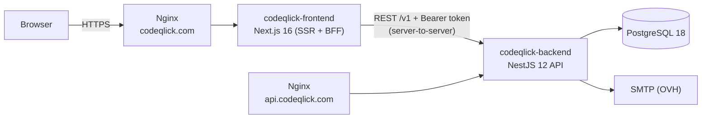
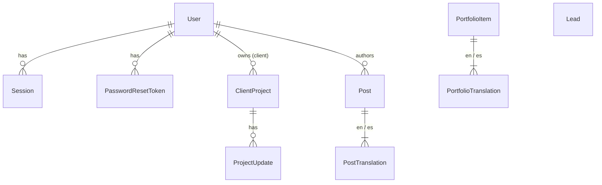
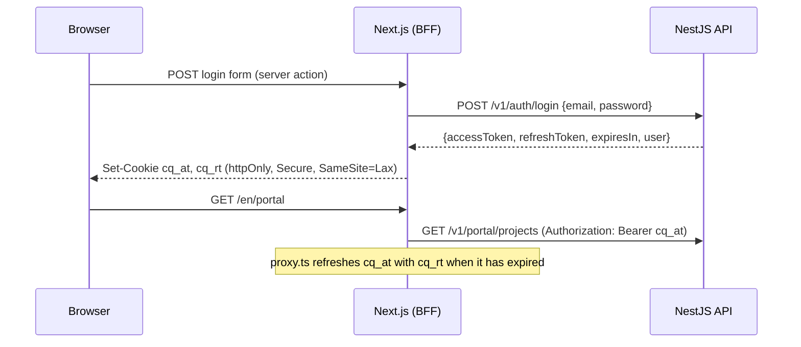

# Codeqlick — Architecture

> *Redefining information technology in society*

This document is the source of truth for how the Codeqlick platform is built. Both apps follow it; change it in the same pull request as any change that breaks it.

## 1. Overview



Two independent deployables in one repository:

| Directory | What it is | Runs on |
|---|---|---|
| `codeqlick-frontend/` | Public website (EN/ES), blog, portfolio, contact form, client portal and admin panel | Node 24, port 3000 |
| `codeqlick-backend/` | REST API: auth, leads, blog, portfolio, client projects, users | Node 24, port 4000 |

They share **no code**. The contract between them is the HTTP API (section 5), documented live with OpenAPI at `/docs` in non-production environments.

## 2. Principles

1. **The backend owns data and rules.** The frontend never talks to the database and never re-implements validation it can get from the API (it validates for UX, the API validates for truth).
2. **Backend-for-frontend (BFF).** The browser only talks to `codeqlick.com`. Next.js server components, server actions and the proxy call the API server-to-server. Tokens never reach browser JavaScript.
3. **Secure by default.** Every API route requires authentication unless explicitly marked `@Public()`. Admin routes additionally require the `ADMIN` role.
4. **Validate at the edge.** Every request body, query and param is parsed with a Zod schema (NestJS 12 Standard Schema validation). Environment variables are validated at boot; the app refuses to start with bad config.
5. **Modules by domain, layers inside.** Each backend module owns its controller (HTTP), service (use cases), repository (persistence) and schemas.
6. **Exact dependency versions.** No `^` or `~` in any `package.json`. Upgrades are deliberate pull requests.
7. **Boring infrastructure.** PostgreSQL, Docker Compose, Nginx. No managed services required to run it.

## 3. Tech stack

| Concern | Choice | Notes |
|---|---|---|
| Runtime | Node.js 24 LTS | Both apps, Docker `node:24-alpine` |
| Language | TypeScript 6.0 | TS 7 (Go compiler) is held back until linters/test runners support its API |
| Backend framework | NestJS 12 (ESM) | `"type": "module"`, NodeNext resolution |
| Validation | Zod 4 via Standard Schema | `@Body({ schema })` + `StandardSchemaValidationPipe` |
| ORM | Prisma 7 + `@prisma/adapter-pg` | Generated client in `src/generated/prisma` |
| Database | PostgreSQL 18 | |
| Auth | JWT access token (15 min) + rotating refresh token (30 days) | Passwords hashed with Argon2id |
| API docs | `@nestjs/swagger` 12 | Zod → OpenAPI via `z.toJSONSchema` |
| Logging | `nestjs-pino` | JSON logs in production, pretty in development, request IDs |
| Rate limiting | `@nestjs/throttler` | Stricter limits on login and contact form |
| Health | `@nestjs/terminus` | `GET /v1/health` checks the database |
| Email | Nodemailer (SMTP) | Mailpit in development |
| Backend tests | Vitest + `unplugin-swc` + Supertest | |
| Frontend framework | Next.js 16 (App Router) + React 19 | `proxy.ts` (formerly middleware) |
| i18n | `next-intl` 4 | `/en/...` and `/es/...`, English default |
| Styling | CSS Modules + design tokens | Brand tokens in `src/styles/tokens.css` |
| Fonts | `next/font/google` | Downloaded at build time, served from our domain (no Google requests at runtime) |
| Lint / format | oxlint + Prettier | Both apps |
| CI | GitHub Actions | Lint, typecheck, test, build per app |

## 4. Backend (`codeqlick-backend`)

### 4.1 Folder structure

```
src/
  main.ts                    Bootstrap: helmet, CORS, cookie parser, global pipe/filter, Swagger, shutdown hooks
  app.module.ts              Wires all modules, global guards (throttler, JWT auth, roles)
  config/
    env.schema.ts            Zod schema for process.env
    app-config.service.ts    Typed accessors over ConfigService
  common/
    decorators/              @Public(), @Roles(), @CurrentUser()
    guards/                  JwtAuthGuard (global), RolesGuard (global)
    filters/                 ProblemDetailsFilter (RFC 9457 error bodies)
    schemas/                 Shared Zod schemas: pagination, locale, id params, slug
    types/                   AuthUser, Paginated<T>
  prisma/                    PrismaModule + PrismaService (adapter-pg, connect/disconnect)
  generated/prisma/          Prisma client output (git-ignored, created by `prisma generate`)
  modules/
    health/
    auth/                    login, refresh (rotation + reuse detection), logout, me
    users/                   Admin management of admin/client accounts
    mail/                    MailService abstraction over Nodemailer
    leads/                   Public contact form + admin pipeline
    posts/                   Blog (EN/ES translations)
    portfolio/               Case studies (EN/ES translations)
    projects/                Client projects + progress updates (admin writes, client reads own)
    media/                   Image uploads (admin) stored on disk and served publicly
prisma/
  schema.prisma
  migrations/
  seed.ts                    Creates the first admin from env vars
prisma.config.ts
test/                        e2e tests (Supertest)
```

Inside each module:

```
modules/posts/
  posts.module.ts
  posts.controller.ts          Public routes
  admin-posts.controller.ts    Admin routes (@Roles('ADMIN'))
  posts.service.ts             Use cases; throws Nest HTTP exceptions
  posts.repository.ts          The only file that touches Prisma for this domain
  posts.schemas.ts             Zod request schemas + inferred types
  posts.service.spec.ts        Unit tests with a mocked repository
```

Dependency direction: **controller → service → repository → PrismaService**. Never skip a layer, never go backwards. The `media` module has no database table: its `media.storage.ts` plays the repository's role over the file system, and `media.repository.ts` only reads which posts and case studies use an image.

### 4.2 Data model



- **User** — `email` (unique, lower-cased), `passwordHash` (Argon2id), `name`, `role` (`ADMIN` | `CLIENT`), `isActive`.
- **Session** — one row per refresh token: `tokenHash` (SHA-256, unique), `familyId`, `expiresAt`, `revokedAt`, `replacedById`, `userAgent`, `ip`.
- **PasswordResetToken** — one row per "forgot my password" email: `tokenHash` (SHA-256, unique), `expiresAt` (60 minutes), `usedAt`. Asking again deletes the user's unused tokens, so only the latest link works.
- **Lead** — contact form submission: `name`, `email`, `company?`, `budget?`, `message`, `locale`, `status` (`NEW` → `CONTACTED` → `QUALIFIED` → `WON` | `LOST` | `ARCHIVED`), `notes?`.
- **Post / PostTranslation** — `slug` (unique), `status` (`DRAFT` | `PUBLISHED`), `publishedAt`, `coverImageUrl?`; translation per `locale` with `title`, `excerpt`, `content` (Markdown).
- **PortfolioItem / PortfolioTranslation** — same publishing model plus `clientName?`, `projectUrl?`, `technologies[]`, `sortOrder`; translation has `title`, `summary`, `content`.
- **ClientProject** — `clientId`, `name`, `description?`, `phase` (`DISCOVERY` | `DESIGN` | `DEVELOPMENT` | `QA` | `LAUNCHED` | `SUPPORT` | `ON_HOLD`), `progress` (0–100), `startDate?`, `dueDate?`, `stagingUrl?`, `productionUrl?`.
- **ProjectUpdate** — `title`, `body` (Markdown), `authorId`, `createdAt`.

All ids are UUIDs. All tables have `createdAt`/`updatedAt`. `Locale` is an enum `EN` | `ES`; the HTTP API uses lowercase `en` | `es`.

### 4.3 Authentication



- **Access token:** JWT (HS256), 15 minutes, claims `sub`, `role`, `email`.
- **Refresh token:** 48 random bytes, base64url, 30 days. Only its SHA-256 hash is stored. Each refresh **rotates** the token (old one revoked, `replacedById` set). Presenting an already-rotated token is treated as theft: the whole `familyId` is revoked.
- **Logout** revokes the current session.
- **Brute force:** login is limited to 5 attempts per minute per IP; the service runs an Argon2 verify even when the email doesn't exist, so timing doesn't reveal accounts.
- Deactivating a user (`isActive=false`) revokes all their sessions.

### 4.4 Errors

All errors use RFC 9457 *problem details* with `Content-Type: application/problem+json`:

```json
{ "type": "about:blank", "title": "Bad Request", "status": 400, "detail": "Validation failed", "instance": "/v1/leads", "errors": [{ "path": "email", "message": "Invalid email" }], "requestId": "…" }
```

Unknown errors return 500 without leaking internals; the stack goes to the logs with the request id.

### 4.5 Configuration (environment)

| Variable | Example | Notes |
|---|---|---|
| `NODE_ENV` | `production` | `development` \| `test` \| `production` |
| `PORT` | `4000` | |
| `DATABASE_URL` | `postgresql://codeqlick:…@localhost:5432/codeqlick` | |
| `CORS_ORIGINS` | `https://codeqlick.com` | Comma-separated |
| `SITE_URL` | `https://codeqlick.com` | Public URL of the website, for links in emails |
| `JWT_ACCESS_SECRET` | 64+ random chars | Required, min 32 |
| `JWT_ACCESS_TTL` | `900` | Seconds |
| `REFRESH_TOKEN_TTL_DAYS` | `30` | |
| `SMTP_HOST` / `SMTP_PORT` / `SMTP_SECURE` / `SMTP_USER` / `SMTP_PASSWORD` | OVH SMTP | |
| `MAIL_FROM` | `Codeqlick <hello@codeqlick.com>` | |
| `LEADS_NOTIFY_TO` | `hello@codeqlick.com` | Where new leads are emailed |
| `UPLOADS_DIR` | `./uploads` | Folder for uploaded images (a Docker volume in production) |
| `SEED_ADMIN_EMAIL` / `SEED_ADMIN_PASSWORD` / `SEED_ADMIN_NAME` | | Only used by `prisma db seed` |
| `LOG_LEVEL` | `info` | |

## 5. API contract (v1)

Base URL: `https://api.codeqlick.com/v1`. JSON in and out. Dates are ISO 8601 strings. Lists are paginated:

```json
{ "items": [ … ], "page": 1, "pageSize": 20, "total": 57, "totalPages": 3 }
```

Query params for lists: `page` (default 1), `pageSize` (default 20, max 100).

### Public

| Method | Path | Body / query | Response |
|---|---|---|---|
| GET | `/health` | | Terminus health result |
| POST | `/leads` | `{ name, email, company?, budget?, message, locale, website? }` (`website` is a honeypot and must be empty) | `201 { id }` — limited to 5/min/IP |
| GET | `/posts` | `?locale=en&page&pageSize` | Paginated `PostSummary` (published only) |
| GET | `/posts/:slug` | `?locale=en` | `PostDetail` or 404 |
| GET | `/portfolio` | `?locale=en&page&pageSize` | Paginated `PortfolioSummary` (published only, by `sortOrder`) |
| GET | `/portfolio/:slug` | `?locale=en` | `PortfolioDetail` or 404 |
| GET | `/media/:filename` | | The uploaded image, cacheable forever (names are never reused); 404 otherwise |
| POST | `/auth/login` | `{ email, password }` | `200 AuthTokens` — limited to 5/min/IP |
| POST | `/auth/refresh` | `{ refreshToken }` | `200 AuthTokens` |
| POST | `/auth/password-reset/request` | `{ email, locale }` | `202` always, whether or not the account exists. An active account is emailed a link to `SITE_URL/{locale}/reset-password?token=…` — limited to 5/min/IP |
| POST | `/auth/password-reset/confirm` | `{ token, newPassword }` | `204`: password set, token spent, every session of the user revoked. `400` when the token is unknown, used or expired — limited to 5/min/IP |

### Authenticated (any role)

| Method | Path | Response |
|---|---|---|
| POST | `/auth/logout` | `{ refreshToken }` → `204` |
| GET | `/auth/me` | `AuthUser` |
| POST | `/auth/password` | `{ currentPassword, newPassword, refreshToken }` → `204`. Revokes the caller's other sessions; the one owning `refreshToken` stays signed in. `400` with a field error when `currentPassword` is wrong or `newPassword` (min 12 chars) equals it — limited to 5/min/IP |

### Client portal (role `CLIENT`; admins may also call)

| Method | Path | Response |
|---|---|---|
| GET | `/portal/projects` | `ClientProject[]` owned by the caller |
| GET | `/portal/projects/:id` | `ClientProject` with `updates[]` (newest first); 404 if not the caller's |

### Admin (role `ADMIN`)

| Method | Path | Body / query |
|---|---|---|
| GET | `/admin/stats` | `{ leads: { new, total }, posts: { published, drafts }, portfolio: { published }, projects: { active }, clients }` |
| GET | `/admin/leads` | `?status&q&page&pageSize` |
| GET | `/admin/leads/export.csv` | `?status&q` (same filters as the list) → `text/csv` attachment with every match, newest first, up to 10,000 rows. UTF-8 with BOM; cells that start like a formula get a leading `'` |
| GET / PATCH | `/admin/leads/:id` | PATCH `{ status?, notes? }` |
| GET / POST | `/admin/posts` | POST `PostInput` |
| GET / PATCH / DELETE | `/admin/posts/:id` | PATCH partial `PostInput` |
| GET / POST | `/admin/portfolio` | POST `PortfolioInput` |
| GET / PATCH / DELETE | `/admin/portfolio/:id` | |
| GET / POST | `/admin/projects` | POST `{ clientId, name, description?, phase, progress, startDate?, dueDate?, stagingUrl?, productionUrl? }` |
| GET / PATCH / DELETE | `/admin/projects/:id` | |
| POST | `/admin/projects/:id/updates` | `{ title, body }` |
| POST | `/admin/media` | `multipart/form-data` with one `file` (PNG, JPEG, WebP or GIF, detected from its content; max 5 MB) → `201 { filename, contentType, size }`; 400 for other content, 413 when too large |
| GET | `/admin/media` | `?page&pageSize` → paginated `{ filename, contentType, size, createdAt, usedBy: { type: 'post' \| 'portfolio', id, slug }[] }`, newest first. `usedBy` lists content that has the image as its cover or in its Markdown |
| DELETE | `/admin/media/:filename` | `204`; `409` while any content still uses the image; `404` for an unknown name |
| GET / POST | `/admin/users` | POST `{ email, name, password, role }`; GET `?role` |
| PATCH | `/admin/users/:id` | `{ name?, password?, isActive?, role? }` |

### Shapes

```ts
type Locale = 'en' | 'es';
type AuthUser = { id: string; email: string; name: string; role: 'ADMIN' | 'CLIENT' };
type AuthTokens = { accessToken: string; refreshToken: string; expiresIn: number; user: AuthUser };

type PostSummary = { slug: string; title: string; excerpt: string; coverImageUrl: string | null; publishedAt: string };
type PostDetail = PostSummary & { content: string; locales: Locale[] };

type Translation<T> = { locale: Locale } & T;
type PostInput = {
  slug: string; status: 'DRAFT' | 'PUBLISHED'; coverImageUrl?: string | null;
  translations: Translation<{ title: string; excerpt: string; content: string }>[]; // at least 'en'
};
type AdminPost = Omit<PostInput, 'coverImageUrl'> & { id: string; coverImageUrl: string | null; publishedAt: string | null; createdAt: string; updatedAt: string };

type PortfolioSummary = { slug: string; title: string; summary: string; clientName: string | null; coverImageUrl: string | null; technologies: string[] };
type PortfolioDetail = PortfolioSummary & { content: string; projectUrl: string | null; locales: Locale[] };
type PortfolioInput = {
  slug: string; status: 'DRAFT' | 'PUBLISHED'; clientName?: string | null; projectUrl?: string | null;
  coverImageUrl?: string | null; technologies: string[]; sortOrder: number;
  translations: Translation<{ title: string; summary: string; content: string }>[];
};

type ClientProject = {
  id: string; name: string; description: string | null;
  phase: 'DISCOVERY' | 'DESIGN' | 'DEVELOPMENT' | 'QA' | 'LAUNCHED' | 'SUPPORT' | 'ON_HOLD';
  progress: number; startDate: string | null; dueDate: string | null;
  stagingUrl: string | null; productionUrl: string | null;
  client: { id: string; name: string; email: string };
  updates?: { id: string; title: string; body: string; createdAt: string; author: { name: string } }[];
  createdAt: string; updatedAt: string;
};

type Lead = { id: string; name: string; email: string; company: string | null; budget: string | null; message: string; locale: Locale; status: 'NEW' | 'CONTACTED' | 'QUALIFIED' | 'WON' | 'LOST' | 'ARCHIVED'; notes: string | null; createdAt: string; updatedAt: string };
type AdminUser = AuthUser & { isActive: boolean; createdAt: string };
```

Slugs match `^[a-z0-9]+(?:-[a-z0-9]+)*$`. A post or portfolio item missing the requested locale falls back to English.

## 6. Frontend (`codeqlick-frontend`)

### 6.1 Folder structure

```
src/
  proxy.ts                     next-intl locale routing + token refresh + route protection
  i18n/
    routing.ts                 locales ['en','es'], default 'en', localePrefix 'always'
    request.ts                 Loads messages per request
    navigation.ts              Locale-aware Link, redirect, usePathname, useRouter
  messages/en.json, es.json    All UI copy
  app/
    layout.tsx                 Root passthrough
    [locale]/
      layout.tsx               <html lang>, fonts, NextIntlClientProvider
      (site)/                  Public website: header + footer
        page.tsx               Landing (hero, services, process, why us, stack, CTA)
        blog/ blog/[slug]/
        work/ work/[slug]/     Portfolio
        contact/               Contact form (server action → POST /v1/leads)
      login/
      forgot-password/         Asks for a reset email
      reset-password/          Landing page of the emailed link: choose a new password
      portal/                  Client area (role CLIENT or ADMIN): projects, account
      admin/                   Admin panel (role ADMIN): dashboard, leads, posts, portfolio, projects, media, users, account;
                               posts and portfolio items have a preview page that renders the saved draft
    media/[file]/route.ts      Serves uploaded images from the API at /media/<filename>
    not-found.tsx
    robots.ts, sitemap.ts
  components/
    brand/                     Logo, Symbol
    layout/                    SiteHeader, SiteFooter, LocaleSwitcher, AppShell (portal/admin)
    ui/                        Button, Field, Select, Textarea, Badge, Card, Pagination, EmptyState
    markdown/                  Markdown renderer (react-markdown, no raw HTML)
    content/                   PostArticle, CaseStudyArticle: shared by the public pages and the admin previews
  lib/
    api/client.ts              Typed fetch wrapper (server-only): base URL, auth header, problem+json errors
    api/types.ts               Types from the API contract (section 5)
    api/*.ts                   One file per resource: posts, portfolio, leads, projects, users, auth, stats
    auth/session.ts            Cookie names, read/write tokens, getCurrentUser(), requireRole()
    env.ts                     Server env validated with Zod (API_URL, SITE_URL)
  styles/
    tokens.css                 Brand tokens (colors, type, spacing, radius)
    globals.css
```

### 6.2 Rules

- **Server first.** Pages are Server Components. Client Components only for interactivity (forms with pending state, locale switcher, mobile nav).
- **Mutations are Server Actions** that call the API, then `revalidatePath` and `redirect`. Forms use `useActionState` to show field errors returned by the API.
- **Caching:** public content is fetched with `next: { revalidate: 300 }`; authenticated data with `cache: 'no-store'`.
- **Auth cookies:** `cq_at` (access token, max-age = `expiresIn`) and `cq_rt` (refresh token, 30 days), both `httpOnly`, `secure` in production, `sameSite: 'lax'`, `path: '/'`.
- **Client IP:** Server Actions for login and contact forward the visitor's IP (`X-Real-IP` from Nginx) to the API as `X-Forwarded-For`, so the API's per-IP rate limits apply per visitor and not per web server.
- `proxy.ts` runs next-intl, then for `/[locale]/portal` and `/[locale]/admin`: if `cq_at` is missing but `cq_rt` exists, it calls `/v1/auth/refresh` and sets new cookies; if neither exists, it redirects to `/[locale]/login?next=…`. Role checks happen in the layouts via `requireRole()`.
- **Images:** uploads go through a Server Action to `POST /v1/admin/media`; the stored URL is `SITE_URL/media/<filename>`, which a route handler serves by fetching the file from the API, so the BFF rule also holds for images.
- **No secrets in the client bundle.** Only `NEXT_PUBLIC_SITE_URL` is public.
- **Accessibility:** semantic HTML, labels on every input, visible focus, 4.5:1 contrast, works without JavaScript for reading content.

## 7. Brand tokens

| Token | Value |
|---|---|
| `--color-fuchsia` | `#D9177E` (primary; white text on it passes WCAG AA at 4.8:1) |
| `--color-fuchsia-dark` | `#A80F5E` (hover, eyebrows on light backgrounds) |
| `--color-fuchsia-light` | `#FF7DBE` (accents on dark backgrounds) |
| `--color-ink` | `#14101F` (text, dark sections) |
| `--color-blush` | `#FCEAF3` (soft backgrounds) |
| `--color-slate` | `#5C5768` (secondary text) |
| Fonts | Space Grotesk (display), IBM Plex Sans (body), JetBrains Mono (code/labels) |

## 8. Environments and deployment

| Environment | How |
|---|---|
| Local | `docker compose up --build -d`: PostgreSQL, Mailpit, `api` and `web` (the `dev` target of each Dockerfile, source bind-mounted for hot reload) |
| Production | VPS (OVH): `docker compose -f docker-compose.prod.yml up -d --build` in `/srv/codeqlick`, Nginx in front with Let's Encrypt |

Production compose runs `db` (PostgreSQL, volume), `backup` (daily `pg_dump` to `/srv/codeqlick/backups`, 14 days kept, plus a copy of the uploaded images), `api` (runs `prisma migrate deploy` on start, keeps uploaded images in the `uploads-data` volume) and `web`. Only Nginx is exposed publicly; `api` and `web` bind to `127.0.0.1`. Step-by-step instructions, the env template and the Nginx sites are in [`deploy/`](../deploy/README.md).

## 9. Quality gates (CI)

Each app has its own workflow, triggered by changes in its folder:

- **Backend:** install → `prisma generate` → lint → typecheck → unit tests → e2e tests against a PostgreSQL service → build.
- **Frontend:** install → lint → typecheck → build.

A pull request can't be merged unless both pass.

## 10. Decisions log

| # | Decision | Why |
|---|---|---|
| 1 | Two apps, no shared package | Independent deploys and versions; the API contract is the boundary |
| 2 | BFF: browser never calls the API directly | Tokens stay httpOnly, no CORS surface for the browser, simpler security |
| 3 | Zod + Standard Schema over class-validator | Native in NestJS 12, one schema gives validation, types and OpenAPI |
| 4 | Rotating refresh tokens with reuse detection | Stolen refresh tokens are detected and the session family is revoked |
| 5 | TypeScript 6.0 instead of 7.0 | TS 7's tooling API isn't stable yet; linters and test runners don't support it |
| 6 | Prisma 7.10 instead of 8.0 RC | Only stable releases in production |
| 7 | Node 24 LTS | Node 26 isn't LTS until late October 2026 |
| 8 | CSS Modules + tokens over a CSS framework | Small surface, no runtime, brand-driven design |
| 9 | Markdown content stored in PostgreSQL | Simple authoring, versionable later, no external CMS |
| 10 | Uploaded images on the API's disk, not in object storage | One VPS and few files: a Docker volume is enough and adds no service or credentials; the URL shape (`/media/<filename>`) would survive a later move |
