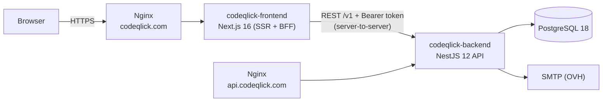
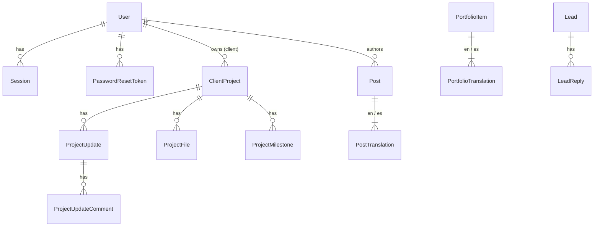
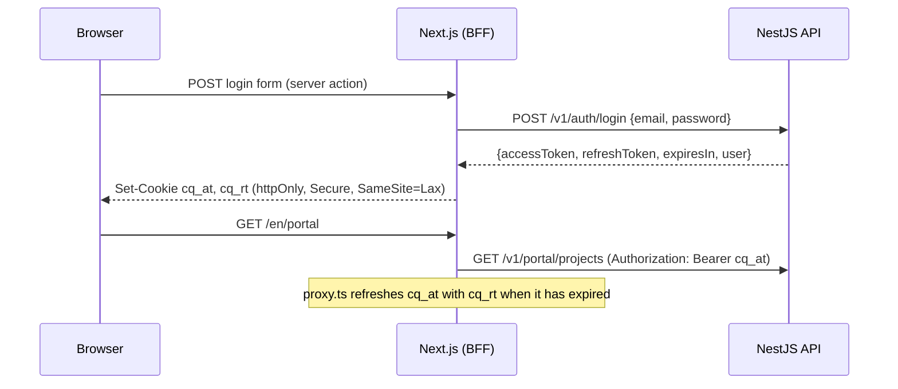

# Codeqlick — Architecture

> *Redefining information technology in society*

This document is the source of truth for how the Codeqlick platform is built. Both apps follow it; change it in the same pull request as any change that breaks it.

## 1. Overview



Two independent deployables in one repository:

| Directory | What it is | Runs on |
|---|---|---|
| `codeqlick-frontend/` | Public website (EN/ES), blog, portfolio, contact form, client portal and admin panel | Node 24, port 3000 |
| `codeqlick-backend/` | REST API: auth, leads, blog, portfolio, client projects, users | Node 24, port 4000 |

They share **no code**. The contract between them is the HTTP API (section 5), documented live with OpenAPI at `/docs` in non-production environments.

## 2. Principles

1. **The backend owns data and rules.** The frontend never talks to the database and never re-implements validation it can get from the API (it validates for UX, the API validates for truth).
2. **Backend-for-frontend (BFF).** The browser only talks to `codeqlick.com`. Next.js server components, server actions and the proxy call the API server-to-server. Tokens never reach browser JavaScript.
3. **Secure by default.** Every API route requires authentication unless explicitly marked `@Public()`. Admin routes additionally require the `ADMIN` role.
4. **Validate at the edge.** Every request body, query and param is parsed with a Zod schema (NestJS 12 Standard Schema validation). Environment variables are validated at boot; the app refuses to start with bad config.
5. **Modules by domain, layers inside.** Each backend module owns its controller (HTTP), service (use cases), repository (persistence) and schemas.
6. **Exact dependency versions.** No `^` or `~` in any `package.json`. Upgrades are deliberate pull requests.
7. **Boring infrastructure.** PostgreSQL, Docker Compose, Nginx. No managed services required to run it.

## 3. Tech stack

| Concern | Choice | Notes |
|---|---|---|
| Runtime | Node.js 24 LTS | Both apps, Docker `node:24-alpine` |
| Language | TypeScript 6.0 | TS 7 (Go compiler) is held back until linters/test runners support its API |
| Backend framework | NestJS 12 (ESM) | `"type": "module"`, NodeNext resolution |
| Validation | Zod 4 via Standard Schema | `@Body({ schema })` + `StandardSchemaValidationPipe` |
| ORM | Prisma 7 + `@prisma/adapter-pg` | Generated client in `src/generated/prisma` |
| Database | PostgreSQL 18 | |
| Auth | JWT access token (15 min) + rotating refresh token (30 days) | Passwords hashed with Argon2id |
| API docs | `@nestjs/swagger` 12 | Zod → OpenAPI via `z.toJSONSchema` |
| Logging | `nestjs-pino` | JSON logs in production, pretty in development, request IDs |
| Rate limiting | `@nestjs/throttler` | Stricter limits on login and contact form |
| Health | `@nestjs/terminus` | `GET /v1/health` checks the database |
| Email | Nodemailer (SMTP) | Mailpit in development |
| Backend tests | Vitest + `unplugin-swc` + Supertest | |
| Frontend tests | Vitest (node) | Unit tests next to the code (`src/**/*.test.ts(x)`): helpers, form schemas and plain components rendered with `react-dom/server`. Pages and Server Actions are checked in a browser |
| Frontend framework | Next.js 16 (App Router) + React 19 | `proxy.ts` (formerly middleware) |
| i18n | `next-intl` 4 | `/en/...` and `/es/...`, English default |
| Styling | CSS Modules + design tokens | Brand tokens in `src/styles/tokens.css` |
| Fonts | `next/font/local` | Latin subset of each variable font (OFL, from Fontsource) in `src/assets/fonts`, served from our domain; neither builds nor visitors reach Google |
| Lint / format | oxlint + Prettier | Both apps |
| Browser tests | Playwright (Chromium) | `codeqlick-frontend/e2e`: public pages, the contact form, and the portal flow (client comments and approves, the team answers), against the whole stack. The E2E workflow builds it from the commit; locally they run against the Docker dev stack (`npm run test:e2e`) |
| CI | GitHub Actions | Lint, typecheck, test, build per app; E2E browser tests; deploy to the VPS once all of a commit's CI has passed |

## 4. Backend (`codeqlick-backend`)

### 4.1 Folder structure

```
src/
  main.ts                    Bootstrap: helmet, CORS, cookie parser, global pipe/filter, Swagger, shutdown hooks
  app.module.ts              Wires all modules, global guards (throttler, JWT auth, roles)
  config/
    env.schema.ts            Zod schema for process.env
    app-config.service.ts    Typed accessors over ConfigService
  common/
    decorators/              @Public(), @Roles(), @CurrentUser()
    guards/                  JwtAuthGuard (global), RolesGuard (global)
    filters/                 ProblemDetailsFilter (RFC 9457 error bodies)
    schemas/                 Shared Zod schemas: pagination, locale, id params, slug
    types/                   AuthUser, Paginated<T>
  prisma/                    PrismaModule + PrismaService (adapter-pg, connect/disconnect)
  generated/prisma/          Prisma client output (git-ignored, created by `prisma generate`)
  modules/
    health/
    auth/                    login, refresh (rotation + reuse detection), logout, me
    users/                   Admin management of admin/client accounts
    mail/                    MailService abstraction over Nodemailer; email-layout.ts renders every email as plain text plus branded HTML
    leads/                   Public contact form + admin pipeline
    posts/                   Blog (EN/ES translations)
    portfolio/               Case studies (EN/ES translations)
    projects/                Client projects + progress updates (admin writes, client reads own)
    support/                 Support requests: clients open and answer them in the portal, the team in the admin panel
    media/                   Image uploads (admin) stored on disk and served publicly
prisma/
  schema.prisma
  migrations/
  seed.ts                    Creates the first admin from env vars
prisma.config.ts
test/                        e2e tests (Supertest)
```

Inside each module:

```
modules/posts/
  posts.module.ts
  posts.controller.ts          Public routes
  admin-posts.controller.ts    Admin routes (@Roles('ADMIN'))
  posts.service.ts             Use cases; throws Nest HTTP exceptions
  posts.repository.ts          The only file that touches Prisma for this domain
  posts.schemas.ts             Zod request schemas + inferred types
  posts.service.spec.ts        Unit tests with a mocked repository
```

Dependency direction: **controller → service → repository → PrismaService**. Never skip a layer, never go backwards. The `media` module has no database table: its `media.storage.ts` plays the repository's role over the file system, and `media.repository.ts` only reads which posts and case studies use an image.

### 4.2 Data model



- **User** — `email` (unique, lower-cased), `passwordHash` (Argon2id), `name`, `role` (`ADMIN` | `CLIENT`), `isActive`, `locale` (`EN` | `ES`, default `EN`: language of the emails the platform sends them).
- **Session** — one row per refresh token: `tokenHash` (SHA-256, unique), `familyId`, `expiresAt`, `revokedAt`, `replacedById`, `userAgent`, `ip`.
- **PasswordResetToken** — one row per "forgot my password" email or welcome email: `tokenHash` (SHA-256, unique), `expiresAt` (60 minutes for a reset, 7 days for a welcome email), `usedAt`. Asking again deletes the user's unused tokens, so only the latest link works.
- **Lead** — contact form submission: `name`, `email`, `company?`, `budget?`, `message`, `locale`, `status` (the sales process from the wiki's Client Engagement: `NEW` → `TALKING` → `CALL` → `PROPOSAL` → `WON` / `LOST`; `SPAM` is not a stage and stays off the board), `lostReason?` (`PRICE`, `NO_RESPONSE`, `NOT_A_FIT`, `CHOSE_OTHER`, `TIMING`, `OTHER`; kept only while LOST), `followUpOn?` (date), `clientId?` (the account it became), `notes?`.
- **LeadReply** — an email answer sent to a lead from the admin panel: `leadId`, `authorId?` (null once the user is deleted), `authorName` copied at the time, `subject`, `body`. Only stored once the email was accepted by the SMTP server.
- **Post / PostTranslation** — `slug` (unique), `status` (`DRAFT` | `PUBLISHED`), `publishedAt`, `coverImageUrl?`; translation per `locale` with `title`, `excerpt`, `content` (Markdown).
- **Tag / PostTag** — blog topics shared by both languages: `slug` (unique, used in `/blog?tag=`), `nameEn`, `nameEs`; `PostTag` joins posts and tags (both sides cascade, so deleting a tag just removes it from its posts). Up to 10 tags per post.
- **Scheduling (posts and case studies):** content is live when `status = PUBLISHED` and `publishedAt <= now`. A published item dated in the future is *scheduled*: the public API (lists, detail, so also the sitemap and RSS) hides it until then and it appears on its own, with no job to run, within the public pages' 5-minute revalidation. `publishedAt` is set on the first publish unless one is given; clearing it on a published item means now. The admin panel types it in Madrid time.
- **PortfolioItem / PortfolioTranslation** — same publishing model plus `clientName?`, `projectUrl?`, `technologies[]`, `services[]` (the website's service keys: web, custom, mobile, design, consulting, support), `sortOrder`, `testimonialAuthor?`; translation has `title`, `summary`, `content`, `testimonialQuote?`, `testimonialRole?`. A case study has a testimonial in a language when it has an author and a quote in that language; it is shown on the case study and on the home page.
- **ClientProject** — `clientId`, `name`, `description?`, `phase` (`DISCOVERY` | `DESIGN` | `DEVELOPMENT` | `QA` | `LAUNCHED` | `SUPPORT` | `ON_HOLD`), `progress` (0–100), `startDate?`, `dueDate?`, `stagingUrl?`, `productionUrl?`.
- **ProjectUpdate** — `title`, `body` (Markdown), `authorId`, `createdAt`, `approvalRequested` (the team asks the client to approve it), `approvedAt?`, `approvedById?`.
- **ProjectUpdateComment** — a comment on an update by the client or the team: `body` (plain text, max 5000), `authorId?`, `createdAt`. Comments by an ADMIN are shown as the team's.
- **ProjectMilestone** — a step of the project shown to the client as a timeline: `title`, `description?` (plain text, max 2000), `dueDate?`, `completedAt?` (set when the admin marks it done; null while open), `position` (order set by the admin, 0-based). The first milestone not done is the "next" one.
- **ProjectFile** — a file shared with the project's client: `name` (original name, cleaned), `contentType` (as sent by the uploader; informational), `size`, `uploadedById?`. The content is stored on disk at `UPLOADS_DIR/project-files/<id>`, never under a public URL.
- **SupportTicket** — a request a client opens from the portal: `number` (sequential, shown as `#12`), `clientId`, `projectId?` (one of the client's projects), `type` (`BUG` | `CHANGE` | `QUESTION`), `priority` (`LOW` | `NORMAL` | `HIGH` | `URGENT`), `status` (`OPEN` | `IN_PROGRESS` | `WAITING_CLIENT` | `RESOLVED` | `CLOSED`), `title`, `resolvedAt?` (set when it becomes RESOLVED or CLOSED, cleared when it is reopened).
- **TicketMessage** — the request's conversation, oldest first: `body` (plain text, max 20 000), `authorId?`. The first message is the client's description; messages by an ADMIN are shown as the team's.
- **TicketAttachment** — a file added to a support request by the client or the team: `name`, `contentType`, `size`, `uploadedById?`. Stored on disk at `UPLOADS_DIR/ticket-files/<id>`, like project files.
- **SavedReply** — a reusable text for lead replies and project comments: `title` (only the admin sees it) and `body`. The admin panel puts `{name}` (lead or client) and `{project}` in when it inserts the text.
- **ActivityLog** — who changed what: `actorId?` (null once the user is deleted) and `actorName` copied at the time, `action` (`<target>.<verb>`, e.g. `post.published`), `targetType`, `targetId?`, `targetLabel?` (title, name or email at the time), `details?` (JSON: what changed, e.g. `{ phase, progress }`). Written by the services after each admin change and each change to one's own account (password, two-step verification, signing out devices); a failed write is logged and never fails the change.

All ids are UUIDs. All tables have `createdAt`/`updatedAt`. `Locale` is an enum `EN` | `ES`; the HTTP API uses lowercase `en` | `es`.

### 4.3 Authentication



- **Access token:** JWT (HS256), 15 minutes, claims `sub`, `role`, `email`, `name` and `sid` (the session's `familyId`, which marks the current device in the sessions list).
- **Refresh token:** 48 random bytes, base64url, 30 days. Only its SHA-256 hash is stored. Each refresh **rotates** the token (old one revoked, `replacedById` set). Presenting an already-rotated token is treated as theft: the whole `familyId` is revoked.
- **Logout** revokes the current session.
- **Lead board** (`/admin/leads/board`): the six stages as columns, each with a line on what it means (spam stays in the list). Cards show a lost lead's reason and flag a follow-up date that has arrived, the 50 most recent leads per column. Cards move by drag and drop or with their "Move to" menu (keyboard and touch); the change shows at once (`useOptimistic`) and a Server Action PATCHes the lead. Each column's header counts the open leads whose follow-up date has arrived ("N por seguir hoy").
- **Weekly summary** (clients): `WeeklyDigestService` checks every hour, in the API process. It sends this week's summary to every active client with `weeklyDigest` whose `lastDigestAt` is before this week's Monday 08:00 Madrid time, so a restart or a missed Monday neither skips nor repeats it. For each project the email lists the updates and completed milestones of the last 7 days, updates waiting for approval and the next milestone. A week with nothing to tell sends nothing, but still counts as done. Clients turn it off in their account (`PATCH /auth/preferences`) and admins on the user page, which also has a "send now" button (`POST /admin/projects/weekly-digest/:clientId` → `{ sent }`, or `{ sent: false, reason: 'no-news' }`). Off in tests.
- **Two-step verification required for admins** (`ADMIN_TWO_FACTOR_REQUIRED`, true in production): `RolesGuard` refuses admin routes with 403 `Two-step verification is required for admin accounts` while the admin's account has no TOTP (read from the database, so turning it on takes effect at once). Account routes (`/auth/*`) carry no `@Roles`, so the setup still works. `GET /auth/2fa` reports `required`, and turning it off is refused (409). The admin layout then shows only the account page with a notice, and `apiFetch` sends that 403 to it.
- **Sessions list:** a session (device) is a `familyId`; its live row (the latest rotation) gives the browser, the IP and the last activity. Signing a device out revokes its family; it stays in until its access token expires (15 minutes at most). A refresh token whose row was revoked without a replacement (signed out) is rejected without the reuse alarm.
- **Cleanup:** sessions and password reset tokens are deleted 30 days after they expire (the API checks twice a day). The 30 days keep reuse detection working for a rotated token that comes back shortly after expiring.
- **Brute force:** login is limited to 5 attempts per minute per IP; the service runs an Argon2 verify even when the email doesn't exist, so timing doesn't reveal accounts.
- Deactivating a user (`isActive=false`) revokes all their sessions.
- **Two-step verification (optional, per user):** an RFC 6238 authenticator app (TOTP, SHA-1, 30 s, 6 digits, ±1 step). With it on, a correct password returns `{ twoFactorRequired, challengeToken }` instead of tokens; the challenge is a 5-minute JWT signed with its own key (so it never passes as an access token) and the web app keeps it in the httpOnly cookie `cq_2fa` until the code is entered at `/[locale]/login/verify`. The secret is stored encrypted (AES-256-GCM, key derived from `JWT_ACCESS_SECRET`: rotating that secret means setting two-step verification up again). An accepted time step can't be reused. Ten single-use recovery codes (`xxxx-xxxx`, stored as SHA-256) replace the app when the phone is lost.

### 4.4 Errors

All errors use RFC 9457 *problem details* with `Content-Type: application/problem+json`:

```json
{ "type": "about:blank", "title": "Bad Request", "status": 400, "detail": "Validation failed", "instance": "/v1/leads", "errors": [{ "path": "email", "message": "Invalid email" }], "requestId": "…" }
```

Unknown errors return 500 without leaking internals; the stack goes to the logs with the request id.

### 4.5 Configuration (environment)

| Variable | Example | Notes |
|---|---|---|
| `NODE_ENV` | `production` | `development` \| `test` \| `production` |
| `PORT` | `4000` | |
| `DATABASE_URL` | `postgresql://codeqlick:…@localhost:5432/codeqlick` | |
| `CORS_ORIGINS` | `https://codeqlick.com` | Comma-separated |
| `SITE_URL` | `https://codeqlick.com` | Public URL of the website, for links in emails and the email logo (`/email/logo.png`, served by the frontend) |
| `JWT_ACCESS_SECRET` | 64+ random chars | Required, min 32 |
| `JWT_ACCESS_TTL` | `900` | Seconds |
| `REFRESH_TOKEN_TTL_DAYS` | `30` | |
| `SMTP_HOST` / `SMTP_PORT` / `SMTP_SECURE` / `SMTP_USER` / `SMTP_PASSWORD` | OVH SMTP | |
| `MAIL_FROM` | `Codeqlick <hello@codeqlick.com>` | |
| `LEADS_NOTIFY_TO` | `hello@codeqlick.com` | Where new leads are emailed |
| `UPLOADS_DIR` | `./uploads` | Folder for uploaded images (a Docker volume in production) |
| `SEED_ADMIN_EMAIL` / `SEED_ADMIN_PASSWORD` / `SEED_ADMIN_NAME` | | Only used by `prisma db seed` |
| `LOG_LEVEL` | `info` | |

## 5. API contract (v1)

Base URL: `https://api.codeqlick.com/v1`. JSON in and out. Dates are ISO 8601 strings. Lists are paginated:

```json
{ "items": [ … ], "page": 1, "pageSize": 20, "total": 57, "totalPages": 3 }
```

Query params for lists: `page` (default 1), `pageSize` (default 20, max 100).

### Public

| Method | Path | Body / query | Response |
|---|---|---|---|
| GET | `/health` | | Terminus health result |
| POST | `/leads` | `{ name, email, company?, budget?, message, locale, website? }` (`website` is a honeypot and must be empty) | `201 { id }` — limited to 5/min/IP |
| GET | `/posts` | `?locale=en&page&pageSize&tag&q` | Paginated `PostSummary` (published only). `q` (max 100 characters) keeps posts whose title, excerpt or content contains it in the requested locale or English, ignoring case and accents (Postgres `unaccent`); `%` and `_` are literal |
| GET | `/posts/tags` | `?locale=en` → `[{ slug, name, count }]`: tags used by live posts, named in `locale`, by name |
| GET | `/posts/:slug/related` | `?locale=en&limit=3` (1–6) → `PostSummary[]`: live posts sharing the most tags, newest first among equals, topped up with the latest posts |
| GET | `/posts/:slug` | `?locale=en` | `PostDetail` or 404 |
| GET | `/portfolio` | `?locale=en&page&pageSize&testimonials=true&technology&service` | Paginated `PortfolioSummary` (published only, by `sortOrder`); `testimonials=true` keeps those with a testimonial in `locale`; `technology` (exact name) and `service` (key) filter and combine |
| GET | `/portfolio/filters` | — | `{ technologies: { name, count }[], services: { key, count }[] }` over published case studies, for the list's filter chips |
| GET | `/portfolio/:slug` | `?locale=en` | `PortfolioDetail` or 404 |
| GET | `/media/:filename` | | The uploaded image, cacheable forever (names are never reused); 404 otherwise |
| POST | `/auth/login` | `{ email, password }` | `200 AuthTokens`, or `200 { twoFactorRequired: true, challengeToken }` when two-step verification is on — limited to 5/min/IP |
| POST | `/auth/2fa/verify` | `{ challengeToken, code }` (authenticator or recovery code) | `200 AuthTokens`; `401` for a wrong code or an expired challenge — limited to 5/min/IP |
| POST | `/auth/refresh` | `{ refreshToken }` | `200 AuthTokens` |
| POST | `/auth/password-reset/request` | `{ email, locale }` | `202` always, whether or not the account exists. An active account is emailed a link to `SITE_URL/{locale}/reset-password?token=…` — limited to 5/min/IP |
| POST | `/auth/password-reset/confirm` | `{ token, newPassword }` | `204`: password set, token spent, every session of the user revoked. `400` when the token is unknown, used or expired — limited to 5/min/IP |

### Authenticated (any role)

| Method | Path | Response |
|---|---|---|
| POST | `/auth/logout` | `{ refreshToken }` → `204` |
| GET | `/auth/me` | `AuthUser` |
| GET | `/auth/2fa` | `{ enabled, recoveryCodesLeft }` |
| POST | `/auth/2fa/setup` | `{ secret, otpauthUrl }`: a new secret, pending until confirmed; `409` when already on |
| POST | `/auth/2fa/enable` | `{ code }` → `{ recoveryCodes }` (shown once); `400` for a wrong code — limited to 5/min/IP |
| POST | `/auth/2fa/disable` | `{ password, code }` → `204`; `400` with a field error for a wrong password or code — limited to 5/min/IP |
| GET | `/auth/sessions` | `ActiveSession[]`: `{ id, userAgent, ip, lastActiveAt, current }`, one per signed-in device, most recent first (`id` is the family id) |
| DELETE | `/auth/sessions/:id` | `204`: signs that device out; `404` when it isn't the caller's or has already ended |
| POST | `/auth/sessions/revoke-others` | `{ refreshToken }` → `204`: signs out every device except the one owning `refreshToken` |
| POST | `/auth/password` | `{ currentPassword, newPassword, refreshToken }` → `204`. Revokes the caller's other sessions; the one owning `refreshToken` stays signed in. `400` with a field error when `currentPassword` is wrong or `newPassword` (min 12 chars) equals it — limited to 5/min/IP |

### Client portal (role `CLIENT`; admins may also call)

| Method | Path | Response |
|---|---|---|
| GET | `/portal/projects` | `ClientProject[]` owned by the caller |
| GET | `/portal/projects/:id` | `ClientProject` with `updates[]` and `files[]` (`{ id, name, contentType, size, createdAt }`), newest first, and `milestones[]` (`{ id, title, description, dueDate, completedAt }`) in the admin's order; 404 if not the caller's |
| POST | `/portal/projects/:id/updates/:updateId/comments` | `{ body }` → `201 UpdateComment` (`{ id, body, createdAt, author: { name, team } }`). A client's comment emails the team inbox (`LEADS_NOTIFY_TO`, reply-to the client) |
| POST | `/portal/projects/:id/updates/:updateId/approval` | Role CLIENT only (403 for admins) → `ProjectUpdate` with `approvedAt`; 400 when the update doesn't ask for approval; approving again keeps the first approval. Emails the team inbox |
| GET | `/portal/projects/:id/files/:fileId` | The file, always as `application/octet-stream` with `Content-Disposition: attachment` (UTF-8 name); 404 if the project isn't the caller's |
| GET / POST | `/portal/tickets` | GET `?page&pageSize` → `Paginated<Ticket>` of the caller's requests, latest activity first. POST (role CLIENT only) `{ type, priority?, title, body, projectId? }` → `201 TicketDetail`; 400 when `projectId` isn't one of the caller's projects. Emails the team inbox (`LEADS_NOTIFY_TO`, reply-to the client) |
| GET | `/portal/tickets/:id` | `TicketDetail`; 404 if it isn't the caller's |
| POST | `/portal/tickets/:id/messages` | `{ body }` → `TicketDetail`. A request `WAITING_CLIENT` or `RESOLVED` goes back to `IN_PROGRESS`; 409 when it is `CLOSED`. Emails the team inbox |
| POST | `/portal/tickets/:id/close` | → `TicketDetail` with status `CLOSED` (no more replies) |
| POST | `/portal/tickets/:id/files` | Multipart, one `file` field, up to 25 MB; the request's client or an admin → `201 TicketDetail`; 409 when `CLOSED`. A client's file emails the team inbox |
| GET | `/portal/tickets/:id/files/:fileId` | The file, always as `application/octet-stream` attachment; 404 if the request isn't the caller's (admins may read any) |

### Admin (role `ADMIN`)

| Method | Path | Body / query |
|---|---|---|
| GET | `/admin/stats` | `{ leads: { new, total, lostReasons }, posts: { published, drafts, scheduled }, portfolio: { published }, projects: { active }, clients, support: { active } }` (`support.active`: requests not resolved or closed) |
| GET | `/admin/stats/timeline` | `?months=12` (1–36) → `{ months: [{ month: 'yyyy-mm', leads, leadsWon, posts, caseStudies }] }`: oldest first, every month present; leads by the month they came in, posts and case studies by the month they went live; months in Madrid time |
| GET | `/admin/tickets` | `?status&active=true&page&pageSize` → `Paginated<Ticket>`, latest activity first; `active=true` leaves out RESOLVED and CLOSED |
| GET / PATCH | `/admin/tickets/:id` | `TicketDetail` / `{ status?, priority? }`. Moving it to RESOLVED or CLOSED, or reopening a resolved one, emails the client |
| DELETE | `/admin/tickets/:id/files/:fileId` | `204` |
| POST | `/admin/tickets/:id/messages` | `{ body, status? }` (default `WAITING_CLIENT`) → `TicketDetail`; emails the client the answer in their language, with a link to `SITE_URL/{locale}/portal/support/:id` |
| GET / POST | `/admin/saved-replies` | List (by title) / create `{ title, body }` |
| PATCH / DELETE | `/admin/saved-replies/:id` | `{ title?, body? }` / `204` |
| POST | `/admin/projects/weekly-digest/:clientId` | Sends that client's weekly summary now → `{ sent: true }`, or `{ sent: false, reason: 'no-news' }` |
| GET | `/admin/stats/visits` | `?days=7|30|90` (default 30) → `SiteVisits`: the public site's numbers from Umami (visitors, visits, page views, bounce rate, average visit, visitors in the previous period, daily series in Madrid days, top pages, referrers, countries and `contact-sent` events). `enabled: false` without `UMAMI_URL`, `UMAMI_WEBSITE_ID` and `UMAMI_PASSWORD`; `available: false` when Umami doesn't answer |
| GET | `/admin/activity` | `?targetType=post|portfolio|project|lead|user|media|tag|account&page&pageSize` → `Paginated<ActivityEntry>`: `{ id, action, actor: { id, name }, target: { type, id, label }, details, createdAt }`, newest first |
| GET | `/admin/leads` | `?status&q&page&pageSize` |
| GET | `/admin/leads/export.csv` | `?status&q` (same filters as the list) → `text/csv` attachment with every match, newest first, up to 10,000 rows. UTF-8 with BOM; cells that start like a formula get a leading `'` |
| GET / PATCH | `/admin/leads/:id` | PATCH `{ status?, notes? }` |
| POST | `/admin/leads/:id/convert` | `{ projectName? }` → `201 { lead, client: { id, created, invitationSent? }, project: { id, name } }`: reuses the email's client account or creates one (welcome email), opens a project in DISCOVERY and sets the lead WON. 409 when already converted or the email is an admin's |
| GET / POST | `/admin/leads/:id/replies` | GET → `LeadReply[]` (`{ id, subject, body, author: { name }, createdAt }`, oldest first). POST `{ subject, body }` emails the answer to the lead from `MAIL_FROM` (branded layout in the lead's language, their message quoted) → `201 { reply, lead }`; a lead still `NEW` becomes `TALKING`. `503` when the email can't be sent, and then nothing is stored |
| GET / POST | `/admin/posts` | POST `PostInput` |
| GET / PATCH / DELETE | `/admin/posts/:id` | PATCH partial `PostInput` |
| GET / POST | `/admin/tags` | GET → `AdminTag[]` (`{ id, slug, nameEn, nameEs, postCount }`); POST `{ slug, nameEn, nameEs }`, `409` when the slug is taken |
| PATCH / DELETE | `/admin/tags/:id` | PATCH partial; DELETE removes the tag from its posts |
| GET / POST | `/admin/portfolio` | POST `PortfolioInput` |
| GET / PATCH / DELETE | `/admin/portfolio/:id` | |
| GET / POST | `/admin/projects` | POST `{ clientId, name, description?, phase, progress, startDate?, dueDate?, stagingUrl?, productionUrl? }` |
| GET / PATCH / DELETE | `/admin/projects/:id` | |
| POST | `/admin/projects/:id/updates/:updateId/comments` | `{ body }` → `201 UpdateComment & { clientNotified }`: the client is emailed the comment in their `locale` with a link to the update |
| POST | `/admin/projects/:id/updates` | `{ title, body, notifyClient?, requestApproval? }`. Updates carry `approvalRequested`, `approvedAt`, `approvedBy` and `comments[]` (oldest first). With `notifyClient: true` the client is emailed the update (title, first 1500 characters, link to `SITE_URL/{locale}/portal/projects/:id`) in their `locale`, and the answer carries `clientNotified: boolean`; a failed email or a deactivated client gives `false` and keeps the update |
| POST | `/admin/projects/:id/milestones` | `{ title, description?, dueDate? }` → `201 ProjectMilestone`, added after the last one |
| PATCH / DELETE | `/admin/projects/:id/milestones/:milestoneId` | PATCH `{ title?, description?, dueDate?, completed? }`: `completed: true` sets `completedAt` to now (kept if it was already done), `false` clears it. DELETE → `204`. 404 when the milestone isn't the project's |
| PUT | `/admin/projects/:id/milestones/order` | `{ ids }`: every milestone of the project once, in the new order → `ProjectMilestone[]`; 400 when an id is missing, repeated or foreign |
| POST | `/admin/projects/:id/files` | `multipart/form-data` with one `file` (any type, max 25 MB) → `201 { id, name, contentType, size, createdAt }`; 413 when too large |
| DELETE | `/admin/projects/:id/files/:fileId` | `204`; removes the row and the content. Deleting a project removes its files too |
| POST | `/admin/media` | `multipart/form-data` with one `file` (PNG, JPEG, WebP or GIF, detected from its content; max 5 MB) → `201 { filename, contentType, size }`; 400 for other content, 413 when too large |
| GET | `/admin/media` | `?page&pageSize` → paginated `{ filename, contentType, size, createdAt, usedBy: { type: 'post' \| 'portfolio', id, slug }[] }`, newest first. `usedBy` lists content that has the image as its cover or in its Markdown |
| DELETE | `/admin/media/:filename` | `204`; `409` while any content still uses the image; `404` for an unknown name |
| GET / POST | `/admin/users` | POST `{ email, name, password?, role, locale? }`; GET `?role`. `locale` (default `en`) is stored as the user's email language. Without `password` the account gets a random one nobody knows and the user is emailed (in that language) a link to `SITE_URL/{locale}/reset-password?token=…&welcome=1`, valid 7 days; the answer then carries `invitationSent: boolean` (a failed email keeps the account) |
| PATCH | `/admin/users/:id` | `{ name?, password?, isActive?, role?, locale? }` |
| POST | `/admin/users/:id/invitation` | `{ locale? }` (default: the user's) → `204`: sends the welcome email again, replacing any earlier link. `400` for a deactivated account, `503` when the email can't be sent |

### Shapes

```ts
type Locale = 'en' | 'es';
type AuthUser = { id: string; email: string; name: string; role: 'ADMIN' | 'CLIENT' };
type AuthTokens = { accessToken: string; refreshToken: string; expiresIn: number; user: AuthUser };

type PostSummary = { slug: string; title: string; excerpt: string; coverImageUrl: string | null; publishedAt: string; tags: { slug: string; name: string }[] };
type PostDetail = PostSummary & { content: string; locales: Locale[] };

type Translation<T> = { locale: Locale } & T;
type PostInput = {
  slug: string; status: 'DRAFT' | 'PUBLISHED'; publishedAt?: string | null /* ISO with offset; future = scheduled */; tagIds?: string[]; coverImageUrl?: string | null;
  translations: Translation<{ title: string; excerpt: string; content: string }>[]; // at least 'en'
};
type AdminPost = Omit<PostInput, 'coverImageUrl'> & { id: string; coverImageUrl: string | null; publishedAt: string | null; createdAt: string; updatedAt: string };

type Testimonial = { quote: string; author: string; role: string | null };
type PortfolioSummary = { slug: string; title: string; summary: string; clientName: string | null; coverImageUrl: string | null; technologies: string[]; testimonial: Testimonial | null };
type PortfolioDetail = PortfolioSummary & { content: string; projectUrl: string | null; locales: Locale[] };
type PortfolioInput = {
  slug: string; status: 'DRAFT' | 'PUBLISHED'; publishedAt?: string | null; clientName?: string | null; projectUrl?: string | null;
  coverImageUrl?: string | null; technologies: string[]; sortOrder: number; testimonialAuthor?: string | null;
  translations: Translation<{ title: string; summary: string; content: string; testimonialQuote?: string | null; testimonialRole?: string | null }>[];
};

type ClientProject = {
  id: string; name: string; description: string | null;
  phase: 'DISCOVERY' | 'DESIGN' | 'DEVELOPMENT' | 'QA' | 'LAUNCHED' | 'SUPPORT' | 'ON_HOLD';
  progress: number; startDate: string | null; dueDate: string | null;
  stagingUrl: string | null; productionUrl: string | null;
  client: { id: string; name: string; email: string };
  updates?: { id: string; title: string; body: string; createdAt: string; author: { name: string } }[];
  createdAt: string; updatedAt: string;
};

type Lead = { id: string; name: string; email: string; company: string | null; budget: string | null; message: string; locale: Locale; status: 'NEW' | 'TALKING' | 'CALL' | 'PROPOSAL' | 'WON' | 'LOST' | 'SPAM'; notes: string | null; lostReason: 'PRICE' | 'NO_RESPONSE' | 'NOT_A_FIT' | 'CHOSE_OTHER' | 'TIMING' | 'OTHER' | null; followUpOn: string | null; clientId: string | null; createdAt: string; updatedAt: string };
type Ticket = {
  id: string; number: number; type: 'BUG' | 'CHANGE' | 'QUESTION'; priority: 'LOW' | 'NORMAL' | 'HIGH' | 'URGENT';
  status: 'OPEN' | 'IN_PROGRESS' | 'WAITING_CLIENT' | 'RESOLVED' | 'CLOSED'; title: string;
  client: { id: string; name: string; email: string }; project: { id: string; name: string } | null;
  createdAt: string; updatedAt: string; resolvedAt: string | null;
};
type TicketDetail = Ticket & {
  messages: { id: string; body: string; createdAt: string; author: { name: string; team: boolean } }[];
  files: { id: string; name: string; contentType: string; size: number; createdAt: string; author: { name: string; team: boolean } }[];
};
type AdminUser = AuthUser & { isActive: boolean; createdAt: string };
```

Slugs match `^[a-z0-9]+(?:-[a-z0-9]+)*$`. A post or portfolio item missing the requested locale falls back to English.

## 6. Frontend (`codeqlick-frontend`)

### 6.1 Folder structure

```
src/
  proxy.ts                     next-intl locale routing + token refresh + route protection
  i18n/
    routing.ts                 locales ['en','es'], default 'en', localePrefix 'always'
    request.ts                 Loads messages per request
    navigation.ts              Locale-aware Link, redirect, usePathname, useRouter
  messages/en.json, es.json    All UI copy
  app/
    layout.tsx                 Root passthrough
    [locale]/
      layout.tsx               <html lang>, fonts, NextIntlClientProvider
      (site)/                  Public website: header + footer
        page.tsx               Landing (hero, services, process, why us, stack, CTA)
        services/ services/[slug]/  One page per service (static copy from messages, built ahead of time)
        blog/ blog/[slug]/     blog/[slug]/og: the post's social preview image (route handler)
        work/ work/[slug]/     Portfolio; work/[slug]/og: the case study's social preview image
        about/                 Who is behind Codeqlick (from the company overview in the Notion wiki)
        legal/ privacy/        Legal notice and privacy policy (shown once LEGAL_OWNER_NAME is set)
        contact/               Contact form (server action → POST /v1/leads). Bots are dropped silently: a
                               honeypot field, and submissions made less than 3 s after the form was served
        not-found.tsx          Boundary for notFound() in site pages (unknown post or case study). Next.js 16.4
                               sends those 404s as an empty document and draws this boundary in the browser
      login/
      forgot-password/         Asks for a reset email
      reset-password/          Landing page of the emailed link: choose a new password (worded as a first password with `welcome=1`)
      portal/                  Client area (role CLIENT or ADMIN): projects, support requests, account
      admin/                   Admin panel (role ADMIN): dashboard (monthly charts as server-drawn SVG, recent activity), leads, support, posts, portfolio, projects, media, users, activity, account;
                               posts and portfolio items have a preview page that renders the saved draft; Markdown
                               fields (post and case-study content, project description and updates) have a live
                               preview next to the editor (MarkdownField, client-side, same renderer as the site)
    media/[file]/route.ts      Serves uploaded images from the API at /media/<filename>
    not-found.tsx              404 for every URL that matches no route: a full page (header, footer, locale from
                               the proxy), rendered on the server
    robots.ts, sitemap.ts
  components/
    brand/                     Logo, Symbol
    layout/                    SiteHeader, SiteFooter, LocaleSwitcher, AppShell (portal/admin)
    ui/                        Button, Field, Select, Textarea, Badge, Card, Pagination, EmptyState
    markdown/                  Markdown renderer (react-markdown, no raw HTML)
    content/                   PostArticle, CaseStudyArticle: shared by the public pages and the admin previews
  lib/
    api/client.ts              Typed fetch wrapper (server-only): base URL, auth header, problem+json errors
    api/types.ts               Types from the API contract (section 5)
    api/*.ts                   One file per resource: posts, portfolio, leads, projects, support, users, auth, stats
    auth/session.ts            Cookie names, read/write tokens, getCurrentUser(), requireRole()
    env.ts                     Server env validated with Zod (API_URL, SITE_URL)
  styles/
    tokens.css                 Brand tokens (colors, type, spacing, radius)
    globals.css
```

### 6.2 Rules

- **Server first.** Pages are Server Components. Client Components only for interactivity (forms with pending state, locale switcher, mobile nav).
- **Mutations are Server Actions** that call the API, then `revalidatePath` and `redirect`. Forms use `useActionState` to show field errors returned by the API.
- **Caching:** public content is fetched with `next: { revalidate: 300 }`; authenticated data with `cache: 'no-store'`.
- **Auth cookies:** `cq_at` (access token, max-age = `expiresIn`) and `cq_rt` (refresh token, 30 days), both `httpOnly`, `secure` in production, `sameSite: 'lax'`, `path: '/'`.
- **Client IP and browser:** Server Actions for login and contact, and the proxy's token refresh, forward the visitor's IP (`X-Real-IP` from Nginx) to the API as `X-Forwarded-For` and their `User-Agent`, so per-IP rate limits apply per visitor and not per web server, and sessions record the real device.
- `proxy.ts` runs next-intl, then for `/[locale]/portal` and `/[locale]/admin`: if `cq_at` is missing but `cq_rt` exists, it calls `/v1/auth/refresh` and sets new cookies; if neither exists, it redirects to `/[locale]/login?next=…`. Role checks happen in the layouts via `requireRole()`.
- **Project files:** uploads are a plain multipart form posted to the route handler `/[locale]/admin/projects/[id]/files`, which checks the origin and streams the body to `POST /v1/admin/projects/:id/files` without buffering it (Server Actions cap bodies at 6 MB). Downloads go through `/[locale]/portal/projects/[id]/files/[fileId]`, which streams the API response. Support request files work the same way through `/[locale]/portal/support/[id]/files` (upload, for the client and the admin page, which adds `?from=admin`) and `/[locale]/portal/support/[id]/files/[fileId]` (download).
- **Legal pages:** `/[locale]/legal` (legal notice, LSSI-CE) and `/[locale]/privacy` (GDPR, cookies), written in `src/content/legal` for a private individual as owner. They render, and the footer, sitemap and contact form link to them, only when `LEGAL_OWNER_NAME` is set (`LEGAL_OWNER_TAX_ID` and `LEGAL_OWNER_ADDRESS` are optional); otherwise they are a 404.
- **FAQ:** `components/content/Faq` renders questions from messages (`Faq.items`) as `<details>` (no script) with `FAQPage` structured data: all of them on /services, five on /contact. Answers follow the wiki's Client Engagement and Services pages; there are no prices or durations, because those depend on each proposal.
- **Analytics:** Umami (self-hosted, cookieless) when `UMAMI_URL` and `UMAMI_WEBSITE_ID` are set. Only the public site layout loads the tracker, from `/api/stats/script.js`; its events go to `/api/stats/api/send`. A route handler forwards just those two paths to Umami inside the Docker network, with the visitor's IP and User-Agent, so the CSP stays same-origin and Umami is never public. "Do Not Track" is respected. A sent contact form fires the `contact-sent` event.
- **Social preview images:** a post or case study is shared with its cover. Without one, `og:image` points to `/[locale]/blog/[slug]/og` (or `/work/[slug]/og`), a 1200×630 PNG drawn on request with `next/og` from the title, a label (date or client) and the brand mark, in the brand fonts read from `public/og-fonts/` (WOFF). Pages with neither use `/og-image.png`.
- **Images:** uploads go through a Server Action to `POST /v1/admin/media`; the stored URL is `SITE_URL/media/<filename>`, which a route handler serves by fetching the file from the API, so the BFF rule also holds for images. Covers that are our own uploads go through `next/image` (`images.localPatterns` allows only `/media/**`), so the browser gets a WebP resized to the width it shows; covers at any other URL are shown as they are.
- **No secrets in the client bundle.** Only `NEXT_PUBLIC_SITE_URL` is public.
- **Security headers** (`next.config.ts`): nosniff, referrer policy, `X-Frame-Options`, permissions policy; in production also a Content Security Policy (scripts, styles, fonts and connections from the site only; scripts need `'unsafe-inline'` for the Next.js bootstrap, since a nonce would make every page dynamic) and HSTS for a year.
- **Accessibility:** semantic HTML, labels on every input, visible focus, 4.5:1 contrast, works without JavaScript for reading content.

## 7. Brand tokens

| Token | Value |
|---|---|
| `--color-fuchsia` | `#D9177E` (primary; white text on it passes WCAG AA at 4.8:1) |
| `--color-fuchsia-dark` | `#A80F5E` (hover, eyebrows on light backgrounds) |
| `--color-fuchsia-light` | `#FF7DBE` (accents on dark backgrounds) |
| `--color-ink` | `#14101F` (text, dark sections) |
| `--color-blush` | `#FCEAF3` (soft backgrounds) |
| `--color-slate` | `#5C5768` (secondary text) |
| Fonts | Space Grotesk (display), IBM Plex Sans (body), JetBrains Mono (code/labels) |

## 8. Environments and deployment

| Environment | How |
|---|---|
| Local | `docker compose up --build -d`: PostgreSQL, Mailpit, `api` and `web` (the `dev` target of each Dockerfile, source bind-mounted for hot reload) |
| Production | VPS (OVH): `docker compose -f docker-compose.prod.yml up -d --build` in `/srv/codeqlick`, Nginx in front with Let's Encrypt |

Production compose runs `db` (PostgreSQL, volume), `backup` (daily `pg_dump` to `/srv/codeqlick/backups`, 14 days kept, plus a copy of the uploaded images), `api` (runs `prisma migrate deploy` on start, keeps uploaded images in the `uploads-data` volume) and `web`. Only Nginx is exposed publicly; `api` and `web` bind to `127.0.0.1`. Step-by-step instructions, the env template and the Nginx sites are in [`deploy/`](../deploy/README.md).

## 9. Quality gates (CI)

Each app has its own workflow, triggered by changes in its folder:

- **Backend:** install → `prisma generate` → lint → typecheck → unit tests → e2e tests against a PostgreSQL service → build.
- **Frontend:** install → lint → typecheck → build.

A pull request can't be merged unless both pass.

## 10. Decisions log

| # | Decision | Why |
|---|---|---|
| 1 | Two apps, no shared package | Independent deploys and versions; the API contract is the boundary |
| 2 | BFF: browser never calls the API directly | Tokens stay httpOnly, no CORS surface for the browser, simpler security |
| 3 | Zod + Standard Schema over class-validator | Native in NestJS 12, one schema gives validation, types and OpenAPI |
| 4 | Rotating refresh tokens with reuse detection | Stolen refresh tokens are detected and the session family is revoked |
| 5 | TypeScript 6.0 instead of 7.0 | TS 7's tooling API isn't stable yet; linters and test runners don't support it |
| 6 | Prisma 7.10 instead of 8.0 RC | Only stable releases in production |
| 7 | Node 24 LTS | Node 26 isn't LTS until late October 2026 |
| 8 | CSS Modules + tokens over a CSS framework | Small surface, no runtime, brand-driven design |
| 9 | Markdown content stored in PostgreSQL | Simple authoring, versionable later, no external CMS |
| 10 | Uploaded images on the API's disk, not in object storage | One VPS and few files: a Docker volume is enough and adds no service or credentials; the URL shape (`/media/<filename>`) would survive a later move |
