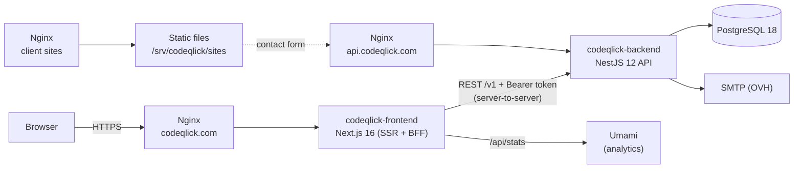
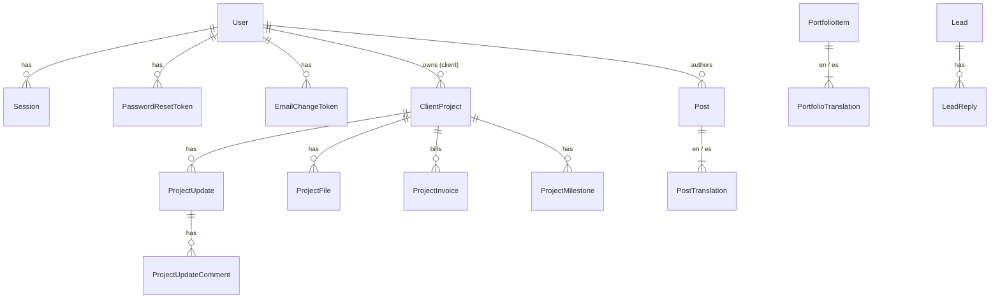
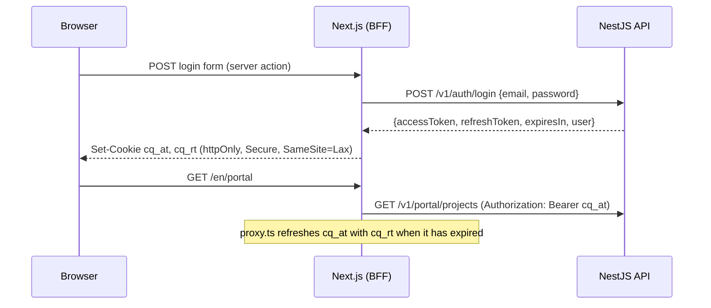

# Codeqlick — Architecture

> *Redefining information technology in society*

This document is the source of truth for how the Codeqlick platform is built. Both apps follow it; change it in the same pull request as any change that breaks it.

## 1. Overview



Two independent deployables in one repository:

| Directory | What it is | Runs on |
|---|---|---|
| `codeqlick-frontend/` | Public website (EN/ES), blog, portfolio, contact form, client portal and admin panel | Node 24, port 3000 |
| `codeqlick-sites/` | The basic-website template (`web-basica`) and the service that builds managed client sites from it | Node 24, internal port 4100 |
| `codeqlick-backend/` | REST API: auth, leads, blog, portfolio, client projects (updates, files, tasks, hours, briefs, reviews, access, monitoring), proposals, support, bookings, settings, users | Node 24, port 4000 |

Client websites hosted by Codeqlick are static sites next to them (section 8.2).

They share **no code**. The contract between them is the HTTP API (section 5), documented live with OpenAPI at `/docs` in non-production environments.

## 2. Principles

1. **The backend owns data and rules.** The frontend never talks to the database and never re-implements validation it can get from the API (it validates for UX, the API validates for truth).
2. **Backend-for-frontend (BFF).** The browser only talks to `codeqlick.com`. Next.js server components, server actions and the proxy call the API server-to-server. Tokens never reach browser JavaScript.
3. **Secure by default.** Every API route requires authentication unless explicitly marked `@Public()`. Admin routes additionally require the `ADMIN` role.
4. **Validate at the edge.** Every request body, query and param is parsed with a Zod schema (NestJS 12 Standard Schema validation). Environment variables are validated at boot; the app refuses to start with bad config.
5. **Modules by domain, layers inside.** Each backend module owns its controller (HTTP), service (use cases), repository (persistence) and schemas.
6. **Exact dependency versions.** No `^` or `~` in any `package.json`. Upgrades are deliberate pull requests.
7. **Boring infrastructure.** PostgreSQL, Docker Compose, Nginx. No managed services required to run it.

## 3. Tech stack

| Concern | Choice | Notes |
|---|---|---|
| Runtime | Node.js 24 LTS | Both apps, Docker `node:24-alpine` |
| Language | TypeScript 7.0 (API and website); 6.0 in the site template | TS 7.0 has only the `tsc` executable: the API compiles and watches with it; `astro check` still needs 6.0 (decision 19) |
| Backend framework | NestJS 12 (ESM) | `"type": "module"`, NodeNext resolution |
| Validation | Zod 4 via Standard Schema | `@Body({ schema })` + `StandardSchemaValidationPipe` |
| ORM | Prisma 7 + `@prisma/adapter-pg` | Generated client in `src/generated/prisma` |
| Database | PostgreSQL 18 | |
| Auth | JWT access token (15 min) + rotating refresh token (30 days) | Passwords hashed with Argon2id |
| API docs | `@nestjs/swagger` 12 | Zod → OpenAPI via `z.toJSONSchema` |
| Logging | `nestjs-pino` | JSON logs in production, pretty in development, request IDs |
| Rate limiting | `@nestjs/throttler` | Stricter limits on login and contact form |
| Health | `@nestjs/terminus` | `GET /v1/health` checks the database |
| Email | Nodemailer (SMTP) | Mailpit in development |
| Backend tests | Vitest + `unplugin-swc` + Supertest | |
| Frontend tests | Vitest (node) | Unit tests next to the code (`src/**/*.test.ts(x)`): helpers, form schemas and plain components rendered with `react-dom/server`. Pages and Server Actions are checked in a browser |
| Frontend framework | Next.js 16 (App Router) + React 19 | `proxy.ts` (formerly middleware) |
| i18n | `next-intl` 4 | `/en/...` and `/es/...`, English default |
| Styling | CSS Modules + design tokens | Brand tokens in `src/styles/tokens.css` |
| Fonts | `next/font/local` | Latin subset of each variable font (OFL, from Fontsource) in `src/assets/fonts`, served from our domain; neither builds nor visitors reach Google |
| Lint / format | oxlint + Prettier | Both apps |
| Browser tests | Playwright (Chromium) | `codeqlick-frontend/e2e`: public pages, the contact form, and the portal flow (client comments and approves, the team answers), against the whole stack. The E2E workflow builds it from the commit; locally they run against the Docker dev stack (`npm run test:e2e`) |
| CI | GitHub Actions | Lint, typecheck, test, build per app; E2E browser tests; deploy to the VPS once all of a commit's CI has passed |

## 4. Backend (`codeqlick-backend`)

### 4.1 Folder structure

```
src/
  main.ts                    Bootstrap: app.setup.ts (helmet, CORS, global pipe/filter, shutdown hooks), Swagger outside production
  app.module.ts              Wires all modules, global guards (throttler, JWT auth, roles)
  config/
    env.schema.ts            Zod schema for process.env
    app-config.service.ts    Typed accessors over ConfigService
  common/
    decorators/              @Public(), @Roles(), @CurrentUser()
    guards/                  JwtAuthGuard (global), RolesGuard (global)
    filters/                 ProblemDetailsFilter (RFC 9457 error bodies)
    schemas/                 Shared Zod schemas: pagination, locale, id params, slug
    types/                   AuthUser, Paginated<T>
  prisma/                    PrismaModule + PrismaService (adapter-pg, connect/disconnect)
  generated/prisma/          Prisma client output (git-ignored, created by `prisma generate`)
  modules/
    health/
    auth/                    login, refresh (rotation + reuse detection), logout, me, two-step verification, sessions
    accounts/                Client companies: `accountOf()` and the people of an account
    activity/                The activity log (who changed what)
    users/                   Admin management of admin/client accounts
    mail/                    MailService abstraction over Nodemailer; email-layout.ts renders every email as plain text plus branded HTML
    leads/                   Public contact form + admin pipeline
    posts/                   Blog (EN/ES translations)
    portfolio/               Case studies (EN/ES translations)
    projects/                Client projects + progress updates (admin writes, client reads own)
    tasks/                   Project tasks: from support requests or planned; the client sees titles and statuses; the release key reads and updates them
    time/                    Time tracking per project and maintenance plans (monthly hour allowances) (admin logs it; the client sees it when the project shows it)
    bookings/                Calls booked from the website (free slots in Madrid time, iCalendar invitations)
    citas/                   Citas: people's booking pages and their appointments (section 4.9)
    swipe/                   Swipe 18+: adults' intimate photos rated by swiping, matches and their chat, moderation and removal requests (section 4.10)
    calculator/              Cost calculator prices (a `settings` row)
    reviews/                 Client reviews: asked for on launch, published on the site with consent
    credentials/             Access clients share for their projects (encrypted; the team reveals, logged)
    monitoring/              Uptime monitoring of hosted client sites (checks every 5 minutes, alerts, status in the portal)
    errors/                  Unexpected errors of the API and the website, grouped, with an email per new one (section 4.11)
    site-forms/              Contact forms of hosted static client sites, relayed to the client's inbox
    domains/                 Client domains: availability, OVH (DNS and expiry) and renewal reminders
    managed-sites/           Managed basic websites: content, revisions, builds through site-builder
    briefs/                  The project brief questionnaire (portal form, admin view, release-key read)
    proposals/               Proposals and quotes: drafted and sent from the admin panel, accepted or declined in the portal
    support/                 Support requests: clients open and answer them in the portal, the team in the admin panel
    media/                   Image uploads (admin) stored on disk and served publicly
    saved-replies/           Reusable texts for lead replies and project comments
    stats/                   Admin dashboard numbers and the public site's visits (Umami)
prisma/
  schema.prisma
  migrations/
  seed.ts                    Creates the first admin from env vars
prisma.config.ts
test/                        e2e tests (Supertest)
```

Inside each module:

```
modules/posts/
  posts.module.ts
  posts.controller.ts          Public routes
  admin-posts.controller.ts    Admin routes (@Roles('ADMIN'))
  posts.service.ts             Use cases; throws Nest HTTP exceptions
  posts.repository.ts          The only file that touches Prisma for this domain
  posts.schemas.ts             Zod request schemas + inferred types
  posts.service.spec.ts        Unit tests with a mocked repository
```

Dependency direction: **controller → service → repository → PrismaService**. Never skip a layer, never go backwards. The `media` module has no database table: its `media.storage.ts` plays the repository's role over the file system, and `media.repository.ts` only reads which posts and case studies use an image.

### 4.2 Data model



- **User** — `email` (unique, lower-cased), `passwordHash` (Argon2id), `name`, `role` (`ADMIN` | `CLIENT`), `isActive`, `locale` (`EN` | `ES`, default `EN`: language of the emails the platform sends them), `weeklyDigest` / `lastDigestAt` (the weekly summary), `monthlyReport` (default true: the monthly website report, section 8.2), `registeredAt?` (decision 17: when the person created the account themselves or accepted the team's invitation; null for a client account the team prepared for an email — a proposal, a project — which nobody can sign in to until its owner registers with that email), `username?` (unique, lower-cased; see "Username" under section 6, "My account"), `avatarKey?` (file name of the profile photo, see "One profile" under section 6), `signupApp?` (decision 29: the web app — `videochat`, `swipe`, `meetings`, `citas` — the person signed up from; null on codeqlick.com or for accounts the team created). `SignupToken.app?` carries it from `/auth/register` until the email is confirmed.
- **Client companies:** a CLIENT user with `memberOfId` is a person of the company whose main client account is `memberOf` (one level: a member can't have members, and projects and proposals must belong to a main account). The main account owns projects, requests and proposals; its active members see and act on all of them (the portal checks the caller's *account*: `accountOf(user)`, carried in the access token as `acc`), and the client emails (updates, comments, replies, status changes, proposals, weekly summary) go to the owner and every active member, each in their language. What a member writes (messages, comments, approvals) is signed with their own name, and team notifications reply to them.
- **Session** — one row per refresh token: `tokenHash` (SHA-256, unique), `familyId`, `expiresAt`, `revokedAt`, `replacedById`, `userAgent`, `ip`.
- **PasswordResetToken** — one row per "forgot my password" email or welcome email: `tokenHash` (SHA-256, unique), `expiresAt` (60 minutes for a reset, 7 days for a welcome email), `usedAt`. Asking again deletes the user's unused tokens, so only the latest link works. An unregistered client's invitation to create their account is one of these too (7 days). **SignupToken** — a self-registration waiting for its email to be confirmed: `email`, `name`, `passwordHash`, `locale`, `tokenHash` (unique), `expiresAt` (24 hours), `usedAt`. **EmailChangeToken** — a change of the account's email waiting for the new address to confirm it: `newEmail`, `tokenHash` (unique), `expiresAt` (24 hours), `usedAt`; asking again replaces the user's pending one.
- **Lead** — contact form submission, or a business the team added itself (`createdById?`: who; a prospect, section 8.2): `name`, `email?` (always set from the forms; a prospect may have none until the team adds it), `company?`, `projectType?` (what they need: `web`, `custom`, `mobile`, `design`, `support`, `not-sure`), `budget?` (only older leads: the form asked for a range before), `message`, `locale`, `status` (the sales process from the wiki's Client Engagement: `NEW` → `TALKING` → `CALL` → `PROPOSAL` → `WON` / `LOST`; `SPAM` is not a stage and stays off the board), `lostReason?` (`PRICE`, `NO_RESPONSE`, `NOT_A_FIT`, `CHOSE_OTHER`, `TIMING`, `OTHER`; kept only while LOST), `followUpOn?` (date), `clientId?` (the account it became), `notes?`, `siteRequest?` (JSON `{ preset, business, domain? }`: when it came from the basic-website request, which onboarding then builds the site from), and its instant preview: `previewSlug?` (unique), `previewStatus?` (`BUILDING` | `READY` | `FAILED` | `REMOVED`), `previewBuiltAt?`, `previewFollowUpAt?` (when the follow-up about it was emailed; never for a prospect) (decision 16, section 8.2), and `proposalId?` (the proposal drafted from the request, `POST /admin/leads/:id/proposal`; null again if it is deleted).
- **SitePurchase** — a request's preview bought online (section 8.2, decision 20): `leadId`, `stripeSessionId` (unique, the Stripe Checkout Session), `amountCents` (the total charged, VAT included), `currency` (`eur`), `status` (`PENDING` → `PAID` | `EXPIRED`), `email?` (the buyer's, from Stripe), `paidAt?`, `projectId?` (the project of the site made from it), `stripeInvoiceId?` (the invoice Stripe issued for it), `error?` (why the site couldn't be made on its own; the team finishes it).
- **LeadReply** — an email answer sent to a lead from the admin panel: `leadId`, `authorId?` (null once the user is deleted), `authorName` copied at the time, `subject`, `body`. Only stored once the email was accepted by the SMTP server.
- **Post / PostTranslation** — `slug` (unique), `status` (`DRAFT` | `PUBLISHED`), `publishedAt`, `coverImageUrl?`; translation per `locale` with `title`, `excerpt`, `content` (Markdown).
- **Tag / PostTag** — blog topics shared by both languages: `slug` (unique, used in `/blog?tag=`), `nameEn`, `nameEs`; `PostTag` joins posts and tags (both sides cascade, so deleting a tag just removes it from its posts). Up to 10 tags per post.
- **Scheduling (posts and case studies):** content is live when `status = PUBLISHED` and `publishedAt <= now`. A published item dated in the future is *scheduled*: the public API (lists, detail, so also the sitemap and RSS) hides it until then and it appears on its own, with no job to run, within the public pages' 5-minute revalidation. `publishedAt` is set on the first publish unless one is given; clearing it on a published item means now. The admin panel types it in Madrid time.
- **PortfolioItem / PortfolioTranslation** — same publishing model plus `clientName?`, `projectUrl?`, `technologies[]`, `services[]` (the website's service keys: web, custom, mobile, design, consulting, support), `sortOrder`, `testimonialAuthor?`; translation has `title`, `summary`, `content`, `testimonialQuote?`, `testimonialRole?`. A case study has a testimonial in a language when it has an author and a quote in that language; it is shown on the case study and on the home page.
- **ClientProject** — `clientId`, `name`, `description?`, `phase` (`DISCOVERY` | `DESIGN` | `DEVELOPMENT` | `QA` | `LAUNCHED` | `SUPPORT` | `ON_HOLD`), `progress` (0–100), `startDate?`, `dueDate?`, `stagingUrl?`, `productionUrl?`, `showHours` (the client sees the hours logged on it; off by default), and its watched domain: `domainName?`, `domainSource` (`RDAP` | `MANUAL` | `OVH`), `domainExpiresAt?` (date), `domainCheckedAt?`, `domainWarnedFor?` (`<day>:<30|7>`, the last reminder). With `RDAP` the expiry is read from the registry's RDAP server (found in IANA's bootstrap, `data.iana.org/rdap/dns.json`); TLDs without RDAP (`.es`) take a date typed by the team. A domain the team's OVH account manages (the client made it the technical contact, decision 15) switches to `OVH` on its next check: the expiry is OVH's (`GET /domain/{name}/serviceInfos`), `.es` included; one OVH stops managing goes back to `RDAP`. 30 and 7 days before it, the team inbox and every person of the client account are emailed, once each per expiry date. A managed site's own domain becomes the project's watched domain when it has none.
- **ProjectUpdate** — `title`, `body` (Markdown), `authorId`, `createdAt`, `approvalRequested` (the team asks the client to approve it), `approvedAt?`, `approvedById?`. A **release** is an update with `version`, `environment` (`STAGING` | `PRODUCTION`) and `url?`: the version deployed, where, and where to try it; posting one also sets the project's `stagingUrl` or `productionUrl` to that URL. A project may have a release key (`releaseTokenHash`, SHA-256 of `cqr_…`, and `releaseTokenCreatedAt`) for its deploy pipeline.
- **ProjectUpdateComment** — a comment on an update by the client or the team: `body` (plain text, max 5000), `authorId?`, `createdAt`. Comments by an ADMIN are shown as the team's.
- **ProjectMilestone** — a step of the project shown to the client as a timeline: `title`, `description?` (plain text, max 2000), `dueDate?`, `completedAt?` (set when the admin marks it done; null while open), `position` (order set by the admin, 0-based). The first milestone not done is the "next" one.
- **ProjectFile** — a file shared with the project's client: `name` (original name, cleaned), `contentType` (as sent by the uploader; informational), `size`, `uploadedById?`. The content is stored on disk at `UPLOADS_DIR/project-files/<id>`, never under a public URL.
- **ProjectInvoice** — an invoice the team issued for a project (decision 23), as the PDF made by the team's invoicing tool: `number` (unique, the invoice's own number), `issuedOn`, `dueOn?` (dates), `amountCents` (the total, VAT included), `currency` (`eur`), `paidAt?` (set by the team), `fileName`, `size`, `uploadedById?`. The PDF is stored at `UPLOADS_DIR/invoices/<id>`, never under a public URL. Its status is derived: `PAID` with `paidAt`, `OVERDUE` once `dueOn` has passed, `DUE` otherwise.
- **SupportTicket** — a request a client opens from the portal: `number` (sequential, shown as `#12`), `clientId`, `projectId?` (one of the client's projects), `type` (`BUG` | `CHANGE` | `QUESTION`), `priority` (`LOW` | `NORMAL` | `HIGH` | `URGENT`), `status` (`OPEN` | `IN_PROGRESS` | `WAITING_CLIENT` | `RESOLVED` | `CLOSED`), `title`, `resolvedAt?` (set when it becomes RESOLVED or CLOSED, cleared when it is reopened).
- **TicketMessage** — the request's conversation, oldest first: `body` (plain text, max 20 000), `authorId?`. The first message is the client's description; messages by an ADMIN are shown as the team's.
- **TicketAttachment** — a file added to a support request by the client or the team: `name`, `contentType`, `size`, `uploadedById?`. Stored on disk at `UPLOADS_DIR/ticket-files/<id>`, like project files.
- **Proposal** — a proposal or quote for a client: `number` (sequential, `#7`), `clientId`, `projectId?` (one of the client's projects), `createdById?`, `title`, `summary` (Markdown: scope), `terms?` (Markdown: payment, deadlines), `currency` (`EUR`), `validUntil?` (date; last day it can be accepted, Madrid time), `status` (`DRAFT` | `SENT` | `ACCEPTED` | `DECLINED` | `WITHDRAWN`), `sentAt?`, `respondedAt?`, `acceptedName?` (the full name the client typed to accept it), `declineReason?`. `expiryRemindedAt?`: when the reminder that it is about to expire went out (section 4.6). Only drafts can be edited or deleted; a sent one gets a new version by duplicating it. Nothing is charged: accepting is a recorded agreement.
- **ProposalTemplate** — a starting point for new proposals ("Web básica"): `name` (unique), `title`, `summary`, `terms?`, `validDays?` (a proposal made from it is valid that many days from the day it is created), `items` (JSON `[{ description, quantity, unitPrice }]`, cents). Admin → Propuestas → Nueva offers them; any proposal can be saved as one.
- **ProposalItem** — a line of a proposal: `position`, `description`, `quantity` (whole units), `unitPrice` (cents). The total is computed, never stored.
- **UpdateDraft** — an update sent with a project's release key and waiting for the team's review: `title`, `body` (Markdown), `version?`, `environment?`, `url?`. The client never sees it; publishing creates the ProjectUpdate (a release when it has a version) from the reviewed text and deletes the draft.
- **MaintenancePlan** — a monthly hour allowance for a project (one per project): `active`, `name`, `monthlyMinutes`, `alertPercent` (default 80), `alertedMonth`/`alertedLevel`. Its time entries draw it down per Madrid calendar month; logging time that crosses the threshold or 100 % emails the team inbox, once a month per level. The client sees the use while it is active. Nothing is billed.
- **SiteForm** — the contact form of a static client site (one per project): public `key` (it goes in the site's HTML), `enabled`, `recipients` (1–5 emails), `submissions` counter, `lastSubmissionAt`. Messages are emailed, never stored. **SiteFormDay** — `formId`, `day` (Madrid), `count`: messages per day, for the visits chart.
- **ManagedSite** — a basic website built from content stored here (one per project, section 8.2): `slug` (unique: folder and preview subdomain `<slug>.<SITES_PREVIEW_DOMAIN>`), `preset` (the demo it started from; its images are usable by name), `content` (JSON: the template's `Site` type without `url`, `form` and `demo`, validated by `siteContentSchema`; uploaded photos are `media/<file>`), `domain?` (the client's own, unique; never under `SITES_PREVIEW_DOMAIN` or the platform's own domain), `domainState?` (`UNREGISTERED`: nobody has it; `ELSEWHERE`: registered but not resolving to `SITES_SERVER_IP` or not answering over HTTPS yet; `LIVE`: it serves the site — null without a domain or before its first check), `domainCheckedAt?`, `mailState?` (where the domain's email goes, from its MX records: `NONE`, `OVH` — `*.ovh.net` — or `OTHER`; checked with the domain, null while unregistered), `status` (`NONE` | `BUILDING` | `LIVE` | `FAILED`), `lastBuildAt?`, `lastBuildError?` (the end of the build log), `release?`, `reportedMonth?` (`yyyy-mm`: the last month its monthly report went out for), `umamiWebsiteId?` (its website in Umami, created on its first build when Umami is set up; the build then adds the cookieless tracker, `UMAMI_SCRIPT_URL`, and the template's privacy and cookie pages mention it). Creating one starts from the preset with the project's name and the client as legal owner, creates the project's site form when missing and sets the project's `stagingUrl` (preview) and `productionUrl` (the domain once LIVE, the preview until then). A domain is published as itself and `www.` (the builder's `domains`). Each check connects it through OVH when the team manages it: its zone's apex and `www` `A`/`AAAA`/`CNAME` records are replaced by one `A` to `SITES_SERVER_IP` unless they already point there (other records, such as MX, are never touched; each change is in the activity log). Turning LIVE rebuilds the site on the domain, turns on its uptime monitor and emails the client; a LIVE domain that still resolves here stays LIVE when HTTPS fails for a moment. Every change is built at once (`url`, `demo: false` and the form's key added); a failed build keeps the previous release online. A site may have a **draft** the client is editing (decision 18): `draftContent?` (the whole content, valid against `siteContentSchema`), `draftPreset?` (the style it starts from, when the client changed it), `draftUpdatedAt?` and `draftKey?` (random, the address of its preview: `/site-draft/<key>/`); publishing it replaces `content` (and `preset`) and clears it. **ManagedSiteRevision** — the content before each change (`authorId?`), the last 20 kept.
- **ClientReview** — the client's review of a project (one per project): `status` (`REQUESTED` | `SUBMITTED` | `PUBLISHED` | `HIDDEN`), `rating` (1–5), `quote`, `authorName`, `authorRole?`, `consent` (may go on the website), `locale` (the language it was written in), `requestedAt`, `submittedAt?`, `publishedAt?`. Asked for (email to every person of the account) when the project's phase moves to `LAUNCHED`, once, or from the project page. The team publishes it only with consent; published reviews show on the home page's testimonials, after the case studies' ones, in their own language.
- **ProjectCredential** — access a client shares for a project instead of emailing it: `label`, `url?`, `username?`, `secret` and `notes?` sealed with AES-256-GCM (key derived from `CREDENTIALS_SECRET`, purpose `project-credentials-v1`), `createdById?`, `viewedAt?`. The people of the client account add and delete theirs but never read a secret back; the team reveals one at a time (logged as `project.credential_viewed`, and the client sees when) and can delete them all at the end. Adding one emails the team inbox, never with the secret.
- **SiteMonitor / SiteCheck** — uptime monitoring of a client project's production site (`productionUrl`): `enabled`, `status` (`UNKNOWN` | `UP` | `DOWN`), `statusSince`, `failures` in a row, `lastCheckedAt`, `lastError`, `certExpiresAt` (read at most hourly), `certWarnedFor`. `MonitoringService` (API process, every 5 minutes, off in tests) requests each enabled site (up below HTTP 400 within 15 s, redirects followed) and stores a `SiteCheck` (`ok`, `statusCode`, `responseMs`, `error`; kept 90 days). Two failures in a row make it DOWN and email the team inbox; its return emails too; a certificate with under 14 days left is warned about once. The server itself (disk ≥ 85 %, memory ≥ 90 %: time for a bigger plan) is watched by `deploy/monitor/monitor.sh`.
- **ProjectBrief** — the client's questionnaire for a project (one per project): `status` (`REQUESTED` | `SUBMITTED`), `answers` (JSON by question: `business`, `goals`, `success`, `audience`, `mustHave`, `niceToHave`, `references`, `brandStatus` none/partial/complete, `brandColors`, `brandTone` formal/friendly/technical/playful, `brandAssetsUrl`, `content` client/codeqlick/both, `domain`, `services`, `deadline`, `deadlineReason`, `other`), `requestedAt`, `submittedAt?`. Created when a lead is converted (no email: the welcome email brings them in), asked for by email when a proposal with a project is accepted or from the project page. Sending needs `business`, `goals`, `audience` and `mustHave`; it can be edited and sent again.
- **ProjectTask** — work on a client project: `title`, `description?` (for the team only), `status` (`TODO` | `IN_PROGRESS` | `DONE`), `doneAt?`, `ticketId?` (the support request it came from). Turning a request into a task moves an open request to `IN_PROGRESS`; when all of a request's tasks are done it becomes `RESOLVED` (the client is emailed, as for any status change).
- **TimeEntry** — time spent on a client project: `projectId`, `userId?` (who logged it), `date` (the day, Madrid), `minutes` (1–1440), `description` (max 500). Logging and deleting entries are recorded in the activity log with the minutes.
- **Setting** — site settings edited in the admin panel, one JSON document per `key`. `calculator`: the cost calculator's prices — per project type (`web`, `custom`, `mobile`, `design`, `support`) `{ min, max, weeksMin, weeksMax }` in euros/weeks for a medium size, size factors `{ small, medium, large }`, extras (`languages`, `accounts`, `payments`, `admin`, `integrations`) `{ min, max }`, and `enabled`. An estimate is the type scaled by the size plus the extras, rounded out to hundreds; types and extras with a maximum of 0 are not offered.
- **Booking** — a video call booked from the website: `name`, `email`, `company?`, `message?`, `locale`, `startsAt`/`endsAt`, `status` (`CONFIRMED` | `CANCELLED`), `slotKey` (the start while confirmed, unique, null once cancelled: no double booking), `cancelTokenHash` (SHA-256 of the token in the visitor's cancel link), `sequence` (calendar revision), `leadId?`. Its settings are the `Setting` `booking`: `enabled`, `meetingUrl` (a fixed Google Meet link), `calendarEmail` (optional: also gets the team's invitations and cancellations, so calls land in that calendar, e.g. the owner's Gmail), `durationMinutes` (15–120, default 30), `minNoticeHours` (default 24), `horizonDays` (default 21) and `weekly` free hours per weekday in Madrid time (`[{ start: 'HH:MM', end: 'HH:MM' }]`). Free slots are those hours cut into calls, after the notice, minus confirmed calls. Booking moves the open lead with that email to `CALL` (or starts one there) with the call's day as follow-up; both sides are emailed an iCalendar invitation (`METHOD:REQUEST`; cancellations send `METHOD:CANCEL` with a higher `SEQUENCE`).
- **BookingPage** / **Appointment** — Citas (section 4.9): a person's booking page (`ownerId`, `slug` unique, `title`, `description`, `durationMinutes`, `location`, `video`, `meetingRoomId?`, `askPhone`, `timeZone`, `weekly`, `minNoticeHours`, `horizonDays`, `enabled`) and the appointments booked on it (`pageId`, `ownerId`, `name`, `email`, `phone?`, `note?`, `locale`, `startsAt`/`endsAt`, `status` reusing `BookingStatus`, `cancelTokenHash`, `sequence`, `reminderSentAt?`). Both cascade with their owner.
- **VideochatProfile** photo verification (section 4.7): `verificationStatus` (NONE · PENDING · APPROVED · REJECTED), `verificationKey?` (private file while pending), `verificationNote?`, `verificationSentAt?`, `verifiedAt?`.
- **SwipeProfile** / **SwipePhoto** / **SwipeVote** / **SwipeMatch** / **SwipeMessage** / **SwipeReport** / **SwipeBlock** / **SwipeTakedown** / **SwipeBlockedHash** — Swipe (section 4.10). Profile per account (`userId` PK: 18+ confirmation and terms version, `nickname`, `gender`, `seeking[]`, `interests[]`, verification `status`/`key`/`note`/`sentAt`/`verifiedAt`, suspension `suspendedAt`/`Until`/`Reason`). Photo (`ref` 8 characters unique, shown on the card; `storageKey` of the private file; `width`, `height`; `hash` dHash; `status` PENDING · LIVE · REJECTED · HIDDEN; `rejectReason`; `likes`; `inAlbum`; reviewer). Vote (PK voter + photo, `ownerId`, `like`). Match (`userAId` < `userBId` unique, `lastMessageAt`, read marks per side) with its messages (≤ 1000 characters). Report (reporter, reported, `photoId?`, `reason`, `details`, chat `transcript` JSON, status, reviewer). Block (both ways hide everything). Takedown (anyone's removal request: `email`, `photoRef`, matched `photoId?`, `reason`, `details`, `locale`, status OPEN · REMOVED · CLOSED, `response`). Blocked hash (removed images, refused on upload). Everything but takedowns and blocked hashes cascades with the account.
- **ErrorGroup** — an unexpected error and its repeats (section 4.11): `fingerprint` (SHA-256, unique), `source` API · WEB_SERVER · WEB_BROWSER, `message`, the last occurrence's `stack`, `method`, `path` (no query string), `reference` (request id or Next.js digest) and `userAgent`, `count`, `firstSeenAt`, `lastSeenAt`, `resolvedAt`.
- **SavedReply** — a reusable text for lead replies and project comments: `title` (only the admin sees it) and `body`. The admin panel puts `{name}` (lead or client) and `{project}` in when it inserts the text.
- **ActivityLog** — who changed what: `actorId?` (null once the user is deleted) and `actorName` copied at the time, `action` (`<target>.<verb>`, e.g. `post.published`), `targetType`, `targetId?`, `targetLabel?` (title, name or email at the time), `details?` (JSON: what changed, e.g. `{ phase, progress }`). Written by the services after each admin change and each change to one's own account (password, two-step verification, signing out devices); a failed write is logged and never fails the change.

All ids are UUIDs. All tables have `createdAt`/`updatedAt`. `Locale` is an enum `EN` | `ES`; the HTTP API uses lowercase `en` | `es`.

### 4.3 Authentication



- **Access token:** JWT (HS256), 15 minutes, claims `sub`, `role`, `email`, `name` and `sid` (the session's `familyId`, which marks the current device in the sessions list).
- **Refresh token:** 48 random bytes, base64url, 30 days. Only its SHA-256 hash is stored. Each refresh **rotates** the token (old one revoked, `replacedById` set). Presenting an already-rotated token is treated as theft: the whole `familyId` is revoked.
- **Logout** revokes the current session.
- **Two-step verification required for admins** (`ADMIN_TWO_FACTOR_REQUIRED`, true in production): `RolesGuard` refuses admin routes with 403 `Two-step verification is required for admin accounts` while the admin's account has no TOTP (read from the database, so turning it on takes effect at once). Account routes (`/auth/*`) carry no `@Roles`, so the setup still works. `GET /auth/2fa` reports `required`, and turning it off is refused (409). The admin layout then shows only the account page with a notice, and `apiFetch` sends that 403 to it.
- **Sessions list:** a session (device) is a `familyId`; its live row (the latest rotation) gives the browser, the IP and the last activity. Signing a device out revokes its family; it stays in until its access token expires (15 minutes at most). A refresh token whose row was revoked without a replacement (signed out) is rejected without the reuse alarm.
- **Cleanup:** sessions and password reset tokens are deleted 30 days after they expire (the API checks twice a day). The 30 days keep reuse detection working for a rotated token that comes back shortly after expiring.
- **Bots and fake accounts (owner's request 2026-11-08):**
  - **Disposable email addresses** (10minutemail, Mailinator, YOPmail…) can't register or become an account's email: `POST /auth/register` and `POST /auth/email` answer `400` with the field error `email: disposable` when the domain, or any domain it is under, is on the community list `disposable-email-domains` (the npm package `disposable-email-domains-js`, kept current by Dependabot). Accounts the team creates or invites are not checked.
  - **Cloudflare Turnstile** on sign-up and sign-in: the website's `/register` and `/login` (on every host, web apps included) show Turnstile's widget (managed mode, light theme, the page's language) when `TURNSTILE_SITE_KEY` is set, and the Server Action sends its token as `captcha`. With `TURNSTILE_SECRET_KEY` set, the API checks the token with Cloudflare's `siteverify` (secret, token and the visitor's IP; 5 s timeout) before anything else and answers `400` with the field error `captcha` when it is missing or refused. If Cloudflare can't be reached the request goes through (logged): an outage must not lock everyone out, and the other limits still apply. Off without the keys (development, tests); `TURNSTILE_SITE_KEY` without the secret only shows the widget. The CSP allows `https://challenges.cloudflare.com` for scripts, frames and connections.
- **Brute force:** login is limited to 5 attempts per minute per IP; the service runs an Argon2 verify even when the email doesn't exist, so timing doesn't reveal accounts.
- Deactivating a user (`isActive=false`) revokes all their sessions.
- **Two-step verification (optional, per user):** an RFC 6238 authenticator app (TOTP, SHA-1, 30 s, 6 digits, ±1 step). With it on, a correct password returns `{ twoFactorRequired, challengeToken }` instead of tokens; the challenge is a 5-minute JWT signed with its own key (so it never passes as an access token) and the web app keeps it in the httpOnly cookie `cq_2fa` until the code is entered at `/[locale]/login/verify`. The secret is stored encrypted (AES-256-GCM, key derived from `JWT_ACCESS_SECRET`: rotating that secret means setting two-step verification up again). An accepted time step can't be reused. Ten single-use recovery codes (`xxxx-xxxx`, stored as SHA-256) replace the app when the phone is lost.

### 4.4 Errors

All errors use RFC 9457 *problem details* with `Content-Type: application/problem+json`:

```json
{ "type": "about:blank", "title": "Bad Request", "status": 400, "detail": "Validation failed", "instance": "/v1/leads", "errors": [{ "path": "email", "message": "Invalid email" }], "requestId": "…" }
```

Unknown errors return 500 without leaking internals; the stack goes to the logs with the request id. They are also recorded for Admin → Errors (section 4.11); an `HttpException` with a 5xx (a service not set up, the API saying it is unavailable) is a known state and is not.

### 4.5 Configuration (environment)

| Variable | Example | Notes |
|---|---|---|
| `NODE_ENV` | `production` | `development` \| `test` \| `production` |
| `PORT` | `4000` | |
| `DATABASE_URL` | `postgresql://codeqlick:…@localhost:5432/codeqlick` | |
| `CORS_ORIGINS` | `https://codeqlick.com` | Comma-separated |
| `SITE_URL` | `https://codeqlick.com` | Public URL of the website, for links in emails and the email logo (`/email/logo.png`, served by the frontend) |
| `JWT_ACCESS_SECRET` | 64+ random chars | Required, min 32 |
| `CREDENTIALS_SECRET` | 64+ random chars | Encrypts the access clients share for their projects (AES-256-GCM). Required in production (`docker-compose.prod.yml`); in development it falls back to `JWT_ACCESS_SECRET`. Changing it makes stored access unreadable |
| `JWT_ACCESS_TTL` | `900` | Seconds |
| `REFRESH_TOKEN_TTL_DAYS` | `30` | |
| `SMTP_HOST` / `SMTP_PORT` / `SMTP_SECURE` / `SMTP_USER` / `SMTP_PASSWORD` | OVH SMTP | |
| `MAIL_FROM` | `Codeqlick <hello@codeqlick.com>` | |
| `LEADS_NOTIFY_TO` | `hello@codeqlick.com` | Where new leads are emailed |
| `UPLOADS_DIR` | `./uploads` | Folder for uploaded images (a Docker volume in production) |
| `SWIPE_UPLOADS_DIR` | `./swipe-uploads` | Swipe's private photos (section 4.10): never served by path, only through the API's access checks. Its own Docker volume (`swipe-data`), left out of the backups on purpose |
| `SITE_BUILDER_URL` / `SITE_BUILDER_TOKEN` | `http://site-builder:4100` | The site builder (section 8.2); without them managed sites answer 503 |
| `SITES_PREVIEW_DOMAIN` | `demo.codeqlick.com` | Managed sites are previewed at `<slug>.<this>` |
| `PUBLIC_API_URL` | `https://api.codeqlick.com/v1` | The API as browsers reach it: managed sites' forms post to `<this>/forms/:key` |
| `SITES_SERVER_IP` | `54.37.159.171` | The server's public IPv4: managed sites' domains must resolve here to be LIVE, and OVH zones point here |
| `OVH_ENDPOINT` / `OVH_APPLICATION_KEY` / `OVH_APPLICATION_SECRET` / `OVH_CONSUMER_KEY` | `https://eu.api.ovh.com/1.0` | OVH's API with the team's keys (rights in `deploy/README.md`), for availability and the domains whose technical contact is the team; off without the three keys. Requests are signed (`$1$` + SHA-1 of secret, consumer key, method, URL, body and OVH's time); no SDK |
| `OVH_NIC_HANDLE` | `ab12345-ovh` | The team's OVH account ID, shown to clients as the technical contact to add |
| `ADMIN_TWO_FACTOR_REQUIRED` | `true` | Admins must have two-step verification to use admin routes (true in production) |
| `UMAMI_URL` / `UMAMI_WEBSITE_ID` / `UMAMI_USERNAME` / `UMAMI_PASSWORD` | `http://umami:3000` | Umami's API inside the Docker network, for the dashboard's visits (`/admin/stats/visits`) and the managed sites' statistics (their websites are created with this account); off without them |
| `UMAMI_SCRIPT_URL` | `https://stats.codeqlick.com/script.js` | The tracker managed client sites load |
| `STRIPE_SECRET_KEY` / `STRIPE_WEBHOOK_SECRET` | `sk_live_…` / `whsec_…` | Buying a preview online (section 8.2, decision 20); off without both. Test keys (`sk_test_…`) in development |
| `SITE_PRICE_CENTS` | `20000` | Price of a basic website bought online, in euro cents before VAT (default 200 €) |
| `SITE_VAT_PERCENT` | `21` | VAT added to it (Spain's general rate); Stripe shows and invoices it as a tax rate "IVA" the API creates once |
| `SEED_ADMIN_EMAIL` / `SEED_ADMIN_PASSWORD` / `SEED_ADMIN_NAME` | | Only used by `prisma db seed` |
| `TURNSTILE_SECRET_KEY` | `0x4AAAA…` | Cloudflare Turnstile's secret key: with it, sign-up and sign-in require a valid Turnstile token (section 4.3); off when empty. The website gets the matching `TURNSTILE_SITE_KEY` |
| `MEETINGS_ORIGINS` | `https://meetings.codeqlick.com` | Pages allowed to open the meetings' WebSocket (section 4.8); production sets it from `MEETINGS_URL` |
| `LOG_LEVEL` | `info` | |

### 4.6 Background work

Scheduled work runs inside the API process (timers that start on boot, off when `NODE_ENV=test`); nothing else needs a scheduler:

- **Uptime monitoring** of client sites every 5 minutes (`MonitoringService`, see SiteMonitor).
- **Session and reset-token cleanup** twice a day (`TokenCleanupService`).
- **Domain renewal** every 6 hours (`DomainsService`): expiry dates older than a day are refreshed (OVH or RDAP) and the reminders due are sent.
- **Request previews** every 6 hours (`SitePreviewsService`): previews older than 30 days, or of converted or spam leads, are taken down, and the follow-ups due are sent (section 8.2).
- **Monthly website report** (clients): `SiteReportsService` checks every hour and, from the 1st at 09:00 Madrid time, sends last month's report of each managed site whose `reportedMonth` is older (section 8.2). Off in tests.
- **Managed sites' domains** every 10 minutes (`SiteDomainsService`): each domain not yet LIVE (and every LIVE one after 6 hours) is connected through OVH when the team manages it and its state checked (see ManagedSite).
- **Weekly summary** (clients): `WeeklyDigestService` checks every hour, in the API process. It sends this week's summary to every active client with `weeklyDigest` whose `lastDigestAt` is before this week's Monday 08:00 Madrid time, so a restart or a missed Monday neither skips nor repeats it. For each project the email lists the updates and completed milestones of the last 7 days, updates waiting for approval and the next milestone. A week with nothing to tell sends nothing, but still counts as done. Clients turn it off in their account (`PATCH /auth/preferences`) and admins on the user page, which also has a "send now" button (`POST /admin/projects/weekly-digest/:clientId` → `{ sent }`, or `{ sent: false, reason: 'no-news' }`). Off in tests.
- **Proposals about to expire** every 6 hours (`ProposalRemindersService`): a `SENT` proposal whose `validUntil` (Madrid day) is today or within the next 3 days, sent more than a day ago and not reminded yet (`expiryRemindedAt`), emails every person of the client account in their language ("it can be accepted until …", with the link to it, or the invitation for someone who hasn't made the account theirs, as when it was sent) and tells the team inbox (`LEADS_NOTIFY_TO`, English). Once per proposal. Off in tests.
- **Scheduled posts and case studies** need no job: they are hidden until their `publishedAt` (see Scheduling).
- **Old resolved errors** daily (`ErrorsService`): resolved groups not seen for 30 days are deleted. Off in tests.

On the host, `deploy/monitor/monitor.sh` (cron, every 5 minutes) watches the server and the stack, and the `backup` container dumps the database daily (section 8).

### 4.7 Video chat (`modules/videochat`)

Codeqlick's first own web app: a random 1:1 video chat at **videochat.codeqlick.com** (spec and decisions also in the Notion roadmap row "Random video chat"). Decisions 21 and 22.

- **Who:** signed-in accounts only (registration confirms the email). Explicit sexual content between consenting adults is allowed (owner's decision, 2026-11-07); minors, non-consent, recording without permission, harassment, hate and anything illegal are not. Before entering, a person gives their date of birth (checked ≥ 18, **not stored**) and accepts the rules (`VIDEOCHAT_TERMS_VERSION`; a new version asks again). `VIDEOCHAT_AGE_VERIFICATION_REQUIRED=true` also requires `ageVerifiedAt` (an age-verification provider or the team, `PUT /admin/videochat/users/:userId/age-verification`); off by default.
- **Media never touches the server:** WebRTC browser to browser, or through **coturn** (TURN) when no direct path exists. The API hands out STUN/TURN URLs (`TURN_URLS`) and TURN credentials valid 12 hours (`<expiry>:<userId>` signed with HMAC-SHA1 of `TURN_SECRET`, coturn's `use-auth-secret`).
- **Signaling:** a WebSocket on the API's HTTP server at `/v1/videochat/ws` (`ws` library, no Nest adapter). Nginx maps `wss://videochat.codeqlick.com/ws` to it. It only accepts `Origin`s in `VIDEOCHAT_ORIGINS` (any origin is refused in production without the header), at most 5 sockets per IP and 64 KB per message, and a socket must send `{ type: 'auth', ticket }` within 5 s. The **ticket** comes from `POST /videochat/ticket`, which the website calls server-side (BFF: no token in the browser): 32 random bytes, single use, 30 s, kept hashed in memory. One live socket per account: a new one closes the old (`error: replaced`, close 4409). Pings every 30 s drop dead sockets.
- **Matching:** in memory (`Matchmaker`; one API instance, scaling out would need a shared store). A `join` pairs with a compatible person waiting, ranked by: first, someone this person hasn't talked to in the last 24 hours (the API remembers each account's last 20 partners, in memory; if only people already met are waiting, they still match); then, the most interests in common; then, who waited longest. Among the best three of that ranking it picks at random; never two sockets of one account, two people who blocked each other (either way), or the same two again within 60 s. The newcomer gets `matched { initiator: true }` and makes the WebRTC offer. Every 5 s the API pairs people already waiting who may meet now (two who just skipped each other, once the 60 s are over), so two people alone never wait forever. While waiting, `waiting { others }` tells how many more people wait who can't be paired with this one now (filters, a block or the 60 s); the room then says so and links to the filters. **Widen the search:** after 30 s waiting with filters on (`seeking`, same country or same language), the room offers "Search without my filters this time" (`widen`): that wait ignores the person's own filters, never the other person's, and the next `join` (after a call or `next`) uses them again; the saved filters don't change. `waiting { others, filtered, widened }` tells the room whether the person has filters and whether this wait is widened.
- **Messages:** browser → server `auth`, `join`, `next`, `leave`, `widen`, `like`, `call { contactId }`, `answer { callId, accept }`, `signal { data: { sdp } | { candidate } }` (relayed as is), `chat { text ≤ 500 }`, `report { reason, details? }`, `block`, and the group messages below; server → browser `ready`, `online`, `waiting`, `matched`, `liked`, `mutual`, `calling`, `incoming`, `call-ended`, `signal`, `chat`, `partner-left`, `reported`, `blocked`, `suspended`, `error { code }`. Limits per socket: 400 messages/min (over it, closed 4429), 20 `next`/min, 20 chat messages/10 s, 200 signals/min, 5 reports or blocks/min; tickets 10/min per account and 30/min per IP.
- **Text chat extras:** while someone types, the partner sees "typing…" (`typing { on }`: sent when typing starts and when it stops — after 3 s without a key, on send, or when the box is emptied; relayed as is, shown for at most 6 s without news). **Quick reactions:** six fixed emojis (❤️ 😂 😮 🔥 👍 😘; `react { emoji }`, anything else is refused) float over the other person's video and are added to the chat log; they count toward the chat limit (20 per 10 s). An incoming message or reaction plays a short soft tone (a "Sounds" switch in the chat turns tones off; remembered on the device) and the tab title flashes while the tab is hidden.
- **Chat translation:** in browsers with the built-in Translator and Language Detector APIs (Chrome and Edge 138+ on desktop), the chat shows a "Translate" switch (remembered on the device). With it on, each message from the other person (or people, in a group) in another language than the page's is translated on the device and shown translated, with "See original"; nothing is sent to a server. Without the APIs the switch isn't shown. The first use may download the browser's language model.
- **Report and block** act on the current partner or on the one of a call that ended less than 5 minutes ago. Both end the call and store a block (reporting someone also blocks them). A report keeps the call's last 30 text messages (`from: reporter | reported`). **Suspension** (`VideochatProfile.suspendedAt`, `suspendedUntil`, `suspensionReason`): automatic after reports from 3 different people within 24 hours (dismissed reports don't count), and at once after one `MINOR` report, which also emails `LEADS_NOTIFY_TO` (no personal data, a link to the admin page); both last until the team reviews them. The team suspends for 24 hours, 7 days, 30 days or for good. A suspended account is disconnected (`suspended`, close 4403) and gets no tickets until the suspension ends or is lifted; a timed one ends by itself (`suspendedUntil` in the past counts as not suspended).
- **Mutual contacts:** during a call or up to 5 minutes after it (like report and block), a person can press "I like them" (`like`). When both have liked each other they become **contacts** (`VideochatLike` rows both ways; a contact is a mutual pair) and both are told at once (`mutual { nickname }`) if connected. Contacts are listed on `/contacts` (nickname, interests, whether they are in the video chat right now and free); "Call" opens the room with `?call=<contactId>`, which sends `call` once connected. A person can **call** a contact who is connected and not in a call (`call { contactId }`): the contact gets `incoming { callId, partner }` wherever they are in the room (searching or idle), and accepts or declines (`answer { callId, accept }`); the caller gets `calling { callId, partner }` and can hang up; unanswered after 30 s it ends (`call-ended { callId, reason: declined | timeout | busy | offline | cancelled }`; searching, next or stop by either side cancels it, and a contact who was searching searches again). A call to someone who is not a contact gets `error { code: not-contact }`. On accept both leave the queue and start a normal call (report, block and next work as usual; the caller makes the offer). Only between mutual contacts with no block either way; at most 10 calls a minute per socket. Removing a contact (`DELETE /videochat/contacts/:id`) deletes the caller's like, so the pair is no longer mutual; blocking deletes both likes. `contactId` is the other account's id, only ever shown to their contacts.
- **Group calls (owner's request 2026-11-08):** up to 4 mutual contacts in one video call (`GROUP_MAX`), browser to browser as a mesh (each one sends to all the others, like Meetings), over the same socket. Whoever is in a group (or starts one) invites a contact who is connected and free (not in a call, ringing or another group): `group-invite { contactId }`. The first invite creates the group with the inviter alone in it (`group { groupId, self, members[] }`). The contact gets `group-invited { groupId, from, size }` wherever they are in the room and accepts or declines (`group-answer { groupId, accept }`); unanswered after 60 s, or when the group ends or fills, it ends (`group-invite-ended { groupId, reason: declined | timeout | busy | offline | full | gone | blocked | not-contact }`, sent to both). Nobody joins a group where a member blocked them or was blocked by them. Joining leaves any 1:1 call or queue; the newcomer gets `group` with the people inside and makes a WebRTC offer to each one (`group-signal { to | from, data }`, relayed only between members); the others get `group-joined { member }`. `group-leave` (or `join`/`next`, or closing the socket) leaves it, the others get `group-left { memberId }`; the last one may stay alone and invite again; an empty group is forgotten. Members' ids are per connection, never account ids. `group-chat { text ≤ 500 }` goes to everyone in the group (`group-chat { from, text }`, same limit as the 1:1 chat). In the room, `group-contacts` returns the person's contacts with whether each can be invited now (`group-contacts { items }`). **Safety:** every member has Report and Block (`group-report { memberId, reason, details? }`, `group-block { memberId }`): the same reports, blocks and automatic suspensions as 1:1; a report keeps the reporter's and the reported person's last group messages (`from: reporter | reported`), and both take the reporter out of the group. The contacts page has "Group" next to "Call" (`/room?group=<contactId>`, which sends `group-invite` once connected). Group calls are not in the statistics.
- **Public profile and filters (all free):** a nickname (the account's username, see "Username" in section 6; never the account name), gender (`WOMAN` · `MAN` · `NONBINARY`, optional), who they want to meet (`seeking`, any of the three; empty means anyone), country (ISO 3166-1 alpha-2, optional) and language (ISO 639-1, optional), with "same country only" and "same language only". **Interests:** up to 5 from a fixed list (`chat`, `friends`, `flirting`, `music`, `movies`, `series`, `gaming`, `sports`, `fitness`, `travel`, `books`, `art`, `photography`, `tech`, `food`, `anime`, `languages`, `nature`, `pets`, `fashion`, and a +18 group shown apart: `spicy`, `explicit`, `showing`, `watching`, `roleplay`, `fetish`, `bdsm`, `striptease`, `mutual`, `couples`, `lgbtq`, `nostrings`; no free text, so nothing to moderate). They don't filter anyone out: they make people with interests in common meet first, and the call shows the partner's interests, highlighting the shared ones. Filters hold **both ways**: two people match only when each one's gender is in the other's `seeking` (an empty `seeking` takes anyone, a person without gender only matches empty `seeking`), and each one's "same country/language only" is met. `matched` carries the partner's public profile `{ nickname, gender, country, language, interests, verified }` (nulls when unset). Changes apply from the next socket, which the room opens after saving.
- **Appeals:** a suspended person can appeal once per suspension (`VideochatAppeal`, a message ≤ 2,000 characters). The team accepts (lifts the suspension) or rejects it, with an optional answer, and the person gets an email either way. **History:** every suspension and lift is a `VideochatSanction` row (who, automatic or not, why, until when, which report), shown on the admin's page for the person. Suspending, lifting, dismissing reports, resolving appeals and age checks go to the activity log (target `videochat`).
- **Experience:** the landing shows how many people are online (`GET /videochat/online`, public); the room shows it live too (`online { count }`, sent on `ready` and, every 5 s, to people not in a call or group when the number changed); in the room, `Esc` is "next", a match plays a short tone and flashes the tab title, a lost socket reconnects by itself (1, 2, 4… up to 30 s, with a new ticket), and a call whose connection fails (ICE `failed`, or no media within 15 s) moves on to the next person. The room works on phones (portrait: the partner's video full width, own video as a corner thumbnail, the buttons in an even grid and the chat below). **On phones:** "Switch camera" (front ↔ back, shown when the device has more than one camera; the new track replaces the old one in the call without renegotiating, and only the front camera is mirrored); "Full screen" (the call fills the screen with the buttons over the video; the browser's full screen where it exists, else the same layout inside the page; Esc or the button leaves it); a **weak connection** badge on the partner's video when, for two samples in a row (every 3 s, `getStats`), the round trip is over 600 ms, more than 8% of video packets are lost or the video drops under 8 frames per second (it goes after two good samples); the screen stays on during a call (Wake Lock, where supported); a match or a contact's call vibrates (where supported). In portrait the buttons sit in a bar fixed to the bottom of the screen (above the home indicator), at least 48 px high, with "Next" the widest.
- **App on the phone (PWA):** on the video chat's host, `/manifest.webmanifest` describes the video chat (name "Codeqlick Videochat", `start_url` `/`, `display: standalone`, light theme colours, the brand icons), so it installs as an app: an "Install the app" button where the browser offers it (`beforeinstallprompt`), and the steps for iPhone (Share → Add to Home Screen) elsewhere. The main site keeps its own manifest.
- **"Tell me when someone is there" (Web Push, opt-in per device):** on `/settings` a person turns on notifications for that browser. The browser registers `/videochat-sw.js` (the service worker only shows notifications and opens the video chat when one is tapped; no caching), subscribes with the server's VAPID public key and the website stores the subscription (`PUT /videochat/push`; `DELETE` removes it). When someone has been waiting alone for 20 s, the API notifies, through `web-push`, people who are not connected, are allowed in (onboarded, not suspended), have not blocked or been blocked by them and whose filters match the waiting person's both ways; at most once every 6 hours per account and at most 20 accounts per notification, at most one round a minute. The notification is in the subscription's language and carries no name or profile ("Someone is waiting in the video chat"). A subscription the push service reports gone (404/410) is deleted; at most 10 per account (the oldest go). Off while `VAPID_PUBLIC_KEY`/`VAPID_PRIVATE_KEY` are empty (`VAPID_SUBJECT` defaults to `mailto:hello@codeqlick.com`). On iPhone, notifications need the app installed first (iOS 16.4+).
- **Peak time alerts (opt-in per account):** with notifications on, `/settings` offers "Also tell me at peak time" (`VideochatProfile.peakAlerts`, `PUT /videochat/push/peak { on }`). Every 5 minutes the API checks whether it is peak time: the current hour (Europe/Madrid) is one of the 3 hours with most calls over the last 14 days (at least 3 calls in it; the ranking is cached for an hour) and at least 5 people are connected now. Then it notifies, through every push subscription they have, accounts that asked for it, are not connected, are allowed in and were not told in the last 20 hours (`peakNotifiedAt`), at most 200 per round ("It's peak time in the video chat: N people are online now"). Off while notifications are off.
- **Statistics (admin):** `/admin/videochat/stats` shows how the video chat is used, for the last 7, 30 or 90 days (days and hours in Europe/Madrid): people who used it each day, new members (first 18+ confirmation), calls (split into under and over a minute), average call length and average wait before a match, reports, calls by hour of the day, and totals for the period (plus members, open reports and suspended accounts now). The data is kept apart from moderation and **anonymous**: `VideochatCallLog` stores only when a call started and ended, its length and the average wait of the two people (never who talked to whom); `VideochatActiveDay` stores which accounts used the video chat on which day (for daily counts). Both are deleted after 180 days (a cleanup in the API, twice a day). A call is logged when it ends.
- **Verified badge (owner's request 2026-11-09):** optional. In `/settings`, a person with a nickname sends a photo of themselves holding a paper with their nickname, "Videochat" and the date (`POST /videochat/verification`, multipart `file`; re-encoded to WebP without metadata like Swipe's; 5 a day). It is stored privately under `SWIPE_UPLOADS_DIR/videochat/` (`VideochatPhotoStorage`; Swipe's orphan cleanup only lists its own top-level files) and the team reviews it on `/admin/videochat` ("Verification photos"). Approving or rejecting deletes the photo (only the outcome stays: `VideochatProfile.verificationStatus` NONE · PENDING · APPROVED · REJECTED, `verificationNote`, `verifiedAt`) and emails the person, with the note when rejected. Approved people carry `verified: true` in what partners see (`matched`, `calling`, `incoming`), and in contacts: a fuchsia tick next to the nickname. The team can take it away from the person's admin page (`DELETE /admin/videochat/users/:userId/verification`). Files nothing points to (a deleted account's) go after an hour, checked every 6 hours. It is not age verification: `ageVerifiedAt` stays separate.
- **Your week (owner's request 2026-11-09):** `/settings` starts with the person's own figures for the last 7 days and the 7 before (`GET /videochat/stats`): chats (their `VideochatActiveDay.calls`, Europe/Madrid days), likes received and new contacts (pairs whose later like fell in the window).
- **Suspicious accounts (admin, owner's request 2026-11-08):** `/admin/videochat/suspicious` lists accounts that look like bots or fake profiles, highest score first (up to 50; suspended ones left out). Signals over the last 7 days, counted per account and day on `VideochatActiveDay` (`calls`, `shortCalls`: under 10 s, `skippedFast`: the other person ended it under 10 s): **reported** by different people in the last 30 days (+3 each, at most +9), **skipped at once** (`skippedFast` ≥ 80 % of at least 15 calls: +3; ≥ 60 %: +1), **machine-like volume** (150 calls or more on a day: +2), **disposable email** (+2) and **new account with a lot of calls** (joined the video chat less than 3 days ago and 30 calls or more: +1). From a score of 3 the account is listed with its reasons, figures and links to its page and to suspend it. "Not suspicious" (`VideochatProfile.suspicionClearedAt`) hides it for 30 days, unless someone new reports it after that.
- **Fast moderation (admin):** on `/admin/videochat` each report shows, beside it, the reported person's history: member since, reports against them by status (open, acted on, dismissed, all time), how many different people reported them, past suspensions and the last one's reason and date. Keyboard shortcuts (shown on the page; ignored while typing in a field): `j` / `k` next / previous report, `x` select it, `d` dismiss, `s` suspend (with the duration chosen on that report), `o` open the person's page, `?` show the shortcuts. Reports can be selected (one by one or all on the page) and dismissed or suspended in bulk: a bulk suspension suspends each person once and closes all their selected reports as ACTIONED; reports no longer open are skipped.
- **Ads (ExoClick, owner's decision 2026-11-08):** banner zones only (300x250, ExoClick's asynchronous tag); no popunders, interstitials or push, and never on screen with a call. Three zones (`lib/videochat-ads.ts`): `waiting` under the room while searching, `between` under the room after "Stop", `pages` at the bottom of the landing and of `/settings`. `components/videochat/AdZone` shows a labelled box ("Publicidad" / "Advertisement") with the `<ins>` tag, adds `https://a.magsrv.com/ad-provider.js` once per page and asks it to serve on every mount; a zone without an ID renders nothing, so a release turns each one on. Only the video chat's and Swipe's hosts (4.10) widen the CSP for ExoClick (`script-src`, `connect-src` and `frame-src` add `*.magsrv.com`, `*.exoclick.com`, `*.exosrv.com`, `*.exdynsrv.com`, `*.realsrv.com`); full screen hides the room's ads. Spec: Notion row "Video chat: ExoClick ads".
- **Scale:** one API instance holds the queue and the sockets in memory, which fits the single VPS (decision 21). Running several instances would need the queue and the relay in a shared store (Redis pub/sub keyed by user); it is left out until one instance is not enough.
- **Search (SEO, owner's request 2026-11-08):** the landing and `/rules` are indexed; room, contacts and settings send `noindex`. Every video chat page sends `<meta name="rating" content="adult">` (Google's label for sexual content, so SafeSearch filters it) and keeps ExoClick's verification tag. `metadataBase`, canonical and hreflang are absolute on the video chat's host (`lib/webapp-seo.ts`: `https://videochat.codeqlick.com/{locale}{path}`, x-default the default locale). On that host `robots.txt` disallows the account pages (`/*/room`, `/*/contacts`, `/*/settings`, login and register, the long `/*/videochat/` URLs) and points to its own `sitemap.xml`, which lists the landing and the rules in both languages (`WEBAPP_PUBLIC_PATHS`); other hosts keep the website's. The landing carries keyword-focused titles and text, six reasons, an eight-question FAQ and JSON-LD (`WebApplication` free and 18+, `Organization`, `FAQPage`); `/{locale}/og` is its share image. Spec: Notion row "Video chat: SEO (rank on Google)".
- **Data:** `VideochatProfile` (`userId`, `adultConfirmedAt`, `termsVersion`, `termsAcceptedAt`, `ageVerifiedAt?`, `suspendedAt?`, `suspendedUntil?`, `suspensionReason?`, `nickname?`, `gender?`, `seeking[]`, `country?`, `language?`, `sameCountryOnly`, `sameLanguageOnly`, `interests[]`), `VideochatReport` (`reporterId`, `reportedId`, `reason` MINOR · NON_CONSENSUAL · ILLEGAL · HARASSMENT · HATE · SPAM · OTHER, `details?`, `transcript` JSON, `status` OPEN · DISMISSED · ACTIONED, `reviewedById?`, `reviewedAt?`), `VideochatBlock` (`blockerId`, `blockedId`), `VideochatLike` (`fromId`, `toId`, `createdAt`; mutual when both directions exist), `VideochatSanction` (`userId`, `kind` SUSPENDED · LIFTED, `reason?`, `until?`, `byId?` — null when automatic, `reportId?`), `VideochatAppeal` (`userId`, `sanctionId`, `message`, `status` OPEN · ACCEPTED · REJECTED, `response?`, `reviewedById?`, `reviewedAt?`), `VideochatCallLog` (`startedAt`, `endedAt`, `durationSec`, `waitSec?`; no user), `VideochatActiveDay` (`day`, `userId`), `VideochatPushSubscription` (`userId`, `endpoint` unique, `p256dh`, `auth`, `locale`); `VideochatProfile.pushNotifiedAt?` is when the account was last notified, `peakAlerts` (default false) and `peakNotifiedAt?` the peak time alerts. All cascade with the user.

### 4.8 Meetings (`modules/meetings`)

Codeqlick's second own web app: video meetings by link at **meetings.codeqlick.com** for everyone (no adult content; spec also in the Notion roadmap row "Meetings"). Decision 24.

- **Rooms:** a signed-in account creates rooms (`MeetingRoom`: `code` unique, `ownerId`, `title` 1–80, `lobby` default true, `createdAt`, `lastUsedAt?`; cascades with the user), at most 20. A room is a permanent link, `meetings.codeqlick.com/{locale}/<code>`, until its owner deletes it; the code is `abc-defg-hij` from the letters without i, l and o, read forgivingly (case, spaces and dashes don't matter). Nothing about the meetings held is stored: no media, no chat, no list of who joined; only `lastUsedAt` (when someone enters an empty room).
- **Who:** anyone with the link. Signed-in people join with their account's name (`POST /meetings/rooms/:code/ticket`); guests type a name of 2–40 characters (`POST /meetings/rooms/:code/guest-ticket`, public, 10/min/IP). Tickets are like the video chat's: 32 random bytes, single use, 30 s, kept hashed in memory, with the ICE servers (the video chat's coturn; TURN usernames are `<expiry>:<user id>` or `<expiry>:guest-<random>`).
- **Waiting room:** when `lobby` is on, the owner goes straight in and everyone else knocks (`waiting`); owners inside get `knock { id, name }` and answer `admit { id, accept }` (declined: `declined`, close 4403). Without the owner inside, people wait. The owner turns it off from the room (`lobby { on }`, stored) or the room list (`PATCH`); turning it off lets everyone knocking in. At most 20 knocking.
- **Meeting:** up to **6 people** inside (the 7th gets `full`, close 4409), each connected to each other browser to browser (a WebRTC mesh: media never reaches the server). Whoever enters gets `ready { self, room, peers, knocks }` and makes the offers to everyone already inside; the others get `joined { peer }`. `signal { to, data }` relays SDP and ICE to one person (`signal { from, data }`). Each connection always has an audio and a video slot, so screen sharing replaces the camera track without renegotiating. `media { audio, video, screen }` tells the others what each one sends. Text chat (`chat`, 500 characters, 20 per 10 s) goes to everyone inside and isn't stored. The owner can remove someone (`remove { id }`: `removed`, close 4403; they may knock again) and end the meeting for everyone (`end`: `ended`, close 4410). Deleting the room ends its meeting too.
- **Signaling:** a WebSocket at `/v1/meetings/ws` on the API's HTTP server (Nginx maps `wss://meetings.codeqlick.com/ws`). It accepts only `Origin`s in `MEETINGS_ORIGINS`, at most 10 sockets per IP, 64 KB per message and 400 messages a minute; `auth { ticket, audio?, video? }` within 5 s. Pings every 30 s drop dead sockets. Every gateway sees every upgrade request: each one takes its own path (`common/websocket`), and unknown paths are dropped. Live meetings are in memory (one API instance, like the video chat).

### 4.9 Citas (`modules/citas`)

Codeqlick's third own web app: online bookings at **citas.codeqlick.com** for anyone with a service (a hairdresser, a teacher, a consultant…); spec also in the Notion roadmap row "Citas". Decision 26.

- **Pages:** a signed-in account creates up to 10 booking pages. Each has a public link `citas.codeqlick.com/{locale}/<slug>` (3–40 lowercase letters, digits and dashes, unique; the app's routes such as `editar` and `cancelar`, the sign-in pages, the web apps and the main site's sections are reserved), a title, a description, a duration (15–120 min), where it happens (free text), its own time zone (IANA, default `Europe/Madrid`), weekly free hours in that zone (ranges per weekday, no overlaps), a minimum notice (0–720 h), how far ahead (1–180 days), whether the phone is required, and an on/off switch (a paused page keeps its link but takes no bookings). With **video**, the page gets a Meetings room (section 4.8) owned by the same person, and every appointment carries its link.
- **Free times:** the page's weekly hours cut into appointments of its duration (the same `freeSlots` as the website's calls, generalised with a time zone), after the notice and within the horizon, minus the owner's confirmed appointments on **any** of their pages (one person can't be in two places).
- **Booking:** public, 5/min/IP, with a honeypot (and the web treats a form filled in under 3 s as one: a fake success, nothing stored). Inside a transaction with a per-owner advisory lock, the time must still be free; otherwise `409`. Both sides get an email with an iCalendar invitation (`METHOD:REQUEST`); the visitor's has a cancel link `citas.codeqlick.com/{locale}/cancelar?token=…` (32 random bytes, stored as its SHA-256).
- **Reminder:** about 24 h before each confirmed appointment, whoever booked gets a reminder email in their language (when, where, the video link, reply-to the owner). It can't carry the cancel link (only its hash is stored), so it points to the confirmation email's link and the booking page. `CitasRemindersService` runs every 15 minutes in the API process (off in tests) and sends for appointments starting in 2–24 h, skipping those booked less than 26 h ahead (their confirmation is fresh). Each reminder is claimed by setting `Appointment.reminderSentAt` before sending, so it goes out once.
- **Cancelling:** the visitor from that link (shows the appointment first; past appointments can't be cancelled), or the owner from their list. Either way both sides are emailed with `METHOD:CANCEL` and a higher `SEQUENCE`. Deleting a page cancels its upcoming appointments first.
- **Privacy:** pages are `noindex`; the owner sees their visitors' name, email, phone and note; the account export (`/auth/me/export`) includes the person's pages and their appointments.

### 4.10 Swipe (`modules/swipe`)

Codeqlick's fourth own web app, at **swipe.codeqlick.com**: adults share intimate photos of themselves, others swipe them (right likes, left skips), and two people who liked a photo of each other match and can chat. Spec in the Notion roadmap row "Swipe 18+". Decision 27. It is listed on the site's `/apps` page with an 18+ warning (owner's request, 2026-11-08); since 2026-11-09 (owner's request) its header and its favicon (the site's, which Google shows in results) carry the Codeqlick logo, and its public pages (`/`, `/rules`, `/takedown`) are indexed like the video chat's: canonical and hreflang on its own host, Open Graph image at `/{locale}/og`, `rating: adult` so SafeSearch filters it, its own sitemap and a robots.txt that keeps out `/deck`, `/photos`, `/matches`, the images and the sign-in pages, which also send `noindex`.

- **Entering:** signed-in accounts only. Like the video chat: date of birth checked ≥ 18 and **not stored** (only its year, since round 2), plus the rules (`SWIPE_TERMS_VERSION`; a new version asks again). No identity document: the owner chose declared age (2026-11-08), so the safeguards below rest on the team's review.
- **Verification photo before uploading:** to upload, a person first sends a photo of themselves holding a paper with their nickname, "Swipe" and the date. The team approves or rejects it (`/admin/swipe`); only the team sees it, and a rejected one is deleted. Moderators reject anyone who doesn't clearly look adult.
- **Verified badge and your week (owner's request 2026-11-09):** cards, the matches list and the chat header show a fuchsia tick next to a nickname whose verification photo was approved (`verified` on cards and match partners; since only verified people can upload, every card has it). `/photos` starts with the person's week once they can upload (`GET /swipe/stats`): views (any vote on their photos), likes, «me encanta» and new matches, for the last 7 days and the 7 before (index `swipe_votes(owner_id, created_at)`).
- **Photos:** up to 10 active per person, 10 uploads a day, JPEG/PNG/WebP up to 10 MB with explicit consent ("only I appear, I am 18+, I took it or let it be taken, I want it here"). The browser shrinks them first (≤ 1600 px, JPEG ≤ 900 KB, because the apps' Nginx sites take 1 MB). The API re-encodes with sharp (rotation applied, ≤ 1600 px, WebP, **metadata stripped**: no camera data or location), computes a 64-bit dHash and refuses images within 6 bits of a blocked hash. Files live in `SWIPE_UPLOADS_DIR` as `<uuid>.webp` (mode 0600); a cleanup every 6 hours deletes files no row points to (deleted photos and accounts). Every photo starts **PENDING** and only the team publishes it (LIVE), comparing it with the verification photo.
- **Seeing photos:** `GET /swipe/photos/:id/file` streams one to its owner, an admin, or a person who can see it in the deck (LIVE, not blocked either way, owner not suspended), otherwise `404`. The web proxies it (`/{locale}/swipe/img/<id>`) with `Cache-Control: private`. Cards show the nickname, gender, interests, the photo's ref and a watermark overlay (nickname · swipe.codeqlick.com); images can't be dragged or long-pressed.
- **Deck and matches:** 10 LIVE photos at a time, never my own, already voted, blocked or from a suspended owner, filtered by whom I want to see (`seeking`). A like counts on the photo; when the owner has also liked one of my photos, a match is created (once) and returned with the vote. A match's chat is text only (≤ 1000 characters, 20/min), the web polls every 4 s; ending a match deletes its chat, blocking also hides both people from each other.
- **Reports:** from a card or a chat (MINOR · NON_CONSENSUAL · STOLEN · ILLEGAL · HARASSMENT · SPAM · OTHER, 20 a day). MINOR, NON_CONSENSUAL and STOLEN **hide the photo at once** (HIDDEN) until reviewed, and MINOR emails the team. From a chat the last 30 messages are saved with the report. The team dismisses (a hidden photo goes back live if nothing else is open) or acts: remove the photo, block its image, suspend the person (24 h, 7 d, 30 d or permanent).
- **Removal requests (DSA):** a public form at `/{locale}/swipe/takedown`, no account needed (5/min/IP, honeypot): email, the photo's ref (optional), reason and details. A matching ref hides the photo at once; the team is emailed and the person gets an acknowledgement. Answered from `/admin/swipe` within 24 hours: remove (deletes the photo and blocks its image) or close (restores it); the person is emailed the answer in their language.
- **Privacy:** the date of birth isn't stored (only its year, for the age filter); files only reach browsers through the access checks; the account export includes the Swipe profile, photos (refs and statuses), likes given, messages sent and reports made; deleting the account deletes everything (files within 6 hours).
- **Improvements, round 2 (owner's request, 2026-11-08):**
  - **Emails to people** (in their account's language, never with a photo, a nickname or message text, so a glance at the inbox gives nothing away): verification approved or rejected (with the team's note), photo published or rejected (with the reason), a new match (to the person who didn't make it), a «me encanta» on one of my photos, and unread messages: a check every 10 minutes emails once per match when the partner's messages have waited 15 minutes unread, and not again until I read them (`SwipeMatch.notifiedAAt/BAt`). A profile switch turns off the match, «me encanta» and message emails (`emailAlerts`, on by default); the team's decisions are always mailed (the reason for a removal is owed under the DSA).
  - **Team digest:** every 30 minutes, when something new is waiting (verifications, photos, open reports, removal requests) since the last digest, `LEADS_NOTIFY_TO` gets one email with the counts and the link to `/admin/swipe`, at most once an hour. MINOR reports and removal requests still email at once.
  - **Own legal texts:** `/{locale}/swipe/terms-of-use` and `/{locale}/swipe/privacy-policy` (owner from `LEGAL_OWNER_*`, like the site's). The privacy policy names the special category data (sex life, GDPR art. 9.2.a: explicit consent at upload), what is kept and for how long, OVHcloud as the only processor, and the rights; both are linked from the entry screen, the footer and the rules. `SWIPE_TERMS_VERSION` moves to `2026-11-08.2`, so everyone accepts them on their next visit (which also stores the birth year of people who entered before).
  - **Phone app and notifications:** on the Swipe host the manifest installs "Swipe" (its own icon, no Codeqlick logo) and `/swipe-sw.js` shows Web Push notifications for a new match, a new message and a «me encanta», with the same VAPID keys as the video chat (off without them). Subscriptions in `SwipePushSubscription` (`POST/DELETE /swipe/push`); the profile has the switch.
  - **Filters:** besides whom I want to see (`seeking`), an age range (18–99) and «only my country». The age comes from the **birth year only** (`birthYear`, stored from the date of birth on entry; people who entered before set it in their profile); people without it only appear when the range is the full one. The country is optional (`country`, ISO code from a fixed list).
  - **Richer profile:** a sentence about me (`bio`, ≤ 160 characters) shown on cards and chats, with the interests that already exist.
  - **Undo and «me encanta»:** `POST /swipe/votes/undo` undoes my last vote when it is under 10 minutes old and didn't make a match (a like is subtracted). A vote can be a «me encanta» (`SwipeVote.superLike`, 3 a day): the owner is told (email and push) and the photos of whoever loved one of theirs come first in their deck, marked.
  - **Watermark in the file:** photos are stored with the nickname, the photo's ref and swipe.codeqlick.com burnt into a corner (the hash is taken before, so blocking still works). Photos stored before are marked once by the background task (`SwipePhoto.watermarked`).
  - **Safer chat:** until each person has sent 5 messages in a match, a message with a phone number, an email, a link or an outside app or handle (WhatsApp, Telegram, Instagram, Snapchat, OnlyFans, @name…) is refused with an explanation (scams and spam). Ending a match stays in the chat's menu.
  - **Blurred photos:** a profile switch (`blurPhotos`) shows the deck's and the chats' photos blurred until tapped.
- **Private album (owner's choice 2026-11-09):** besides the 10 public photos, up to 5 photos in a private album (`SwipePhoto.inAlbum`). They are reviewed like any photo, never appear in the deck (and can't be voted), and only people matched with the owner see them: the chat shows a closed «Álbum privado de …» with the thumbnails (blurred when the viewer chose blurred photos), the matches list shows how many there are (`partner.albumPhotos`), and the file route lets a viewer through only with a match. A photo moves into or out of the album from «Mis fotos» without a new review; reports, takedowns and admin tools work on album photos as on any other (the admin lists tag them).
- **Ads (ExoClick, like the video chat, 4.7):** the same 300x250 banner tag, from a separate ExoClick site for swipe.codeqlick.com with its own verification tag. Two zones (`SWIPE_AD_ZONES` in `lib/videochat-ads.ts`): `deck` under the deck, `pages` at the bottom of the landing and of the matches list; never inside a chat or over a photo. `AdZone` takes `app="swipe"`; a zone without an ID renders nothing, so the release that fills the IDs turns them on. Swipe's host gets the same CSP as the video chat's (ExoClick's hosts in `script-src`, `connect-src`, `frame-src`).

### 4.11 Errors log (`modules/errors`)

Owner's choice (2026-11-09): know about a bug before a person writes in, without an outside service. Unexpected errors from three places are grouped in `ErrorGroup` and shown in Admin → Errors:

- **API:** `ProblemDetailsFilter` records every error that is not an `HttpException` (the ones that become a generic 500), with the request's method, path, request id and user agent.
- **Website server:** `src/instrumentation.ts` (`onRequestError`) posts every error Next.js reports while rendering, in a Server Action or a route handler to `POST /errors` (`source: server`, with the digest the visitor's error page shows). Production only; an `ApiError` with a 4xx (the visitor's doing) or 503 (the API down, which the server monitor alerts on) is left out.
- **Visitors' browsers:** `components/layout/ErrorReporter` (in the root layout) listens for uncaught errors and promise rejections, and the error pages (`[locale]/error.tsx`, `(site)/error.tsx`) report what they catch. Errors with a digest came from the server and are skipped; so is noise nobody can fix (`lib/error-report.ts`: extensions, cross-origin scripts such as the ads, network failures, chunks of an older release). At most 5 reports per page load, through a Server Action (the BFF) that forwards the visitor's IP. Production only.

**Grouping:** the fingerprint is the SHA-256 of the source, the message without ids, numbers, URLs and quoted values, and the first stack frame of the app's own code without line numbers or bundle hashes, so the same bug stays one group across occurrences and releases. A repeat adds to `count` and updates the last occurrence's details.

**Alerts:** a new group, or a resolved one that happens again (it opens again), emails the team inbox (`LEADS_NOTIFY_TO`, English) with the message, where, and a link to it; at most 10 alert emails an hour. Later repeats only count.

**Limits:** `POST /errors` is public (the website calls it server-side), validated and limited to 30/min/IP; past 300 open groups no new ones are created. Resolved groups not seen for 30 days are deleted.

## 5. API contract (v1)

Base URL: `https://api.codeqlick.com/v1`. JSON in and out. Dates are ISO 8601 strings. Lists are paginated:

```json
{ "items": [ … ], "page": 1, "pageSize": 20, "total": 57, "totalPages": 3 }
```

Query params for lists: `page` (default 1), `pageSize` (default 20, max 100).

### Public

| Method | Path | Body / query | Response |
|---|---|---|---|
| GET | `/health` | | Terminus health result |
| POST | `/leads` | `{ name, email, company?, projectType?, message, locale, website? }` (`projectType`: web, custom, mobile, design, support or not-sure; `budget?` is still accepted from older pages) (`website` is a honeypot and must be empty) | `201 { id }` — limited to 5/min/IP |
| GET | `/posts` | `?locale=en&page&pageSize&tag&q` | Paginated `PostSummary` (published only). `q` (max 100 characters) keeps posts whose title, excerpt or content contains it in the requested locale or English, ignoring case and accents (Postgres `unaccent`); `%` and `_` are literal |
| GET | `/posts/tags` | `?locale=en` → `[{ slug, name, count }]`: tags used by live posts, named in `locale`, by name |
| GET | `/posts/:slug/related` | `?locale=en&limit=3` (1–6) → `PostSummary[]`: live posts sharing the most tags, newest first among equals, topped up with the latest posts |
| GET | `/posts/:slug` | `?locale=en` | `PostDetail` or 404 |
| GET | `/portfolio` | `?locale=en&page&pageSize&testimonials=true&technology&service` | Paginated `PortfolioSummary` (published only, by `sortOrder`); `testimonials=true` keeps those with a testimonial in `locale`; `technology` (exact name) and `service` (key) filter and combine |
| GET | `/portfolio/filters` | — | `{ technologies: { name, count }[], services: { key, count }[] }` over published case studies, for the list's filter chips |
| GET | `/portfolio/:slug` | `?locale=en` | `PortfolioDetail` or 404 |
| GET | `/brief` | `Authorization: Bearer <release key>` → the key's project's brief (`{ project: { id, name }, status, answers, ... }`) | |
| GET / POST | `/tasks` | `Authorization: Bearer <release key>`. GET `?status=TODO|IN_PROGRESS|DONE|open` → the key's project's `ProjectTask[]` (open first: in progress, to do; then done). POST `{ title, description? }` → `201` task | |
| PATCH | `/tasks/:taskId` | Release key + `{ title?, description?, status? }` → task; `DONE` may resolve its request. Limited to 60/min/IP | |
| GET | `/bookings/slots` | `{ durationMinutes, timeZone: 'Europe/Madrid', slots: string[] }` (ISO instants); `404` until published | |
| GET | `/reviews` | `?locale=en&limit=6` (1–12) → published reviews written in that language (`{ quote, author, role, rating }`), newest first | |
| POST | `/bookings` | `{ name, email, company?, message?, locale, startsAt, website? }` (`website`: honeypot) | `201 { id, startsAt, meetingUrl }`; `409` when the time isn't free (any more). Emails the visitor (their language, Meet link, cancel link, invitation) and the team inbox (invitation, reply-to the visitor) — limited to 5/min/IP |
| POST | `/bookings/cancel` | `{ token }` (from the visitor's email) | `200 { startsAt }`; `404` for an unknown or already cancelled call. Emails the team |
| POST | `/forms/:key` | A client site's contact form: `{ name, email, phone?, message, website? (honeypot), redirect? }`, urlencoded (a plain HTML form) or JSON | Emails the project's `recipients` (Spanish, reply-to the visitor). A form post is answered `303` to `redirect` or the `Referer` with `form=ok` / `form=error` added, only when that URL is on the project's production or staging origin (else a short page); JSON gets `{ ok }`. `403` when `Origin` is another site; `404` for an unknown or disabled key — limited to 5/min/IP |
| GET | `/domains/availability?name=` | A label (`peluqueria-ana`, accents and spaces become dashes) or a domain | `{ results: [{ domain, available: true \| false \| null }] }`: a label in `.com`, `.es` and `.eu`; a domain first, then its label in the other two. OVH's order API answers when its keys are set; otherwise RDAP (404 free, 200 taken; `null` when unknown, e.g. `.es`). Cached 10 min, 400 without a usable label, limited to 20/min/IP |
| POST | `/site-requests` | The basic-website request: `{ preset, business: { name, kind, city, address?, phone?, whatsapp?, email?, hours? (a line per slot, "Days: hours"), services? (a line each, "Service — price"), about?, wishes? (what they want on the website, in their words) }, domain?: { name, owned }, name, email, locale, website? (honeypot) }` | `201 { id, previewUrl? }`: a lead (`projectType: web`, `company` = the business, the message a readable summary with the link to the preview's waiting page) keeping `siteRequest` (with the domain they want, `owned: false`, or have); onboarding pre-fills the site's domain with it; the usual lead emails. No photos (decision 13). Limited to 3/min/IP. Onboarding with that lead fills the site from it: business name and tagline, contact, address, hours, services and about, `schemaType: LocalBusiness`; the preset's made-up services, reviews and facts are dropped |
| GET | `/meetings/rooms/by-code/:code` | `{ code, title, ownerName, live }` of a meeting room (section 4.8); `404` when there is none, `400` for something that can't be a code. Limited to 60/min/IP |
| POST | `/meetings/rooms/:code/guest-ticket` | `{ name }` (2–40) → `{ ticket, expiresIn: 30, iceServers, room: { code, title } }`: a guest's single-use ticket into the room. Limited to 10/min/IP |
| GET | `/citas/p/:slug` | A booking page (section 4.9): `{ slug, title, description, ownerName, durationMinutes, location, video, askPhone, timeZone, enabled, slots }` (`slots`: free starts, ISO); `404` when there is none |
| POST | `/citas/p/:slug/appointments` | `{ startsAt, name, email, phone?, note?, locale, website? }` → the appointment `{ id, slug, title, ownerName, startsAt, endsAt, timeZone, location, meetingCode, status }`; `400` without a required phone, `409` when paused or the time isn't free. Limited to 5/min/IP |
| POST | `/citas/cancel/preview` | `{ token }` → that appointment; `404` for an unknown token |
| POST | `/citas/cancel` | `{ token }` → the cancelled appointment (again if already cancelled); `409` once it has started |
| POST | `/swipe/takedown` | `{ email, photoRef?, reason, details, locale, website? }` → `{ id }`: a removal request (section 4.10); a matching `photoRef` hides that photo at once. Limited to 5/min/IP |
| POST | `/errors` | `{ source: server \| browser, message, stack?, method?, path?, digest?, userAgent? }` → 204: the website reports an error (section 4.11). Limited to 30/min/IP |
| GET | `/videochat/online` | Public: `{ online }`, people connected to the video chat right now (cached 10 s). Limited to 60/min/IP |
| GET | `/site-requests/previews/:slug` | Public: whether a request's preview is online → `{ status, url, business, purchase }`; `purchase` is `{ priceCents (before VAT), vatPercent, totalCents, currency, available }` while buying online is on (`available`: READY, not bought, not a client yet), else null. 404 when there is none. Limited to 30/min/IP |
| POST | `/site-requests/previews/:slug/checkout` | Public: `{ locale, accept: true }` (the terms and starting at once) → `{ url }`, a Stripe Checkout Session to pay the website (section 8.2). 404 while buying online is off or without a preview; 409 when it isn't READY, was bought or its lead is a client. Limited to 5/min/IP |
| GET | `/site-requests/purchases/:sessionId` | Public: how a purchase is going, for the page Stripe returns to → `{ status, business, siteUrl? }` (`siteUrl` once its site exists); 404 when unknown |
| POST | `/payments/stripe` | Stripe's webhook (raw body, `Stripe-Signature` checked with `STRIPE_WEBHOOK_SECRET`, else 400): a paid `checkout.session.completed` or `checkout.session.async_payment_succeeded` marks the purchase PAID and makes the site; `checkout.session.expired` marks it EXPIRED. Answers 200 to anything else |
| GET | `/calculator` | The calculator's prices (`Setting` `calculator`) once published; `404` until then | |
| POST | `/drafts` | `Authorization: Bearer <release key>` + `{ title, body, version?, environment? (required with a version), url? }` | `201 UpdateDraft` (`{ id, project: { id, name }, title, body, version, environment, url, createdAt }`); the team inbox is emailed a link to review it. Same key rules and limit as `/releases` |
| POST | `/releases` | `Authorization: Bearer <release key>` + the body of `POST /admin/projects/:id/releases` | `201` release on the key's project, posted as "Despliegue automático" (shown as Codeqlick); `401` for a missing, unknown or revoked key — limited to 20/min/IP. For deploy pipelines: see below |
| GET | `/media/:filename` | | The uploaded image, cacheable forever (names are never reused); 404 otherwise |
| POST | `/auth/login` | `{ email, password, captcha? }` (`captcha`: the Turnstile token, required while `TURNSTILE_SECRET_KEY` is set; `400` field error `captcha` when refused) | `200 AuthTokens`, or `200 { twoFactorRequired: true, challengeToken }` when two-step verification is on — limited to 5/min/IP |
| POST | `/auth/2fa/verify` | `{ challengeToken, code }` (authenticator or recovery code) | `200 AuthTokens`; `401` for a wrong code or an expired challenge — limited to 5/min/IP |
| POST | `/auth/refresh` | `{ refreshToken }` | `200 AuthTokens` |
| POST | `/auth/password-reset/request` | `{ email, locale }` | `202` always, whether or not the account exists. An active account is emailed a link to `SITE_URL/{locale}/reset-password?token=…`, or, when it was never registered, the invitation to create it — limited to 5/min/IP |
| POST | `/auth/register` | `{ name, email, password, locale, acceptPrivacy: true, website? (honeypot), captcha? }` (`captcha` as in login) | `202` always (it never says whether the email has an account); `400` field error `email: disposable` for a disposable address, `captcha` for a refused token. An email without a registered account is emailed a link to `SITE_URL/{locale}/register/confirm?token=…` (24 hours); one with a registered account is emailed that it already has one, with links to sign in and reset the password — limited to 3/min/IP |
| POST | `/auth/register/confirm` | `{ token }` | `200 AuthTokens`: the account is created (role CLIENT) or, when the team had prepared one for that email, it becomes theirs with the name and password they chose; signed in at once. `400` when the token is unknown, used or expired — limited to 5/min/IP |
| GET | `/auth/register/invitation?token=…` | | `{ email, name }` of the invitation (to fill in the form); `400` when invalid or expired |
| POST | `/auth/register/invitation` | `{ token, name, password, locale, acceptPrivacy: true }` | `200 AuthTokens`: the invitation's link proves the email, so the account is theirs at once — limited to 5/min/IP |
| POST | `/auth/password-reset/confirm` | `{ token, newPassword }` | `204`: password set, token spent, every session of the user revoked. `400` when the token is unknown, used or expired — limited to 5/min/IP |

### Authenticated (any role)

| Method | Path | Response |
|---|---|---|
| POST | `/auth/logout` | `{ refreshToken }` → `204` |
| GET | `/auth/me` | `AuthUser` |
| GET / PATCH | `/auth/preferences` | `{ weeklyDigest, monthlyReport }` / either of them → the preferences |
| GET | `/auth/2fa` | `{ enabled, recoveryCodesLeft }` |
| POST | `/auth/2fa/setup` | `{ secret, otpauthUrl }`: a new secret, pending until confirmed; `409` when already on |
| POST | `/auth/2fa/enable` | `{ code }` → `{ recoveryCodes }` (shown once); `400` for a wrong code — limited to 5/min/IP |
| POST | `/auth/2fa/disable` | `{ password, code }` → `204`; `400` with a field error for a wrong password or code — limited to 5/min/IP |
| GET | `/auth/sessions` | `ActiveSession[]`: `{ id, userAgent, ip, lastActiveAt, current }`, one per signed-in device, most recent first (`id` is the family id) |
| DELETE | `/auth/sessions/:id` | `204`: signs that device out; `404` when it isn't the caller's or has already ended |
| POST | `/auth/sessions/revoke-others` | `{ refreshToken }` → `204`: signs out every device except the one owning `refreshToken` |
| POST | `/auth/password` | `{ currentPassword, newPassword, refreshToken }` → `204`. Revokes the caller's other sessions; the one owning `refreshToken` stays signed in. `400` with a field error when `currentPassword` is wrong or `newPassword` (min 12 chars) equals it — limited to 5/min/IP |
| PATCH | `/auth/me` | `{ name?, locale? }` → `AuthUser`: the caller's own name and email language |
| GET | `/auth/username/available` | `?username=` → `{ username, available, reason? }` (`reason`: `invalid` · `reserved` · `taken`; the caller's own name counts as available). 30/min |
| POST · DELETE | `/auth/me/avatar` | POST multipart `file` (PNG, JPEG or WebP up to 10 MB) → `AuthUser` with `avatar`: re-encoded to a 256×256 WebP square without metadata, replacing the old one; `400` not an image. DELETE → `AuthUser` without it. 10/min |
| GET | `/avatars/:file` | Public: a profile photo (`image/webp`, cached for a year: names are random and never reused) |
| PUT | `/auth/me/username` | `{ username }` (3–20 characters: `a-z`, `0-9`, `.` and `_`, starting and ending with a letter or digit, no `..`; upper case is lowered) → `AuthUser` with `username`; `400` invalid or reserved, `409` taken by someone else. `null` removes it. 10/min |
| POST | `/auth/email` | `{ email, password, locale }` → `202` (`400` field error `email: disposable` for a disposable address): emails a link to the new address (`SITE_URL/{locale}/confirm-email?token=…`, 24 hours; a new request replaces the pending one). `400` with a field error for a wrong password or the same email; `409` when the email already has an account — limited to 5/min/IP |
| POST | `/auth/email/confirm` | `{ token }` (no sign-in needed: the link may open on another device) → `{ email }`: the account's email changes, every session ends (they sign in again with the new address) and the old address is told. `400` when the token is unknown, used or expired; `409` when the email got an account meanwhile — limited to 5/min/IP |
| GET | `/auth/me/export` | Everything the platform keeps about the caller, as a JSON download (`codeqlick-<date>.json`; GDPR access and portability): account, sessions, projects they take part in, proposals, support requests and messages, comments on updates, managed-site edits, leads that became their account, meeting rooms, booking pages with their appointments, video chat profile, likes, blocks, reports made and sanctions. Never other people's data beyond names of the team and project titles. Limited to 3/hour |
| DELETE | `/auth/me` | `{ password }` → `204`: the account and everything that hangs from it is deleted (as an admin deleting it) and a goodbye email is sent. Refused: `403` for admin accounts (another admin deletes them); `409` for a client account that owns projects (contracts and invoices must be kept: the page offers a support request to close it). A person of a client company deletes just themself. `400` with a field error for a wrong password — limited to 5/min/IP |

| GET | `/videochat/me` | `{ onboarded, termsVersion, acceptedTermsVersion, suspended, suspension, ageVerificationRequired, ageVerified, allowed, profile, pushPublicKey, peakAlerts }` (section 4.7; `pushPublicKey` is the VAPID key, null while notifications are off; `peakAlerts` whether the account asked for peak time alerts); `suspension` is `{ reason, until, appeal: { status, response, createdAt } \| null }` or null, `profile` is `VideochatSettings` or null before onboarding |
| PUT | `/videochat/profile` | `VideochatSettings` `{ nickname, gender, seeking[], country, language, sameCountryOnly, sameLanguageOnly, interests[] }` (interests: up to 5 of the fixed list, section 4.7) → the same; `409` before onboarding |
| PUT | `/videochat/push` | `{ endpoint, keys: { p256dh, auth }, locale }` (a browser's push subscription) → `204`; `409` before onboarding or while notifications are off — limited to 10/min/IP |
| DELETE | `/videochat/push` | `{ endpoint }` → `204` (also when unknown) |
| PUT | `/videochat/push/peak` | `{ on }` → `{ on }`: peak time alerts for the account (section 4.7); `409` before onboarding |
| GET | `/videochat/stats` | `{ week: { chats, likes, contacts }, previousWeek }`: the person's last 7 days and the 7 before (section 4.7) |
| POST | `/videochat/verification` | multipart `file` → the status (`verification: { status: PENDING, note }`); `409` without a nickname, when verified already, before onboarding or while suspended; `400` not an image; `429` over 5 a day |
| GET | `/videochat/verification/file` | My photo while it waits for review |
| GET | `/videochat/contacts` | `{ items: [{ contactId, nickname, gender, country, language, interests, verified, online, busy, since }] }`: mutual contacts, newest first (section 4.7) |
| DELETE | `/videochat/contacts/:id` | → `204`: removes my like, so we are no longer contacts |
| POST | `/videochat/appeal` | `{ message }` → `204`; `409` when not suspended or the suspension was already appealed — limited to 5/min/IP |
| PUT | `/videochat/me` | `{ birthDate: 'YYYY-MM-DD', acceptTerms: true, termsVersion }` → the status; `403` under 18 (nothing stored), `409` for an old `termsVersion` — limited to 10/min/IP |
| GET | `/meetings/rooms` | `{ items: [{ id, code, title, lobby, createdAt, lastUsedAt, live }] }`: my meeting rooms, newest first (`live`: people inside now) |
| POST | `/meetings/rooms` | `{ title }` → the room; `409` past 20 rooms |
| PATCH | `/meetings/rooms/:id` | `{ title?, lobby? }` → the room (a live meeting follows); `404` when not mine |
| DELETE | `/meetings/rooms/:id` | `204`; a meeting going on in it ends |
| POST | `/meetings/rooms/:code/ticket` | Like the guest's ticket, with my account's name; the owner's ticket goes straight in |
| GET | `/citas/pages` | `{ items }`: my booking pages, with `upcoming` (confirmed appointments to come) and `meetingCode` |
| POST | `/citas/pages` | A page's fields → the page; `409` for a taken link or past 10 pages |
| PATCH | `/citas/pages/:id` | Any of the fields → the page; `404` when not mine |
| DELETE | `/citas/pages/:id` | `204`; its upcoming appointments are cancelled and their people emailed |
| GET | `/citas/appointments?scope=upcoming\|past` | `{ items }`: appointments on my pages, with the page's title |
| POST | `/citas/appointments/:id/cancel` | The owner cancels one; the visitor is emailed |
| GET | `/swipe/me` | Swipe status (section 4.10): `{ onboarded, termsVersion, acceptedTermsVersion, suspended, suspension: { reason, until } \| null, allowed, profile: { nickname, gender, seeking, interests } \| null, verification: { status, note, hasPhoto }, canUpload }` |
| PUT | `/swipe/me` | `{ birthDate, acceptTerms: true, termsVersion }` → the status; `403` under 18 (nothing stored), `409` for an old `termsVersion`. 10/min |
| PUT | `/swipe/profile` | `{ nickname, gender?, seeking, interests }` → the status |
| POST | `/swipe/verification` | Multipart `file` + `consent=true` → the status (verification PENDING); `400` not an image, `409` without a nickname. 10/min |
| GET | `/swipe/verification/file` | My verification photo (`image/webp`); `404` when none |
| GET | `/swipe/photos` | `{ items: [{ id, ref, status, rejectReason, likes, width, height, inAlbum, createdAt }] }`: my photos |
| POST | `/swipe/photos` | Multipart `file` + `consent=true` (+ `album=true` for the private album) → the photo (PENDING); `400` not an image or a removed one, `403` before the verification is approved, `409` past 10 public photos or 5 album photos, `429` past 10 uploads a day |
| PATCH | `/swipe/photos/:id` | `{ album }` → the photo, moved into or out of the private album (no new review); `409` when the destination is full |
| DELETE | `/swipe/photos/:id` | `204`; the file is deleted |
| GET | `/swipe/photos/:id/file` | The photo (`image/webp`, `Cache-Control: private, max-age=300`) for its owner, admins or a person who may see it in the deck (an album photo: only someone matched with its owner); otherwise `404` |
| GET | `/swipe/deck` | `{ items: [{ id, ref, width, height, nickname, gender, interests, bio, verified, lovesYou }] }`: up to 10 photos to vote on; `403` before onboarding or while suspended |
| POST | `/swipe/votes` | `{ photoId, like }` → `{ match: { id, nickname } \| null }` (a new match only once). 300/h |
| GET | `/swipe/matches` | `{ items: [{ id, partner: { nickname, gender, interests, bio, verified, photoId, albumPhotos }, lastMessage: { text, mine, at } \| null, unread, createdAt }] }` |
| GET | `/swipe/stats` | `{ week: { views, likes, loves, matches }, previousWeek }`: what happened to my photos in the last 7 days and the 7 before |
| GET | `/swipe/matches/:id/album` | `{ items: [{ id, ref, width, height }] }`: the partner's live album photos (empty when either blocked or they are suspended); `404` when the match isn't mine |
| GET | `/swipe/matches/:id/messages` | `?after=<ISO>` → `{ items: [{ id, mine, text, createdAt }] }` (the last 100, or newer than `after`); marks them read; `404` when not mine |
| POST | `/swipe/matches/:id/messages` | `{ text }` (1–1000) → the message. 20/min |
| DELETE | `/swipe/matches/:id` | `204`: ends the match and deletes its chat |
| POST | `/swipe/matches/:id/block` | `204`: ends the match and blocks the person both ways |
| POST | `/swipe/reports` | `{ photoId \| matchId, reason, details? }` → `204`; MINOR, NON_CONSENSUAL and STOLEN hide the photo at once. 20 a day |
| POST | `/videochat/ticket` | `{ ticket, expiresIn: 30, iceServers: { urls, username?, credential? }[] }`; `409` before onboarding, `403` suspended or age not verified when required, `429` past 10/min per account |

### Client portal (role `CLIENT`; admins may also call)

| Method | Path | Response |
|---|---|---|
| GET | `/portal/projects` | `ClientProject[]` owned by the caller, each with its `milestones[]` |
| GET | `/portal/todo` | What waits on the client, oldest first: `{ items: [{ kind, id, title, projectId, projectName, since }] }`, `kind` being `approval` (an update asking for approval, `id` the update's), `proposal` (sent, not expired), `ticket` (a request `WAITING_CLIENT`, `title` with its `#number`), `brief` (questionnaire requested, not sent; `id` the project's) `review` (review requested; `id` the project's) or `invoice` (a team invoice not paid; `id` the invoice's, `title` its number, `since` its `issuedOn`) |
| GET | `/portal/projects/:id` | `ClientProject` with `updates[]` and `files[]` (`{ id, name, contentType, size, createdAt }`), newest first, and `milestones[]` (`{ id, title, description, dueDate, completedAt }`) in the admin's order; 404 if not the caller's |
| POST | `/portal/projects/:id/updates/:updateId/comments` | `{ body }` → `201 UpdateComment` (`{ id, body, createdAt, author: { name, team } }`). A client's comment emails the team inbox (`LEADS_NOTIFY_TO`, reply-to the client) |
| POST | `/portal/projects/:id/updates/:updateId/approval` | Role CLIENT only (403 for admins) → `ProjectUpdate` with `approvedAt`; 400 when the update doesn't ask for approval; approving again keeps the first approval. Emails the team inbox |
| GET / PUT | `/portal/projects/:id/brief` | `{ status: 'NONE' | 'REQUESTED' | 'SUBMITTED', answers, requestedAt, submittedAt, updatedAt }` / `{ answers, submit? }`: saves; with `submit`, sends it (400 listing `answers.<key>` when an essential one is missing) and emails the team inbox |
| GET / PUT | `/portal/projects/:id/review` | The review (`status: 'NONE'` when not asked for) / `{ rating, quote, authorName, authorRole?, consent, locale }` (400 when not asked for); emails the team inbox. Sending again puts a published one back to review |
| GET / POST | `/portal/projects/:id/credentials` | List (`{ id, label, url, username, createdBy: { name }, createdAt, viewedAt }`, never the secret) / `{ label, url?, username?, secret, notes? }` → `201` |
| DELETE | `/portal/projects/:id/credentials/:credentialId` | `204` |
| GET | `/portal/projects/:id/status` | `SiteMonitor` view (`{ status, statusSince, uptime30, days: [{ day, checks, ratio }] (30 Madrid days), certExpiresAt, lastCheckedAt, ... }`); 404 unless the project is the caller's and monitored |
| GET / PUT | `/portal/projects/:id/site` | The client's managed website: `{ status, preset, url, previewUrl, domain: { name, state, checkedAt, mail, nicHandle, serverIp }, lastBuildAt, businessName, colors: { primary, primaryText }, editable, unpublishedSince, legalMissing }` (`unpublishedSince`: when the editor's draft was saved, if it differs from the published site, else null; `legalMissing`: `taxId`/`address` the published legal data lacks; `nicHandle` and `serverIp` are what the client sets at their registrar), `editable` being what they may change (`tagline`, `contact` — with `reviewUrl`, the Google review link of section 8.2 —, `hours`, `hero: { title, text }`, `services`, `about: { title, paragraphs }`, `gallery`, `testimonials`; brand, theme and legal data stay with the team) / `{ site: editable }` → merged into the content, validated as a whole (400 with the field in the message), saved as a change by the client (a revision) and published; the team inbox is emailed what changed (or that publishing failed). Changing the hours drops the machine-readable `openingHoursSpec`. 404 unless the project is the caller's and has a managed site. Limited to 30/hour |
| PUT | `/portal/projects/:id/site/domain` | `{ name: string \| null }` → the site: the client chooses, changes or drops their own domain; it is rebuilt and the domain checked right away. 400 for a Codeqlick domain, 409 when another site uses it. Limited to 10/hour |
| GET / PUT / DELETE | `/portal/projects/:id/site/draft` | The website editor (section 8.2): `{ content, preset, presets: [{ key, theme, images }], published: { content, preset }, draft: { updatedAt, previewUrl, previewStatus } \| null, bookingPages: [{ slug, title, url, enabled }], menuEnabled }` (`content`/`preset`: the draft's, or the published ones without a draft; `bookingPages`: the Citas pages of the people of the client account, for the site's booking button) / `{ content, preset?, rebuild? }` → the same: saved as the draft (400 with every issue as `{ path, message }`, nothing saved), its preview built when `rebuild` (or when there was none) / `204`: the draft is discarded and its preview deleted. Limited to 600/hour |
| POST | `/portal/projects/:id/site/draft/publish` | The draft becomes the site's content (a revision of the previous one) and is published; the team inbox is emailed what changed. 409 without a draft. Limited to 30/hour |
| POST | `/portal/projects/:id/site/draft/style` | `{ preset }` → the editor view: the draft takes that style's colours, fonts, corners, section order and photos (uploaded photos stay), keeping every text |
| GET | `/site-drafts/:key/*` | Public (the key is the secret): a file of the draft's preview, streamed from the builder; 404 when it doesn't exist or was discarded |
| POST | `/portal/projects/:id/site/images` | Multipart `file` (JPEG, PNG or WebP, 5 MB) → `201 { file: 'media/<name>', url }`, stored with the uploaded images (an image a managed site uses counts as used in the media library). Limited to 20/hour |
| GET | `/portal/projects/:id/visits` | `?days=7\|30\|90` (default 30) → `{ enabled, available, days, visitors, pageviews, messages, daily: [{ date, visitors, pageviews, messages }], referrers: [{ source, visitors }] (5) }`: the managed site's numbers from Umami and its form's messages; `enabled: false` until it has statistics. Also `GET /admin/projects/:id/visits`. 404 without a managed site of the caller's |
| GET | `/portal/projects/:id/tasks` | The project's tasks without `description` (`{ id, title, status, ticket, doneAt, createdAt, updatedAt }`) |
| GET | `/portal/projects/:id/plan` | `{ active, name, monthlyMinutes, alertPercent, month, usedMinutes, remainingMinutes, percent, months: [{ month, minutes }] (4, newest first) }`; 404 unless the project is the caller's and the plan is active |
| GET | `/portal/projects/:id/time` | `ProjectTime` (`{ totalMinutes, months: [{ month: 'yyyy-mm', minutes }], entries: TimeEntry[] }`, newest first); 404 unless the project is the caller's and has `showHours` |
| GET | `/portal/projects/:id/files/:fileId` | The file, always as `application/octet-stream` with `Content-Disposition: attachment` (UTF-8 name); 404 if the project isn't the caller's |
| GET | `/portal/invoices` | Every invoice of the caller's account, newest first: `{ items: Invoice[] }` (shape below), the team's (`source: 'team'`) and those Stripe issued for websites bought online (`source: 'stripe'`, decision 20) |
| GET | `/portal/invoices/:id/file` | A team invoice's PDF, as an `application/pdf` attachment; 404 if it isn't the caller's |
| GET | `/portal/invoices/stripe/:purchaseId` | `{ url }`: the PDF of the invoice Stripe issued for that purchase, asked to Stripe at that moment (its links don't last); 404 if the purchase isn't of one of the caller's projects or has no invoice |
| GET | `/portal/proposals` | `?status&page&pageSize` → `Paginated<Proposal>` of the caller's proposals, drafts left out |
| GET | `/portal/proposals/:id` | `Proposal`; 404 for a draft or someone else's |
| POST | `/portal/proposals/:id/accept` | Role CLIENT only (403 for admins). `{ name }` → `Proposal` `ACCEPTED`; 409 unless `SENT` and not expired. Emails the team inbox |
| POST | `/portal/proposals/:id/decline` | Role CLIENT only. `{ reason? }` → `Proposal` `DECLINED`; 409 unless `SENT`. Emails the team inbox |
| GET / POST | `/portal/tickets` | GET `?page&pageSize` → `Paginated<Ticket>` of the caller's requests, latest activity first. POST (role CLIENT only) `{ type, priority?, title, body, projectId? }` → `201 TicketDetail`; 400 when `projectId` isn't one of the caller's projects. Emails the team inbox (`LEADS_NOTIFY_TO`, reply-to the client) |
| GET | `/portal/tickets/:id` | `TicketDetail`; 404 if it isn't the caller's |
| POST | `/portal/tickets/:id/messages` | `{ body }` → `TicketDetail`. A request `WAITING_CLIENT` or `RESOLVED` goes back to `IN_PROGRESS`; 409 when it is `CLOSED`. Emails the team inbox |
| POST | `/portal/tickets/:id/close` | → `TicketDetail` with status `CLOSED` (no more replies) |
| POST | `/portal/tickets/:id/files` | Multipart, one `file` field, up to 25 MB; the request's client or an admin → `201 TicketDetail`; 409 when `CLOSED`. A client's file emails the team inbox |
| GET | `/portal/tickets/:id/files/:fileId` | The file, always as `application/octet-stream` attachment; 404 if the request isn't the caller's (admins may read any) |

### Admin (role `ADMIN`)

| Method | Path | Body / query |
|---|---|---|
| GET | `/admin/stats` | `{ leads: { new, total, lostReasons }, posts: { published, drafts, scheduled }, portfolio: { published }, projects: { active }, clients, support: { active }, proposals: { sent }, drafts: { pending }, bookings: { upcoming } }` (`clients`: active client accounts, decision 29, without people who only use our web apps; `support.active`: requests not resolved or closed; `proposals.sent`: waiting for the client's answer) |
| GET | `/admin/stats/timeline` | `?months=12` (1–36) → `{ months: [{ month: 'yyyy-mm', leads, leadsWon, posts, caseStudies }] }`: oldest first, every month present; leads by the month they came in, posts and case studies by the month they went live; months in Madrid time |
| GET / POST | `/admin/proposals` | GET `?status&clientId&page&pageSize` → `Paginated<Proposal>`, latest activity first. POST `{ clientId, projectId?, title, summary, terms?, validUntil?, items: [{ description, quantity, unitPrice }] }` (1–100 items, cents) → `201 Proposal` `DRAFT` |
| GET / PUT / DELETE | `/admin/proposals/:id` | `Proposal` / the same body without `clientId` (drafts only; items replaced) / `204` (drafts only); 409 otherwise |
| POST | `/admin/proposals/:id/send` | Draft → `SENT`; emails the client in their language with a link to `SITE_URL/{locale}/portal/proposals/:id` → `Proposal & { clientNotified }`; 400 when `validUntil` has passed |
| POST | `/admin/proposals/:id/withdraw` | `SENT` → `WITHDRAWN` |
| POST | `/admin/proposals/:id/duplicate` | `201 Proposal`: a new draft with the same content (no valid-until date) |
| POST | `/admin/proposals/:id/template` | `{ name }` → the template made from the proposal (replaces one with the same name; `validUntil` becomes `validDays`) |
| GET / POST | `/admin/proposal-templates` | `ProposalTemplate[]` by name / `{ name, title, summary, terms?, validDays? (1–365), items }` → the template (replaces one with the same name) |
| PUT / DELETE | `/admin/proposal-templates/:id` | The same body → the template (409 when the name is another's) / `204` |
| GET | `/admin/projects/:id/review` | The review |
| POST | `/admin/projects/:id/review/request` | Asks for it (once per project) |
| PUT | `/admin/projects/:id/review/status` | `{ status: 'PUBLISHED' | 'HIDDEN' }`; 400 publishing without consent |
| POST | `/admin/projects/:id/credentials/:credentialId/reveal` | `{ secret, notes }`; logged, and `viewedAt` is set |
| DELETE | `/admin/projects/:id/credentials` | Deletes all of the project's access → `{ deleted }` |
| GET | `/admin/monitoring` | Every monitor's view |
| GET | `/admin/errors?status=open\|resolved` | Error groups (section 4.11), last seen first, up to 200: `{ id, source, message, stack, method, path, reference, userAgent, count, firstSeenAt, lastSeenAt, resolvedAt }[]` |
| GET | `/admin/errors/:id` | One error group |
| POST | `/admin/errors/:id/resolve` · `/admin/errors/:id/reopen` | Marks it fixed or open again → the group |
| POST | `/admin/errors/resolve-all` | Marks every open group fixed → `{ resolved }` |
| GET / PUT | `/admin/projects/:id/monitor` | The view (or `{ enabled: false }`) / `{ enabled }` (400 without a production URL; enabling checks at once) |
| POST | `/admin/projects/:id/monitor/check` | Checks now (certificate included) → the view |
| POST | `/admin/sites/onboard` | `{ name, email, locale? (es), businessName, slug, preset, domain?, leadId? }` → `201 { projectId, client: { id, created, invitationSent? }, site, monitoring }`: a basic-website client in one step. With `leadId` the lead is converted (as `/admin/leads/:id/convert`: account, project, brief, WON); otherwise the account is found or created (welcome email) and a project opened in DESIGN. Then the managed site from the preset (form and first build included) and, without a domain of its own, the uptime monitor (a client domain may lack DNS yet). A taken name or domain is refused (409) before anything is created |
| POST | `/admin/leads/:id/proposal` | Only leads with a `siteRequest`: reuses the email's client account or prepares an unregistered one (no email), drafts a proposal for it from the request (section 8.2), links it as the lead's `proposalId` and moves the lead to `PROPOSAL` → `201 { proposalId, client: { id, created, invitationSent? } }`; `400` without a request, `409` while the lead already has one |
| POST | `/admin/projects/:id/site/report` | Sends last month's website report of the project's site now (section 8.2), whatever the day and whether or not it went out → `{ sent: number }` (the people emailed; 0 when all opted out); `404` without a managed site |
| DELETE | `/admin/leads/:id/preview` | Takes the request's preview down → `{ status: 'REMOVED' \| null }` (`null`: it had none). Lead views carry `preview: { url, status, builtAt } \| null` and `prospect` (added by the team) |
| POST | `/admin/leads/:id/preview` | (Re)builds the lead's preview from its `siteRequest` → `{ status: 'BUILDING' }`: on its slug while it is up, on a new one when it was removed or never built (then it counts toward the daily cap: 429 past it). Nobody is emailed. 400 without a `siteRequest`, 503 without a builder |
| PUT | `/admin/leads/:id/request` | `{ preset, business, domain? }` (the request's own schema) → the lead: replaces its `siteRequest` (and the `message` summary) and rebuilds its preview as above |
| GET | `/admin/previews` | Every lead with a preview, newest first: `{ leadId, name, email, business, preset, slug, url, status, builtAt, createdAt, prospect, purchased }[]` (up to 200; `purchased`: bought online) |
| GET | `/admin/leads/:id/purchases` | The lead's online purchases of its preview, newest first (section 8.2, decision 20): `{ id, status, business, siteUrl, delayed, stripeSessionId, amountCents, currency, email, paidAt, projectId, error, createdAt }[]` |
| POST | `/admin/previews` | `{ preset, business, domain?, name?, email?, locale? }` → `201 { leadId }`: a prospect (section 8.2): a lead `createdById` the caller, status `NEW`, with its `siteRequest` and its preview building (`name` defaults to the business). 429 past the daily cap and 503 without a builder, creating nothing |
| DELETE | `/admin/projects/:id/site` | → `204`: takes the managed site down (section 8.2): the builder marks it for removal (the host unpublishes its domains and folder), the project's monitor is turned off, its preview and live addresses are cleared and the site and its revisions are deleted. Its photos stay in the media library and its form keeps working until removed. `project.site_deleted` in the activity log. Deleting a project does this first |
| GET | `/admin/sites` | Every managed site (`SiteView`: `{ projectId, project, client, slug, preset, domain, previewUrl, url, status, lastBuildAt, lastBuildError, release, content, updatedAt }`), newest first |
| GET / POST / PATCH | `/admin/projects/:id/site` | The site (or `{ exists: false }`) / `{ slug, preset: 'peluqueria' \| 'restaurante' \| 'fisioterapia' \| 'portfolio' \| 'despacho' \| 'comercio' \| 'reformas' \| 'general', domain? }` (a preset's name is reserved for its demo) → `201` site, built (409 when the project has one or the name or domain is taken) / `{ domain: string \| null }` → the site, rebuilt (a new domain starts unchecked and is checked right after). `SiteView` has `domainState`, `domainCheckedAt` and `menuEnabled`. `503` when the builder isn't configured or doesn't answer |
| PUT | `/admin/projects/:id/site/menu` | `{ enabled }` → the site, rebuilt: turns the menu extra on or off (section 8.2); `project.site_menu` in the activity log |
| POST | `/admin/projects/:id/site/domain/check` | Checks the site's domain now (connecting it through OVH when it can) → the site |
| PUT | `/admin/projects/:id/site/content` | `{ content }` (the whole content; 400 with the path in the message) → the site, rebuilt; the previous content becomes a revision |
| POST | `/admin/projects/:id/site/build` | Builds the current content again → the site |
| GET | `/admin/projects/:id/site/revisions` | `[{ id, createdAt, author: { name } \| null }]`, newest first |
| POST | `/admin/projects/:id/site/revisions/:revisionId/restore` | Puts that content back (itself a change, so the current one becomes a revision) → the site |
| GET / PUT | `/admin/projects/:id/domain` | `{ name, source, expiresAt, daysLeft, checkedAt }` / `{ name: string \| null, source: 'RDAP' \| 'MANUAL' \| 'OVH', expiresAt? (MANUAL) }` → the view (an automatic domain is checked at once; changing it starts the reminders over) |
| POST | `/admin/projects/:id/domain/check` | Reads the expiry again (OVH or RDAP) → the view |
| GET / PUT | `/admin/projects/:id/form` | `SiteForm` view (`{ enabled, key, recipients, origins, submissions, lastSubmissionAt }`, or `{ enabled: false }`) / `{ enabled, recipients }` (the first save creates the key) |
| POST | `/admin/projects/:id/form/key` | Replaces the key (the old one stops working) → the view |
| GET | `/admin/projects/:id/brief` | The brief, as the portal returns it |
| POST | `/admin/projects/:id/brief/request` | Creates it if missing and emails every person of the client account (not once it was sent) |
| GET / POST | `/admin/projects/:id/tasks` | `?status` → `ProjectTask[]` / `{ title, description? }` → `201` |
| PATCH / DELETE | `/admin/projects/:id/tasks/:taskId` | `{ title?, description?, status? }` / `204` |
| POST | `/admin/tickets/:id/task` | `{ projectId?, title? }` → `201` task made from the request (title and first message), on its project unless another of the client's projects is given; 400 without a project |
| GET / POST | `/admin/projects/:id/time` | `ProjectTime` / `{ date: 'yyyy-mm-dd', minutes, description }` → `201 TimeEntry` (`{ id, date, minutes, description, author: { name }, project: { id, name, client: { id, name } } }`) |
| DELETE | `/admin/projects/:id/time/:entryId` | `204` |
| GET / PUT | `/admin/projects/:id/plan` | The plan (or `{ active: false }`) / `{ active, name, monthlyMinutes (60–60000), alertPercent? (10–99) }` |
| GET | `/admin/plans` | `?month=yyyy-mm` → `{ month, plans: [{ project, client, name, monthlyMinutes, usedMinutes, percent }] }`, most used first |
| GET | `/admin/time` | `?month=yyyy-mm` (default: the current Madrid month) → `{ month, totalMinutes, projects: [{ id, name, client, minutes }] (most hours first), entries: TimeEntry[] }` |
| GET | `/admin/tickets` | `?status&active=true&page&pageSize` → `Paginated<Ticket>`, latest activity first; `active=true` leaves out RESOLVED and CLOSED |
| GET / PATCH | `/admin/tickets/:id` | `TicketDetail` / `{ status?, priority? }`. Moving it to RESOLVED or CLOSED, or reopening a resolved one, emails the client |
| DELETE | `/admin/tickets/:id/files/:fileId` | `204` |
| POST | `/admin/tickets/:id/messages` | `{ body, status? }` (default `WAITING_CLIENT`) → `TicketDetail`; emails the client the answer in their language, with a link to `SITE_URL/{locale}/portal/support/:id` |
| GET | `/admin/bookings` | `?scope=upcoming|past` → bookings (upcoming: soonest first) |
| POST | `/admin/bookings/:id/cancel` | Cancels a confirmed call; the visitor is emailed in their language with the calendar cancellation |
| GET / PUT | `/admin/booking-settings` | The booking settings / the whole config; `400` when publishing without the link or any free hours |
| GET / PUT | `/admin/calculator` | The calculator's prices (defaults: none, not published) / the whole config; `400` when publishing with no priced type or a maximum below its minimum |
| GET / POST | `/admin/saved-replies` | List (by title) / create `{ title, body }` |
| PATCH / DELETE | `/admin/saved-replies/:id` | `{ title?, body? }` / `204` |
| POST | `/admin/projects/weekly-digest/:clientId` | Sends that client's weekly summary now → `{ sent: true }`, or `{ sent: false, reason: 'no-news' }` |
| GET | `/admin/stats/visits` | `?days=7|30|90` (default 30) → `SiteVisits`: the public site's numbers from Umami (visitors, visits, page views, bounce rate, average visit, visitors in the previous period, daily series in Madrid days, top pages, referrers, countries, `contact-sent` events and `events: [{ name, count }]`, every event of the period by count). The dashboard turns `events` into **goals** (`contact-sent`, `site-request-sent`, `site-buy-click`, `site-bought`, `call-booked`, each with its share of visitors) and **buttons** (the `cta-*` clicks). `enabled: false` without `UMAMI_URL`, `UMAMI_WEBSITE_ID` and `UMAMI_PASSWORD`; `available: false` when Umami doesn't answer |
| GET | `/admin/activity` | `?targetType=post|portfolio|project|lead|user|media|tag|account|support|proposal|settings|booking&page&pageSize` → `Paginated<ActivityEntry>`: `{ id, action, actor: { id, name }, target: { type, id, label }, details, createdAt }`, newest first |
| GET | `/admin/leads` | `?status&q&page&pageSize` |
| GET | `/admin/leads/export.csv` | `?status&q` (same filters as the list) → `text/csv` attachment with every match, newest first, up to 10,000 rows. UTF-8 with BOM; cells that start like a formula get a leading `'` |
| GET / PATCH / DELETE | `/admin/leads/:id` | PATCH `{ status?, notes?, name?, email? (null clears it, only for a prospect), company? (null clears it) }` / DELETE → `204`: the lead, its replies and its preview (taken down) are deleted; its bookings, proposal and client account stay, unlinked. `lead.deleted` in the activity log. 409 when it has an online purchase (its record is kept) |
| POST | `/admin/leads/:id/convert` | `{ projectName? }` → `201 { lead, client: { id, created, invitationSent? }, project: { id, name } }`: reuses the email's client account or prepares an unregistered one and invites them to create it, opens a project in DISCOVERY and sets the lead WON. 409 when already converted or the email is an admin's |
| GET / POST | `/admin/leads/:id/replies` | GET → `LeadReply[]` (`{ id, subject, body, author: { name }, createdAt }`, oldest first). POST `{ subject, body }` emails the answer to the lead from `MAIL_FROM` (branded layout in the lead's language, their message quoted) → `201 { reply, lead }`; a lead still `NEW` becomes `TALKING`. `503` when the email can't be sent, and then nothing is stored |
| GET / POST | `/admin/posts` | POST `PostInput` |
| GET / PATCH / DELETE | `/admin/posts/:id` | PATCH partial `PostInput` |
| GET / POST | `/admin/tags` | GET → `AdminTag[]` (`{ id, slug, nameEn, nameEs, postCount }`); POST `{ slug, nameEn, nameEs }`, `409` when the slug is taken |
| PATCH / DELETE | `/admin/tags/:id` | PATCH partial; DELETE removes the tag from its posts |
| GET / POST | `/admin/portfolio` | POST `PortfolioInput` |
| GET / PATCH / DELETE | `/admin/portfolio/:id` | |
| GET / POST | `/admin/projects` | POST `{ clientId, name, description?, phase, progress, startDate?, dueDate?, stagingUrl?, productionUrl? }` |
| GET / PATCH / DELETE | `/admin/projects/:id` | DELETE answers `409` while the project has invoices (they must be kept) |
| POST | `/admin/projects/:id/updates/:updateId/comments` | `{ body }` → `201 UpdateComment & { clientNotified }`: the client is emailed the comment in their `locale` with a link to the update |
| POST | `/admin/projects/:id/releases` | `{ version, environment, url?, title, body, notifyClient?, requestApproval? }` → `201` update with `release: { version, environment, url }` (plain updates have `release: null`); same email and `clientNotified` as updates, worded as a new version |
| GET | `/admin/projects/drafts` | Every project's `UpdateDraft[]`, oldest first (declared before `/:id`) |
| GET | `/admin/projects/:id/drafts` | The project's drafts |
| POST | `/admin/projects/:id/drafts/:draftId/publish` | The reviewed `{ title, body, version?, environment?, url?, notifyClient?, requestApproval? }` → `201` update or release, as `POST …/updates` / `…/releases`; the draft is deleted |
| DELETE | `/admin/projects/:id/drafts/:draftId` | `204`: discards it |
| POST / DELETE | `/admin/projects/:id/release-key` | `201 { key }`: a new release key (`cqr_…`), shown only this once, replacing the previous one / `204` revokes it. Projects carry `releaseKeyCreatedAt` |
| POST | `/admin/projects/:id/updates` | `{ title, body, notifyClient?, requestApproval? }`. Updates carry `approvalRequested`, `approvedAt`, `approvedBy` and `comments[]` (oldest first). With `notifyClient: true` the client is emailed the update (title, first 1500 characters, link to `SITE_URL/{locale}/portal/projects/:id`) in their `locale`, and the answer carries `clientNotified: boolean`; a failed email or a deactivated client gives `false` and keeps the update |
| POST | `/admin/projects/:id/milestones` | `{ title, description?, dueDate? }` → `201 ProjectMilestone`, added after the last one |
| PATCH / DELETE | `/admin/projects/:id/milestones/:milestoneId` | PATCH `{ title?, description?, dueDate?, completed? }`: `completed: true` sets `completedAt` to now (kept if it was already done), `false` clears it. DELETE → `204`. 404 when the milestone isn't the project's |
| PUT | `/admin/projects/:id/milestones/order` | `{ ids }`: every milestone of the project once, in the new order → `ProjectMilestone[]`; 400 when an id is missing, repeated or foreign |
| POST | `/admin/projects/:id/files` | `multipart/form-data` with one `file` (any type, max 25 MB) → `201 { id, name, contentType, size, createdAt }`; 413 when too large |
| DELETE | `/admin/projects/:id/files/:fileId` | `204`; removes the row and the content. Deleting a project removes its files too |
| GET | `/admin/projects/:id/invoices` | `Invoice[]` of the project (team ones), newest first |
| POST | `/admin/projects/:id/invoices` | `multipart/form-data`: `file` (a PDF, max 10 MB; anything else is a 400), `number`, `issuedOn`, `dueOn?` (`yyyy-mm-dd`), `amount` (euros, VAT included, `1234.56`), `notify` (`true` emails every person of the client account, in their language, with a link to the portal's invoices) → `201 Invoice`; 409 when the number exists. `project.invoice_added` in the activity log |
| PATCH | `/admin/invoices/:id` | `{ paid: boolean }` → `Invoice` (sets or clears `paidAt`). `project.invoice_paid` or `project.invoice_unpaid` in the activity log |
| DELETE | `/admin/invoices/:id` | `204`; the row and its PDF (an invoice issued by mistake; a real one is corrected with a credit note, uploaded as another invoice). `project.invoice_deleted` in the activity log |
| POST | `/admin/media` | `multipart/form-data` with one `file` (PNG, JPEG, WebP or GIF, detected from its content; max 5 MB) → `201 { filename, contentType, size }`; 400 for other content, 413 when too large |
| GET | `/admin/media` | `?page&pageSize` → paginated `{ filename, contentType, size, createdAt, usedBy: { type: 'post' \| 'portfolio', id, slug }[] }`, newest first. `usedBy` lists content that has the image as its cover or in its Markdown |
| DELETE | `/admin/media/:filename` | `204`; `409` while any content still uses the image; `404` for an unknown name |
| GET / POST | `/admin/users` | POST `{ email, name, password?, role, locale?, memberOfId? }` (`memberOfId`: add a person to a client company's main account; 400 unless both are clients and it is a main account); GET `?role&memberOf=<account id>&accounts=true&kind&app&q` (`accounts`: main client accounts only; `kind`: `client` | `app` | `none`, decision 29; `app`: accounts that signed up from or use that web app, clients included; `q`: part of the name or email). Users carry `kind` (`client` | `app` | `none`, null for admins), `apps` (the web apps they signed up from or use) and `signupApp`. Users carry `memberOfId`. `locale` (default `en`) is stored as the user's email language. Without `password` the account gets a random one nobody knows and the user is emailed (in that language) a link valid 7 days: an admin to `SITE_URL/{locale}/reset-password?token=…&welcome=1`, a client (left unregistered) to create their account at `SITE_URL/{locale}/register?invitation=…`; the answer then carries `invitationSent: boolean` (a failed email keeps the account). Users carry `registered: boolean` |
| PATCH / DELETE | `/admin/users/:id` | PATCH `{ name?, password?, isActive?, role?, locale? }` / DELETE → `204`: the account and what hangs from it go (sessions, its company's people, proposals, support requests); its posts, updates, comments, files, hours and activity stay without author, and leads it became stay unlinked. 400 for your own account, 409 while it owns projects (delete them first). `user.deleted` in the activity log. User views carry `owns: { projects, members, proposals, tickets }` (counts, on `GET /admin/users/:id`) |
| POST | `/admin/users/:id/invitation` | `{ locale? }` (default: the user's) → `204`: sends the welcome email again (to an unregistered client: the invitation to create their account), replacing any earlier link. `400` for a deactivated account, `503` when the email can't be sent |

| GET | `/admin/videochat/stats` | `{ online, waiting, calls }` right now |
| GET | `/admin/videochat/stats/history?days=7\|30\|90` | `{ days: [{ date, activeUsers, newMembers, calls, longCalls, avgDurationSec, avgWaitSec, reports }], hours: number[24], totals: { activeUsers, newMembers, calls, longCalls, avgDurationSec, avgWaitSec, reports, members, openReports, suspended } }` (section 4.7; `days` defaults to 30) |
| GET | `/admin/videochat/reports` | `?status=OPEN\|DISMISSED\|ACTIONED` (default OPEN; oldest first while open) → up to 200 `{ id, reason, details, transcript, status, createdAt, reviewedAt, reviewedBy, reporter: { id, name, email }, reported: { id, name, email, suspendedAt, recentReports, history } }` (`recentReports`: last 30 days; `history`: `{ memberSince, reports: { open, actioned, dismissed, total }, reporters, suspensions, lastSuspension: { reason, createdAt } \| null }`) |
| POST | `/admin/videochat/reports/:id/dismiss` | `204`: the report no longer counts towards automatic suspension |
| POST | `/admin/videochat/reports/:id/suspend` | `{ reason?, duration? }` → `204`: suspends the reported account (disconnected at once; `duration` `24h` · `7d` · `30d` · `permanent`, default permanent) and closes the report as ACTIONED |
| POST | `/admin/videochat/reports/bulk` | `{ ids: uuid[1..100], action: 'dismiss' \| 'suspend', duration? }` → `{ done, skipped }`: dismisses or suspends from each open report (a person is suspended once, all their selected reports close as ACTIONED); reports not found or no longer open are skipped |
| GET | `/admin/videochat/suspensions` | `{ user: { id, name, email }, suspendedAt, reason }[]`, newest first |
| DELETE | `/admin/videochat/suspensions/:userId` | `204`; `404` when not suspended |
| GET | `/admin/videochat/users/:userId` | `{ user: { id, name, email, createdAt }, profile, suspension, ageVerified, reportsReceived, reportsMade, sanctions, appeals }` (the last ones newest first, up to 50); `404` before they joined |
| POST | `/admin/videochat/users/:userId/suspend` | `{ reason, duration }` → `204` |
| GET | `/admin/videochat/suspicious` | `SuspiciousAccount[]`: `{ userId, nickname, email, joinedAt, score, reasons: ('reported' \| 'skipped' \| 'volume' \| 'disposable' \| 'new')[], reporters, calls, shortCalls, skippedFast, maxCallsInDay }`, highest score first (section 4.7) |
| POST | `/admin/videochat/users/:userId/not-suspicious` | `204`: hides the account from the suspicious list for 30 days; `404` before they joined |
| GET | `/admin/videochat/appeals` | `?status=OPEN\|ACCEPTED\|REJECTED` → up to 200 `{ id, message, status, response, createdAt, reviewedAt, user: { id, name, email }, sanction: { reason, until, createdAt } }` |
| POST | `/admin/videochat/appeals/:id/accept` · `/reject` | `{ response? }` → `204`; accepting lifts the suspension; both email the person; `409` when already resolved |
| GET | `/admin/videochat/verifications` | Verification photos waiting, oldest first: `{ items: [{ userId, nickname, name, email, sentAt }] }` |
| GET | `/admin/videochat/verifications/:userId/file` | That photo |
| POST | `/admin/videochat/verifications/:userId` | `{ approve, note? }` → `204`; deletes the photo and emails the person; `404` when none is waiting |
| DELETE | `/admin/videochat/users/:userId/verification` | → `204`: takes the verified badge away; `404` when not verified |
| PUT / DELETE | `/admin/videochat/users/:userId/age-verification` | `204`: marks (or clears) the person's age as verified by the team; `404` before they joined the video chat |
| GET | `/admin/swipe/overview` | `{ members, uploaders, pendingVerifications, pendingPhotos, livePhotos, openReports, openTakedowns, matches, suspended }` (section 4.10) |
| GET | `/admin/swipe/verifications` | Pending verification photos, oldest first: `{ userId, nickname, name, email, memberSince, sentAt }[]` |
| GET | `/admin/swipe/verifications/:userId/file` | That verification photo |
| POST | `/admin/swipe/verifications/:userId` | `{ approve, note? }` → `204`; rejecting deletes the file |
| GET | `/admin/swipe/photos` | `?status=PENDING\|LIVE\|HIDDEN\|REJECTED` (default PENDING) → up to 200 photos with their owner and open reports |
| POST | `/admin/swipe/photos/:id/approve` · `/hide` | `204`: publishes or hides the photo |
| POST | `/admin/swipe/photos/:id/reject` | `{ reason?, block? }` → `204`: deletes the file; `block` refuses the image from then on |
| GET | `/admin/swipe/reports` | `?status=OPEN\|DISMISSED\|ACTIONED` → up to 200 reports with the photo, transcript, reporter and reported (and their report count) |
| POST | `/admin/swipe/reports/:id/dismiss` | `204`; a photo hidden by it goes back live when nothing else is open |
| POST | `/admin/swipe/reports/:id/action` | `{ removePhoto, blockImage, suspend: '24h'\|'7d'\|'30d'\|'permanent'\|null, reason? }` → `204` |
| GET | `/admin/swipe/takedowns` | `?status=OPEN\|REMOVED\|CLOSED` → up to 200 removal requests with the matched photo |
| POST | `/admin/swipe/takedowns/:id` | `{ remove, response }` → `204`: removes (deletes and blocks the image) or closes (restores the photo); the person is emailed |
| GET | `/admin/swipe/suspensions` | Suspended Swipe accounts, newest first |
| POST | `/admin/swipe/users/:userId/suspend` | `{ duration, reason? }` → `204` |
| DELETE | `/admin/swipe/users/:userId/suspension` | `204` |

### Shapes

```ts
interface Invoice {
  id: string; // the purchase's for Stripe ones
  source: 'team' | 'stripe';
  number: string | null; // Stripe numbers its own, shown in its PDF
  issuedOn: string; // yyyy-mm-dd
  dueOn: string | null;
  amountCents: number; // VAT included
  currency: string;
  status: 'PAID' | 'DUE' | 'OVERDUE';
  paidAt: string | null;
  project: { id: string; name: string } | null;
}

type Locale = 'en' | 'es';
type AuthUser = { id: string; email: string; name: string; role: 'ADMIN' | 'CLIENT' };
type AuthTokens = { accessToken: string; refreshToken: string; expiresIn: number; user: AuthUser };

type PostSummary = { slug: string; title: string; excerpt: string; coverImageUrl: string | null; publishedAt: string; tags: { slug: string; name: string }[] };
type PostDetail = PostSummary & { content: string; locales: Locale[] };

type Translation<T> = { locale: Locale } & T;
type PostInput = {
  slug: string; status: 'DRAFT' | 'PUBLISHED'; publishedAt?: string | null /* ISO with offset; future = scheduled */; tagIds?: string[]; coverImageUrl?: string | null;
  translations: Translation<{ title: string; excerpt: string; content: string }>[]; // at least 'en'
};
type AdminPost = Omit<PostInput, 'coverImageUrl'> & { id: string; coverImageUrl: string | null; publishedAt: string | null; createdAt: string; updatedAt: string };

type Testimonial = { quote: string; author: string; role: string | null };
type PortfolioSummary = { slug: string; title: string; summary: string; clientName: string | null; coverImageUrl: string | null; technologies: string[]; testimonial: Testimonial | null };
type PortfolioDetail = PortfolioSummary & { content: string; projectUrl: string | null; locales: Locale[] };
type PortfolioInput = {
  slug: string; status: 'DRAFT' | 'PUBLISHED'; publishedAt?: string | null; clientName?: string | null; projectUrl?: string | null;
  coverImageUrl?: string | null; technologies: string[]; sortOrder: number; testimonialAuthor?: string | null;
  translations: Translation<{ title: string; summary: string; content: string; testimonialQuote?: string | null; testimonialRole?: string | null }>[];
};

type ClientProject = {
  id: string; name: string; description: string | null;
  phase: 'DISCOVERY' | 'DESIGN' | 'DEVELOPMENT' | 'QA' | 'LAUNCHED' | 'SUPPORT' | 'ON_HOLD';
  progress: number; startDate: string | null; dueDate: string | null;
  stagingUrl: string | null; productionUrl: string | null; showHours: boolean;
  client: { id: string; name: string; email: string };
  updates?: { id: string; title: string; body: string; createdAt: string; author: { name: string } }[];
  createdAt: string; updatedAt: string;
};

type Lead = { id: string; name: string; email: string; company: string | null; budget: string | null /* older leads */; projectType: string | null; message: string; locale: Locale; status: 'NEW' | 'TALKING' | 'CALL' | 'PROPOSAL' | 'WON' | 'LOST' | 'SPAM'; notes: string | null; lostReason: 'PRICE' | 'NO_RESPONSE' | 'NOT_A_FIT' | 'CHOSE_OTHER' | 'TIMING' | 'OTHER' | null; followUpOn: string | null; clientId: string | null; createdAt: string; updatedAt: string };
type Ticket = {
  id: string; number: number; type: 'BUG' | 'CHANGE' | 'QUESTION'; priority: 'LOW' | 'NORMAL' | 'HIGH' | 'URGENT';
  status: 'OPEN' | 'IN_PROGRESS' | 'WAITING_CLIENT' | 'RESOLVED' | 'CLOSED'; title: string;
  client: { id: string; name: string; email: string }; project: { id: string; name: string } | null;
  createdAt: string; updatedAt: string; resolvedAt: string | null;
};
type TicketDetail = Ticket & {
  messages: { id: string; body: string; createdAt: string; author: { name: string; team: boolean } }[];
  files: { id: string; name: string; contentType: string; size: number; createdAt: string; author: { name: string; team: boolean } }[];
};
type Proposal = {
  id: string; number: number; title: string; summary: string; terms: string | null; currency: string; validUntil: string | null;
  status: 'DRAFT' | 'SENT' | 'ACCEPTED' | 'DECLINED' | 'WITHDRAWN'; expired: boolean /* sent, past validUntil */;
  sentAt: string | null; respondedAt: string | null; acceptedName: string | null; declineReason: string | null;
  client: { id: string; name: string; email: string }; project: { id: string; name: string } | null;
  items: { id: string; description: string; quantity: number; unitPrice: number; amount: number }[]; total: number /* cents */;
  createdAt: string; updatedAt: string;
};
type AdminUser = AuthUser & { isActive: boolean; createdAt: string };
```

Slugs match `^[a-z0-9]+(?:-[a-z0-9]+)*$`. A post or portfolio item missing the requested locale falls back to English.

## 6. Frontend (`codeqlick-frontend`)

### 6.1 Folder structure

```
src/
  proxy.ts                     next-intl locale routing + token refresh + route protection
  i18n/
    routing.ts                 locales ['en','es'], default 'en', localePrefix 'always'
    request.ts                 Loads messages per request
    navigation.ts              Locale-aware Link, redirect, usePathname, useRouter
  messages/en.json, es.json    All UI copy
  app/
    layout.tsx                 Root passthrough
    [locale]/
      layout.tsx               <html lang>, fonts, NextIntlClientProvider
      (site)/                  Public website: header + footer
        page.tsx               Landing (hero, services, process, why us, stack, CTA)
        services/ services/[slug]/  One page per service (static copy from messages, built ahead of time)
        blog/ blog/[slug]/     blog/[slug]/og: the post's social preview image (route handler)
        work/ work/[slug]/     Portfolio; work/[slug]/og: the case study's social preview image
        about/                 Who is behind Codeqlick (from the company overview in the Notion wiki)
        apps/                  "Nuestras apps": Codeqlick's own web apps (section 6.3), one card each with a
                               link to its host; the video chat's says it is for adults only. Linked from
                               the header menu
        legal/ privacy/        Legal notice and privacy policy (shown once LEGAL_OWNER_NAME is set)
        book/                  Book a call (free slots, POST /v1/bookings) and cancel from the emailed link
        calculator/            Cost calculator (prices from GET /v1/calculator; 404 until published)
        basic-website/         The basic website offer: price (messages), what is included, the demos
                               (covers in public/demos, links to <demo>.demo.codeqlick.com), steps, FAQ;
                               request/: the online request (style, business, contact; honeypot and 3 s rule)
        contact/               Contact form (server action → POST /v1/leads). Bots are dropped silently: a
                               honeypot field, and submissions made less than 3 s after the form was served
        not-found.tsx          Boundary for notFound() in site pages (unknown post or case study). Next.js 16.4
                               sends those 404s as an empty document and draws this boundary in the browser
      login/
      forgot-password/         Asks for a reset email
      reset-password/          Landing page of the emailed link: choose a new password (worded as a first password with `welcome=1`)
      register/                Create an account (clients): name, email, password, privacy; `?email=` fills it in,
                               `?invitation=` is the team's invitation (email fixed, signed in at once);
                               register/confirm: the emailed link, a button that confirms and signs in
      portal/                  Client area (role CLIENT or ADMIN): projects (updates, timeline, files, tasks, hours and plan,
                               brief, review, shared access, site status, "Tu web" (status, domain) and its editor (forms and
                               the draft's preview, section 8.2),
                               photos shown from public/presets or the uploads; site/reviews: the Google
                               review kit, QR and printable poster), proposals, invoices (download, and the
                               team's invoices in a project's admin page), support requests, account
      admin/                   Admin panel (role ADMIN): dashboard (monthly charts as server-drawn SVG, visits, recent activity), leads
                               (list and board), proposals, support, hours and plans, drafts to review, bookings, calculator,
                               monitoring, errors (section 4.11), saved replies, posts, tags, portfolio, projects, managed websites (list and "Nueva web
                               básica", also from a lead), previews (list, "Nueva vista previa"), media, users, activity,
                               account; leads, users and managed sites can be deleted (typing to confirm), leads' contact
                               details and requests edited;
                               posts and portfolio items have a preview page that renders the saved draft; Markdown
                               fields (post and case-study content, project description and updates) have a live
                               preview next to the editor (MarkdownField, client-side, same renderer as the site)
    media/[file]/route.ts      Serves uploaded images from the API at /media/<filename>
    not-found.tsx              404 for every URL that matches no route: a full page (header, footer, locale from
                               the proxy), rendered on the server
    robots.ts, sitemap.ts
  components/
    brand/                     Logo, Symbol
    layout/                    SiteHeader (NavLinks marks the current section), MobileNav, SiteFooter (studio, clients
                               and contact columns; tagline in the bottom bar, away from the logo), LocaleSwitcher,
                               AppShell (portal/admin)
    ui/                        Button, Field, Select, Textarea, Badge, Card, Pagination, EmptyState
    markdown/                  Markdown renderer (react-markdown, no raw HTML)
    content/                   PostArticle, CaseStudyArticle: shared by the public pages and the admin previews
  lib/
    api/client.ts              Typed fetch wrapper (server-only): base URL, auth header, problem+json errors
    api/types.ts               Types from the API contract (section 5)
    api/*.ts                   One file per resource (posts, portfolio, leads, projects, proposals, support, bookings, calculator,
                               briefs, reviews, credentials, monitoring, site-forms, tasks, time, plans, users, auth, stats…)
    auth/session.ts            Cookie names, read/write tokens, getCurrentUser(), requireRole()
    env.ts                     Server env validated with Zod (API_URL, SITE_URL, PUBLIC_API_URL, UMAMI_*, LEGAL_OWNER_*)
  styles/
    tokens.css                 Brand tokens (colors, type, spacing, radius)
    globals.css
```

### 6.2 Rules

- **Server first.** Pages are Server Components. Client Components only for interactivity (forms with pending state, locale switcher, mobile nav).
- **Mutations are Server Actions** that call the API, then `revalidatePath` and `redirect`. Forms use `useActionState` to show field errors returned by the API.
- **Caching:** public content is fetched with `next: { revalidate: 300 }`; authenticated data with `cache: 'no-store'`.
- **Auth cookies:** `cq_at` (access token, max-age = `expiresIn`) and `cq_rt` (refresh token, 30 days), both `httpOnly`, `secure` in production, `sameSite: 'lax'`, `path: '/'`.
- **Client IP and browser:** Server Actions for login and contact, and the proxy's token refresh, forward the visitor's IP (`X-Real-IP` from Nginx) to the API as `X-Forwarded-For` and their `User-Agent`, so per-IP rate limits apply per visitor and not per web server, and sessions record the real device.
- `proxy.ts` runs next-intl, then for `/[locale]/portal` and `/[locale]/admin`: if `cq_at` is missing but `cq_rt` exists, it calls `/v1/auth/refresh` and sets new cookies; if neither exists, it redirects to `/[locale]/login?next=…`. Role checks happen in the layouts via `requireRole()`.
- **Project files:** uploads are a plain multipart form posted to the route handler `/[locale]/admin/projects/[id]/files`, which checks the origin and streams the body to `POST /v1/admin/projects/:id/files` without buffering it (Server Actions cap bodies at 6 MB). Downloads go through `/[locale]/portal/projects/[id]/files/[fileId]`, which streams the API response. Support request files work the same way through `/[locale]/portal/support/[id]/files` (upload, for the client and the admin page, which adds `?from=admin`) and `/[locale]/portal/support/[id]/files/[fileId]` (download).
- **Username (owner's request 2026-11-09):** every account can choose a unique username (`User.username`, shown as `@name`) in My account and change it whenever they want. A username belongs to one account at a time: anyone else trying it gets "taken" until its owner changes it or deletes their account, which frees it at once (no waiting period). The check is case-insensitive (stored lower-cased; unique index). Reserved names (`admin`, `codeqlick`, `support`, `root`, `api`, `www`, `help`, `security`, `staff`, `team`, `system`, the app names…) are refused, except for the team's own accounts (role `ADMIN`), so the company can use `@codeqlick`. The page checks availability as you type (`GET /auth/username/available`), and the unique index decides when two people save the same name at the same moment (the second gets "taken"). It is optional (accounts without one show their name as before), appears in the header's account menu, in the account export and on the admin user pages (searchable), and is recorded in the activity log (`account.username_changed`). **Videochat and Swipe use it as the nickname (owner's choice 2026-11-09):** the nickname field in both apps edits the account's username (same rules, same availability, same activity entry), so a person has one public name in every app and nobody can take someone else's name in another app. Saving it in either app updates the account and both app profiles at once (Videochat only when the person had shown a nickname there; clearing it in Videochat hides it again without touching the username). Migration `20261110020000_app_nicknames_are_usernames` turned existing nicknames into usernames where they were valid, not reserved and free (the oldest account won), then copied each account's username into its app profiles.
- **One profile (owner's choice 2026-11-09):** an account has one name, one optional `@username` and one optional **profile photo**, set in My account and used everywhere outside the 18+ apps: the header of the portal and the admin panel, Meetings ("you'll join as", and the tile of a signed-in person whose camera is off; guests keep their initial) and the owner's public Citas booking page. Videochat and Swipe never show it: there people only appear by their nickname, which is the account's `@username`. The photo is uploaded from My account (`POST /auth/me/avatar`; the browser shrinks it first, the API re-encodes it like Swipe's photos to a 256×256 WebP with no metadata) and stored under `UPLOADS_DIR/avatars/<uuid>.webp` (outside the media library's listing). The website serves it at `/avatar/<file>` from the API's public `GET /avatars/:file`. Replacing or removing it deletes the old file; a sweep every 6 hours deletes files no account points to (deleted accounts) once they are an hour old. `AuthUser.avatar` carries the file name (from `GET /auth/me` and account changes; not in the token).
- **Security page (owner's choice 2026-11-09):** `/[locale]/security` explains how to report a vulnerability (email hello@codeqlick.com with "Security" in the subject; what to include; what's in scope: codeqlick.com, the API and every app subdomain; out of scope: denial of service, spam, social engineering, physical access, automated scanner output without a proof; good-faith rules: no accessing other people's data beyond the minimum, no changes, no disclosure before a fix; we answer within 5 working days and credit the finder if they want). It is indexed, linked from the footer and listed in the sitemap. Every web host serves `/.well-known/security.txt` (RFC 9116) from a route handler: `Contact`, `Expires` one year after the request, `Preferred-Languages: es, en`, `Canonical` on the requesting host and `Policy` pointing to the page on codeqlick.com.
- **Legal pages:** `/[locale]/legal` (legal notice, LSSI-CE) and `/[locale]/privacy` (GDPR, cookies), written in `src/content/legal` for a private individual as owner. They render, and the footer, sitemap and contact form link to them, only when `LEGAL_OWNER_NAME` is set (`LEGAL_OWNER_TAX_ID` and `LEGAL_OWNER_ADDRESS` are optional); otherwise they are a 404.
- **FAQ:** `components/content/Faq` renders questions from messages (`Faq.items`) as `<details>` (no script) with `FAQPage` structured data: all of them on /services, five on /contact. Answers follow the wiki's Client Engagement and Services pages; there are no prices or durations, because those depend on each proposal.
- **Lead board** (`/[locale]/admin/leads/board`): the six stages as columns, each with a line on what it means (spam stays in the list). Cards show a lost lead's reason and flag a follow-up date that has arrived, the 50 most recent leads per column. Cards move by drag and drop or with their "Move to" menu (keyboard and touch); the change shows at once (`useOptimistic`) and a Server Action PATCHes the lead. Each column's header counts the open leads whose follow-up date has arrived ("N por seguir hoy").
- **Analytics:** Umami (self-hosted, cookieless) when `UMAMI_URL` and `UMAMI_WEBSITE_ID` are set. Only the public site layout loads the tracker, from `/api/stats/script.js`; its events go to `/api/stats/api/send`. A route handler forwards just those two paths to Umami inside the Docker network, with the visitor's IP and User-Agent, so the CSP stays same-origin and Umami is never public. The tracker script is cached for a day (a week more while it refreshes) and sent as is (gzipping it in the route handler lost its `Content-Encoding` header on the way to the browser, which broke the tracker from 2026-11-07 to the fix). "Do Not Track" is respected. Conversion events: a sent contact form fires `contact-sent`; a sent basic-website request `site-request-sent`; pressing "pay" `site-buy-click`; a paid basic website `site-bought`; a booked call `call-booked` (`TrackEvent` fires them once the page that confirms the action shows). The main buttons carry `data-umami-event` (`cta-header`, `cta-home-hero`, `cta-home-bottom`, `cta-basic-website-top`, `cta-basic-website-bottom`). Events hold no personal data.
- **Social preview images:** a post or case study is shared with its cover. Without one, `og:image` points to `/[locale]/blog/[slug]/og` (or `/work/[slug]/og`), a 1200×630 PNG drawn on request with `next/og` from the title, a label (date or client) and the brand mark, in the brand fonts read from `public/og-fonts/` (WOFF). Pages with neither use `/og-image.png`.
- **Images:** uploads go through a Server Action to `POST /v1/admin/media`; the stored URL is `SITE_URL/media/<filename>`, which a route handler serves by fetching the file from the API, so the BFF rule also holds for images. Covers that are our own uploads go through `next/image` (`images.localPatterns` allows only `/media/**` and the basic-website demo screenshots in `/demos/**`), so the browser gets a WebP resized to the width it shows; covers at any other URL are shown as they are.
- **No secrets in the client bundle.** Only `NEXT_PUBLIC_SITE_URL` is public. `TURNSTILE_SITE_KEY` (Turnstile's public site key, section 4.3) is read at request time by the sign-in and sign-up pages and given to the widget.
- **Security headers** (`next.config.ts`): nosniff, referrer policy, `X-Frame-Options`, permissions policy; in production also a Content Security Policy (scripts, styles, fonts and connections from the site only; scripts need `'unsafe-inline'` for the Next.js bootstrap, since a nonce would make every page dynamic) and HSTS for a year.
- **Client portal, what waits on the client:** the portal home starts with "Waiting on you" (from `GET /portal/todo`): each item with a link to where it is done (an update's approval opens the project at `#update-<id>`); nothing is shown when nothing waits. Each project card shows its next milestone and how many items wait on that project. The project page shows the same items for that project at the top, puts the updates before the shared access, and leaves out start and delivery dates that aren't set. Its optional data (tasks, brief, status, access, review, plan, site, hours) is fetched in parallel.
- **Website editor, guidance:** each folded part of the editor's form is flagged "Check" when a field inside has an error (and opens), or "Incomplete" (legal data without tax ID or address); the invalid-draft banner has a button to the first field to fix. The status says whether the saved draft still has to be published or the site is up to date. The client's site page warns about unpublished changes and missing legal data, linking to the editor (`#legal` opens that part).
- **Emails, readability:** web addresses in an email's text are links that may break anywhere, and on phones the card's padding shrinks, so no email is wider than a 375 px screen. A website request's summary (the lead's message and the requester's acknowledgement) is written in the requester's language. A support request's status email says what the new status means for the client ("We need your reply" when it waits on them).
- **Browser tests, wider:** the E2E job also starts the site builder and gives the API `MAIL_OUTBOX_DIR` (honoured only with `NODE_ENV=test`), where it writes every email it sends as JSON; the tests read links from there. They cover signing up with the email confirmation, an admin turning on two-step verification and signing in with a code, a basic-website request and its acknowledgement, and the client's website editor (draft, preview, errors, publishing). Paying with Stripe stays covered by the API's e2e tests, which fake Checkout and sign the webhooks.
- **Accessibility:** semantic HTML, labels on every input, visible focus, 4.5:1 contrast (small fuchsia text on white uses `--color-fuchsia-dark`: the brand fuchsia is 4.3:1), works without JavaScript for reading content.
- **Public UI patterns:** the header marks the visitor's section with `aria-current="page"` (a fuchsia underline; a left bar in the mobile menu); below 480px the header's call to action moves to the end of the mobile menu. Cards that lead somewhere (services, recent work) are clickable as a whole: the link's `::before` covers the card, which lifts on hover and draws the focus ring. Post and case-study cards lift and zoom their cover. Field errors carry a "!" badge so they don't rely on colour alone. Pages of the public site sit in `.site-shell`, so the footer stays at the bottom of short pages. Password fields (`FormInput type="password"`) have a show-password toggle (`aria-pressed`). Blog posts show a reading-progress bar (CSS scroll-driven animation, none without support or with reduced motion). The website request's style cards mark the chosen one with a badge on the thumbnail's corner. On phones the portal and admin bar keep logo and account controls on one row, the tabs below. In the portal, the proposals and support lists (`listTable`) make the whole row the link and, on phones, stack each row with every value under its label; panels space their text from the buttons or form that follow; short forms (account, accepting a proposal) are capped at a readable width (`formNarrow`); "write a comment"-style toggles (`commentForm`) carry a turning chevron, as do the editor's sections. The admin's lists (contacts, posts, portfolio, projects, websites, previews, users, support, errors, proposals) use the same `listTable`; other links in a row (a site's address, a member's account) stay clickable above the row's link. Admin tabs (Swipe, Videochat and its statistics) are small pill buttons like Errors', the active one filled. Dashboard counters fill six to a row on a laptop and two on phones; a filter's search box gets room for its placeholder. The lead board is the containing block of its cards' visually hidden labels, so on phones it scrolls inside instead of widening the page. Fieldsets that hold a scrolling row (the booking days) set `min-width: 0` so they don't widen the page. Text fields are never under 16px on touch screens (the `mono` variant included), or iOS zooms the page in on focus and the zoom outlives the navigation that follows (the 2FA code used to leave the admin panel zoomed in). Motion uses `--transition-fast` / `--transition-base` and is switched off under `prefers-reduced-motion`.

### 6.3 Web apps on subdomains (`lib/webapps.ts`)

Besides client work, Codeqlick runs its own web apps, each on `<app>.codeqlick.com` and served by this same app under `/[locale]/<app>` with the same accounts. `WEBAPPS` lists them (now `videochat`, `meetings`, `citas` and `swipe`). On its host an app's addresses don't repeat its name: `videochat.codeqlick.com/es/room` is the route `/es/videochat/room` (owner's request, 2026-11-08). The proxy, before anything else: on an app's host, `/{locale}/…` is rewritten to the route `/{locale}/<app>/…` (the browser keeps the short address), the sign-in pages (`login`, `register`, `forgot-password`, `reset-password`) are served as they are, the main site's sections (`SITE_SECTIONS` in `lib/webapps.ts`, kept in sync with the folders by a test) and the other apps go to the main host, and the old addresses with the app's name (`/{locale}/<app>/…`) are redirected to the short ones on navigations (images and form posts to them are just served); on the main host, `/{locale}/<app>/…` goes to the app's host without the app's name. In the code links keep the route (`/videochat/room`): each app's layout sets `WebappProvider` on its own host, and the `Link` and `useRouter` of `i18n/navigation` then write the short address. Server-side redirects and sign-in `next` values with the route still work through the redirect. Emails and notifications link to the short addresses. Cookies are per host, so a person signs in on the app's host too. Locally the app opens at `http://videochat.localhost:3000` (browsers resolve `*.localhost`). Requests by IP address (Next.js calling itself) are never redirected. A new app needs its name in `WEBAPPS` (here and in the API's `common/webapps.ts`), its pages and its card on the main site's `/apps` page (links go to `/{locale}/<app>`, which the proxy sends to the app's host). Its subdomain is published by the release itself: after `deploy/deploy.sh` restarts the stack, it runs the root helper `codeqlick-webapp-site` (installed once by `deploy/setup-webapps.sh`, the deploy user may run it with sudo and nothing else) for every app in the API's `WEBAPPS` whose Nginx site has no certificate: DNS `A` record through OVH's API, an Nginx site from the helper's template (pages to the web, `/ws` to the API's `/v1/<app>/ws`) and the certificate (decision 25).

**Apps menu** (`components/layout/AppSwitcher`, owner's choice 2026-11-09): every app's header has an "Apps" button (a `<details>` menu, no JavaScript) listing the other Codeqlick apps with a one-line description, plus "See all apps" (`/{locale}/apps` on the main host); links are absolute (`webappUrl`), each tagged for Umami (`app-switcher`, `from`, `to`). `switcherApps` in `lib/webapps.ts` decides the list: inside an app for everyone (Meetings, Citas) only the apps for everyone; inside an 18+ app (`ADULT_WEBAPPS`: videochat, swipe) every other app, the 18+ ones last with a "+18" tag. So a booking page or a meeting never points at explicit content. On phones only the icon shows and the menu hangs from the whole header.

**Video chat** (`/[locale]/videochat`, section 4.7): its own layout in the website's light colours (no site header or footer) and `noindex`. `/` is the landing with the adult-content warning and the way in; `/rules` the rules people accept; `/room` (protected like the portal) shows the suspension notice, the 18+/rules form, or the room. The room (`components/videochat/VideochatRoom`, a Client Component) turns on the camera, gets a ticket through a Server Action, opens the WebSocket (`VIDEOCHAT_WS_URL`, which the build also adds to the CSP's `connect-src`, else `wss://<host>/ws` in production and the local API in development) and runs WebRTC with the partner: next, stop, mute, camera off, text chat, report (reason and details, in a `<dialog>`) and block. Every page on the video chat's host allows `camera=(self), microphone=(self)` (moving between pages keeps the first page's policy, so the room alone would not be enough); every other host denies them. Admin → Videochat lists who is online and the reports (open, acted on, dismissed) with their messages, to dismiss or suspend, and the suspended accounts, to lift. Full product (section 4.7): `/settings` edits the public profile and filters and turns notifications on or off for the device (`components/videochat/PushToggle`); the landing offers to install the app (`components/videochat/InstallApp`), and `app/manifest.ts` returns the video chat's manifest on its host; the suspension notice shows the reason, the end date and an appeal form (then its status and answer); Admin → Videochat adds the open appeals (accept or reject with an answer) and a page per person (`/admin/videochat/users/[id]`: profile, status, reports received and made, sanctions, appeals; suspend for a chosen time, lift, age verified).

**Meetings** (`/[locale]/meetings`, section 4.8): its own layout in the light colours, indexable landing. `/` explains it, takes a code or a pasted link ("Join a meeting") and, for a signed-in person, lists their rooms (create, copy link, waiting room on/off, delete). `/<code>` (`noindex`) shows "this room doesn't exist" or the room (`components/meetings/MeetingRoom`, a Client Component): a camera preview with mute and camera toggles and the name (guests) or "you'll join as …"; then the waiting room or the meeting: a grid of tiles (1, 2, then 3 columns; on phones 1 for two people, else 2), mute, camera, share screen (computers), chat and people panels (the owner's knocks, remove, waiting room switch, end for everyone), copy link and leave; and a closing card for each way out (left, declined, removed, ended, full, gone, connection lost). The ticket comes from a Server Action (signed in: the account's ticket; otherwise, or when the session ran out, a guest's). The socket is `MEETINGS_WS_URL` (added to the CSP like the video chat's), else `wss://<host>/ws` in production and the local API in development. The proxy refreshes an expiring session on `/meetings` but never sends anyone to sign in (`OPTIONAL_SESSION_PATH`). The hosts of both calling apps allow `camera`, `microphone` and `display-capture` for themselves.

**Citas** (`/[locale]/citas`, section 4.9): the Meetings layout and colours. `/` explains it and, for a signed-in person, lists their pages (copy link, view, edit, pause, delete) and their upcoming or past (`?scope=past`) appointments with cancel. `/editar/<id|nueva>` (signed in, `PROTECTED_PATH`) is the page editor; hours are typed per weekday as `09:00-13:00, 16:00-19:00`. `/<slug>` (`noindex`) is the public page: days with free times, then the times in the page's zone (and the visitor's own when it differs), then name, email, phone and note. `/cancelar?token=` shows the appointment and cancels it. The proxy refreshes sessions on `/citas` without requiring one (`OPTIONAL_SESSION_PATH`).

**Swipe** (`/[locale]/swipe`, section 4.10): its own light layout with the Codeqlick logo and the `swipe` wordmark, public pages indexed (section 4.10), listed on `/apps` with an 18+ warning. `/` is the 18+ landing (warning, how it works, safety), `/rules` the rules, `/takedown` the public removal form. `/deck`, `/photos`, `/matches` and `/matches/<id>` need a session (`PROTECTED_PATH`) and show the onboarding (date of birth + rules) or the suspension first. The deck drags cards with the pointer (100 px votes) or the arrow keys, with like/skip buttons, report and the match banner; `/photos` holds the profile, the verification photo and the photo grid (uploads are shrunk in the browser); the chat polls every 4 s. Images go through `/{locale}/swipe/img/<id|verification>`, a route handler that streams them from the API with the session's token. Moderation is `/admin/swipe` (tabs: to review, reports, removals, live, suspended, hidden); its images go through `/{locale}/admin/swipe/img/<kind>/<id>` on the main host.

## 7. Brand tokens

| Token | Value |
|---|---|
| `--color-fuchsia` | `#D9177E` (primary; white text on it passes WCAG AA at 4.8:1) |
| `--color-fuchsia-dark` | `#A80F5E` (hover, eyebrows on light backgrounds) |
| `--color-fuchsia-light` | `#FF7DBE` (accents on dark backgrounds) |
| `--color-ink` | `#14101F` (text, dark sections) |
| `--color-blush` | `#FCEAF3` (soft backgrounds) |
| `--color-slate` | `#5C5768` (secondary text) |
| Fonts | Space Grotesk (display), IBM Plex Sans (body), JetBrains Mono (code/labels) |

## 8. Environments and deployment

| Environment | How |
|---|---|
| Local | `docker compose up --build -d`: PostgreSQL, Mailpit, `api` and `web` (the `dev` target of each Dockerfile, source bind-mounted for hot reload) |
| Production | VPS (OVH): `docker compose -f docker-compose.prod.yml up -d --build` in `/srv/codeqlick`, Nginx in front with Let's Encrypt |
| Staging | Same VPS, `/srv/codeqlick-staging`: `docker-compose.staging.yml` (database, API, website and Mailpit; Stripe, OVH, Umami, site builder and video chat off) at https://staging.codeqlick.com behind a password. The Staging workflow (`workflow_dispatch`: branch, optionally production's newest backup as data) runs `deploy/staging.sh` over the deploy key |

Production compose runs `db` (PostgreSQL, volume), `backup` (daily `pg_dump` to `/srv/codeqlick/backups`, 14 days kept, plus a copy of the uploaded images), `api` (runs `prisma migrate deploy` on start, keeps uploaded images in the `uploads-data` volume and Swipe's private photos in `swipe-data`, which is not backed up), `web`, `site-builder` (builds managed client sites, 8.2) and `umami` with its own `umami-db` (analytics; dashboard at stats.codeqlick.com). Only Nginx is exposed publicly; the services bind to `127.0.0.1`. Merging to `main` deploys on its own once the commit's CI passes (`.github/workflows/deploy.yml`). Step-by-step instructions, the env template and the Nginx sites are in [`deploy/`](../deploy/README.md).

### 8.1 Releases from client projects' pipelines

Client projects are built and deployed by Codeqlick, so each deploy can publish itself to the client's portal. Create the key on the project page (admin → project → "Despliegue automático"), store it as a secret of that project's CI (e.g. `CODEQLICK_RELEASE_KEY`) and add a step after a successful deploy:

```yaml
- name: Publish the release to the client portal
  env:
    KEY: ${{ secrets.CODEQLICK_RELEASE_KEY }}
  run: |
    curl -fsS -X POST https://api.codeqlick.com/v1/releases \
      -H "Authorization: Bearer $KEY" -H 'Content-Type: application/json' \
      -d "$(jq -n --arg v "${GITHUB_REF_NAME}" --arg body "$(git log -1 --pretty=%B)" \
            '{version: $v, environment: "STAGING", url: "https://preview.example.com", title: "Nueva versión", body: $body, notifyClient: false}')"
```

`notifyClient: true` emails the client; `requestApproval: true` asks them to approve it in the portal.

To review before anything reaches the client, send a **draft** instead: `tools/codeqlick-draft.sh "<title>" [since-ref]` builds the body from the commit subjects since `since-ref` (default: the latest tag; Conventional Commit prefixes dropped) and posts it to `/v1/drafts` with `CODEQLICK_RELEASE_KEY`; `CODEQLICK_VERSION`, `CODEQLICK_ENVIRONMENT` and `CODEQLICK_URL` make it a release, `DRY_RUN=1` prints it. The team gets an email, reviews the text on the project page (or in Admin → "Borradores por revisar") and publishes or discards it.

The project's **tasks** (changes the client asked for, planned work) can be followed from the repository with the same key: `tools/codeqlick-tasks.sh list | all | show <id> | start <id> | done <id> | add "<title>" ["<details>"]`. Marking a task done resolves the support request it came from. The client's **brief** prints as Markdown with `tools/codeqlick-brief.sh` (`--json` for the raw answers).

### 8.2 Hosting client sites

Client sites are static and served by the host's Nginx from `/srv/codeqlick/sites/<name>/current`
(the root helper `cq-site` adds each domain's Nginx site and certificate). Their contact form posts
to `POST /v1/forms/:key` (a project's `SiteForm`).

- **Template:** `codeqlick-sites/web-basica` (Astro; a site's content is one `Site` object in
  `site.ts` plus its images; the demos in `examples/` are also the presets of managed sites:
  `peluqueria`, `restaurante`, `fisioterapia`, `portfolio`, `despacho` (professional office),
  `comercio` (shop), `reformas` (trades) and `general`, "Another kind of website", a neutral design
  with generic photos for any other business. `sections` orders the middle sections and `navLabels`
  renames them in the header and above their titles, e.g. a portfolio's gallery first as
  "Trabajos"). Its CI
  (`.github/workflows/sites.yml`) checks and builds the template and every demo, and builds a preset
  through the builder.
- **site-builder** (`codeqlick-sites/builder/server.mjs`, a service in both compose files, internal
  only): `POST /build` with `Authorization: Bearer $SITE_BUILDER_TOKEN` and `{ slug, preset,
  domains, content }` writes the content to a work folder, copies its images (`media/<name>` from
  the API's uploads, mounted read-only; other names from the preset), runs `astro build`, copies
  the result to `releases/<timestamp>`, swaps `current` (a relative link), keeps 5 releases and
  writes `domains` (and drops a `remove` mark). One build at a time; answers `{ ok, release, ms }`, or `422 { ok: false, error }`
  with the end of the build log. `GET /presets` returns the demos' content.
- **Domains:** `deploy/sites/sync-sites.sh` (the deploy user's cron, every minute) runs
  `cq-site add` for each domain in `sites/*/domains` that points at the server and isn't served
  over HTTPS yet. A client's own domain is theirs (decision 15): they register and pay it, and
  either make the team's OVH account its technical contact (the API then points it here and reads
  its expiry) or point `@` and `www` at the server themselves. The portal tells them which.
  Their email is theirs too: a domain newly bought at OVH includes a free Zimbra Starter mailbox
  in their account. The portal tells them to keep that option, to create `hola@<domain>` in the
  OVH manager, how to read it (webmail, IMAP/SMTP `ssl0.ovh.net`) and offers to put that address on
  the site. Zone changes never touch MX or TXT records.
- **Request previews** (decision 16): `POST /site-requests` reserves a slug (`<business label>-<6
  random chars>`) and, after storing the lead, builds the preset with the request applied in the
  background (`SitePreviewsService`) with `demo: true`, `form: { demo: true }` and `preview: true`
  (the template then puts `noindex` on every page and a bar "Vista previa preparada por Codeqlick ·
  aún no está publicada"), at `<slug>.<SITES_PREVIEW_DOMAIN>`. Until the host publishes it (about a
  minute) that address answers with another site of the server, so in production the API waits for
  it to answer 200 over HTTPS (up to 10 minutes, else `FAILED`) before marking it `READY` and
  emailing the requester the link. The "sent" page (`?preview=<slug>`) links
  `/basic-website/request/preview/<slug>`, which asks `GET /site-requests/previews/:slug`, refreshes
  itself every 10 s while it is `BUILDING` and sends the visitor to the preview once `READY` (and
  says it isn't available when it failed or was removed). At most 10 a day across all
  requests (more still become leads, without preview). They are taken down after 30 days, or once
  the lead is converted (onboarding does it at once) or marked as spam (a job every 6 hours), and
  from the lead page: the builder's `DELETE /sites/:slug` writes `sites/<slug>/remove`, and
  `sync-sites.sh` runs `cq-site remove` for each of its domains and deletes the folder.
- **Preview follow-up:** three days after a preview became `READY`, a lead still `NEW` (nobody has
  answered it), not converted and whose preview is still up gets one email in its language: "what
  do you think of it?", the preview's button and an invitation to reply with what to change or to
  book a call. It is sent once (`previewFollowUpAt`), and the lead's `followUpOn` becomes that day
  when it had none, so the board flags it for the team. The lead page shows when it went out.
- **Proposal from a request:** "Preparar propuesta" on a lead with a `siteRequest` drafts, in the
  lead's language, a proposal for its client account (prepared unregistered when missing, no email):
  title "Web de <business>", a summary with the business, kind and city, the chosen style, the
  domain (theirs or to register), their wishes and what the basic website includes; one item "Web
  básica de una página" at 200 €; terms with the two rounds of changes, the domain paid by the
  client and the optional maintenance; valid 30 days. The team reviews and sends it as any draft.
- **Monthly website report:** on the 1st (from 09:00 Madrid time) every managed site whose domain is
  `LIVE` gets last month's report, emailed to the active people of the client account with
  `monthlyReport` (each in their language): visitors and page views (Umami, with the month before
  to compare), the top 3 sources, the messages sent through its form and the uptime of its monitor,
  plus a button to the project in the portal. When Umami doesn't answer it waits for the next hourly
  check, and from the 3rd it goes out without visits. `reportedMonth` keeps it to one a month.
  Clients turn it off in their account and admins on the user page; the project page has "send now".
- **Prospects:** "Nueva vista previa" (Admin → Vistas previas) builds the preview of a business
  that hasn't asked yet, to show it in person or send it: the request's fields (style, business,
  contact details, hours, services, about, wishes) and, optionally, the person's name and email.
  It is a lead added by the team (`createdById`): never emailed automatically (no "your preview is
  ready", no follow-up), its legal email is the business's, the person's or `MAIL_FROM`, and it
  can't be converted or get a proposal until it has an email. From the lead page the team edits any
  request (form or prospect) and rebuilds its preview, rebuilds a removed or failed one, or deletes
  the lead. Previews are listed with their state, address and lead.
- **Taking a managed site down** (Admin → project → website → "Dar de baja la web", typing its
  address to confirm): see `DELETE /admin/projects/:id/site`. DNS records set at OVH are left as
  they are.
- **Website editor** (`/[locale]/portal/projects/[id]/site/editor`, decision 18): clients (and
  admins) change everything of their site: design (the style it starts from, colours with a
  contrast check, fonts, corners), the business (name, tagline, description for Google, kind of
  business, price range), the hero (texts, photo, buttons, facts), every section (shown or hidden,
  its title and menu label, its order) with its items and photos, the banner, contact details,
  hours, social links, the contact section and the legal data. Forms on the left, the draft's
  preview on the right (on phones, a "Ver" tab). Every change is saved as the draft about a second
  after typing stops; texts and colours change in the preview at once (the draft build marks its
  texts with `data-edit` paths and listens to `postMessage`), anything else (photos, sections,
  order, fonts, style) rebuilds the preview, which takes a few seconds. "Publicar" puts it online;
  "Descartar cambios" goes back to the published site. The draft's preview is a build with
  `draft: true` (noindex, links disabled, no form, no statistics) under the base path
  `/site-draft/<key>`, kept by the builder apart from the published releases, served sandboxed
  (`Content-Security-Policy: sandbox allow-scripts`). The "Tu web" page keeps the status, the
  domain and the review kit, and opens the editor.
- **Google review kit:** the site content's `contact.reviewUrl` is the business's "write a review"
  link on Google (`https://g.page/r/…/review`, `https://search.google.com/local/writereview?placeid=…`
  or a `maps.app.goo.gl`/`goo.gl` short link; other hosts are refused). Clients set it in "Tu web"
  (reviews section), with how to get it from their Google Business Profile ("Pedir
  reseñas"). With it the site's reviews section ends with "Déjanos tu opinión en Google", and the
  portal page `/portal/projects/[id]/site/reviews` shows the kit: the QR code (SVG drawn on the
  server), the link to copy and send by WhatsApp or email, and a printable A5 poster ("¿Te ha
  gustado? Déjanos tu opinión en Google", business name, QR, short steps) printed or saved as PDF
  from the browser. Without the link the page explains how to get it. The project page links to it.
- **Menu or catalogue with QR** (a paid extra, owner's choice 2026-11-10): the site content's
  `menu` is `{ title, intro?, categories: [{ name, items: [{ name, description?, price?,
  allergens? }] }], note? }` (1–20 categories of 1–60 items; `allergens` from the 14 the EU
  requires restaurants to declare: `gluten`, `crustaceans`, `eggs`, `fish`, `peanuts`, `soybeans`,
  `milk`, `nuts`, `celery`, `mustard`, `sesame`, `sulphites`, `lupin`, `molluscs`). The team turns it
  on per site (`ManagedSite.menuEnabled`, Admin → project → website, "Carta"); it is billed apart,
  like any extra. Turned off, builds leave `menu` out (the content keeps it, so turning it back on
  restores it) and the website editor's "Carta" part shows it locked with "Pídela a Codeqlick",
  a link to a new support request asking for it. Turned on, the client edits it there (shown or
  hidden, title, intro, categories and their items, allergens as checkboxes, a closing note; texts
  change live in the preview) and the template publishes it on its own page, `/carta`: the
  categories with a jump list, every item with its price and allergens (in words, never icons
  alone) and the allergen note required in Spain ("Si tienes alguna alergia o intolerancia,
  pregúntanos"). The header links to it as "Carta" (or the section's title when shorter than 20
  characters) and so does the home page, after the hero. The portal page
  `/portal/projects/[id]/site/menu` gives the QR to `<site address>/carta` (SVG drawn on the server,
  as the review kit's) and a printable A5 poster ("Escanea para ver la carta", business name, QR,
  address) printed or saved as PDF from the browser; "Tu web" links to it once the menu is on.
- **Online appointments** (Citas on the basic website): the site content's `booking` is
  `{ url, label }`, the link of a Citas booking page (section 4.9;
  `<citas host>/{es|en}/<slug>`, checked against the host's `citas.` subdomain) and its button's
  text (up to 40 characters, "Pedir cita" by default). With it the template shows that button in
  the header (beside "Llamar", which becomes the secondary one; on phones it stays in the bar next
  to the menu and also heads the menu), at the top of the contact section ("Reserva online") and
  tells search engines with a schema.org `ReserveAction`. The website editor's "Citas online"
  part turns it on, picks one of the booking pages of the people of the client account (the
  editor view's `bookingPages`: title, link, whether it is paused), writes the button's text
  (changed live in the preview) and, without any page, links to Citas to create one
  (`/editar/nueva`, a new tab). A paused page keeps its link, so the button stays and Citas says
  it takes no bookings for now. The appointments themselves are Citas's: emails, reminders and
  cancelling as in section 4.9.
- **Notices** (closures and special hours): the site content's `notices` (up to 5) are short texts
  with dates, `{ text, from?, until }` (`YYYY-MM-DD`, `until` not before `from`): "Cerrado por
  vacaciones del 10 al 20 de agosto", "El 12 de octubre abrimos de 10:00 a 14:00". Each shows as a
  bar on top of every page from `from` (or at once) to the end of `until`, by the visitor's date: the
  site is static, so the bars are built `hidden` and a small inline script shows the ones in their
  window, and they go away on their own when the dates pass without a rebuild (a notice past its
  `until` stays in the content until the client removes it). Clients edit them in the website
  editor ("Avisos"), which says of each whether it is showing, scheduled or over; the draft's
  preview shows them all, and their texts change live.
- **Buying a preview** (decision 20): with `STRIPE_SECRET_KEY` and `STRIPE_WEBHOOK_SECRET` set,
  the requester can buy their website from its preview for `SITE_PRICE_CENTS` plus VAT
  (`SITE_VAT_PERCENT`: 200 € + 21 % IVA, 242 €), one payment, with nobody from the team in between.
  The preview's bar adds "La quiero · 200 € + IVA" (the
  build gets `previewBuyUrl`), and so do the "your preview is ready" and follow-up emails. They lead
  to `/[locale]/basic-website/request/preview/<slug>/buy` on the website: the business, the link to
  the preview, what is included (the whole website with a contact form that works, hosting,
  the editor to change everything, choosing their domain from the client area; the domain is paid
  apart, to its registrar) and the price before VAT with the total, and a checkbox to accept the terms (`/terms`) and ask to
  start at once, knowing the right of withdrawal ends once the website is made. Its button asks
  `POST /site-requests/previews/:slug/checkout` and goes to Stripe Checkout (one line "Web básica —
  <business>" at the price before VAT with the tax rate "IVA <n> %" (exclusive; the API finds or
  creates it in Stripe once), euros, the lead's email when it has one, billing address and optional
  tax ID collected, an invoice created on payment (`invoice_creation`), the purchase in
  `client_reference_id` and the metadata). Stripe returns to
  `…/preview/<slug>/paid?session=<id>`, which follows the purchase (refreshing while it is pending)
  and then says the website is made, where it is and that an email brings them into the client
  area; a cancelled payment returns to the buy page. Stripe's webhook makes the website once it is
  paid, whatever the buyer does after paying: the lead gets the buyer's email if it had none, and
  onboarding runs from it as the team's oldest active admin (activity says it came from a purchase):
  the client account (invited to create it, decision 17), the project, the site from the request
  (slug: the business label, with a suffix when taken; no domain, chosen from the portal), its
  monitor, and the preview taken down. The buyer gets "pago recibido, tu web ya está creada" with
  its address and the client area, and the team gets an email with the purchase. If the site can't
  be made (the lead became a client meanwhile, the builder failed…) the purchase stays PAID with its
  `error`, and the team is emailed to finish it by hand. Each event is handled once. The lead page
  shows its purchases (with a link to the invoice in Stripe's dashboard), and Admin → Vistas previas
  marks bought ones. Stripe numbers and emails the invoice (the owner's tax details and "email
  finalized invoices" are set in Stripe's dashboard); the purchase keeps its id and the total
  charged. The privacy policy names Stripe as the payment processor.
- **Custom sites** keep their own repository and are uploaded with `deploy/sites/publish-site.sh`.
  The demos are published that way at `<demo>.demo.codeqlick.com`.

Details in `deploy/README.md`.

## 9. Quality gates (CI)

Each app has its own workflow, triggered by changes in its folder:

- **Backend:** install → `prisma generate` → lint → format check → typecheck → unit tests → migrations and e2e tests against a PostgreSQL service → build.
- **Frontend:** install → lint → format check → typecheck → unit tests → build.
- **E2E:** the whole stack built from the commit, then Playwright browser tests.
- **Deploy:** after all of a commit's CI on `main` has passed, runs `deploy/ci-deploy.sh` on the server.

Changes that touch neither app (only `deploy/` or docs) run no CI and aren't deployed on their own.

**Dependencies (weekly).** Versions stay exact, so nothing updates on its own:

- **Dependabot** (`.github/dependabot.yml`) opens, every Monday, one grouped pull request per app (backend, frontend, `codeqlick-sites/web-basica`) with the patch and minor releases, one for GitHub Actions, and a pull request as soon as a dependency has a security fix (with "Dependabot security updates" on in the repository settings). Majors are left to people, and so are TypeScript minors and `@types/node` majors (the pins in section 2). Each pull request runs the normal CI; merging it deploys.
- **Audit** (`.github/workflows/audit.yml`) runs `npm audit --omit=dev --audit-level=high` in each app every Monday and by hand; a failed run emails the repository's owner.

## 10. Decisions log

| # | Decision | Why |
|---|---|---|
| 1 | Two apps, no shared package | Independent deploys and versions; the API contract is the boundary |
| 2 | BFF: browser never calls the API directly | Tokens stay httpOnly, no CORS surface for the browser, simpler security |
| 3 | Zod + Standard Schema over class-validator | Native in NestJS 12, one schema gives validation, types and OpenAPI |
| 4 | Rotating refresh tokens with reuse detection | Stolen refresh tokens are detected and the session family is revoked |
| 5 | TypeScript 6.0 instead of 7.0 | TS 7's tooling API isn't stable yet; linters and test runners don't support it |
| 6 | Prisma 7.10 instead of 8.0 RC | Only stable releases in production |
| 7 | Node 24 LTS | Node 26 isn't LTS until late October 2026 |
| 8 | CSS Modules + tokens over a CSS framework | Small surface, no runtime, brand-driven design |
| 9 | Markdown content stored in PostgreSQL | Simple authoring, versionable later, no external CMS |
| 10 | Uploaded images on the API's disk, not in object storage | One VPS and few files: a Docker volume is enough and adds no service or credentials; the URL shape (`/media/<filename>`) would survive a later move |
| 11 | Managed basic websites are built on the server from content in the database | Clients edit their own site from the portal and it republishes in seconds; one shared template keeps 200 € sites maintainable. Custom sites keep their own repository (`deploy/sites/publish-site.sh`) |
| 12 | The basic-website template lives in this repository (`codeqlick-sites/web-basica`) | The builder image needs it and every managed site must build from the same version; no extra repository credentials on the server |
| 13 | The public website request takes no photos | Anonymous uploads invite abuse; photos come later through the client portal, where the person has an account |
| 14 | Domain expiry: RDAP when the registry offers it, a date typed by the team otherwise | `.es` has no public RDAP or WHOIS; most other TLDs do |
| 15 | The client is the holder of their domain and pays the registrar; Codeqlick manages it as the technical contact | The domain is the client's if they ever leave; Codeqlick resells nothing (no business registration yet); as OVH technical contact the team's API keys can set its DNS and read its expiry (also `.es`) without the client's password |
| 16 | Request previews are built at once, under the previews' domain, demo-mode and noindex, and removed after 30 days | Seeing their own site a minute after asking sells it; demo mode (form that doesn't send, no dialling) and noindex keep a page nobody reviewed harmless; a daily cap keeps Let's Encrypt's weekly certificate limit for codeqlick.com safe |
| 17 | Clients create their own account; the team only prepares what is theirs and invites them | Consent and credentials come from the person (`/register`, email confirmed, privacy accepted). A proposal, project or site the team prepares for an email hangs from an unregistered account for that email, so nothing else changes; it can't be signed in to until its owner registers (on their own or from the invitation), and team emails to it (a sent proposal) carry the invitation instead of the portal link. Weekly summaries and monthly reports skip unregistered accounts |
| 18 | Clients edit everything of their website, on a draft with its preview | They own it: design, texts, photos, sections and legal data are theirs to change, with nothing left to ask the team for. A draft keeps half-finished changes off the live site, and its preview is a real build of the template (no second renderer to keep in step): texts and colours are patched live, everything else rebuilt in seconds. Publishing tells the team what changed, and every publish keeps a revision |
| 19 | TypeScript 7.0 in the API and the website; the site template stays on 6.0 | The Go compiler type-checks in a fraction of the time. 7.0 ships no programmatic API, so the API is built with `tsc` instead of the Nest CLI (it only ran `tsc` and cleaned `dist`), and the template keeps 6.0 until `astro check` (or its successor for 7.1+) supports it. Supersedes decision 5 for the API and the website |
| 20 | Clients can buy their preview online, through Stripe Checkout, for 200 € + IVA with Stripe's invoice | The preview sells the website; paying for it there and getting it made at once, with the editor to finish it themselves, sells it to those who don't want a call. Stripe Checkout keeps card data off the platform and its webhook makes the site even if the buyer closes the page. Built off (no keys) until the owner was registered; switched on once registered and the gestor reviewed the terms and the price (200 € + 21 % IVA). Stripe issues each sale's invoice (numbering, tax breakdown, the buyer's tax ID when given), so there is no invoicing of our own |
| 21 | The video chat's signaling runs in the API; media goes browser to browser (WebRTC) with our own coturn | Reusing the API gives accounts, bans and moderation for free; a WebSocket with a single-use ticket keeps tokens out of the browser (the BFF rule's aim) without making Next.js proxy a socket. Media never touching the server keeps cost and liability low; coturn on the VPS avoids handing visitors' IPs to a third-party STUN/TURN. One API instance holds the queue in memory |
| 22 | Video chat: verified accounts only, adults only, explicit content allowed, declared age by default | Owner's decisions (2026-11-07). An account per person makes bans and reports stick. Declared age (date of birth, not stored) is the default because no age-verification provider is set up yet; Spanish and EU rules on explicit content expect real age assurance, so `VIDEOCHAT_AGE_VERIFICATION_REQUIRED` and `ageVerifiedAt` are ready for one. A report of a possible minor suspends at once |
| 23 | Invoices are made outside and uploaded as PDFs; the portal lists them with Stripe's | Invoicing (numbering, VAT, the records the law asks for) stays in the team's invoicing tool or with the gestor, which already does it right; the platform only shows each client their invoices and whether they are paid, next to the ones Stripe issued for websites bought online |
| 24 | Meetings: video meetings by link for everyone, guests without an account, a 6-person mesh | Owner's choice of the next own app (2026-11-08). It reuses the video chat's WebRTC, coturn and accounts, and gives the apps page one for everyone next to the 18+ video chat. Guests by link make sharing effortless; the owner's waiting room and remove keep strangers out. A mesh needs no media server (nothing to run or pay for, media never touches it) and works well up to about six people; a larger meeting would need an SFU |
| 25 | Web app subdomains are published by the release, through one root helper the deploy user may run with sudo | Each app used to need a manual command with sudo on the server (DNS, Nginx, certificate), typed from a phone. The helper is a root-owned copy, so the deploy user can't change what runs as root; it takes only an app name, builds the Nginx site from its own template, and never changes an existing DNS record or site. A failure never fails the release, and the next release tries again |
| 26 | Citas: booking pages for anyone, free times across all of a person's pages, video through Meetings | Owner's choice of the next own app (2026-11-08). It reuses the website's slot and iCalendar code, so bookings land in any calendar without connecting one; checking the owner's appointments on all their pages and a per-owner lock stop double bookings. Video reuses Meetings instead of asking for a Google Meet link. Calendar sync (Google/Outlook busy times) and payments are left for later |
| 27 | Swipe: 18+ photo swiping on its own subdomain, declared age, every photo reviewed before it goes live | Owner's request (2026-11-08) with a budget of 0 €, so no paid age-verification provider (owner's choice: date of birth only). Compensations: a verification photo with nickname and date approved by the team before any upload, pre-publication review of every photo with the rule "when in doubt, reject", reports of a minor, non-consent or a stolen photo hiding it at once, a public removal form answered in 24 h, perceptual-hash blocking of removed images, private storage with metadata stripped and no backups. Spanish and EU rules on explicit content expect real age assurance; a provider can be added later. The owner later listed it on `/apps` (2026-11-08) and asked for the Codeqlick logo and indexed public pages like the video chat's (2026-11-09) |
| 28 | Cloudflare Turnstile against bots on sign-up and sign-in, and disposable emails refused | Owner's choice (2026-11-08) among the anti-bot options. Turnstile is free, cookieless and mostly invisible; the secret stays in the API, which checks every token. If Cloudflare is down sign-in still works (the rate limits remain), so an outage of a third party never locks people out |
| 29 | Accounts are told apart as clients, web-app users or neither, worked out from their data | Owner's request (2026-11-08): one account serves codeqlick.com and every web app, so the admin list mixed clients with Videochat or Swipe users. A **client** is a `CLIENT` account the team prepared (unregistered), part of a company (member or with members), or with a project, proposal, support request or converted lead. An **app user** is any other `CLIENT` account that signed up from a web app (`User.signupApp`, stored from `/auth/register`'s `app`) or uses one (a Videochat or Swipe profile, a Meetings room, a Citas page). **Neither** (`none`): signed up on codeqlick.com with nothing yet. Derived rather than stored, so it follows the data: an app user who gets a proposal becomes a client and keeps their apps. Existing accounts got `signupApp` from the app they already used. The admin user list filters by kind, app and name or email; the dashboard's client count leaves app users out. Access is unchanged: everyone keeps one account for the site and the apps |
